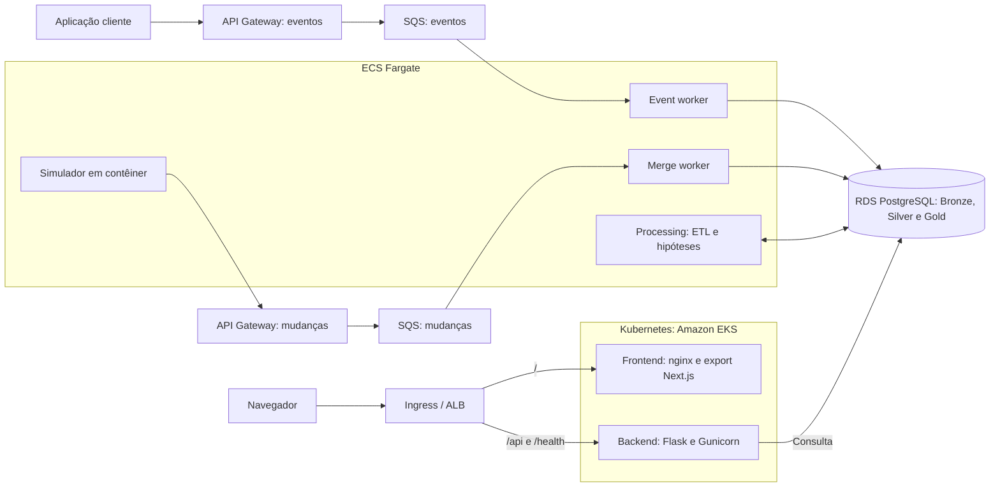

# Aplicação final: sistema distribuído de telemetria

&emsp; Esta documentação apresenta a aplicação final Linceu, do grupo Vale a Pena Ver de Novo, desenvolvida no projeto com o Grupo Globo. A implementação, identificada no repositório como Argus, reúne ingestão de telemetria, processamento incremental e investigação de degradações de streaming. O documento concentra a arquitetura distribuída, a execução dos componentes em contêineres, a orquestração com Kubernetes e os mecanismos de recuperação frente a falhas.

## 1. Vídeo de apresentação da aplicação distribuída

&emsp; Vídeo de apresentação: [ver vídeo](https://youtu.be/4U6GvE_Xhgw)

&emsp; A apresentação audiovisual complementa a documentação técnica com uma demonstração detalhada da aplicação distribuída. Seu escopo abrange os fluxos entre os componentes, a execução da API em Docker, a orquestração do frontend e do backend no Kubernetes, os serviços assíncronos no ECS Fargate e os mecanismos de recuperação após a perda de uma réplica. A consulta de dados históricos pela Timeline exemplifica o funcionamento integrado da interface, da API e da persistência na AWS.

## 2. Objetivo e funcionalidades

&emsp; A aplicação apoia a investigação de incidentes em uma cadeia de streaming monitorada por diferentes fontes. A proposta combina uma entrada padronizada para eventos com normalização, agregação e correlação temporal, permitindo consultar sinais e examinar hipóteses com suas evidências. O objetivo é reduzir a fragmentação da investigação entre player, CDN, backend e identidade.

&emsp; A ingestão recebe os seis tipos de evento do MVP: `request`, `screen_view`, `session`, `video_view`, `vitals` e `error`. Um segundo caminho recebe mudanças de registros de telemetria, representadas como eventos CDC. Ambos alimentam o PostgreSQL, mas possuem filas e consumidores próprios.

| Tela | Papel na investigação |
|---|---|
| Agora | Apresentação de sinais em desvio no período consultado. |
| Explorar | Exploração de métricas agregadas e consulta de eventos recentes de sessão. |
| Comparar | Comparação do volume de eventos com janelas de referência. |
| Hipóteses | Consulta de explicações candidatas, scores e evidências associadas. |
| Timeline | Reconstrução temporal dos sinais das fontes, com possibilidade de focar o instante de uma hipótese. |
| Recorte | Análise do escopo afetado por dimensões disponíveis nos dados. |

&emsp; As telas dependem dos dados disponíveis e da janela selecionada. Um recorte sem resultados representa uma consulta concluída sem registros elegíveis, enquanto erros de consulta possuem tratamento próprio. Hipóteses e scores apoiam a priorização da análise humana; não representam confirmação automática de causa raiz. As regras de domínio estão detalhadas no [artefato de hipóteses](./hipoteses.md).

## 3. Arquitetura distribuída

### 3.1 Fluxos de ingestão e consulta

&emsp; A arquitetura separa o caminho assíncrono de ingestão e processamento do caminho síncrono de consulta. O API Gateway recebe eventos e mudanças e os encaminha às filas SQS. Os workers no ECS Fargate persistem os registros, e o serviço de processamento transforma os dados e produz resultados analíticos. O dashboard e a API de consulta são executados no Amazon EKS Auto Mode, com entrada pelo Ingress e persistência compartilhada no Amazon RDS PostgreSQL.

&emsp; A Figura 1 resume essa divisão. As conexões ao banco representam responsabilidades de escrita ou leitura; o processamento das camadas ocorre dentro do serviço `processing`.

<div align="center">

<sub>Figura 1 - Fluxos principais da aplicação distribuída</sub>



<sup>Fonte: autoria própria (2026).</sup>

</div>

&emsp; O SQS desacopla a entrada do ritmo de consumo: uma rajada pode permanecer na fila enquanto os workers a processam. O Kubernetes atende ao caminho que precisa responder ao navegador, mantendo réplicas e controlando a disponibilidade dos pods. O Fargate preserva os consumidores assíncronos e seus papéis IAM por task. A escolha também considera as restrições de IAM do AWS Academy Learner Lab, registradas no [artefato de conteinerização](./conteineres-final.md).

### 3.2 Componentes e responsabilidades

| Componente | Responsabilidade | Forma de execução |
|---|---|---|
| Frontend | Interface de investigação, filtros e visualizações. | Imagem `frontend`, nginx servindo o export estático do Next.js em Deployment no EKS. |
| Backend | API de consulta em Flask, servida pelo Gunicorn; leitura controlada e feedback de hipóteses. | Imagem `backend`, Deployment no EKS. |
| Event worker | Consumo de eventos de sessão e gravação em `bronze.event`. | Imagem `worker`, comando `event`, serviço ECS Fargate. |
| Merge worker | Registro de mudanças e atualização da tabela corrente na mesma transação. | Imagem `worker`, comando `merge`, serviço ECS Fargate. |
| Processing | ETL incremental, qualidade das fontes, detector e motor determinístico de hipóteses. | Imagem `processing`, serviço ECS Fargate. |
| Simulator | Relógio virtual e reemissão das mudanças históricas. | Imagem `simulator`, serviço ECS Fargate, ativado conforme o cenário. |
| Loader | Carga inicial a partir de arquivos Parquet. | Imagem `loader`, task ECS avulsa que termina após a carga. |
| Jobs de banco | Aplicação de migrations e criação ou atualização do login de leitura. | Jobs Kubernetes que reutilizam a imagem `processing`. |
| PostgreSQL | Persistência das camadas de dados e coordenação da análise. | Serviço gerenciado Amazon RDS. |

&emsp; A imagem `worker` é compartilhada por dois serviços, diferenciados pelo comando de execução. O serviço `processing` reúne as etapas de análise no mesmo processo, enquanto os Jobs de banco reutilizam sua imagem para tarefas finitas. Simulator, loader e Jobs fazem parte da implementação, mas isso não implica que estejam permanentemente executando.

### 3.3 Camadas de dados e relógio virtual

&emsp; A camada Bronze conserva eventos e o histórico de mudanças; a Silver normaliza sinais e mantém fatos de análise; a Gold reúne agregações, qualidade, hipóteses e evidências. O schema `detect` registra o estado de execução do detector, incluindo checkpoints e coordenação dos ciclos de análise.

&emsp; Como o dataset contém dados históricos, o presente da aplicação é definido por `sim.now()`. As views de leitura aplicam a elegibilidade temporal dos registros por `available_at`, evitando a exposição de informações antes de sua disponibilidade simulada. O frontend utiliza esse relógio para ancorar consultas. A escolha de uma janela histórica permite investigar um caso armazenado mesmo quando a simulação está pausada.

## 4. Conteinerização e execução dos componentes

### 4.1 Construção das imagens

&emsp; Os [Dockerfiles da aplicação](../apps/fullstack/) separam construção e execução em múltiplos estágios. Essa técnica permite copiar os artefatos necessários para a imagem final sem incluir todas as ferramentas do estágio de construção, conforme a [documentação do Docker](https://docs.docker.com/build/building/multi-stage/) (DOCKER, [s.d.]). Nos serviços Python, os arquivos `uv.lock` orientam a instalação das dependências; no frontend, `npm ci` utiliza o `package-lock.json`.

| Imagem | Processo principal | Verificação de saúde |
|---|---|---|
| [backend](../apps/fullstack/backend/Dockerfile) | Gunicorn com dois workers e quatro threads por worker, porta 5000. | `/health/live` para o processo; `/health/ready` verifica a dependência de banco no Kubernetes. |
| [frontend](../apps/fullstack/frontend/Dockerfile) | nginx em porta 8080, servindo arquivos estáticos. | `/healthz`. |
| [worker](../apps/fullstack/worker/Dockerfile) | `python -m argus_worker`, com modo `event` ou `merge`. | Arquivo de heartbeat atualizado pelo ciclo do consumidor. |
| [processing](../apps/fullstack/processing/Dockerfile) | `python -m argus_processing`. | Arquivo de heartbeat. |
| [simulator](../apps/fullstack/simulator/Dockerfile) | `python -m argus_simulator`. | Arquivo de heartbeat. |
| [loader](../apps/fullstack/loader/Dockerfile) | `python -m argus_loader`. | Tarefa finita, sem `HEALTHCHECK` contínuo. |

&emsp; As imagens executam com usuários sem privilégio de root. Backend, frontend e processing possuem publicação para `amd64` e `arm64`, permitindo atender aos nós do cluster e aos ambientes locais; os componentes exclusivos do Fargate utilizam ARM64. As imagens publicadas são identificadas por tags vinculadas à revisão do código, e não por uma referência genérica `latest`.

### 4.2 Execução direta em Docker

&emsp; A execução local evidenciou a construção do backend com `make -C apps/fullstack image-backend` e sua execução no contêiner `argus-video-backend`, usando a imagem `argus-backend:dev`. A porta 15000 da interface local foi encaminhada à porta 5000 do contêiner. O registro de `docker ps` indicou estado `healthy`, e a consulta a `/health/live` retornou HTTP 200 com o corpo abaixo:

```json
{"status":"ok"}
```

&emsp; O [registro de execução Docker](./evidencias/aplicacao_final_2026_10_06/docker_execucao.txt) evidencia a execução do processo da API em contêiner Docker. O ensaio local não utilizou um banco de dados e, portanto, não comprova integração local com PostgreSQL. A consulta funcional com persistência foi demonstrada no ambiente AWS.

### 4.3 Estado observado na AWS

&emsp; As consultas ao ambiente AWS evidenciaram o EKS ativo, com Kubernetes 1.33, e o estado de execução dos componentes apresentado abaixo. As referências de imagem estão abreviadas para omitir o endereço do registro e identificadores da conta.

| Componente | Ambiente | Estado registrado | Imagem identificada |
|---|---|---|---|
| Backend | EKS | 2 réplicas desejadas, prontas e disponíveis; pods Running, Ready e sem reinícios. | `argus-events-dev-backend:326769cbb9d9` |
| Frontend | EKS | 2 réplicas desejadas, prontas e disponíveis; pods Running, Ready e sem reinícios. | `argus-events-dev-frontend:6b5fe5c6f213` |
| Event worker | ECS Fargate | 1 task desejada, 1 em execução e nenhuma pendente. | `argus-events-dev-worker:326769cbb9d9`, comando `event`. |
| Merge worker | ECS Fargate | 1 task desejada, 1 em execução e nenhuma pendente. | `argus-events-dev-worker:326769cbb9d9`, comando `merge`. |
| Processing | ECS Fargate | 1 task desejada, 1 em execução e nenhuma pendente. | `argus-events-dev-processing:326769cbb9d9`. |
| Simulator | ECS Fargate | Nenhuma task desejada ou em execução. | Imagem configurada, serviço pausado. |

&emsp; As tags de frontend e backend são diferentes, portanto não se atribui a todos os componentes uma única revisão implantada. Não havia Jobs Kubernetes presentes na consulta, e os registros não incluem uma execução do loader. Os registros sanitizados de [Kubernetes](./evidencias/aplicacao_final_2026_10_06/kubernetes.json), [serviços AWS e Docker](./evidencias/aplicacao_final_2026_10_06/execucao.json) e [task definitions](./evidencias/aplicacao_final_2026_10_06/task_definitions.json) evidenciam o estado de execução dos componentes.

## 5. Orquestração com Kubernetes

### 5.1 Objetos e roteamento

&emsp; Os manifestos em [k8s/base](../apps/fullstack/k8s/base/) descrevem o estado desejado da aplicação no namespace `argus`. Os Deployments controlam as réplicas e as atualizações dos pods, em consonância com o modelo descrito pela [documentação do Kubernetes](https://kubernetes.io/docs/concepts/workloads/controllers/deployment/) (KUBERNETES, [s.d.]a). Os Services fornecem os destinos internos utilizados pelo Ingress.

| Objeto | Configuração relevante | Efeito na operação |
|---|---|---|
| Deployments `argus-backend` e `argus-frontend` | Duas réplicas na base; `RollingUpdate`, `maxUnavailable: 0`, `maxSurge: 1`. | Reconciliação do número de pods e atualização gradual com uma réplica adicional permitida. |
| Service do backend | `ClusterIP`, porta 5000. | Roteamento interno para os pods da API. |
| Service do frontend | `ClusterIP`, porta 80 para a porta 8080 do contêiner. | Roteamento interno para o nginx. |
| Ingress `argus` | `/api` e `/health` para backend; `/` para frontend. | Dashboard e API publicados pela mesma origem. |
| HPA do backend | Mínimo 2, máximo 6; alvo de 60% de utilização de CPU. | Ajuste do número de réplicas conforme a métrica disponível. |
| HPA do frontend | Mínimo 2, máximo 4; alvo de 70% de utilização de CPU. | Ajuste independente da capacidade do dashboard. |
| PDB por aplicação | `minAvailable: 1`. | Limitação de interrupções voluntárias efetuadas pela API de eviction. |
| ConfigMap e Secret | Configuração operacional e valores sensíveis separados da imagem. | Implantação sem incorporar credenciais ao código ou ao bundle do frontend. |
| Jobs `argus-db-migrate` e `argus-db-reader` | Execução sequencial de tarefas de banco. | Preparação do schema e do login de leitura antes da operação da API. |

&emsp; Os objetos exercem funções complementares: o Deployment mantém réplicas, o Service seleciona os destinos e o Ingress expõe as rotas. O HPA ajusta a quantidade de pods, enquanto o provisionamento de nós pertence ao EKS Auto Mode. As consultas evidenciaram `ScalingActive=True` e `ValidMetricFound` em ambos os HPAs, com duas réplicas em cada Deployment. Esse estado comprova disponibilidade de métricas, mas não demonstra um aumento de escala.

### 5.2 Sondas e encerramento

&emsp; A aplicação diferencia startup, liveness e readiness, conforme a [documentação de sondas do Kubernetes](https://kubernetes.io/docs/tasks/configure-pod-container/configure-liveness-readiness-startup-probes/) (KUBERNETES, [s.d.]b). No backend, startup e liveness utilizam `/health/live`, que verifica o processo sem acessar o banco. A readiness utiliza `/health/ready`, permitindo retirar um pod do atendimento quando a dependência não responde, sem transformar a queda do banco em reinícios sucessivos de todos os processos.

&emsp; No frontend, as três sondas utilizam `/healthz`, pois o nginx serve arquivos estáticos. Os manifestos também definem `preStop` e períodos de encerramento para reduzir a interrupção de requisições em andamento durante atualizações. O funcionamento desses recursos depende da capacidade disponível e das condições do ambiente; sua presença não constitui garantia universal de ausência de erros.

## 6. Resiliência frente a falhas

### 6.1 Proteções no processamento assíncrono

&emsp; Os workers tratam reentregas com gravação idempotente. O merge worker registra o histórico e atualiza a tabela corrente na mesma transação, evitando divergência entre essas representações. Mensagens inválidas são encaminhadas à fila de rejeitados com o motivo; falhas transitórias podem resultar em novas tentativas.

&emsp; O processamento incremental conserva checkpoints e utiliza mecanismos de claim, lease, heartbeat e fencing para coordenar ciclos e proteger a publicação concorrente de resultados. A retomada é orientada pelo estado persistido. Esses mecanismos reduzem o risco de duplicação ou de resultados inconsistentes, sem eliminar a necessidade de observar filas, transações e dependências externas.

### 6.2 Ensaio de reposição de pod

&emsp; O ensaio de autocura no Kind local evidenciou a reposição de pod do backend durante carga k6. A comparação abaixo utiliza o [registro original](./evidencias/resiliencia-kind-01-autocura.txt) e os [resumos da rodada A](./evidencias/resiliencia-kind/k6-01-A-1replica.summary.json) e da [rodada B](./evidencias/resiliencia-kind/k6-01-B-2replicas.summary.json).

| Cenário | Tempo da exclusão até o novo pod Ready | Requisições registradas | Falhas registradas |
|---|---|---|---|
| Uma réplica do backend, removida durante o ensaio | 8,3 segundos | 2.470 | 354, aproximadamente 14,3%. |
| Duas réplicas do backend, com uma removida durante o ensaio | 6,2 segundos | 2.262 | 0. |

&emsp; A comparação evidencia a diferença entre recompor a capacidade e manter atendimento durante a recomposição. Com uma réplica, houve um intervalo sem pod pronto; com duas, a réplica remanescente sustentou o tráfego observado. Os volumes e as durações das rodadas diferem, portanto a tabela não é um benchmark isolado do número de réplicas. Os tempos e as taxas pertencem ao ensaio local e não são medições de recuperação no EKS.

### 6.3 Limites das proteções e da validação

&emsp; O PDB limita interrupções voluntárias realizadas pela API de eviction, conforme a [documentação de interrupções do Kubernetes](https://kubernetes.io/docs/concepts/workloads/pods/disruptions/) (KUBERNETES, [s.d.]c). Ele não impede a exclusão direta de um pod e não garante proteção contra falhas abruptas de nó ou de zona. A continuidade também depende de réplicas prontas, distribuição dos pods, capacidade para reagendamento e disponibilidade do banco.

&emsp; Os ensaios de [rollout e rollback](./evidencias/resiliencia-kind-02-rollout-e-undo.txt) e de [perda do banco local](./evidencias/resiliencia-kind-03-perda-do-banco.txt) complementam as evidências de resiliência no ambiente local. As consultas ao ambiente AWS não incluíram injeção de falhas. Testes de perda de zona, restauração de RDS e aumento efetivo de escala no EKS exigem validações próprias; as limitações e os procedimentos estão registrados na seção 3 da [arquitetura final](./arquitetura-final.md).

## 7. Demonstração funcional, segurança e operação

### 7.1 Consulta de dados históricos na AWS

&emsp; A execução integrada na AWS evidenciou a consulta autenticada à Timeline centrada na hipótese `2873`, em uma janela histórica de três horas. A interface apresentou sinais nas seis fontes: NPAW, Prometheus, New Relic, Apollo, Tsuru e ServiceNow, demonstrando a consulta de dados históricos pela aplicação.

&emsp; O relógio virtual permaneceu pausado. As telas ancoradas nesse presente estavam sem resultados nos recortes consultados; a navegação para uma janela histórica exibiu dados existentes, sem nova carga ou alteração do relógio. A execução evidenciou a leitura integrada entre interface, API e persistência.

### 7.2 Controles de segurança e observabilidade

&emsp; As APIs exigem token Bearer, com exceção do endpoint público de liveness. O token do dashboard permanece na sessão do navegador e não integra a imagem estática. O backend utiliza um login de banco com acesso às views permitidas; o feedback de hipótese é executado por função controlada. Os pods possuem configuração para execução sem root, sistema de arquivos raiz somente para leitura e remoção de capabilities.

&emsp; Os serviços ECS utilizam logs no CloudWatch; os serviços Python incluem registros estruturados e mecanismos de heartbeat. Os pods Kubernetes podem ser inspecionados com `kubectl`, enquanto Prometheus, Grafana e k6 dão apoio aos ensaios locais. A coleta centralizada do EKS não deve ser presumida como habilitada apenas pela existência desses recursos, conforme as limitações registradas na [arquitetura final](./arquitetura-final.md).

### 7.3 Localização do código e reprodução

&emsp; O [Makefile](../apps/fullstack/Makefile) concentra os comandos operacionais. O [runbook Kubernetes](../apps/fullstack/k8s/README.md) descreve a configuração de contexto, os overlays AWS e Kind, a preparação do banco e a aplicação dos manifestos. A infraestrutura está descrita no [Terraform](../apps/fullstack/infra/), e os [Dockerfiles](../apps/fullstack/) documentam os processos e suas dependências.

```bash
# Construção local da imagem do backend
make -C apps/fullstack image-backend

# Inspeção do contêiner de demonstração, se presente no ambiente local
docker ps -a --filter name=argus-video-backend

# Inspeção dos recursos no contexto Kubernetes previamente configurado
make -C apps/fullstack k8s-status
kubectl -n argus get deployments,pods,services
kubectl -n argus get hpa,pdb

# Validação dos manifestos sem aplicação no cluster
make -C apps/fullstack k8s-validate
```

&emsp; Os comandos devem ser executados a partir da raiz do repositório, com as ferramentas e o contexto necessários. Credenciais, tokens, endpoints e identificadores de conta são configurados fora dos artefatos versionados. A consulta de estado não substitui os procedimentos de implantação; ações de carga, publicação ou mudança de infraestrutura seguem o runbook e dependem do cenário de operação.

## 8. Referências

&emsp; DOCKER. Multi-stage builds. [s.d.]. Disponível em: <https://docs.docker.com/build/building/multi-stage/>. Acesso em: 6 out. 2026.

&emsp; KUBERNETES. Deployments. [s.d.]a. Disponível em: <https://kubernetes.io/docs/concepts/workloads/controllers/deployment/>. Acesso em: 6 out. 2026.

&emsp; KUBERNETES. Configure Liveness, Readiness and Startup Probes. [s.d.]b. Disponível em: <https://kubernetes.io/docs/tasks/configure-pod-container/configure-liveness-readiness-startup-probes/>. Acesso em: 6 out. 2026.

&emsp; KUBERNETES. Disruptions. [s.d.]c. Disponível em: <https://kubernetes.io/docs/concepts/workloads/pods/disruptions/>. Acesso em: 6 out. 2026.
