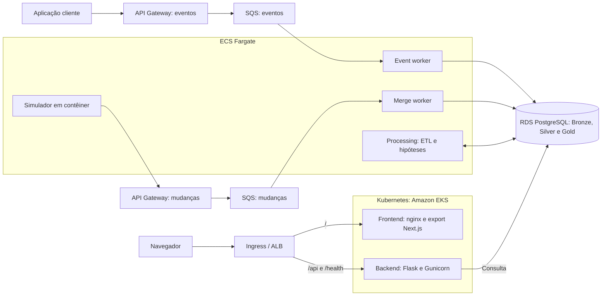

# Aplicação final: sistema distribuído de telemetria

&emsp; Esta documentação apresenta a aplicação final Linceu, do grupo Vale a Pena Ver de Novo, desenvolvida no projeto com o Grupo Globo. A implementação, identificada no repositório como Argus, reúne ingestão de telemetria, processamento incremental e investigação de degradações de streaming. O documento concentra a arquitetura distribuída, a execução dos componentes em contêineres, a orquestração com Kubernetes e os mecanismos de recuperação frente a falhas.

## 1. Vídeo de apresentação da aplicação distribuída

**Vídeo de apresentação:** [ver vídeo](https://youtu.be/4U6GvE_Xhgw)

&emsp; A apresentação audiovisual complementa a documentação técnica com uma demonstração detalhada da aplicação distribuída. Seu escopo abrange os fluxos entre os componentes, a execução da API em Docker, a orquestração do frontend e do backend no Kubernetes, os serviços assíncronos no ECS Fargate e os mecanismos de recuperação após a perda de uma réplica. A consulta de dados históricos pela Timeline exemplifica o funcionamento integrado da interface, da API e da persistência na AWS.

## 2. Objetivo e funcionalidades

&emsp; A aplicação apoia a investigação de incidentes em uma cadeia de streaming monitorada por diferentes fontes. A proposta combina uma entrada padronizada para eventos com normalização, agregação e correlação temporal, permitindo consultar sinais e examinar hipóteses com suas evidências. O objetivo é reduzir a fragmentação da investigação entre player, CDN, backend e identidade.

&emsp; A ingestão recebe os seis tipos de evento do MVP: `request`, `screen_view`, `session`, `video_view`, `vitals` e `error`. Um segundo caminho recebe mudanças de registros de telemetria, representadas como eventos CDC. Ambos alimentam o PostgreSQL, mas possuem filas e consumidores próprios.

| Tela | Papel na investigação |
|---|---|
| Agora | Apresentação de sinais em desvio no período consultado. |
| Explorar | Exploração de métricas agregadas e consulta de eventos recentes de sessão. |
| Comparar | Comparação do volume de eventos com janelas de referência. |
| Hipóteses | Consulta de explicações candidatas, scores e evidências associadas. |
| Timeline | Reconstrução temporal dos sinais das fontes, com possibilidade de focar o instante de uma hipótese. |
| Recorte | Análise do escopo afetado por dimensões disponíveis nos dados. |

&emsp; As telas dependem dos dados disponíveis e da janela selecionada. Um recorte sem resultados representa uma consulta concluída sem registros elegíveis, enquanto erros de consulta possuem tratamento próprio. Hipóteses e scores apoiam a priorização da análise humana; não representam confirmação automática de causa raiz. As regras de domínio estão detalhadas no [artefato de hipóteses](./hipoteses.md).

## 3. Arquitetura distribuída

### 3.1 Fluxos de ingestão e consulta

&emsp; A arquitetura separa o caminho assíncrono de ingestão e processamento do caminho síncrono de consulta. O API Gateway recebe eventos e mudanças e os encaminha às filas SQS. Os workers no ECS Fargate persistem os registros, e o serviço de processamento transforma os dados e produz resultados analíticos. O dashboard e a API de consulta são executados no Amazon EKS Auto Mode, com entrada pelo Ingress e persistência compartilhada no Amazon RDS PostgreSQL.

&emsp; A Figura 1 resume essa divisão. As conexões ao banco representam responsabilidades de escrita ou leitura; o processamento das camadas ocorre dentro do serviço `processing`.

Figura 1 - Fluxos principais da aplicação distribuída

Fonte: elaboração do grupo a partir do código e dos manifestos da aplicação (2026).

&emsp; O SQS desacopla a entrada do ritmo de consumo: uma rajada pode permanecer na fila enquanto os workers a processam. O Kubernetes atende ao caminho que precisa responder ao navegador, mantendo réplicas e controlando a disponibilidade dos pods. O Fargate preserva os consumidores assíncronos e seus papéis IAM por task. A escolha também considera as restrições de IAM do AWS Academy Learner Lab, registradas no [artefato de conteinerização](./conteineres-final.md).

### 3.2 Componentes e responsabilidades

| Componente | Responsabilidade | Forma de execução |
|---|---|---|
| Frontend | Interface de investigação, filtros e visualizações. | Imagem `frontend`, nginx servindo o export estático do Next.js em Deployment no EKS. |
| Backend | API de consulta em Flask, servida pelo Gunicorn; leitura controlada e feedback de hipóteses. | Imagem `backend`, Deployment no EKS. |
| Event worker | Consumo de eventos de sessão e gravação em `bronze.event`. | Imagem `worker`, comando `event`, serviço ECS Fargate. |
| Merge worker | Registro de mudanças e atualização da tabela corrente na mesma transação. | Imagem `worker`, comando `merge`, serviço ECS Fargate. |
| Processing | ETL incremental, qualidade das fontes, detector e motor determinístico de hipóteses. | Imagem `processing`, serviço ECS Fargate. |
| Simulator | Relógio virtual e reemissão das mudanças históricas. | Imagem `simulator`, serviço ECS Fargate, ativado conforme o cenário. |
| Loader | Carga inicial a partir de arquivos Parquet. | Imagem `loader`, task ECS avulsa que termina após a carga. |
| Jobs de banco | Aplicação de migrations e criação ou atualização do login de leitura. | Jobs Kubernetes que reutilizam a imagem `processing`. |
| PostgreSQL | Persistência das camadas de dados e coordenação da análise. | Serviço gerenciado Amazon RDS. |

&emsp; A imagem `worker` é compartilhada por dois serviços, diferenciados pelo comando de execução. O serviço `processing` reúne as etapas de análise no mesmo processo, enquanto os Jobs de banco reutilizam sua imagem para tarefas finitas. Simulator, loader e Jobs fazem parte da implementação, mas isso não implica que estejam permanentemente executando.

### 3.3 Camadas de dados e relógio virtual

&emsp; A camada Bronze conserva eventos e o histórico de mudanças; a Silver normaliza sinais e mantém fatos de análise; a Gold reúne agregações, qualidade, hipóteses e evidências. O schema `detect` registra o estado de execução do detector, incluindo checkpoints e coordenação dos ciclos de análise.

&emsp; Como o dataset contém dados históricos, o presente da aplicação é definido por `sim.now()`. As views de leitura aplicam a elegibilidade temporal dos registros por `available_at`, evitando a exposição de informações antes de sua disponibilidade simulada. O frontend utiliza esse relógio para ancorar consultas. A escolha de uma janela histórica permite investigar um caso armazenado mesmo quando a simulação está pausada.
