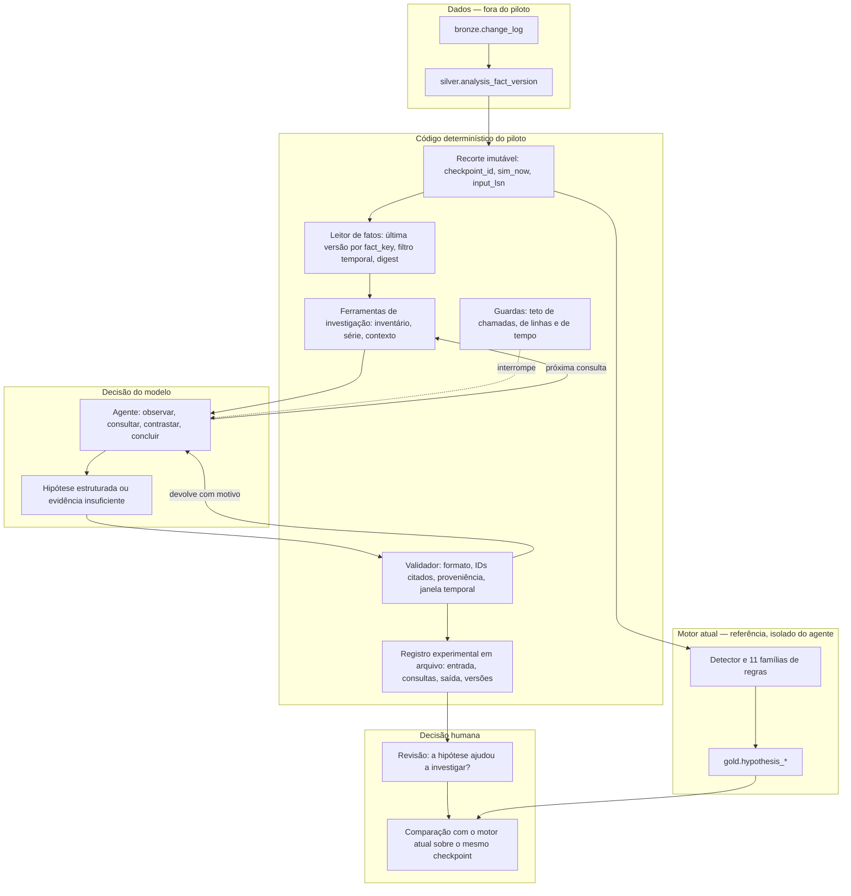
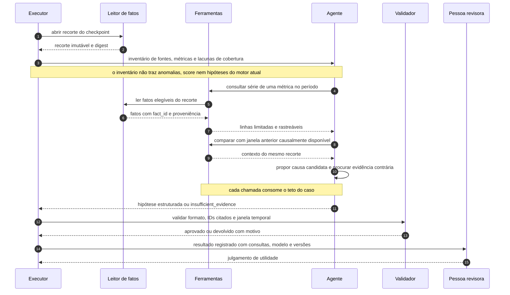

# Arquitetura inicial do agente de hipóteses com IA

> Proposta de MVA — Dia 1. Este documento descreve uma alternativa experimental;
> não representa comportamento já implementado ou publicado no Argus.

## 1. Problema e primeira adição de valor

O motor atual detecta anomalias e gera hipóteses por 11 famílias de regras. A
alternativa proposta começa antes dessa geração: um agente investiga os fatos
disponíveis em um checkpoint e formula suas próprias explicações candidatas.
Ele não recebe as anomalias, os candidatos, o score ou as hipóteses do motor
atual. A primeira adição de valor é produzir, para **um recorte de incidente**,
uma hipótese verificável com referências aos fatos consultados, ou declarar que
a evidência é insuficiente. A decisão sobre a causa continua humana.

As duas abordagens podem ser comparadas depois sobre o mesmo checkpoint. A
comparação não transforma a saída do motor atual em resposta correta para a IA.

## 2. Fatos que o agente poderá consultar

### Fonte e unidade de observação

A fonte proposta é `silver.analysis_fact_version`, que normaliza mudanças do
`bronze.change_log`. O identificador de uma observação é
`(fact_key, version_lsn)`. O [contrato `Fact`](../apps/fullstack/processing/src/argus_processing/domain.py)
contém `role`, `kind`, `event_start`, `event_end`, `available_at`, `source`,
`entity`, `metric`, `dimension_type`, `dimension_value`, `value`, `sample_size`
e `attributes`. Esses campos descrevem um fato; nenhum deles é, por si só, uma
causa confirmada.

O recorte deve ser fixado por `checkpoint_id`, `sim_now` e `input_lsn`. Para cada
`fact_key`, somente a última versão com `version_lsn <= input_lsn` pode entrar;
ela precisa ter `available_at <= sim_now`, `event_start <= sim_now` e não estar
marcada como excluída. O agente vê um conjunto imutável ao longo da investigação.
Reexecuções devem registrar um digest desse conjunto. A seleção atual do
processamento em [`claim_and_capture`](../apps/fullstack/processing/src/argus_processing/analysis_repository.py)
serve de referência para essas invariantes, mas o agente não deve tomar posse
do cursor nem reutilizar o commit protegido do motor determinístico.

### Categorias iniciais

| Categoria consultável | Fatos normalizados disponíveis | Pergunta que ajuda a investigar |
|---|---|---|
| Métricas de serviço e infraestrutura | Buckets de sinais de Prometheus, New Relic, Apollo e fontes afins | O erro, a latência ou a saúde do serviço mudou no período? |
| Borda e proteção | Volume e taxas 4xx/5xx do RPaaS; sinais do Cloud Armor | A degradação aparece na borda ou em bloqueios? |
| Mudanças operacionais | Deploys e eventos do Tsuru | Houve mudança temporalmente próxima ao efeito? |
| Experiência de reprodução | Player, dispositivo, geografia, QoE, sessões ativas e erros de reprodução | O impacto aparece em quais recortes de usuários? |
| Contexto editorial | Eventos ao vivo e sua janela | O aumento de volume coincide com programação esperada? |

Este é um catálogo de **tipos de fato**, não uma lista de tabelas liberadas para
SQL arbitrário. A interface do agente deverá devolver somente campos
selecionados, com identificador e proveniência. `attributes` exige seleção
explícita por fonte antes de chegar ao modelo, para evitar carga irrelevante ou
identificadores de usuário. O conjunto exato de métricas e atributos aceitos
fica para o contrato de ferramentas do Dia 2.

### Limites semânticos dos dados

- UF e ISP são dimensões marginais separadas. O agente não pode afirmar um
  cruzamento `UF × ISP` ausente dos dados.
- Valores `?` e `(desconhecido)` não definem um recorte confiável.
- Latências percentis nulas do RPaaS não devem ser apresentadas como medidas.
- Um 4xx do RPaaS não identifica sozinho falha de autorização de playback;
  isso depende do vhost catalogado.
- Fatos NPAW/Youbora podem chegar com atraso causal de 28 horas. Mesmo se o
  evento ocorreu antes, só entram após `available_at`.
- `incidents` e `incident_label` são material de avaliação retrospectiva,
  **não** entrada online do agente. Também ficam fora as anomalias,
  `gold.hypothesis_*`, feedback e scores do motor atual.

### Forma mínima entregue ao agente

Cada resposta de consulta deverá oferecer pelo menos:

```json
{
  "fact_id": "fact_key:version_lsn",
  "source": "nome-da-fonte",
  "kind": "metric",
  "entity": "entidade-catalogada",
  "metric": "metrica-catalogada",
  "event_start": "instante-do-evento",
  "available_at": "instante-de-disponibilidade",
  "value": 0,
  "sample_size": 0,
  "dimension_type": null,
  "dimension_value": null
}
```

O exemplo é um formato, não um registro real. Valores ausentes continuam
ausentes; não são convertidos em zero. Consultas agregadas devem trazer os
identificadores dos fatos que contribuíram para o resultado ou uma referência
estável ao conjunto, para permitir conferência posterior.

## 3. Arquitetura do piloto

Esta seção fixa o desenho do piloto: quais peças existem, por onde passa uma
investigação e onde está a fronteira entre código determinístico e modelo. Dois
termos aparecem o tempo todo. **Ferramenta** é uma função fechada que o agente
pode chamar, com parâmetros declarados e resposta de formato conhecido — não é
acesso ao banco nem SQL livre. **Teto** é um limite numérico aplicado pelo
executor, fora do alcance do modelo, que encerra a investigação quando é
atingido.

### 3.1 Decisão de arquitetura do Dia 1 — grau de autonomia

A decisão central do Dia 1 é quanta liberdade a investigação tem. O piloto adota
**autonomia limitada por ferramentas e teto**: o agente escolhe o que investigar,
em que ordem e quando parar, mas só enxerga os dados através de um conjunto
pequeno de ferramentas declaradas e só age dentro de um número máximo de chamadas
por caso.

Duas alternativas foram descartadas:

| Alternativa | Por que não entra no piloto |
|---|---|
| Entregar um bloco de contexto pronto e pedir a hipótese em uma única chamada | O agente não investigaria; quem escolheria as evidências seria quem montou o bloco, e a comparação com o motor atual mediria essa escolha, não o modelo. |
| Dar acesso amplo, com SQL livre ou catálogo aberto de tabelas | Transformaria o piloto em plataforma genérica de agentes, abriria vazamento temporal e acesso a rótulos de incidente, e não cabe em sete dias. |

A autonomia limitada preserva o que se quer testar — se o modelo encontra desvios
e formula explicações próprias — sem abrir o banco nem o calendário do projeto.

### 3.2 Diagrama de componentes



A seta tracejada do bloco de guardas é a única forma de o piloto parar o agente:
nada no prompt depende de o modelo respeitar o próprio limite. A seta de
`gold.hypothesis_*` chega apenas na comparação, depois da revisão humana — não há
caminho dela para o agente, e é isso que impede o piloto de copiar a resposta do
motor atual.

Duas interfaces concentram o desenho. O **leitor de fatos** é a costura principal
do piloto — a única fronteira por onde os dados entram: recebe a identidade do
checkpoint e devolve um recorte imutável com funções de consulta limitadas,
escondendo SQL, versionamento e seleção temporal de todo o resto. O **agente**
aparece atrás de uma assinatura igualmente pequena,
`investigar(recorte, ferramentas) -> resultado`, o que permite trocar modelo,
prompt ou estratégia sem mexer no restante do piloto. A seleção de trabalho em
[`claim_and_capture`](../apps/fullstack/processing/src/argus_processing/analysis_repository.py)
serve de referência para as invariantes temporais do recorte, mas o piloto não
reaproveita seu cursor nem seu commit protegido.

### 3.3 Fluxo de uma investigação



O ciclo tem quatro fases, e o agente pode voltar da terceira para a segunda
enquanto houver orçamento:

1. **Orientação.** O agente recebe o inventário do recorte e escolhe por onde
   começar. Nenhuma métrica vem marcada como suspeita.
2. **Levantamento.** O agente pede séries e contexto. Toda resposta devolve os
   identificadores dos fatos que a sustentam.
3. **Contraste.** O agente propõe uma causa candidata e procura, no mesmo
   recorte, uma observação que a derrube. Hipótese sem tentativa de refutação
   registrada é tratada como incompleta.
4. **Conclusão.** O agente entrega a hipótese com evidências a favor e contra, as
   lacunas que encontrou e o histórico de consultas, ou declara
   `insufficient_evidence`.

A investigação termina por uma de quatro razões, todas registradas: conclusão do
agente, declaração de evidência insuficiente, teto atingido ou saída rejeitada
pelo validador mais de uma vez. As duas últimas viram limitação do piloto no
registro, nunca hipótese apresentada.

## 4. Responsabilidades e decisões

### 4.1 Responsabilidade por componente

| Componente | Decide | Não decide |
|---|---|---|
| Leitor de fatos | Quais fatos existem no recorte, por versão e disponibilidade temporal | O que é relevante, o que é anômalo |
| Ferramentas | Que recortes podem ser pedidos, em que formato e com qual limite de linhas | Qual pergunta vale a pena fazer |
| Guardas | Quando a investigação acaba por esgotamento de orçamento | Se a resposta obtida é boa |
| Agente | O que investigar, em que ordem, qual explicação propor e quando parar | O que está disponível, o que é verdade, o que é publicado |
| Validador | Se a saída é bem formada, citável e temporalmente legítima | Se a causa sugerida é correta |
| Registro | O que fica gravado para auditoria e reexecução | Qualquer leitura de qualidade |
| Pessoa revisora | Se a hipótese ajudou, se o piloto continua, qual ação tomar | Nada que o código já garante por construção |

### 4.2 Decisões que cabem à IA

- Por onde começar a investigação, a partir do inventário.
- Qual consulta fazer em seguida, em função do que já observou.
- Qual explicação candidata propor e com que escopo — serviço, região,
  dispositivo ou canal.
- Qual observação poderia derrubar a própria hipótese, e pedi-la.
- Quando a evidência basta e quando responder `insufficient_evidence`.
- Como redigir a justificativa, citando os fatos consultados.
- Quais lacunas de dados declarar como limitação da investigação.

### 4.3 Decisões que não cabem à IA

| Decisão | Onde ela fica |
|---|---|
| O que é visível no recorte, incluindo o corte por `sim_now` e `input_lsn` | Leitor de fatos |
| Quais ferramentas existem e o que cada uma devolve | Contrato de ferramentas, fechado no Dia 2 |
| Quantas chamadas, quantas linhas e quanto tempo um caso pode consumir | Guardas do executor |
| Se um `fact_id` citado existe e pertence ao recorte | Validador |
| Qual é o formato aceito da resposta | Contrato de saída, fechado no Dia 2 |
| Se a causa proposta é verdadeira | Pessoa revisora |
| Se o resultado vira hipótese do produto | Decisão de projeto, fora do piloto |

Três exclusões sustentam a comparação e precisam valer em código, não em
instrução de prompt: o agente não recebe anomalias, candidatos, score ou
hipóteses do motor atual; não recebe `incidents`, `incident_label` nem feedback
humano; e não recebe fato algum com `available_at` posterior ao `sim_now` do
recorte. Se qualquer uma falhar, o resultado da comparação perde sentido.

## 5. Limites do piloto

### 5.1 Limites de execução

Os números abaixo são a proposta do Dia 1 e existem para forçar investigação
curta e auditável. Eles podem ser ajustados no Dia 5, com o motivo registrado.

| Limite | Valor proposto | Razão |
|---|---|---|
| Casos por execução | 1 checkpoint e 1 recorte | Mantém o digest do conjunto estável e a reexecução comparável. |
| Ferramentas expostas | 3 | Inventário, série e contexto cobrem o ciclo sem virar plataforma. |
| Chamadas de ferramenta por caso | 12 | Permite algumas idas e voltas e impede investigação indefinida. |
| Linhas por resposta | 200, com agregação ou paginação acima disso | Evita despejar a janela inteira no modelo. |
| Tempo de parede por caso | 5 minutos | Torna o lote do Dia 5 executável em uma sessão. |
| Devoluções do validador | 1 nova tentativa | Separa erro de formatação de incapacidade de responder. |

Ao atingir qualquer teto, o executor encerra o caso e grava o motivo. Um caso
encerrado por teto não produz hipótese apresentável.

### 5.2 Limites de acesso

- Somente leitura. O piloto não escreve em `silver`, `gold` ou `detect`, não toma
  posse do cursor de progresso e não reutiliza o commit protegido do motor
  determinístico.
- O modelo não recebe credenciais de banco, string de conexão nem SQL livre.
- A forma de acesso ao banco fica para o Dia 2. As permissões atuais do
  `argus_reader` cobrem apenas views públicas e não autorizam supor leitura
  direta de `silver.analysis_fact_version`.
- `attributes` só chega ao modelo com seleção explícita por fonte, sem
  identificadores de usuário.
- O registro do piloto é arquivo local em JSON ou Markdown. Nada é publicado em
  tabela de produção, API ou frontend.

### 5.3 Fora do piloto

Ficam de fora, e seguem decisões de projeto posteriores: integração com a API e
com o frontend, novas permissões de banco ou migração de schema, métrica de
qualidade calculada automaticamente, treino ou ajuste de modelo, uso de rótulos
de incidente como entrada, e qualquer ação operacional derivada de uma hipótese
do agente. O refinador Ollama já presente na API continua apenas redigindo
respostas a partir de hipóteses publicadas pelo motor atual, e não participa
deste fluxo.

## 6. Escopo do MVA e decisões seguintes

**Valor a demonstrar:** em um caso selecionado, o agente produz uma explicação
que um investigador consegue conferir abrindo as evidências citadas, ou expõe
honestamente a falta de dados. O primeiro protótipo pode ser executado por CLI
e registrar JSON/Markdown local; não precisa de tela, tabela de produção ou
publicação automática.

**Fora do Dia 1:** escolha de modelo e provedor, prompt final e primeira
execução ponta a ponta. Os limites gerais do piloto estão na seção 5; esta seção
trata apenas do que o Dia 1 não fecha.

No Dia 2, fechar quatro decisões para implementação paralela por duas pessoas:

| Decisão | Responsável sugerido | Critério de aceite |
|---|---|---|
| Interface e acesso ao recorte de fatos | Pessoa dos dados | Mesmo checkpoint produz o mesmo conjunto e não expõe futuro. |
| Ferramentas de consulta e limites | Pessoa dos dados, com revisão conjunta | Cada resposta é limitada, paginável ou agregada e rastreável a fatos. |
| Formato da hipótese e estratégia de investigação | Pessoa do agente | A saída cita fatos a favor/contra e admite insuficiência. |
| Casos de avaliação | Ambas | Casos cobrem evidência suficiente, contraditória e fonte atrasada. |

O protótipo deve permanecer em execução experimental separada. O guia do
`apps/fullstack/processing` preserva o ciclo atual como determinístico; uma
integração produtiva requer uma decisão arquitetural posterior e validação com
os responsáveis pelo projeto.
