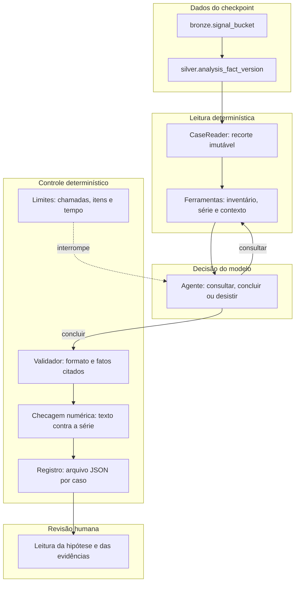

# Arquitetura do agente de hipóteses com IA

&emsp; Este documento explica como o agente de hipóteses funciona, por que ele foi desenhado dessa forma e onde cada parte está implementada no repositório. O agente é uma execução experimental que roda separada do motor determinístico do Argus. Os formatos exatos de entrada e saída, com exemplos de JSON, estão no [contrato do agente](contrato-agente-hipoteses.md).

## 1. O problema que o agente tenta resolver

&emsp; O Argus detecta anomalias e explica cada uma delas com 11 famílias de regras escritas à mão. Por exemplo, se um deploy aconteceu pouco antes de o erro subir, o motor sugere uma possível regressão causada pelo deploy. Esse método é previsível e fácil de auditar, mas só enxerga as explicações que alguém pensou em escrever como regra.

&emsp; O agente testa outra abordagem. Ele recebe os mesmos dados que o motor teria naquele instante e investiga por conta própria: escolhe o que consultar, em que ordem, e formula uma explicação candidata. O resultado é uma hipótese com as evidências citadas, ou a declaração de que os dados não bastam. A decisão sobre a causa continua sendo de uma pessoa.

&emsp; Um princípio atravessa todo o desenho: o agente nunca vê a resposta do motor atual. Ele não recebe anomalias, scores, hipóteses publicadas nem incidentes já rotulados. Se recebesse, estaria copiando a resposta em vez de investigar, e a comparação entre as duas abordagens não significaria nada.

## 2. Visão geral do fluxo

&emsp; Uma investigação passa por cinco etapas. Primeiro, o momento da análise é fixado em um checkpoint. Depois, um leitor monta uma fotografia imutável dos fatos disponíveis naquele momento. Em seguida, o agente faz perguntas a essa fotografia por meio de três ferramentas. Ao final, ele entrega uma conclusão, que passa por validação e por uma checagem numérica antes de ser registrada.



&emsp; O diagrama mostra a separação central do piloto. Os blocos determinísticos decidem o que o agente pode ver e o que acontece com a resposta dele. O modelo decide apenas o que perguntar e o que concluir. Nenhum bloco de controle depende de o modelo cumprir uma regra que está escrita no texto do prompt.

## 3. O que o agente enxerga

&emsp; Um fato é uma observação de uma fonte. Pode ser o erro 5xx de um serviço em um intervalo de 15 minutos, ou um deploy registrado pela plataforma. Cada fato tem dois instantes. O instante do evento diz quando ele aconteceu. O instante de disponibilidade diz quando a informação chegaria ao sistema. A diferença existe porque algumas fontes demoram para entregar os dados, e o agente só pode usar um fato depois que ele estaria disponível.

&emsp; Um checkpoint é um ponto de corte no tempo. Ele guarda o instante simulado em que a análise acontece, chamado `sim_now`, e a versão mais recente dos dados que já tinham chegado até ali, identificada pelo `input_lsn`. Tudo que aconteceu depois desse instante, ou que ainda não tinha chegado, fica fora da investigação.

&emsp; A montagem desse recorte acontece no construtor do leitor. Ele percorre todos os fatos do checkpoint e mantém só a versão mais recente de cada um. Descarta qualquer versão posterior ao `input_lsn`, qualquer fato disponível depois do `sim_now` e qualquer fato apagado na origem:

```python
if (
    fact["version_lsn"] > self.input_lsn
    or _instant(fact["available_at"]) > self.sim_now
    or _instant(fact["event_start"]) > self.sim_now
):
    continue
```

&emsp; O trecho está em [leitor.py](../apps/fullstack/agente/src/argus_agente/leitor.py), dentro de `CaseReader.__init__`. O conjunto que sobra é congelado e recebe um digest, um resumo que muda se qualquer fato ou papel mudar. Duas execuções com o mesmo digest enxergaram exatamente os mesmos dados, o que torna a reexecução comparável.

&emsp; O atraso fica mais claro com um exemplo real. No checkpoint 12, usado nos testes com dado real, a série de erros da rpaas tem latência de 15 minutos. Um bucket com evento às 19h45 só fica disponível às 20h00. Com o presente simulado às 19h55, esse bucket simplesmente não existe para o agente.

&emsp; Os fatos se dividem em dois tipos. Fatos de métrica são séries numéricas, como taxa de erro, volume de requisições ou tempo de resposta. Fatos de contexto são eventos com início e, quando conhecido, fim, como deploys e transmissões ao vivo.

&emsp; Algumas cautelas vêm da natureza dos dados. Dimensões como UF e ISP são recortes separados, e o agente não pode afirmar um cruzamento entre elas que não existe nos dados. Os valores `?` e `(desconhecido)` não definem um recorte confiável. Um erro 4xx da rpaas, sozinho, não prova falha de autorização de reprodução. Fatos da NPAW podem chegar com até 28 horas de atraso. Anomalias, hipóteses publicadas, feedback humano e incidentes rotulados nunca entram nessa leitura.

## 4. Como uma investigação acontece

&emsp; Ao abrir o caso, o executor entrega ao modelo uma mensagem inicial com o recorte, as ferramentas disponíveis, o orçamento e o inventário. A mensagem é montada em [prompt.py](../apps/fullstack/agente/src/argus_agente/prompt.py), na função `mensagem_de_abertura`, e é gravada exatamente como foi enviada, para que qualquer resultado possa ser conferido depois.

&emsp; O inventário é a única visão global que o modelo recebe. Ele diz, para cada série, quantos pontos existem, em que intervalo de tempo aparecem e se há valores nulos. Não diz quais séries parecem anormais. Marcar uma série como suspeita seria fazer a própria escolha que o piloto quer observar o modelo fazer.

&emsp; Depois da abertura, o modelo responde um passo por vez. Cada passo é um objeto JSON com uma de três ações: consultar uma ferramenta, concluir com uma hipótese ou desistir, declarando o que faltou. A investigação só continua enquanto o modelo estiver consultando.

&emsp; O núcleo do ciclo está na função `investigar`, em [agente.py](../apps/fullstack/agente/src/argus_agente/agente.py). A cada volta, ela pede um passo ao modelo, valida esse passo, executa a consulta se for o caso e devolve o resultado ao modelo como uma nova mensagem. O laço termina quando o modelo conclui ou desiste, ou quando um dos limites de orçamento interrompe a investigação.

&emsp; Cada investigação termina em um de cinco desfechos, todos gravados. Pode haver uma hipótese aprovada, uma declaração de evidência insuficiente, orçamento esgotado, duas respostas seguidas fora do formato, ou um erro de execução, como um modelo indisponível. Os três últimos são limitações do piloto e não produzem hipótese. Eles aparecem no relatório como os outros casos, porque um relatório que esconde falhas não serve para avaliar o piloto.

## 5. As três ferramentas de leitura

&emsp; O agente não escreve consultas. Ele escolhe entre três ferramentas, cada uma com parâmetros declarados. Nenhuma aceita SQL, nome de tabela ou um horário posterior ao presente simulado. Todas são implementadas no leitor, e quem escolhe a função certa pelo nome é o despacho em [ferramentas.py](../apps/fullstack/agente/src/argus_agente/ferramentas.py):

```python
def despachar(ferramentas, nome, argumentos):
    metodo = getattr(ferramentas, nome, None)
    if metodo is None or nome.startswith("_"):
        raise FerramentaIndisponivel(f"ferramenta desconhecida: {nome}")
    return metodo(**argumentos)
```

&emsp; A ferramenta `inventariar_fatos` lista as séries do recorte, com a fonte, a entidade, a métrica, a dimensão, a contagem de pontos, o primeiro e o último evento, a primeira e a última disponibilidade e a indicação de valores nulos. Não aceita filtros escolhidos pelo agente, só paginação. Está em `inventariar_fatos` no [leitor.py](../apps/fullstack/agente/src/argus_agente/leitor.py).

&emsp; A ferramenta `consultar_serie` devolve os pontos de uma métrica em uma janela. Exige fonte, entidade, métrica e os dois instantes. Recusa uma janela que termine depois do presente simulado, e recusa uma dimensão sem o par completo de tipo e valor:

```python
if fim > sim_now or inicio >= fim:
    raise ValueError("janela fora do recorte")
if (dimension[0] is None) != (dimension[1] is None):
    raise ValueError("dimensão exige tipo e valor")
```

&emsp; A ferramenta `consultar_contexto` devolve eventos e fatos que podem sustentar ou enfraquecer uma explicação, como deploys e transmissões ao vivo. Exige a janela e pelo menos uma entre fonte e entidade. Um evento entra na resposta se houver sobreposição com a janela, e não apenas se começar dentro dela. Assim, um deploy que começou antes da janela e ainda estava em curso aparece. A regra está em `consultar_contexto`:

```python
began = _instant(fact["event_start"])
finished = _instant(fact["event_end"]) if fact["event_end"] else began
if began <= end and finished >= start:
    items.append(self._project(fact))
```

&emsp; Toda resposta tem o mesmo formato: os itens, quantos vieram, se há mais páginas e o cursor para a próxima. Cada página tem no máximo 200 itens. O cursor fica vinculado à consulta, e usar um cursor com filtros diferentes é erro. Paginar consome uma chamada do orçamento. Quando a janela não tem dados, a resposta vem vazia e com uma limitação de cobertura, em vez de uma série de zeros. Um vazio nunca quer dizer que o problema não existiu.

&emsp; Um pedido inválido é recusado com erro explícito e também consome uma chamada. A recusa volta ao modelo como mais um resultado, e o caso continua. Isso faz parte do desenho, porque uma investigação real também esbarra em consultas que não fazem sentido.

## 6. Quem decide o quê

&emsp; O modelo decide por onde começar, qual consulta fazer em seguida, qual explicação propor e com que escopo, qual observação poderia derrubar a própria hipótese, quando a evidência basta e como redigir a justificativa. Ele também escolhe quais lacunas declarar.

&emsp; O código decide o que é visível, quantas chamadas, itens e segundos cabem em um caso, se cada `fact_id` citado existe no recorte, se o texto de uma evidência condiz com a série real e o que fica gravado. Essas decisões não passam pelo prompt. Um modelo que ignore uma instrução não consegue ler dados que o código não entregou.

&emsp; A revisão humana decide se a hipótese faz sentido, se as evidências foram lidas corretamente e se o resultado tem valor. O sistema registra tudo o que a revisão precisa para isso, mas não emite julgamento sobre a verdade da causa.

&emsp; As três exclusões que sustentam a comparação com o motor são garantidas por construção. A mensagem de abertura, montada em `mensagem_de_abertura`, contém só o recorte, as ferramentas, o orçamento e o inventário. Nenhum campo de anomalia, score, hipótese publicada ou rótulo de incidente aparece nela, porque o leitor não tem acesso a essas tabelas.

## 7. Como a resposta é conferida

&emsp; Antes de aceitar uma conclusão, o validador em [validador.py](../apps/fullstack/agente/src/argus_agente/validador.py) confere se ela pode ser verificada. Ele não julga se a causa é verdadeira. As regras são estas:

&emsp; Todo `fact_id` citado precisa ter aparecido em alguma resposta de ferramenta nesta investigação. Uma referência inventada é indistinguível de uma evidência real, então é recusada.

&emsp; A evidência a favor não pode ser vazia, e a evidência contrária também não. A segunda regra existe porque o agente precisa ter olhado algo que pudesse derrubar a hipótese. Declarar uma lacuna não substitui essa observação:

```python
if not contra:
    problemas.append(
        "evidence_against vazio: cite pelo menos um fato, entre os consultados, "
        "que enfraquece a hipotese, mesmo que ela continue sendo a melhor"
    )
```

&emsp; As explicações rivais precisam ser ao menos duas. Cada uma tem um veredito, que pode ser sustentada, refutada ou não verificada. Os vereditos sustentada e refutada exigem fatos citados. O não verificada existe para registrar, sem fingir, que os dados não alcançam aquela explicação.

&emsp; O enunciado não pode afirmar causa com certeza. Expressões como "causa raiz" ou "com certeza" são recusadas, porque a saída é uma explicação candidata e não uma confirmação. A hipótese também precisa dizer em que instante o efeito começa, e a escopo precisa indicar a entidade.

&emsp; Quando uma regra falha, o modelo recebe a lista de problemas e tem uma nova tentativa. Se a segunda resposta também falhar, o caso termina como resposta inválida.

&emsp; Depois da validação vem a checagem numérica, em [checagem.py](../apps/fullstack/agente/src/argus_agente/checagem.py). Ela confere o que o texto de cada evidência afirma contra a série real. Se a observação diz que uma série cai e a série sobe a partir do efeito, a conclusão é recusada e o modelo recebe a correção. Isso pega um tipo de erro que o validador não vê, porque os identificadores podem existir enquanto a frase contradiz os números.

&emsp; A direção é medida comparando a média da série antes e depois do instante de efeito. Uma variação de pelo menos 10% em qualquer sentido conta como alta ou queda. Abaixo disso, a série é considerada estável. A decisão está em `checar_evidencias`:

```python
if direcao != medicao.direcao_medida:
    registro["status"] = "contradito"
```

&emsp; Adjetivos de intensidade, como "significativo", "acentuado" ou "pico", exigem uma variação relativa de pelo menos 50%. Assim, um aumento de 25% descrito como significativo é marcado como exagero.

&emsp; A checagem só decide quando consegue. Ela precisa que a evidência cite fatos de uma única série, que a série tenha pontos antes e depois do efeito, e que a frase tenha uma direção clara. Quando alguma dessas condições falha, a evidência fica marcada como indeterminada e nada é contradito. Uma frase como "o padrão não é crescente constante" mistura duas direções, então também fica indeterminada.

&emsp; A checagem tem limites conhecidos. Ela olha só as observações das evidências, não o enunciado geral. Como o limiar é relativo, uma variação pequena em valor absoluto pode passar como significativa. Esses casos são sinalizados no registro para a revisão humana.

## 8. Limites de execução

&emsp; Cada caso tem um orçamento: no máximo 12 chamadas de ferramenta, 200 itens por resposta, 300 segundos de tempo de parede, uma correção por resposta inválida e, no máximo, duas falhas iguais da mesma chamada. Os valores ficam em `Orcamento`, em [limites.py](../apps/fullstack/agente/src/argus_agente/limites.py), e são aplicados pelo executor, não pelo modelo:

```python
def antes_da_chamada(self) -> None:
    if self.chamadas >= self.orcamento.max_chamadas:
        raise TetoAtingido("chamadas")
    self.chamadas += 1
```

&emsp; Ao atingir qualquer limite, o caso é encerrado e o motivo fica registrado. Um caso encerrado por limite nunca produz hipótese apresentável. Os limites existem para que a investigação seja curta e auditável, e para que um modelo lento ou em loop não prenda o lote.

&emsp; Um desses limites nasceu de um comportamento observado em dois modelos diferentes: ambos repetiam a mesma chamada de ferramenta inválida, depois de já terem recebido o erro, até esgotar o teto de chamadas sem concluir. Por isso a mesma chamada inválida só pode falhar duas vezes; na terceira, o executor encerra o caso com o motivo `repeticao_de_chamada_invalida`. A primeira falha continua voltando ao modelo como dado, com a chance de corrigir. A assinatura que identifica a repetição ignora os campos de paginação, para que variar o `limit` não disfarce o mesmo pedido. Os achados que motivaram essa guarda estão em [artefatos/comparacao-hipoteses/eval-modelo-real.md](comparacao-hipoteses/eval-modelo-real.md).

&emsp; A chamada ao modelo tem um tratamento à parte. Como o servidor compartilhado às vezes fica ocupado por outros usuários, o cliente tenta a chamada duas vezes antes de desistir, e registra quantas tentativas foram feitas. Um servidor que continua fora do ar vira um erro de execução com o motivo gravado, e não uma resposta inventada.

## 9. O que fica gravado

&emsp; Cada caso gera um arquivo JSON. A função `escrever_caso`, em [registro.py](../apps/fullstack/agente/src/argus_agente/registro.py), grava o registro completo. O formato é definido pela classe `RegistroDoCaso`, em [contrato.py](../apps/fullstack/agente/src/argus_agente/contrato.py).

&emsp; O arquivo guarda a identidade do recorte, incluindo o digest, a identidade do modelo e a versão do prompt. Guarda a mensagem de abertura exatamente como foi enviada, cada consulta com seus argumentos e identificadores, e cada passo com o texto bruto que o modelo devolveu, mesmo quando foi rejeitado. Também guarda a hipótese, com as checagens numéricas, e o consumo do orçamento. Essa última parte é escrita pelo código, nunca pelo modelo.

&emsp; Cada caso termina em um dos desfechos abaixo, todos gravados: `hipotese`, quando a conclusão passou em todas as verificações; `evidencia_insuficiente`, quando o agente desistiu com lacunas declaradas; `teto_atingido`, quando um limite de orçamento foi alcançado; `resposta_invalida`, quando duas respostas seguidas violaram o formato; e `erro_de_execucao`, para falhas do modelo ou do leitor.

## 10. Acesso aos dados e reconstrução do recorte real

&emsp; O piloto só lê. Ele não escreve em `silver`, `gold` ou `detect`, e não usa o cursor de progresso do motor. A conexão ao banco é aberta em [banco.py](../apps/fullstack/agente/src/argus_agente/banco.py), dentro de uma transação somente leitura com isolamento de leitura repetível. Antes disso, o código confere o host da conexão e recusa qualquer endereço que não seja local:

```python
host = conninfo_to_dict(database_url).get("host")
if host not in {"localhost", "127.0.0.1", "::1"}:
    raise ValueError("o piloto aceita apenas PostgreSQL local")
```

&emsp; O recorte real usado nos testes merece uma explicação. O banco local foi carregado a partir da bronze, mas não tem o registro de mudanças (`change_log`) para as séries de sinais. Por isso, a função oficial que constrói os fatos não tem o que ler. O script [reconstruir_recorte_real.sql](../apps/fullstack/agente/scripts/reconstruir_recorte_real.sql) recria esses fatos a partir de `bronze.signal_bucket`, usando a mesma expressão da função oficial e a versão real de cada linha. O resultado é um checkpoint marcado como reconstruído. Ele não é uma reprodução do fluxo de captura de mudanças, e essa diferença deve ser lembrada ao interpretar os casos.

&emsp; O checkpoint escolhido foi identificado pela inspeção manual da série bruta. Ele não foi escolhido por nenhum resultado do motor, mas essa escolha é humana, e isso fica registrado no próprio checkpoint.

## 11. O que o agente não faz

&emsp; O agente não publica nada. Os resultados ficam em arquivos locais, e nenhuma tabela de produção, endpoint da API ou tela do frontend recebe hipóteses dele. A tela de hipóteses mostra apenas as hipóteses do motor determinístico. Hoje não existe um caminho que leve o resultado do agente até essa tela, e a decisão de criar esse caminho é uma decisão de projeto que depende da comparação entre as duas abordagens.

&emsp; O refinador de texto que usa o Ollama no backend é um componente separado. Ele apenas reescreve, em linguagem mais clara, uma hipótese que o motor determinístico já publicou. Não participa da investigação do agente.

&emsp; O agente também não é treinado nem ajustado. Ele usa um modelo de linguagem já existente, com instruções e regras de validação fixas, e toda a sua lógica de controle está no código deste diretório.

## 12. Onde está cada parte

&emsp; O pacote do agente fica em [apps/fullstack/agente](../apps/fullstack/agente/README.md), e cada módulo tem uma função bem definida.

&emsp; O leitor de fatos, que monta o recorte e implementa as três ferramentas, está em [leitor.py](../apps/fullstack/agente/src/argus_agente/leitor.py).

&emsp; A abertura de um checkpoint real do banco local está em [banco.py](../apps/fullstack/agente/src/argus_agente/banco.py).

&emsp; O despacho das ferramentas está em [ferramentas.py](../apps/fullstack/agente/src/argus_agente/ferramentas.py), e a montagem do caso para o agente em [casos.py](../apps/fullstack/agente/src/argus_agente/casos.py).

&emsp; O prompt, a mensagem de abertura e as mensagens de correção estão em [prompt.py](../apps/fullstack/agente/src/argus_agente/prompt.py).

&emsp; O cliente do modelo, com a chamada ao Ollama e a leitura da resposta, está em [modelo.py](../apps/fullstack/agente/src/argus_agente/modelo.py).

&emsp; O ciclo de investigação está em [agente.py](../apps/fullstack/agente/src/argus_agente/agente.py), e os limites de execução em [limites.py](../apps/fullstack/agente/src/argus_agente/limites.py).

&emsp; O validador da resposta está em [validador.py](../apps/fullstack/agente/src/argus_agente/validador.py), e a checagem numérica em [checagem.py](../apps/fullstack/agente/src/argus_agente/checagem.py).

&emsp; Os contratos de dados, com os esquemas enviados ao modelo e as classes do registro, estão em [contrato.py](../apps/fullstack/agente/src/argus_agente/contrato.py). O registro dos casos é escrito por [registro.py](../apps/fullstack/agente/src/argus_agente/registro.py), e o lote de casos por [lote.py](../apps/fullstack/agente/src/argus_agente/lote.py).

&emsp; As CLIs de linha de comando estão em [agentectl.py](../apps/fullstack/agente/src/argus_agente/agentectl.py). Os scripts de apoio em `tools/` são apenas cascas sobre o pacote: [agente_hipoteses_caso.py](../apps/fullstack/tools/agente_hipoteses_caso.py) e [agente_hipoteses_db.py](../apps/fullstack/tools/agente_hipoteses_db.py).

&emsp; Os casos sintéticos usados nos testes estão em [fixtures/sinteticos](../apps/fullstack/agente/fixtures/sinteticos), e os roteiros que simulam um modelo, sem rede, estão em [fixtures/roteiros](../apps/fullstack/agente/fixtures/roteiros).

&emsp; A avaliação do modelo real contra esses roteiros está em [avaliar_modelo.py](../apps/fullstack/agente/scripts/avaliar_modelo.py). Ela roda cada caso com o roteiro e com o Ollama configurado, compara o desfecho e mede as chamadas que a ferramenta recusou, para que um ajuste de prompt ou uma troca de modelo possam ser medidos sem o checkpoint do banco. Os achados dessa avaliação, e as correções de prompt que saíram deles, estão em [artefatos/comparacao-hipoteses/eval-modelo-real.md](comparacao-hipoteses/eval-modelo-real.md).
