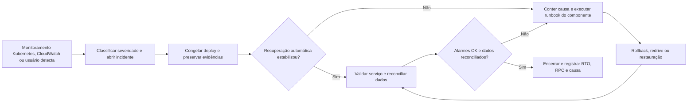

# Arquitetura final da aplicação

## 1. Diagrama de implantação

> Inserir o diagrama de implantação da arquitetura distribuída, indicando os componentes, os ambientes de execução e as conexões entre eles.

### 1.1 Componentes e justificativas

> Listar os principais componentes do diagrama, suas responsabilidades, tecnologias utilizadas e justificativas para as escolhas arquiteturais.

## 2. Inventário de contêineres, Docker e Kubernetes

### 2.1 Dockerfiles

> Listar cada Dockerfile, o serviço ou imagem gerada, a finalidade do contêiner e o componente correspondente no diagrama.

### 2.2 Execução local

> Informar os arquivos usados para executar a aplicação localmente, incluindo sua finalidade e os serviços iniciados.

### 2.3 Orquestração e infraestrutura Terraform

> Listar os arquivos de orquestração e infraestrutura, os recursos declarados e a forma como eles implantam ou conectam os componentes da arquitetura.

## 3. Plano de recuperação de falhas

O plano adota Kubernetes exclusivamente no caminho síncrono: o frontend e o
backend executam no cluster, cada um em seu próprio Deployment e Service, sob
um Ingress comum. PostgreSQL, API Gateway, SQS, workers, simulador e
processamento analítico continuam nos serviços AWS existentes e não são
migrados para Kubernetes.

O plano parte de quatro princípios: uma mensagem aceita não pode desaparecer
silenciosamente; um componente sem estado deve ser substituído, e não reparado
manualmente; uma versão defeituosa deve voltar para uma versão conhecida; e
toda recuperação termina com reconciliação de dados, não apenas com o recurso
aparecendo como `Ready`.

Os tempos desta seção são **metas operacionais propostas**, ainda não SLAs
contratados. RTO é o tempo máximo desejado para restabelecer o serviço; RPO é
a perda máxima de dados admitida. Para a ingestão, o compromisso de RPO começa
depois que o API Gateway responde sucesso e o SQS confirma que recebeu a
mensagem. Uma requisição que recebe `5xx` antes de entrar na fila precisa ser
reenviada pelo produtor e não está coberta pelo RPO do pipeline.

### 3.1 Objetivos e níveis de severidade

#### 3.1.1 Metas de recuperação

| Escopo da falha | Meta de RTO | Meta de RPO | Condição para cumprir a meta |
|---|---:|---:|---|
| Um pod de frontend ou backend | sem indisponibilidade percebida; até 2 min para retirar e recriar o pod | 0, pois as duas aplicações são sem estado | pelo menos duas réplicas `Ready`, probes corretas e dependências externas saudáveis |
| Perda de um nó do cluster | sem indisponibilidade percebida; até 5 min para reagendar as réplicas | 0 | cluster com ao menos dois nós, réplicas distribuídas por anti-afinidade e capacidade livre |
| Publicação defeituosa de frontend ou backend | até 10 min | 0 | estratégia `RollingUpdate`, histórico do Deployment e imagem anterior preservada no registry |
| Falha completa do Ingress ou do cluster | até 30 min | 0; frontend e backend são sem estado | acesso ao cluster, manifests versionados e fallback AWS disponível |
| Queda de uma task ECS de ingestão ou processamento | até 5 min | 0 para eventos já aceitos | serviço com `desired_count > 0`, mensagem ainda dentro da retenção do SQS e operações idempotentes |
| Indisponibilidade temporária de todos os consumidores | até 30 min para reativar o consumo; a drenagem depende do backlog | 0 por até 4 dias | filas preservadas e capacidade de consumo suficiente depois da retomada |
| Falha de instância ou zona do RDS em produção | até 15 min | 0 no failover Multi-AZ | `db_multi_az = true`; esta condição não está ativa no ambiente `dev` atual |
| Corrupção lógica ou restauração do RDS | até 4 h | até 5 min, como meta para o ponto de restauração | backups automáticos e logs de transação disponíveis; restauração ainda precisa ser ensaiada |
| Perda total da região ou da conta | até 24 h | até 24 h | cópia de backup e estado Terraform fora da conta/região; condição ainda não implementada |

As filas principais retêm mensagens por 4 dias; as DLQs, por 14 dias. Esses
prazos são janelas de recuperação, e não RTO: deixar um incidente aberto até
o limite de retenção viola as metas acima e aumenta o risco de perda.

#### 3.1.2 Classificação e responsabilidade

| Severidade | Critério | Impacto | Acionamento e responsáveis |
|---|---|---|---|
| **SEV-1 — crítica** | Ingress ou cluster indisponível; nenhum pod de backend `Ready`; ingestão inteira indisponível; RDS indisponível; risco de corrupção ou perda; backlog perto da retenção | perda de visibilidade operacional ou indisponibilidade total | alerta imediato; o responsável de infraestrutura assume a coordenação, o responsável de dados protege e valida o banco e o responsável da aplicação trata código e versão |
| **SEV-2 — alta** | Deployment abaixo das réplicas mínimas; HPA no limite; serviço ECS abaixo do desejado; DLQ com mensagens; fila envelhecendo; erros ou latência elevados | degradação parcial, dado atrasado ou capacidade sem margem | atendimento em até 15 min pelo responsável de infraestrutura, com apoio do dono do serviço afetado |
| **SEV-3 — moderada** | um pod substituído com sucesso; mensagem inválida isolada; alarme recuperado sem impacto visível | redundância reduzida ou ocorrência isolada | triagem no mesmo turno; registrar causa, confirmar a recuperação e abrir correção se houver recorrência |

Os responsáveis são definidos por papel para que o plano continue válido
quando a equipe mudar. Em uma SEV-1, apenas o coordenador do incidente declara
o encerramento, depois da validação conjunta de infraestrutura, aplicação e
dados.

### 3.2 Estratégias de recuperação

#### 3.2.1 Replicação, isolamento e retenção

| Componente | Estratégia adotada | Comportamento durante a falha | Arquivos relacionados |
|---|---|---|---|
| Frontend no Kubernetes | Deployment com 2 réplicas, Service `ClusterIP`, `RollingUpdate`, HPA de 2 a 4 pods, PDB e anti-afinidade entre nós | o Service remove pods não prontos; o ReplicaSet recria pods e o scheduler os reposiciona em nós saudáveis | manifests de Deployment, Service, HPA e PDB do frontend |
| Backend no Kubernetes | Deployment com 2 réplicas, Service `ClusterIP`, `RollingUpdate`, HPA de 2 a 6 pods, PDB e anti-afinidade entre nós | requisições seguem apenas para pods `Ready`; o Deployment recompõe réplicas sem estado | manifests de Deployment, Service, ConfigMap, Secret, HPA e PDB do backend |
| Entrada HTTP | Ingress compartilha a mesma origem: `/api`, `/health`, `/docs` e `/openapi.json` seguem para o backend; as demais rotas seguem para o frontend | elimina URL fixa no bundle e concentra a troca de destino; falha do controller afeta os dois serviços e é tratada como SEV-1 | manifest de Ingress e configuração do controller do cluster |
| API de ingestão | API Gateway integra diretamente com duas filas SQS independentes | a borda não depende da disponibilidade dos workers; eventos e mudanças acumulam separadamente | `apps/basica/infra/apigateway.tf`, `apps/basica/infra/apigateway_changes.tf`, `apps/basica/infra/sqs.tf`, `apps/basica/infra/sqs_changes.tf` |
| `event-worker` e `merge-worker` | serviços ECS Fargate mantêm o número desejado de tasks; filas persistem trabalho pendente | a queda do consumidor não interrompe a aceitação; a mensagem volta a ficar visível se não for confirmada | `apps/basica/infra/ecs.tf` |
| Processamento e simulador | serviços ECS mantêm uma task quando habilitados | ECS substitui a task; checkpoints, watermarks, leases e o relógio persistem no PostgreSQL | `apps/basica/infra/ecs_processing.tf`, `apps/basica/infra/ecs_simulator.tf`, `apps/basica/db/migrations/` |
| Mensagens problemáticas | cinco tentativas antes do redrive nativo; quarentena explícita de payload inválido; DLQ com retenção de 14 dias | um item defeituoso é isolado sem bloquear os itens válidos; o redrive é manual depois da correção | `apps/basica/infra/sqs.tf`, `apps/basica/infra/sqs_changes.tf`, `apps/basica/infra/iam.tf`, `apps/basica/worker/src/argus_worker/` |
| PostgreSQL | armazenamento criptografado, backup automático e opção Multi-AZ; proteção contra exclusão e snapshot final em `prod` | Multi-AZ permite failover da instância; backup permite reconstrução em falha lógica | `apps/basica/infra/rds.tf`, `apps/basica/infra/variables.tf` |
| Versões executáveis | imagens de frontend e backend separadas no registry e marcadas pelo SHA do commit | uma versão conhecida permanece disponível para `rollout undo`, sem depender de `latest` | Dockerfiles do frontend e backend, manifests Kubernetes e pipeline de publicação |

O limite do cluster é intencional: somente frontend e backend entram no
Kubernetes. Colocar SQS, PostgreSQL ou os consumidores no cluster duplicaria
serviços gerenciados e ampliaria o domínio de falha. Os workers continuam em
ECS Fargate e se comunicam com SQS e RDS sem depender do Ingress ou dos pods da
camada web.

O `event-worker` aceita sobreposição durante uma publicação porque a
escrita é idempotente por identificador. O `merge-worker`, o processamento e o
simulador param a versão anterior antes de iniciar a nova para evitar duas
instâncias concorrendo pelo mesmo estado. Nesses serviços, a continuidade vem
da fila e dos checkpoints persistidos, não de duas tasks ativas ao mesmo tempo.

#### 3.2.2 Health checks e reinicialização

No backend, a `startupProbe` e a `livenessProbe` consultam
`GET /health/live`, rota que verifica apenas se o processo Flask/Gunicorn está
vivo. A `readinessProbe` consulta `GET /health/ready`, que também verifica o
PostgreSQL. Essa separação evita reiniciar um processo saudável durante uma
falha do banco: o pod permanece em execução, mas sai temporariamente dos
Endpoints do Service e deixa de receber tráfego.

No frontend, as três probes consultam uma rota local `/healthz` servida pelo
Nginx. Falha de liveness faz o kubelet reiniciar o contêiner; falha de readiness
retira o pod do Service sem encerrá-lo. Os Deployments mantêm no mínimo duas
réplicas e usam `RollingUpdate` com `maxUnavailable: 0` e `maxSurge: 1`, para
que uma nova versão só substitua a anterior depois de ficar pronta.

Os contêineres de longa duração que permanecem no ECS continuam usando o
heartbeat existente. O health check roda a cada 30 s, tolera três falhas e
reprova quando o heartbeat tem mais de 120 s. Como o contêiner é `essential`,
a task termina e o serviço ECS cria outra para voltar ao `desired_count`.

#### 3.2.3 Fallback e rollback

As recuperações e fallbacks automáticos adotados são:

1. o Service envia novas requisições somente a pods `Ready`;
2. o ReplicaSet recompõe pods encerrados e o scheduler os reposiciona quando um
   nó fica indisponível;
3. o HPA aumenta o backend de 2 a 6 pods e o frontend de 2 a 4 pods quando a
   utilização média de CPU ultrapassa o alvo definido;
4. o PDB preserva ao menos uma réplica de cada Deployment durante interrupções
   voluntárias, como manutenção e drenagem de nó;
5. o `RollingUpdate` mantém a versão anterior atendendo até a nova passar pelas
   probes, e o histórico do Deployment permite `rollout undo`;
6. o ECS repõe as tasks dos workers e o *deployment circuit breaker* reverte
   uma publicação que não estabiliza;
7. o SQS reentrega mensagens não confirmadas e, depois do limite, move-as para
   a DLQ em vez de descartá-las;
8. o RDS realiza failover automático somente quando Multi-AZ está habilitado.

O fallback para fora do cluster é manual. O frontend estático pode voltar a
ser publicado no S3 e a API Flask continua empacotável em AWS Lambda, exposta
por API Gateway (`apps/basica/infra/api_read.tf`). A troca requer alterar o
destino de entrada ou republicar o frontend com a URL de contingência; ela não
resolve indisponibilidade do RDS, compartilhado pelos caminhos principal e
alternativo. Automatizar essa troca exige DNS com health check ou uma camada de
entrada capaz de alternar entre Kubernetes e AWS.

O rollback do frontend ou backend seleciona a revisão anterior do respectivo
Deployment e acompanha o rollout até todas as réplicas ficarem `Ready`. Os
serviços que permanecem no ECS continuam usando a task definition anterior por
meio do circuit breaker.

### 3.3 Procedimento de resposta

O fluxo de decisão é o mesmo para todos os componentes:

#### 3.3.1 Detectar e classificar

1. Confirmar o alerta e a abrangência: Ingress, frontend, backend, nó do
   cluster, fila, ECS, processamento, banco ou rede.
2. Registrar horário, evento Kubernetes, revisão dos Deployments, imagens dos
   pods, estado das probes, `request_id`, task definitions, tamanho e idade das
   filas. Esses dados não devem ser substituídos por novo deploy antes da
   coleta.
3. Inspecionar pods, eventos, logs, Endpoints, HPAs e rollouts do namespace;
   depois correlacionar com os alarmes de 5xx e latência, idade das filas, DLQ,
   CPU, conexões e espaço do RDS. `make -C apps/basica logs`, `dlq` e `count`
   continuam reunindo as inspeções dos componentes AWS.
4. Classificar SEV-1, SEV-2 ou SEV-3 e designar um coordenador. Em SEV-1, pausar
   novos deploys e mudanças de schema até a normalização.

#### 3.3.2 Conter e recuperar por modo de falha

| Falha observada | Contenção | Recuperação | Critério específico de sucesso |
|---|---|---|---|
| Um pod de frontend ou backend falha | permitir que readiness retire o pod; não reiniciar réplicas saudáveis | kubelet reinicia o contêiner ou ReplicaSet cria novo pod | réplicas `Ready` iguais ao mínimo, Endpoints completos e taxa de 5xx normal |
| Um nó falha | impedir novos agendamentos no nó e preservar eventos | scheduler reposiciona os pods em outro nó; repor capacidade do cluster se faltar recurso | pods distribuídos em nós saudáveis e PDB respeitado |
| Backend fica sem pods `Ready` | congelar o rollout e preservar eventos e logs | desfazer a revisão; se o cluster não recuperar, acionar a API Lambda de contingência | `/health/live` e `/health/ready` 200, Service com Endpoints e smoke test aprovado |
| Frontend fica sem pods `Ready` | congelar o rollout | desfazer a revisão; se o cluster não recuperar, republicar o export estático no S3 | rota `/` e assets respondendo 200, navegação e chamada à API aprovadas |
| Ingress falha | preservar os Services e confirmar que os pods continuam saudáveis | restaurar controller, configuração ou DNS; usar os fallbacks AWS se a falha persistir | entrada externa alcança frontend e backend pela mesma origem |
| Task ECS encerra ou trava | permitir uma tentativa de reposição automática; manter mensagens no SQS | ECS cria nova task; em crash loop, voltar à task definition anterior ou corrigir a dependência | `RunningTaskCount` igual ao desejado, heartbeat recente e fila voltando a drenar |
| RDS fica indisponível | parar temporariamente os consumidores se a falha for longa, evitando que mensagens válidas esgotem cinco tentativas e inundem a DLQ | aguardar failover Multi-AZ; sem Multi-AZ, corrigir a instância ou restaurar backup em nova instância e atualizar a configuração | `/health/ready` 200, escrita e leitura de verificação aprovadas e backlog em queda |
| Fila acumula | manter a borda aceitando enquanto houver retenção e capacidade | restabelecer ou aumentar consumidores com a mesma imagem; acompanhar idade da mensagem mais antiga, não apenas quantidade | fila principal zerada ou dentro do patamar normal e contagens reconciliadas |
| Mensagens chegam à DLQ | impedir redrive em massa antes de identificar a causa; separar payload inválido de falha transitória | corrigir código ou configuração e redirecionar somente itens recuperáveis para a fila de origem | DLQ tratada, itens válidos persistidos uma vez e itens inválidos com motivo registrado |
| Imagem ou deploy defeituoso | pausar o rollout antes que todas as réplicas antigas saiam | Kubernetes volta à revisão anterior; ECS volta à task definition anterior | digest esperado em todos os pods e tasks e smoke test aprovado |
| NAT ou rota privada falha | evitar substituir em massa tasks que ainda estejam executando | recriar rota ou NAT por Terraform; em produção, promover a topologia para um NAT por AZ | tasks alcançam ECR, SQS, Secrets Manager e CloudWatch; novas tasks conseguem iniciar |
| Perda ou corrupção de estado | bloquear migrations e escritas não essenciais | selecionar ponto anterior ao incidente, restaurar o RDS, aplicar migrations imutáveis e reconciliar filas e DLQs | checksums das migrations, contagens por camada e consultas do dashboard consistentes |

As tasks `loader` e `migration` são operações *one-shot*, não serviços.
Elas não reiniciam indefinidamente porque uma carga ou migration defeituosa
repetida pode ampliar o dano. Depois de corrigir a causa, o operador executa
novamente a task; migrations já aplicadas são protegidas por checksum.

#### 3.3.3 Validar e encerrar

A recuperação somente pode ser declarada depois de todos os passos aplicáveis:

1. `make -C apps/basica smoke` confirma as rotas publicadas, autenticação e
   respostas do caminho de leitura;
2. Deployments, Services, Endpoints, Ingress e ECS apresentam capacidade
   saudável igual à desejada por pelo menos duas janelas de métrica;
3. a idade da mensagem mais antiga diminui continuamente, as filas drenam e
   `make -C apps/basica dlq` não mostra itens novos sem explicação;
4. `make -C apps/basica count` e uma reconciliação do lote comparam aceitos,
   persistidos, ainda enfileirados e rejeitados. Fila vazia, sozinha, não prova
   ausência de perda;
5. os alarmes voltam a `OK`, não há erro recorrente nos logs e as métricas de
   latência e throughput retornam ao patamar anterior;
6. o registro do incidente guarda causa, versão afetada, horários de detecção
   e recuperação, RTO e RPO observados, volume reconciliado e ação preventiva.

### 3.4 Testes e evidências de recuperação

O RNF05 já exercitou quatro cenários na AWS. Os resultados detalhados estão
em `artefatos/testes-carga-inicial.md`.

| Exercício executado | Evidência | Conclusão |
|---|---|---|
| consumidor de mudanças desligado | 96.020 eventos aceitos e fila drenada em cerca de 16 min | retomada comprovada; reconciliação total ainda pendente |
| interrupção forçada do `merge-worker` | 28.800 eventos aceitos, task reiniciada automaticamente e fila principal zerada | reinicialização comprovada; reconciliação total ainda pendente |
| backlog do fluxo de eventos | fila `0 → 1.001 → 0` e banco `27.509 → 28.510` | recuperação sem perda comprovada para 1.001/1.001 eventos |
| timeout extremo no cliente | 100/100 expirações com limite de 1 ms; depois 5/5 respostas 200 | recuperação do cliente comprovada no escopo testado |

Esses resultados comprovam a recuperação do pipeline AWS, mas não comprovam
a camada Kubernetes. A validação do cluster deve executar e preservar as
seguintes evidências:

| Ensaio Kubernetes | Ação | Critério de aceite |
|---|---|---|
| reinício de pod | excluir uma réplica de frontend e uma de backend durante tráfego | ReplicaSet recompõe cada pod; nenhuma indisponibilidade percebida e nenhuma resposta 5xx causada pelo teste |
| falha de nó | drenar um nó que hospeda uma réplica de cada Deployment | PDB mantém uma réplica; pods são reagendados em outro nó dentro do RTO |
| deploy defeituoso | publicar imagem que não passa na startup probe | pods antigos continuam atendendo; rollout não conclui e rollback restaura a revisão anterior |
| perda de prontidão do backend | bloquear temporariamente a conexão de um pod com o RDS | readiness retira o pod dos Endpoints sem reinício em ciclo; tráfego segue para réplica pronta |
| escalabilidade | gerar carga crescente separadamente no frontend e no backend | HPA aumenta réplicas dentro dos limites e reduz apenas depois da janela de estabilização |
| falha de entrada | interromper uma réplica do controller de Ingress | outra réplica mantém a entrada; se todo o controller falhar, o alerta SEV-1 é emitido |

Os alvos `resiliencia-fila-cheia`, `resiliencia-timeout`,
`resiliencia-evento-invalido`, `resiliencia-concorrente` e
`resiliencia-watermark-check` do `Makefile` tornam os testes repetíveis. Antes
de cada release relevante deve ser executado ao menos o teste de interrupção
task, o reinício de pods e a reconciliação do lote. Trimestralmente, o plano
prevê ensaiar o rollback dos dois Deployments, a falha de nó, a restauração do
RDS em uma instância isolada e o redrive de uma amostra conhecida da DLQ. Os
ensaios planejados não devem ser apresentados como evidência concluída enquanto
seus registros não forem anexados à seção 4.

### 3.5 Limitações e decisões pendentes

1. **A arquitetura Kubernetes ainda precisa de evidência de implantação.** Este
   artefato define o comportamento esperado de Deployments, Services, Ingress,
   HPA, PDB e probes. Os manifests e os resultados dos ensaios devem ser
   validados no branch de implementação antes de declarar esses mecanismos
   como comprovados.
2. **Alta disponibilidade depende do cluster.** Duas réplicas no mesmo nó não
   toleram a perda desse nó. O ambiente precisa de pelo menos dois nós em zonas
   distintas, anti-afinidade e capacidade para reagendar pods.
3. **PDB cobre somente interrupção voluntária.** Ele limita um `drain`, mas não
   impede perda simultânea causada por falha de nó, zona ou cluster.
4. **HPA depende do Metrics Server e de recursos declarados.** Sem métricas de
   CPU ou sem `requests`, o escalonamento não funciona. Escalar pods também não
   corrige gargalo no RDS, que precisa ser observado separadamente.
5. **O fallback para AWS exige intervenção.** Não há failover automático entre
   o Ingress do Kubernetes, o site S3 e a API Lambda. Automatizar esse caminho
   exige endpoint estável, health check externo e teste periódico dos destinos.
6. **O ambiente AWS atual está pausado.** Em `terraform.tfvars`, os workers, o
   processamento e o simulador estão com `desired_count = 0`. A reposição
   automática de tasks só existe quando o serviço está habilitado; `make resume`
   religa workers e processamento.
7. **O RDS de desenvolvimento é Single-AZ.** `db_multi_az = false` e a retenção
   de backup é de apenas 1 dia. Antes de tratar o ambiente como produção,
   Multi-AZ deve ser obrigatório, a retenção deve ser ampliada e um restore
   completo precisa comprovar as metas de RTO e RPO.
8. **Os serviços ECS não têm auto scaling.** O padrão é uma task por serviço
   quando habilitado. O SQS absorve interrupções e rajadas, mas uma falha reduz
   temporariamente o consumo a zero. A equipe deve definir auto scaling por
   idade ou profundidade de fila, ou manter mais de uma réplica onde o controle
   de concorrência permitir.
9. **Existe um único NAT Gateway na infraestrutura AWS atual.** Um NAT por AZ e
   tabelas de rota independentes eliminariam esse ponto único de falha para os
   serviços que permanecem fora do Kubernetes.
10. **Não há recuperação regional ou entre contas.** RDS, ECR, SQS e backups
    permanecem na mesma região e conta. A meta de desastre regional da tabela
    3.1.1 não está atendida.
11. **A notificação depende de configuração.** O tópico SNS existe, mas o
    e-mail só recebe alertas se `alarm_email` estiver preenchido e a inscrição
    for confirmada. A camada Kubernetes também precisa encaminhar seus alertas
    ao mesmo canal operacional.
12. **A evidência de recuperação ainda é parcial nos maiores volumes.** O
    reinício e a drenagem foram observados, mas somente o recorte de 1.001
    eventos foi reconciliado integralmente. Os próximos ensaios devem registrar
    a igualdade `aceitos = persistidos + rejeitados recuperáveis + ainda em
    fila` para todo o lote.

### 3.6 Campos a preencher após a implementação do Kubernetes

Esta subseção separa o que já está definido como plano do que ainda precisa ser
comprovado no ambiente implantado. Os campos abaixo devem ser preenchidos no
branch de implementação, sem substituir as metas registradas nas seções
anteriores.

#### 3.6.1 Identificação do ambiente validado

| Campo | Valor a registrar após a implementação |
|---|---|
| Provedor e nome do cluster | **A preencher** |
| Região, zonas e quantidade de nós | **A preencher** |
| Versão do Kubernetes | **A preencher** |
| Namespace da aplicação | **A preencher** |
| Controller e endereço do Ingress | **A preencher** |
| Versão do Metrics Server | **A preencher** |
| Commit e data da implantação testada | **A preencher** |
| Digests das imagens de frontend e backend | **A preencher** |
| Responsável pela validação | **A preencher** |

#### 3.6.2 Configuração de resiliência efetivamente aplicada

| Controle | Valor projetado | Valor aplicado e evidência |
|---|---|---|
| Réplicas do frontend | mínimo 2; HPA entre 2 e 4 | **A preencher** |
| Réplicas do backend | mínimo 2; HPA entre 2 e 6 | **A preencher** |
| Estratégia de atualização | `RollingUpdate`, `maxUnavailable: 0`, `maxSurge: 1` | **A preencher** |
| Probes do frontend | startup, liveness e readiness em `/healthz` | **A preencher** |
| Probes do backend | startup e liveness em `/health/live`; readiness em `/health/ready` | **A preencher** |
| PodDisruptionBudget | ao menos 1 pod disponível por Deployment | **A preencher** |
| Distribuição dos pods | anti-afinidade entre nós e, quando disponível, entre zonas | **A preencher** |
| Recursos e métrica do HPA | `requests` e `limits` declarados; alvo de CPU definido | **A preencher** |
| Réplicas do Ingress controller | pelo menos 2, distribuídas entre nós | **A preencher** |
| Retenção da imagem anterior | digest preservado para rollback | **A preencher** |

#### 3.6.3 Resultados dos ensaios de recuperação

| Ensaio | Data | Resultado observado | RTO observado | Perda ou RPO observado | Evidência | Situação |
|---|---|---|---:|---:|---|---|
| Exclusão de pod do frontend | **A preencher** | **A preencher** | **A preencher** | **A preencher** | **A preencher** | **Pendente** |
| Exclusão de pod do backend | **A preencher** | **A preencher** | **A preencher** | **A preencher** | **A preencher** | **Pendente** |
| Drenagem ou perda de nó | **A preencher** | **A preencher** | **A preencher** | **A preencher** | **A preencher** | **Pendente** |
| Imagem que falha na startup probe | **A preencher** | **A preencher** | **A preencher** | **A preencher** | **A preencher** | **Pendente** |
| Perda de readiness por falha do RDS | **A preencher** | **A preencher** | **A preencher** | **A preencher** | **A preencher** | **Pendente** |
| Escala automática do frontend | **A preencher** | **A preencher** | **A preencher** | **A preencher** | **A preencher** | **Pendente** |
| Escala automática do backend | **A preencher** | **A preencher** | **A preencher** | **A preencher** | **A preencher** | **Pendente** |
| Interrupção de uma réplica do Ingress | **A preencher** | **A preencher** | **A preencher** | **A preencher** | **A preencher** | **Pendente** |
| Rollback do frontend | **A preencher** | **A preencher** | **A preencher** | **A preencher** | **A preencher** | **Pendente** |
| Rollback do backend | **A preencher** | **A preencher** | **A preencher** | **A preencher** | **A preencher** | **Pendente** |
| Acionamento do fallback AWS | **A preencher** | **A preencher** | **A preencher** | **A preencher** | **A preencher** | **Pendente** |

Cada evidência deve informar a revisão implantada e anexar somente dados sem
segredos: saída resumida dos recursos, eventos, gráficos de disponibilidade e
latência, horário de início e fim, contagem de erros e resultado da
reconciliação. A situação só pode mudar para **Aprovado** quando o critério de
aceite da seção 3.4 for atendido; caso contrário, deve ficar como **Reprovado**
e apontar a correção necessária.

#### 3.6.4 Lista de fechamento do plano

- [ ] Confirmar que frontend e backend são os únicos componentes da aplicação
      executados no Kubernetes.
- [ ] Validar ao menos dois nós, distribuição das réplicas e capacidade para
      reagendamento.
- [ ] Confirmar probes, PDBs, HPAs, `requests`, `limits` e política de rollout.
- [ ] Confirmar que ConfigMaps e Secrets necessários foram aplicados sem
      registrar valores sensíveis neste artefato.
- [ ] Integrar eventos e alertas do cluster ao canal operacional usado pela
      infraestrutura AWS.
- [ ] Executar todos os ensaios da seção 3.6.3 e comparar os resultados com as
      metas de RTO e RPO da seção 3.1.1.
- [ ] Reconciliar requisições, filas, DLQs e registros do PostgreSQL depois dos
      ensaios que afetarem o backend.
- [ ] Testar o fallback manual para S3 e Lambda e registrar o procedimento e o
      tempo observado.
- [ ] Anexar as evidências na seção 4 e atualizar as limitações que tiverem sido
      resolvidas.

## 4. Evidências de validação

> Inserir evidências do diagrama, da execução dos contêineres, da infraestrutura implantada e dos testes de recuperação de falhas.

