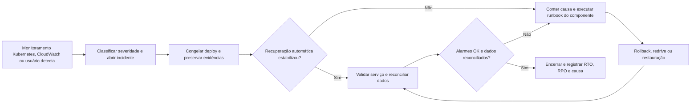

# Arquitetura final da aplicação

## 1. Diagrama de implantação

> Inserir o diagrama de implantação da arquitetura distribuída, indicando os componentes, os ambientes de execução e as conexões entre eles.


### 1.1 Componentes e justificativas

> Listar os principais componentes do diagrama, suas responsabilidades, tecnologias utilizadas e justificativas para as escolhas arquiteturais.


## 2. Inventário de contêineres, Docker e Kubernetes

Este inventário descreve os arquivos do commit `263b7d3` na branch
`fix/Repositório`, conferidos em 23/09/2026. O Kubernetes executa o
dashboard, a API de consulta e um `Job` de migrations. A API também registra
feedback de hipóteses pela função controlada `gold.submit_hypothesis_feedback`.
A ingestão e o processamento assíncrono continuam no ECS Fargate. As decisões
e os comandos estão detalhados no [inventário de contêineres](conteineres-final.md)
e no [runbook do Kubernetes](../apps/fullstack/k8s/README.md).

No diagrama fornecido para a seção 1, o ALB público recebe o tráfego HTTP do
navegador e encaminha `/` ao frontend e `/api` e `/health` ao backend no EKS
Auto Mode. Os nós EC2 gerenciados, as tasks Fargate e o RDS ficam nas
sub-redes privadas. Os dois caminhos compartilham o PostgreSQL, mas têm
entradas e ciclos de escala
distintos. O desenho representa duas zonas de disponibilidade. A distribuição
real dos pods por zona não foi registrada no ensaio descrito na seção 3.6.


### 2.1 Dockerfiles

Cada Dockerfile tem dois estágios (`builder` e `runtime`) e fixa ambas as
imagens base por digest `sha256`. As cinco imagens Python usam o runtime
`python:3.12-slim-bookworm`. A do frontend usa nginx. Os comandos abaixo são
os padrões da imagem, exceto quando a task ECS ou o Job os substitui.

| Dockerfile | Build e conteúdo da imagem | Inicialização, usuário e health check | Relação com o diagrama |
|---|---|---|---|
| [`apps/fullstack/frontend/Dockerfile`](../apps/fullstack/frontend/Dockerfile) | `node:20` com `npm ci` e `npm run build` gera o export estático do Next.js. O estágio `nginx:1.27-alpine` copia `out/` e `nginx.conf`. | `CMD nginx -g 'daemon off;'`, usuário `nginx` (UID 101), porta 8080. `HEALTHCHECK` consulta `/healthz` a cada 30 s. | Imagem do `Deployment argus-frontend` no EKS ou kind, atrás do Ingress e do ALB. |
| [`apps/fullstack/backend/Dockerfile`](../apps/fullstack/backend/Dockerfile) | `uv` instala dependências do lockfile e o código no builder. `python:3.12-slim` recebe a `.venv` e `run.py`. | `CMD gunicorn` com 2 workers e 4 threads na porta 5000, usuário `argus` (UID 10001). `HEALTHCHECK` consulta `/health/live` a cada 30 s, sem depender do RDS. | Imagem do `Deployment argus-backend` no caminho síncrono. Também atende o ASG legado. |
| [`apps/fullstack/worker/Dockerfile`](../apps/fullstack/worker/Dockerfile) | `uv` instala `common/` e `worker/` no builder. O runtime Python recebe a `.venv`. | `ENTRYPOINT python -m argus_worker`. A task ECS seleciona `event` ou `merge`. UID 10001. `HEALTHCHECK` a cada 30 s exige heartbeat com menos de 120 s. | Uma imagem para `event-worker` e `merge-worker` no ECS Fargate: consomem SQS e persistem os dados das mensagens no PostgreSQL. |
| [`apps/fullstack/processing/Dockerfile`](../apps/fullstack/processing/Dockerfile) | Builder `uv` com `common/` e `processing/`. Runtime Python inclui a `.venv`, `db/migrations/` e `tools/migrate.py`. | `ENTRYPOINT python -m argus_processing`, UID 10001. `HEALTHCHECK` de heartbeat a cada 30 s, com limite de 120 s. O Job substitui o comando por `python /app/tools/migrate.py aplicar`. | Serviço analítico no ECS e imagem reutilizada pelo `Job argus-db-migrate` no EKS. |
| [`apps/fullstack/simulator/Dockerfile`](../apps/fullstack/simulator/Dockerfile) | Builder `uv` com `common/` e `simulator/`. Runtime Python recebe a `.venv`. | `ENTRYPOINT python -m argus_simulator`, UID 10001. `HEALTHCHECK` de heartbeat a cada 30 s, com limite de 120 s. | Serviço ECS que gera eventos e mudanças no caminho assíncrono. |
| [`apps/fullstack/loader/Dockerfile`](../apps/fullstack/loader/Dockerfile) | Builder `uv` com `common/` e `loader/`. Runtime Python recebe a `.venv`. | `ENTRYPOINT python -m argus_loader`, UID 10001. Sem `HEALTHCHECK`, pois a task avulsa termina após a carga. | Task ECS que lê os Parquets do S3 e faz a carga inicial no PostgreSQL. |

`worker`, `processing`, `simulator` e `loader` usam `apps/fullstack/` como
contexto de build para incluir `common/`. `backend` e `frontend` usam seus
próprios diretórios. O Makefile publica `backend`, `frontend` e `processing`
para `amd64` e `arm64`. `backend` e `frontend` precisam de `amd64` para os
nós EKS observados. A variante `arm64` atende aos ambientes ARM64 locais e,
no caso do backend, ao caminho legado. `processing` também precisa das duas
arquiteturas porque serve ao ECS Fargate ARM64 e ao Job no EKS `amd64`.
As imagens `worker`,
`simulator` e `loader` são publicadas apenas para ARM64, arquitetura padrão
das tasks Fargate atuais. Essa divisão deve ser revista se o tipo de nó ou a
arquitetura das tasks mudar.


### 2.2 Execução local

| Arquivo ou entrada | Serviços iniciados e uso |
|---|---|
| [`backend/compose.yaml`](../apps/fullstack/backend/compose.yaml) | Sobe API e PostgreSQL 16. Banco em `127.0.0.1:55433` e API em `127.0.0.1:5000`. As migrations são aplicadas separadamente. |
| [`observability/docker-compose.yml`](../apps/fullstack/observability/docker-compose.yml) | Sobe Prometheus na porta 9090 e Grafana na 3001, restritos a `127.0.0.1`. |
| [`Makefile`](../apps/fullstack/Makefile), alvo `db-local` | Inicia PostgreSQL 16 na porta 55432, cria os bancos de desenvolvimento e teste e aplica as migrations. |
| [`k8s/overlays/kind/kind-cluster.yaml`](../apps/fullstack/k8s/overlays/kind/kind-cluster.yaml) | `kind-up` cria um cluster de um nó a partir deste arquivo e instala ingress-nginx e metrics-server. A entrada fica em `http://localhost:8080`. |
| [`k8s/overlays/kind/kustomization.yaml`](../apps/fullstack/k8s/overlays/kind/kustomization.yaml) | `k8s-apply` implanta frontend, backend, Ingress, PostgreSQL local e Secret gerado de `secret.env`. O `Job` é aplicado separadamente por `k8s-migrate`. |

Para reproduzir o caminho Kubernetes local, executar, da raiz:

```bash
make -C apps/fullstack kind-up
make -C apps/fullstack k8s-images kind-load
make -C apps/fullstack k8s-apply K8S_OVERLAY=kind
make -C apps/fullstack k8s-migrate K8S_OVERLAY=kind
```

O kind valida o roteamento e os manifests.
seu nó único não demonstra disponibilidade entre nós ou zonas.


### 2.3 Orquestração e infraestrutura Terraform

#### 2.3.1 Inventário dos arquivos Kubernetes

Os caminhos abaixo partem de `apps/fullstack/k8s/`. Arquivos `kustomization.yaml`
compõem recursos, enquanto patches alteram os objetos da base. A configuração
do cluster kind e o exemplo de Secret são entradas de apoio, não recursos
criados por `kubectl apply`.

**Base comum aos ambientes**

| Arquivo | Recurso e configuração principal | Relação com o diagrama |
|---|---|---|
| [`apps/fullstack/k8s/base/namespace.yaml`](../apps/fullstack/k8s/base/namespace.yaml) | Cria `Namespace argus`, isolando os objetos da aplicação. | Contorno lógico dos workloads EKS. Não representa uma sub-rede. |
| [`apps/fullstack/k8s/base/configmap.yaml`](../apps/fullstack/k8s/base/configmap.yaml) | Cria `ConfigMap argus-backend`: região `us-east-1`, log `INFO`, janela de 168 h, limite de 20.000 itens e `AUTH_REQUIRED=1`. Segredos ficam fora deste arquivo. | Configuração não sensível da API de leitura no EKS. |
| [`apps/fullstack/k8s/base/backend-deployment.yaml`](../apps/fullstack/k8s/base/backend-deployment.yaml) | Cria `Deployment argus-backend`: 2 réplicas, porta 5000, `RollingUpdate` 0/1, probes de startup/liveness/readiness, `preStop` de 10 s, UID 10001, ConfigMap e Secret. Prefere espalhar por zona e nó. | Pods Flask/Gunicorn nos nós EC2 privados, ligados ao RDS. |
| [`apps/fullstack/k8s/base/backend-service.yaml`](../apps/fullstack/k8s/base/backend-service.yaml) | Cria `Service argus-backend` `ClusterIP` na porta 5000, selecionando os pods da API. | Destino interno do Ingress para `/api` e `/health`. |
| [`apps/fullstack/k8s/base/backend-hpa.yaml`](../apps/fullstack/k8s/base/backend-hpa.yaml) | Cria `HPA argus-backend`: 2 a 6 réplicas, alvo de CPU de 60%, subida sem estabilização e descida estabilizada em 300 s. | Escala declarada do caminho síncrono. Depende de métricas disponíveis. |
| [`apps/fullstack/k8s/base/backend-pdb.yaml`](../apps/fullstack/k8s/base/backend-pdb.yaml) | Cria `PDB argus-backend` com `minAvailable: 1` para interrupções voluntárias. | Preserva uma réplica da API durante drenagem planejada. |
| [`apps/fullstack/k8s/base/frontend-deployment.yaml`](../apps/fullstack/k8s/base/frontend-deployment.yaml) | Cria `Deployment argus-frontend`: 2 réplicas, nginx na porta 8080, `RollingUpdate` 0/1, probes `/healthz`, `preStop` de 5 s, UID 101 e preferência por zona. | Pods do dashboard nos nós EC2 privados. |
| [`apps/fullstack/k8s/base/frontend-service.yaml`](../apps/fullstack/k8s/base/frontend-service.yaml) | Cria `Service argus-frontend` `ClusterIP`, porta 80 para a porta 8080 do contêiner. | Destino interno do Ingress para `/`. |
| [`apps/fullstack/k8s/base/frontend-hpa.yaml`](../apps/fullstack/k8s/base/frontend-hpa.yaml) | Cria `HPA argus-frontend`: 2 a 4 réplicas, alvo de CPU de 70%. | Escala declarada do dashboard no caminho síncrono. |
| [`apps/fullstack/k8s/base/frontend-pdb.yaml`](../apps/fullstack/k8s/base/frontend-pdb.yaml) | Cria `PDB argus-frontend` com `minAvailable: 1` para interrupções voluntárias. | Preserva uma réplica do dashboard durante drenagem planejada. |
| [`apps/fullstack/k8s/base/ingress.yaml`](../apps/fullstack/k8s/base/ingress.yaml) | Cria `Ingress argus` com `/api` e `/health` para backend:5000 e `/` para frontend:80, na mesma origem. | Entrada lógica do ALB público representado no diagrama. |
| [`apps/fullstack/k8s/base/kustomization.yaml`](../apps/fullstack/k8s/base/kustomization.yaml) | Compõe Namespace, ConfigMap, Deployments, Services, HPAs, PDBs e Ingress. Não inclui o Job de migration. | Define a base comum da aplicação EKS e do equivalente local. |

**Migration separada**

| Arquivo | Recurso e configuração principal | Relação com o diagrama |
|---|---|---|
| [`apps/fullstack/k8s/migrate/job-db-migrate.yaml`](../apps/fullstack/k8s/migrate/job-db-migrate.yaml) | Cria `Job argus-db-migrate` com a imagem `processing`, comando `python /app/tools/migrate.py aplicar`, `backoffLimit: 2`, limite de 900 s e credencial mestre do Secret. | Migration pontual entre EKS e PostgreSQL privado. |
| [`apps/fullstack/k8s/migrate/kustomization.yaml`](../apps/fullstack/k8s/migrate/kustomization.yaml) | Compõe apenas o Job, separado da base porque o template de Job é imutável. | Permite executar migration separadamente dos Deployments. |

**Overlay AWS**

| Arquivo | Recurso e configuração principal | Relação com o diagrama |
|---|---|---|
| [`apps/fullstack/k8s/overlays/aws/ingressclass.yaml`](../apps/fullstack/k8s/overlays/aws/ingressclass.yaml) | Cria `IngressClassParams` e `IngressClass argus-alb` para `eks.amazonaws.com/alb`, com esquema público. | Vincula o Ingress ao ALB gerenciado pelo EKS Auto Mode. |
| [`apps/fullstack/k8s/overlays/aws/ingress-patch.yaml`](../apps/fullstack/k8s/overlays/aws/ingress-patch.yaml) | Altera `Ingress argus`: ALB público, alvos por IP de pod, listener HTTP 80, health check `/health/live` e atraso de desregistro de 30 s. | Liga o ALB às duas aplicações sem expor seus Services diretamente. |
| [`apps/fullstack/k8s/overlays/aws/kustomization.yaml`](../apps/fullstack/k8s/overlays/aws/kustomization.yaml) | Compõe a base, a classe de Ingress e o patch. As imagens ECR são injetadas pelo Makefile. Não gera o Secret. | Seleciona a implantação AWS do caminho síncrono. |

**Overlay kind**

| Arquivo | Recurso e configuração principal | Relação com o diagrama |
|---|---|---|
| [`apps/fullstack/k8s/overlays/kind/kind-cluster.yaml`](../apps/fullstack/k8s/overlays/kind/kind-cluster.yaml) | Configura o kind com um nó control-plane e mapeia `localhost:8080` para a porta 80 do ingress-nginx. Não é recurso aplicado pelo Kubernetes. | Reproduz localmente a entrada única do navegador. |
| [`apps/fullstack/k8s/overlays/kind/kustomization.yaml`](../apps/fullstack/k8s/overlays/kind/kustomization.yaml) | Compõe base, PostgreSQL local e patches. Substitui imagens por tags `:dev` e gera `Secret argus-backend` de `secret.env`. | Versão local da topologia EKS, sem ALB ou RDS. |
| [`apps/fullstack/k8s/overlays/kind/postgres.yaml`](../apps/fullstack/k8s/overlays/kind/postgres.yaml) | Cria `Deployment` e `Service argus-postgres` com PostgreSQL 16, porta 5432, armazenamento `emptyDir` e readiness por `psql SELECT 1`. | Substitui o RDS apenas no ensaio local. |
| [`apps/fullstack/k8s/overlays/kind/config-patch.yaml`](../apps/fullstack/k8s/overlays/kind/config-patch.yaml) | Altera o ConfigMap: `AUTH_REQUIRED=0`, log `DEBUG` e origens localhost. | Adapta a API à autenticação e ao endereço locais. |
| [`apps/fullstack/k8s/overlays/kind/hpa-patch.yaml`](../apps/fullstack/k8s/overlays/kind/hpa-patch.yaml) | Altera os dois HPAs para 1 a 2 réplicas no nó único. | Reduz a escala dos dois Deployments em relação ao EKS do diagrama. |
| [`apps/fullstack/k8s/overlays/kind/ingress-patch.yaml`](../apps/fullstack/k8s/overlays/kind/ingress-patch.yaml) | Altera a classe de `Ingress argus` para `nginx`, preservando as rotas da base. | Substitui o ALB pelo ingress-nginx local. |
| [`apps/fullstack/k8s/overlays/kind/replicas-patch.yaml`](../apps/fullstack/k8s/overlays/kind/replicas-patch.yaml) | Altera os dois Deployments para uma réplica e reduz recursos. O backend usa um worker Gunicorn. | Permite ensaiar dashboard e API no nó único. |
| [`apps/fullstack/k8s/overlays/kind/migrate/kustomization.yaml`](../apps/fullstack/k8s/overlays/kind/migrate/kustomization.yaml) | Compõe o Job de migration com a imagem local `argus-processing:dev`. | Aplica ao PostgreSQL local a mesma migration da arquitetura AWS. |
| [`apps/fullstack/k8s/overlays/kind/secret.env.example`](../apps/fullstack/k8s/overlays/kind/secret.env.example) | Modelo de cinco chaves locais usado para gerar o Secret. Não é manifesto Kubernetes nem contém os segredos AWS. | Fornece ao backend e ao Job credenciais do banco descartável do kind. |

O Secret Kubernetes `argus-backend` consumido pelo backend e pelo Job é criado
no EKS por `make k8s-secret`, a partir dos outputs do Terraform. No kind, o
`secretGenerator` do overlay usa `secret.env`, copiado do exemplo local. Os
valores reais do Secret EKS e o arquivo `secret.env` não são versionados.

#### 2.3.2 Infraestrutura Terraform

| Arquivos | Recursos declarados e conexão |
|---|---|
| [`infra/eks.tf`](../apps/fullstack/infra/eks.tf), [`infra/vpc.tf`](../apps/fullstack/infra/vpc.tf), [`infra/rds.tf`](../apps/fullstack/infra/rds.tf) | EKS Auto Mode opcional na VPC, acesso ao cluster, sub-redes etiquetadas para o ALB e regra de acesso dos pods ao RDS. O ALB externo nasce do Ingress. |
| [`infra/ecr.tf`](../apps/fullstack/infra/ecr.tf) e arquivos [`infra/ecs*.tf`](../apps/fullstack/infra/ecs.tf) | Repositórios de imagens, serviços ECS dos workers, processamento e simulador, task de carga e task alternativa de migration. |
| [`infra/apigateway.tf`](../apps/fullstack/infra/apigateway.tf), [`infra/apigateway_changes.tf`](../apps/fullstack/infra/apigateway_changes.tf), [`infra/sqs.tf`](../apps/fullstack/infra/sqs.tf), [`infra/sqs_changes.tf`](../apps/fullstack/infra/sqs_changes.tf) | Rotas de ingestão para filas separadas de eventos e mudanças, consumidas pelos workers, cada uma com DLQ. |
| [`infra/auth.tf`](../apps/fullstack/infra/auth.tf), [`infra/observability.tf`](../apps/fullstack/infra/observability.tf), [`infra/outputs.tf`](../apps/fullstack/infra/outputs.tf) | Autenticação, alarmes e saídas usadas na implantação. `asg.tf`, `alb.tf`, `frontend_s3.tf` e `api_read.tf` mantêm os caminhos anteriores de leitura e contingência. |

O [Makefile](../apps/fullstack/Makefile) contém alvos de publicação de imagens,
renderização dos overlays com `k8s-validate` e aplicação separada do `Job` e
dos Deployments. O [runbook](../apps/fullstack/k8s/README.md) define a ordem de
execução: criar o Secret `argus-backend`, executar o Job de migrations e então
aplicar os Deployments no EKS. No kind, `k8s-apply` cria primeiro o PostgreSQL
local e as aplicações, e `k8s-migrate` executa o Job em seguida. No EKS,
frontend e backend partem de duas réplicas. Os HPAs
declaram 2 a 4 e 2 a 6 réplicas, respectivamente. Escalonamento efetivo depende
da API de métricas, conforme a seção 3.

O [backend](../apps/fullstack/backend/README.md) oferece o refinamento opcional
de uma hipótese já publicada por `POST /api/v1/hypotheses/{id}/refinement`.
O frontend solicita esse refinamento automaticamente ao abrir a hipótese com a
API real.
Quando `OLLAMA_URL` e as variáveis `OLLAMA_SSH_*` são fornecidas, ele consulta
o Ollama remoto por SSH e valida as fontes citadas antes de devolver a
explicação. Essa é a integração externa representada na seção 1. Ela não cria
hipóteses, não altera o score e não grava dados. O Ollama não compõe as seis
imagens do projeto, e os manifests Kubernetes base não injetam essas variáveis
nem implantam o servidor. Portanto, o caminho é arquiteturalmente previsto,
mas sua execução no EKS não está demonstrada pelas evidências da seção 4.


## 3. Plano de recuperação de falhas

O plano adota Kubernetes no caminho síncrono: frontend e backend executam no
cluster, cada um em seu próprio Deployment e Service, sob um Ingress comum.
um Job executa as migrations. PostgreSQL, API Gateway, SQS, workers, simulador e
processamento analítico continuam nos serviços AWS existentes e não são
migrados para Kubernetes.

O Ollama remoto é uma dependência opcional apenas da explicação refinada. A
consulta determinística de hipóteses e o pipeline de ingestão não dependem da
disponibilidade desse serviço externo.

O plano parte de quatro princípios. Uma mensagem aceita não pode desaparecer
silenciosamente. Um componente sem estado deve ser substituído sem reparo
manual. Uma versão defeituosa deve voltar a uma versão conhecida. Toda
recuperação termina com reconciliação de dados, além da condição `Ready`.

Os tempos desta seção são **metas operacionais propostas**, ainda não SLAs
contratados. RTO é o tempo máximo desejado para restabelecer o serviço. RPO é
a perda máxima de dados admitida. Para a ingestão, o compromisso de RPO começa
depois que o API Gateway responde sucesso e o SQS confirma que recebeu a
mensagem. Uma requisição que recebe `5xx` antes de entrar na fila precisa ser
reenviada pelo produtor e não está coberta pelo RPO do pipeline.

### 3.1 Objetivos e níveis de severidade

#### 3.1.1 Metas de recuperação

| Escopo da falha | Meta de indisponibilidade do serviço | Meta de recomposição | Meta de RPO | Condição para cumprir a meta |
|---|---:|---:|---:|---|
| Um pod de frontend ou backend | Sem interrupção percebida | Até 2 min para recuperar a réplica | 0 para o serviço sem estado | Outra réplica `Ready`, capacidade livre e dependências saudáveis. |
| Perda abrupta de um nó | Sem interrupção percebida | Até 5 min para reagendar as réplicas | 0 para o serviço sem estado | Réplicas efetivamente distribuídas e capacidade em outro nó. O PDB não protege a queda abrupta. |
| Publicação defeituosa | Até 10 min | Até 10 min após rollback executado pelo operador | 0 para o serviço sem estado | Revisão anterior e imagem preservadas. Não há reversão automática no Deployment. |
| Falha completa do Ingress ou cluster | Até 30 min | Depende do reparo ou do fallback manual | 0 para frontend e backend sem estado | Destino S3/Lambda previamente implantado e testado, além de RDS disponível. A meta ainda não foi comprovada. |
| Queda de task ECS consumidora | Até 5 min para retomar o consumo | Até 5 min para repor a task | 0 para mensagens retidas e reconciliadas | Serviço habilitado, retenção remanescente suficiente e operações idempotentes. |
| Todos os consumidores indisponíveis | Até 30 min para reativar o consumo | Drenagem depende do backlog | 0 somente para mensagens ainda retidas ou na DLQ e reconciliadas | Medir a idade da mensagem mais antiga no início da falha. |
| Falha de instância ou zona do RDS | Até 15 min em produção | Failover depende do Multi-AZ | 0 no failover Multi-AZ | `db_multi_az = true`. O ambiente `dev` atual não tem essa configuração. |
| Corrupção lógica do RDS | Até 4 h | Restauração e reconciliação dentro do RTO | Até 5 min como meta | Backup e logs disponíveis. Um restore completo ainda não foi ensaiado. |
| Perda total da região ou conta | Até 24 h como meta | Recriação fora da região/conta | Até 24 h como meta | Cópia externa de backup e estado Terraform ainda não implementada. |

As filas principais retêm mensagens por quatro dias e as DLQs, por 14 dias.
A janela que resta no início do incidente depende da idade das mensagens já
enfileiradas. Para cada fila, calcular quatro dias menos a idade da mensagem
mais antiga, considerar o momento do redrive e reconciliar os identificadores.
Esses prazos não são RTO nem garantem RPO zero por quatro dias após a falha.

#### 3.1.2 Classificação e responsabilidade

| Severidade | Critério | Impacto | Acionamento e responsáveis |
|---|---|---|---|
| **SEV-1: crítica** | Ingress, cluster, ingestão ou RDS indisponível. Nenhum pod de backend `Ready`, risco de perda ou backlog perto da retenção também se enquadram. | Perda de visibilidade operacional ou indisponibilidade total. | Alerta imediato. Infraestrutura coordena, dados protege e valida o banco, e aplicação trata código e versão. |
| **SEV-2: alta** | Deployment abaixo das réplicas mínimas, HPA no limite, ECS abaixo do desejado, DLQ com mensagens, fila envelhecendo ou erros e latência elevados. | Degradação parcial, dado atrasado ou capacidade sem margem. | Atendimento em até 15 min por infraestrutura, com apoio do dono do serviço. |
| **SEV-3: moderada** | Pod substituído com sucesso, mensagem inválida isolada ou alarme recuperado sem impacto visível. | Redundância reduzida ou ocorrência isolada. | Triagem no mesmo turno. Registrar causa, confirmar recuperação e abrir correção se houver recorrência. |

A indisponibilidade isolada do refinamento por Ollama deve ser triada como
degradação parcial, sem classificar o pipeline determinístico como indisponível.

Os responsáveis são definidos por papel para que o plano continue válido
quando a equipe mudar. Em uma SEV-1, apenas o coordenador do incidente declara
o encerramento, depois da validação conjunta de infraestrutura, aplicação e
dados.


### 3.2 Estratégias de recuperação

#### 3.2.1 Replicação, isolamento e retenção

| Componente | Estratégia adotada | Comportamento durante a falha | Arquivos relacionados |
|---|---|---|---|
| Frontend no Kubernetes | Deployment com 2 réplicas, Service `ClusterIP`, `RollingUpdate`, HPA declarado de 2 a 4 pods, PDB e preferência de distribuição por zona | o Service remove pods não prontos. O ReplicaSet recria pods e o scheduler os reposiciona em nós saudáveis | manifests de Deployment, Service, HPA e PDB do frontend |
| Backend no Kubernetes | Deployment com 2 réplicas, Service `ClusterIP`, `RollingUpdate`, HPA declarado de 2 a 6 pods, PDB e preferência de distribuição por zona e nó | requisições seguem apenas para pods `Ready`. O Deployment recompõe réplicas sem estado | manifests de Deployment, Service, ConfigMap, Secret, HPA e PDB do backend |
| Entrada HTTP | Ingress cria um ALB público de origem única: `/api` e `/health` seguem para o backend. `/` e demais caminhos seguem para o frontend | elimina URL fixa no bundle e concentra a troca de destino. Falha da entrada afeta os dois serviços e é tratada como SEV-1 | manifest de Ingress e configuração do controlador do EKS Auto Mode |
| Ollama remoto opcional | Backend usa uma sessão SSH para solicitar o refinamento e valida as fontes da resposta. A integração depende de configuração fora dos manifests base | falha de rede, resposta inválida ou fonte inexistente afeta apenas a rota de refinamento, que responde `503`. Hipóteses publicadas e evidências continuam consultáveis | `apps/fullstack/backend/src/telemetry/infrastructure/ollama.py`, `apps/fullstack/backend/README.md` |
| API de ingestão | API Gateway integra diretamente com duas filas SQS independentes | a borda não depende da disponibilidade dos workers. Eventos e mudanças acumulam separadamente | `apps/fullstack/infra/apigateway.tf`, `apps/fullstack/infra/apigateway_changes.tf`, `apps/fullstack/infra/sqs.tf`, `apps/fullstack/infra/sqs_changes.tf` |
| `event-worker` e `merge-worker` | serviços ECS Fargate mantêm o número desejado de tasks. Filas persistem trabalho pendente | a queda do consumidor não interrompe a aceitação. A mensagem volta a ficar visível se não for confirmada | `apps/fullstack/infra/ecs.tf` |
| Processamento e simulador | serviços ECS mantêm uma task quando habilitados | ECS substitui a task. Checkpoints, watermarks, leases e o relógio persistem no PostgreSQL | `apps/fullstack/infra/ecs_processing.tf`, `apps/fullstack/infra/ecs_simulator.tf`, `apps/fullstack/db/migrations/` |
| Mensagens problemáticas | cinco tentativas antes do redrive nativo. Quarentena explícita de payload inválido. DLQ com retenção de 14 dias | um item defeituoso é isolado sem bloquear os itens válidos. O redrive é manual depois da correção | `apps/fullstack/infra/sqs.tf`, `apps/fullstack/infra/sqs_changes.tf`, `apps/fullstack/infra/iam.tf`, `apps/fullstack/worker/src/argus_worker/` |
| PostgreSQL | armazenamento criptografado, backup automático e opção Multi-AZ. Proteção contra exclusão e snapshot final em `prod` | Multi-AZ permite failover da instância. Backup permite reconstrução em falha lógica | `apps/fullstack/infra/rds.tf`, `apps/fullstack/infra/variables.tf` |
| Versões executáveis | imagens de frontend e backend separadas no registry e marcadas pelo SHA do commit | O rollback depende de preservar a revisão e a imagem anterior no registry, sem depender de `latest`. | Dockerfiles do frontend e backend, manifests Kubernetes e pipeline de publicação |

O limite do cluster é intencional: apenas frontend, backend e o `Job` de
migrations entram no Kubernetes. Colocar SQS, PostgreSQL ou consumidores no cluster duplicaria
serviços gerenciados e ampliaria o domínio de falha. Os workers continuam em
ECS Fargate e se comunicam com SQS e RDS sem depender do Ingress ou dos pods da
camada web.

O `event-worker` aceita sobreposição durante uma publicação porque a
escrita é idempotente por identificador. O `merge-worker`, o processamento e o
simulador param a versão anterior antes de iniciar a nova para evitar duas
instâncias concorrendo pelo mesmo estado. Nesses serviços, a continuidade vem
da fila e dos checkpoints persistidos, não de duas tasks ativas ao mesmo tempo.

#### 3.2.2 Health checks e reinicialização

No backend, a `startupProbe` e a `livenessProbe` consultam
`GET /health/live`, rota que verifica apenas se o processo Flask/Gunicorn está
vivo. A `readinessProbe` consulta `GET /health/ready`, que também verifica o
PostgreSQL. Essa separação evita reiniciar um processo saudável durante uma
falha do banco: o pod permanece em execução, mas sai temporariamente dos
Endpoints do Service e deixa de receber tráfego.

No frontend, as três probes consultam uma rota local `/healthz` servida pelo
Nginx. Falha de liveness faz o kubelet reiniciar o contêiner. Falha de readiness
retira o pod do Service sem encerrá-lo. No overlay AWS, os Deployments
partem de duas réplicas e usam `RollingUpdate` com `maxUnavailable: 0` e
`maxSurge: 1`, para
que uma nova versão só substitua a anterior depois de ficar pronta.

Os parâmetros declarados sustentam as estimativas, mas não fixam um RTO:

| Aplicação | Startup | Liveness | Readiness | Entrada em serviço e encerramento |
|---|---|---|---|---|
| Backend | `/health/live`, período 3 s, 20 falhas. Janela nominal de até 60 s. | `/health/live`, período 10 s, timeout 3 s, 3 falhas. | `/health/ready`, período 5 s, timeout 3 s, 3 falhas. | `minReadySeconds: 10`, `preStop: 10 s`, `terminationGracePeriodSeconds: 45`. |
| Frontend | `/healthz`, período 2 s, 15 falhas. Janela nominal de até 30 s. | `/healthz`, período 10 s, timeout 2 s, 3 falhas. | `/healthz`, período 5 s, timeout 2 s, 3 falhas. | `minReadySeconds: 5`, `preStop: 5 s`, `terminationGracePeriodSeconds: 30`. |

O tempo real ainda inclui início do contêiner, agendamento, atualização dos
Endpoints e health check do ALB. Os testes da seção 3.4 devem medi-lo sob
tráfego para validar as metas da seção 3.1.1.

Os contêineres de longa duração que permanecem no ECS continuam usando o
heartbeat existente. O health check roda a cada 30 s, tolera três falhas e
reprova quando o heartbeat tem mais de 120 s. Como o contêiner é `essential`,
a task termina e o serviço ECS cria outra para voltar ao `desired_count`.

#### 3.2.3 Fallback e rollback

**Ações automáticas.** O Service retira pods sem readiness. O ReplicaSet
recompõe réplicas e o scheduler pode reagendá-las quando há capacidade. O PDB
limita apenas interrupções voluntárias. SQS reentrega mensagens não confirmadas
e as envia à DLQ após o limite. ECS repõe tasks quando `desired_count > 0`.
O *deployment circuit breaker* configurado nos serviços ECS reverte um deploy
que não estabiliza. O failover do RDS é automático somente com Multi-AZ ativo.
Os resultados medidos e as falhas desses controles estão na seção 4.

**Rollback Kubernetes, executado pelo operador.** O `RollingUpdate` conserva
pods antigos enquanto os novos não estão prontos, mas não desfaz sozinho a
revisão defeituosa. Depois de preservar eventos, logs e digests, confirmar
que há revisão anterior (`kubectl -n argus rollout history deployment/argus-backend`
ou `deployment/argus-frontend`). Executar, para o serviço afetado:

```bash
kubectl -n argus rollout undo deployment/argus-backend
kubectl -n argus rollout status deployment/argus-backend --timeout=300s
```

Para o frontend, substituir `argus-backend` por `argus-frontend`. Conferir
réplicas `Ready`, digest anterior, Ingress e smoke test. O histórico é limitado
a três revisões nos manifests. Se a revisão ou a imagem não estiver disponível,
publicar uma imagem conhecida de forma controlada. O circuit breaker do ECS
não executa esse rollback do Kubernetes.

**Fallback S3/Lambda, executado pelo operador.** Terraform declara o website
S3 em [`frontend_s3.tf`](../apps/fullstack/infra/frontend_s3.tf) e a API de
leitura Lambda/API Gateway em [`api_read.tf`](../apps/fullstack/infra/api_read.tf).
Os registros da seção 4 não comprovam que esses destinos estavam implantados
ou saudáveis no ensaio EKS. O procedimento requer credenciais AWS com acesso
ao estado Terraform e ao bucket, perfil `g4` no laboratório, região
`us-east-1` e acesso ao cluster para validar o retorno. Antes de depender dos
destinos, verificar no estado
Terraform os outputs `frontend_url`, `frontend_bucket` e `read_api_url` e
testar seus endpoints. Se os recursos não existirem, preparar o pacote Lambda
e aplicar a infraestrutura pelo fluxo `make -C apps/fullstack tf-apply`, sujeito
à revisão do plano Terraform. Esse preparo deve ocorrer antes do incidente
para tornar viável a meta de 30 min.

1. Confirmar que RDS e rede estão disponíveis, que a Lambda alcança o banco e
   que o token Bearer de leitura existe. O fallback compartilha o RDS.
2. Obter `read_api_url` e `frontend_url` com `terraform output -raw` em
   `apps/fullstack/infra`. Validar `GET /api/v1/clock` com token válido e sem
   token. A resposta sem token deve ser `401` quando a autenticação está ativa.
3. Definir `ARGUS_API_URL` como `read_api_url` e executar
   `make -C apps/fullstack frontend-deploy`. O build grava essa URL no frontend
   estático e publica os arquivos no bucket `frontend_bucket`.
4. Validar a página no `frontend_url`, as rotas do dashboard, as chamadas à API
   com Bearer e os dados de leitura. Registrar horário, respostas e latência.
5. Alterar manualmente o endereço apresentado ao usuário, ou o DNS se houver
   um registro operacional, para o `frontend_url`. Não há alternância de DNS
   automatizada nos arquivos atuais.
6. Depois da recuperação do EKS, validar pods, Ingress, RDS, autenticação e
   consultas pela origem principal. Restaurar manualmente o endereço do EKS
   e repetir o smoke test. Registrar o período de operação no fallback.

Evitar girar tokens durante a troca, pois `auth-rotate` invalida credenciais
anteriores. A contingência cobre leitura e dashboard. Ela não substitui a
ingestão nem recupera uma falha no RDS compartilhado.


### 3.3 Procedimento de resposta

O fluxo de decisão é o mesmo para todos os componentes:



#### 3.3.1 Detectar e classificar

1. Confirmar o alerta e a abrangência: Ingress/ALB, frontend, backend, nó do
   cluster, fila, ECS, processamento, banco, rede ou refinamento externo.
2. Registrar horário, evento Kubernetes, revisão dos Deployments, imagens dos
   pods, estado das probes, `request_id`, task definitions, tamanho e idade das
   filas. Esses dados não devem ser substituídos por novo deploy antes da
   coleta.
3. Inspecionar pods, eventos, logs, Endpoints, HPAs e rollouts do namespace.
   Depois correlacionar com os alarmes de 5xx e latência, idade das filas, DLQ,
   CPU, conexões e espaço do RDS. `make -C apps/fullstack logs`, `dlq` e `count`
   continuam reunindo as inspeções dos componentes AWS.
4. Classificar SEV-1, SEV-2 ou SEV-3 e designar um coordenador. Em SEV-1, pausar
   novos deploys e mudanças de schema até a normalização.

#### 3.3.2 Conter e recuperar por modo de falha

| Falha observada | Contenção | Recuperação | Critério específico de sucesso |
|---|---|---|---|
| Um pod de frontend ou backend falha | permitir que readiness retire o pod. Não reiniciar réplicas saudáveis | kubelet reinicia o contêiner ou ReplicaSet cria novo pod | réplicas `Ready` iguais ao mínimo, Endpoints completos e taxa de 5xx normal |
| Um nó falha abruptamente | preservar eventos e verificar os pods afetados | scheduler reposiciona os pods em outro nó. Repor capacidade se faltar recurso. | Pods `Ready` em nós saudáveis e tráfego recuperado. O PDB não impede a perda abrupta. |
| Backend fica sem pods `Ready` | congelar o rollout e preservar eventos e logs | desfazer a revisão. Se o cluster não recuperar, acionar a API Lambda de contingência | `/health/live` e `/health/ready` 200, Service com Endpoints e smoke test aprovado |
| Frontend fica sem pods `Ready` | congelar o rollout | desfazer a revisão. Se o cluster não recuperar, republicar o export estático no S3 | rota `/` e assets respondendo 200, navegação e chamada à API aprovadas |
| Ingress falha | preservar os Services e confirmar que os pods continuam saudáveis | corrigir regra ou classe do Ingress e verificar o ALB gerenciado. Usar os fallbacks AWS se a falha persistir | entrada externa alcança frontend e backend pela mesma origem |
| Refinamento por Ollama falha | preservar a hipótese e suas evidências e verificar se as consultas determinísticas seguem disponíveis | conferir configuração `OLLAMA_URL` e `OLLAMA_SSH_*`, conectividade SSH e fontes citadas. Repetir somente a requisição de refinamento após corrigir a causa | rota de refinamento responde com fontes válidas, sem alteração de score ou persistência. Falhas permanecem `503` |
| Task ECS encerra ou trava | permitir uma tentativa de reposição automática. Manter mensagens no SQS | ECS cria nova task. Em crash loop, voltar à task definition anterior ou corrigir a dependência | `RunningTaskCount` igual ao desejado, heartbeat recente e fila voltando a drenar |
| RDS fica indisponível | parar temporariamente os consumidores se a falha for longa, evitando que mensagens válidas esgotem cinco tentativas e inundem a DLQ | aguardar failover Multi-AZ. Sem Multi-AZ, corrigir a instância ou restaurar backup em nova instância e atualizar a configuração | `/health/ready` 200, escrita e leitura de verificação aprovadas e backlog em queda |
| Fila acumula | manter a borda aceitando enquanto houver retenção e capacidade | restabelecer ou aumentar consumidores com a mesma imagem. Acompanhar idade da mensagem mais antiga, não apenas quantidade | fila principal zerada ou dentro do patamar normal e contagens reconciliadas |
| Mensagens chegam à DLQ | impedir redrive em massa antes de identificar a causa. Separar payload inválido de falha transitória | corrigir código ou configuração e redirecionar somente itens recuperáveis para a fila de origem | DLQ tratada, itens válidos persistidos uma vez e itens inválidos com motivo registrado |
| Imagem ou deploy defeituoso | pausar novas publicações e preservar eventos | No Kubernetes, o operador executa `kubectl rollout undo` conforme a seção 3.2.3. No ECS, o circuit breaker reverte automaticamente um deploy que não estabiliza. | Digest esperado em todos os pods e tasks e smoke test aprovado. |
| NAT ou rota privada falha | evitar substituir em massa tasks que ainda estejam executando | recriar rota ou NAT por Terraform. Em produção, promover a topologia para um NAT por AZ | tasks alcançam ECR, SQS, Secrets Manager e CloudWatch. Novas tasks conseguem iniciar |
| Perda ou corrupção de estado | bloquear migrations e escritas não essenciais | selecionar ponto anterior ao incidente, restaurar o RDS, aplicar migrations imutáveis e reconciliar filas e DLQs | checksums das migrations, contagens por camada e consultas do dashboard consistentes |

As tasks `loader` e `migration` são operações *one-shot*, não serviços.
Elas não reiniciam indefinidamente porque uma carga ou migration defeituosa
repetida pode ampliar o dano. Depois de corrigir a causa, o operador executa
novamente a task. Migrations já aplicadas são protegidas por checksum.

#### 3.3.3 Validar e encerrar

A recuperação somente pode ser declarada depois de todos os passos aplicáveis:

1. Confirmar pelo endereço do Ingress as rotas `/` e `/api/v1/clock`, a
   autenticação e uma consulta de leitura. `make -C apps/fullstack smoke` pode
   apontar para o ALB legado e, sozinho, não prova a recuperação do EKS.
2. Deployments, Services, Endpoints, Ingress e ECS apresentam capacidade
   saudável igual à desejada por pelo menos duas janelas de métrica.
3. A idade da mensagem mais antiga diminui continuamente, as filas drenam e
   `make -C apps/fullstack dlq` não mostra itens novos sem explicação.
4. `make -C apps/fullstack count` fornece as contagens iniciais. Para cada lote,
   cruzar os identificadores aceitos com os registros únicos no PostgreSQL,
   os itens ainda nas filas, os enviados à DLQ e os rejeitados com motivo.
   Procurar identificadores ausentes e duplicados e verificar se o processamento
   idempotente produziu uma única versão válida por identificador. Registrar
   totais, amostra ou lista completa de IDs e consultas usadas. Fila vazia e
   igualdade entre contagens agregadas, sozinhas, não provam ausência de perda.
5. Os alarmes voltam a `OK`, não há erro recorrente nos logs e as métricas de
   latência e throughput retornam ao patamar anterior.
6. O registro do incidente guarda causa, versão afetada, horários de detecção
   e recuperação, RTO e RPO observados, volume reconciliado e ação preventiva.

### 3.4 Testes e evidências de recuperação

Os resultados já executados e suas fontes ficam concentrados na seção 4.
Os exercícios abaixo ainda exigem capturas próprias com ambiente, data,
commit, digests, horários, eventos, logs, tráfego e reconciliação quando houver
dados envolvidos. Comparar o tempo de atendimento ao usuário e o tempo de
recomposição da réplica separadamente com as metas da seção 3.1.1.

| Ensaio planejado | Ação | Critério de aceite e registro necessário |
|---|---|---|
| Reposição de pod | Excluir uma réplica de frontend e outra de backend sob tráfego controlado. | Medir respostas ao usuário e tempo até `Ready` por aplicação. Guardar eventos, logs e timestamps. |
| Retirada controlada de nó | Executar `kubectl drain` em nó com réplicas da aplicação. | Verificar que o PDB permite somente a interrupção voluntária segura e medir o reagendamento. |
| Queda abrupta de nó | Simular perda de nó separadamente do `drain`, em ambiente de ensaio. | Medir respostas e recomposição sem atribuir proteção ao PDB. Confirmar capacidade em outro nó e distribuição por zona. |
| Deploy defeituoso | Publicar imagem que falha a startup probe e executar o rollback da seção 3.2.3. | Confirmar atendimento pela revisão antiga, ação do operador, digest restaurado e tempo de recuperação. |
| Perda de readiness | Interromper temporariamente a conexão de um pod de backend com o RDS. | Confirmar retirada dos Endpoints sem ciclo de reinício e recuperação após restaurar a conexão. |
| Escala por CPU | Disponibilizar `metrics.k8s.io` e gerar carga separada no frontend e backend. | Registrar `ScalingActive=True`, CPU, réplicas, latência e erros em cada etapa. |
| Entrada e contingência | Simular falha do Ingress e executar a troca S3/Lambda da seção 3.2.3. | Guardar outputs Terraform, autenticação, URLs antes/depois e tempos de troca e retorno. |
| RDS e filas | Restaurar backup em instância isolada e redirigir uma amostra conhecida da DLQ. | Medir restauração, idade das mensagens e igualdade por identificador, incluindo duplicidades. |

Os alvos `resiliencia-fila-cheia`, `resiliencia-timeout`,
`resiliencia-evento-invalido`, `resiliencia-concorrente` e
`resiliencia-watermark-check` do `Makefile` apoiam a repetição dos ensaios do
pipeline. Antes de cada release relevante, exercitar interrupção de task,
reposição de pod e reconciliação. Trimestralmente, ensaiar rollback, os dois
modos de perda de nó, restauração isolada do RDS e redrive de uma amostra
conhecida. Só registrar uma meta como atingida depois de anexar as medidas à
seção 4.


### 3.5 Limitações e decisões pendentes

| Limitação | Impacto | Ação necessária | Prioridade |
|---|---|---|---|
| Recuperação Kubernetes ainda não ensaiada integralmente. | RTOs de nó, readiness, rollback e Ingress continuam metas. | Executar e registrar os exercícios da seção 3.4 com eventos e horários. | Alta |
| Distribuição por zona é preferida com `ScheduleAnyway`, sem garantia observada. PDB atua só no `drain`. | Uma falha abrupta pode derrubar várias réplicas. | Registrar nós e zonas dos pods, reservar capacidade e testar `drain` e perda abrupta separadamente. | Alta |
| HPA do EKS ensaiado não tinha API de métricas. | Escala automática não foi demonstrada sob carga. | Restaurar `metrics.k8s.io`, confirmar `kubectl top` e `ScalingActive=True` e repetir a carga. | Alta |
| Fallback S3/Lambda não foi comprovado como implantado e não troca a entrada automaticamente. | Falha do Ingress pode exceder a meta de recuperação. | Pré-implantar, validar autenticação e destino e ensaiar o runbook da seção 3.2.3. Avaliar DNS com health check. | Alta |
| RDS `dev` usa Single-AZ e backup de um dia. | Failover Multi-AZ e RPO de restauração não se aplicam ao ambiente atual. | Exigir Multi-AZ em produção, ampliar retenção e ensaiar restore completo. | Alta |
| ECS repõe tasks somente com `desired_count > 0` e não tem auto scaling declarado. | Uma task única pode deixar consumo parado e ampliar a idade da fila. | Definir capacidade mínima e escala por idade da mensagem, respeitando exclusão dos consumidores. | Alta |
| Reconciliação de alto volume e frescor da ETL incompletos. | Contagem agregada pode ocultar perda ou duplicidade. TI-05 não atingiu o prazo. | Reconciliar IDs e duplicidades, drenar ou recomputar backlog e repetir TI-05. | Alta |
| Não há cópia de desastre entre regiões ou contas. | Meta regional da seção 3.1.1 ainda não é atendível. | Definir e implantar backup e estado Terraform externos, depois ensaiar a recuperação. | Alta |
| Um NAT atende a infraestrutura AWS atual. | Falha do NAT afeta saída privada de ECS e outros serviços. | Planejar um NAT por zona e rotas independentes para produção. | Média |
| Alertas e logs Kubernetes não têm captura operacional completa. | Diagnóstico, causa de reinícios e medição de RTO ficam frágeis. | Configurar coleta central, registrar eventos e logs anteriores. Confirmar `alarm_email` e a inscrição SNS. | Média |
| Commit e digests da implantação não constam das capturas. | Não há vínculo verificável entre execução e código. | Guardar revisão, digests, ambiente e horário em cada ensaio. | Média |
| Ollama externo não foi validado no EKS. | Refinamento opcional pode responder `503`. | Injetar configuração por mecanismo seguro e testar SSH, fontes e isolamento da falha. | Média |

Os resultados que fundamentam essas limitações e suas lacunas estão na
seção 4. As prioridades acima orientam o trabalho e não são comprovação de
que as metas foram atingidas.


### 3.6 Estado observado e fechamento da validação Kubernetes

O ensaio local de 21/09/2026 ocorreu no kind de um nó, com PostgreSQL local.
O ensaio AWS da mesma data ocorreu no EKS Auto Mode
`argus-events-livia-dev-eks`, em `us-east-1`, com EKS 1.33 e dois nós
`amd64`. A URL do Ingress e as zonas dos nós não foram preservadas na captura.
Os resultados e limites de cada ensaio estão na seção 4.

O código declara dois pods iniciais por Deployment no EKS, probes, HPA, PDB,
Ingress e Secret `argus-backend`. A presença desses objetos não comprova
distribuição por zona, escala efetiva ou recuperação após falha abrupta. O
kind usa réplicas reduzidas e não representa a disponibilidade entre zonas.

Para fechar a validação, executar os ensaios da seção 3.4 e anexar à seção 4
as capturas de eventos, logs, horários, revisão e digests, resultados por rota,
autenticação, distribuição por nó e zona e reconciliação por identificador.
Restabelecer a API de métricas antes do ensaio de escala. Verificar também o
canal de alertas e a configuração do refinamento opcional antes de declará-los
operacionais.


## 4. Evidências de validação

O código inventariado na seção 2 corresponde ao commit `263b7d3` da branch
`fix/Repositório`. Os registros de execução de 21/09/2026 **não preservam o
commit implantado nem os digests das imagens**. Portanto, o vínculo exato
entre esses ensaios e essa revisão do código permanece pendente. O diagrama
fornecido para a seção 1 é a referência de topologia e não é reproduzido aqui.

| Verificação | Ambiente, data e fonte | Resultado comprovado e limite |
|---|---|---|
| Especificação de imagens e orquestração | Código do commit `263b7d3`: [Dockerfiles](../apps/fullstack/backend/Dockerfile), [base Kubernetes](../apps/fullstack/k8s/base/kustomization.yaml), [overlay AWS](../apps/fullstack/k8s/overlays/aws/kustomization.yaml) e [EKS Terraform](../apps/fullstack/infra/eks.tf). | Seis imagens e a divisão EKS/ECS são rastreáveis no código. A existência do manifesto não comprova implantação. |
| Renderização dos manifests | Validação estática em 21/09/2026: [log `k8s-validate`](evidencias/k8s-validate.txt). | Cinco conjuntos renderizados. O teste não acessou cluster. |
| Caminho síncrono local | Kind de um nó, PostgreSQL local e réplicas reduzidas, em 21/09/2026: [log de Kubernetes e Playwright](evidencias/testes-kubernetes.txt). | `/` e `/api/v1/clock` responderam 200 e 12 testes de navegador passaram. Não mede tolerância a perda de nó ou zona. |
| Entrada EKS e carga até 100 usuários virtuais | EKS Auto Mode `argus-events-livia-dev-eks`, EKS 1.33 em `us-east-1`, dois nós `amd64`, 21/09/2026. [Registro do cluster](evidencias/carga-kubernetes.txt), [resumo A](evidencias/carga-kubernetes/rodada-a-resultado.json), [saída k6 A](evidencias/carga-kubernetes/rodada-a-saida-k6.txt). ID `20260921T183035Z`. | Frontend e backend `2/2`. Três níveis de 5, 25 e 100 VUs duraram 2 min cada, com 30 s entre níveis e pausa de 2 s entre navegações. Foram 25.576 requisições no conjunto, sem erro. Em 100 VUs, p95 de requisição 662 ms, p99 1.069 ms e p95 de abertura de tela 772 ms. Todos os limiares configurados passaram nesse nível. |
| Escopo da aprovação até 100 VUs | [Script de carga](../apps/fullstack/tests/carga/carga_ui.js) e [resumo A](evidencias/carga-kubernetes/rodada-a-resultado.json). | O script percorre as telas `agora`, `timeline`, `comparar`, `explorar`, `recorte` e `hipoteses`, suas rotas de leitura da API e `GET /api/v1/clock` na preparação. A aprovação vale para essas rotas e para 2 min por nível, com erro abaixo de 1%, p95 de requisição abaixo de 3 s, p99 abaixo de 5 s e p95 de tela abaixo de 5 s. Não demonstra capacidade sustentada por horas nem outras rotas. |
| Limite acima de 100 VUs | Mesmo EKS e data. [Resumo B](evidencias/carga-kubernetes/rodada-b-resultado.json) e [saída k6 B](evidencias/carga-kubernetes/rodada-b-saida-k6.txt). ID `20260921T184009Z`. | Em 200 VUs, não houve erros, mas `agora` excedeu os limiares por tela, com p95 de requisição 4.441 ms e p95 de tela 5.075 ms. `recorte` teve p95 de requisição 3.189 ms. Em 450 e 900 VUs, os erros chegaram a 15,21% e 24,80%. Não há aprovação de capacidade nesses níveis. |
| HPA e reinícios | [Registro do EKS](evidencias/carga-kubernetes.txt), 21/09/2026. | `metrics.k8s.io` ausente, `ScalingActive=False` e duas réplicas durante a carga. O registro mostra reinícios dos pods de backend, mas não inclui `kubectl describe`, eventos completos, `lastState` ou logs anteriores que determinem a causa. Não atribuir os reinícios à saturação sem essa análise. |
| Rollout e reposição de pod | [Relatório de contêinerização](conteineres-final.md), seções 5.2 e 5.3. Ambiente e revisão da execução não identificados no resumo. | O relatório informa 547 respostas HTTP 200 durante um rollout e 4 s até um pod de backend ficar `Ready`. Não há log bruto com horários e requisições anexado para auditar esses números ou validar o RTO. |
| Recuperação do pipeline assíncrono | AWS Academy Learner Lab em `us-east-1`: [testes de carga e resiliência](testes-carga-inicial.md). A seção RNF05 não registra data, commit ou digest de cada cenário. | Desligamento de consumidor, reposição de task e drenagem foram registrados. O recorte de 1.001 eventos tem igualdade de contagens. Não há conciliação por IDs e duplicidades para esse lote nem reconciliação integral dos lotes maiores. Assim, não se afirma RPO zero para eles. |
| Integração fora do cluster | PostgreSQL 16 local e AWS Academy Learner Lab, em 17/09/2026: [log de integração](evidencias/testes-integracao.txt). Imagens e commit implantados não registrados. | TI-02, TI-03 e TI-04 passaram. TI-05 na AWS falhou: o evento chegou à bronze, mas não apareceu na API dentro de 300 s por atraso da ETL. Frescor ponta a ponta segue pendente. |
| Ollama e fallback AWS | [Adaptador Ollama](../apps/fullstack/backend/src/telemetry/infrastructure/ollama.py), [testes](../apps/fullstack/backend/tests/test_ollama.py), [Terraform da API de leitura](../apps/fullstack/infra/api_read.tf) e [site S3](../apps/fullstack/infra/frontend_s3.tf). | Há código e recursos declarados. Não há captura que comprove Ollama remoto ativo no EKS, site S3 e Lambda disponíveis para contingência ou troca real entre destinos. |

Os [testes funcionais](testes-funcionais.md), [unitários](evidencias/testes-unitarios.txt)
e a [carga anterior](evidencias/testes-carga.txt) têm escopos diferentes do
ensaio EKS. Para fechar as metas de recuperação, faltam os exercícios da seção
3.4 com captura de commit, digests, eventos e logs, inclusive causa dos
reinícios, horários, distribuição por zona, rollback, fallback e reconciliação
por identificador. Metas propostas na seção 3.1.1 não são resultados medidos.
