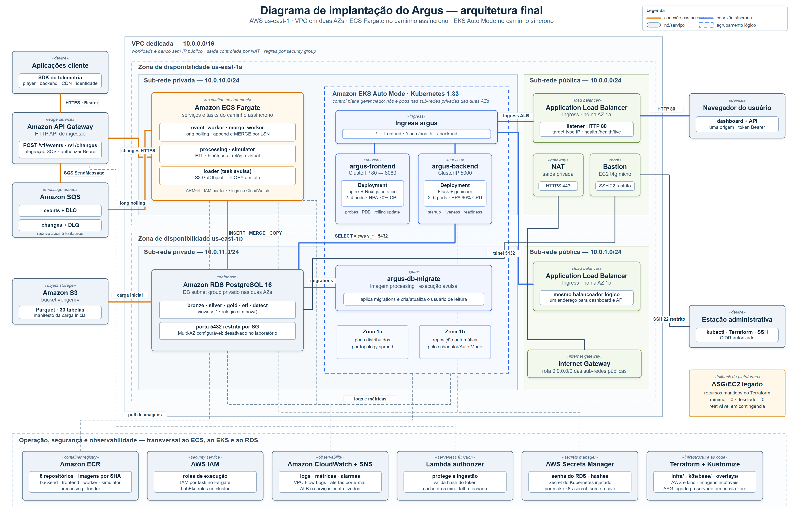
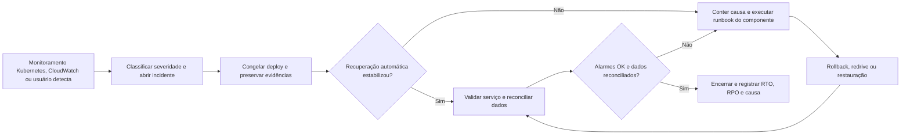

# Arquitetura final da aplicação

## 1. Diagrama de implantação

<div align="center">

<sub>Figura 1 - Diagrama de implantação da arquitetura final</sub>



<sup>Fonte: autoria própria (2026).</sup>

</div>

&emsp; O diagrama representa a arquitetura final. O caminho síncrono é
orquestrado pelo Amazon Elastic Kubernetes Service (EKS) Auto Mode, que provisiona e
remove automaticamente instâncias EC2 gerenciadas. Essas instâncias atuam como
*worker nodes* e hospedam os pods do frontend e do backend. O pipeline assíncrono
permanece no Amazon Elastic Container Service (ECS) Fargate. O Ollama é uma
integração externa e opcional usada somente para refinar a explicação final de uma
hipótese já publicada, sem participar da ingestão, do processamento ou da persistência.

&emsp; A topologia final tem correspondência direta entre o diagrama (Figura 1), a
lista de componentes (seção 1.2) e as conexões descritas na seção 1.1. O
caminho de leitura é atendido por um único balanceador público, o ALB criado
pelo Ingress do EKS, enquanto a Lambda de leitura e o website S3 funcionam
apenas como contingência manual (seção 3.2.3). O diagrama representa o estado
pretendido da arquitetura; as ressalvas de ensaio ao longo do texto indicam
onde a execução observada ainda difere dele, como os nós criados nas sub-redes
públicas (seção 1.2).

### 1.1 Escopo e leitura do diagrama

&emsp; O Linceu usa uma arquitetura distribuída híbrida dentro de uma Amazon Virtual Private
Cloud (VPC) própria na região `us-east-1` e, no diagrama, o limite externo da VPC, as
duas zonas de disponibilidade e as sub-redes públicas e privadas mostram onde os
recursos são implantados, enquanto as caixas internas representam serviços
gerenciados, ambientes de execução e artefatos de software. Os grupos tracejados,
como o cluster EKS, indicam apenas um agrupamento lógico e não uma nova sub-rede.
Os nós EC2 gerenciados aparecem nas sub-redes privadas, que é a topologia
pretendida; no ensaio de 24/09 o Auto Mode os criou nas sub-redes públicas, com
IP público, limitação descrita na seção 1.2.

&emsp; No diagrama, são usadas linhas laranja para o caminho assíncrono de escrita e
processamento, linhas azuis para o caminho síncrono de consulta e linhas cinzas
tracejadas para dependências operacionais, como imagens, segredos, logs e métricas.
Como algumas relações envolvem requisição e resposta ou operações nos dois sentidos,
as setas foram omitidas. As cores funcionam como principal referência visual para
mostrar que os dois caminhos compartilham o PostgreSQL, mas seguem gatilhos e
estratégias de escala diferentes.

1. Ingestão assíncrona. Aplicações cliente enviam eventos e mudanças ao API
   Gateway. A integração direta publica nas filas do Amazon Simple Queue Service
   (SQS). Depois, `event_worker` e
   `merge_worker`, executados no ECS Fargate, consomem em *long polling* e persistem
   os dados no Amazon Relational Database Service (RDS). O SQS absorve picos e as
   filas de mensagens não processadas (DLQs, do inglês *dead-letter queues*) isolam
   mensagens que falharam após cinco tentativas.
2. Processamento e carga. `processing` e `simulator` permanecem como serviços
   Fargate. O `loader` é uma task avulsa que lê os Parquets do bucket de origem e
   executa a carga em lote no banco.
3. Consulta síncrona. O navegador acessa um Application Load
   Balancer (ALB), criado pelo Ingress, que encaminha `/` ao frontend nginx e `/api`
   e `/health` à API Flask. Os dois `Services` são `ClusterIP`, portanto somente o
   Ingress publica o sistema externamente. Os pods são agendados em instâncias EC2
   gerenciadas que o EKS Auto Mode cria como nós quando a capacidade existente não
   comporta a carga. A API de leitura Lambda + API Gateway continua provisionada como
   contingência do caminho de leitura, mas o caminho síncrono principal representado no
   diagrama é atendido pelos Deployments `argus-frontend` e `argus-backend` no EKS.
   Quando o frontend usa a API real, a tela solicita automaticamente o refinamento da
   hipótese por `POST /api/v1/hypotheses/{id}/refinement`. Só então o backend envia a
   hipótese e suas evidências ao Ollama remoto por SSH, valida as fontes citadas na
   resposta e devolve a explicação final ao navegador.
4. Persistência. As consultas da API usam o usuário de leitura e as views `v_*`.
   O feedback de hipóteses é uma escrita controlada pela função `SECURITY DEFINER`
   `gold.submit_hypothesis_feedback`. Workers, loader e migrations usam credenciais
   de execução próprias do serviço, mas as tasks ECS compartilham a URL mestre e a
   task role configurada para o fluxo. A porta 5432 é privada e liberada somente
   pelos *security groups* previstos.
5. Operação. Amazon Elastic Container Registry (ECR), Identity and Access
   Management (IAM), Secrets Manager, CloudWatch, Simple Notification Service (SNS)
   e Terraform formam o plano transversal de imagens, identidade, segredos,
   observabilidade e infraestrutura como código. Kustomize descreve a orquestração
   dos componentes no EKS.

### 1.2 Componentes e justificativas

| Componente / nó | Responsabilidade e artefatos implantados | Justificativa técnica |
|---|---|---|
| Amazon API Gateway + Lambda authorizer | Expõe `POST /v1/events` e `POST /v1/changes`, integra diretamente com o SQS e valida o token Bearer pelo hash armazenado no Secrets Manager. | A integração direta reduz componentes intermediários e latência na borda. O authorizer centraliza a autenticação, usa cache de cinco minutos e falha de forma fechada quando o segredo não pode ser validado. |
| Amazon SQS e DLQs | Mantém filas independentes para eventos e mudanças, ambas com política de redrive para DLQ após cinco tentativas. | Desacopla recepção e processamento, absorve rajadas e preserva mensagens problemáticas para diagnóstico e reprocessamento sem bloquear toda a ingestão. |
| Amazon ECS Fargate | Executa os serviços `event_worker`, `merge_worker`, `processing` e `simulator`, além da task avulsa `loader`. | O pipeline assíncrono já recebe estado desejado, reinicialização e isolamento por task sem administrar servidores. Ele permanece no Fargate porque os consumidores precisam de IAM por task para acessar SQS, S3 e outros serviços AWS. |
| Amazon EKS Auto Mode | Orquestra o caminho síncrono no namespace `argus`, provisiona instâncias EC2 gerenciadas como *worker nodes* e reúne os Deployments do frontend e do backend, Services, Ingress, Horizontal Pod Autoscalers (HPAs), Pod Disruption Budgets (PDBs) e os Jobs `argus-db-migrate` e `argus-db-reader`. | Fornece reconciliação contínua, reposição de pods, escalonamento e *rolling update*; a escala dos pods pelo HPA depende do add-on `metrics-server`, ausente no ensaio de 21/09, declarado em `eks.tf` como `aws_eks_addon` e ativo no ensaio de 24/09 (seção 4). Quando faltam recursos para pods pendentes, o Auto Mode cria novos nós EC2 e, quando a capacidade deixa de ser necessária, pode removê-los. Ele também fornece rede e controlador de ALB gerenciados, compatíveis com as restrições de IAM do Learner Lab. |
| Ingress + Application Load Balancer | O Ingress cria um ALB que encaminha `/` para `argus-frontend` e `/api` e `/health` para `argus-backend`, registrando diretamente os IPs dos pods. | A origem única elimina o CORS entre dashboard e API, enquanto o registro direto dos IPs evita um salto adicional por `NodePort`. Este ALB do Ingress é o único balanceador público do caminho de leitura (seção 1.3). |
| Frontend | O `Deployment argus-frontend` serve o export estático do Next.js em nginx, com 2 réplicas mínimas, HPA até 4, sondas, PDB e atualização gradual. | O nginx no EKS permite compartilhar a origem com a API e manter a mesma imagem em diferentes ambientes. |
| API de leitura | O `Deployment argus-backend` executa a API Flask + gunicorn na porta 5000, com 2 a 6 pods, HPA por CPU, probes, PDB e `preStop`. Além das consultas determinísticas, expõe `POST /api/v1/hypotheses/{id}/refinement`. A Lambda Flask atrás de API Gateway continua provisionada como contingência do caminho de leitura (seção 3.2.3). | O EKS oferece reposição de pods, escala horizontal e *rolling update* para o caminho síncrono principal. No cluster do lab de 21/09 o HPA ficou em `cpu: <unknown>` porque o Auto Mode não trazia a API `metrics.k8s.io` ([registro](evidencias/carga-kubernetes.txt), linhas 17 a 23). Com o add-on `metrics-server` declarado em [`eks.tf`](../apps/fullstack/infra/eks.tf) como `aws_eks_addon`, o ensaio de 24/09 registrou `ScalingActive True ValidMetricFound` e `cpu: 0%/60%` ([registro](evidencias/carga-kubernetes-2026-09-24/hpa-e-cluster.txt)). O caminho da métrica está comprovado, mas um aumento de réplicas no EKS ainda não foi observado: a carga de 100 VUs manteve a CPU abaixo do alvo e o Deployment em 2 pods (seções 3.5 e 4). |
| Ollama remoto (opcional) | Refina a explicação apresentada ao usuário com base exclusiva na hipótese publicada e em suas evidências. O backend abre uma sessão SSH com o servidor externo e executa nele a chamada HTTP ao Ollama; cada afirmação retornada precisa citar uma fonte válida. | Mantém o modelo fora do motor determinístico: ele não cria hipóteses, não altera score ou evidências e não grava dados. Falha de rede, resposta inválida ou fonte inexistente resulta em `503`, sem resposta parcialmente fundamentada. A integração só é ativada quando `OLLAMA_URL` e as variáveis `OLLAMA_SSH_*` são fornecidas; os manifests Kubernetes base ainda não as injetam. |
| Migration e login de leitura | O `Job argus-db-migrate` usa a imagem `processing` para aplicar as migrations. Em seguida, o `Job argus-db-reader`, com a mesma imagem, executa `migrate.py criar-leitor --usuario argus_api` para criar ou atualizar o usuário de leitura usado pelo backend. `make k8s-migrate` roda os dois em sequência. | Migration e criação de login são execuções finitas, portanto Jobs representam melhor seu ciclo de vida no Kubernetes. A separação existe porque `aplicar` não cria o login: no lab limpo de 18/09, só com a migration o backend ficou `0/1` por falha de autenticação de `argus_api`. |
| Amazon RDS PostgreSQL 16 | Mantém as camadas `bronze`, `silver`, `gold`, `etl`, `detect`, o relógio `sim.now()` e as views `v_*`, com um DB subnet group que abrange as duas zonas de disponibilidade (AZs) e permite habilitar o modo Multi-AZ. | O modelo relacional preserva transações, constraints, MERGE por LSN e consultas analíticas, enquanto a instância privada e o usuário de leitura com menor privilégio reduzem a exposição. No laboratório, mantivemos o Multi-AZ desligado por custo, mas em produção ele deve ser habilitado. |
| VPC, sub-redes, Network Address Translation (NAT) e Internet Gateway | Mantém as tasks Fargate (`assign_public_ip = false`) e o RDS (`publicly_accessible = false`, DB subnet group só com as privadas) nas sub-redes privadas, enquanto o ALB do Ingress, o NAT e, se habilitado, o bastion ficam nas públicas. Limitação conhecida: o cluster EKS recebe as quatro sub-redes (`subnet_ids = concat(local.private_subnet_ids, local.public_subnet_ids)` em [`eks.tf`](../apps/fullstack/infra/eks.tf)) e não há NodeClass própria restringindo onde o Auto Mode cria nós, enquanto as públicas têm `map_public_ip_on_launch = true`; no ensaio de 24/09 os dois nós ficaram nas sub-redes públicas `10.0.0.0/24` e `10.0.1.0/24`, com IP público (`EXTERNAL-IP`), e os pods receberam IPs de `10.0.1.0/24` ([registro](evidencias/carga-kubernetes-2026-09-24/hpa-e-cluster.txt)). | A topologia em duas zonas reduz o domínio de falha, e o banco continua sem entrada direta da internet: a porta 5432 só aceita os security groups das tasks ECS, do cluster EKS e do bastion (e, se preenchido, `db_allowed_cidr`). O Terraform não declara regra de entrada da internet para os nós, que usam o security group do cluster criado pelo EKS, mas eles ficam endereçáveis publicamente. A correção prevista é uma NodeClass própria com `subnetSelectorTerms` apenas das privadas (seção 3.5). As tags `kubernetes.io/role/*` indicam ao EKS onde criar o ALB. |
| Bastion Host | É um componente opcional, criado somente quando `bastion_key_name` é preenchido. Quando habilitado, permite SSH e acesso administrativo controlado aos recursos privados. | Mantém um caminho administrativo sem expor o RDS diretamente. O bastion não faz parte obrigatória de toda implantação. |
| Amazon Simple Storage Service (S3) | O bucket `origem` ([`s3_origem.tf`](../apps/fullstack/infra/s3_origem.tf)) armazena os Parquets e o manifesto usados na carga inicial. O bucket do website do dashboard ([`frontend_s3.tf`](../apps/fullstack/infra/frontend_s3.tf), outputs `frontend_bucket` e `frontend_url`) hospeda o export estático do Next.js publicado por `make frontend-deploy` e é a contingência do dashboard. Buckets separados ([`vpc_logs.tf`](../apps/fullstack/infra/vpc_logs.tf)) recebem os VPC Flow Logs e os access logs de ALB. | O S3 oferece alta durabilidade para objetos imutáveis e evidências operacionais. O dashboard do caminho principal é servido pelo nginx no EKS; o website S3 só entra quando o Ingress está indisponível (seção 3.2.3). |
| Amazon ECR | Armazena seis imagens: `backend`, `frontend`, `worker`, `simulator`, `processing` e `loader`, publicadas com tag derivada do SHA. | A versão explícita torna o deploy rastreável e permite rollback sem a ambiguidade de `latest`. `backend`, `frontend` e `processing` são publicados para `amd64` e `arm64` (`IMAGES_MULTIARCH` no [`Makefile`](../apps/fullstack/Makefile)), pois os nós EKS e o Fargate usam arquiteturas diferentes e a imagem `processing` roda nos dois, como serviço Fargate e como Job de migration no EKS. As demais imagens são publicadas apenas para `arm64`. |
| CloudWatch + SNS | Mantém alarmes e logs dos componentes AWS. O SNS envia notificações quando `alarm_email` está preenchido e a assinatura foi confirmada. Os VPC Flow Logs são enviados para S3 por padrão, embora o destino CloudWatch possa ser configurado. Os pods EKS não possuem coleta centralizada de logs e métricas por padrão. | A observabilidade cobre principalmente filas, ECS, RDS, API Gateway, Lambda e infraestrutura Terraform; o dashboard CloudWatch `main` permanece em `observability.tf`, sem os widgets de ALB e ASG do caminho EC2 removido. O ambiente ainda depende de uma configuração adicional para acompanhar o EKS de forma centralizada. |
| IAM + Secrets Manager + Secret do Kubernetes | O IAM define os papéis de acesso e o Secrets Manager protege credenciais e hashes. O comando `make k8s-secret` cria o Secret `argus-backend` no cluster sem versionar esse recurso Kubernetes. Alguns valores relacionados ao EKS aparecem em outputs sensíveis e continuam no Terraform state. | IRSA e Pod Identity são bloqueados no Learner Lab. Por isso, os workloads EKS não chamam APIs AWS e os workers continuam usando IAM por task no Fargate. |
| Terraform + Kustomize | O Terraform provisiona a infraestrutura na AWS, enquanto a base Kustomize descreve os objetos comuns e os overlays `aws` e `kind` adaptam entrada, imagens, réplicas e configuração para cada ambiente. | Essa combinação mantém a infraestrutura e a orquestração reproduzíveis, revisáveis e portáveis. Os manifests são aplicados separadamente depois que o Terraform disponibiliza o cluster. |

### 1.3 Camada de execução no EKS Auto Mode

&emsp; O frontend e o backend são executados no EKS Auto Mode, com reposição automática
de pods, atualização gradual, HPA e PDB. O dashboard e a API são publicados pelo
mesmo Ingress e pelo mesmo ALB, permitindo compartilhar a origem e recuperar
rapidamente o caminho síncrono quando um contêiner falha. A escala pelo HPA
depende da API `metrics.k8s.io`, ausente no ensaio de 21/09 e fornecida pelo
add-on `metrics-server` declarado em `eks.tf`. No ensaio de 24/09 o HPA leu a
métrica de CPU (`ScalingActive True`), mas a carga não levou a um aumento de
réplicas no EKS (ressalva na seção 1.2 e limitação registrada na seção 3.5).

&emsp; O cluster é opcional no Terraform: `create_eks = false` é o padrão em
[`terraform.tfvars.example`](../apps/fullstack/infra/terraform.tfvars.example)
porque o control plane cobra por hora existindo e o orçamento do Learner Lab é
finito; o cluster é ligado com `create_eks = true` e desligado sem tocar no
restante do stack. O caminho de leitura não mantém um Auto Scaling Group nem um
ALB próprio, que duplicariam a API de leitura já atendida pelo EKS e um segundo
balanceador público pago em paralelo. O único balanceador público do caminho de
leitura é o ALB criado pelo Ingress do EKS, e a contingência desse caminho é a
Lambda de leitura atrás do API Gateway (output `read_api_url`, em `api_read.tf`)
com o website S3 do dashboard (`frontend_s3.tf`), conforme a seção 3.2.3.

&emsp; O Ollama entra somente depois que a API recupera uma hipótese já publicada. O
frontend solicita automaticamente sua explicação refinada, o backend limita o contexto
à hipótese e às evidências disponíveis e valida se todas as afirmações citam fontes
existentes antes de retornar a resposta ao usuário. Assim, a indisponibilidade do
modelo afeta apenas esse refinamento opcional e não interfere no pipeline determinístico.

&emsp; O EKS Auto Mode não elimina o uso de EC2. Quando o scheduler identifica pods pendentes
e os nós existentes não têm capacidade suficiente, o mecanismo de provisionamento do
Auto Mode cria novas instâncias EC2 gerenciadas para atuarem como *worker nodes*. O
scheduler então aloca os pods nesses nós, e os contêineres e processos da aplicação
são executados dentro dos pods.

&emsp; A escolha por duas plataformas foi intencional, já que o EKS atende às necessidades
do frontend e da API de leitura, enquanto o Fargate continua adequado para os workers
e para as tasks de processamento, que já são desacoplados pelo SQS e precisam de IAM
por task para acessar outros serviços da AWS.


## 2. Inventário de contêineres, Docker e Kubernetes

&emsp; Este inventário descreve os arquivos de implementação conferidos em
24/09/2026. O Kubernetes está configurado para executar o dashboard, a API de
consulta e dois `Jobs` de banco: as migrations e a criação do login de leitura. A API também registra
feedback de hipóteses pela função controlada `gold.submit_hypothesis_feedback`.
A ingestão e o processamento assíncrono continuam no ECS Fargate. As decisões
e os comandos estão detalhados no [inventário de contêineres](conteineres-final.md)
e no [runbook do Kubernetes](../apps/fullstack/k8s/README.md).

&emsp; No diagrama fornecido para a seção 1, o ALB público recebe o tráfego HTTP do
navegador e encaminha `/` ao frontend e `/api` e `/health` ao backend no EKS
Auto Mode. As tasks Fargate e o RDS ficam nas sub-redes privadas. Os nós EC2
gerenciados deveriam ficar nelas também, mas, como o cluster recebe as sub-redes
públicas e privadas sem NodeClass que as restrinja, o ensaio de 24/09 registrou
os dois nós nas sub-redes públicas, com IP público (limitação da seção 1.2). Os
dois caminhos compartilham o PostgreSQL, mas têm entradas e ciclos de escala
distintos. O desenho representa duas zonas de disponibilidade. No ensaio de
24/09, os dois nós estavam em sub-redes de zonas diferentes, mas os quatro pods
da aplicação ficaram no mesmo nó (`i-00a465e34dd02fa77`), conforme a seção 3.5.


### 2.1 Dockerfiles

&emsp; Cada Dockerfile tem dois estágios (`builder` e `runtime`) e fixa ambas as
imagens base por digest `sha256`. As cinco imagens Python usam o runtime
`python:3.12-slim-bookworm`. A do frontend usa nginx. Os comandos abaixo são
os padrões da imagem, exceto quando a task ECS ou o Job os substitui.

| Dockerfile | Build e conteúdo da imagem | Inicialização, usuário e health check | Relação com o diagrama |
|---|---|---|---|
| [`apps/fullstack/frontend/Dockerfile`](../apps/fullstack/frontend/Dockerfile) | `node:20` com `npm ci` e `npm run build` gera o export estático do Next.js. O estágio `nginx:1.27-alpine` copia `out/` e `nginx.conf`. | `CMD nginx -g 'daemon off;'`, usuário `nginx` (UID 101), porta 8080. `HEALTHCHECK` consulta `/healthz` a cada 30 s. | Imagem do `Deployment argus-frontend` no EKS ou kind, atrás do Ingress e do ALB. |
| [`apps/fullstack/backend/Dockerfile`](../apps/fullstack/backend/Dockerfile) | `uv` instala dependências do lockfile e o código no builder. `python:3.12-slim` recebe a `.venv` e `run.py`. | `CMD gunicorn` com 2 workers e 4 threads na porta 5000, usuário `argus` (UID 10001). `HEALTHCHECK` consulta `/health/live` a cada 30 s, sem depender do RDS. | Imagem do `Deployment argus-backend` no caminho síncrono. |
| [`apps/fullstack/worker/Dockerfile`](../apps/fullstack/worker/Dockerfile) | `uv` instala `common/` e `worker/` no builder. O runtime Python recebe a `.venv`. | `ENTRYPOINT python -m argus_worker`. A task ECS seleciona `event` ou `merge`. UID 10001. `HEALTHCHECK` a cada 30 s exige heartbeat com menos de 120 s. | Uma imagem para `event-worker` e `merge-worker` no ECS Fargate: consomem SQS e persistem os dados das mensagens no PostgreSQL. |
| [`apps/fullstack/processing/Dockerfile`](../apps/fullstack/processing/Dockerfile) | Builder `uv` com `common/` e `processing/`. Runtime Python inclui a `.venv`, `db/migrations/` e `tools/migrate.py`. | `ENTRYPOINT python -m argus_processing`, UID 10001. `HEALTHCHECK` de heartbeat a cada 30 s, com limite de 120 s. O Job substitui o comando por `python /app/tools/migrate.py aplicar`. | Serviço analítico no ECS e imagem reutilizada pelo `Job argus-db-migrate` no EKS. |
| [`apps/fullstack/simulator/Dockerfile`](../apps/fullstack/simulator/Dockerfile) | Builder `uv` com `common/` e `simulator/`. Runtime Python recebe a `.venv`. | `ENTRYPOINT python -m argus_simulator`, UID 10001. `HEALTHCHECK` de heartbeat a cada 30 s, com limite de 120 s. | Serviço ECS que gera eventos e mudanças no caminho assíncrono. |
| [`apps/fullstack/loader/Dockerfile`](../apps/fullstack/loader/Dockerfile) | Builder `uv` com `common/` e `loader/`. Runtime Python recebe a `.venv`. | `ENTRYPOINT python -m argus_loader`, UID 10001. Sem `HEALTHCHECK`, pois a task avulsa termina após a carga. | Task ECS que lê os Parquets do S3 e faz a carga inicial no PostgreSQL. |

&emsp; `worker`, `processing`, `simulator` e `loader` usam `apps/fullstack/` como
contexto de build para incluir `common/`. `backend` e `frontend` usam seus
próprios diretórios. O Makefile publica `backend`, `frontend` e `processing`
para `amd64` e `arm64`. `backend` e `frontend` precisam de `amd64` para os
nós EKS observados. A variante `arm64` é a plataforma padrão do build local
(`make images`) e atende aos ambientes ARM64. `processing` também precisa das duas
arquiteturas porque serve ao ECS Fargate ARM64 e ao Job no EKS `amd64`.
As imagens `worker`,
`simulator` e `loader` são publicadas apenas para ARM64, arquitetura padrão
das tasks Fargate atuais. Essa divisão deve ser revista se o tipo de nó ou a
arquitetura das tasks mudar.

&emsp; Arquivos auxiliares dos builds e da validação

| Arquivo | Função e relação com a implantação |
|---|---|
| [`apps/fullstack/.dockerignore`](../apps/fullstack/.dockerignore) | Limita o contexto compartilhado de `worker`, `processing`, `simulator` e `loader`. Exclui arquivos de ambiente, caches, dependências locais, estado Terraform, dados e logs antes do envio ao builder. |
| [`apps/fullstack/backend/.dockerignore`](../apps/fullstack/backend/.dockerignore) | Limita o contexto próprio do backend. Exclui ambiente local, caches, testes, artefatos de distribuição e logs da imagem da API. |
| [`apps/fullstack/frontend/.dockerignore`](../apps/fullstack/frontend/.dockerignore) | Limita o contexto próprio do frontend. Exclui `node_modules`, export anterior, arquivos de ambiente, saídas de teste e `public/build-info.json`. O Dockerfile instala dependências com `npm ci` e gera seu próprio build. |
| [`apps/fullstack/frontend/nginx.conf`](../apps/fullstack/frontend/nginx.conf) | Serve o export estático do Next.js na porta 8080. `try_files` resolve rotas com barra final e `index.html`. Os assets de `/_next/static/` recebem cache longo. `/healthz` responde às probes Kubernetes e `/health/live` ao health check comum do ALB, inclusive no target group do frontend. Usa logs em stdout/stderr e caminhos temporários em `/tmp`. |
| [`apps/fullstack/tools/verifica_manifests.py`](../apps/fullstack/tools/verifica_manifests.py) | Verificação offline chamada por `make k8s-validate`. Confere a ordem das rotas do Ingress, o build `amd64` das imagens executadas no EKS e a correspondência entre as chaves do Secret criadas pelo Makefile e as exigidas pelos pods. Complementa a renderização Kustomize. Não testa um cluster em execução. |

### 2.2 Execução local

| Arquivo ou entrada | Serviços iniciados e uso |
|---|---|
| [`backend/compose.yaml`](../apps/fullstack/backend/compose.yaml) | Sobe API e PostgreSQL 16. Banco em `127.0.0.1:55433` e API em `127.0.0.1:5000`. As migrations são aplicadas separadamente. |
| [`observability/docker-compose.yml`](../apps/fullstack/observability/docker-compose.yml) | Sobe Prometheus na porta 9090 e Grafana na 3001, restritos a `127.0.0.1`. |
| [`observability/prometheus.yml`](../apps/fullstack/observability/prometheus.yml) | Configuração do Prometheus local: raspa a si mesmo a cada 5 s e recebe as métricas do k6 por *remote write* em `/api/v1/write` durante os ensaios de carga. |
| [`observability/grafana/`](../apps/fullstack/observability/grafana/) | Provisionamento do Grafana local: fontes de dados Prometheus e CloudWatch e os painéis `argus-k6.json` (RNF01/02/03) e `resiliencia.json` (RNF04/05/11). |
| [`.devcontainer/devcontainer.json`](../apps/fullstack/.devcontainer/devcontainer.json) | Ambiente de desenvolvimento em contêiner (`python:1-3.12-bookworm` com Node 20, `uv` e Docker-in-Docker) aberto em `apps/fullstack`. Executa `make install frontend-install` na criação e encaminha as portas 3000, 5000 e 55432. Não é imagem implantada. |
| [`Makefile`](../apps/fullstack/Makefile), alvo `db-local` | Inicia PostgreSQL 16 na porta 55432, cria os bancos de desenvolvimento e teste e aplica as migrations. |
| [`k8s/overlays/kind/kind-cluster.yaml`](../apps/fullstack/k8s/overlays/kind/kind-cluster.yaml) | `kind-up` cria um cluster de um nó a partir deste arquivo e instala ingress-nginx e metrics-server. A entrada fica em `http://localhost:8080`. |
| [`k8s/overlays/kind/kustomization.yaml`](../apps/fullstack/k8s/overlays/kind/kustomization.yaml) | `k8s-apply` implanta frontend, backend, Ingress, PostgreSQL local e Secret gerado de `secret.env`. Os Jobs de migration e de login de leitura são aplicados separadamente por `k8s-migrate`. |

&emsp; Para reproduzir o caminho Kubernetes local, executar, da raiz:

```bash
make -C apps/fullstack kind-up
make -C apps/fullstack k8s-images kind-load
make -C apps/fullstack k8s-apply K8S_OVERLAY=kind
make -C apps/fullstack k8s-migrate K8S_OVERLAY=kind
```

&emsp; O kind valida o roteamento e os manifests. Seu nó único não demonstra
disponibilidade entre nós ou zonas.


### 2.3 Orquestração e infraestrutura Terraform

#### 2.3.1 Inventário dos arquivos Kubernetes

&emsp; Os caminhos abaixo partem de `apps/fullstack/k8s/`. Arquivos `kustomization.yaml`
compõem recursos, enquanto patches alteram os objetos da base. A configuração
do cluster kind e o exemplo de Secret são entradas de apoio, não recursos
criados por `kubectl apply`.

&emsp; Base comum aos ambientes

| Arquivo | Recurso e configuração principal | Relação com o diagrama |
|---|---|---|
| [`apps/fullstack/k8s/base/namespace.yaml`](../apps/fullstack/k8s/base/namespace.yaml) | Cria `Namespace argus`, isolando os objetos da aplicação. | Contorno lógico dos workloads EKS. Não representa uma sub-rede. |
| [`apps/fullstack/k8s/base/configmap.yaml`](../apps/fullstack/k8s/base/configmap.yaml) | Cria `ConfigMap argus-backend`: região `us-east-1`, log `INFO`, janela de 168 h, limite de 20.000 itens e `AUTH_REQUIRED=1`. Segredos ficam fora deste arquivo. | Configuração não sensível da API de leitura no EKS. |
| [`apps/fullstack/k8s/base/backend-deployment.yaml`](../apps/fullstack/k8s/base/backend-deployment.yaml) | Cria `Deployment argus-backend`: 2 réplicas, porta 5000, `RollingUpdate` 0/1, probes de startup/liveness/readiness, `preStop` de 10 s, `revisionHistoryLimit: 3`, ConfigMap e Secret (`DATABASE_URL`, `USER_ID_HASH_SALT`, `DASHBOARD_TOKEN_SHA256`). Recursos: *request* de 250m de CPU e 256Mi de memória, *limit* de 512Mi de memória. Segurança: UID 10001, `runAsNonRoot`, seccomp `RuntimeDefault`, `readOnlyRootFilesystem`, `allowPrivilegeEscalation: false`, *capabilities* `drop: ["ALL"]` e `/tmp` em `emptyDir`. Prefere espalhar por zona e nó (`maxSkew: 1`, `ScheduleAnyway`). | Pods Flask/Gunicorn nos nós EC2 gerenciados, ligados ao RDS. A *request* de CPU é a base do percentual do HPA, e o *limit* de memória faz um vazamento terminar em `OOMKilled` e reinício pelo kubelet, sem afetar os demais pods do nó. |
| [`apps/fullstack/k8s/base/backend-service.yaml`](../apps/fullstack/k8s/base/backend-service.yaml) | Cria `Service argus-backend` `ClusterIP` na porta 5000, selecionando os pods da API. | Destino interno do Ingress para `/api` e `/health`. |
| [`apps/fullstack/k8s/base/backend-hpa.yaml`](../apps/fullstack/k8s/base/backend-hpa.yaml) | Cria `HPA argus-backend`: 2 a 6 réplicas, alvo de 60% da *request* de CPU. Subida sem estabilização, até dobrar as réplicas a cada 30 s (`Percent 100`); descida estabilizada em 300 s, até metade a cada 60 s (`Percent 50`). | Escala declarada do caminho síncrono. Depende de `metrics.k8s.io`, fornecido pelo add-on `metrics-server` de `eks.tf`; métrica lida no EKS em 24/09 (`ScalingActive True`), sem aumento de réplicas observado. |
| [`apps/fullstack/k8s/base/backend-pdb.yaml`](../apps/fullstack/k8s/base/backend-pdb.yaml) | Cria `PDB argus-backend` com `minAvailable: 1` para interrupções voluntárias. | Preserva uma réplica da API durante drenagem planejada. |
| [`apps/fullstack/k8s/base/frontend-deployment.yaml`](../apps/fullstack/k8s/base/frontend-deployment.yaml) | Cria `Deployment argus-frontend`: 2 réplicas, nginx na porta 8080, `RollingUpdate` 0/1, probes `/healthz`, `preStop` de 5 s e preferência por zona (`ScheduleAnyway`). Recursos: *request* de 50m de CPU e 64Mi de memória, *limit* de 128Mi de memória. Mesmo `securityContext` do backend, com UID 101. | Pods do dashboard nos nós EC2 gerenciados. |
| [`apps/fullstack/k8s/base/frontend-service.yaml`](../apps/fullstack/k8s/base/frontend-service.yaml) | Cria `Service argus-frontend` `ClusterIP`, porta 80 para a porta 8080 do contêiner. | Destino interno do Ingress para `/`. |
| [`apps/fullstack/k8s/base/frontend-hpa.yaml`](../apps/fullstack/k8s/base/frontend-hpa.yaml) | Cria `HPA argus-frontend`: 2 a 4 réplicas, alvo de CPU de 70%. | Escala declarada do dashboard no caminho síncrono. |
| [`apps/fullstack/k8s/base/frontend-pdb.yaml`](../apps/fullstack/k8s/base/frontend-pdb.yaml) | Cria `PDB argus-frontend` com `minAvailable: 1` para interrupções voluntárias. | Preserva uma réplica do dashboard durante drenagem planejada. |
| [`apps/fullstack/k8s/base/ingress.yaml`](../apps/fullstack/k8s/base/ingress.yaml) | Cria `Ingress argus` com `/api` e `/health` para backend:5000 e `/` para frontend:80, na mesma origem. | Entrada lógica do ALB público representado no diagrama. |
| [`apps/fullstack/k8s/base/kustomization.yaml`](../apps/fullstack/k8s/base/kustomization.yaml) | Compõe Namespace, ConfigMap, Deployments, Services, HPAs, PDBs e Ingress. Não inclui o Job de migration. | Define a base comum da aplicação EKS e do equivalente local. |

&emsp; Migration separada

| Arquivo | Recurso e configuração principal | Relação com o diagrama |
|---|---|---|
| [`apps/fullstack/k8s/migrate/job-db-migrate.yaml`](../apps/fullstack/k8s/migrate/job-db-migrate.yaml) | Cria `Job argus-db-migrate` com a imagem `processing`, comando `python /app/tools/migrate.py aplicar`, `backoffLimit: 2`, `activeDeadlineSeconds: 900`, `restartPolicy: Never`, `ttlSecondsAfterFinished: 3600` e credencial mestre do Secret. Recursos: *request* de 250m de CPU e 512Mi, *limit* de 1Gi de memória; mesmo `securityContext` restritivo dos Deployments. Aplica as 33 migrations de `db/migrations/`. | Migration pontual entre EKS e PostgreSQL privado. |
| [`apps/fullstack/k8s/migrate/job-db-reader.yaml`](../apps/fullstack/k8s/migrate/job-db-reader.yaml) | Cria `Job argus-db-reader` com a mesma imagem e o mesmo Secret, `args: ["criar-leitor", "--usuario", "argus_api"]`, `backoffLimit: 2`, `activeDeadlineSeconds: 300`, `restartPolicy: Never` e `ttlSecondsAfterFinished: 3600`. Usa `DATABASE_URL_MASTER` e `DB_READER_PASSWORD`; *request* de 100m e 256Mi, *limit* de 512Mi. | Cria ou atualiza o login de leitura que o backend usa no RDS. Roda depois da migration, pois concede o papel criado na migration 001. |
| [`apps/fullstack/k8s/migrate/kustomization.yaml`](../apps/fullstack/k8s/migrate/kustomization.yaml) | Compõe os dois Jobs de banco, separados da base porque o template de Job é imutável. `make k8s-migrate` apaga e aplica um de cada vez, filtrando pelo label, e espera o primeiro terminar. | Permite executar migration e login de leitura separadamente dos Deployments. |

&emsp; Overlay AWS

| Arquivo | Recurso e configuração principal | Relação com o diagrama |
|---|---|---|
| [`apps/fullstack/k8s/overlays/aws/ingressclass.yaml`](../apps/fullstack/k8s/overlays/aws/ingressclass.yaml) | Cria `IngressClassParams` e `IngressClass argus-alb` para `eks.amazonaws.com/alb`, com esquema público. | Vincula o Ingress ao ALB gerenciado pelo EKS Auto Mode. |
| [`apps/fullstack/k8s/overlays/aws/ingress-patch.yaml`](../apps/fullstack/k8s/overlays/aws/ingress-patch.yaml) | Altera `Ingress argus`: ALB público (`internet-facing`), alvos por IP de pod, listener HTTP 80, health check `/health/live` a cada 15 s (2 sucessos para saudável, 3 falhas para não saudável) e `deregistration_delay` de 30 s. | Liga o ALB às duas aplicações sem expor seus Services diretamente. |
| [`apps/fullstack/k8s/overlays/aws/kustomization.yaml`](../apps/fullstack/k8s/overlays/aws/kustomization.yaml) | Compõe a base, a classe de Ingress e o patch. As imagens ECR são injetadas pelo Makefile. Não gera o Secret. | Seleciona a implantação AWS do caminho síncrono. |

&emsp; O esquema do ALB aparece em dois arquivos deste overlay e os dois declaram o
mesmo valor, `internet-facing` (ALB público), portanto não há divergência:
`ingressclass.yaml` o define em `IngressClassParams.spec.scheme` e
`ingress-patch.yaml` o repete na anotação `alb.ingress.kubernetes.io/scheme` do
próprio `Ingress`. O controlador embutido do EKS Auto Mode resolve o esquema a
partir desses dois pontos; eles são mantidos idênticos de propósito, de modo que
a ordem de precedência entre eles é indiferente para o resultado e nenhum deles
sobrepõe o outro com um valor diferente. Assim, o único balanceador público do
caminho de leitura (seção 1.3) é sempre `internet-facing`, e esta arquitetura
não configura ALB interno em nenhum dos dois arquivos.

&emsp; Overlay kind

| Arquivo | Recurso e configuração principal | Relação com o diagrama |
|---|---|---|
| [`apps/fullstack/k8s/overlays/kind/kind-cluster.yaml`](../apps/fullstack/k8s/overlays/kind/kind-cluster.yaml) | Configura o kind com um nó control-plane e mapeia `localhost:8080` para a porta 80 do ingress-nginx. Não é recurso aplicado pelo Kubernetes. | Reproduz localmente a entrada única do navegador. |
| [`apps/fullstack/k8s/overlays/kind/kustomization.yaml`](../apps/fullstack/k8s/overlays/kind/kustomization.yaml) | Compõe base, PostgreSQL local e patches. Substitui imagens por tags `:dev` e gera `Secret argus-backend` de `secret.env`. | Versão local da topologia EKS, sem ALB ou RDS. |
| [`apps/fullstack/k8s/overlays/kind/postgres.yaml`](../apps/fullstack/k8s/overlays/kind/postgres.yaml) | Cria `Deployment` e `Service argus-postgres` com PostgreSQL 16, porta 5432, armazenamento `emptyDir` e readiness por `psql SELECT 1`. | Substitui o RDS apenas no ensaio local. |
| [`apps/fullstack/k8s/overlays/kind/config-patch.yaml`](../apps/fullstack/k8s/overlays/kind/config-patch.yaml) | Altera o ConfigMap: `AUTH_REQUIRED=0`, log `DEBUG` e origens localhost. | Adapta a API à autenticação e ao endereço locais. |
| [`apps/fullstack/k8s/overlays/kind/hpa-patch.yaml`](../apps/fullstack/k8s/overlays/kind/hpa-patch.yaml) | Altera os dois HPAs para 1 a 2 réplicas no nó único. | Reduz a escala dos dois Deployments em relação ao EKS do diagrama. |
| [`apps/fullstack/k8s/overlays/kind/ingress-patch.yaml`](../apps/fullstack/k8s/overlays/kind/ingress-patch.yaml) | Altera a classe de `Ingress argus` para `nginx`, preservando as rotas da base. | Substitui o ALB pelo ingress-nginx local. |
| [`apps/fullstack/k8s/overlays/kind/replicas-patch.yaml`](../apps/fullstack/k8s/overlays/kind/replicas-patch.yaml) | Altera os dois Deployments para uma réplica e reduz as *requests* (backend 100m e 192Mi, frontend 20m e 32Mi). O backend usa um worker Gunicorn. | Permite ensaiar dashboard e API no nó único. |
| [`apps/fullstack/k8s/overlays/kind/migrate/kustomization.yaml`](../apps/fullstack/k8s/overlays/kind/migrate/kustomization.yaml) | Compõe os dois Jobs de `k8s/migrate/` (migration e login de leitura) com a imagem local `argus-processing:dev`. | Aplica ao PostgreSQL local a mesma migration e o mesmo login da arquitetura AWS. |
| [`apps/fullstack/k8s/overlays/kind/secret.env.example`](../apps/fullstack/k8s/overlays/kind/secret.env.example) | Modelo de cinco chaves locais usado para gerar o Secret. Não é manifesto Kubernetes nem contém os segredos AWS. | Fornece ao backend e ao Job credenciais do banco descartável do kind. |
| `apps/fullstack/k8s/overlays/kind/secret.env` (não versionado) | Entrada local do `secretGenerator`, gerada localmente a partir de `secret.env.example` e listada no `.gitignore` da raiz; somente o `.example` é versionado. Não é manifesto aplicado diretamente. Os valores não são reproduzidos neste documento. | Gera `Secret argus-backend` para backend e Job no kind; não é a fonte do Secret EKS. |

&emsp; O Secret Kubernetes `argus-backend` consumido pelo backend e pelos Jobs é criado
no EKS por `make k8s-secret`, a partir dos outputs do Terraform, com cinco
chaves: `DATABASE_URL`, `DATABASE_URL_MASTER`, `DB_READER_PASSWORD`,
`USER_ID_HASH_SALT` e `DASHBOARD_TOKEN_SHA256`. No kind, o
`secretGenerator` do overlay usa `secret.env`, gerado localmente a partir de
`secret.env.example` e ignorado pelo Git pela regra em `.gitignore` da raiz;
apenas o modelo é versionado. Os valores do Secret EKS não constam dos
manifests.

#### 2.3.2 Infraestrutura Terraform

&emsp; Os arquivos abaixo ficam em [`apps/fullstack/infra/`](../apps/fullstack/infra/).
A coluna "nó do diagrama" indica o elemento da seção 1 que cada arquivo
materializa.

| Arquivo | Recursos principais | Nó do diagrama |
|---|---|---|
| [`api_read.tf`](../apps/fullstack/infra/api_read.tf) | `aws_lambda_function read_api` (Flask em `python3.12`), `aws_apigatewayv2_api read` com stage, integração e rotas `GET /`, `GET /{proxy+}` e `POST /api/v1/hypotheses/{id}/feedback`, papel IAM, log groups e alarme de erros; output `read_api_url`. | Contingência da API de leitura (Lambda + API Gateway). |
| [`apigateway.tf`](../apps/fullstack/infra/apigateway.tf) | `aws_apigatewayv2_api events`, integração `SQS-SendMessage`, rota `POST /v1/events`, stage, papel `apigw_sqs` e log group. | API Gateway de ingestão. |
| [`apigateway_changes.tf`](../apps/fullstack/infra/apigateway_changes.tf) | Integração `SQS-SendMessage` e rota `POST /v1/changes` na mesma API de ingestão. | API Gateway de ingestão (mudanças). |
| [`auth.tf`](../apps/fullstack/infra/auth.tf) | `aws_lambda_function authorizer`, dois `aws_apigatewayv2_authorizer` (leitura e ingestão), segredos `auth-tokens` e `ingest-token`, rotas públicas `GET /health/live`, `GET /docs` e `GET /openapi.json` e alarme de negações. | Lambda authorizer e Secrets Manager. |
| [`bastion.tf`](../apps/fullstack/infra/bastion.tf) | `aws_instance bastion` (AL2023, criado só quando `bastion_key_name` é preenchido), security group e regras de SSH, HTTPS e acesso à aplicação e ao RDS. | Bastion Host opcional na sub-rede pública. |
| [`ecr.tf`](../apps/fullstack/infra/ecr.tf) | `aws_ecr_repository images` (`for_each` nas seis imagens) e `aws_ecr_lifecycle_policy`. | Amazon ECR. |
| [`ecs.tf`](../apps/fullstack/infra/ecs.tf) | `aws_ecs_cluster main` com Container Insights, log groups por serviço, security group das tasks com saída HTTPS e acesso ao RDS, e as task definitions e services `event_worker` e `merge_worker`. | ECS Fargate (workers de SQS). |
| [`ecs_processing.tf`](../apps/fullstack/infra/ecs_processing.tf), [`ecs_simulator.tf`](../apps/fullstack/infra/ecs_simulator.tf) | Task definition e service de `processing` e de `simulator`, uma task cada quando habilitados. | ECS Fargate (processamento e simulador). |
| [`ecs_loader.tf`](../apps/fullstack/infra/ecs_loader.tf), [`ecs_migration.tf`](../apps/fullstack/infra/ecs_migration.tf) | Task definitions avulsas do `loader` e da migration alternativa por ECS, executadas pelos outputs `loader_run_command` e `migration_run_command`. | ECS Fargate (carga inicial); alternativa ao Job de migration do EKS. |
| [`eks.tf`](../apps/fullstack/infra/eks.tf) | `aws_eks_cluster main` em Auto Mode (`create_eks`, `eks_version`, `eks_node_pools`), access entry e policy association dos administradores, papéis descobertos por `data aws_iam_roles` e `aws_eks_addon metrics-server`. | Amazon EKS Auto Mode. |
| [`frontend_s3.tf`](../apps/fullstack/infra/frontend_s3.tf) | Website hosting, criptografia, public access block e policy de leitura do bucket do dashboard; o bucket em si nasce fora do Terraform por restrição da SCP do lab. | Contingência do dashboard (website S3). |
| [`iam.tf`](../apps/fullstack/infra/iam.tf) | Papéis `task-execution` e `task` do ECS com as policies `worker`, `db-secret` e `ingest-token`. | IAM (identidade por task no Fargate). |
| [`locals.tf`](../apps/fullstack/infra/locals.tf) | Nome do stack, seleção de VPC e sub-redes, lista de imagens e URIs no ECR, ARNs de papéis, `database_url`, variáveis comuns dos contêineres, origens do dashboard e nomes dos buckets; `data` de conta, região e VPC padrão. | Transversal. |
| [`observability.tf`](../apps/fullstack/infra/observability.tf) | `aws_sns_topic alarms` com assinatura por e-mail, 17 blocos `aws_cloudwatch_metric_alarm` (DLQs, backlog das filas, serviços fora do ar, 5xx da API, RDS, análise, `lag_sim` e fonte silenciosa) e o dashboard CloudWatch `main`, sem widgets de ALB e ASG. | CloudWatch + SNS. |
| [`outputs.tf`](../apps/fullstack/infra/outputs.tf) | Endpoints de ingestão e leitura, filas, banco, ECR, comandos de operação (`docker_push_commands`, `loader_run_command`, `migration_run_command`), `frontend_url`, `frontend_bucket`, `read_api_url`, `dashboard_url` e as saídas `eks_*`, incluindo as sensíveis usadas por `make k8s-secret`. | Transversal (entrada do Kustomize e dos runbooks). |
| [`providers.tf`](../apps/fullstack/infra/providers.tf), [`versions.tf`](../apps/fullstack/infra/versions.tf) | Provider `aws` na região configurada com `default_tags`; Terraform `>= 1.9`, `hashicorp/aws ~> 5.60` e `hashicorp/random ~> 3.6`. | Transversal. |
| [`rds.tf`](../apps/fullstack/infra/rds.tf) | `aws_db_instance main` (PostgreSQL 16, `multi_az` e retenção de backup por variável), subnet group nas duas AZs, parameter group, senha em `random_password` e Secrets Manager, security group e regras de entrada na porta 5432 para tasks ECS, pods EKS e bastion. | Amazon RDS PostgreSQL 16. |
| [`s3_origem.tf`](../apps/fullstack/infra/s3_origem.tf) | Versionamento, criptografia, public access block e ciclo de vida do bucket `origem`; output `origem_bucket`. | S3 (bucket de origem da carga). |
| [`sqs.tf`](../apps/fullstack/infra/sqs.tf), [`sqs_changes.tf`](../apps/fullstack/infra/sqs_changes.tf) | Filas `events` e `changes`, cada uma com DLQ, política de redrive e policy de envio pelo API Gateway. | Amazon SQS e DLQs. |
| [`variables.tf`](../apps/fullstack/infra/variables.tf) | Entradas do stack: região e nome, rede, banco, filas, imagens e tags, `create_eks`, `eks_*`, `bastion_key_name`, `alarm_email` e limiares dos alarmes. | Transversal. |
| [`vpc.tf`](../apps/fullstack/infra/vpc.tf) | `aws_vpc main`, duas sub-redes públicas e duas privadas derivadas de `vpc_cidr`, Internet Gateway, um NAT Gateway com EIP, tabelas de rota e endpoint gateway do S3. | VPC, sub-redes, NAT e Internet Gateway. |
| [`vpc_logs.tf`](../apps/fullstack/infra/vpc_logs.tf) | `aws_flow_log vpc` com bucket S3, policy, log group e papel de entrega, além do bucket de access logs de ALB. | S3 e CloudWatch (evidências operacionais). |

&emsp; A arquitetura não inclui os arquivos `asg.tf`, `alb.tf` e `asg_observability.tf`,
as variáveis `asg_*`, `app_instance_type` e `instance_profile_name` nem os
outputs `alb_dns_name`, `api_url_alb`, `alb_zone_id` e `asg_name`, pois um
caminho EC2 duplicaria a API de leitura que o EKS já atende e manteria um
segundo balanceador público pago em paralelo ao ALB do Ingress.

&emsp; O [Makefile](../apps/fullstack/Makefile) contém alvos de publicação de imagens,
renderização dos overlays com `k8s-validate` e aplicação separada do `Job` e
dos Deployments. O [runbook](../apps/fullstack/k8s/README.md) define a ordem de
execução: criar o Secret `argus-backend`, executar o Job de migrations e então
aplicar os Deployments no EKS. No kind, `k8s-apply` cria primeiro o PostgreSQL
local e as aplicações, e `k8s-migrate` executa os dois Jobs em seguida. No EKS,
frontend e backend partem de duas réplicas. Os HPAs
declaram 2 a 4 e 2 a 6 réplicas, respectivamente. A API de métricas respondeu
no ensaio de 24/09, mas o aumento efetivo de réplicas no EKS ainda não foi
observado, conforme a seção 3.

&emsp; O [backend](../apps/fullstack/backend/README.md) oferece o refinamento opcional
de uma hipótese já publicada por `POST /api/v1/hypotheses/{id}/refinement`.
O frontend solicita esse refinamento automaticamente ao abrir a hipótese com a
API real.
Quando `OLLAMA_URL` e as variáveis `OLLAMA_SSH_*` são fornecidas, ele consulta
o Ollama remoto por SSH e valida as fontes citadas antes de devolver a
explicação. Essa é a integração externa representada na seção 1. Ela não cria
hipóteses, não altera o score e não grava dados. O Ollama não compõe as seis
imagens do projeto, e os manifests Kubernetes base não injetam essas variáveis
nem implantam o servidor. Portanto, o caminho é arquiteturalmente previsto,
mas sua execução no EKS não está demonstrada pelas evidências da seção 4.


## 3. Plano de recuperação de falhas

&emsp; O plano adota Kubernetes no caminho síncrono: frontend e backend executam no
cluster, cada um em seu próprio Deployment e Service, sob um Ingress comum.
Dois Jobs executam as migrations e criam o login de leitura. PostgreSQL, API Gateway, SQS, workers, simulador e
processamento analítico continuam nos serviços AWS existentes e não são
migrados para Kubernetes.

&emsp; O Ollama remoto é uma dependência opcional apenas da explicação refinada. A
consulta determinística de hipóteses e o pipeline de ingestão não dependem da
disponibilidade desse serviço externo.

&emsp; O plano parte de quatro princípios. Uma mensagem aceita não pode desaparecer
silenciosamente. Um componente sem estado deve ser substituído sem reparo
manual. Uma versão defeituosa deve voltar a uma versão conhecida. Toda
recuperação termina com reconciliação de dados, além da condição `Ready`.

&emsp; Os tempos desta seção são metas operacionais propostas, ainda não SLAs
contratados. RTO é o tempo máximo desejado para restabelecer o serviço. RPO é
a perda máxima de dados admitida. Para a ingestão, o compromisso de RPO começa
depois que o API Gateway responde sucesso e o SQS confirma que recebeu a
mensagem. Uma requisição que recebe `5xx` antes de entrar na fila precisa ser
reenviada pelo produtor e não está coberta pelo RPO do pipeline.

### 3.1 Objetivos e níveis de severidade

#### 3.1.1 Metas de recuperação

| Escopo da falha | Meta de indisponibilidade do serviço | Meta de recomposição | Meta de RPO | Condição para cumprir a meta |
|---|---:|---:|---:|---|
| Um pod de frontend ou backend | Sem interrupção percebida | Até 2 min para recuperar a réplica | 0 para o serviço sem estado | Outra réplica `Ready`, capacidade livre e dependências saudáveis. |
| Perda abrupta de um nó | Sem interrupção percebida | Até 5 min para reagendar as réplicas | 0 para o serviço sem estado | Réplicas efetivamente distribuídas e capacidade em outro nó. O PDB não protege a queda abrupta. |
| Publicação defeituosa | Até 10 min | Até 10 min após rollback executado pelo operador | 0 para o serviço sem estado | Revisão anterior e imagem preservadas. Não há reversão automática no Deployment. |
| Falha completa do Ingress ou cluster | Até 30 min | Depende do reparo ou do fallback manual | 0 para frontend e backend sem estado | Destino S3/Lambda previamente implantado e testado, além de RDS disponível. A meta ainda não foi comprovada. |
| Queda de task ECS consumidora | Até 5 min para retomar o consumo | Até 5 min para repor a task | 0 para mensagens retidas e reconciliadas | Serviço habilitado, retenção remanescente suficiente e operações idempotentes. |
| Todos os consumidores indisponíveis | Até 30 min para reativar o consumo | Drenagem depende do backlog | 0 somente para mensagens ainda retidas ou na DLQ e reconciliadas | Medir a idade da mensagem mais antiga no início da falha. |
| Falha de instância ou zona do RDS | Até 15 min em produção | Failover depende do Multi-AZ | 0 no failover Multi-AZ | `db_multi_az = true`. O ambiente `dev` atual não tem essa configuração. |
| Corrupção lógica do RDS | Até 4 h | Restauração e reconciliação dentro do RTO | Até 5 min como meta | Backup e logs disponíveis. Um restore completo ainda não foi ensaiado. |
| Perda total da região ou conta | Até 24 h como meta | Recriação fora da região/conta pelo procedimento da seção 3.3.5 | Até 24 h como meta | Cópia externa de backup e estado Terraform ainda não implementada; sem ela, o procedimento da seção 3.3.5 não é executável. |

&emsp; As filas principais retêm mensagens por quatro dias e as DLQs, por 14 dias.
A janela que resta no início do incidente depende da idade das mensagens já
enfileiradas. Para cada fila, calcular quatro dias menos a idade da mensagem
mais antiga, considerar o momento do redrive e reconciliar os identificadores.
Esses prazos não são RTO nem garantem RPO zero por quatro dias após a falha.
As metas de perda abrupta de nó, rollback Kubernetes, restauração do RDS e
troca de entrada ainda não foram medidas de ponta a ponta. Os exercícios da
seção 3.4 definem como verificá-las. Até haver registros na seção 4, elas
permanecem objetivos, não tempos alcançados.

#### 3.1.2 Classificação e responsabilidade

| Severidade | Critério | Impacto | Acionamento e responsáveis |
|---|---|---|---|
| SEV-1: crítica | Ingress, cluster, ingestão ou RDS indisponível. Nenhum pod de backend `Ready`, risco de perda ou backlog perto da retenção também se enquadram. | Perda de visibilidade operacional ou indisponibilidade total. | Alerta imediato. Infraestrutura coordena, dados protege e valida o banco, e aplicação trata código e versão. |
| SEV-2: alta | Deployment abaixo das réplicas mínimas, HPA no limite, ECS abaixo do desejado, DLQ com mensagens, fila envelhecendo ou erros e latência elevados. | Degradação parcial, dado atrasado ou capacidade sem margem. | Atendimento em até 15 min por infraestrutura, com apoio do dono do serviço. |
| SEV-3: moderada | Pod substituído com sucesso, mensagem inválida isolada ou alarme recuperado sem impacto visível. | Redundância reduzida ou ocorrência isolada. | Triagem no mesmo turno. Registrar causa, confirmar recuperação e abrir correção se houver recorrência. |

&emsp; A indisponibilidade isolada do refinamento por Ollama deve ser triada como
degradação parcial, sem classificar o pipeline determinístico como indisponível.

&emsp; Os responsáveis são definidos por papel para que o plano continue válido
quando a equipe mudar. Em uma SEV-1, apenas o coordenador do incidente declara
o encerramento, depois da validação conjunta de infraestrutura, aplicação e
dados.


### 3.2 Estratégias de recuperação

#### 3.2.1 Replicação, isolamento e retenção

| Componente | Estratégia adotada | Comportamento durante a falha | Arquivos relacionados |
|---|---|---|---|
| Frontend no Kubernetes | Deployment com 2 réplicas, Service `ClusterIP`, `RollingUpdate`, HPA declarado de 2 a 4 pods, PDB e preferência de distribuição por zona | o Service remove pods não prontos. O ReplicaSet recria pods e o scheduler os reposiciona em nós saudáveis | manifests de Deployment, Service, HPA e PDB do frontend |
| Backend no Kubernetes | Deployment com 2 réplicas, Service `ClusterIP`, `RollingUpdate`, HPA declarado de 2 a 6 pods, PDB e preferência de distribuição por zona e nó (`ScheduleAnyway`, não garantida: em 24/09 as duas réplicas ficaram no mesmo nó, seção 3.5) | requisições seguem apenas para pods `Ready`. O Deployment recompõe réplicas sem estado | manifests de Deployment, Service, ConfigMap, Secret, HPA e PDB do backend |
| Entrada HTTP | Ingress cria um ALB público de origem única: `/api` e `/health` seguem para o backend. `/` e demais caminhos seguem para o frontend | elimina URL fixa no bundle e concentra a troca de destino. Falha da entrada afeta os dois serviços e é tratada como SEV-1 | manifest de Ingress e configuração do controlador do EKS Auto Mode |
| Ollama remoto opcional | Backend usa uma sessão SSH para solicitar o refinamento e valida as fontes da resposta. A integração depende de configuração fora dos manifests base | falha de rede, resposta inválida ou fonte inexistente afeta apenas a rota de refinamento, que responde `503`. Hipóteses publicadas e evidências continuam consultáveis | `apps/fullstack/backend/src/telemetry/infrastructure/ollama.py`, `apps/fullstack/backend/README.md` |
| API de ingestão | API Gateway integra diretamente com duas filas SQS independentes | a borda não depende da disponibilidade dos workers. Eventos e mudanças acumulam separadamente | `apps/fullstack/infra/apigateway.tf`, `apps/fullstack/infra/apigateway_changes.tf`, `apps/fullstack/infra/sqs.tf`, `apps/fullstack/infra/sqs_changes.tf` |
| `event-worker` e `merge-worker` | serviços ECS Fargate mantêm o número desejado de tasks. Filas persistem trabalho pendente | a queda do consumidor não interrompe a aceitação. A mensagem volta a ficar visível se não for confirmada | `apps/fullstack/infra/ecs.tf` |
| Processamento e simulador | serviços ECS mantêm uma task quando habilitados | ECS substitui a task. Checkpoints, watermarks, leases e o relógio persistem no PostgreSQL | `apps/fullstack/infra/ecs_processing.tf`, `apps/fullstack/infra/ecs_simulator.tf`, `apps/fullstack/db/migrations/` |
| Mensagens problemáticas | cinco tentativas antes do redrive nativo. Quarentena explícita de payload inválido. DLQ com retenção de 14 dias | um item defeituoso é isolado sem bloquear os itens válidos. O redrive é manual depois da correção | `apps/fullstack/infra/sqs.tf`, `apps/fullstack/infra/sqs_changes.tf`, `apps/fullstack/infra/iam.tf`, `apps/fullstack/worker/src/argus_worker/` |
| PostgreSQL | armazenamento criptografado, backup automático e opção Multi-AZ. Proteção contra exclusão e snapshot final em `prod` | Multi-AZ permite failover da instância. Backup permite reconstrução em falha lógica | `apps/fullstack/infra/rds.tf`, `apps/fullstack/infra/variables.tf` |
| Versões executáveis | imagens de frontend e backend separadas no registry e marcadas pelo SHA da revisão do código | O rollback depende de preservar a revisão e a imagem anterior no registry, sem depender de `latest`. | Dockerfiles do frontend e backend, manifests Kubernetes e pipeline de publicação |

&emsp; O limite do cluster é intencional: apenas frontend, backend e os `Jobs` de
migration e login de leitura entram no Kubernetes. Colocar SQS, PostgreSQL ou consumidores no cluster duplicaria
serviços gerenciados e ampliaria o domínio de falha. Os workers continuam em
ECS Fargate e se comunicam com SQS e RDS sem depender do Ingress ou dos pods da
camada web.

&emsp; O `event-worker` aceita sobreposição durante uma publicação porque a
escrita é idempotente por identificador. O `merge-worker`, o processamento e o
simulador param a versão anterior antes de iniciar a nova para evitar duas
instâncias concorrendo pelo mesmo estado. Nesses serviços, a continuidade vem
da fila e dos checkpoints persistidos, não de duas tasks ativas ao mesmo tempo.

#### 3.2.2 Health checks e reinicialização

&emsp; No backend, a `startupProbe` e a `livenessProbe` consultam
`GET /health/live`, rota que verifica apenas se o processo Flask/Gunicorn está
vivo. A `readinessProbe` consulta `GET /health/ready`, que também verifica o
PostgreSQL. Essa separação evita reiniciar um processo saudável durante uma
falha do banco: o pod permanece em execução, mas sai temporariamente dos
Endpoints do Service e deixa de receber tráfego.

&emsp; No frontend, as três probes consultam uma rota local `/healthz` servida pelo
Nginx. Falha de liveness faz o kubelet reiniciar o contêiner. Falha de readiness
retira o pod do Service sem encerrá-lo. No overlay AWS, os Deployments
partem de duas réplicas e usam `RollingUpdate` com `maxUnavailable: 0` e
`maxSurge: 1`, para
que uma nova versão só substitua a anterior depois de ficar pronta.

&emsp; Os parâmetros declarados sustentam as estimativas, mas não fixam um RTO:

| Aplicação | Startup | Liveness | Readiness | Entrada em serviço e encerramento |
|---|---|---|---|---|
| Backend | `/health/live`, período 3 s, 20 falhas. Janela nominal de até 60 s. | `/health/live`, período 10 s, timeout 3 s, 3 falhas. | `/health/ready`, período 5 s, timeout 3 s, 3 falhas. | `minReadySeconds: 10`, `preStop: 10 s`, `terminationGracePeriodSeconds: 45`. |
| Frontend | `/healthz`, período 2 s, 15 falhas. Janela nominal de até 30 s. | `/healthz`, período 10 s, timeout 2 s, 3 falhas. | `/healthz`, período 5 s, timeout 2 s, 3 falhas. | `minReadySeconds: 5`, `preStop: 5 s`, `terminationGracePeriodSeconds: 30`. |

&emsp; O tempo real ainda inclui início do contêiner, agendamento, atualização dos
Endpoints e health check do ALB. Os testes da seção 3.4 devem medi-lo sob
tráfego para validar as metas da seção 3.1.1.

&emsp; Os contêineres de longa duração que permanecem no ECS continuam usando o
heartbeat existente. O health check roda a cada 30 s, tolera três falhas e
reprova quando o heartbeat tem mais de 120 s. Como o contêiner é `essential`,
a task termina e o serviço ECS cria outra para voltar ao `desired_count`.

#### 3.2.3 Fallback e rollback

&emsp; A condição vigente do caminho de leitura é única: ele é atendido pelo ALB
público do Ingress no EKS, e não há comutação automática de entrada. Os
destinos S3 (dashboard estático) e Lambda + API Gateway (API de leitura) existem
como código e recursos declarados, mas formam uma contingência preparada e
manual, ativada por operador. Esta seção separa, por isso, três planos
distintos e não sobrepostos: (a) o comportamento automático já configurado
(reposição de pod e task, reentrega de mensagem, circuit breaker do ECS); (b) o
rollback e o fallback executados pelo operador (rollback Kubernetes e troca
para S3/Lambda); e (c) os pré-requisitos que precisam estar satisfeitos
antes de um incidente para que a troca seja viável. A arquitetura não inclui um
caminho EC2 com Auto Scaling Group e ALB próprio; a tabela abaixo descreve
apenas a configuração atual.

&emsp; Resposta automática por falha. Estes mecanismos estão configurados, mas
somente os ensaios identificados na seção 4 comprovam seu comportamento no
ambiente observado.

| Falha | Resposta automática configurada | Quando o operador precisa agir |
|---|---|---|
| Pod sem readiness ou nó perdido | Service retira o pod sem readiness. ReplicaSet recompõe a réplica e o scheduler a reagenda se houver capacidade. | Falta de capacidade, indisponibilidade do cluster ou falha persistente da aplicação. O PDB limita somente retiradas voluntárias, como `drain`. |
| Task consumidora encerrada ou mensagem não confirmada | ECS repõe a task se `desired_count > 0`. SQS reentrega a mensagem e a envia à DLQ após o limite de tentativas. | Crash loop, fila envelhecendo ou redrive da DLQ após corrigir a causa. |
| Deploy ECS que não estabiliza | O *deployment circuit breaker* dos serviços ECS pode reverter a publicação. | Verificar a versão ativa e corrigir a causa. Esse controle não atua nos Deployments Kubernetes. |
| Falha de instância do RDS | Failover automático apenas se Multi-AZ estiver ativo. | Corrupção lógica, restauração de backup ou falha no RDS Single-AZ usado em `dev`. |
| Ingress ou cluster indisponível | Não há troca automática para S3/Lambda nem alternância de DNS declarada; o ALB do Ingress é o único balanceador público do caminho de leitura. | Validar os destinos, fazer a troca de entrada e retornar ao EKS pelo procedimento abaixo. A implantação e a execução real desse fallback não estão comprovadas. |

&emsp; Rollback Kubernetes, executado pelo operador. O `RollingUpdate` conserva
pods antigos enquanto os novos não estão prontos, mas não desfaz sozinho a
revisão defeituosa. Depois de preservar eventos, logs e digests, confirmar
que há revisão anterior (`kubectl -n argus rollout history deployment/argus-backend`
ou `deployment/argus-frontend`). Executar, para o serviço afetado:

```bash
kubectl -n argus rollout undo deployment/argus-backend
kubectl -n argus rollout status deployment/argus-backend --timeout=300s
```

&emsp; Para o frontend, substituir `argus-backend` por `argus-frontend`. Conferir
réplicas `Ready`, digest anterior, Ingress e smoke test. O histórico é limitado
a três revisões nos manifests. Se a revisão ou a imagem não estiver disponível,
publicar uma imagem conhecida de forma controlada. O circuit breaker do ECS
não executa esse rollback do Kubernetes.

&emsp; Fallback S3/Lambda, executado pelo operador. Terraform declara o website
S3 em [`frontend_s3.tf`](../apps/fullstack/infra/frontend_s3.tf) e a API de
leitura Lambda/API Gateway em [`api_read.tf`](../apps/fullstack/infra/api_read.tf).
Não há ASG nem ALB próprio como alternativa: esses dois destinos são a única
contingência do caminho de leitura.
Os registros da seção 4 não comprovam que esses destinos estavam implantados
ou saudáveis no ensaio EKS. O procedimento requer credenciais AWS com acesso
ao estado Terraform e ao bucket, perfil `g4` no laboratório, região
`us-east-1` e acesso ao cluster para validar o retorno. Antes de depender dos
destinos, verificar no estado
Terraform os outputs `frontend_url`, `frontend_bucket` e `read_api_url` e
testar seus endpoints. Se os recursos não existirem, preparar o pacote Lambda
e aplicar a infraestrutura pelo fluxo `make -C apps/fullstack tf-apply`, sujeito
à revisão do plano Terraform. Esse preparo deve ocorrer antes do incidente
para tornar viável a meta de 30 min.

1. Confirmar que RDS e rede estão disponíveis, que a Lambda alcança o banco e
   que o token Bearer de leitura existe. O fallback compartilha o RDS.
2. Obter `read_api_url` e `frontend_url` com `terraform output -raw` em
   `apps/fullstack/infra`. Validar `GET /api/v1/clock` com token válido e sem
   token. A resposta sem token deve ser `401` quando a autenticação está ativa.
3. Definir `ARGUS_API_URL` como `read_api_url` e executar
   `make -C apps/fullstack frontend-deploy`. O build grava essa URL no frontend
   estático e publica os arquivos no bucket `frontend_bucket`.
4. Validar a página no `frontend_url`, as rotas do dashboard, as chamadas à API
   com Bearer e os dados de leitura. Registrar horário, respostas e latência.
5. Alterar manualmente o endereço apresentado ao usuário, ou o DNS se houver
   um registro operacional, para o `frontend_url`. Não há alternância de DNS
   automatizada nos arquivos atuais.
6. Depois da recuperação do EKS, validar pods, Ingress, RDS, autenticação e
   consultas pela origem principal. Restaurar manualmente o endereço do EKS
   e repetir o smoke test. Registrar o período de operação no fallback.

&emsp; Evitar girar tokens durante a troca, pois `auth-rotate` invalida credenciais
anteriores. A contingência cobre leitura e dashboard. Ela não substitui a
ingestão nem recupera uma falha no RDS compartilhado.


### 3.3 Procedimento de resposta

&emsp; O fluxo de decisão é o mesmo para todos os componentes:



#### 3.3.1 Detectar e classificar

1. Confirmar o alerta e a abrangência: Ingress/ALB, frontend, backend, nó do
   cluster, fila, ECS, processamento, banco, rede ou refinamento externo.
2. Registrar horário, evento Kubernetes, revisão dos Deployments, imagens dos
   pods, estado das probes, `request_id`, task definitions, tamanho e idade das
   filas. Esses dados não devem ser substituídos por novo deploy antes da
   coleta.
3. Inspecionar pods, eventos, logs, Endpoints, HPAs e rollouts do namespace.
   Depois correlacionar com os alarmes de 5xx e latência, idade das filas, DLQ,
   CPU, conexões e espaço do RDS. `make -C apps/fullstack logs`, `dlq` e `count`
   continuam reunindo as inspeções dos componentes AWS.
4. Classificar SEV-1, SEV-2 ou SEV-3 e designar um coordenador. Em SEV-1, pausar
   novos deploys e mudanças de schema até a normalização.

#### 3.3.2 Conter e recuperar por modo de falha

| Falha observada | Contenção | Recuperação | Critério específico de sucesso |
|---|---|---|---|
| Um pod de frontend ou backend falha | permitir que readiness retire o pod. Não reiniciar réplicas saudáveis | kubelet reinicia o contêiner ou ReplicaSet cria novo pod | réplicas `Ready` iguais ao mínimo, Endpoints completos e taxa de 5xx normal |
| Um nó falha abruptamente | preservar eventos e verificar os pods afetados | scheduler reposiciona os pods em outro nó. Repor capacidade se faltar recurso. | Pods `Ready` em nós saudáveis e tráfego recuperado. O PDB não impede a perda abrupta. |
| Backend fica sem pods `Ready` | congelar o rollout e preservar eventos e logs | desfazer a revisão. Se o cluster não recuperar, acionar a API Lambda de contingência | `/health/live` e `/health/ready` 200, Service com Endpoints e smoke test aprovado |
| Frontend fica sem pods `Ready` | congelar o rollout | desfazer a revisão. Se o cluster não recuperar, republicar o export estático no S3 | rota `/` e assets respondendo 200, navegação e chamada à API aprovadas |
| Ingress falha | preservar os Services e confirmar que os pods continuam saudáveis | corrigir regra ou classe do Ingress e verificar o ALB gerenciado. Usar os fallbacks AWS se a falha persistir | entrada externa alcança frontend e backend pela mesma origem |
| Refinamento por Ollama falha | preservar a hipótese e suas evidências e verificar se as consultas determinísticas seguem disponíveis | conferir configuração `OLLAMA_URL` e `OLLAMA_SSH_*`, conectividade SSH e fontes citadas. Repetir somente a requisição de refinamento após corrigir a causa | rota de refinamento responde com fontes válidas, sem alteração de score ou persistência. Falhas permanecem `503` |
| Task ECS encerra ou trava | permitir uma tentativa de reposição automática. Manter mensagens no SQS | ECS cria nova task. Em crash loop, voltar à task definition anterior ou corrigir a dependência | `RunningTaskCount` igual ao desejado, heartbeat recente e fila voltando a drenar |
| RDS fica indisponível | parar temporariamente os consumidores se a falha for longa, evitando que mensagens válidas esgotem cinco tentativas e inundem a DLQ | aguardar failover Multi-AZ. Sem Multi-AZ, corrigir a instância ou seguir a restauração da seção 3.3.3 | `/health/ready` 200, escrita e leitura de verificação aprovadas e backlog em queda |
| Fila acumula | manter a borda aceitando enquanto houver retenção e capacidade | restabelecer ou aumentar consumidores com a mesma imagem. Acompanhar idade da mensagem mais antiga, não apenas quantidade | fila principal zerada ou dentro do patamar normal e contagens reconciliadas |
| Mensagens chegam à DLQ | impedir redrive em massa antes de identificar a causa. Separar payload inválido de falha transitória | corrigir código ou configuração e redirecionar somente itens recuperáveis para a fila de origem | DLQ tratada, itens válidos persistidos uma vez e itens inválidos com motivo registrado |
| Imagem ou deploy defeituoso | pausar novas publicações e preservar eventos | No Kubernetes, o operador executa `kubectl rollout undo` conforme a seção 3.2.3. No ECS, o circuit breaker reverte automaticamente um deploy que não estabiliza. | Digest esperado em todos os pods e tasks e smoke test aprovado. |
| NAT ou rota privada falha | evitar substituir em massa tasks que ainda estejam executando | recriar rota ou NAT por Terraform. Em produção, promover a topologia para um NAT por AZ | tasks alcançam ECR, SQS, Secrets Manager e CloudWatch. Novas tasks conseguem iniciar |
| Perda ou corrupção de estado | bloquear migrations e escritas não essenciais | selecionar um ponto anterior ao incidente e seguir a restauração e reconciliação da seção 3.3.3 | checksums das migrations, contagens por camada e consultas do dashboard consistentes |

&emsp; As tasks `loader` e `migration` são operações *one-shot*, não serviços.
Elas não reiniciam indefinidamente porque uma carga ou migration defeituosa
repetida pode ampliar o dano. Depois de corrigir a causa, o operador executa
novamente a task. Migrations já aplicadas são protegidas por checksum.

#### 3.3.3 Recuperar o PostgreSQL de backup

&emsp; Este procedimento é uma sequência planejada, sem ensaio completo registrado
na seção 4. Um failover Multi-AZ de uma instância saudável preserva o endpoint
e deve ser verificado antes de iniciar uma restauração. Para corrupção lógica
ou perda sem failover viável, o operador executa os passos abaixo. A restauração
pontual do RDS cria outra instância e outro endpoint, como descreve a
[documentação da AWS](https://docs.aws.amazon.com/AmazonRDS/latest/UserGuide/USER_PIT.html).

1. Conter e registrar. Registrar horário de detecção, identificador da
   instância, endpoint atual, idade da mensagem mais antiga em cada SQS,
   contagens por camada e `desired_count` dos serviços ECS. Suspender novas
   migrations e pausar `event-worker`, `merge-worker` e `processing`, mantendo
   as filas disponíveis. Reduzir temporariamente `desired_count` a zero por
   operação controlada e registrar os valores anteriores. Esse ajuste precisa
   ser reconciliado com o Terraform antes do próximo `apply`.
2. Escolher o ponto. Usar eventos, logs e a última transação válida para
   localizar o instante imediatamente anterior à corrupção, em UTC. Consultar
   `LatestRestorableTime` e `BackupRetentionPeriod` com
   `aws rds describe-db-instances --db-instance-identifier <origem> --profile g4 --region us-east-1`.
   Confirmar que o ponto está na janela disponível. Se não estiver, selecionar
   um snapshot utilizável e registrar a perda potencial entre o backup e a
   falha. Não usar automaticamente o ponto mais recente quando ele já contém
   dados corrompidos.
3. Restaurar isoladamente. Usar `aws rds restore-db-instance-to-point-in-time`
   com `--source-db-instance-identifier <origem>`,
   `--target-db-instance-identifier <nova-instancia>` e
   `--restore-time <instante-UTC>`. Informar o mesmo DB subnet group e os
   security groups privados adequados com `--db-subnet-group-name` e
   `--vpc-security-group-ids`, além de `--no-publicly-accessible` e do
   `--db-parameter-group-name` original. Em produção, incluir `--multi-az`,
   retenção de backup apropriada e proteção contra exclusão. Sem esses
   parâmetros, a restauração pode usar grupos padrão e criar uma instância
   Single-AZ. Para snapshot, usar a operação de restauração de snapshot
   equivalente. Esperar a nova instância com
   `aws rds wait db-instance-available --db-instance-identifier <nova-instancia> --profile g4 --region us-east-1`.
   Conferir endpoint, criptografia, acesso privado, usuários, credenciais
   restauradas e conectividade a partir da VPC antes de mudar qualquer
   consumidor.
4. Validar o banco restaurado. Em acesso privado e somente leitura,
   conferir a versão do schema, checksums e status das migrations, contagens
   bronze/silver/gold e uma amostra de identificadores afetados. Executar a
   inspeção por uma task temporária na VPC apontada explicitamente para o
   novo endpoint. O alvo `make -C apps/fullstack migrate-status-aws` usa outputs
   Terraform e só serve após a reconciliação desses outputs. Executar
   migrations pendentes apenas se o schema restaurado realmente as exigir,
   com credencial mestre e imagem correspondente. Não aplicar migrations às
   cegas.
5. Trocar o endpoint e as credenciais de conexão. Registrar o novo endpoint
   nas URLs `DATABASE_URL` e `DATABASE_URL_MASTER`, preservando usuários,
   senhas e `sslmode`. Atualizar as duas chaves no Secret Kubernetes
   `argus-backend` por canal seguro, sem expor valores em arquivo ou log, e
   preservar as outras três chaves. Reiniciar `Deployment argus-backend` e
   confirmar `/health/ready`. Atualizar também as task definitions ECS e a
   configuração da Lambda de leitura, que compõe a contingência do caminho
   de leitura.
   Esses destinos usam referências derivadas de `aws_db_instance.main` em
   Terraform. Reconciliar a nova instância com o estado e revisar o plano
   antes de aplicar Terraform. `make k8s-secret` só pode regenerar o Secret
   depois que `eks_backend_database_url` e `eks_master_database_url` apontarem
   para o novo endpoint; executá-lo antes disso recolocaria a URL antiga.
6. Retomar e reconciliar. Validar escrita e leitura com lote conhecido,
   autenticação, dashboard e latência. Restaurar gradualmente os
   `desired_count` registrados, acompanhar idade das filas e DLQs e fazer
   redrive apenas dos itens corrigidos. Cruzar IDs aceitos, filas e registros
   persistidos para localizar ausentes e duplicados, conforme a seção 3.3.4.
   Medir RTO desde a falha até o serviço validado e RPO a partir do último
   dado confirmado e recuperado. Preservar a instância original para análise
   até encerrar a reconciliação.

#### 3.3.4 Validar e encerrar

&emsp; A recuperação somente pode ser declarada depois de todos os passos aplicáveis:

1. Confirmar pelo endereço do Ingress as rotas `/` e `/api/v1/clock`, a
   autenticação e uma consulta de leitura. `make -C apps/fullstack smoke` testa
   a URL informada em `ARGUS_API_URL` e confere o CORS a partir de
   `frontend_url` (website S3); sozinho, não prova a recuperação do EKS.
2. Deployments, Services, Endpoints, Ingress e ECS apresentam capacidade
   saudável igual à desejada por pelo menos duas janelas de métrica.
3. A idade da mensagem mais antiga diminui continuamente, as filas drenam e
   `make -C apps/fullstack dlq` não mostra itens novos sem explicação.
4. `make -C apps/fullstack count` fornece as contagens iniciais. Para cada lote,
   cruzar os identificadores aceitos com os registros únicos no PostgreSQL,
   os itens ainda nas filas, os enviados à DLQ e os rejeitados com motivo.
   Procurar identificadores ausentes e duplicados e verificar se o processamento
   idempotente produziu uma única versão válida por identificador. Registrar
   totais, amostra ou lista completa de IDs e consultas usadas. Fila vazia e
   igualdade entre contagens agregadas, sozinhas, não provam ausência de perda.
5. Os alarmes voltam a `OK`, não há erro recorrente nos logs e as métricas de
   latência e throughput retornam ao patamar anterior.
6. O registro do incidente guarda causa, versão afetada, horários de detecção
   e recuperação, RTO e RPO observados, volume reconciliado e ação preventiva.

#### 3.3.5 Recuperar de perda total de região ou conta

&emsp; Este é o cenário mais severo da seção 3.1.1 (meta de RTO e RPO de 24 h) e
depende de um pré-requisito que ainda não existe no ambiente atual: cópias
externas de backup e do estado (state) do Terraform fora da região e da conta
primárias (seção 3.5). Por isso, a sequência abaixo é um procedimento
planejado e condicionado: enquanto essas cópias não forem implantadas e
ensaiadas, o passo 0 é a própria ação de maior prioridade e a meta de 24 h
permanece não atendível. O objetivo desta subseção é transformar o
reconhecimento da dependência em um runbook executável, com localização das
cópias, acesso ao destino, recuperação de imagens e segredos e ordem de
reconstrução.

&emsp; Pré-requisitos (precisam existir antes do incidente).

- Localização das cópias. Snapshots do RDS (ou export para S3) copiados para
  uma região/conta secundária; o *backend* do estado Terraform replicado em um
  bucket fora da conta primária, com a trava (`lock`) correspondente; as seis
  imagens do ECR replicadas por *cross-region replication* para o registry
  secundário ou, na ausência disso, reconstruíveis a partir do código versionado
  (tags por SHA); os segredos (hashes de token, `USER_ID_HASH_SALT`, senhas do
  RDS) guardados em um cofre externo à conta primária ou declaradamente
  regeneráveis.
- Acesso ao destino. Credenciais e perfil com permissão na conta/região
  secundária (no Learner Lab isso é limitado; em produção, uma conta de
  recuperação de desastres dedicada), região de destino definida e cotas de
  serviço conferidas.

&emsp; Ordem de reconstrução (executada pelo operador).

1. Declarar e acessar. Declarar a perda regional, registrar horário e última
   cópia externa disponível de cada artefato e autenticar na conta/região de
   destino. Confirmar perfil, região e cotas antes de provisionar.
2. Recriar a base de rede. Fazer o *bootstrap* do backend de estado na
   região de destino (bucket e trava limpos) e aplicar o Terraform para recriar
   VPC, as duas sub-redes privadas e as duas públicas, Internet Gateway, NAT,
   tabelas de rota e security groups, preservando a topologia em duas zonas.
3. Restaurar o RDS. Restaurar a instância a partir do snapshot copiado para o
   destino, em sub-redes privadas, com `--no-publicly-accessible`, o DB subnet
   group e o parameter group equivalentes e, em produção, `--multi-az`. Conferir
   endpoint, versão de schema, checksums e status das migrations antes de ligar
   qualquer consumidor, como na seção 3.3.3.
4. Recuperar as imagens. Se o ECR foi replicado, apontar os manifests e as
   task definitions para o registry da região de destino. Caso contrário,
   reconstruir e publicar as seis imagens a partir do código versionado,
   mantendo as tags por SHA para preservar a rastreabilidade do deploy.
5. Recuperar os segredos. Recriar os segredos no Secrets Manager da conta de
   destino (hashes de token, `USER_ID_HASH_SALT` e as senhas do RDS restaurado)
   e regenerar o Secret Kubernetes `argus-backend` com `make k8s-secret` a partir
   dos novos outputs do Terraform. Se houver suspeita de comprometimento das
   cópias, girar os tokens com `auth-rotate` após a troca, não durante.
6. Subir os workloads. Reconstruir o caminho assíncrono (API Gateway, filas
   SQS e serviços ECS Fargate) e o caminho síncrono (EKS Auto Mode). Enquanto o
   EKS não estiver pronto, usar a contingência S3/Lambda da seção 3.2.3 como
   entrada provisória de leitura. Aplicar migrations apenas se o schema
   restaurado as exigir.
7. Religar a entrada. Publicar a URL ou o DNS do novo ambiente e validar
   autenticação, rotas do dashboard, `GET /api/v1/clock`, leitura e escrita de
   verificação. Não há alternância de DNS automatizada: a troca é manual.
8. Reconciliar e encerrar. Cruzar identificadores, filas e registros
   persistidos (seção 3.3.4), medir RTO desde a perda até o serviço validado e
   RPO a partir da última cópia externa confirmada, registrando a perda potencial
   entre essa cópia e a falha. Reconciliar a nova infraestrutura com o estado
   Terraform antes do próximo `apply`.

&emsp; A validação completa deste procedimento exige o ensaio dedicado da seção 3.4.
Até que as cópias externas existam e o ensaio seja registrado na seção 4, a
contingência regional permanece uma meta, não um tempo alcançado.

### 3.4 Testes e evidências de recuperação

&emsp; Os resultados já executados e suas fontes ficam concentrados na seção 4.
Três dos exercícios abaixo foram executados em 24/09 no cluster kind local
(um nó, Postgres em `emptyDir`, imagens construídas do),
com a saída bruta em `evidencias/resiliencia-kind-0*.txt` e os scripts em
`evidencias/resiliencia-kind/`. Esse ambiente exercita os mesmos manifestos do
EKS, mas não a distribuição por zona nem o ALB: os números valem para o
comportamento do Deployment e das sondas, não para o EKS. Os demais exercícios
ainda exigem capturas próprias com ambiente, data, revisão do código, digests,
horários, eventos, logs, tráfego e reconciliação quando houver dados envolvidos.
Comparar o tempo de atendimento ao usuário e o tempo de recomposição da réplica
separadamente com as metas da seção 3.1.1.

| Ensaio planejado | Ação | Critério de aceite e registro necessário | Estado |
|---|---|---|---|
| Reposição de pod | Excluir uma réplica de frontend e outra de backend sob tráfego controlado. | Medir respostas ao usuário e tempo até `Ready` por aplicação. Guardar eventos, logs e timestamps. | Backend executado no kind em 24/09 (abaixo). Frontend pendente. |
| Retirada controlada de nó | Executar `kubectl drain` em nó com réplicas da aplicação. | Verificar que o PDB permite somente a interrupção voluntária segura e medir o reagendamento. | Pendente: exige mais de um nó. |
| Queda abrupta de nó | Simular perda de nó separadamente do `drain`, em ambiente de ensaio. | Medir respostas e recomposição sem atribuir proteção ao PDB. Confirmar capacidade em outro nó e distribuição por zona. | Pendente: exige mais de um nó. |
| Deploy defeituoso | Publicar imagem que falha a startup probe e executar o rollback da seção 3.2.3. | Confirmar atendimento pela revisão antiga, ação do operador, digest restaurado e tempo de recuperação. | Executado no kind em 24/09 com tag inexistente (`ImagePullBackOff`), não com falha de startup probe (abaixo). |
| Perda de readiness | Interromper temporariamente a conexão de um pod de backend com o RDS. | Confirmar retirada dos Endpoints sem ciclo de reinício e recuperação após restaurar a conexão. | Executado no kind em 24/09 escalando o Postgres local a zero (abaixo). |
| Escala por CPU | Disponibilizar `metrics.k8s.io` e gerar carga separada no frontend e backend. | Registrar `ScalingActive=True`, CPU, réplicas, latência e erros em cada etapa. | Parcial. No kind, o HPA do backend subiu de 1 para 2 réplicas (`SuccessfulRescale`) durante o ensaio de deploy (abaixo). No EKS, em 24/09, o HPA registrou `ScalingActive True` e `cpu: 0%/60%`, mas a rodada de 100 VUs não elevou a CPU ao alvo e as réplicas ficaram em 2 ([registro](evidencias/carga-kubernetes-2026-09-24/hpa-e-cluster.txt)). Falta carga que provoque a subida no EKS. |
| Entrada e contingência | Simular falha do Ingress e executar a troca S3/Lambda da seção 3.2.3. | Guardar outputs Terraform, autenticação, URLs antes/depois e tempos de troca e retorno. | Pendente. |
| RDS e filas | Executar a seção 3.3.3 em instância isolada, trocar endpoint e Secret, retomar consumidores e redirigir uma amostra conhecida da DLQ. | Guardar ponto escolhido, backup, endpoint anterior e novo, plano Terraform, horários de restauração e troca, status das migrations, idade das mensagens e conciliação por identificador, incluindo duplicidades. | Pendente. |
| Perda de região ou conta | Implantar o pré-requisito e executar o procedimento da seção 3.3.5 em uma região/conta secundária, a partir das cópias externas de backup, estado Terraform, imagens e segredos. | Guardar localização e idade de cada cópia, ordem de reconstrução, horários por etapa, endpoints novos, plano Terraform, status das migrations e reconciliação por identificador. | Pendente: exige o pré-requisito da seção 3.5 (cópias externas) ainda não implementado. |

&emsp; Ensaios executados em 24/09 no kind local. Carga com k6 a 5 VUs contra
`/api/v1/clock` e `/api/v1/hypotheses` pelo Ingress durante toda a ação, com
timestamp de milissegundo em cada linha e o `kubectl get -w` gravado ao lado.

| Ensaio | Comando-chave | Medição | Leitura frente à meta de 3.1.1 | Evidência |
|---|---|---|---|---|
| Reposição de pod (backend) | `kubectl delete pod -l app.kubernetes.io/name=argus-backend` | 1 réplica: novo pod `Ready` em 8,3 s; k6 com 2470 requisições e 354 falhas 503 (14,3%) na janela sem pod. 2 réplicas, um pod removido: novo pod `Ready` em 6,2 s; k6 com 2262 requisições e 0 falhas. | Recomposição em segundos, dentro dos 2 min. "Sem interrupção percebida" só se cumpre com outra réplica `Ready`, que é a condição declarada na meta e o motivo de a base usar duas réplicas. | `evidencias/resiliencia-kind-01-autocura.txt` |
| Deploy sem queda | `kubectl rollout restart deployment/argus-backend` | `rollout status` concluído em 60,3 s (inclui `preStop` de 10 s e término gracioso). 5 timeouts (0,09% de 5394 requisições) no mesmo instante, durante o `ContainerCreating` do pod novo, com o pod antigo ainda `Ready`; nenhuma falha na troca de endpoint. | Capacidade nunca caiu (`maxUnavailable: 0`). Os timeouts são saturação da VM local, a ser confirmada no EKS. | `evidencias/resiliencia-kind-02-rollout-e-undo.txt` |
| Deploy defeituoso e rollback | `kubectl set image ... backend=argus-backend:nao-existe`; `kubectl rollout undo` | Pod novo em `ImagePullBackOff` 17,1 s após o `set image`; pods antigos seguiram `Ready`, Ingress respondendo 200 e 0 falhas no k6 nessa fase. `rollout undo` concluído em 3,0 s, imagem anterior restaurada (digest no cabeçalho da evidência). | Dentro dos 10 min. A reversão continua manual: o Deployment não reverte sozinho. | `evidencias/resiliencia-kind-02-rollout-e-undo.txt` |
| Perda de readiness | `kubectl scale deployment/argus-postgres --replicas=0` e depois `--replicas=1` | Backend `Ready=False` 29,8 s após o scale (3 falhas de readiness a cada 5 s), `RESTARTS=0`, Endpoints vazio, Ingress 503; `/health/live` direto no pod seguiu 200. Postgres de volta em 81,2 s, mas vazio (`emptyDir`): readiness seguiu 503 (`{"status":"unavailable"}`) sem reinício; após o Job de migrations (31,7 s), `Ready` em 2,5 s no mesmo pod, `RESTARTS=0`. | Confirma readiness separada de liveness: o pod saiu do balanceamento e voltou sozinho, sem reinício. Ressalva: o kubelet registrou 2 timeouts de liveness (limiar 3) enquanto a readiness ficava presa no `connect` ao banco; com um worker de gunicorn (patch do kind), a readiness presa pode sufocar `/health/live`. Nos primeiros 30 s o usuário viu timeouts, não 503. | `evidencias/resiliencia-kind-03-perda-do-banco.txt` |

&emsp; O que ficou fora: reposição de pod do frontend, os dois modos de perda de nó
(o kind tem um nó só), ensaio dedicado de HPA, contingência de entrada e
RDS/filas. Nenhum dos ensaios foi repetido no EKS.

&emsp; Os alvos `resiliencia-fila-cheia`, `resiliencia-timeout`,
`resiliencia-evento-invalido`, `resiliencia-concorrente` e
`resiliencia-watermark-check` do `Makefile` apoiam a repetição dos ensaios do
pipeline. Antes de cada release relevante, exercitar interrupção de task,
reposição de pod e reconciliação. Trimestralmente, ensaiar rollback, os dois
modos de perda de nó, restauração isolada do RDS e redrive de uma amostra
conhecida. Só registrar uma meta como atingida depois de anexar as medidas à
seção 4.


### 3.5 Limitações e decisões pendentes

| Limitação | Impacto | Ação necessária | Prioridade |
|---|---|---|---|
| Recuperação Kubernetes ainda não ensaiada integralmente. | RTOs de nó, readiness, rollback e Ingress continuam metas. | Executar e registrar os exercícios da seção 3.4 com eventos e horários. | Alta |
| Distribuição por zona e nó é preferida com `ScheduleAnyway`, não garantida. No EKS em 24/09, com dois nós prontos, os quatro pods de frontend e backend ficaram no mesmo nó `i-00a465e34dd02fa77` ([registro](evidencias/carga-kubernetes-2026-09-24/hpa-e-cluster.txt)). PDB atua só no `drain`. | A perda desse nó derrubaria todas as réplicas das duas aplicações. | Registrar nós e zonas dos pods, reservar capacidade e testar `drain` e perda abrupta separadamente. | Alta |
| HPA do EKS lê a métrica (`ScalingActive True` em 24/09), mas nenhum aumento de réplicas foi observado no EKS. | Escala automática sob carga real continua não demonstrada no EKS. | Repetir a carga até a CPU passar de 60% da *request* e registrar o evento `SuccessfulRescale`, réplicas, latência e erros. | Alta |
| Nós EKS nas sub-redes públicas com IP público (ensaio de 24/09), porque o cluster recebe as quatro sub-redes e não há NodeClass própria. | Os nós ficam endereçáveis da internet; a proteção passa a depender só dos security groups. O RDS continua privado. | Criar uma NodeClass do Auto Mode com `subnetSelectorTerms` apenas das sub-redes privadas e referenciá-la no node pool. | Alta |
| Fallback S3/Lambda não foi comprovado como implantado e não troca a entrada automaticamente. | Falha do Ingress pode exceder a meta de recuperação. | Pré-implantar, validar autenticação e destino e ensaiar o runbook da seção 3.2.3. Avaliar DNS com health check. | Alta |
| RDS `dev` usa Single-AZ e backup de um dia. | Failover Multi-AZ e RPO de restauração não se aplicam ao ambiente atual. | Exigir Multi-AZ em produção, ampliar retenção e ensaiar restore completo. | Alta |
| ECS repõe tasks somente com `desired_count > 0` e não tem auto scaling declarado. | Uma task única pode deixar consumo parado e ampliar a idade da fila. | Definir capacidade mínima e escala por idade da mensagem, respeitando exclusão dos consumidores. | Alta |
| Reconciliação de alto volume e frescor da ETL incompletos. | Contagem agregada pode ocultar perda ou duplicidade. TI-05 não atingiu o prazo. | Reconciliar IDs e duplicidades, drenar ou recomputar backlog e repetir TI-05. | Alta |
| Não há cópia de desastre entre regiões ou contas. | Meta regional da seção 3.1.1 ainda não é atendível e o procedimento da seção 3.3.5 não pode ser executado. | Implantar o pré-requisito da seção 3.3.5 (cópias externas de backup, estado Terraform, imagens e segredos), depois executar e ensaiar o procedimento de recuperação. | Alta |
| Um NAT atende a infraestrutura AWS atual. | Falha do NAT afeta saída privada de ECS e outros serviços. | Planejar um NAT por zona e rotas independentes para produção. | Média |
| Alertas e logs Kubernetes não têm captura operacional completa. | Diagnóstico, causa de reinícios e medição de RTO ficam frágeis. | Configurar coleta central, registrar eventos e logs anteriores. Confirmar `alarm_email` e a inscrição SNS. | Média |
| Digests da implantação não constam de todas as capturas. As de 21/09 não têm revisão; as de 24/09 registram o, mas no EKS sem os digests. | O vínculo entre execução e imagem é parcial. | Guardar revisão, digests, ambiente e horário em cada ensaio. | Média |
| Ollama externo não foi validado no EKS. | Refinamento opcional pode responder `503`. | Injetar configuração por mecanismo seguro e testar SSH, fontes e isolamento da falha. | Média |

&emsp; Os resultados que fundamentam essas limitações e suas lacunas estão na
seção 4. As prioridades acima orientam o trabalho e não são comprovação de
que as metas foram atingidas.


### 3.6 Estado observado e fechamento da validação Kubernetes

&emsp; O ensaio local de 21/09/2026 ocorreu no kind de um nó, com PostgreSQL local.
O ensaio AWS da mesma data ocorreu no EKS Auto Mode
`argus-events-livia-dev-eks`, em `us-east-1`, com EKS 1.33 e dois nós
`amd64`. A URL do Ingress e as zonas dos nós não foram preservadas na captura.
Em 24/09 a rodada de 100 VUs foi repetida no EKS Auto Mode `argus-events-dev-eks`
(EKS 1.33) com o `metrics-server` ativo. Os resultados
e limites de cada ensaio estão na seção 4.

&emsp; O código declara dois pods iniciais por Deployment no EKS, probes, HPA, PDB,
Ingress e Secret `argus-backend`. A presença desses objetos não comprova
distribuição por zona, escala efetiva ou recuperação após falha abrupta. O
kind usa réplicas reduzidas e não representa a disponibilidade entre zonas.

&emsp; Para fechar a validação, executar os ensaios da seção 3.4 e anexar à seção 4
as capturas de eventos, logs, horários, revisão e digests, resultados por rota,
autenticação, distribuição por nó e zona e reconciliação por identificador.
A API de métricas já responde (add-on `metrics-server` em `eks.tf`); falta o
ensaio de escala com carga suficiente para acionar o HPA. Verificar também o
canal de alertas e a configuração do refinamento opcional antes de declará-los
operacionais.


## 4. Evidências de validação

&emsp; Os arquivos inventariados na seção 2 descrevem a implementação versionada
neste repositório. Os registros de execução de 21/09/2026 não preservam a
revisão implantada nem os digests das imagens. Portanto, o vínculo exato
entre os ensaios e os arquivos atuais permanece pendente. O diagrama
fornecido para a seção 1 é a referência de topologia e não é reproduzido aqui.

| Verificação | Ambiente, data e fonte | Resultado comprovado e limite |
|---|---|---|
| Especificação de imagens e orquestração | Arquivos versionados: [Dockerfiles](../apps/fullstack/backend/Dockerfile), [base Kubernetes](../apps/fullstack/k8s/base/kustomization.yaml), [overlay AWS](../apps/fullstack/k8s/overlays/aws/kustomization.yaml) e [EKS Terraform](../apps/fullstack/infra/eks.tf). | Seis imagens e a divisão EKS/ECS são rastreáveis no código. A existência do manifesto não comprova implantação. |
| Renderização dos manifests | Validação estática em 21/09/2026: [log `k8s-validate`](evidencias/k8s-validate.txt). | Cinco conjuntos renderizados: `base`, `migrate`, `overlays/aws`, `overlays/kind` e `overlays/kind/migrate`. O teste não acessou cluster. |
| Caminho síncrono local | Kind de um nó, PostgreSQL local e réplicas reduzidas, em 21/09/2026: [log de Kubernetes e Playwright](evidencias/testes-kubernetes.txt). | `/` e `/api/v1/clock` responderam 200 e 12 testes de navegador passaram. Não mede tolerância a perda de nó ou zona. |
| Entrada EKS e carga até 100 usuários virtuais | EKS Auto Mode `argus-events-livia-dev-eks`, EKS 1.33 em `us-east-1`, dois nós `amd64`, 21/09/2026. [Registro do cluster](evidencias/carga-kubernetes.txt), [resumo A](evidencias/carga-kubernetes/rodada-a-resultado.json), [saída k6 A](evidencias/carga-kubernetes/rodada-a-saida-k6.txt). ID `20260921T183035Z`. | Frontend e backend `2/2`. Três níveis de 5, 25 e 100 VUs duraram 2 min cada, com 30 s entre níveis e pausa de 2 s entre navegações. Foram 25.576 requisições no conjunto, sem erro. Em 100 VUs, p95 de requisição 662 ms, p99 1.069 ms e p95 de abertura de tela 772 ms. Todos os limiares configurados passaram nesse nível. |
| Escopo da aprovação até 100 VUs | [Script de carga](../apps/fullstack/tests/carga/carga_ui.js) e [resumo A](evidencias/carga-kubernetes/rodada-a-resultado.json). | O script percorre as telas `agora`, `timeline`, `comparar`, `explorar`, `recorte` e `hipoteses`, suas rotas de leitura da API e `GET /api/v1/clock` na preparação. A aprovação vale para essas rotas e para 2 min por nível, com erro abaixo de 1%, p95 de requisição abaixo de 3 s, p99 abaixo de 5 s e p95 de tela abaixo de 5 s. Não demonstra capacidade sustentada por horas nem outras rotas. |
| Limite acima de 100 VUs | Mesmo EKS e data. [Resumo B](evidencias/carga-kubernetes/rodada-b-resultado.json) e [saída k6 B](evidencias/carga-kubernetes/rodada-b-saida-k6.txt). ID `20260921T184009Z`. | Em 200 VUs, não houve erros, mas `agora` excedeu os limiares por tela, com p95 de requisição 4.441 ms e p95 de tela 5.075 ms. `recorte` teve p95 de requisição 3.189 ms. Em 450 e 900 VUs, os erros chegaram a 15,21% e 24,80%. Não há aprovação de capacidade nesses níveis. |
| HPA e reinícios | [Registro do EKS](evidencias/carga-kubernetes.txt), 21/09/2026. | `metrics.k8s.io` ausente, `ScalingActive=False` e duas réplicas durante a carga. O registro mostra reinícios dos pods de backend, mas não inclui `kubectl describe`, eventos completos, `lastState` ou logs anteriores que determinem a causa. Não atribuir os reinícios à saturação sem essa análise. |
| HPA, reinícios e posicionamento após o `metrics-server` | EKS Auto Mode `argus-events-dev-eks`, 24/09/2026: [registro do cluster](evidencias/carga-kubernetes-2026-09-24/hpa-e-cluster.txt) e [saída k6](evidencias/carga-kubernetes-2026-09-24/carga-ui_output_20260925T004042Z.txt). ID `20260925T004042Z`. | `ScalingActive True ValidMetricFound`, `cpu: 0%/60%` no backend e `2%/70%` no frontend, Deployments `2/2` e 0 reinícios. Até 100 VUs, 24.177 requisições sem falha. As amostras a cada 15 s mostram 2 pods do início ao fim: não houve `SuccessfulRescale`, portanto a métrica está comprovada, mas a escala não. Os dois nós estavam em sub-redes públicas com IP público e os quatro pods da aplicação no mesmo nó. |
| Rollout e reposição de pod | Kind local de um nó, 24/09/2026: [reposição de pod](evidencias/resiliencia-kind-01-autocura.txt) e [rollout e `rollout undo`](evidencias/resiliencia-kind-02-rollout-e-undo.txt), com os scripts em [`evidencias/resiliencia-kind/`](evidencias/resiliencia-kind/). | Novo pod de backend `Ready` em 8,3 s com uma réplica (14,3% de 503 na janela sem pod) e em 6,2 s com duas (0 falhas); `rollout restart` em 60,3 s com 5 timeouts em 5.394 requisições; `rollout undo` em 3,0 s. Os logs brutos têm timestamps por linha. Não valem como medida do EKS (seção 3.4). |
| Recuperação do pipeline assíncrono | AWS Academy Learner Lab em `us-east-1`: [testes de carga e resiliência](testes-carga-inicial.md). A seção RNF05 não registra data, revisão do código ou digest de cada cenário. | Desligamento de consumidor, reposição de task e drenagem foram registrados. O recorte de 1.001 eventos tem igualdade de contagens. Não há conciliação por IDs e duplicidades para esse lote nem reconciliação integral dos lotes maiores. Assim, não se afirma RPO zero para eles. |
| Integração fora do cluster | PostgreSQL 16 local e AWS Academy Learner Lab, em 17/09/2026: [log de integração](evidencias/testes-integracao.txt). Imagens e revisão implantadas não registradas. | TI-02, TI-03 e TI-04 passaram. TI-05 na AWS falhou: o evento chegou à bronze, mas não apareceu na API dentro de 300 s por atraso da ETL. Frescor ponta a ponta segue pendente. |
| Ollama e fallback AWS | [Adaptador Ollama](../apps/fullstack/backend/src/telemetry/infrastructure/ollama.py), [testes](../apps/fullstack/backend/tests/test_ollama.py), [Terraform da API de leitura](../apps/fullstack/infra/api_read.tf) e [site S3](../apps/fullstack/infra/frontend_s3.tf). | Há código e recursos declarados. Não há captura que comprove Ollama remoto ativo no EKS, site S3 e Lambda disponíveis para contingência ou troca real entre destinos. |

&emsp; Os [testes funcionais](testes-funcionais.md), [unitários](evidencias/testes-unitarios.txt)
e a [carga anterior](evidencias/testes-carga.txt) têm escopos diferentes do
ensaio EKS. Para fechar as metas de recuperação, faltam os exercícios da seção
3.4 com captura da revisão do código, digests, eventos e logs, inclusive causa dos
reinícios, horários, distribuição por zona, rollback, fallback e reconciliação
por identificador. Metas propostas na seção 3.1.1 não são resultados medidos.

&emsp; Os ensaios de recuperação executados em 24/09 no kind (reposição de pod, rollout
com deploy defeituoso e `rollout undo`, e perda do banco) estão em
[`evidencias/resiliencia-kind-01-autocura.txt`](evidencias/resiliencia-kind-01-autocura.txt),
[`resiliencia-kind-02-rollout-e-undo.txt`](evidencias/resiliencia-kind-02-rollout-e-undo.txt) e
[`resiliencia-kind-03-perda-do-banco.txt`](evidencias/resiliencia-kind-03-perda-do-banco.txt),
com os scripts em [`evidencias/resiliencia-kind/`](evidencias/resiliencia-kind/); a seção 3.4
traz as medições.
