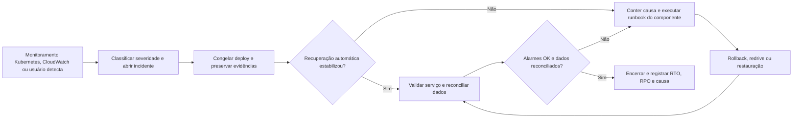

# Arquitetura final da aplicação

## 1. Diagrama de implantação

> Inserir o diagrama de implantação da arquitetura distribuída, indicando os componentes, os ambientes de execução e as conexões entre eles.


### 1.1 Componentes e justificativas

> Listar os principais componentes do diagrama, suas responsabilidades, tecnologias utilizadas e justificativas para as escolhas arquiteturais.


## 2. Inventário de contêineres, Docker e Kubernetes

Este inventário descreve o estado desta branch. O Kubernetes executa o
dashboard, a API de leitura e um `Job` de migrations. A ingestão e o
processamento assíncrono continuam no ECS Fargate. As decisões e os comandos
estão detalhados em [conteineres-final.md](conteineres-final.md) e no
[runbook do Kubernetes](../apps/basica/k8s/README.md).


### 2.1 Dockerfiles

| Dockerfile | Imagem e execução | Finalidade e componente de implantação |
|---|---|---|
| [`frontend/Dockerfile`](../apps/basica/frontend/Dockerfile) | `frontend`, `Deployment argus-frontend` no EKS ou kind | Compila o export estático do Next.js e o serve com Nginx na porta 8080, atrás do Ingress. |
| [`backend/Dockerfile`](../apps/basica/backend/Dockerfile) | `backend`, `Deployment argus-backend` no EKS ou kind | Executa a API Flask/Gunicorn na porta 5000 e consulta o PostgreSQL; a imagem também serve ao ASG legado. |
| [`processing/Dockerfile`](../apps/basica/processing/Dockerfile) | `processing`, serviço ECS e `Job argus-db-migrate` | Executa ETL e análise no ECS; a mesma imagem contém as migrations e a ferramenta usada pelo `Job`. |
| [`worker/Dockerfile`](../apps/basica/worker/Dockerfile) | `worker`, serviços ECS `event-worker` e `merge-worker` | Consome e persiste as duas filas SQS; cada serviço usa um comando específico da mesma imagem. |
| [`simulator/Dockerfile`](../apps/basica/simulator/Dockerfile) | `simulator`, serviço ECS | Emite eventos e mudanças segundo o relógio virtual e os cenários de falha. |
| [`loader/Dockerfile`](../apps/basica/loader/Dockerfile) | `loader`, task avulsa ECS | Faz a carga inicial dos dados e termina. |

As seis imagens usam build em estágios e bases fixadas por digest. As imagens
Python executam com o usuário `argus` (UID 10001); a do dashboard, com
`nginx` (UID 101). `backend` e `frontend` são publicados para `amd64` e
`arm64`, pois os nós observados no EKS são `amd64`. As quatro cargas
assíncronas usam `apps/basica/` como contexto de build para incluir `common/`;
backend e frontend usam seus próprios diretórios. O `loader` é uma task
pontual e não tem health check de serviço contínuo.


### 2.2 Execução local

| Arquivo ou entrada | Serviços iniciados e uso |
|---|---|
| [`backend/compose.yaml`](../apps/basica/backend/compose.yaml) | Sobe API e PostgreSQL 16; banco em `127.0.0.1:55433` e API em `127.0.0.1:5000`. As migrations são aplicadas separadamente. |
| [`observability/docker-compose.yml`](../apps/basica/observability/docker-compose.yml) | Sobe Prometheus na porta 9090 e Grafana na 3001, restritos a `127.0.0.1`. |
| [`Makefile`](../apps/basica/Makefile), alvo `db-local` | Inicia PostgreSQL 16 na porta 55432, cria os bancos de desenvolvimento e teste e aplica as migrations. |
| [`k8s/overlays/kind/kind-cluster.yaml`](../apps/basica/k8s/overlays/kind/kind-cluster.yaml) e [`k8s/overlays/kind/kustomization.yaml`](../apps/basica/k8s/overlays/kind/kustomization.yaml) | Criam um cluster de um nó com ingress-nginx, metrics-server e PostgreSQL; aplicam frontend, backend e `Job` de migration com entrada comum em `http://localhost:8080`. O overlay reduz as réplicas mínimas para uma por serviço. |

Para reproduzir o caminho Kubernetes local, executar, da raiz:

```bash
make -C apps/basica kind-up
make -C apps/basica k8s-images kind-load
make -C apps/basica k8s-apply K8S_OVERLAY=kind
make -C apps/basica k8s-migrate K8S_OVERLAY=kind
```

O kind valida o roteamento e os manifests;
seu nó único não demonstra disponibilidade entre nós ou zonas.


### 2.3 Orquestração e infraestrutura Terraform

| Arquivos | Recursos declarados e conexão |
|---|---|
| [`k8s/base/`](../apps/basica/k8s/base/kustomization.yaml) | Namespace `argus`, ConfigMap, dois Deployments e Services `ClusterIP`, dois HPAs, dois PDBs e um Ingress. `/api` e `/health` chegam ao backend; `/` chega ao frontend na mesma origem. |
| [`k8s/migrate/`](../apps/basica/k8s/migrate/kustomization.yaml) | `Job argus-db-migrate`, aplicado separadamente porque o template do Job é imutável. Usa a imagem `processing` e a credencial mestre; a API usa uma credencial de leitura. |
| [`k8s/overlays/aws/`](../apps/basica/k8s/overlays/aws/kustomization.yaml) e [`k8s/overlays/kind/`](../apps/basica/k8s/overlays/kind/kustomization.yaml) | No EKS, classe de Ingress do ALB e anotações; no kind, imagens, réplicas, autenticação, Ingress e banco local. O Makefile injeta referências do ECR e cria o Secret AWS sem versionar seus valores. |
| [`infra/eks.tf`](../apps/basica/infra/eks.tf), [`infra/vpc.tf`](../apps/basica/infra/vpc.tf), [`infra/rds.tf`](../apps/basica/infra/rds.tf) | EKS Auto Mode opcional na VPC, acesso ao cluster, sub-redes etiquetadas para o ALB e regra de acesso dos pods ao RDS. O ALB externo nasce do Ingress. |
| [`infra/ecr.tf`](../apps/basica/infra/ecr.tf) e arquivos [`infra/ecs*.tf`](../apps/basica/infra/ecs.tf) | Repositórios de imagens, serviços ECS dos workers, processamento e simulador, task de carga e task alternativa de migration. |
| [`infra/apigateway.tf`](../apps/basica/infra/apigateway.tf), [`infra/apigateway_changes.tf`](../apps/basica/infra/apigateway_changes.tf), [`infra/sqs.tf`](../apps/basica/infra/sqs.tf), [`infra/sqs_changes.tf`](../apps/basica/infra/sqs_changes.tf) | Rotas de ingestão para filas separadas de eventos e mudanças, consumidas pelos workers, cada uma com DLQ. |
| [`infra/auth.tf`](../apps/basica/infra/auth.tf), [`infra/observability.tf`](../apps/basica/infra/observability.tf), [`infra/outputs.tf`](../apps/basica/infra/outputs.tf) | Autenticação, alarmes e saídas usadas na implantação. `asg.tf`, `alb.tf`, `frontend_s3.tf` e `api_read.tf` mantêm os caminhos anteriores de leitura e contingência. |

O [Makefile](../apps/basica/Makefile) contém alvos de publicação de imagens,
renderização dos overlays com `k8s-validate` e aplicação separada do `Job` e
dos Deployments; o [runbook](../apps/basica/k8s/README.md) define a ordem de
execução. No EKS, frontend e backend partem de duas réplicas; os HPAs
declaram 2–4 e 2–6 réplicas, respectivamente. Escalonamento efetivo depende
da API de métricas, conforme a seção 3.

O backend também contém um adaptador opcional de refinamento de hipóteses via
Ollama, descrito no [guia da API](../apps/basica/backend/README.md). Os
manifests não configuram `OLLAMA_URL` nem implantam um servidor Ollama;
portanto, esse refinamento não faz parte da implantação EKS validada aqui.


## 3. Plano de recuperação de falhas

O plano adota Kubernetes no caminho síncrono: frontend e backend executam no
cluster, cada um em seu próprio Deployment e Service, sob um Ingress comum;
um Job executa as migrations. PostgreSQL, API Gateway, SQS, workers, simulador e
processamento analítico continuam nos serviços AWS existentes e não são
migrados para Kubernetes.

O plano parte de quatro princípios: uma mensagem aceita não pode desaparecer
silenciosamente; um componente sem estado deve ser substituído, e não reparado
manualmente; uma versão defeituosa deve voltar para uma versão conhecida; e
toda recuperação termina com reconciliação de dados, não apenas com o recurso
aparecendo como `Ready`.

Os tempos desta seção são **metas operacionais propostas**, ainda não SLAs
contratados. RTO é o tempo máximo desejado para restabelecer o serviço; RPO é
a perda máxima de dados admitida. Para a ingestão, o compromisso de RPO começa
depois que o API Gateway responde sucesso e o SQS confirma que recebeu a
mensagem. Uma requisição que recebe `5xx` antes de entrar na fila precisa ser
reenviada pelo produtor e não está coberta pelo RPO do pipeline.

### 3.1 Objetivos e níveis de severidade

#### 3.1.1 Metas de recuperação

| Escopo da falha | Meta de RTO | Meta de RPO | Condição para cumprir a meta |
|---|---:|---:|---|
| Um pod de frontend ou backend | sem indisponibilidade percebida; até 2 min para retirar e recriar o pod | 0, pois as duas aplicações são sem estado | pelo menos duas réplicas `Ready`, probes corretas e dependências externas saudáveis |
| Perda de um nó do cluster | sem indisponibilidade percebida; até 5 min para reagendar as réplicas | 0 | cluster com ao menos dois nós, réplicas efetivamente distribuídas e capacidade livre; os manifests atuais apenas preferem o espalhamento |
| Publicação defeituosa de frontend ou backend | até 10 min | 0 | estratégia `RollingUpdate`, histórico do Deployment e imagem anterior preservada no registry |
| Falha completa do Ingress ou do cluster | até 30 min | 0; frontend e backend são sem estado | acesso ao cluster, manifests versionados e fallback AWS disponível |
| Queda de uma task ECS de ingestão ou processamento | até 5 min | 0 para eventos já aceitos | serviço com `desired_count > 0`, mensagem ainda dentro da retenção do SQS e operações idempotentes |
| Indisponibilidade temporária de todos os consumidores | até 30 min para reativar o consumo; a drenagem depende do backlog | 0 por até 4 dias | filas preservadas e capacidade de consumo suficiente depois da retomada |
| Falha de instância ou zona do RDS em produção | até 15 min | 0 no failover Multi-AZ | `db_multi_az = true`; esta condição não está ativa no ambiente `dev` atual |
| Corrupção lógica ou restauração do RDS | até 4 h | até 5 min, como meta para o ponto de restauração | backups automáticos e logs de transação disponíveis; restauração ainda precisa ser ensaiada |
| Perda total da região ou da conta | até 24 h | até 24 h | cópia de backup e estado Terraform fora da conta/região; condição ainda não implementada |

As filas principais retêm mensagens por 4 dias; as DLQs, por 14 dias. Esses
prazos são janelas de recuperação, e não RTO: deixar um incidente aberto até
o limite de retenção viola as metas acima e aumenta o risco de perda.

#### 3.1.2 Classificação e responsabilidade

| Severidade | Critério | Impacto | Acionamento e responsáveis |
|---|---|---|---|
| **SEV-1 — crítica** | Ingress ou cluster indisponível; nenhum pod de backend `Ready`; ingestão inteira indisponível; RDS indisponível; risco de corrupção ou perda; backlog perto da retenção | perda de visibilidade operacional ou indisponibilidade total | alerta imediato; o responsável de infraestrutura assume a coordenação, o responsável de dados protege e valida o banco e o responsável da aplicação trata código e versão |
| **SEV-2 — alta** | Deployment abaixo das réplicas mínimas; HPA no limite; serviço ECS abaixo do desejado; DLQ com mensagens; fila envelhecendo; erros ou latência elevados | degradação parcial, dado atrasado ou capacidade sem margem | atendimento em até 15 min pelo responsável de infraestrutura, com apoio do dono do serviço afetado |
| **SEV-3 — moderada** | um pod substituído com sucesso; mensagem inválida isolada; alarme recuperado sem impacto visível | redundância reduzida ou ocorrência isolada | triagem no mesmo turno; registrar causa, confirmar a recuperação e abrir correção se houver recorrência |

Os responsáveis são definidos por papel para que o plano continue válido
quando a equipe mudar. Em uma SEV-1, apenas o coordenador do incidente declara
o encerramento, depois da validação conjunta de infraestrutura, aplicação e
dados.


### 3.2 Estratégias de recuperação

#### 3.2.1 Replicação, isolamento e retenção

| Componente | Estratégia adotada | Comportamento durante a falha | Arquivos relacionados |
|---|---|---|---|
| Frontend no Kubernetes | Deployment com 2 réplicas, Service `ClusterIP`, `RollingUpdate`, HPA declarado de 2 a 4 pods, PDB e preferência de distribuição por zona | o Service remove pods não prontos; o ReplicaSet recria pods e o scheduler os reposiciona em nós saudáveis | manifests de Deployment, Service, HPA e PDB do frontend |
| Backend no Kubernetes | Deployment com 2 réplicas, Service `ClusterIP`, `RollingUpdate`, HPA declarado de 2 a 6 pods, PDB e preferência de distribuição por zona e nó | requisições seguem apenas para pods `Ready`; o Deployment recompõe réplicas sem estado | manifests de Deployment, Service, ConfigMap, Secret, HPA e PDB do backend |
| Entrada HTTP | Ingress compartilha a mesma origem: `/api` e `/health` seguem para o backend; `/` e demais caminhos seguem para o frontend | elimina URL fixa no bundle e concentra a troca de destino; falha da entrada afeta os dois serviços e é tratada como SEV-1 | manifest de Ingress e configuração do controlador do cluster |
| API de ingestão | API Gateway integra diretamente com duas filas SQS independentes | a borda não depende da disponibilidade dos workers; eventos e mudanças acumulam separadamente | `apps/basica/infra/apigateway.tf`, `apps/basica/infra/apigateway_changes.tf`, `apps/basica/infra/sqs.tf`, `apps/basica/infra/sqs_changes.tf` |
| `event-worker` e `merge-worker` | serviços ECS Fargate mantêm o número desejado de tasks; filas persistem trabalho pendente | a queda do consumidor não interrompe a aceitação; a mensagem volta a ficar visível se não for confirmada | `apps/basica/infra/ecs.tf` |
| Processamento e simulador | serviços ECS mantêm uma task quando habilitados | ECS substitui a task; checkpoints, watermarks, leases e o relógio persistem no PostgreSQL | `apps/basica/infra/ecs_processing.tf`, `apps/basica/infra/ecs_simulator.tf`, `apps/basica/db/migrations/` |
| Mensagens problemáticas | cinco tentativas antes do redrive nativo; quarentena explícita de payload inválido; DLQ com retenção de 14 dias | um item defeituoso é isolado sem bloquear os itens válidos; o redrive é manual depois da correção | `apps/basica/infra/sqs.tf`, `apps/basica/infra/sqs_changes.tf`, `apps/basica/infra/iam.tf`, `apps/basica/worker/src/argus_worker/` |
| PostgreSQL | armazenamento criptografado, backup automático e opção Multi-AZ; proteção contra exclusão e snapshot final em `prod` | Multi-AZ permite failover da instância; backup permite reconstrução em falha lógica | `apps/basica/infra/rds.tf`, `apps/basica/infra/variables.tf` |
| Versões executáveis | imagens de frontend e backend separadas no registry e marcadas pelo SHA do commit | uma versão conhecida permanece disponível para `rollout undo`, sem depender de `latest` | Dockerfiles do frontend e backend, manifests Kubernetes e pipeline de publicação |

O limite do cluster é intencional: apenas frontend, backend e o `Job` de
migrations entram no Kubernetes. Colocar SQS, PostgreSQL ou consumidores no cluster duplicaria
serviços gerenciados e ampliaria o domínio de falha. Os workers continuam em
ECS Fargate e se comunicam com SQS e RDS sem depender do Ingress ou dos pods da
camada web.

O `event-worker` aceita sobreposição durante uma publicação porque a
escrita é idempotente por identificador. O `merge-worker`, o processamento e o
simulador param a versão anterior antes de iniciar a nova para evitar duas
instâncias concorrendo pelo mesmo estado. Nesses serviços, a continuidade vem
da fila e dos checkpoints persistidos, não de duas tasks ativas ao mesmo tempo.

#### 3.2.2 Health checks e reinicialização

No backend, a `startupProbe` e a `livenessProbe` consultam
`GET /health/live`, rota que verifica apenas se o processo Flask/Gunicorn está
vivo. A `readinessProbe` consulta `GET /health/ready`, que também verifica o
PostgreSQL. Essa separação evita reiniciar um processo saudável durante uma
falha do banco: o pod permanece em execução, mas sai temporariamente dos
Endpoints do Service e deixa de receber tráfego.

No frontend, as três probes consultam uma rota local `/healthz` servida pelo
Nginx. Falha de liveness faz o kubelet reiniciar o contêiner; falha de readiness
retira o pod do Service sem encerrá-lo. Os Deployments mantêm no mínimo duas
réplicas e usam `RollingUpdate` com `maxUnavailable: 0` e `maxSurge: 1`, para
que uma nova versão só substitua a anterior depois de ficar pronta.

Os contêineres de longa duração que permanecem no ECS continuam usando o
heartbeat existente. O health check roda a cada 30 s, tolera três falhas e
reprova quando o heartbeat tem mais de 120 s. Como o contêiner é `essential`,
a task termina e o serviço ECS cria outra para voltar ao `desired_count`.

#### 3.2.3 Fallback e rollback

Os mecanismos de recuperação declarados e seus limites observados são:

1. o Service envia novas requisições somente a pods `Ready`;
2. o ReplicaSet recompõe pods encerrados e o scheduler os reposiciona quando um
   nó fica indisponível;
3. o HPA foi configurado para aumentar o backend de 2 a 6 pods e o frontend de
   2 a 4 pods por CPU; **no ensaio EKS de 21/09/2026, não escalou porque a API
   `metrics.k8s.io` estava ausente**. Até corrigir e retestar, usar escala
   manual supervisionada quando houver saturação;
4. o PDB preserva ao menos uma réplica de cada Deployment durante interrupções
   voluntárias, como manutenção e drenagem de nó;
5. o `RollingUpdate` mantém a versão anterior atendendo até a nova passar pelas
   probes, e o histórico do Deployment permite `rollout undo`;
6. o ECS repõe as tasks dos workers e o *deployment circuit breaker* reverte
   uma publicação que não estabiliza;
7. o SQS reentrega mensagens não confirmadas e, depois do limite, move-as para
   a DLQ em vez de descartá-las;
8. o RDS realiza failover automático somente quando Multi-AZ está habilitado.

O fallback para fora do cluster é manual. O frontend estático pode voltar a
ser publicado no S3 e a API Flask continua empacotável em AWS Lambda, exposta
por API Gateway (`apps/basica/infra/api_read.tf`). A troca requer alterar o
destino de entrada ou republicar o frontend com a URL de contingência; ela não
resolve indisponibilidade do RDS, compartilhado pelos caminhos principal e
alternativo. Automatizar essa troca exige DNS com health check ou uma camada de
entrada capaz de alternar entre Kubernetes e AWS.

O rollback do frontend ou backend seleciona a revisão anterior do respectivo
Deployment e acompanha o rollout até todas as réplicas ficarem `Ready`. Os
serviços que permanecem no ECS continuam usando a task definition anterior por
meio do circuit breaker.


### 3.3 Procedimento de resposta

O fluxo de decisão é o mesmo para todos os componentes:



#### 3.3.1 Detectar e classificar

1. Confirmar o alerta e a abrangência: Ingress, frontend, backend, nó do
   cluster, fila, ECS, processamento, banco ou rede.
2. Registrar horário, evento Kubernetes, revisão dos Deployments, imagens dos
   pods, estado das probes, `request_id`, task definitions, tamanho e idade das
   filas. Esses dados não devem ser substituídos por novo deploy antes da
   coleta.
3. Inspecionar pods, eventos, logs, Endpoints, HPAs e rollouts do namespace;
   depois correlacionar com os alarmes de 5xx e latência, idade das filas, DLQ,
   CPU, conexões e espaço do RDS. `make -C apps/basica logs`, `dlq` e `count`
   continuam reunindo as inspeções dos componentes AWS.
4. Classificar SEV-1, SEV-2 ou SEV-3 e designar um coordenador. Em SEV-1, pausar
   novos deploys e mudanças de schema até a normalização.

#### 3.3.2 Conter e recuperar por modo de falha

| Falha observada | Contenção | Recuperação | Critério específico de sucesso |
|---|---|---|---|
| Um pod de frontend ou backend falha | permitir que readiness retire o pod; não reiniciar réplicas saudáveis | kubelet reinicia o contêiner ou ReplicaSet cria novo pod | réplicas `Ready` iguais ao mínimo, Endpoints completos e taxa de 5xx normal |
| Um nó falha | impedir novos agendamentos no nó e preservar eventos | scheduler reposiciona os pods em outro nó; repor capacidade do cluster se faltar recurso | pods distribuídos em nós saudáveis e PDB respeitado |
| Backend fica sem pods `Ready` | congelar o rollout e preservar eventos e logs | desfazer a revisão; se o cluster não recuperar, acionar a API Lambda de contingência | `/health/live` e `/health/ready` 200, Service com Endpoints e smoke test aprovado |
| Frontend fica sem pods `Ready` | congelar o rollout | desfazer a revisão; se o cluster não recuperar, republicar o export estático no S3 | rota `/` e assets respondendo 200, navegação e chamada à API aprovadas |
| Ingress falha | preservar os Services e confirmar que os pods continuam saudáveis | corrigir regra ou classe do Ingress e verificar o ALB gerenciado; usar os fallbacks AWS se a falha persistir | entrada externa alcança frontend e backend pela mesma origem |
| Task ECS encerra ou trava | permitir uma tentativa de reposição automática; manter mensagens no SQS | ECS cria nova task; em crash loop, voltar à task definition anterior ou corrigir a dependência | `RunningTaskCount` igual ao desejado, heartbeat recente e fila voltando a drenar |
| RDS fica indisponível | parar temporariamente os consumidores se a falha for longa, evitando que mensagens válidas esgotem cinco tentativas e inundem a DLQ | aguardar failover Multi-AZ; sem Multi-AZ, corrigir a instância ou restaurar backup em nova instância e atualizar a configuração | `/health/ready` 200, escrita e leitura de verificação aprovadas e backlog em queda |
| Fila acumula | manter a borda aceitando enquanto houver retenção e capacidade | restabelecer ou aumentar consumidores com a mesma imagem; acompanhar idade da mensagem mais antiga, não apenas quantidade | fila principal zerada ou dentro do patamar normal e contagens reconciliadas |
| Mensagens chegam à DLQ | impedir redrive em massa antes de identificar a causa; separar payload inválido de falha transitória | corrigir código ou configuração e redirecionar somente itens recuperáveis para a fila de origem | DLQ tratada, itens válidos persistidos uma vez e itens inválidos com motivo registrado |
| Imagem ou deploy defeituoso | pausar o rollout antes que todas as réplicas antigas saiam | Kubernetes volta à revisão anterior; ECS volta à task definition anterior | digest esperado em todos os pods e tasks e smoke test aprovado |
| NAT ou rota privada falha | evitar substituir em massa tasks que ainda estejam executando | recriar rota ou NAT por Terraform; em produção, promover a topologia para um NAT por AZ | tasks alcançam ECR, SQS, Secrets Manager e CloudWatch; novas tasks conseguem iniciar |
| Perda ou corrupção de estado | bloquear migrations e escritas não essenciais | selecionar ponto anterior ao incidente, restaurar o RDS, aplicar migrations imutáveis e reconciliar filas e DLQs | checksums das migrations, contagens por camada e consultas do dashboard consistentes |

As tasks `loader` e `migration` são operações *one-shot*, não serviços.
Elas não reiniciam indefinidamente porque uma carga ou migration defeituosa
repetida pode ampliar o dano. Depois de corrigir a causa, o operador executa
novamente a task; migrations já aplicadas são protegidas por checksum.

#### 3.3.3 Validar e encerrar

A recuperação somente pode ser declarada depois de todos os passos aplicáveis:

1. confirmar pelo endereço do Ingress as rotas `/` e `/api/v1/clock`, a
   autenticação e uma consulta de leitura. `make -C apps/basica smoke` pode
   apontar para o ALB legado e, sozinho, não prova a recuperação do EKS;
2. Deployments, Services, Endpoints, Ingress e ECS apresentam capacidade
   saudável igual à desejada por pelo menos duas janelas de métrica;
3. a idade da mensagem mais antiga diminui continuamente, as filas drenam e
   `make -C apps/basica dlq` não mostra itens novos sem explicação;
4. `make -C apps/basica count` e uma reconciliação do lote comparam aceitos,
   persistidos, ainda enfileirados e rejeitados. Fila vazia, sozinha, não prova
   ausência de perda;
5. os alarmes voltam a `OK`, não há erro recorrente nos logs e as métricas de
   latência e throughput retornam ao patamar anterior;
6. o registro do incidente guarda causa, versão afetada, horários de detecção
   e recuperação, RTO e RPO observados, volume reconciliado e ação preventiva.

### 3.4 Testes e evidências de recuperação

O RNF05 já exercitou quatro cenários na AWS. Os resultados detalhados estão
em `artefatos/testes-carga-inicial.md`.

| Exercício executado | Evidência | Conclusão |
|---|---|---|
| consumidor de mudanças desligado | 96.020 eventos aceitos e fila drenada em cerca de 16 min | retomada comprovada; reconciliação total ainda pendente |
| interrupção forçada do `merge-worker` | 28.800 eventos aceitos, task reiniciada automaticamente e fila principal zerada | reinicialização comprovada; reconciliação total ainda pendente |
| backlog do fluxo de eventos | fila `0 → 1.001 → 0` e banco `27.509 → 28.510` | recuperação sem perda comprovada para 1.001/1.001 eventos |
| timeout extremo no cliente | 100/100 expirações com limite de 1 ms; depois 5/5 respostas 200 | recuperação do cliente comprovada no escopo testado |

Esses resultados cobrem o pipeline AWS. No Kubernetes, os registros de
21/09/2026 comprovam a renderização dos overlays, o caminho de leitura no
kind e a execução de carga pelo Ingress do EKS. O relatório
[conteineres-final.md](conteineres-final.md) também registra 547 respostas
HTTP 200 e nenhuma falha durante um `rollout restart` e a reposição de um pod
do backend em 4 s. Esses dois números aparecem como resumo no relatório,
sem log bruto de tempo e requisições no diretório de evidências; por isso
não bastam para afirmar todos os RTOs da tabela 3.1.1.

O [ensaio de carga do EKS](evidencias/carga-kubernetes.txt) mostra um limite
operacional relevante: de 5 a 100 usuários virtuais, as 25.576 requisições
da rodada A tiveram 0% de erro; com 450 e 900 usuários virtuais, as taxas
foram 15,21% e 24,80%, respectivamente. Os dois HPAs permaneceram com duas
réplicas porque não existia o APIService `v1beta1.metrics.k8s.io`. Houve
reinícios dos pods do backend sob saturação. Portanto, o HPA está declarado,
mas **a escala automática no EKS não foi validada e o teste de limite falhou**.

Os seguintes ensaios ainda precisam de execução com registros próprios:

| Ensaio Kubernetes | Ação | Critério de aceite |
|---|---|---|
| reinício de pod | repetir a exclusão de uma réplica de frontend e de backend durante tráfego, guardando timestamps e respostas | ReplicaSet recompõe cada pod dentro do RTO e não há 5xx causado pelo teste |
| falha de nó | drenar um nó que hospeda uma réplica de cada Deployment | PDB mantém uma réplica; pods são reagendados em outro nó dentro do RTO |
| deploy defeituoso | publicar imagem que não passa na startup probe | pods antigos continuam atendendo; rollout não conclui e rollback restaura a revisão anterior |
| perda de prontidão do backend | bloquear temporariamente a conexão de um pod com o RDS | readiness retira o pod dos Endpoints sem reinício em ciclo; tráfego segue para réplica pronta |
| escalabilidade | restabelecer `metrics.k8s.io` e gerar carga crescente separadamente no frontend e no backend | HPAs mostram `ScalingActive=True`, aumentam réplicas dentro dos limites e reduzem após a estabilização |
| falha de entrada | simular falha do ALB ou do roteamento do Ingress no EKS | alerta SEV-1 e recuperação ou fallback documentado com tempo medido |

Os alvos `resiliencia-fila-cheia`, `resiliencia-timeout`,
`resiliencia-evento-invalido`, `resiliencia-concorrente` e
`resiliencia-watermark-check` do `Makefile` tornam os testes repetíveis. Antes
de cada release relevante deve ser executado ao menos o teste de interrupção
task, o reinício de pods e a reconciliação do lote. Trimestralmente, o plano
prevê ensaiar o rollback dos dois Deployments, a falha de nó, a restauração do
RDS em uma instância isolada e o redrive de uma amostra conhecida da DLQ. Os
ensaios planejados não devem ser apresentados como evidência concluída enquanto
seus registros não forem anexados à seção 4.


### 3.5 Limitações e decisões pendentes

1. **A implantação foi observada, mas a recuperação não foi completamente
   ensaiada.** Há evidência de dois nós EKS, Deployments e PDBs disponíveis,
   testes de ponta a ponta no kind e carga no EKS. Faltam registros brutos de
   falha de nó, rollback, perda de prontidão e fallback.
2. **Alta disponibilidade depende da distribuição efetiva.** O EKS observado
   tinha dois nós. Os manifests usam `topologySpreadConstraints` com
   `ScheduleAnyway`, o que prefere distribuir, mas não garante zonas ou nós
   diferentes. Um ensaio de perda de nó ainda é necessário.
3. **PDB cobre somente interrupção voluntária.** Ele limita um `drain`, mas não
   impede perda simultânea causada por falha de nó, zona ou cluster.
4. **O HPA não escalou no EKS testado.** Os `requests` e HPAs estão declarados,
   porém `metrics.k8s.io` não existia no cluster do ensaio. Instalar ou reparar
   o provedor de métricas, confirmar `kubectl top pods` e `ScalingActive=True`
   e repetir a carga são ações necessárias. Escalar pods também não resolve
   sozinho o gargalo no RDS.
5. **O fallback para AWS exige intervenção.** Não há failover automático entre
   o Ingress do Kubernetes, o site S3 e a API Lambda. Automatizar esse caminho
   exige endpoint estável, health check externo e teste periódico dos destinos.
6. **A reposição do ECS depende da capacidade desejada.** A execução de TI-05
   registrou `desired_count = 1` para os dois workers e processamento, e `0`
   para o simulador naquele momento. Os valores mudam com a operação do lab;
   a reposição só ocorre quando o serviço está habilitado.
7. **O RDS de desenvolvimento é Single-AZ.** `db_multi_az = false` e a retenção
   de backup é de apenas 1 dia. Antes de tratar o ambiente como produção,
   Multi-AZ deve ser obrigatório, a retenção deve ser ampliada e um restore
   completo precisa comprovar as metas de RTO e RPO.
8. **Os serviços ECS não têm auto scaling.** O padrão é uma task por serviço
   quando habilitado. O SQS absorve interrupções e rajadas, mas uma falha reduz
   temporariamente o consumo a zero. A equipe deve definir auto scaling por
   idade ou profundidade de fila, ou manter mais de uma réplica onde o controle
   de concorrência permitir.
9. **Existe um único NAT Gateway na infraestrutura AWS atual.** Um NAT por AZ e
   tabelas de rota independentes eliminariam esse ponto único de falha para os
   serviços que permanecem fora do Kubernetes.
10. **Não há recuperação regional ou entre contas.** RDS, ECR, SQS e backups
    permanecem na mesma região e conta. A meta de desastre regional da tabela
    3.1.1 não está atendida.
11. **A notificação depende de configuração.** O tópico SNS existe, mas o
    e-mail só recebe alertas se `alarm_email` estiver preenchido e a inscrição
    for confirmada. A camada Kubernetes também precisa encaminhar seus alertas
    ao mesmo canal operacional.
12. **A evidência de recuperação ainda é parcial nos maiores volumes.** O
    reinício e a drenagem foram observados, mas somente o recorte de 1.001
    eventos foi reconciliado integralmente. Os próximos ensaios devem registrar
    a igualdade `aceitos = persistidos + rejeitados recuperáveis + ainda em
    fila` para todo o lote.
13. **A ETL acumulou atraso na implantação AWS de TI-05.** O evento de teste
    chegou à camada bronze, mas não foi promovido à silver dentro dos 300 s
    do teste, que reprovou. O backlog após a carga inicial precisa ser drenado
    ou tratado por uma operação de recomputação definida pela equipe antes de
    afirmar frescor ponta a ponta.


### 3.6 Estado observado e fechamento da validação Kubernetes

Esta subseção registra o que os arquivos de evidência desta branch permitem
afirmar. Configuração declarada, recurso observado e comportamento comprovado
são coisas distintas.

#### 3.6.1 Ambiente observado

| Campo | Registro disponível |
|---|---|
| Provedor e cluster | EKS Auto Mode, `argus-events-livia-dev-eks`, no ensaio de 21/09/2026. |
| Região, versão e nós | Região de referência `us-east-1`; EKS 1.33, dois nós `amd64` com kubelet `v1.33.13-eks-bca9cf6`. As zonas dos nós não constam na captura. |
| Namespace e entrada | Namespace `argus`; Ingress do EKS usado na carga, com URL omitida da evidência. No kind, Ingress nginx em `localhost:8080`. |
| Métricas | No kind, o HPA mostrou percentuais de CPU. No EKS ensaiado, `v1beta1.metrics.k8s.io` não existia; ambos os HPAs exibiram `<unknown>` e `ScalingActive=False`. |
| Versão da aplicação | Os registros estão datados de 21/09/2026, mas não preservam o commit ou os digests das imagens implantadas. Essa rastreabilidade deve constar na próxima captura. |

#### 3.6.2 Controles declarados e observados

| Controle | Declaração nos manifests | Evidência de execução |
|---|---|---|
| Réplicas e distribuição | Dois pods iniciais por Deployment no EKS; preferência por espalhamento de zona e, no backend, de nó (`ScheduleAnyway`). | Ambos os Deployments estavam `2/2` ao fim da carga no EKS; a distribuição real por zona não foi registrada. O kind usa mínimo de uma réplica. |
| Atualização e probes | `RollingUpdate`, `maxUnavailable: 0`, `maxSurge: 1`; `/healthz` no frontend; `/health/live` e `/health/ready` no backend. | A suíte no kind obteve 200 para `/` e `/api/v1/clock`. O relatório de contêineres resume um rollout com 547 respostas 200, sem log bruto anexado. |
| Interrupção voluntária | PDB `minAvailable: 1` para cada Deployment. | No EKS, ambos os PDBs exibiam uma interrupção permitida; não há registro de `drain`. |
| Escala por CPU | HPA frontend 2–4 pods com alvo de 70%; backend 2–6 com alvo de 60%; ambos têm `requests.cpu`. | Objetos criados, mas escala automática inoperante no EKS ensaiado por ausência da API de métricas. |
| Segredos e banco | ConfigMap não sensível; Secret `argus-backend` criado pelo Makefile; API usa `argus_api`, Job usa credencial mestre. | Manifests e runbook mostram o mecanismo. A evidência publicada não contém valores sensíveis nem uma auditoria da rotação. |

#### 3.6.3 Resultado dos ensaios

| Ensaio | Resultado documentado | Situação para o plano de recuperação |
|---|---|---|
| Renderização dos manifests | Cinco conjuntos (`base`, `migrate`, `aws`, `kind` e migration do kind) renderizados sem cluster. | Aprovado como verificação estática; não comprova implantação. |
| Caminho síncrono no kind | Deployments, Services, Ingress, HPAs e PDBs listados; `/` e `/api/v1/clock` responderam 200; 12 testes de navegador passaram. | Aprovado para integração local. |
| Rollout do backend sob tráfego | Relatório de contêineres registra 547 respostas 200 e nenhuma falha. | Indício positivo; falta captura bruta e medição do RTO. |
| Reposição de pod do backend | Relatório de contêineres registra 4 s até `Ready`. | Indício positivo; falta medição reproduzível e teste do frontend. |
| Carga no EKS | Até 100 usuários virtuais, 25.576 requisições sem erro. Com 450 e 900, erro de 15,21% e 24,80%; houve reinícios do backend. | Capacidade aprovada somente até o patamar ensaiado de 100 usuários; escala automática reprovada no EKS testado. |
| Falha de nó, perda de readiness, rollback, falha do Ingress e fallback AWS | Não há execução rastreável nos arquivos de evidência. | Pendente; não atribuir RTO ou RPO observado. |

#### 3.6.4 Ações de fechamento

1. Restabelecer a API `metrics.k8s.io` no EKS e repetir a carga, registrando
   `kubectl top`, condições dos HPAs, réplicas e erros por nível.
2. Repetir rollout e exclusão de pods sob tráfego com logs brutos, horários,
   digests e medidas de RTO; testar também o frontend.
3. Registrar zonas e nós de cada pod e ensaiar `drain`, readiness do backend,
   rollback, falha de entrada e fallback AWS. Comparar os tempos medidos com
   as metas da seção 3.1.1.
4. Anexar reconciliação de filas e PostgreSQL nos ensaios que afetarem a
   ingestão e registrar no mesmo conjunto de evidências a revisão implantada.
5. Encaminhar alertas do cluster ao canal operacional e validar que chegam
   com severidade e componente identificados.


## 4. Evidências de validação

As evidências abaixo foram produzidas em setembro de 2026 e correspondem aos
arquivos disponíveis nesta branch. A seção 1 foi reservada para o diagrama
final; os diagramas anteriores em `artefatos/assets/` retratam etapas
anteriores da implantação e não devem ser usados como prova de que o EKS já
estava representado no desenho final.

| Afirmação verificada | Evidência e ambiente | Resultado e limite |
|---|---|---|
| Imagens e orquestração estão especificadas | [Dockerfiles](../apps/basica/backend/Dockerfile), [base Kubernetes](../apps/basica/k8s/base/kustomization.yaml), [overlay AWS](../apps/basica/k8s/overlays/aws/kustomization.yaml), [EKS Terraform](../apps/basica/infra/eks.tf) e [inventário de contêineres](conteineres-final.md) | Seis imagens e divisão EKS/ECS rastreáveis no código. A presença de um manifesto não equivale a ensaio em execução. |
| Manifests renderizam | [Registro `k8s-validate`](evidencias/k8s-validate.txt), 21/09/2026 | Cinco conjuntos de manifests renderizados; verificação estática, sem contato com cluster. |
| Dashboard, API e PostgreSQL se integram no Kubernetes local | [Registro do kind e Playwright](evidencias/testes-kubernetes.txt), 21/09/2026 | `GET /` e `GET /api/v1/clock` retornaram 200; 12 testes de navegador passaram. O kind tinha um nó, banco local e réplicas reduzidas. |
| EKS recebeu os Deployments e o Ingress sob carga | [Carga Kubernetes](evidencias/carga-kubernetes.txt) e [resumos das rodadas](evidencias/carga-kubernetes/rodada-a-resultado.json), 21/09/2026 | Dois nós `amd64`; frontend e backend `2/2`. Rodada A, até 100 usuários virtuais: 25.576 requisições, 0% de erro. Rodada B: 15,21% de erro com 450 e 24,80% com 900. |
| Escala automática no EKS | [Diagnóstico do HPA](evidencias/carga-kubernetes.txt) | **Não funcionou no ensaio:** `metrics.k8s.io` ausente, `ScalingActive=False`, duas réplicas durante a carga. Os reinícios do backend sob saturação também constam do registro. |
| Rollout e reposição de pod | [Relatório de contêinerização](conteineres-final.md), seções 5.2 e 5.3 | O relatório informa 547 respostas 200 durante um rollout e 4 s para repor um pod. São resumos sem captura bruta anexa; repetir para validar RTO e ausência de erros de forma auditável. |
| Recuperação do pipeline assíncrono | [Testes de carga e resiliência iniciais](testes-carga-inicial.md) | Reposição de task e drenagem de fila foram observadas. A reconciliação completa foi registrada somente para o lote de 1.001 eventos; os demais números não provam RPO zero. |
| Integração dos componentes fora do cluster | [Log de integração](evidencias/testes-integracao.txt) | TI-02, TI-03 e TI-04 passaram com PostgreSQL de teste. TI-05, na AWS, **falhou**: o evento entrou na bronze, mas o backlog da ETL impediu sua exposição na API dentro de 300 s. Isso limita a afirmação de frescor ponta a ponta. |

Os resultados dos [testes funcionais](testes-funcionais.md), dos
[testes unitários](evidencias/testes-unitarios.txt) e da
[carga anterior](evidencias/testes-carga.txt) complementam a validação da
aplicação, mas foram obtidos em escopos diferentes do ensaio EKS. A seção
3.6.4 registra os ensaios e as capturas que ainda faltam para fechar as metas
de recuperação. A implantação observada comprova a topologia básica; não há
evidência suficiente para declarar atendidos o HPA no EKS, o failover de nó,
o fallback AWS ou todos os RTOs e RPOs propostos.

