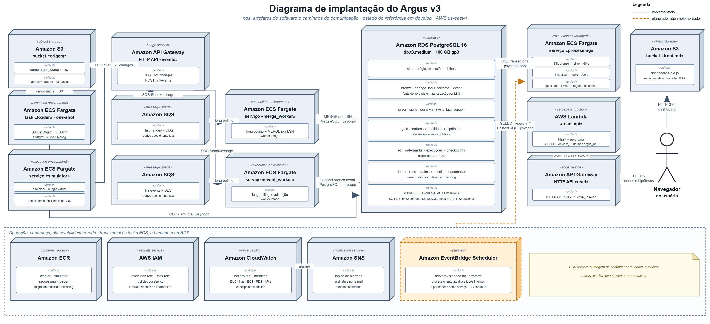

# Arquitetura do Argus v3

&emsp; Este artefato reúne, em um único documento, a arquitetura da plataforma de
Monitoração Agêntica no seu estado atual, batizado internamente de **Argus v3**. Ele
consolida o que antes estava dividido entre um artefato de arquitetura resumido e o
plano técnico completo da migração (o antigo `plano-argus-v3.md`, hoje incorporado a
este documento): o porquê da mudança de arquitetura, o diagrama de implantação dos
componentes na AWS, a descrição de cada nó e como eles se conectam, o desenho completo
do banco de dados, a justificativa técnica das decisões de arquitetura e tecnologia
adotadas, o desenho do ETL incremental, o plano de deploy dos recursos AWS, e o
registro de riscos e da proveniência de cada decisão.

&emsp; O sistema descrito aqui é o resultado de um pivot de escopo em relação ao MVP
original (ver [`mvp-inicial.md`](mvp-inicial.md)): em vez de um coletor próprio de
telemetria de frontend, a solução passou a ser um **consumidor de change data capture
(CDC)** das tabelas já tratadas pelo Argus, o correlator de incidentes já em produção
na Globo, mantendo-as replicadas e atualizadas na infraestrutura do projeto, e
derivando delas as camadas analíticas que alimentam o dashboard. A seção 1 detalha essa
mudança de premissa.

---

## 1. Por que a arquitetura mudou

&emsp; A arquitetura anterior (documentada em [`mvp-inicial.md`](mvp-inicial.md)) foi
desenhada para um firehose de telemetria: API Gateway, SQS, worker Fargate, DynamoDB,
com Lambda de leitura por cima. Ela funcionava e chegou a ir ao ar. Mas partia de uma
premissa que o entendimento aprofundado com o parceiro derrubou: a de que o sistema
**produz** o dado.

&emsp; Na prática, o Argus já existe em produção na Globo e já tem 33 tabelas com o
dado tratado, desde fonte bruta (Prometheus, New Relic, Apollo, RPaaS, Cloud Armor,
Tsuru) até camada canônica (`signal_point`, `signal_bucket`), ground truth
(`incidents`, `incident_label`) e saída do sistema atual (`dashboard_artifact`). O que
o projeto precisa fazer é **ler dessas tabelas**, replicá-las na infraestrutura do
grupo, e construir em paralelo um esquema que simule como o fluxo funcionaria em
produção, mantendo essas tabelas atualizadas ao longo do tempo.

&emsp; Isso muda a natureza do sistema: ele deixa de ser um coletor e passa a ser um
**consumidor de change data capture com replay**, que recebe as mudanças que a origem
publica, materializa o estado corrente, e deriva as camadas analíticas a partir disso.

### 1.1 As sete decisões que orientam a arquitetura

| # | Decisão | Consequência |
|---|---|---|
| 1 | Substituir o DynamoDB por completo | `dynamodb.tf` sai; toda a persistência vira PostgreSQL |
| 2 | Carregar as 33 tabelas inteiras, incluindo `prom_point` | 68,7 milhões de linhas; justificativa na seção 1.2 |
| 3 | Dois fluxos de ingestão | CDC das tabelas já mapeadas e eventos de grain de sessão, que chegam por outro fluxo do Argus |
| 4 | Bronze otimizada para mudar, não para performance | O ETL ainda está em aprimoramento; o custo de errar precisa ser baixo |
| 5 | Carga inicial via Parquet | `tools/etl_dump.py` converte o dump e gera os 33 arquivos (199 MB) |
| 6 | Não renormalizar `signal_point` | A silver faz canonicalização de tipo e tempo, não normalização multifonte |
| 7 | Detecção segue embrionária; ETL deixou de ser no-op | O worker de processamento roda o ETL incremental (seção 7); detector e canário seguem no-op, com infraestrutura provisionada e observável para quando chegarem |

### 1.2 Por que `prom_point` entra, apesar de ser 60% das linhas

&emsp; `prom_point` é a tabela-fato do Prometheus, com 41,2 milhões das 68,7 milhões
de linhas do dump. É camada de fonte bruta, e o `signal_bucket` já traz o Prometheus
normalizado, então a tentação de deixá-la de fora é real. Três telas do dashboard não
fecham sem ela:

- **Timeline**: "CDN, Prometheus VTS" é uma das seis raias nomeadas do eixo de tempo,
  e a cronologia reconstruída tem entradas que são fatos do Prometheus (por exemplo,
  "p95 na borda do PoP Fortaleza sobe de 368 ms para 412 ms"). O painel lateral conta
  "fontes com desvio: 3 de 13", as 13 fontes do vocabulário do dataset.
- **Hipóteses**: o fator de score "ausência de causa concorrente" afirma que CDN,
  Globo-ID e backend não desviaram na janela. Provar ausência exige a série inteira,
  não só os pontos anômalos; o motor de descarte consome mais dado bruto que o de
  detecção, e é ele que separa 4 hipóteses de 11 descartadas.
- **Comparar**: "p95 de borda 412 ms vs 368 ms, +12%, 1,2σ". O σ vem da distribuição
  histórica da série.

&emsp; O argumento decisivo é de granularidade. O gráfico da tela Comparar declara
"bucket de 1 min", e a Timeline resolve eventos em 19:58, 20:00, 20:02, 20:04, 20:06 e
20:07. O `signal_bucket` é de 15 minutos, o que colapsaria a janela de correlação
inteira em um único ponto; só o `prom_point` tem cadência de 1 minuto. Soma-se que
`prom_series.labels_json` traz `pop` em claro (é de lá que sai "PoP Fortaleza") e
`prom_query.section` dá o agrupamento das raias, e que as fontes NPAW têm cerca de 28 h
de latência estrutural: para uma tela marcada ao vivo, o sinal de infraestrutura
quase-real-time é Prometheus (1 min) e `rpaas_bucket` (15 min).

---

## 2. Diagrama de implantação

&emsp; A Figura 1 mostra o diagrama de implantação do Argus v3, no padrão UML de nós
(estereótipo `«device»` para infraestrutura gerenciada como armazenamento, e
`«execution environment»` para ambientes que executam código próprio) e artefatos de
software (estereótipo `«artifact»`) hospedados dentro de cada nó. As setas indicam
caminhos de comunicação entre nós, rotuladas com o protocolo ou mecanismo usado. O nó
com borda tracejada laranja (`Amazon EventBridge Scheduler`) está marcado como
planejado: aparece no desenho original da arquitetura, mas ainda não existe como
recurso Terraform aplicado; ver a pendência registrada na seção 9.

Figura 1 - Diagrama de implantação do Argus v3, com nós, artefatos de software e
caminhos de comunicação, no estado atual do Terraform em `apps/basica/infra/`

Fonte: material produzido pelos autores (2026).

&emsp; O diagrama é organizado da esquerda para a direita seguindo o fluxo do dado: a
fonte (bucket S3 de origem) alimenta a carga inicial e o simulador; o simulador emite
change events por HTTPS para a camada de ingestão (API Gateway e SQS); dois serviços
ECS consomem essas filas e escrevem no RDS PostgreSQL, o nó central que hospeda as
quatro camadas do desenho medallion (bronze, silver, gold, detect); um serviço de
processamento roda o ETL incremental sobre esse banco; e a camada de consulta (Lambda
mais API Gateway) expõe as views a um dashboard estático servido via S3, acessado pelo
navegador do usuário. Uma faixa transversal na base do diagrama reúne os nós de
operação, segurança e observabilidade, comuns a todos os serviços acima.
