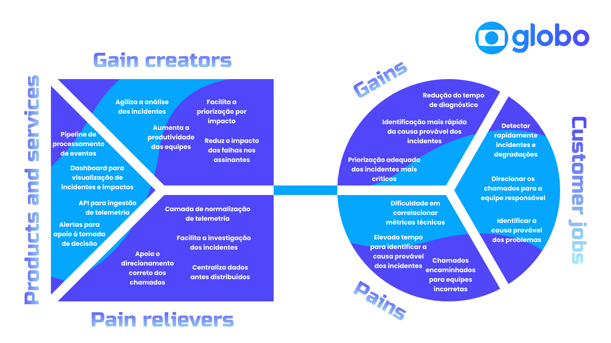

# Entendimento do Negócio

## 1. Matriz de Avaliação de Valor (Oceano Azul)

---

## 2. Matriz de Risco

---

## 3. Canvas da Proposta de Valor

### 3.1. Value Proposition Canvas

&nbsp; O Canvas da Proposta de Valor é uma ferramenta estratégica que permite compreender de forma visual e objetiva a relação entre o que uma organização oferece e as necessidades de seu público-alvo. Ele é dividido em dois lados complementares: o Perfil do Cliente, que identifica as tarefas, dores e ganhos esperados, e o Mapa de Valor, que apresenta como os produtos e serviços propostos aliviam essas dores e criam benefícios. Neste projeto, a ferramenta é utilizada para relacionar a solução de observabilidade aos desafios enfrentados pelo time de tecnologia da Globo durante o monitoramento e a resolução de incidentes do Globoplay.

Figura 3 - Value Proposition Canvas

  

Fonte: Material produzido pelos autores (2026)

##### PROPOSTA DE VALOR

###### Produtos & Serviços

&nbsp; Esta seção detalha os produtos e serviços que compõem a proposta de valor entregue ao cliente.

- **1 -** API para ingestão de dados de telemetria.
- **2 -** Pipeline escalável, executado na AWS, para processamento de eventos.
- **3 -** Camada de normalização de diferentes formatos de telemetria.
- **4 -** Armazenamento centralizado das informações processadas.
- **5 -** Dashboard para visualização de incidentes e de seus impactos.
- **6 -** Alertas para apoio à tomada de decisão das equipes técnicas.

###### Criadores de Ganhos (*Gain Creators*)

&nbsp; Esta seção detalha os elementos da solução que atuam como criadores de ganhos para o cliente, fortalecendo a proposta de valor.

- **1 -** Acesso mais rápido a informações consolidadas sobre os incidentes.
- **2 -** Priorização dos incidentes conforme o impacto identificado.
- **3 -** Maior produtividade das equipes durante a investigação.
- **4 -** Melhor suporte à tomada de decisão operacional.
- **5 -** Maior capacidade de cumprimento dos acordos de nível de serviço (SLA).
- **6 -** Redução do impacto das falhas percebidas pelos assinantes.

###### Aliviadores de Dores (*Pain Relievers*)

&nbsp; Esta seção apresenta os elementos da solução que atuam como aliviadores das dores identificadas no perfil do cliente.

- **1 -** Centralização de dados anteriormente distribuídos entre diferentes fontes.
- **2 -** Padronização dos diferentes formatos de telemetria recebidos.
- **3 -** Reunião de métricas, eventos e informações de impacto para facilitar a investigação.
- **4 -** Ampliação da visibilidade sobre o incidente e os grupos afetados.
- **5 -** Apoio ao direcionamento dos chamados para a equipe responsável.
- **6 -** Processamento escalável do volume de eventos por meio da infraestrutura da AWS.

---

##### PERFIL DO CLIENTE (Público-Alvo Ideal)

&nbsp; O cliente analisado neste projeto corresponde ao time de tecnologia da Globo responsável pelo monitoramento e pela resolução de incidentes do Globoplay. Embora as equipes técnicas sejam as usuárias diretas da solução, os assinantes são beneficiados indiretamente pela redução do impacto e da duração das falhas.

###### Tarefas do Cliente (*Customer Jobs*)

&nbsp; Esta seção descreve as principais responsabilidades, objetivos e desafios enfrentados pelo cliente, que orientam o desenvolvimento da solução.

- **1 -** Monitorar continuamente a saúde dos sistemas do Globoplay.
- **2 -** Detectar incidentes e degradações na experiência dos assinantes.
- **3 -** Analisar informações provenientes de diferentes fontes de observabilidade.
- **4 -** Investigar as possíveis causas dos incidentes.
- **5 -** Priorizar os incidentes conforme o impacto nos usuários.
- **6 -** Direcionar os chamados para a equipe responsável.
- **7 -** Reduzir o tempo de resolução e cumprir os SLAs estabelecidos.

###### Ganhos Desejados (*Gains*)

&nbsp; Esta seção apresenta os ganhos esperados pelo cliente com a adoção da solução.

- **1 -** Redução do tempo necessário para analisar e diagnosticar incidentes.
- **2 -** Visualização integrada das informações de observabilidade.
- **3 -** Priorização adequada dos incidentes mais críticos.
- **4 -** Maior eficiência operacional das equipes técnicas.
- **5 -** Maior cumprimento dos SLAs de atendimento.
- **6 -** Redução do impacto das falhas na experiência dos assinantes.

###### Dores (*Pains*)

&nbsp; Esta seção descreve os principais desafios e obstáculos enfrentados pelo cliente.

- **1 -** Dados distribuídos entre diferentes fontes, dificultando uma análise integrada.
- **2 -** Falta de visão ponta a ponta sobre os incidentes.
- **3 -** Tempo elevado para investigar as possíveis causas dos problemas.
- **4 -** Chamados encaminhados para equipes incorretas.
- **5 -** Baixa visibilidade sobre falhas que afetam dispositivos, versões ou regiões específicas.
- **6 -** Dificuldade para perceber degradações que não geram erros explícitos nos painéis tradicionais.

&nbsp; Dessa forma, o modelo demonstra que a solução proposta busca aliviar as principais dificuldades enfrentadas pelo time de tecnologia da Globo, especialmente a fragmentação dos dados, a falta de visão ponta a ponta e o tempo elevado de investigação. Ao centralizar e padronizar a telemetria, apresentar informações contextualizadas em um dashboard e apoiar o direcionamento dos incidentes, a solução contribui para aumentar a eficiência das equipes, favorecer o cumprimento dos SLAs e reduzir o impacto das falhas percebidas pelos assinantes do Globoplay.

## 4. Análise Financeira do Projeto

---

## 5. Análise de impacto do projeto na perspectivas dos ODS

---

## Referências
