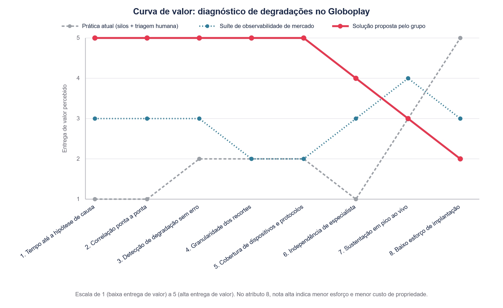
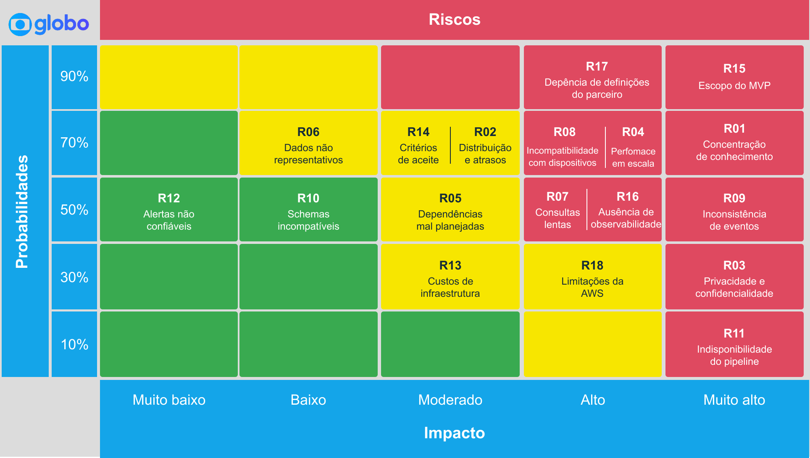
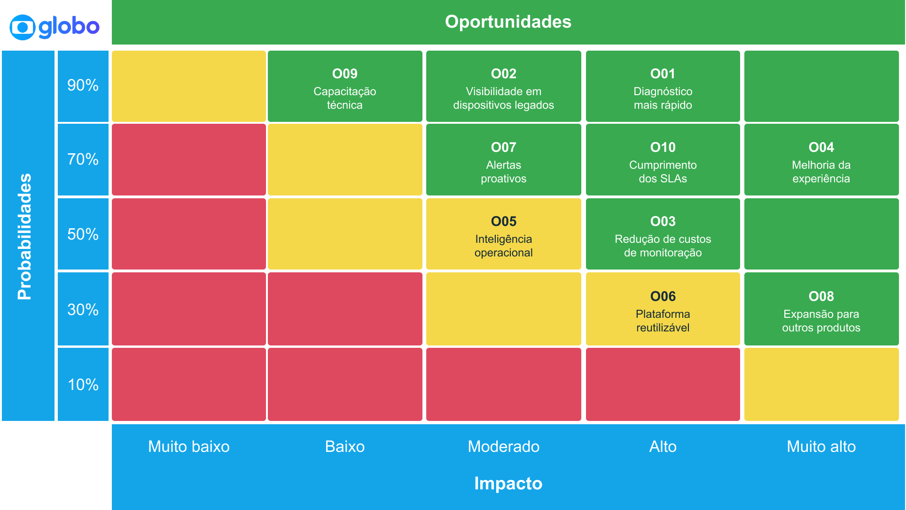
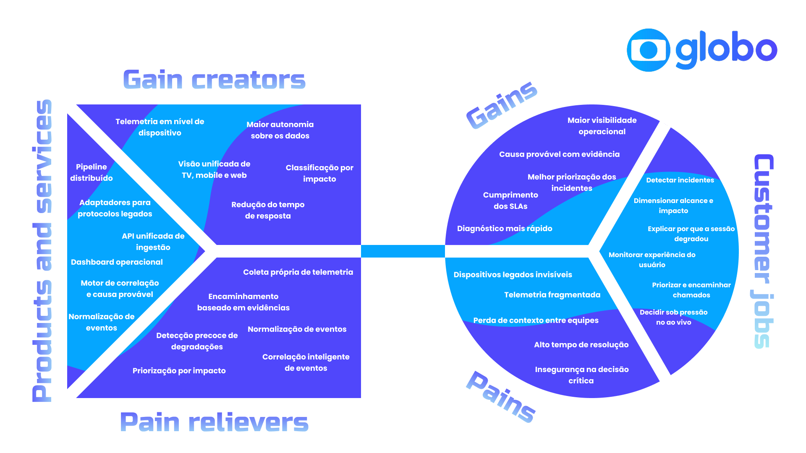

# Entendimento do Negócio

## 1. Matriz de Avaliação de Valor (Oceano Azul)

### 1.1. Contexto da comparação

&emsp; O projeto responde a uma pergunta específica: como identificar de forma automática, em minutos, a causa provável de uma degradação de streaming, sem depender de um especialista por componente. A matriz compara três formas de responder a ela.

&emsp; **Prática atual: monitoração fragmentada por área, com triagem manual.** Cada componente da cadeia de entrega (player, CDN, backend, identidade, catálogo) é operado por uma área distinta, com painel, vocabulário de métricas e especialistas próprios. O incidente percorre uma fila por vez até alguém identificar o responsável, e a correlação entre fontes é feita manualmente. Não custa nada implantar, porque já existe, mas cobra caro por incidente.

&emsp; **Consolidação em uma suíte de observabilidade de mercado.** Uma plataforma comercial de APM e Real User Monitoring reúne as fontes em um painel único, com alertas por limiar e detecção de anomalia. Reduz a fragmentação, mas parte de duas premissas frágeis neste contexto: base de dispositivos homogênea e compatível com padrões modernos de coleta, e cobrança proporcional ao volume e à cardinalidade dos dados observados.

&emsp; **Solução proposta pelo grupo.** Sistema distribuído proprietário de telemetria, com API única de ingestão que aceita protocolos modernos e legados, normalização dos eventos sob vocabulário comum (`request`, `vitals`, `screen_view`, `video_view`, `session`, `error`), pipeline de alta escala sem perdas e camada agêntica de correlação, que devolve uma linha do tempo única do incidente e uma hipótese de causa provável ranqueada, com o recorte afetado explícito.

&emsp; **Aviso executivo sobre escopo.** A matriz compara a solução-alvo, e não apenas o recorte entregue no MVP funcional do módulo. O MVP atual implementa ingestão, processamento assíncrono, armazenamento e consulta: os eventos são enviados pelas aplicações à API de ingestão, enfileirados, gravados sem transformação e expostos por uma API de leitura, conforme `arquitetura.md`. A camada agêntica de correlação, a linha do tempo única automatizada e a hipótese de causa provável pertencem ao roadmap de produção, especialmente à Fase 5 da análise financeira (seção 4.3), e não devem ser apresentadas como capacidade já entregue pelo MVP.

&emsp; A matriz avalia as abordagens de solução, e não o Globoplay. Características do produto e da audiência entram como justificativa do valor de cada atributo, não como objeto de avaliação.

### 1.2. Escala e critérios de atribuição das notas

&emsp; As notas vão de 1 (baixa entrega de valor) a 5 (alta entrega de valor para o Grupo Globo). Para reduzir subjetividade, foram atribuídas segundo cinco critérios:

- Aderência ao problema: a abordagem produz hipótese, recorte e linha do tempo, ou apenas mais dados?
- Cobertura da superfície de falha: enxerga a combinação de plataforma, modelo, versão, UF e operadora em que o problema se manifesta?
- Impacto no tempo de resolução, medido entre o sintoma e a hipótese acionável.
- Custo humano por incidente, em horas de especialista, reunião e plantão.
- Viabilidade operacional, incluindo esforço de implantação e robustez sob evento ao vivo.

&emsp; Todos os atributos são enunciados de modo que nota alta signifique maior entrega de valor, inclusive o atributo 8, formulado como *baixo* esforço de implantação e custo de propriedade. Assim a curva é lida em sentido único, sem inversão de eixo.

### 1.3. Matriz de avaliação de valor

| Atributo de valor para o Grupo Globo                       | Prática atual (fragmentada, triagem manual) | Suíte de observabilidade de mercado | Solução proposta pelo grupo | Justificativa das notas                                                                                                                                                                                                                                                                                                                                                                             |
| ---------------------------------------------------------- | -------------------------------------: | ----------------------------------: | --------------------------: | --------------------------------------------------------------------------------------------------------------------------------------------------------------------------------------------------------------------------------------------------------------------------------------------------------------------------------------------------------------------------------------------------- |
| 1. Tempo até a hipótese de causa provável                  |                                      1 |                                   3 |                           5 | Hoje o tempo de resolução é a soma das filas: gasta-se mais para descobrir quem conserta do que para consertar. A suíte comercial encurta o caminho ao reunir sinais em um painel, mas ainda entrega gráficos que alguém precisa interpretar. Só a solução proposta tem como produto final uma hipótese ranqueada, e não um conjunto de séries temporais.                                           |
| 2. Correlação ponta a ponta em uma linha do tempo única    |                                      1 |                                   3 |                           5 | A experiência do assinante é ponta a ponta, mas a observabilidade não é: nenhum painel atual acompanha a jornada inteira do play. A suíte comercial resolve isso quando todas as fontes são de fato integradas, o que raramente se completa numa cadeia com mais de treze fontes heterogêneas. A solução proposta faz o agrupamento por filtros, que proporciona o olhar de uma linha do tempo única. |
| 3. Detecção de degradação que não gera erro                |                                      2 |                                   3 |                           5 | Buffer alto e tempo de início ruim não produzem taxa de erro, e o painel tradicional não acende. Ferramentas de mercado detectam anomalia, mas sobre métricas agregadas, em que a degradação de um recorte se dilui. A solução proposta parte de eventos de QoE coletados no cliente, em que o sintoma percebido pelo assinante é o próprio dado primário.                                          |
| 4. Granularidade nos recortes de investigação              |                                      2 |                                   2 |                           5 | Uma falha que atinge meio por cento das sessões pode ser a totalidade das sessões de um modelo de TV numa região. A prática atual dilui isso na média nacional. A suíte comercial é penalizada pelo próprio modelo de cobrança: cada dimensão adicional vira custo e empurra o time de volta ao agregado. Na solução proposta, o evento é gravado sem agregação prévia, e a granularidade passa a ser decidida na consulta e não pelo preço de observar mais uma dimensão. O preço dessa escolha aparece do lado da leitura: recortes fora das chaves de partição são resolvidos por filtro sobre o conjunto lido.               |
| 5. Cobertura da base real de dispositivos e protocolos     |                                      2 |                                   2 |                           5 | Sete plataformas e centenas de modelos convivem no parque, e parte relevante deles não suporta os padrões modernos de coleta que as plataformas de mercado assumem. Nem a prática atual nem a suíte resolvem isso, porque a limitação está na borda e não no backend. A API única multiprotocolo ataca a causa do ponto cego.                                                                       |
| 6. Independência de especialista e custo humano da triagem |                                      1 |                                   3 |                           4 | Hoje o diagnóstico vira reunião: como nenhum time enxerga o todo, a correlação exige uma sala de especialistas, o recurso mais caro da casa gasto em triagem. Um painel unificado reduz parte disso. A nota 4 da solução proposta reconhece que a hipótese automática ainda dependerá de validação humana enquanto não houver histórico suficiente para calibrar sua confiabilidade.                |
| 7. Sustentação sob pico de evento ao vivo                  |                                      3 |                                   4 |                           3 | Aqui a solução proposta não é superior. A prática atual, embora lenta, sobrevive a picos porque não depende de infraestrutura nova. As suítes comerciais operam infraestrutura endurecida por anos de produção. A solução proposta precisa demonstrar ingestão sem perdas em cenários de milhões de sessões simultâneas, e essa capacidade ainda é hipótese de engenharia.                          |
| 8. Baixo esforço de implantação e custo de propriedade     |                                      5 |                                   3 |                           2 | A prática atual não custa nada para implantar, por definição. Consolidar em suíte comercial é um projeto de migração relevante, com custo recorrente proporcional ao volume. Construir plataforma própria é a alternativa mais cara em desenvolvimento, operação e plantão, e cria um sistema que passa a precisar ele próprio de monitoração.                                                      |

&emsp; A Figura 1 apresenta a curva de valor correspondente à matriz. Os atributos 1 e 2, com destaque acima, são os que descrevem capacidade ainda projetada para a Fase 5, portanto representam a solução-alvo e não a entrega funcional imediata do MVP inicial.

<div align="center">

<sub>Figura 1 - Curva de valor da matriz de avaliação</sub>



<sup>Fonte: Material produzido pelos autores (2026)</sup>

</div>

### 1.4. Leitura estratégica da matriz

&emsp; A curva da solução proposta concentra valor nos cinco primeiros atributos, que traduzem o problema a resolver, e aceita ser pior nos dois últimos, que dizem respeito a conveniência e maturidade.

&emsp; O cruzamento entre os atributos 4 e 8 resume o dilema. Nas suítes comerciais, granularidade e custo são grandezas acopladas: observar cada combinação de modelo, firmware, UF e operadora aumenta a fatura, o que leva o time a agregar métricas e a perder justamente o sinal de que precisa. A solução proposta desacopla parcialmente essas dimensões e paga por isso em custo de construção. A escolha é entre pagar em licença e perder granularidade, ou pagar em engenharia e ganhá-la.

&emsp; A prática atual tem uma leitura própria que costuma passar despercebida. Ela pontua alto só no atributo 8, e de forma enganosa: custo zero de implantação convive com custo altíssimo por incidente, concentrado em horas de especialista e em tempo de assinante impactado. Esse custo é real e não aparece em nenhuma linha de orçamento de ferramenta.

### 1.5. Trade-offs explícitos da solução proposta

&emsp; Os trade-offs abaixo são tratados como riscos de projeto na seção 2, com probabilidade, impacto e plano de ação; aqui interessam apenas como contrapartida da escolha de valor. Os principais são:

- Uma causa provável errada durante um evento ao vivo é pior do que hipótese nenhuma, porque direciona o esforço da equipe para o componente errado no pior momento. A saída precisa vir ranqueada e com evidência auditável, e sua qualidade depende de um histórico de incidentes rotulados que talvez ainda não exista em volume suficiente.
- A camada de inferência só gera valor sobre eventos confiáveis. Investir na inteligência antes de estabilizar ingestão e olhar para os eventos corretos produziria diagnóstico automático sobre dado incompleto, resultado pior do que a triagem manual de hoje.
- Ao internalizar a telemetria, o Globoplay passa a depender de um sistema que precisa estar disponível exatamente quando a operação está sob estresse. A indisponibilidade da plataforma de monitoração durante uma transmissão de alta audiência é um modo de falha que não existia enquanto o serviço era terceirizado (R11 e R16 da seção 2).
- Armazenar eventos por dispositivo, versão, UF e operadora em alta escala continua caro, e a política de retenção e amostragem terá de ser decisão explícita de projeto, sob o risco de reproduzir internamente o mesmo incentivo a observar menos (R13 da seção 2).

### 1.6. Evidências que reforçam a comparação

&emsp; **Contexto do produto.** O Globoplay reúne cerca de 30 milhões de usuários ativos mensais (EXAME, 2026), com picos que chegam a 4,1 milhões de sessões em um único evento ao vivo. O produto é entregue em sete plataformas, sobre centenas de modelos de dispositivo, distribuídos por 27 unidades federativas e dezenas de provedores de acesso. A cadeia de entrega envolve mais de treze fontes de dados, produzidas por áreas diferentes, com formatos e janelas de agregação diferentes, e todas precisam ser lidas em conjunto para explicar um único play que deu errado. É esse espaço de busca que torna a varredura manual inviável em plantão.

&emsp; **Impacto econômico da degradação silenciosa.** O estudo de Krishnan e Sitaraman (2012), conduzido sobre 23 milhões de visualizações na rede da Akamai e apresentado no Internet Measurement Conference, mostrou que o abandono começa quando o vídeo demora mais de cerca de 2 segundos para iniciar, com aumento aproximado de 5,8 pontos percentuais na taxa de abandono a cada segundo adicional. Travamentos equivalentes a 1% da duração reduzem em cerca de 5% o tempo assistido, e quem sofre falha de reprodução tem probabilidade cerca de 2,3% menor de voltar na mesma semana. O resultado sustenta o atributo 3: a degradação que não gera erro é justamente a que destrói engajamento.

&emsp; **Peso do custo de observabilidade.** A pesquisa da Grafana Labs (2025) aponta que o gasto com observabilidade representa em média cerca de 17% do gasto total com infraestrutura de computação, sendo 10% a resposta mais frequente. Pesquisas do setor também indicam que a maioria dos times filtra, arquiva ou desloca dados para conter custo, reduzindo visibilidade para economizar. É esse comportamento que os atributos 4 e 8 pretendem transformar em decisão consciente.

### 1.7. Quatro ações do Oceano Azul aplicadas ao projeto

&emsp; Para tornar explícita a conexão com o Canvas da Proposta de Valor (seção 3), cada item de *Aumentar* e *Criar* indica, entre parênteses, os produtos (P1–P6, seção 3.1.2) e ganhos (G1–G5, seção 3.1.4) diretamente vinculados; os itens de *Eliminar* e *Reduzir* indicam as dores (D1–D5, seção 3.1.3) que endereçam.

#### Eliminar

- A reunião de correlação como etapa obrigatória do diagnóstico, hoje necessária para formular a primeira hipótese. (D3, D4)
- O alinhamento manual de horários e recortes entre painéis de fontes distintas. (D2, D3)
- Os pontos cegos de dispositivos que não aparecem em painel algum por incompatibilidade de protocolo. (D1)

#### Reduzir

- O número de saltos entre filas até chegar ao time correto, substituindo triagem por eliminação por triagem com hipótese. (D3, D4)
- A amostragem cega motivada por custo, e não por irrelevância analítica. (atributo 4 da matriz, 1.3)
- O intervalo entre a degradação e a percepção interna dela, hoje dependente da reclamação do assinante. (D4)

#### Aumentar

- A resolução da análise, com sessão, tipo de evento e aparelho como chaves de consulta, e modelo, versão, UF e operadora como filtros aplicados sobre o conjunto recuperado. (produtos P4 e P6, Armazenamento indexado e Dashboard/API de consulta; sustenta o ganho G1, Maior visibilidade operacional)
- A cobertura efetiva da base instalada, incluindo aparelhos antigos e redes instáveis. (produtos P1 e P2, Contrato de eventos e API única de ingestão; sustenta o ganho G1)
- A autonomia do time de atendimento, medida pelo quanto a primeira linha conclui sem escalar. (produto P6, Dashboard e API de consulta; sustenta os ganhos G3, Diagnóstico mais rápido, e G5, Cumprimento dos SLAs)

#### Criar

- Hipótese de causa provável ranqueada, com evidência associada, que nenhuma das alternativas entrega hoje. (produto P5, Motor de correlação e causa provável; sustenta o ganho G2, Causa provável com evidência)
- Linha do tempo única do incidente, atravessando componentes que só existem separados. (produtos P4 e P5, Armazenamento indexado e Motor de correlação)
- API única de ingestão multiprotocolo, que trata a heterogeneidade do parque como característica permanente. (produto P2, API única de ingestão; sustenta o ganho G1)

### 1.8. Como a solução gera diferenciação

&emsp; A diferenciação está em mudar a natureza da entrega, e não apenas sua qualidade. As duas alternativas comparadas entregam dados: uma os espalha em painéis por componente, a outra os reúne em um painel único. Em ambas, a inferência sobre a causa continua sendo tarefa de alguém que conheça o comportamento normal de cada peça da cadeia. A solução do grupo entrega inferência, movendo a fronteira da automação da coleta e da visualização para a formulação de hipótese.

&emsp; Porém ela não é absoluta. A solução é deliberadamente pior em facilidade de adoção e ainda precisa comprovar sustentação sob pico. Seu valor depende de uma decisão do parceiro: aceitar maior custo de propriedade e maior responsabilidade operacional em troca de granularidade, cobertura e velocidade de diagnóstico que nem a prática atual nem o mercado entregam para a realidade específica do Globoplay.

## 2. Matriz de Riscos e Oportunidades

### 2.1. Matriz de Risco

&emsp; A matriz de riscos e oportunidades é uma ferramenta utilizada para identificar, analisar e priorizar eventos que podem afetar o desenvolvimento e os resultados do projeto. Os riscos representam situações incertas que podem gerar impactos negativos, como atrasos, falhas técnicas, aumento de custos ou comprometimento da segurança. Já as oportunidades correspondem a condições que podem produzir benefícios, como redução de custos, melhoria da experiência dos usuários, aumento da eficiência operacional e expansão da solução.

&emsp; Cada risco e oportunidade foi avaliado de acordo com sua probabilidade de ocorrência e seu impacto potencial. A combinação desses dois fatores determina sua classificação e auxilia na definição das prioridades de acompanhamento. Além disso, foram estabelecidos planos de ação para reduzir a probabilidade ou o impacto dos riscos e para ampliar a possibilidade de concretização das oportunidades identificadas.

&emsp; A Figura 2 apresenta a matriz de classificação dos riscos identificados.

<div align="center">

<sub>Figura 2 - Matriz de classificação de riscos</sub>



<sup>Fonte: Material produzido pelos autores (2026)</sup>

</div>

&emsp; A coluna "Responsável" indica o papel funcional do grupo que acompanha cada risco ou oportunidade. A atribuição nominal de integrante deve ser preenchida no quadro da sprint, mas o artefato mantém o papel responsável para preservar a governança mesmo quando houver rodízio entre os oito integrantes. A coluna "Categoria" usa a taxonomia obrigatória do enunciado: **Técnico**, **Negócio**, **Operacional** ou **Humano**.

| Descrição do risco | Categoria | Responsável | Classificação na matriz | Explicação | Plano de ação |
|---|---|---|---|---|---|
| **R01: Concentração de conhecimento técnico** | Humano | Papel de gestão de projeto | **Risco alto** - Probabilidade: 70%; Impacto: muito alto | O risco ocorre quando apenas um integrante domina componentes críticos da solução, como a API de ingestão, o processamento dos eventos, o banco de dados, a infraestrutura AWS ou o dashboard. A ausência ou indisponibilidade desse integrante pode bloquear tarefas, comprometer o cronograma e dificultar a manutenção da aplicação. | Realizar revisões cruzadas de código, programação em pares nos componentes críticos, rodízio de responsabilidades e documentação técnica contínua. Registrar decisões arquiteturais e compartilhar atualizações durante os rituais Scrum. |
| **R02: Distribuição desigual de tarefas e atrasos** | Humano | Papel de gestão de projeto | **Risco moderado** - Probabilidade: 70%; Impacto: moderado | A concentração de atividades complexas em poucos integrantes pode provocar sobrecarga, redução da qualidade das entregas, desmotivação e atrasos. Ao mesmo tempo, integrantes com tarefas menores podem não desenvolver conhecimento suficiente sobre os componentes centrais do sistema. | Dividir as entregas em tarefas menores, definir responsáveis e revisores, acompanhar semanalmente a carga de trabalho e redistribuir atividades quando forem identificados bloqueios ou desequilíbrios. |
| **R03: Violação de privacidade e confidencialidade** | Técnico | Papel de segurança e privacidade | **Risco alto** - Probabilidade: 30%; Impacto: muito alto | Os eventos de telemetria podem conter identificadores de usuário e dispositivo, cabeçalhos de autenticação ou outras informações sensíveis. Além das exigências da LGPD, os documentos do parceiro determinam que os dados e desafios do projeto não sejam compartilhados com terceiros. A exposição pode ocorrer em repositórios públicos, protótipos, vídeos, capturas de tela ou ferramentas externas. | Aplicar a redação dos identificadores e cabeçalhos sensíveis na resposta da API de leitura, conforme a arquitetura vigente, mantendo o evento cru no banco sob TTL, criptografia em repouso e controle de acesso. Definir políticas de retenção, restringir quem consulta a base diretamente e empregar dados sintéticos em protótipos, testes públicos e demonstrações. |
| **R04: Baixo desempenho da ingestão e do processamento em escala** | Técnico | Papel de backend e ingestão | **Risco alto** - Probabilidade: 70%; Impacto: alto | A API de ingestão e os componentes de processamento podem não suportar o volume médio ou os picos de eventos gerados pelos dispositivos, provocando aumento de latência, acúmulo de mensagens, rejeição de requisições ou indisponibilidade parcial da plataforma. | Definir metas mensuráveis de eventos por segundo, latência, taxa de erro e disponibilidade. Executar testes progressivos de carga, pico e resistência, monitorar gargalos e permitir escalabilidade horizontal dos componentes críticos. |
| **R05: Dependências técnicas e organizacionais não planejadas** | Operacional | Papel de gestão de projeto | **Risco moderado** - Probabilidade: 50%; Impacto: moderado | Algumas atividades podem depender de schemas, APIs, dados, ambientes AWS, decisões arquiteturais ou respostas do parceiro que ainda não estejam disponíveis. Isso pode deixar integrantes bloqueados e comprometer a sequência planejada das entregas. | Mapear as dependências durante o planejamento das sprints, priorizar contratos de API e schemas, criar mocks para componentes indisponíveis e registrar responsáveis e prazos para a resolução de cada dependência. |
| **R06: Dados de teste pouco representativos** | Técnico | Papel de dados e schemas | **Risco baixo** - Probabilidade: 70%; Impacto: moderado | Os dados sintéticos ou exemplos fornecidos podem não representar adequadamente a diversidade de dispositivos, sistemas operacionais, condições de conectividade, formatos de evento e picos de utilização do Globoplay. Isso pode levar à validação de uma arquitetura inadequada e à definição incorreta de requisitos de desempenho. | Solicitar ao parceiro amostras anonimizadas e estatísticas agregadas. Desenvolver um gerador de eventos capaz de simular diferentes dispositivos, versões, condições de rede, tipos de erro, volumes e padrões de utilização. |
| **R07: Lentidão nas consultas e no dashboard** | Técnico | Papel de dashboard e consultas | **Risco alto** - Probabilidade: 50%; Impacto: alto | O alto volume de registros, a elevada cardinalidade dos campos e a combinação de filtros cumulativos podem tornar as consultas lentas ou excessivamente caras. Isso comprometeria a navegação no dashboard e reduziria a utilidade da solução durante a investigação de incidentes. | Utilizar índices, particionamento, paginação, agregações e cache. Restringir períodos excessivamente amplos quando necessário e realizar testes com diferentes combinações de filtros, volumes e níveis de cardinalidade. |
| **R08: Incompatibilidade com dispositivos legados** | Técnico | Papel de backend e ingestão | **Risco alto** - Probabilidade: 70%; Impacto: alto | Dispositivos antigos podem não suportar os protocolos, formatos, mecanismos de autenticação, criptografia ou tamanhos de payload adotados pela solução. Como o suporte a dispositivos legados é parte central da proposta de valor, essa incompatibilidade pode impedir o atendimento do objetivo principal do projeto. | Criar uma matriz de compatibilidade com os dispositivos prioritários, definir um contrato mínimo de comunicação, desenvolver adaptadores para formatos diferentes e executar testes com simuladores ou dispositivos representativos. |
| **R09: Perda, duplicação ou desordenação de eventos** | Técnico | Papel de backend e ingestão | **Risco alto** - Probabilidade: 50%; Impacto: muito alto | Conexões instáveis, falhas temporárias e tentativas automáticas de reenvio podem causar perda, duplicação ou chegada fora de ordem dos eventos. Essas ocorrências podem gerar métricas incorretas, análises inconsistentes e diagnósticos equivocados. | Utilizar identificadores únicos, operações idempotentes, timestamps padronizados, filas persistentes, políticas controladas de retentativa e dead-letter queue. Definir também como eventos atrasados e duplicados serão tratados. |
| **R10: Incompatibilidade e evolução não controlada dos schemas** | Técnico | Papel de dados e schemas | **Risco baixo** - Probabilidade: 50%; Impacto: baixo | Diferentes dispositivos e versões das aplicações podem enviar campos, estruturas ou valores distintos. Mudanças não controladas nos schemas podem interromper a ingestão, provocar perda de informações ou tornar versões antigas incompatíveis com o sistema. | Adotar versionamento dos schemas, validação por tipo de evento, compatibilidade retroativa e tolerância controlada a campos adicionais. Implementar testes automatizados de contrato e documentar os campos obrigatórios e opcionais. |
| **R11: Indisponibilidade do pipeline de telemetria** | Técnico | Papel de infraestrutura e nuvem | **Risco alto** - Probabilidade: 10%; Impacto: muito alto | Falhas na API, na fila, nos processadores ou no armazenamento podem interromper o fluxo de eventos e causar perda de visibilidade operacional. Mesmo interrupções curtas podem ser críticas durante períodos de alta utilização ou incidentes reais. | Desacoplar os componentes por meio de filas, implementar health checks, timeouts, políticas de retentativa e armazenamento temporário. Prever mecanismos de recuperação e testar falhas dos componentes mais críticos. |
| **R12: Alertas imprecisos ou excessivos** | Operacional | Papel de dashboard e consultas | **Risco baixo** - Probabilidade: 50%; Impacto: muito baixo | Limites inadequados podem gerar falsos positivos, deixar de identificar falhas relevantes ou produzir notificações em excesso. A fadiga de alertas pode reduzir a confiança dos usuários e fazer com que incidentes reais sejam ignorados. | Definir níveis de severidade, janelas temporais, agrupamento de ocorrências e regras ajustáveis. Acompanhar falsos positivos e falsos negativos e revisar periodicamente os limites com os usuários da plataforma. |
| **R13: Custos de infraestrutura acima do previsto** | Negócio | Papel de infraestrutura e nuvem | **Risco moderado** - Probabilidade: 30%; Impacto: moderado | A ingestão contínua, o processamento em larga escala, a transferência de dados e o armazenamento de eventos detalhados podem gerar custos superiores às estimativas iniciais, especialmente durante picos ou com políticas de retenção inadequadas. | Estimar o custo total da arquitetura, definir políticas de retenção, agregação, amostragem e compressão e configurar o acompanhamento dos gastos com processamento, armazenamento, transferência e serviços gerenciados. |
| **R14: Critérios de aceite pouco objetivos** | Negócio | Papel de produto e requisitos | **Risco moderado** - Probabilidade: 70%; Impacto: moderado | Expressões como "alta escala", "sem perdas", "tempo real" e "falhas críticas" podem não possuir valores mensuráveis. A ausência de critérios objetivos dificulta o desenvolvimento dos requisitos não funcionais, a execução dos testes e a validação do MVP. | Converter os termos em indicadores verificáveis, como eventos por segundo, latência máxima, disponibilidade mínima, período de retenção, taxa aceitável de perda e volume utilizado nos testes. Validar os valores com o parceiro. |
| **R15: Escopo do MVP superior ao tempo disponível** | Operacional | Papel de gestão de projeto | **Risco alto** - Probabilidade: 90%; Impacto: muito alto | A quantidade de funcionalidades previstas, incluindo API unificada, suporte a dispositivos legados, ingestão resiliente, normalização, armazenamento, consultas e dashboard, pode superar o tempo e os recursos disponíveis para o desenvolvimento. | Classificar os requisitos como essenciais, desejáveis ou futuros. Priorizar inicialmente um fluxo completo de ponta a ponta, desde o envio de um evento até sua consulta e visualização, evitando implementar funcionalidades isoladas sem integração. |
| **R16: Ausência de observabilidade da própria plataforma** | Técnico | Papel de infraestrutura e nuvem | **Risco alto** - Probabilidade: 50%; Impacto: alto | Sem métricas e logs internos, a equipe pode não distinguir uma falha do Globoplay de um problema na própria plataforma de monitoração. Também pode ser difícil identificar acúmulo de mensagens, lentidão no processamento, descarte de eventos ou indisponibilidade de componentes. | Instrumentar a solução com métricas, logs estruturados e, quando aplicável, rastreamento distribuído. Acompanhar latência, throughput, taxa de erro, backlog, descarte de eventos, uso de recursos e disponibilidade. |
| **R17: Dependência de definições e validações do parceiro** | Negócio | Papel de relacionamento com o parceiro | **Risco alto** - Probabilidade: 90%; Impacto: alto | A falta ou demora na confirmação de protocolos legados, formatos reais das mensagens, campos obrigatórios, volumes, personas, critérios de aceite e papel da camada unificada pode levar à implementação de uma solução desalinhada às necessidades do parceiro. | Consolidar as dúvidas em reuniões de elicitação, registrar respostas e premissas, manter uma matriz de rastreabilidade e validar periodicamente schemas, requisitos, arquitetura e protótipos com os stakeholders. |
| **R18: Limitações ou indisponibilidade do ambiente AWS Academy** | Técnico | Papel de infraestrutura e nuvem | **Risco moderado** - Probabilidade: 30%; Impacto: alto | Restrições de permissões, créditos, duração das sessões, alteração de endereços públicos ou indisponibilidade de serviços podem comprometer a implantação, os testes e a demonstração da aplicação no ambiente exigido para a disciplina. | Documentar e automatizar a implantação, manter scripts de configuração, monitorar o consumo de créditos, testar a aplicação antes da entrega e garantir que ela também possa ser executada localmente. |

### 2.1.1. Risco considerado e descartado

&emsp; O enunciado exige o registro de ao menos um risco avaliado e posteriormente descartado, com justificativa. O grupo cogitou e descartou o seguinte:

&emsp; **Adoção de banco relacional (PostgreSQL) para o armazenamento dos eventos brutos.** Nas primeiras discussões de arquitetura, cogitou-se usar um banco relacional, já familiar à equipe, para simplificar consultas ad-hoc durante o desenvolvimento do MVP. O risco identificado era de desempenho de escrita: no volume de rollout total estimado (C9 ≈ 3,6 bilhões de eventos/mês, seção 4.2), sustentar essa taxa de escrita exigiria sharding manual e ajuste fino de índices, esforço de engenharia que competiria diretamente com o prazo de 10 semanas do módulo (C2) e elevaria o risco de indisponibilidade sob pico, equivalente ao R11. O risco foi descartado como risco ativo do projeto porque a equipe optou, ainda na fase de arquitetura, por um banco gerenciado com escrita particionada nativamente (DynamoDB, conforme `arquitetura.md` e o dimensionamento em 4.4), que desloca o problema de escala para um serviço já projetado para volume alto sem operação manual de sharding. A decisão elimina o risco original, mas introduz o R13 (custo de infraestrutura) como seu substituto: a mesma escala que ameaçava o desempenho passa a ameaçar o orçamento.

### 2.1.2. Cenários concretos de simulação e métricas de verificação

&emsp; Para cada risco, um cenário concreto de ocorrência em uma janela de 2 semanas (equivalente a uma sprint) e a métrica que permite verificar se o risco está sob controle.

| Risco | Cenário concreto (janela de 2 semanas) | Métrica de verificação |
|---|---|---|
| R01 | O único integrante que domina a configuração da fila e do worker fica indisponível por 4 dias durante a sprint, e uma falha no componente crítico não é resolvida a tempo da entrega. | Número de componentes críticos com apenas um integrante capaz de resolvê-los sozinho (meta: 0 ao fim da sprint). |
| R02 | Ao final da sprint, dois integrantes concentram 60% dos pontos de história entregues, enquanto outros dois entregam menos de 10% cada, atrasando a revisão de código dos primeiros. | Desvio-padrão dos pontos de história concluídos por integrante ao fim da sprint (meta: abaixo de 20% da média). |
| R03 | Durante a gravação de um vídeo de demonstração do protótipo, um identificador de dispositivo real aparece sem redação em um print publicado no repositório. | Número de ocorrências de dado sensível não redigido identificadas em revisão de artefatos publicados (meta: 0 por sprint). |
| R04 | Um teste de carga simulando 5.000 eventos/segundo ao longo da sprint de hardening mostra rejeição de requisições acima de 2.000 eventos/segundo. | Eventos por segundo sustentados sem erro 5xx nem timeout em teste de carga (meta: ≥ 3.000 eventos/segundo). |
| R05 | Dois integrantes ficam bloqueados por 3 dias na sprint de integração aguardando a definição do schema de um novo tipo de evento por outro subtime. | Dias-pessoa perdidos por bloqueio de dependência interna, registrados por sprint (meta: redução a cada sprint). |
| R06 | Com os dados sintéticos atuais, a equipe não identifica, ao longo da sprint, um problema de payload que só ocorre em firmware antigo, revelado apenas após a integração com o parceiro. | Percentual de tipos de dispositivo e formato de payload reais cobertos pelo gerador sintético (meta: ≥ 90%). |
| R07 | Com a base populada com 10 milhões de eventos, consultas do dashboard com 4 ou mais filtros cumulativos passam de 8 segundos de resposta durante a sprint de testes. | Tempo de resposta p95 das consultas do dashboard sob volume de referência (meta: abaixo de 3 segundos). |
| R08 | Nos testes de integração da sprint com simuladores de Smart TV antiga, o protocolo de autenticação do dispositivo não é aceito pela API, e nenhum evento chega à ingestão. | Percentual dos dispositivos da matriz de compatibilidade prioritária que enviam eventos com sucesso (meta: 100% dos prioritários). |
| R09 | Em teste de resiliência de 2 semanas simulando quedas de conexão, 5% dos eventos reenviados chegam duplicados, inflando as contagens de erro por sessão. | Taxa de eventos duplicados detectados no armazenamento após deduplicação (meta: abaixo de 1%). |
| R10 | Uma nova versão do app passa a enviar, durante a sprint, um campo novo obrigatório à ingestão, e a validação rejeita em massa os eventos dessa versão. | Número de rejeições em massa de eventos por incompatibilidade de schema, por sprint (meta: 0). |
| R11 | Em um pico simulado durante a sprint, a fila fica indisponível por 15 minutos, interrompendo o recebimento de eventos sem fallback. | Tempo total de indisponibilidade do pipeline de ingestão por sprint (meta: abaixo de 5 minutos, equivalente a disponibilidade ≥ 99,8%). |
| R12 | Com o ambiente de staging ativo durante a sprint, o time recebe mais de 50 alertas em 2 semanas, dos quais menos de 10% correspondem a degradações reais. | Taxa de falso-positivo dos alertas emitidos (meta: abaixo de 20%). |
| R13 | Ao final da sprint com o ambiente de testes ativo continuamente, o gasto acumulado na conta AWS ultrapassa em 30% o valor estimado para o período. | Desvio percentual entre custo de nuvem real e estimado, apurado a cada 2 semanas (meta: abaixo de 15%). |
| R14 | No planejamento da sprint, uma história com o critério "sem perdas" não pode ser considerada concluída porque ninguém define o que conta como perda aceitável, e o item é adiado. | Número de histórias com critério de aceite sem valor numérico verificável, medido no planning de cada sprint (meta: 0). |
| R15 | Ao fim de uma sprint planejada para entregar o fluxo de consulta completo, apenas ingestão e armazenamento ficam prontos, e o dashboard é adiado para a sprint seguinte. | Percentual de histórias planejadas para a sprint efetivamente concluídas até o fim do período (meta: ≥ 80%). |
| R16 | Durante a sprint, um pico de eventos descartados pelo worker passa despercebido por 3 dias porque não há métrica nem alerta configurado para esse cenário. | Tempo entre a ocorrência de uma falha interna simulada e sua detecção pela própria plataforma (meta: abaixo de 10 minutos). |
| R17 | Ao longo da sprint, a equipe aguarda a confirmação do parceiro sobre o formato real de um tipo de evento e não consegue fechar a validação da API antes do fim do período. | Número de perguntas em aberto para o parceiro há mais de 2 semanas, registradas na matriz de rastreabilidade (meta: 0 no fechamento de cada sprint). |
| R18 | No meio da sprint, a sessão do AWS Academy Learner Lab expira e o IP público do ambiente muda, derrubando o acesso à demonstração até a reconfiguração. | Tempo de indisponibilidade do ambiente de demonstração por reinício de sessão do Learner Lab (meta: abaixo de 30 minutos, com script de reconfiguração automatizado). |

### 2.2. Matriz de Oportunidades

&emsp; A Figura 3 apresenta a matriz de classificação das oportunidades identificadas.

<div align="center">

<sub>Figura 3 - Matriz de classificação de oportunidades</sub>



<sup>Fonte: Material produzido pelos autores (2026)</sup>

</div>


| Descrição (Oportunidade) | Categoria | Responsável | Classificação na matriz | Explicação | Plano de Ação |
|---|---|---|---|---|---|
| **O01: Diagnóstico mais rápido** | Operacional | Papel de produto e requisitos | **Oportunidade alta** - Probabilidade: 90%; Impacto: alto | A centralização e normalização dos eventos permitirá que as equipes identifiquem falhas e suas causas com maior rapidez. | Medir o tempo médio de detecção e resolução antes e depois da adoção da solução, comparando os resultados para validar o ganho. |
| **O02: Visibilidade em dispositivos legados** | Técnico | Papel de backend e ingestão | **Oportunidade alta** - Probabilidade: 90%; Impacto: moderado | A solução possibilitará monitorar equipamentos que não são atendidos adequadamente pelas ferramentas modernas de mercado. | Disponibilizar métricas de desempenho, erros e qualidade segmentadas por modelo, versão e plataforma de dispositivo. |
| **O03: Redução de custos de monitoração** | Negócio | Papel de infraestrutura e nuvem | **Oportunidade alta** - Probabilidade: 50%; Impacto: alto | O desenvolvimento de uma solução proprietária adaptada ao Globoplay pode diminuir a dependência de plataformas internacionais de monitoração. | Comparar periodicamente os custos das soluções externas com o custo por evento da nova plataforma, documentando a economia gerada. |
| **O04: Melhoria da experiência** | Negócio | Papel de produto e requisitos | **Oportunidade alta** - Probabilidade: 70%; Impacto: muito alto | A identificação antecipada de lentidão, travamentos, erros e problemas de reprodução permitirá corrigir degradações antes que afetem mais usuários. | Organizar indicadores de qualidade por plataforma, dispositivo, versão e condição de rede, criando alertas para degradações relevantes. |
| **O05: Inteligência operacional** | Técnico | Papel de dados e schemas | **Oportunidade moderada** - Probabilidade: 50%; Impacto: moderado | Os dados coletados poderão revelar padrões de falha, horários críticos, dispositivos problemáticos e versões com maior incidência de erros. | Estruturar relatórios e análises periódicas para apoiar decisões técnicas e a priorização de melhorias no produto. |
| **O06: Plataforma reutilizável** | Técnico | Papel de infraestrutura e nuvem | **Oportunidade moderada** - Probabilidade: 30%; Impacto: alto | A arquitetura desenvolvida poderá ser reutilizada por outras aplicações e equipes do Grupo Globo. | Projetar APIs genéricas, componentes modulares, contratos versionados e documentação que facilitem a integração de novos sistemas. |
| **O07: Alertas proativos** | Operacional | Papel de dashboard e consultas | **Oportunidade alta** - Probabilidade: 70%; Impacto: moderado | A análise contínua dos eventos permitirá identificar tendências negativas antes que elas se transformem em incidentes relevantes. | Estabelecer thresholds relacionados à taxa de erros, latência, falhas de reprodução e outros eventos críticos, com revisão periódica. |
| **O08: Expansão para outros produtos** | Negócio | Papel de relacionamento com o parceiro | **Oportunidade alta** - Probabilidade: 30%; Impacto: muito alto | A solução poderá evoluir para uma infraestrutura corporativa de observabilidade de frontend utilizada por outros produtos do Grupo Globo. | Manter a arquitetura desacoplada do Globoplay, permitindo a configuração de diferentes produtores e tipos de eventos. |
| **O09: Capacitação técnica** | Humano | Papel de gestão de projeto | **Oportunidade alta** - Probabilidade: 90%; Impacto: baixo | O projeto permitirá o desenvolvimento de competências práticas em sistemas distribuídos, processamento em escala, APIs, filas, observabilidade e engenharia de dados. | Disseminar o conhecimento por meio de documentação, revisões de código, rodízio entre componentes e encontros de compartilhamento técnico. |
| **O10: Cumprimento dos SLAs** | Negócio | Papel de relacionamento com o parceiro | **Oportunidade alta** - Probabilidade: 70%; Impacto: alto | A redução do tempo de resposta aos incidentes e o aumento da disponibilidade contribuirão para o cumprimento dos níveis de serviço. | Acompanhar indicadores de latência, erros e disponibilidade para identificar violações de SLA e priorizar ações de melhoria operacional. |

### 2.2.1. Cenários concretos de simulação e métricas das oportunidades

&emsp; Assim como nos riscos, cada oportunidade deve ser acompanhada por um cenário verificável em uma janela de 2 semanas e por uma métrica que permita saber se o ganho está se materializando.

| Oportunidade | Cenário concreto (janela de 2 semanas) | Métrica de verificação |
|---|---|---|
| O01 | Durante uma sprint de validação, a equipe investiga três incidentes simulados usando a timeline unificada em vez de consultar painéis separados. | Tempo médio entre alerta e hipótese inicial registrada (meta: redução de 30% contra o processo manual). |
| O02 | A sprint inclui seis modelos legados prioritários no gerador de eventos, e todos passam a aparecer no dashboard com segmentação por versão. | Percentual de modelos legados prioritários com telemetria consultável (meta: 100% dos modelos priorizados na sprint). |
| O03 | Ao final de 2 semanas de ambiente ativo, o custo por evento da arquitetura própria é comparado ao custo estimado da ferramenta de mercado. | Custo de infraestrutura por milhão de eventos processados (meta: abaixo do baseline equivalente da ferramenta contratada). |
| O04 | Um erro de reprodução concentrado em Smart TVs antigas é detectado no protótipo antes de se tornar reclamação recorrente no atendimento. | Tempo entre início da degradação simulada e detecção operacional (meta: abaixo de 10 minutos). |
| O05 | A base sintética de 2 semanas revela padrão de erro por versão de aplicativo que não aparecia na visão agregada. | Número de padrões acionáveis descobertos por relatório quinzenal (meta: pelo menos 1 padrão validado por sprint de análise). |
| O06 | Um segundo produto hipotético do Grupo Globo é modelado usando o mesmo contrato de eventos e os mesmos componentes de ingestão. | Percentual de componentes reutilizados sem alteração estrutural (meta: acima de 70%). |
| O07 | Thresholds de erro e latência são configurados em staging e avaliados durante 2 semanas de eventos sintéticos. | Percentual de alertas que correspondem a degradações reais simuladas (meta: precisão acima de 80%). |
| O08 | O parceiro avalia, ao fim da sprint, se a arquitetura pode receber eventos de outro produto sem acoplamento ao Globoplay. | Número de dependências específicas do Globoplay identificadas na arquitetura (meta: redução a cada revisão). |
| O09 | Em uma sprint, cada integrante assume ao menos uma tarefa fora de sua especialidade principal com revisão assistida. | Percentual de integrantes que revisaram ou implementaram componente fora de sua trilha principal (meta: 100% ao fim da sprint). |
| O10 | Incidentes simulados de latência e erro são acompanhados contra limites de SLA definidos para o protótipo. | Percentual de violações de SLA detectadas antes do prazo de resposta acordado (meta: 100% nas simulações). |


---

## 3. Canvas da Proposta de Valor

### 3.1. Value Proposition Canvas

&emsp; O Canvas da Proposta de Valor relaciona, de um lado, as tarefas, dores e ganhos do cliente e, de outro, os produtos, aliviadores de dores e criadores de ganho oferecidos pela solução. Seu propósito não é descrever os dois lados isoladamente, mas demonstrar o encaixe entre eles. Nesta seção, o cliente analisado é o time de tecnologia responsável pelo monitoramento e pela resolução de incidentes do Globoplay, personificado pelas mesmas personas construídas no artefato de entendimento de UX (`entendimento_ux.md`, seção 3), e não por uma persona genérica: **Rafael Santos**, engenheiro de observabilidade de 30 anos, que abre o plantão tentando descobrir se uma degradação é do player, da CDN ou do backend antes de escalar para outro time; e **Mariana Souza**, analista de suporte de 28 anos, que recebe o chamado do assinante e decide, sob pressão de fila, se o caso é isolado ou merece escalonamento técnico. Os assinantes, personificados por Luísa Silva dos Santos na mesma seção, são beneficiados de forma indireta, pela redução da duração e do impacto das falhas.

&emsp; A Figura 4 apresenta o canvas consolidado, detalhado nas subseções seguintes.

<div align="center">

<sub>Figura 4 - Value Proposition Canvas</sub>



<sup>Fonte: Material produzido pelos autores (2026)</sup>

</div>

#### 3.1.1. Perfil do cliente

&emsp; As tarefas do cliente (*customer jobs*) descrevem o que o time precisa realizar. Além das tarefas funcionais, foi incluída uma tarefa emocional, determinante na operação sob evento ao vivo. A coluna "Origem" indica se o item foi **Observado** (relatado explicitamente pelo parceiro nos documentos e alinhamentos), **Inferido** (deduzido a partir do que foi observado) ou **Suposto** (hipótese da equipe, ainda sem confirmação do parceiro).

| # | Tarefa do cliente | Tipo | Origem |
|---|---|---|---|
| J1 | Detectar incidentes | Funcional | Inferido |
| J2 | Dimensionar alcance e impacto | Funcional | Inferido |
| J3 | Explicar por que a sessão degradou | Funcional | Inferido |
| J4 | Monitorar a experiência do usuário | Funcional | Observado |
| J5 | Priorizar e encaminhar chamados | Funcional | Observado |
| J6 | Decidir sob pressão no ao vivo | Emocional | Suposto |

&emsp; Correlacionar eventos manualmente não foi tratado como tarefa do cliente, e sim como custo que a solução pretende eliminar, conforme a ação *Eliminar* descrita em 1.7 (dores D2 e D3). Do mesmo modo, os produtos P1, P2 e P6 sustentam diretamente a ação *Aumentar* sobre cobertura, resolução da análise e autonomia do atendimento, enquanto P2, P4 e P5 sustentam a ação *Criar* sobre API multiprotocolo, linha do tempo única e hipótese ranqueada. A correspondência completa está detalhada em 1.7.

#### 3.1.2. Mapa de valor

&emsp; Os produtos e serviços que compõem a proposta e as tarefas do cliente que cada um atende:

| # | Produto ou serviço | Atende a |
|---|---|---|
| P1 | Contrato de eventos em vocabulário comum | J1, J3 |
| P2 | API única de ingestão | J1, J4 |
| P3 | Fila de mensagens e worker de processamento | J1, J2 |
| P4 | Armazenamento com índices por tipo de evento e por aparelho | J2, J3 |
| P5 | Motor de correlação e causa provável | J3, J5, J6 |
| P6 | Dashboard e API de consulta | J2, J4, J5 |

&emsp; P5 é o componente que diferencia a proposta das alternativas comparadas em 1.3. Sem ele, os demais produtos entregam dados, e não inferência, e a solução se aproxima da suíte de mercado avaliada na matriz. Seu custo de construção está estimado na Fase 5 do investimento inicial, em 4.3.

#### 3.1.3. Encaixe entre dores e aliviadores

&emsp; A severidade indica o peso da dor para o cliente: **Alta** quando a dor impede a execução da tarefa; **Média** quando a torna mais lenta ou imprecisa. A origem segue a mesma convenção da seção 3.1.1.

| # | Dor (*Pain*) | Severidade | Origem | Aliviador correspondente (*Pain Reliever*) |
|---|---|---|---|---|
| D1 | Dispositivos legados invisíveis | Alta | Observado | Ingestão própria, sem intermediário de mercado |
| D2 | Telemetria fragmentada | Média | Observado | Normalização de eventos |
| D3 | Perda de contexto entre equipes | Alta | Inferido | Encaminhamento baseado em evidências |
| D4 | Alto tempo de resolução | Alta | Observado | Correlação inteligente de eventos; detecção precoce de degradações |
| D5 | Insegurança na decisão crítica | Média | Suposto | Priorização por impacto |

&emsp; **Aprofundamento da dor crítica (D4).** D4 foi selecionada para aprofundamento por concentrar severidade Alta e ser a mais diretamente ligada ao resultado de negócio. Se essa dor não for resolvida, o tempo de resolução medido entre sintoma e hipótese acionável permanece dependente da reunião de correlação (1.4), com efeito em duas frentes. Financeira: incidentes prolongados aumentam o risco de estouro de SLA, cujo custo de descumprimento não está modelado na análise financeira (4.5–4.7), mas se soma ao custo evitado ali tratado como piso, não como estimativa central. Reputacional: pela degradação silenciosa que, segundo Krishnan e Sitaraman (2012, ver 1.6), aumenta em cerca de 5,8 pontos percentuais o abandono por segundo adicional de espera e reduz em cerca de 2,3% a probabilidade de o assinante voltar na mesma semana. Em um evento ao vivo de audiência elevada (picos de até 4,1 milhões de sessões, conforme 1.6), a mesma degradação não resolvida a tempo escala esse efeito para uma fração relevante da base ativa: mesmo uma fração pequena de churn evitado, como discutido na limitação 6 da análise financeira (4.7), supera em ordem de grandeza o custo evitado de ferramenta que hoje sustenta o caso financeiro do projeto.

#### 3.1.4. Encaixe entre ganhos e criadores de ganho

&emsp; A relevância indica o quanto o ganho é esperado pelo cliente: **Alta** para ganhos sem os quais a solução não se justifica; **Média** para ganhos complementares. A origem segue a mesma convenção da seção 3.1.1.

| # | Ganho (*Gain*) | Relevância | Origem | Criador correspondente (*Gain Creator*) |
|---|---|---|---|---|
| G1 | Maior visibilidade operacional | Alta | Observado | Telemetria em nível de dispositivo; maior autonomia sobre os dados |
| G2 | Causa provável com evidência | Alta | Inferido | Visão unificada de TV, mobile e web |
| G3 | Diagnóstico mais rápido | Alta | Observado | Redução do tempo de resposta |
| G4 | Melhor priorização dos incidentes | Média | Inferido | Classificação por impacto |
| G5 | Cumprimento dos SLAs | Média | Observado | Redução do tempo de resposta |

&emsp; O encaixe demonstrado acima delimita a proposta. A solução é baseada em ingestão própria: os eventos emitidos pelas aplicações são recebidos por uma API única na infraestrutura da AWS, enfileirados, gravados sem transformação, correlacionados e apresentados em dashboard. Dentro do escopo do MVP e conforme o rollout, ela substitui parte das funcionalidades hoje desempenhadas por ferramentas de observabilidade de mercado, e não a totalidade delas. Essa proporção é tratada como premissa B3 na análise financeira, em 4.2. O valor central permanece a ampliação da visibilidade necessária para investigar incidentes, reduzir o tempo perdido entre filas e equipes, apoiar o cumprimento dos SLAs e diminuir o impacto das falhas percebidas pelos assinantes do Globoplay.

## 4. Análise Financeira do Projeto

### 4.1. Introdução

&emsp; Esta seção apresenta a análise financeira preliminar da solução de telemetria distribuída para monitoração de frontends multiplataforma do Globoplay. O objetivo é avaliar a viabilidade econômica da proposta, tratando o benefício como custo evitado, com premissas justificadas. A análise é conduzida em dois horizontes: o ROI (*Return on Investment*) do primeiro ano, em 4.6, e o custo total de propriedade em três anos, na mesma subseção, por ser a métrica adequada a uma decisão de infraestrutura que substitui uma despesa por outra.

&emsp; O parceiro não disponibilizou orçamento fechado para a implementação. Os valores apresentados são estimativas baseadas em premissas justificadas e fontes públicas. Quando uma estimativa é assumida, isso é explicitado.

&emsp; **Nota metodológica.** O parceiro não forneceu dados financeiros próprios. Todas as premissas vêm de fontes públicas (balanços, imprensa especializada, guias salariais, benchmarks de mercado) ou são estimativas da equipe, sempre sinalizadas na coluna "Confiança".

&emsp; **Nota sobre simplificações didáticas.** Para fins didáticos, esta análise adota quatro simplificações que, em um estudo de viabilidade corporativo, seriam tratadas de forma mais granular: (i) o CAPEX é amortizado integralmente no Ano 1, sem distribuição plurianual; (ii) não se aplica taxa de desconto (WACC) ao fluxo de caixa do período, dado o horizonte de apenas 12 meses; (iii) o benefício é modelado exclusivamente como custo evitado com ferramenta de mercado, sem monetizar ganhos indiretos de retenção, SLA ou churn; (iv) o custo de infraestrutura de produção é derivado de um modelo de volume da própria equipe, e não de pricing negociado. Essas escolhas tornam o modelo mais transparente na leitura do resultado, sem comprometer a validade da conclusão qualitativa.

&emsp; A simplificação (i) merece uma ressalva adicional: amortizar 100% do CAPEX no Ano 1 é uma opção didática, não uma prática contábil. Uma análise formal apresentaria uma DRE projetada com depreciação plurianual dos ativos intangíveis desenvolvidos (software próprio), conforme o CPC 04 (Ativo Intangível). Essa peça contábil está fora do escopo desta análise, que trata o investimento sob a ótica de fluxo de caixa e TCO, e não de demonstração de resultado.

### 4.2. Premissas declaradas

&emsp; Escala de confiança: **Alta** = dado oficial ou fonte primária; **Média** = fonte secundária confiável, não é dado direto do parceiro; **Baixa** = estimativa da equipe, não validada.

#### Contexto financeiro da organização

&emsp; O Globoplay alcançou breakeven e lucro em 2025, pela primeira vez em 10 anos de operação, com cerca de 30 milhões de usuários ativos mensais (EXAME, 2026). O Grupo Globo fechou o ano com faturamento bruto de R$ 18,2 bi, receita líquida consolidada de R$ 16,87 bi e lucro líquido de R$ 1,45 bi (ISTOÉ DINHEIRO, 2026; TELETIME, 2026).

&emsp; O dado operacionalmente relevante para esta análise é a escala de usuários (A1), que determina o volume de telemetria e, por consequência, o custo de infraestrutura calculado em 4.4. Os indicadores consolidados do grupo servem apenas para dimensionar a ordem de grandeza do investimento frente à capacidade financeira do parceiro.

#### A. Operação do parceiro

| # | Premissa | Valor | Confiança | Fonte |
|---|---|---|---|---|
| A1 | Usuários ativos mensais do Globoplay | ~30 milhões | Média | EXAME (2026). Base paga não divulgada |

&emsp; **Modelo de benefício.** O projeto é infraestrutura interna e não gera receita direta; o benefício é modelado como custo evitado com ferramentas de observabilidade de mercado, conforme o documento de escopo do parceiro.

#### B. Benefícios esperados

| # | Premissa | Valor | Confiança | Fonte |
|---|---|---|---|---|
| B1 | Contrato enterprise de observabilidade para operação de porte similar | US$ 800 mil – 2 mi/ano | Baixa | VENDORBENCHMARK (2026). A faixa descreve a trajetória de custo de organizações que não controlaram consumo, não um benchmark de operação comparável (ver limitação 1) |
| B2 | Câmbio USD/BRL | R$ 5,08 | Média | INVESTING.COM (2026), 3 ago. 2026 |
| B3 | Escopo da ferramenta de mercado substituível pelo MVP no 1º ano | 30–70% (cenários) | Baixa | Estimativa da equipe |
| B4 | Taxa de captura (migração das aplicações e fontes para a API) no 1º ano | 20–60% (cenários) | Baixa | Estimativa da equipe |

#### C. Custos de implementação

| # | Premissa | Valor | Confiança | Fonte |
|---|---|---|---|---|
| C1 | Equipe do projeto (custo de mercado) | 5 devs (2 sênior + 3 pleno) | Baixa | Equipe típica de projeto |
| C2 | Duração do módulo acadêmico (MVP) | 10 semanas | Alta | Cronograma do módulo |
| C3 | Salário de Dev Back-End Sênior (SP) | R$ 12.250–20.600/mês | Alta | ROBERT HALF (2026) |
| C4 | Salário de Dev Full-Stack Pleno (SP) | R$ 9.550–15.900/mês | Alta | ROBERT HALF (2026) |
| C5 | Nuvem para ambiente de desenvolvimento e teste | ~R$ 3.000/mês | Baixa | Estimativa não detalhada por serviço |

#### C'. Premissas complementares derivadas pela equipe

&emsp; C1 a C5 não cobrem todos os itens de uma implantação em produção. As quatro premissas abaixo foram acrescentadas pelo grupo.

| # | Premissa | Valor | Confiança | Derivação |
|---|---|---|---|---|
| C6 | Encargos sobre salário (CLT) | +75% sobre o bruto (faixa de mercado: +70% a +80% para encargos, benefícios e provisões em RH corporativo no Brasil) | Média | Prática de mercado |
| C7 | Custo mensal carregado, sênior e pleno | R$ 31.100 / R$ 22.700 | Média | Médio-superior de C3 e C4 + C6 |
| C8 | Prazo até produção estável | 6 meses | Baixa | C2 (10 semanas) + ~3,5 meses de hardening, integração e governança |
| C9 | Volume de eventos em rollout total | ~3,6 bi eventos/mês | Baixa | A1 (30 mi) × ~8 sessões/mês × ~15 eventos/sessão |

&emsp; **Correção de C6.** Uma versão anterior desta análise adotava +35% de encargos CLT sobre o salário bruto. Em RH corporativo no Brasil, encargos, benefícios e provisões situam-se tipicamente entre +70% e +80% do bruto; a versão anterior subestimava, portanto, o custo de pessoal de todas as fases do projeto e da sustentação contínua. Este documento adota +75%, ponto médio da faixa de mercado, e recalcula C7 e todas as figuras derivadas dele nas seções 4.3 a 4.7.

&emsp; **Validação futura.** As premissas de menor confiança tornam-se verificáveis já no primeiro trimestre de operação, a partir de métricas que a própria plataforma coleta: custo por evento, cobertura de dispositivos e volume de eventos processados. Este modelo deve ser recalculado quando esses dados existirem.

---

### 4.3. Investimento inicial

&emsp; A Fase 1 corresponde ao escopo do módulo (C2); as Fases 2 a 5 cobrem o que separa o MVP de um sistema em produção sob carga real.

| Fase | Escopo | Duração | Custo (R$) |
|---|---|---|---|
| 1. MVP | API única de ingestão, protocolos legados, pipeline de ingestão e armazenamento, normalização mínima, consultas de falhas críticas, dashboard | 10 semanas (~2,5 meses) | 348.000 |
| 2. Hardening e escala | Resiliência da ingestão, backpressure, tolerância a perda de eventos, testes de carga em pico, ajuste de retenção | 1,5 mês | 209.000 |
| 3. Integração e rollout | Adaptadores para os protocolos em uso nas aplicações de TV, mobile e web; integração com pipeline de dados e stack de alertas do Globoplay; migração gradual das fontes | 1,5 mês | 276.000 |
| 4. Segurança, privacidade e governança | Adequação à LGPD (BRASIL, 2018), política de retenção e anonimização, controle de acesso, documentação | Paralelo às Fases 2 e 3 (~0,5 FTE) | 74.000 |
| 5. Correlação e inferência de causa provável | Motor de correlação entre fontes, linha do tempo única do incidente, ranqueamento de hipóteses com evidência associada e calibração sobre incidentes rotulados | Paralelo às Fases 2 e 3 (1 sênior + 1 pleno) | 108.000 |
| **Total** | | **~6 meses** | **R$ 1.015.000** |

**Composição.** Equipe core (C1 + C7) = 2 × R$ 31.100 + 3 × R$ 22.700 = R$ 130.300/mês.

| Item | Cálculo | Valor (R$) |
|---|---|---|
| Equipe core (Fases 1 a 3) | R$ 130.300 × 5,5 meses | 717.000 |
| Infraestrutura de desenvolvimento e teste (C5) | R$ 3.000 × 6 | 18.000 |
| Gestão técnica (~20% de dedicação) | R$ 30.000 × 20% × 6 | 36.000 |
| Especialistas do Globoplay (integração) | 2 engenheiros × 1 mês (taxa C7 sênior) | 62.000 |
| Segurança, privacidade e governança | 0,5 FTE sênior × 4 meses (C7) + revisão jurídica | 74.000 |
| Camada de correlação e inferência (P5 do canvas) | (R$ 31.100 + R$ 22.700) × 2 meses | 108.000 |
| **Total** | | **1.015.000** |

---

### 4.4. Custos operacionais anuais

&emsp; Uma plataforma proprietária transfere o custo da licença para a operação interna. Esses custos são o principal contrapeso do benefício.

**Derivação da infraestrutura de produção (cenário base, B4 = 40%).** O dimensionamento segue as etapas da arquitetura descrita em `arquitetura.md`, com preços de tabela da região US East (AMAZON WEB SERVICES, 2026) convertidos por B2. O volume é de ~1,44 bi eventos/mês (C9 × B4), com item médio de ~500 bytes.

| Etapa da arquitetura | Dimensionamento | US$/mês |
|---|---|---:|
| API Gateway (ingestão) | 1,44 bi requisições; US$ 1,00/milhão até 300 mi e US$ 0,90/milhão acima | 1.326 |
| SQS | `SendMessage` por evento, recebimento e exclusão em lotes de 10; US$ 0,40/milhão | 691 |
| ECS Fargate (worker) | ~6 tarefas de 0,5 vCPU e 1 GB em ARM, 24/7; US$ 0,03238/vCPU-hora | 87 |
| DynamoDB, escrita | 3 unidades por evento (tabela + GSI1 + GSI2); US$ 0,625/milhão | 2.700 |
| DynamoDB, armazenamento | ~1,5 TB com TTL de 30 dias; US$ 0,25/GB | 375 |
| DynamoDB, leitura | consultas do dashboard; US$ 0,125/milhão | 6 |
| Lambda (API de leitura) | ~5 mi de invocações, 512 MB, ~1,5 s | 65 |
| API Gateway (leitura) | ~5 mi de requisições | 5 |
| CloudWatch Logs e métricas EMF | log por ciclo do worker e cinco alarmes | 40 |
| S3 e CloudFront | dashboard Next.js exportado como estático | 5 |
| Transferência de dados | respostas da API de leitura | 10 |
| **Total** | | **~5.310** |
| **Equivalente em reais** | B2 = R$ 5,08 | **~R$ 27.000** |

&emsp; O ambiente de laboratório descrito em `arquitetura.md` opera na ordem de 1 milhão de eventos por mês e custa cerca de US$ 14 mensais. A diferença de três ordens de grandeza para a tabela acima é de volume, não de arquitetura: os mesmos componentes, cobrados por requisição e por unidade de escrita, escalam de forma praticamente linear.

&emsp; Dois itens respondem por 95% da conta. O DynamoDB pesa 58% porque **cada GSI multiplica a escrita**: o mesmo evento é gravado três vezes, na tabela e nos dois índices. Reduzir para um GSI cortaria cerca de US$ 900/mês, ao custo de perder um dos caminhos de consulta. A borda de ingestão, API Gateway e SQS, responde por 38%, e é consequência de cobrar por requisição um fluxo de um evento por chamada; agrupar eventos no cliente antes do `POST` é a alavanca mais direta sobre esse valor. O NAT Gateway, que seria o maior item isolado, não aparece porque a arquitetura atribui IP público à tarefa.

| Item | Anual (R$) | Premissa |
|---|---|---|
| Infraestrutura de produção (nuvem) | 324.000 | R$ 27.000/mês; escala com B4 |
| Sustentação e plantão (dev pleno, 50%) | 136.000 | C7: R$ 22.700 × 50% × 12 |
| Evolução dos adaptadores e da API de ingestão (dev sênior, 30%) | 112.000 | C7: R$ 31.100 × 30% × 12 |
| Suporte a engenharia e produto (~20h/mês) | 34.000 | C7: R$ 22.700 ÷ 160h × 20h × 12 |
| **Total** | **606.000** | R$ 282.000 fixos + R$ 324.000 variáveis |

&emsp; A sustentação da camada de inferência (Fase 5) está contemplada no item de evolução, sem acréscimo de quadro no Ano 1, simplificação que deve ser revista quando houver histórico de incidentes rotulados suficiente para recalibrar o modelo.

&emsp; A parcela variável (R$ 810.000 × B4, sendo R$ 810.000 o custo em rollout total) é o item mais sensível do modelo e o único que a equipe controla por decisões de arquitetura: política de retenção, agregação de dados históricos, compressão e particionamento. Nenhum ganho de otimização foi incorporado ao modelo, por falta de premissa quantificável.

---

### 4.5. Benefícios econômicos estimados

&emsp; O projeto não gera receita direta. A fórmula `Baseline = Receita + Economia + Outros Benefícios` reduz-se ao termo de economia: o gasto anual evitado com uma plataforma de observabilidade de mercado. Adota-se o **piso** de B1 (US$ 800 mil/ano), por ser a estimativa mais defensável na ausência de dado do parceiro.

| Etapa | Fórmula | Cenário base |
|---|---|---|
| Baseline | B1 × B2 | US$ 800.000 × R$ 5,08 = **R$ 4.064.000/ano** |
| Ganho potencial | Baseline × B3 | R$ 4.064.000 × 50% = **R$ 2.032.000/ano** |
| Ganho efetivo (Ano 1) | Ganho potencial × B4 | R$ 2.032.000 × 40% = **R$ 812.800** |

&emsp; B3 mede a fração do escopo funcional que o MVP cobre: a solução própria não replica APM completo, tracing distribuído, integrações prontas e suporte contínuo. B4 mede a rampagem: o contrato só deixa de ser pago na proporção em que as aplicações e fontes migram para a nova ingestão.

&emsp; **Nota metodológica.** (i) O benefício é custo evitado bruto; o custo de operar a plataforma própria é descontado em 4.6. (ii) O rollout parcial reduz simultaneamente benefício e custo de infraestrutura, por isso ambos são recalculados em conjunto na sensibilidade. (iii) No teto de B1 (US$ 2 mi/ano), o baseline e o ganho efetivo são multiplicados por 2,5, enquanto os custos permanecem inalterados; o benefício líquido do Ano 1 passa a R$ 1.426 mil, conforme a tabela da limitação 1 em 4.7.

---

### 4.6. Cálculo do ROI

```
ROI = Benefício Líquido ÷ Investimento Inicial × 100
Benefício Líquido = Ganhos estimados (1 ano) − Custos operacionais anuais
```

#### Cenário base

| Componente | Valor | Origem |
|---|---|---|
| Investimento inicial | R$ 1.015.000 | 4.3 |
| Custos operacionais anuais | R$ 606.000 | 4.4 |
| Ganho efetivo no Ano 1 | R$ 813.000 | 4.5 (B3 = 50%, B4 = 40%) |
| **Benefício líquido** | **R$ 207.000** | R$ 813.000 − R$ 606.000 |
| **ROI (Ano 1)** | **~20%** | R$ 207.000 ÷ R$ 1.015.000 |

#### Análise de sensibilidade

&emsp; B3 e B4 são os principais vetores de incerteza (ambos Baixa confiança). Os cenários variam os dois simultaneamente; a parcela variável dos custos (R$ 810.000 × B4) é recalculada em cada linha, somada aos R$ 282.000 fixos de 4.4.

| Cenário | B3 | B4 | Ganho efetivo Y1 | Custos anuais | Benefício líquido | ROI |
|---|---|---|---|---|---|---|
| Pessimista | 30% | 20% | R$ 244 mil | R$ 444 mil | −R$ 200 mil | −20% |
| Base | 50% | 40% | R$ 813 mil | R$ 606 mil | R$ 207 mil | 20% |
| Otimista | 70% | 60% | R$ 1.707 mil | R$ 768 mil | R$ 939 mil | 93% |

&emsp; No cenário pessimista o resultado é negativo: o custo de operar a plataforma própria supera o contrato evitado. No cenário base o projeto recupera parte do investimento já no Ano 1, mas em proporção mais modesta do que uma leitura que subestime os encargos de pessoal sugeriria.

#### Comparativo de TCO: construir vs. contratar (3 anos)

&emsp; O ROI acima mede um único ano e trata custo evitado como se fosse entrada de caixa. Duas ressalvas tornam essa leitura insuficiente para uma decisão de infraestrutura. Primeiro, o projeto não visa lucro: é substituição de uma despesa por outra, e a métrica adequada é custo total de propriedade, não retorno. Segundo, contratos enterprise de observabilidade têm compromisso anual de volume mínimo: substituir 20% do uso não gera 20% de economia na fatura do mesmo ano.

&emsp; O comparativo abaixo confronta os dois caminhos ao longo de 3 anos, mantendo B3 = 50% e assumindo trajetória de rollout de 40% → 80% → 100% (B4). Na coluna *build*, o Globoplay paga simultaneamente a construção, a operação própria e o contrato residual sobre a fração ainda não substituída.

| R$ mil | Ano 1 | Ano 2 | Ano 3 | Total |
|---|---|---|---|---|
| **Contratar**, contrato integral | 4.064 | 4.064 | 4.064 | **12.192** |
| Construir, investimento (4.3) | 1.015 | 0 | 0 | 1.015 |
| Construir, operação (4.4) | 606 | 930 | 1.092 | 2.628 |
| Construir, contrato residual | 3.251 | 2.438 | 2.032 | 7.721 |
| **Construir**, total | 4.872 | 3.368 | 3.124 | **11.364** |
| **Diferença anual** | −808 | +696 | +940 | **+828** |

&emsp; Construir custa R$ 808 mil **a mais** que contratar no Ano 1: paga-se a construção, a operação própria e o contrato residual ao mesmo tempo. A virada ocorre já dentro do Ano 3, com cruzamento acumulado por volta do mês 25, mais tarde do que uma estimativa com encargos de pessoal subestimados sugeriria. Em 3 anos, a economia é de R$ 828 mil, ou ~7% do TCO.

&emsp; A mesma comparação sob os cenários de sensibilidade:

| Cenário (B3; trajetória de B4) | TCO contratar | TCO construir | Diferença em 3 anos |
|---|---|---|---|
| Pessimista (30%; 20→40→60%) | 12.192 | 13.562 | **−1.370** (construir é mais caro) |
| Base (50%; 40→80→100%) | 12.192 | 11.364 | **+828** |
| Otimista (70%; 60→90→100%) | 12.192 | 8.966 | **+3.226** |

&emsp; O intervalo é largo o bastante para inverter a decisão: no cenário pessimista, contratar é a escolha economicamente correta ao longo de todo o horizonte.

---

### 4.7. Interpretação dos resultados

#### Viabilidade financeira

&emsp; No cenário base, construir é economicamente preferível a contratar, com economia de ~7% do TCO em 3 anos e virada no mês ~25.

| Referência | Valor | Proporção |
|---|---|---|
| Investimento inicial | R$ 1.015 mil | ~25% de um ano de contrato de mercado (baseline B1) |
| Operação anual em regime permanente | R$ 1.092 mil | ~27% do baseline |
| Custo operacional / ganho bruto (Ano 1) | R$ 606 mil / R$ 813 mil | 75% |

&emsp; O denominador correto é o gasto com observabilidade, e não o resultado do grupo: comparar R$ 798 mil ao lucro consolidado produz um percentual sem significado decisório. A decisão não se sustenta pelo Ano 1, e sim pela trajetória: o benefício cresce com o rollout, enquanto o investimento é pago uma única vez.

#### Justificativa do resultado

&emsp; Três fatores limitam o ROI do Ano 1:

- **Rampagem (B4 = 40%).** O contrato de mercado continua sendo pago na fração não migrada. Em regime permanente (B4 = 100%, B3 = 50%), o benefício líquido anual seria de ~R$ 940 mil.
- **Substituição parcial (B3 = 50%).** Enquanto houver escopo residual, o contrato é reduzido de tier, não cancelado, e contratos com volume mínimo podem não permitir nem isso dentro do ciclo vigente.
- **Custo operacional próprio elevado (75% do ganho bruto no Ano 1).** Característico de projetos de construir em vez de comprar: parte do que se paga a um fornecedor é infraestrutura e pessoal, que apenas mudam de dono. O custo de pessoal, corrigido nesta versão para refletir encargos CLT de mercado (C6), pesa mais do que uma leitura anterior sugeria.

#### Ponto de equilíbrio

&emsp; Com B3 = 50%, o benefício bruto iguala os custos operacionais quando:

```
R$ 2.032.000 × B4 = R$ 282.000 + R$ 810.000 × B4  →  B4 ≈ 23%
```

| Marco | Condição |
|---|---|
| Sustentabilidade operacional (benefício = custos anuais) | B4 ≈ 23% |
| Virada do TCO acumulado (construir passa a ser mais barato) | mês ~25 |
| Recuperação integral do investimento via TCO | Ano 3 |

#### Benefícios operacionais não monetizados

| Benefício | Estimativa | Situação |
|---|---|---|
| Redução do tempo de diagnóstico de incidentes | ~3 engenheiros × 6h × 4 incidentes/mês × 35% de redução ≈ 300h/ano ≈ **R$ 58 mil/ano** (custo C7 sênior) | Não incluído no ROI |
| Visibilidade sobre dispositivos legados | Não quantificável: churn não diagnosticado em segmentos que hoje nenhuma ferramenta de mercado observa | Não incluído |
| Operação em eventos de pico (Copa 2026) | Não quantificável: custo reputacional de degradação não detectada | Não incluído |

#### Limitações da análise

**1. B1 pode superestimar o baseline.** A faixa de US$ 800 mil a US$ 2 mi/ano descreve organizações cujo consumo de observabilidade cresceu sem controle, e não o custo de uma operação de porte comparável ao Globoplay. A mesma fonte modela uma implantação de 500 hosts com APM e logs entre US$ 358 mil e US$ 678 mil em preço de tabela, caindo para US$ 197 mil a US$ 441 mil após negociação enterprise. Se o gasto real do parceiro estiver nessa faixa negociada, o baseline cai para cerca de metade a um quarto do adotado. O modelo é sensível a B1 nas duas direções:

| Parâmetro | Cenário negociado | Piso adotado | Teto da faixa |
|---|---|---|---|
| B1 | US$ 300 mil/ano | US$ 800 mil/ano | US$ 2 mi/ano |
| Baseline anual | R$ 1.524 mil | R$ 4.064 mil | R$ 10.160 mil |
| Benefício líquido Ano 1 | −R$ 301 mil | R$ 207 mil | R$ 1.426 mil |
| Diferença de TCO em 3 anos | −R$ 1.967 mil | +R$ 828 mil | +R$ 7.533 mil |

&emsp; Com B1 em US$ 300 mil/ano, construir é mais caro que contratar em todos os três anos. Este é o primeiro dado a solicitar ao parceiro; enquanto não houver o valor real do contrato do Globoplay, a conclusão de viabilidade permanece condicional.

**2. B3 e B4 não foram validados.** Sem plano de rollout acordado nem inventário de escopo funcional. A amplitude entre cenários vai de −R$ 1.370 mil a +R$ 3.226 mil de diferença de TCO, largura suficiente para inverter a decisão.

**3. Custo de infraestrutura é derivado, não cotado.** O modelo usa preço de tabela por etapa da arquitetura, sem desconto negociado nem Savings Plans. Um erro de fator 2 em C9 altera o custo operacional em ~R$ 324 mil/ano, suficiente para inverter o sinal do benefício. A métrica de custo por evento corrige essa premissa no primeiro trimestre de operação.

**4. Contrato residual tratado como proporcional.** O modelo assume que o contrato de mercado é reduzido na exata proporção do escopo substituído. Compromissos anuais de volume mínimo e ciclos de renovação podem atrasar essa redução em um ano inteiro, empurrando a virada do TCO para o Ano 3.

**5. Custos de time do parceiro possivelmente subestimados.** Assume-se ~2 engenheiros por 1 mês para integração. Se cada aplicação exigir alterações conduzidas por um time distinto para passar a emitir na API, o esforço de integração e a manutenção anual crescem de forma relevante.

**6. Nenhum ganho de receita foi modelado, e este é o benefício principal do projeto.** A solução existe para detectar falhas de frontend, não para reduzir licença de software. Se 0,1% da base de assinantes for retida por melhor qualidade de experiência, o efeito superaria todo o custo evitado aqui modelado. Na ausência de dados de churn do parceiro, o benefício central do projeto permanece fora da conta, e o resultado apresentado deve ser lido como piso, não como estimativa central.

---

## 5. Análise de impacto do projeto nos Objetivos de Desenvolvimento Sustentável da ONU

### 5.1. Introdução

&emsp; Com o objetivo de analisar os possíveis efeitos econômicos, sociais e ambientais associados ao projeto, foi realizada uma avaliação de sua contribuição para os Objetivos de Desenvolvimento Sustentável (ODS), definidos no âmbito da Agenda 2030 da Organização das Nações Unidas (ONU).

#### 5.1.1. Agenda 2030 e ODS

&emsp; A Agenda 2030 consiste em um plano global elaborado pela ONU e adotado por quase 200 países em 2015, com foco na promoção do desenvolvimento sustentável (ORGANIZAÇÃO DAS NAÇÕES UNIDAS, 2015). A partir dos ODS, a Agenda incentiva indivíduos, organizações e governos a repensarem suas práticas e decisões em favor do futuro da sociedade e do planeta.

&emsp; São 17 os ODS relacionados à Agenda. A tabela abaixo os lista de forma condensada; a análise aplicada ao projeto, em 5.2, aprofunda apenas os quatro diretamente relacionados à solução.

| ODS | Nome |
|---|---|
| 1 | Erradicação da pobreza |
| 2 | Fome zero e agricultura sustentável |
| 3 | Saúde e bem-estar |
| 4 | Educação de qualidade |
| 5 | Igualdade de gênero |
| 6 | Água potável e saneamento |
| 7 | Energia limpa e acessível |
| 8 | Trabalho decente e crescimento econômico |
| 9 | Indústria, inovação e infraestrutura |
| 10 | Redução das desigualdades |
| 11 | Cidades e comunidades sustentáveis |
| 12 | Consumo e produção responsáveis |
| 13 | Ação contra a mudança global do clima |
| 14 | Vida na água |
| 15 | Vida terrestre |
| 16 | Paz, justiça e instituições eficazes |
| 17 | Parcerias e meios de implementação |

#### 5.1.2. Análise de impacto

&emsp; A análise foi organizada de modo a identificar e avaliar os efeitos do projeto sobre os três pilares da sustentabilidade: econômico, social e ambiental, considerando também seu alinhamento com os Objetivos de Desenvolvimento Sustentável definidos pela ONU. Para isso, foi adotada uma abordagem composta por levantamento teórico, uso de metodologias já existentes e análise de correlação.

**Mapeamento de áreas de impacto**

&emsp; Identificação das relações entre as funcionalidades e operações do projeto e os aspectos econômicos, sociais e ambientais, estabelecendo conexões com os ODS e suas respectivas metas. Para essa etapa, foram utilizados como referência o portal oficial da ONU e publicações acadêmicas e institucionais relacionadas aos impactos da computação em nuvem.

**Revisão bibliográfica**

&emsp; Levantamento de evidências quantitativas e qualitativas sobre os impactos da computação em nuvem, considerando temas como impactos sociais, pegada hídrica, pegada de carbono e consumo energético. Foram consultadas fontes institucionais, documentos disponibilizados pelo parceiro e publicações relacionadas à sustentabilidade de infraestruturas computacionais, com o propósito de fundamentar a associação entre o projeto e os Objetivos de Desenvolvimento Sustentável.

**Integração de metodologias existentes**

&emsp; Análise e combinação de abordagens já utilizadas por instituições e publicações especializadas na avaliação de impactos sustentáveis, adaptando seus princípios ao contexto específico do projeto.

**Análise de correlação**

&emsp; Estabelecimento de relações entre as características do projeto e as metas dos ODS, com base em indicadores públicos e métricas obtidas de fontes confiáveis, a fim de estimar a contribuição potencial da solução.

### 5.2. Resultados

&emsp; A partir das características da solução, foram identificadas contribuições principalmente para os seguintes Objetivos de Desenvolvimento Sustentável:

1. ODS 9 - Indústria, inovação e infraestrutura;
2. ODS 10 - Redução das desigualdades;
3. ODS 12 - Consumo e produção responsáveis;
4. ODS 17 - Parcerias e meios de implementação.

&emsp; O impacto mais direto ocorre no ODS 9, e de forma estrutural também no ODS 17, por decorrer diretamente do modelo de parceria acadêmico-empresarial que origina o projeto. Os impactos associados aos ODS 10 e 12 são indiretos e dependem da forma como a solução for implementada e utilizada.

#### 5.2.1. ODS 9 - Indústria, inovação e infraestrutura

&emsp; O ODS 9 busca construir infraestruturas resilientes, promover a inovação e melhorar as capacidades tecnológicas (ORGANIZAÇÃO DAS NAÇÕES UNIDAS, [s. d.]a). Entre suas metas estão o desenvolvimento de infraestruturas confiáveis e resilientes, a modernização tecnológica e o fortalecimento da pesquisa e da inovação.

&emsp; Esse é o ODS mais diretamente relacionado ao projeto, pois a solução consiste na construção de uma infraestrutura digital própria de observabilidade para a Globoplay.

&emsp; A diversidade de dispositivos, sistemas operacionais e condições de conectividade dificulta a utilização uniforme de ferramentas comerciais de telemetria. A solução proposta procura superar essa limitação por meio de uma camada de ingestão capaz de receber eventos provenientes de diferentes plataformas e formatos, normalizá-los e disponibilizá-los para análise.

&emsp; A plataforma também deverá apresentar características de sistemas distribuídos, como escalabilidade, resiliência, processamento assíncrono e capacidade de lidar com grandes volumes de eventos. Dessa forma, o projeto contribui para a criação de uma infraestrutura tecnológica mais adaptável às condições reais de operação do parceiro.

&emsp; A principal meta relacionada é a meta 9.1, que trata do desenvolvimento de infraestrutura de qualidade, confiável e resiliente (ORGANIZAÇÃO DAS NAÇÕES UNIDAS, [s. d.]a). A solução contribui para essa meta ao:

- aumentar a visibilidade sobre a saúde das aplicações frontend;
- permitir a detecção de degradações em diferentes dispositivos;
- reduzir o tempo necessário para investigar incidentes;
- apoiar o cumprimento dos níveis de serviço;
- aumentar a resiliência da operação por meio de dados mais completos.

&emsp; Também existe relação com a meta 9.4, que trata da modernização da infraestrutura e do uso mais eficiente de recursos e tecnologias (ORGANIZAÇÃO DAS NAÇÕES UNIDAS, [s. d.]a). Nesse aspecto, a plataforma pode:

- reduzir a dependência de ferramentas externas incompatíveis com parte dos dispositivos;
- centralizar fontes de telemetria anteriormente fragmentadas;
- permitir a evolução modular dos componentes;
- oferecer uma API unificada para diferentes padrões de comunicação;
- melhorar o aproveitamento dos dados já coletados.

&emsp; A meta 9.5, relacionada ao fortalecimento da pesquisa, da inovação e das capacidades tecnológicas (ORGANIZAÇÃO DAS NAÇÕES UNIDAS, [s. d.]a), também é aplicável. O projeto envolve investigação e desenvolvimento em áreas como:

- arquitetura de sistemas distribuídos;
- observabilidade;
- processamento de eventos;
- correlação entre QoS e QoE;
- análise de séries temporais;
- experiência do usuário em plataformas heterogêneas;
- detecção de padrões operacionais.

&emsp; Os principais impactos positivos associados ao ODS 9 são:

- fortalecimento da infraestrutura de monitoramento da Globo;
- maior capacidade de diagnosticar degradações e incidentes;
- aumento da cobertura de telemetria em dispositivos heterogêneos;
- desenvolvimento de uma solução adaptada ao contexto tecnológico brasileiro;
- redução da dependência de ferramentas externas;
- ampliação da capacidade de inovação interna;
- maior confiabilidade e continuidade operacional;
- criação de uma base tecnológica para futuras análises preditivas.

&emsp; O impacto poderá ser acompanhado pelos seguintes indicadores:

| Indicador | Forma de medição |
|---|---|
| Cobertura de dispositivos | Percentual de famílias de dispositivos capazes de enviar telemetria |
| Cobertura de eventos | Percentual dos seis tipos de evento aceitos pela plataforma |
| Tempo médio de detecção | Tempo entre o início de uma degradação e sua identificação |
| Tempo médio de diagnóstico | Tempo necessário para identificar uma possível causa do incidente |
| Disponibilidade da ingestão | Percentual de tempo em que a API permanece disponível |
| Taxa de perda de eventos | Percentual de eventos recebidos que não são armazenados ou processados |
| Capacidade de processamento | Quantidade de eventos processados por segundo |
| Compatibilidade | Número de formatos, versões ou protocolos suportados |
| Redução de dependência externa | Quantidade de funções anteriormente dependentes de ferramentas de terceiros |
| Uso da plataforma | Número de consultas, análises ou investigações realizadas |

&emsp; A contribuição ao ODS 9 não elimina possíveis efeitos negativos. Uma plataforma distribuída pode aumentar:

- a complexidade da infraestrutura;
- a dependência de serviços de nuvem;
- o custo de armazenamento;
- a necessidade de manutenção especializada;
- a superfície de ataque;
- o risco de indisponibilidade caso a arquitetura não seja resiliente.

&emsp; Esses riscos devem ser mitigados por meio de arquitetura modular, testes de desempenho, monitoramento da própria plataforma, documentação e planejamento de escalabilidade.

#### 5.2.2. ODS 10 - Redução das desigualdades

&emsp; O ODS 10 busca reduzir desigualdades e promover inclusão e igualdade de oportunidades. A meta 10.2 trata da promoção da inclusão social e econômica, enquanto a meta 10.3 aborda a redução das desigualdades de resultados (ORGANIZAÇÃO DAS NAÇÕES UNIDAS, [s. d.]b).

&emsp; A relação do projeto com esse ODS é indireta, entretanto, pode contribuir para reduzir diferenças na qualidade do serviço digital oferecido a usuários que possuem dispositivos, versões de sistemas operacionais ou condições de conectividade distintas.

&emsp; No contexto de um país continental, usuários acessam o serviço por meio de:

- Smart TVs novas e antigas;
- dispositivos móveis de diferentes faixas de desempenho;
- sistemas operacionais desatualizados;
- navegadores diversos;
- provedores de internet distintos;
- conexões instáveis ou de menor velocidade.

&emsp; Quando as ferramentas de observabilidade não conseguem coletar dados de equipamentos antigos, os problemas desses usuários podem permanecer invisíveis por mais tempo. Consequentemente, a operação pode priorizar apenas os dispositivos mais modernos e mais bem monitorados.

&emsp; A plataforma proposta pode reduzir essa assimetria ao permitir que dispositivos com diferentes capacidades enviem eventos por interfaces compatíveis com suas limitações.

&emsp; A contribuição indireta ao ODS 10 inclui:

- ampliação da visibilidade sobre usuários de dispositivos legados;
- redução da diferença de monitoramento entre plataformas modernas e antigas;
- identificação de falhas concentradas em determinados modelos, regiões ou provedores;
- apoio à melhoria da experiência de usuários com conectividade limitada;
- prevenção de decisões baseadas apenas nos segmentos tecnologicamente mais atualizados;
- maior consideração de grupos que utilizam aparelhos com menor capacidade computacional.

&emsp; Um exemplo seria a identificação de que um erro de reprodução ocorre predominantemente em Smart TVs fabricadas em determinado ano. Sem telemetria adequada, esse grupo poderia ser tratado apenas como uma pequena parcela de reclamações. Com a plataforma, o problema pode ser quantificado, analisado e priorizado.

| Indicador | Forma de medição |
|---|---|
| Cobertura de dispositivos legados | Percentual de modelos antigos contemplados pela coleta |
| Distribuição da cobertura | Comparação da cobertura entre sistemas operacionais e fabricantes |
| Erros por segmento | Taxa de erros por modelo, ano, plataforma, região ou provedor |
| Diferença de QoE | Diferença de latência, buffering ou falhas entre grupos de dispositivos |
| Redução da disparidade | Redução da diferença de qualidade entre dispositivos modernos e legados |
| Incidentes segmentados | Quantidade de incidentes identificados em grupos antes pouco observados |
| Compatibilidade regional | Capacidade de identificar problemas por estado ou provedor de internet |

&emsp; Não é possível afirmar que o projeto reduzirá diretamente desigualdades sociais. A contribuição depende de três condições:

- os dispositivos legados realmente serem incluídos na coleta;
- os dados coletados serem utilizados para priorizar melhorias;
- as equipes responsáveis implementarem correções para os grupos afetados.

&emsp; O sistema oferece visibilidade e apoio à tomada de decisão, mas não garante, por si só, que as desigualdades de experiência serão eliminadas.

#### 5.2.3. ODS 12 - Consumo e produção responsáveis

&emsp; O ODS 12 busca garantir padrões sustentáveis de produção e consumo (ORGANIZAÇÃO DAS NAÇÕES UNIDAS, [s. d.]c). Entre suas metas estão o uso eficiente de recursos, a redução da geração de resíduos e o incentivo para que empresas adotem práticas sustentáveis.

&emsp; A relação do projeto com esse ODS também é indireta. A plataforma poderá contribuir para o uso mais eficiente de recursos computacionais e para a extensão do suporte a dispositivos antigos.

&emsp; A observabilidade detalhada permite identificar:

- eventos coletados sem utilidade;
- armazenamento excessivo de dados;
- consultas ineficientes;
- duplicação de eventos;
- retenção desnecessária;
- processamento repetido;
- componentes que consomem recursos acima do esperado.

&emsp; Essas informações podem apoiar decisões de otimização da infraestrutura.

&emsp; Além disso, a compatibilidade com dispositivos legados pode contribuir para prolongar sua utilização. Caso aplicações deixem de funcionar corretamente apenas por falta de suporte de observabilidade ou compatibilidade, usuários podem ser incentivados a substituir aparelhos ainda funcionais. Uma plataforma capaz de identificar e apoiar a correção de problemas nesses equipamentos pode reduzir esse incentivo.

&emsp; A principal relação ocorre com a meta 12.2, que trata da gestão sustentável e do uso eficiente dos recursos (ORGANIZAÇÃO DAS NAÇÕES UNIDAS, [s. d.]c). A plataforma pode apoiar essa meta por meio de:

- políticas de retenção de dados;
- agregação de eventos históricos;
- compactação de mensagens;
- eliminação de duplicidades;
- escalabilidade baseada na demanda;
- acompanhamento do uso de armazenamento;
- redução de processamento desnecessário.

&emsp; Também existe relação indireta com a meta 12.5, voltada à redução da geração de resíduos por prevenção, redução, reciclagem e reuso (ORGANIZAÇÃO DAS NAÇÕES UNIDAS, [s. d.]c). O possível impacto ocorre pela extensão da vida útil de dispositivos. Entretanto, o projeto não atua diretamente na gestão de resíduos eletrônicos. Portanto, essa contribuição deve ser apresentada como potencial e indireta.

&emsp; A meta 12.6, que incentiva grandes empresas a adotarem práticas sustentáveis e integrarem informações de sustentabilidade (ORGANIZAÇÃO DAS NAÇÕES UNIDAS, [s. d.]c), também pode ser considerada. A plataforma poderá incluir indicadores de eficiência da infraestrutura, desde que a Globo decida monitorá-los.

&emsp; Os principais impactos positivos são:

- melhor utilização dos recursos de computação e armazenamento;
- redução de processamento redundante;
- definição de políticas adequadas de retenção;
- possibilidade de uso de agregações para dados históricos;
- redução de dependência de múltiplas ferramentas externas;
- prolongamento potencial do suporte a dispositivos antigos;
- apoio à redução da substituição prematura de equipamentos;
- melhoria da governança dos dados de telemetria.

| Indicador | Forma de medição |
|---|---|
| Volume de dados armazenados | Quantidade de dados armazenados por período |
| Retenção média | Tempo médio de permanência de dados brutos e agregados |
| Taxa de duplicação | Percentual de mensagens duplicadas |
| Dados descartados | Percentual de campos ou eventos sem utilidade removidos |
| Custo por evento | Custo de infraestrutura dividido pela quantidade de eventos processados |
| Compressão | Redução do tamanho médio dos eventos após compactação |
| Eficiência de processamento | Recursos consumidos por quantidade de eventos |
| Suporte a legados | Quantidade de dispositivos antigos ainda atendidos |
| Escalabilidade sob demanda | Diferença entre recursos provisionados e recursos efetivamente utilizados |

&emsp; Apesar das contribuições potenciais, a plataforma também poderá aumentar o consumo de recursos devido a:

- armazenamento de milhões de eventos;
- replicação de dados;
- processamento contínuo;
- consultas de séries temporais;
- dashboards atualizados frequentemente;
- manutenção de ambientes de desenvolvimento, teste e produção;
- transferência de dados entre serviços.

&emsp; A implementação da plataforma não pode ser considerada sustentável automaticamente. Para reduzir seu impacto, recomenda-se:

- definir tempos de retenção diferentes por tipo de dado;
- manter dados detalhados apenas pelo período necessário;
- agregar dados antigos;
- evitar duplicação entre bases;
- aplicar compressão;
- utilizar particionamento;
- desligar recursos ociosos;
- acompanhar custos e consumo de infraestrutura;
- limitar atualizações de dashboards quando o tempo real não for necessário.

#### 5.2.4. ODS 17 - Parcerias e meios de implementação

&emsp; O ODS 17 busca fortalecer os meios de implementação e revitalizar a parceria global para o desenvolvimento sustentável (ORGANIZAÇÃO DAS NAÇÕES UNIDAS, [s. d.]d), incentivando parcerias eficazes entre os setores público, privado e a sociedade civil, incluindo instituições de ensino.

&emsp; O projeto é, em si, uma aplicação direta desse objetivo: nasce de uma parceria acadêmico-empresarial entre o Inteli e o Grupo Globo, na qual uma instituição de ensino desenvolve, com um parceiro real da indústria, uma solução tecnológica que responde a uma necessidade operacional concreta da Globoplay. Essa configuração aproxima a formação técnica dos alunos da complexidade de um sistema de produção em escala, e devolve ao parceiro uma investigação estruturada de um problema que, de outra forma, competiria por prioridade com a operação corrente.

&emsp; A meta 17.17, que incentiva parcerias eficazes nos setores público, privado e da sociedade civil, apoiando-se em suas experiências e estratégias de mobilização de recursos (ORGANIZAÇÃO DAS NAÇÕES UNIDAS, [s. d.]d), é a mais diretamente aplicável. O projeto contribui a essa meta ao:

- mobilizar competências técnicas da instituição de ensino para um problema real do setor privado;
- produzir artefatos (arquitetura, protótipo, análise de viabilidade) que o parceiro pode avaliar e, potencialmente, internalizar;
- expor os alunos a um contexto de decisão real, com restrições de dados, prazo e escopo definidas pelo parceiro, e não hipotéticas.

&emsp; A meta 17.8, voltada ao reforço de capacidades em ciência, tecnologia e inovação (ORGANIZAÇÃO DAS NAÇÕES UNIDAS, [s. d.]d), também é aplicável: o projeto desenvolve, em contexto nacional, competências de engenharia de sistemas distribuídos e observabilidade aplicadas a um produto de streaming de grande escala, competência tecnológica hoje concentrada em fornecedores internacionais de observabilidade (ver atributo 8 da matriz, em 1.3).

&emsp; A contribuição ao ODS 17 é estrutural, e não um efeito da solução implantada: ela existe independentemente do sucesso técnico do MVP, porque decorre do próprio modelo de parceria entre Inteli e Grupo Globo que originou o projeto. Sua limitação é a mesma: o impacto se encerra no par acadêmico-empresarial específico deste módulo, a menos que a metodologia ou os resultados sejam formalizados e reaplicados em parcerias futuras.

### 5.3. Conclusão

| ODS | Nível de relação | Principal contribuição | Limitação |
|---|---|---|---|
| ODS 9 | Direta e forte | Infraestrutura digital resiliente, inovação e capacidade tecnológica | Depende da escalabilidade, confiabilidade e manutenção da solução |
| ODS 10 | Indireta e moderada | Maior visibilidade sobre dispositivos legados e contextos de conectividade diversos | A plataforma apenas identifica desigualdades; as melhorias dependem de ações posteriores |
| ODS 12 | Indireta e moderada | Uso mais eficiente de recursos e possível prolongamento do suporte a dispositivos | A própria plataforma também consome armazenamento e processamento |
| ODS 17 | Direta e estrutural | Parceria acadêmico-empresarial entre Inteli e Grupo Globo, mobilizando competência técnica para um problema real de infraestrutura | O impacto se limita ao escopo deste módulo, a menos que a parceria ou seus resultados sejam formalizados e estendidos |

**Impactos positivos**

- melhoria da confiabilidade da infraestrutura digital;
- redução do tempo de detecção e análise de incidentes;
- inclusão de dispositivos e plataformas com menor cobertura de telemetria;
- desenvolvimento de tecnologia adaptada ao contexto do parceiro;
- uso mais eficiente de dados operacionais;
- redução de dependência de ferramentas externas;
- possibilidade de prolongamento do suporte a equipamentos antigos;
- criação de uma base para inovação e análise preditiva;
- fortalecimento da parceria entre instituição de ensino e indústria (ODS 17).

**Impactos negativos**

- aumento do consumo de armazenamento;
- aumento do processamento contínuo;
- custos de infraestrutura em nuvem;
- possível duplicação de dados;
- coleta excessiva de informações;
- riscos de segurança e privacidade;
- dependência de infraestrutura tecnológica;
- geração de complexidade operacional;
- risco de ampliar a desigualdade caso dispositivos legados não sejam realmente contemplados.

&emsp; Para ampliar os impactos positivos e reduzir os negativos, recomenda-se:

- priorizar a compatibilidade com dispositivos legados;
- definir políticas de retenção e descarte de dados;
- aplicar redação de identificadores e cabeçalhos sensíveis na saída da API de leitura;
- manter o evento cru sob TTL, criptografia em repouso e controle de acesso restrito;
- armazenar apenas campos necessários para a análise;
- agregar dados históricos para reduzir volume;
- acompanhar custo e utilização dos serviços de nuvem;
- implementar escalabilidade de acordo com a demanda;
- medir diferenças de qualidade entre dispositivos e regiões;
- estabelecer indicadores de eficiência e cobertura;
- utilizar dados sintéticos em protótipos e demonstrações;
- documentar as hipóteses utilizadas na análise;
- revisar periodicamente os impactos do projeto.

&emsp; A contribuição mais consistente do projeto ocorre no ODS 9, pois a solução propõe uma infraestrutura digital inovadora, resiliente e adaptada a um ambiente heterogêneo de dispositivos e condições de conectividade.

&emsp; O ODS 10 também é relevante, mas de forma indireta, uma vez que a ampliação da telemetria pode tornar visíveis problemas enfrentados por usuários de dispositivos antigos, plataformas menos comuns ou redes limitadas.

&emsp; O ODS 12 está relacionado à eficiência no uso de recursos computacionais, à governança dos dados e ao possível prolongamento do suporte a equipamentos legados. Entretanto, esse impacto dependerá da adoção de políticas de retenção, compactação, agregação e dimensionamento eficiente da infraestrutura.

&emsp; O ODS 17 se distingue dos demais por não depender da adoção da plataforma: decorre diretamente da natureza da parceria entre Inteli e Grupo Globo que estrutura o projeto, mobilizando competência técnica acadêmica para um problema real de infraestrutura de streaming.

## 6. Referências bibliográficas

AMAZON WEB SERVICES. Pricing: API Gateway, DynamoDB on-demand, Fargate, Lambda e SQS. Seattle: AWS, 2026. Disponível em: https://aws.amazon.com/api-gateway/pricing/; https://aws.amazon.com/dynamodb/pricing/on-demand/; https://aws.amazon.com/fargate/pricing/; https://aws.amazon.com/lambda/pricing/; https://aws.amazon.com/sqs/pricing/. Acesso em: 13 ago. 2026.

BRASIL. _Lei nº 13.709, de 14 de agosto de 2018_ (Lei Geral de Proteção de Dados Pessoais).

EXAME. Após 1º lucro em 10 anos de vida, Globoplay se prepara para virar o jogo na guerra do streaming. São Paulo, 25 fev. 2026. Por Mateus Omena. Disponível em: https://exame.com/pop/apos-1o-lucro-em-10-anos-de-vida-globoplay-se-prepara-para-virar-o-jogo-na-guerra-do-streaming/. Acesso em: 4 ago. 2026.

GRAFANA LABS. _Observability Survey Report 2025_. Disponível em: https://grafana.com/observability-survey/2025/. Acesso em: ago. 2026.

INVESTING.COM. Cotação USD/BRL. 2026. Disponível em: https://br.investing.com/currencies/usd-brl. Acesso em: 3 ago. 2026.

ISTOÉ DINHEIRO. Globo fatura R$ 18,2 bilhões em 2025, mas lucro cai; veja números do balanço. São Paulo, 25 mar. 2026. Disponível em: https://istoedinheiro.com.br/globo-fatura-r-182-bilhoes-em-2025-mas-lucro-cai-veja-numeros-do-balanco. Acesso em: 4 ago. 2026.

KRISHNAN, S. Shunmuga; SITARAMAN, Ramesh K. Video stream quality impacts viewer behavior: inferring causality using quasi-experimental designs. In: ACM INTERNET MEASUREMENT CONFERENCE, 2012, Boston. Proceedings [...]. New York: ACM, 2012. p. 211-224.

ORGANIZAÇÃO DAS NAÇÕES UNIDAS. Transformando nosso mundo: a Agenda 2030 para o Desenvolvimento Sustentável. Nova York: ONU, 2015. Disponível em: https://sdgs.un.org/2030agenda. Acesso em: 4 ago. 2026.

ORGANIZAÇÃO DAS NAÇÕES UNIDAS. Objetivo de Desenvolvimento Sustentável 9: indústria, inovação e infraestrutura. Brasília, DF: Nações Unidas Brasil, [s. d.]a. Disponível em: https://brasil.un.org/pt-br/sdgs/9. Acesso em: 4 ago. 2026.

ORGANIZAÇÃO DAS NAÇÕES UNIDAS. Objetivo de Desenvolvimento Sustentável 10: redução das desigualdades. Brasília, DF: Nações Unidas Brasil, [s. d.]b. Disponível em: https://brasil.un.org/pt-br/sdgs/10. Acesso em: 4 ago. 2026.

ORGANIZAÇÃO DAS NAÇÕES UNIDAS. Objetivo de Desenvolvimento Sustentável 12: consumo e produção responsáveis. Brasília, DF: Nações Unidas Brasil, [s. d.]c. Disponível em: https://brasil.un.org/pt-br/sdgs/12. Acesso em: 4 ago. 2026.

ORGANIZAÇÃO DAS NAÇÕES UNIDAS. Objetivo de Desenvolvimento Sustentável 17: parcerias e meios de implementação. Brasília, DF: Nações Unidas Brasil, [s. d.]d. Disponível em: https://brasil.un.org/pt-br/sdgs/17. Acesso em: 24 ago. 2026.

ROBERT HALF. Guia Salarial 2026. São Paulo: Robert Half, 2026. Disponível em: https://www.roberthalf.com.br/guia-salarial. Acesso em: 4 ago. 2026.

TELETIME. Lucro da Globo cai para R$ 1,45 bilhão em 2025, apesar de crescimento na receita. São Paulo, 25 mar. 2026. Disponível em: https://teletime.com.br/25/03/2026/lucro-da-globo-cai-para-r-145-bilhao-em-2025-apesar-de-crescimento-na-receita/. Acesso em: 4 ago. 2026.

UPTRACE. Observability Tools Pricing Comparison [2026]. 7 fev. 2026. Por Vladimir Mihailenco. Disponível em: https://uptrace.dev/comparisons/observability-tools-pricing. Acesso em: 4 ago. 2026.

VENDORBENCHMARK. Observability Platform Pricing Benchmarks 2026: The Complete Enterprise Guide. 2 abr. 2026, atualizado em 26 abr. 2026. Por Fredrik Filipsson. Disponível em: https://vendorbenchmark.com/blog/observability-platform-pricing-benchmark-comparison. Acesso em: 4 ago. 2026.

*Nota: as URLs de Investing.com e Robert Half apontam para páginas genéricas; não há permalink para a cotação de fechamento nem para a faixa salarial específica citadas em B2, D3 e D4.*
