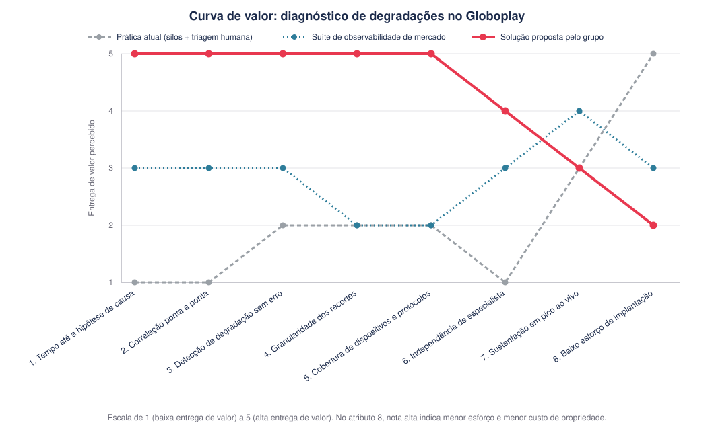

# Entendimento do Negócio

## 1. Matriz de Avaliação de Valor (Oceano Azul)

### 1.1. Contexto da comparação

&emsp; O projeto responde a uma pergunta específica: como identificar de forma automática, em minutos, a causa provável de uma degradação de streaming, sem depender de um especialista por componente. A matriz compara três formas de responder a ela.

&emsp; **Prática atual: monitoração em silos com triagem humana.** Cada componente da cadeia de entrega (player, CDN, backend, identidade, catálogo) é operado por uma área distinta, com painel, vocabulário de métricas e especialistas próprios. O incidente percorre uma fila por vez até alguém identificar o responsável, e a correlação entre fontes é feita manualmente. Não custa nada implantar, porque já existe, mas cobra caro por incidente.

&emsp; **Consolidação em uma suíte de observabilidade de mercado.** Uma plataforma comercial de APM e Real User Monitoring reúne as fontes em um painel único, com alertas por limiar e detecção de anomalia. Reduz a fragmentação, mas parte de duas premissas frágeis neste contexto: base de dispositivos homogênea e compatível com padrões modernos de coleta, e cobrança proporcional ao volume e à cardinalidade dos dados observados.

&emsp; **Solução proposta pelo grupo.** Sistema distribuído proprietário de telemetria, com API única de ingestão que aceita protocolos modernos e legados, normalização dos eventos sob vocabulário comum (`request`, `vitals`, `screen_view`, `video_view`, `session`, `error`), pipeline de alta escala sem perdas e camada agêntica de correlação, que devolve uma linha do tempo única do incidente e uma hipótese de causa provável ranqueada, com o recorte afetado explícito.

&emsp; A matriz avalia as abordagens de solução, e não o Globoplay. Características do produto e da audiência entram como justificativa do valor de cada atributo, não como objeto de avaliação.

### 1.2. Escala e critérios de atribuição das notas

&emsp; As notas vão de 1 (baixa entrega de valor) a 5 (alta entrega de valor para o Grupo Globo). Para reduzir subjetividade, foram atribuídas segundo cinco critérios:

- Aderência ao problema: a abordagem produz hipótese, recorte e linha do tempo, ou apenas mais dados?
- Cobertura da superfície de falha: enxerga a combinação de plataforma, modelo, versão, UF e operadora em que o problema se manifesta?
- Impacto no tempo de resolução, medido entre o sintoma e a hipótese acionável.
- Custo humano por incidente, em horas de especialista, reunião e plantão.
- Viabilidade operacional, incluindo esforço de implantação e robustez sob evento ao vivo.

&emsp; No atributo 8 a escala foi invertida em relação ao esforço: nota alta significa menor esforço de implantação e menor custo de propriedade. Sem essa inversão, o eixo seria lido em sentido contrário aos demais e a curva perderia consistência.

### 1.3. Matriz de avaliação de valor

| Atributo de valor para o Grupo Globo                       | Prática atual (silos + triagem humana) | Suíte de observabilidade de mercado | Solução proposta pelo grupo | Justificativa das notas                                                                                                                                                                                                                                                                                                                                                                             |
| ---------------------------------------------------------- | -------------------------------------: | ----------------------------------: | --------------------------: | --------------------------------------------------------------------------------------------------------------------------------------------------------------------------------------------------------------------------------------------------------------------------------------------------------------------------------------------------------------------------------------------------- |
| 1. Tempo até a hipótese de causa provável                  |                                      1 |                                   3 |                           5 | Hoje o tempo de resolução é a soma das filas: gasta-se mais para descobrir quem conserta do que para consertar. A suíte comercial encurta o caminho ao reunir sinais em um painel, mas ainda entrega gráficos que alguém precisa interpretar. Só a solução proposta tem como produto final uma hipótese ranqueada, e não um conjunto de séries temporais.                                           |
| 2. Correlação ponta a ponta em uma linha do tempo única    |                                      1 |                                   3 |                           5 | A experiência do assinante é ponta a ponta, mas a observabilidade não é: nenhum painel atual acompanha a jornada inteira do play. A suíte comercial resolve isso quando todas as fontes são de fato integradas, o que raramente se completa numa cadeia com mais de dez fontes heterogêneas. A solução proposta faz o agrupamento por filtros, que proporciona o olhar de uma linha do tempo única. |
| 3. Detecção de degradação que não gera erro                |                                      2 |                                   3 |                           5 | Buffer alto e tempo de início ruim não produzem taxa de erro, e o painel tradicional não acende. Ferramentas de mercado detectam anomalia, mas sobre métricas agregadas, em que a degradação de um recorte se dilui. A solução proposta parte de eventos de QoE coletados no cliente, em que o sintoma percebido pelo assinante é o próprio dado primário.                                          |
| 4. Granularidade nos recortes de investigação              |                                      2 |                                   2 |                           5 | Uma falha que atinge meio por cento das sessões pode ser a totalidade das sessões de um modelo de TV numa região. A prática atual dilui isso na média nacional. A suíte comercial é penalizada pelo próprio modelo de cobrança: cada dimensão adicional vira custo e empurra o time de volta ao agregado. Na solução proposta, a granularidade é decidida pela necessidade analítica.               |
| 5. Cobertura da base real de dispositivos e protocolos     |                                      2 |                                   2 |                           5 | Sete plataformas e centenas de modelos convivem no parque, e parte relevante deles não suporta os padrões modernos de coleta que as plataformas de mercado assumem. Nem a prática atual nem a suíte resolvem isso, porque a limitação está na borda e não no backend. A API única multiprotocolo ataca a causa do ponto cego.                                                                       |
| 6. Independência de especialista e custo humano da triagem |                                      1 |                                   3 |                           4 | Hoje o diagnóstico vira reunião: como nenhum time enxerga o todo, a correlação exige uma sala de especialistas, o recurso mais caro da casa gasto em triagem. Um painel unificado reduz parte disso. A nota 4 da solução proposta reconhece que a hipótese automática ainda dependerá de validação humana enquanto não houver histórico suficiente para calibrar sua confiabilidade.                |
| 7. Sustentação sob pico de evento ao vivo                  |                                      3 |                                   4 |                           3 | Aqui a solução proposta não é superior. A prática atual, embora lenta, sobrevive a picos porque não depende de infraestrutura nova. As suítes comerciais operam infraestrutura endurecida por anos de produção. A solução proposta precisa demonstrar ingestão sem perdas em cenários de milhões de sessões simultâneas, e essa capacidade ainda é hipótese de engenharia.                          |
| 8. Baixo esforço de implantação e custo de propriedade     |                                      5 |                                   3 |                           2 | A prática atual não custa nada para implantar, por definição. Consolidar em suíte comercial é um projeto de migração relevante, com custo recorrente proporcional ao volume. Construir plataforma própria é a alternativa mais cara em desenvolvimento, operação e plantão, e cria um sistema que passa a precisar ele próprio de monitoração.                                                      |



<figcaption style="text-align: center;">
 Figura 1: Curva de valor da matriz
</figcaption>

### 1.4. Leitura estratégica da matriz

&emsp; A curva da solução proposta concentra valor nos cinco primeiros atributos, que traduzem o problema a resolver, e aceita ser pior nos dois últimos, que dizem respeito a conveniência e maturidade.

&emsp; O cruzamento entre os atributos 4 e 8 resume o dilema. Nas suítes comerciais, granularidade e custo são grandezas acopladas: observar cada combinação de modelo, firmware, UF e operadora aumenta a fatura, o que leva o time a agregar métricas e a perder justamente o sinal de que precisa. A solução proposta desacopla parcialmente essas dimensões e paga por isso em custo de construção. A escolha é entre pagar em licença e perder granularidade, ou pagar em engenharia e ganhá-la.

&emsp; A prática atual tem uma leitura própria que costuma passar despercebida. Ela pontua alto só no atributo 8, e de forma enganosa: custo zero de implantação convive com custo altíssimo por incidente, concentrado em horas de especialista e em tempo de assinante impactado. Esse custo é real e não aparece em nenhuma linha de orçamento de ferramenta.

### 1.5. Trade-offs explícitos da solução proposta

&emsp; Os principais trade-offs assumidos são:

- Uma causa provável errada durante um evento ao vivo é pior do que hipótese nenhuma, porque direciona o esforço da equipe para o componente errado no pior momento. A saída precisa vir ranqueada e com evidência auditável, e sua qualidade depende de um histórico de incidentes rotulados que talvez ainda não exista em volume suficiente.
- A camada de inferência só gera valor sobre eventos confiáveis. Investir na inteligência antes de estabilizar ingestão e olhar para os eventos corretos produziria diagnóstico automático sobre dado incompleto, resultado pior do que a triagem manual de hoje.
- Ao internalizar a telemetria, o Globoplay passa a depender de um sistema que precisa estar disponível exatamente quando a operação está sob estresse. A indisponibilidade da plataforma de monitoração durante uma transmissão de alta audiência é um modo de falha que não existia enquanto o serviço era terceirizado.
- Armazenar eventos por dispositivo, versão, UF e operadora em alta escala continua caro, e a política de retenção e amostragem terá de ser decisão explícita de projeto, sob o risco de reproduzir internamente o mesmo incentivo a observar menos.

### 1.6. Evidências que reforçam a comparação

&emsp; **Contexto do produto.** Cerca de um em cada dez brasileiros acessa o Globoplay, com picos que chegam a 4,1 milhões de sessões em um único evento ao vivo. O produto é entregue em sete plataformas, sobre centenas de modelos de dispositivo, distribuídos por 27 unidades federativas e dezenas de provedores de acesso. A cadeia de entrega envolve mais de treze fontes de dados, produzidas por áreas diferentes, com formatos e janelas de agregação diferentes, e todas precisam ser lidas em conjunto para explicar um único play que deu errado. É esse espaço de busca que torna a varredura manual inviável em plantão.

&emsp; **Impacto econômico da degradação silenciosa.** O estudo de Krishnan e Sitaraman, apresentado no Internet Measurement Conference de 2012 sobre 23 milhões de visualizações na rede da Akamai, mostrou que o abandono começa quando o vídeo demora mais de cerca de 2 segundos para iniciar, com aumento aproximado de 5,8 pontos percentuais na taxa de abandono a cada segundo adicional. Travamentos equivalentes a 1% da duração reduzem em cerca de 5% o tempo assistido, e quem sofre falha de reprodução tem probabilidade cerca de 2,3% menor de voltar na mesma semana. O resultado sustenta o atributo 3: a degradação que não gera erro é justamente a que destrói engajamento.

&emsp; **Peso do custo de observabilidade.** A pesquisa da Grafana Labs de 2025 aponta que o gasto com observabilidade representa em média cerca de 17% do gasto total com infraestrutura de computação, sendo 10% a resposta mais frequente. Pesquisas do setor também indicam que a maioria dos times filtra, arquiva ou desloca dados para conter custo, reduzindo visibilidade para economizar. É esse comportamento que os atributos 4 e 8 pretendem transformar em decisão consciente.

### 1.7. Quatro ações do Oceano Azul aplicadas ao projeto

#### Eliminar

- A reunião de correlação como etapa obrigatória do diagnóstico, hoje necessária para formular a primeira hipótese.
- O alinhamento manual de horários e recortes entre painéis de fontes distintas.
- Os pontos cegos de dispositivos que não aparecem em painel algum por incompatibilidade de protocolo.

#### Reduzir

- O número de saltos entre filas até chegar ao time correto, substituindo triagem por eliminação por triagem com hipótese.
- A amostragem cega motivada por custo, e não por irrelevância analítica.
- O intervalo entre a degradação e a percepção interna dela, hoje dependente da reclamação do assinante.

#### Aumentar

- A resolução da análise, até o nível de modelo, firmware, UF, operadora e versão de aplicação.
- A cobertura efetiva da base instalada, incluindo aparelhos antigos e redes instáveis.
- A autonomia do time de atendimento, medida pelo quanto a primeira linha conclui sem escalar.

#### Criar

- Hipótese de causa provável ranqueada, com evidência associada, que nenhuma das alternativas entrega hoje.
- Linha do tempo única do incidente, atravessando componentes que só existem separados.
- API única de ingestão multiprotocolo, que trata a heterogeneidade do parque como característica permanente.

### 1.8. Como a solução gera diferenciação

&emsp; A diferenciação está em mudar a natureza da entrega, e não apenas sua qualidade. As duas alternativas comparadas entregam dados: uma os espalha em painéis por componente, a outra os reúne em um painel único. Em ambas, a inferência sobre a causa continua sendo tarefa de alguém que conheça o comportamento normal de cada peça da cadeia. A solução do grupo entrega inferência, movendo a fronteira da automação da coleta e da visualização para a formulação de hipótese.

&emsp; Porem ela não é absoluta. A solução é deliberadamente pior em facilidade de adoção e ainda precisa comprovar sustentação sob pico. Seu valor depende de uma decisão do parceiro: aceitar maior custo de propriedade e maior responsabilidade operacional em troca de granularidade, cobertura e velocidade de diagnóstico que nem a prática atual nem o mercado entregam para a realidade específica do Globoplay.

## 2. Matriz de Risco

---

## 3. Canvas da Proposta de Valor

### 3.1. Value Proposition Canvas

&nbsp; O Canvas da Proposta de Valor é uma ferramenta estratégica que permite compreender de forma visual e objetiva a relação entre o que uma organização oferece e as necessidades de seu público-alvo. Ele é dividido em dois lados complementares: o Perfil do Cliente, que identifica as tarefas, dores e ganhos esperados, e o Mapa de Valor, que apresenta como os produtos e serviços propostos aliviam essas dores e criam benefícios. Neste projeto, a ferramenta é utilizada para relacionar uma solução própria de coleta e análise de telemetria aos desafios enfrentados pelo time de tecnologia da Globo durante o monitoramento e a resolução de incidentes do Globoplay.

<div align="center">

<sub>Figura 3 - Value Proposition Canvas</sub>

  

<sup>Fonte: Material produzido pelos autores (2026)</sup>

</div>

##### PROPOSTA DE VALOR

###### Produtos & Serviços

&nbsp; Esta seção detalha os produtos e serviços que compõem a proposta de valor entregue ao cliente.

- **1 -** SDKs e agentes próprios para coleta de telemetria em dispositivos de TV, mobile e web.
- **2 -** API para receber diretamente os eventos enviados pelos dispositivos.
- **3 -** Pipeline escalável, executado na AWS, para processamento dos eventos coletados.
- **4 -** Camada de normalização dos eventos coletados diretamente dos dispositivos, convertendo protocolos modernos e legados para um formato unificado.
- **5 -** Armazenamento centralizado das informações processadas.
- **6 -** Dashboard para visualização de incidentes, impactos e alertas operacionais.
- **7 -** Mecanismo para identificação de incidentes e degradações a partir dos eventos coletados.

###### Criadores de Ganhos (*Gain Creators*)

&nbsp; Esta seção detalha os elementos da solução que atuam como criadores de ganhos para o cliente, fortalecendo a proposta de valor.

- **1 -** A consolidação das informações no dashboard reduz o tempo de análise e diagnóstico.
- **2 -** A integração dos dados de TV, mobile e web proporciona uma visão mais ampla da experiência dos assinantes.
- **3 -** A classificação pelo alcance e impacto facilita a priorização dos incidentes mais críticos.
- **4 -** A coleta própria elimina parte das limitações impostas pelas ferramentas de mercado e amplia o controle da Globo sobre a evolução da plataforma.
- **5 -** A disponibilidade de telemetria em nível de dispositivo facilita a identificação da causa provável dos incidentes.
- **6 -** O direcionamento mais preciso dos chamados reduz retrabalho e aumenta a produtividade.
- **7 -** A detecção e a investigação mais rápidas apoiam o cumprimento dos acordos de nível de serviço (SLA).
- **8 -** A redução do tempo de resposta contribui para diminuir a duração e o impacto das falhas percebidas pelos assinantes.

###### Aliviadores de Dores (*Pain Relievers*)

&nbsp; Esta seção apresenta os elementos da solução que atuam como aliviadores das dores identificadas no perfil do cliente.

- **1 -** A coleta própria permite monitorar dispositivos que não são plenamente suportados pelas soluções de mercado, reduzindo a dependência dessas ferramentas no escopo coberto pelo projeto.
- **2 -** A normalização converte eventos de diferentes plataformas para um formato comum, reduzindo a fragmentação.
- **3 -** O armazenamento e o dashboard centralizam informações anteriormente distribuídas.
- **4 -** A análise contínua da telemetria permite identificar degradações mesmo quando não há erros explícitos registrados.
- **5 -** A correlação entre eventos, dispositivos, plataformas e sessões reduz o tempo necessário para encontrar a causa provável do incidente.
- **6 -** A visualização do alcance e do impacto ajuda a evitar a priorização inadequada dos incidentes.
- **7 -** As informações consolidadas apoiam o encaminhamento do chamado para a equipe responsável.
- **8 -** O processamento escalável permite lidar com o volume de eventos sem comprometer a análise operacional.

---

##### PERFIL DO CLIENTE (Público-Alvo Ideal)

&nbsp; O cliente analisado neste projeto corresponde ao time de tecnologia da Globo responsável pelo monitoramento e pela resolução de incidentes do Globoplay. Embora as equipes técnicas sejam as usuárias diretas da solução, os assinantes são beneficiados indiretamente pela redução do impacto e da duração das falhas.

###### Tarefas do Cliente (*Customer Jobs*)

&nbsp; Esta seção descreve as principais responsabilidades, objetivos e desafios enfrentados pelo cliente, que orientam o desenvolvimento da solução.

- **1 -** Monitorar continuamente a experiência do Globoplay em TV, mobile e web. 
- **2 -** Detectar incidentes e degradações, inclusive quando não há erros explícitos. 
- **3 -** Correlacionar eventos e métricas técnicas provenientes de diferentes dispositivos e plataformas. 
- **4 -** Identificar evidências que apoiem a investigação da causa provável dos incidentes. 
- **5 -** Mensurar o alcance e o impacto dos incidentes sobre os assinantes. 
- **6 -** Priorizar incidentes conforme sua criticidade e impacto. 
- **7 -** Encaminhar os chamados para a equipe responsável e acompanhar sua resolução. 
- **8 -** Cumprir os SLAs e demonstrar eficiência operacional para outras áreas da Globo. 
- **9 -** Tomar decisões com segurança, mesmo sob pressão durante incidentes críticos.

###### Ganhos Desejados (*Gains*)

&nbsp; Esta seção apresenta os ganhos esperados pelo cliente com a adoção da solução.

- **1 -** Reduzir o tempo necessário para detectar, analisar e diagnosticar incidentes.
- **2 -** Obter visibilidade sobre dispositivos anteriormente pouco observáveis.
- **3 -** Identificar mais rapidamente evidências relacionadas à causa provável dos incidentes.
- **4 -** Conhecer o alcance e o impacto de cada incidente sobre os assinantes.
- **5 -** Priorizar adequadamente os incidentes mais críticos.
- **6 -** Reduzir o tempo gasto na identificação da equipe responsável pelo incidente, acelerando todo o fluxo de resolução.
- **7 -** Aumentar a autonomia e o controle da Globo sobre seus dados de telemetria.
- **8 -** Reduzir a dependência tecnológica de soluções externas para observabilidade.
- **9 -** Reduzir retrabalho e aumentar a produtividade das equipes técnicas.
- **10 -** Apoiar o cumprimento dos SLAs e aumentar a confiança durante a tomada de decisão.
- **11 -** Diminuir a duração e o impacto percebido das falhas pelos assinantes.

###### Dores (*Pains*)

&nbsp; Esta seção descreve os principais desafios e obstáculos enfrentados pelo cliente.

- **1 -** Dependência de ferramentas de mercado para coletar e disponibilizar dados de observabilidade.
- **2 -** Dados de telemetria fragmentados e apresentados em formatos diferentes entre TV, mobile e web.
- **3 -** Perda de contexto durante o encaminhamento do incidente entre diferentes equipes e filas.
- **4 -** Degradações de desempenho nem sempre geram erros explícitos, dificultando sua detecção pelas ferramentas tradicionais.
- **5 -** Dificuldade para correlacionar informações e encontrar evidências sobre a causa provável dos incidentes.
- **6 -** Priorização inadequada quando o impacto real do incidente não está claro.
- **7 -** O tempo de resolução é elevado porque parte significativa do esforço é gasta identificando qual equipe é responsável pelo problema.
- **8 -** Encaminhamento de chamados para equipes incorretas, causando retrabalho e atraso na resolução.
- **9 -** Pressão e insegurança na tomada de decisão durante incidentes críticos.
- **10 -** Prolongamento das falhas, com risco de descumprimento dos SLAs e prejuízo à experiência dos assinantes.

&nbsp; Dessa forma, o modelo demonstra que a solução proposta é baseada em coleta própria. Por meio de SDKs e agentes próprios, os eventos são coletados diretamente nos dispositivos de TV, mobile e web e enviados à infraestrutura da plataforma na AWS, onde são processados, normalizados, armazenados e apresentados em um dashboard. A solução foi concebida para substituir, dentro do escopo do MVP e conforme o rollout dos SDKs e agentes próprios, parte das funcionalidades atualmente desempenhadas por ferramentas de observabilidade de mercado. O valor central da proposta permanece a ampliação da visibilidade necessária para investigar incidentes, reduzir o tempo perdido entre filas e equipes, apoiar o cumprimento dos SLAs e diminuir o impacto das falhas percebidas pelos assinantes do Globoplay.


>>>>>>> artefatos/entendimento_negocio.md
## 4. Análise Financeira do Projeto

### 4.1. Introdução

&emsp; Esta seção apresenta a análise financeira preliminar da solução de telemetria distribuída para monitoração de frontends multiplataforma do Globoplay, considerando um horizonte de 1 ano. O objetivo é demonstrar a viabilidade econômica da proposta por meio do cálculo do ROI (*Return on Investment*), tratando o benefício como custo evitado e ganho operacional, com premissas justificadas.

&emsp; O parceiro não disponibilizou orçamento fechado para a implementação. Os valores apresentados são estimativas baseadas em premissas justificadas e fontes públicas. Quando uma estimativa é assumida pelo grupo, isso é explicitado.

&emsp; **Nota metodológica.** O parceiro não forneceu dados financeiros próprios. Todas as premissas vêm de fontes públicas (balanços, imprensa especializada, guias salariais, benchmarks de mercado) ou são estimativas da equipe, sempre sinalizadas na coluna "Confiança". Ajuste os números marcados como *Baixa* confiança assim que houver dado real do parceiro — eles são o principal risco do modelo.

&emsp; **Nota sobre simplificações didáticas.** Para fins didáticos, esta análise adota quatro simplificações que, em um estudo de viabilidade corporativo, seriam tratadas de forma mais granular: (i) o CAPEX é amortizado integralmente no Ano 1, sem distribuição plurianual; (ii) não se aplica taxa de desconto (WACC) ao fluxo de caixa do período, dado o horizonte de apenas 12 meses; (iii) o benefício é modelado exclusivamente como custo evitado com ferramenta de mercado, sem monetizar ganhos indiretos de retenção, SLA ou churn; (iv) o custo de infraestrutura de produção é derivado de um modelo de volume da própria equipe, e não de pricing negociado. Essas escolhas tornam o modelo mais transparente na leitura do resultado, sem comprometer a validade da conclusão qualitativa.

### 4.2. Premissas declaradas

&emsp; Escala de confiança: **Alta** = dado oficial ou fonte primária; **Média** = fonte secundária confiável, não é dado direto do parceiro; **Baixa** = estimativa da equipe, não validada.

#### Contexto financeiro da organização

&emsp; O Globoplay alcançou breakeven e lucro em 2025, pela primeira vez em 10 anos de operação, com cerca de 30 milhões de usuários ativos mensais (EXAME, 2026). O Grupo Globo fechou o ano com receita líquida consolidada de R$ 16,87 bi e lucro líquido de R$ 1,45 bi (TELETIME, 2026; ISTOÉ DINHEIRO, 2026).

&emsp; O dado operacionalmente relevante para esta análise é a escala de usuários (A1), que determina o volume de telemetria e, por consequência, o custo de infraestrutura calculado em 4.4. Os indicadores consolidados do grupo servem apenas para dimensionar a ordem de grandeza do investimento frente à capacidade financeira do parceiro.

#### A. Operação do parceiro

| # | Premissa | Valor | Confiança | Fonte |
|---|---|---|---|---|
| A1 | Usuários ativos mensais do Globoplay | ~30 milhões | Média | EXAME (2026). Base paga não divulgada |

&emsp; **Modelo de benefício.** O projeto é infraestrutura interna e não gera receita direta; o benefício é modelado como custo evitado com ferramentas de observabilidade de mercado, conforme o documento de escopo do parceiro.

#### B. Benefícios esperados

| # | Premissa | Valor | Confiança | Fonte |
|---|---|---|---|---|
| B1 | Contrato enterprise de observabilidade para operação de porte similar | US$ 800 mil – 2 mi/ano | Baixa | VENDORBENCHMARK (2026). A faixa descreve a trajetória de custo de organizações que não controlaram consumo, não um benchmark de operação comparável — ver limitação 1 |
| B2 | Câmbio USD/BRL | R$ 5,08 | Média | INVESTING.COM (2026), 3 ago. 2026 |
| B3 | Escopo da ferramenta de mercado substituível pelo MVP no 1º ano | 30–70% (cenários) | Baixa | Estimativa da equipe |
| B4 | Taxa de captura (rollout na base de dispositivos) no 1º ano | 20–60% (cenários) | Baixa | Estimativa da equipe |

#### D. Custos de implementação

| # | Premissa | Valor | Confiança | Fonte |
|---|---|---|---|---|
| D1 | Equipe do projeto (custo de mercado) | 5 devs (2 sênior + 3 pleno) | Baixa | Equipe típica de projeto Inteli |
| D2 | Duração do módulo acadêmico (MVP) | 10 semanas | Alta | Cronograma do módulo |
| D3 | Salário — Dev Back-End Sênior (SP) | R$ 12.250–20.600/mês | Alta | ROBERT HALF (2026) |
| D4 | Salário — Dev Full-Stack Pleno (SP) | R$ 9.550–15.900/mês | Alta | ROBERT HALF (2026) |
| D5 | Nuvem — ambiente de desenvolvimento e teste | ~R$ 3.000/mês | Baixa | Estimativa não detalhada por serviço |

#### D'. Premissas complementares derivadas pela equipe

&emsp; D1 a D5 não cobrem todos os itens de uma implantação em produção. As quatro premissas abaixo foram acrescentadas pelo grupo.

| # | Premissa | Valor | Confiança | Derivação |
|---|---|---|---|---|
| D6 | Encargos sobre salário (CLT) | +35% sobre o bruto | Média | Prática de mercado |
| D7 | Custo mensal carregado — sênior / pleno | R$ 24.000 / R$ 17.500 | Média | Médio-superior de D3 e D4 + D6 |
| D8 | Prazo até produção estável | 6 meses | Baixa | D2 (10 semanas) + ~3,5 meses de hardening, integração e governança |
| D9 | Volume de eventos em rollout total | ~3,6 bi eventos/mês | Baixa | A1 (30 mi) × ~8 sessões/mês × ~15 eventos/sessão |

&emsp; **Validação futura.** As premissas de menor confiança tornam-se verificáveis já no primeiro trimestre de operação, a partir de métricas que a própria plataforma coleta: custo por evento, cobertura de dispositivos e volume de eventos processados. Este modelo deve ser recalculado quando esses dados existirem.

---

### 4.3. Investimento inicial

&emsp; Estimativa do custo que o Globoplay incorreria para levar a solução a produção, não do custo do projeto acadêmico. A Fase 1 corresponde ao escopo do módulo (D2); as Fases 2 a 4 cobrem o que separa o MVP de um sistema em produção sob carga real.

| Fase | Escopo | Duração | Custo (R$) |
|---|---|---|---|
| 1. MVP | API única de ingestão, protocolos legados, pipeline de ingestão e armazenamento, normalização mínima, consultas de falhas críticas, dashboard | 10 semanas (~2,5 meses) | 274.000 |
| 2. Hardening e escala | Resiliência da ingestão, backpressure, tolerância a perda de eventos, testes de carga em pico, ajuste de retenção | 1,5 mês | 164.000 |
| 3. Integração e rollout | SDKs e agentes para TV, mobile e web; integração com pipeline de dados e stack de alertas do Globoplay; deploy gradual | 1,5 mês | 217.000 |
| 4. Segurança, privacidade e governança | Adequação à LGPD, política de retenção e anonimização, controle de acesso, documentação | Paralelo às Fases 2 e 3 (~0,5 FTE) | 60.000 |
| **Total** | | **~6 meses** | **R$ 715.000** |

**Composição.** Equipe core (D1 + D7) = 2 × R$ 24.000 + 3 × R$ 17.500 = R$ 100.500/mês.

| Item | Cálculo | Valor (R$) |
|---|---|---|
| Equipe core (Fases 1 a 3) | R$ 100.500 × 5,5 meses | 553.000 |
| Infraestrutura de desenvolvimento e teste (D5) | R$ 3.000 × 6 | 18.000 |
| Gestão técnica (~20% de dedicação) | R$ 30.000 × 20% × 6 | 36.000 |
| Especialistas do Globoplay (integração) | 2 engenheiros × 1 mês | 48.000 |
| Segurança, privacidade e governança | 0,5 FTE sênior × 4 meses + revisão jurídica | 60.000 |
| **Total** | | **715.000** |

---

### 4.4. Custos operacionais anuais

&emsp; Uma plataforma proprietária transfere o custo da licença para a operação interna. Esses custos são o principal contrapeso do benefício.

**Derivação da infraestrutura de produção (cenário base, B4 = 40%):**

| Etapa | Cálculo | Resultado |
|---|---|---|
| Volume em rollout total (D9) | 30 mi × 8 sessões × 15 eventos | ~3,6 bi eventos/mês |
| Volume no cenário base | 3,6 bi × 40% (B4) | ~1,44 bi eventos/mês |
| Dados brutos | 1,44 bi × ~500 bytes | ~720 GB/mês |
| Dados armazenados | compressão colunar ~10:1 | ~72 GB/mês |
| Recursos em regime permanente | fila + banco colunar + object storage + API autoescalada | ~35–40 vCPU |
| Custo mensal | nuvem com redundância (AMAZON WEB SERVICES, 2026; UPTRACE, 2026) | **~R$ 25.000/mês** |

| Item | Anual (R$) | Premissa |
|---|---|---|
| Infraestrutura de produção (nuvem) | 300.000 | R$ 25.000/mês; escala com B4 |
| Sustentação e plantão (dev pleno, 50%) | 105.000 | D7: R$ 17.500 × 50% × 12 |
| Evolução dos SDKs e agentes (dev sênior, 30%) | 86.000 | D7: R$ 24.000 × 30% × 12 |
| Suporte a engenharia e produto (~20h/mês) | 27.000 | D7: R$ 17.500 ÷ 160h × 20h × 12 |
| **Total** | **518.000** | R$ 218.000 fixos + R$ 300.000 variáveis |

&emsp; A parcela variável (R$ 750.000 × B4) é o item mais sensível do modelo e o único que a equipe controla por decisões de arquitetura: política de retenção, agregação de dados históricos, compressão e particionamento. Nenhum ganho de otimização foi incorporado ao modelo, por falta de premissa quantificável.

---

### 4.5. Benefícios econômicos estimados

&emsp; O projeto não gera receita direta. A fórmula `Baseline = Receita + Economia + Outros Benefícios` reduz-se ao termo de economia: o gasto anual evitado com uma plataforma de observabilidade de mercado. Adota-se o **piso** de B1 (US$ 800 mil/ano), por ser a estimativa mais defensável na ausência de dado do parceiro.

| Etapa | Fórmula | Cenário base |
|---|---|---|
| Baseline | B1 × B2 | US$ 800.000 × R$ 5,08 = **R$ 4.064.000/ano** |
| Ganho potencial | Baseline × B3 | R$ 4.064.000 × 50% = **R$ 2.032.000/ano** |
| Ganho efetivo (Ano 1) | Ganho potencial × B4 | R$ 2.032.000 × 40% = **R$ 812.800** |

&emsp; B3 mede a fração do escopo funcional que o MVP cobre — a solução própria não replica APM completo, tracing distribuído, integrações prontas e suporte contínuo. B4 mede a rampagem: o contrato só deixa de ser pago na proporção em que a base de dispositivos migra.

&emsp; **Nota metodológica.** (i) O benefício é custo evitado bruto; o custo de operar a plataforma própria é descontado em 4.6. (ii) O rollout parcial reduz simultaneamente benefício e custo de infraestrutura, por isso ambos são recalculados em conjunto na sensibilidade. (iii) No teto de B1 (US$ 2 mi/ano), todos os ganhos devem ser multiplicados por 2,5.

---

### 4.6. Cálculo do ROI

```
ROI = Benefício Líquido ÷ Investimento Inicial × 100
Benefício Líquido = Ganhos estimados (1 ano) − Custos operacionais anuais
```

#### Cenário base

| Componente | Valor | Origem |
|---|---|---|
| Investimento inicial | R$ 715.000 | 4.3 |
| Custos operacionais anuais | R$ 518.000 | 4.4 |
| Ganho efetivo no Ano 1 | R$ 813.000 | 4.5 (B3 = 50%, B4 = 40%) |
| **Benefício líquido** | **R$ 295.000** | R$ 813.000 − R$ 518.000 |
| **ROI (Ano 1)** | **~41%** | R$ 295.000 ÷ R$ 715.000 |

#### Análise de sensibilidade

&emsp; B3 e B4 são os principais vetores de incerteza (ambos Baixa confiança). Os cenários variam os dois simultaneamente; a parcela variável dos custos (R$ 750.000 × B4) é recalculada em cada linha.

| Cenário | B3 | B4 | Ganho efetivo Y1 | Custos anuais | Benefício líquido | ROI |
|---|---|---|---|---|---|---|
| Pessimista | 30% | 20% | R$ 244 mil | R$ 368 mil | −R$ 124 mil | −17% |
| Base | 50% | 40% | R$ 813 mil | R$ 518 mil | R$ 295 mil | 41% |
| Otimista | 70% | 60% | R$ 1.707 mil | R$ 668 mil | R$ 1.039 mil | 145% |

&emsp; No cenário pessimista o resultado é negativo: o custo de operar a plataforma própria supera o contrato evitado. No cenário base o projeto recupera boa parte do investimento já no Ano 1.

#### Comparativo de TCO: construir vs. contratar (3 anos)

&emsp; O ROI acima mede um único ano e trata custo evitado como se fosse entrada de caixa. Duas ressalvas tornam essa leitura insuficiente para uma decisão de infraestrutura. Primeiro, o projeto não visa lucro: é substituição de uma despesa por outra, e a métrica adequada é custo total de propriedade, não retorno. Segundo, contratos enterprise de observabilidade têm compromisso anual de volume mínimo — substituir 20% do uso não gera 20% de economia na fatura do mesmo ano.

&emsp; O comparativo abaixo confronta os dois caminhos ao longo de 3 anos, mantendo B3 = 50% e assumindo trajetória de rollout de 40% → 80% → 100% (B4). Na coluna *build*, o Globoplay paga simultaneamente a construção, a operação própria e o contrato residual sobre a fração ainda não substituída.

| R$ mil | Ano 1 | Ano 2 | Ano 3 | Total |
|---|---|---|---|---|
| **Contratar** — contrato integral | 4.064 | 4.064 | 4.064 | **12.192** |
| Construir — investimento (4.3) | 715 | — | — | 715 |
| Construir — operação (4.4) | 518 | 818 | 968 | 2.304 |
| Construir — contrato residual | 3.251 | 2.438 | 2.032 | 7.721 |
| **Construir** — total | 4.484 | 3.256 | 3.000 | **10.741** |
| **Diferença anual** | −420 | +808 | +1.064 | **+1.451** |

&emsp; Construir custa R$ 420 mil **a mais** que contratar no Ano 1: paga-se a construção e o contrato ao mesmo tempo. A virada ocorre no Ano 2, com cruzamento acumulado por volta do mês 18. Em 3 anos, a economia é de R$ 1,45 milhão, ou ~12% do TCO.

&emsp; A mesma comparação sob os cenários de sensibilidade:

| Cenário (B3; trajetória de B4) | TCO contratar | TCO construir | Diferença em 3 anos |
|---|---|---|---|
| Pessimista (30%; 20→40→60%) | 12.192 | 12.998 | **−806** (construir é mais caro) |
| Base (50%; 40→80→100%) | 12.192 | 10.741 | **+1.451** |
| Otimista (70%; 60→90→100%) | 12.192 | 8.324 | **+3.868** |

&emsp; O intervalo é largo o bastante para inverter a decisão: no cenário pessimista, contratar é a escolha economicamente correta ao longo de todo o horizonte.

---

### 4.7. Interpretação dos resultados

#### Viabilidade financeira

&emsp; No cenário base, construir é economicamente preferível a contratar, com economia de ~12% do TCO em 3 anos e virada no mês ~18.

| Referência | Valor | Proporção |
|---|---|---|
| Investimento inicial | R$ 715 mil | ~18% de um ano de contrato de mercado (baseline B1) |
| Operação anual em regime permanente | R$ 968 mil | ~24% do baseline |
| Custo operacional / ganho bruto (Ano 1) | R$ 518 mil / R$ 813 mil | 64% |

&emsp; O denominador correto é o gasto com observabilidade, e não o resultado do grupo: comparar R$ 715 mil ao lucro consolidado produz um percentual sem significado decisório. A decisão não se sustenta pelo Ano 1, e sim pela trajetória — o benefício cresce com o rollout, enquanto o investimento é pago uma única vez.

#### Justificativa do resultado

&emsp; Três fatores limitam o ROI do Ano 1:

- **Rampagem (B4 = 40%).** O contrato de mercado continua sendo pago na fração não migrada. Em regime permanente (B4 = 100%, B3 = 50%), o benefício líquido anual seria de ~R$ 1,06 milhão.
- **Substituição parcial (B3 = 50%).** Enquanto houver escopo residual, o contrato é reduzido de tier, não cancelado — e contratos com volume mínimo podem não permitir nem isso dentro do ciclo vigente.
- **Custo operacional próprio elevado (64% do ganho bruto no Ano 1).** Característico de projetos de construir em vez de comprar: parte do que se paga a um fornecedor é infraestrutura, que apenas muda de dono.

#### Ponto de equilíbrio

&emsp; Com B3 = 50%, o benefício bruto iguala os custos operacionais quando:

```
R$ 2.032.000 × B4 = R$ 218.000 + R$ 750.000 × B4  →  B4 ≈ 17%
```

| Marco | Condição |
|---|---|
| Sustentabilidade operacional (benefício = custos anuais) | B4 ≈ 17% |
| Virada do TCO acumulado (construir passa a ser mais barato) | mês ~18 |
| Recuperação integral do investimento via TCO | Ano 3 |

#### Benefícios operacionais não monetizados

| Benefício | Estimativa | Situação |
|---|---|---|
| Redução do tempo de diagnóstico de incidentes | ~3 engenheiros × 6h × 4 incidentes/mês × 35% de redução ≈ 300h/ano ≈ **R$ 45 mil/ano** (custo D7) | Não incluído no ROI |
| Visibilidade sobre dispositivos legados | Não quantificável — churn não diagnosticado em segmentos que hoje nenhuma ferramenta de mercado observa | Não incluído |
| Operação em eventos de pico (Copa 2026) | Não quantificável — custo reputacional de degradação não detectada | Não incluído |

#### Limitações da análise

**1. B1 pode superestimar o baseline.** A faixa de US$ 800 mil a US$ 2 mi/ano descreve organizações cujo consumo de observabilidade cresceu sem controle, e não o custo de uma operação de porte comparável ao Globoplay. A mesma fonte modela uma implantação de 500 hosts com APM e logs entre US$ 358 mil e US$ 678 mil em preço de tabela, caindo para US$ 197 mil a US$ 441 mil após negociação enterprise. Se o gasto real do parceiro estiver nessa faixa negociada, o baseline cai para cerca de metade a um quarto do adotado. O modelo é sensível a B1 nas duas direções:

| Parâmetro | Cenário negociado | Piso adotado | Teto da faixa |
|---|---|---|---|
| B1 | US$ 300 mil/ano | US$ 800 mil/ano | US$ 2 mi/ano |
| Baseline anual | R$ 1.524 mil | R$ 4.064 mil | R$ 10.160 mil |
| Benefício líquido Ano 1 | −R$ 213 mil | R$ 295 mil | R$ 1.514 mil |
| Diferença de TCO em 3 anos | −R$ 1.343 mil | +R$ 1.451 mil | +R$ 8.157 mil |

&emsp; Com B1 em US$ 300 mil/ano, construir é mais caro que contratar em todos os três anos. Este é o primeiro dado a solicitar ao parceiro; enquanto não houver o valor real do contrato do Globoplay, a conclusão de viabilidade permanece condicional.

**2. B3 e B4 não foram validados.** Sem plano de rollout acordado nem inventário de escopo funcional. A amplitude entre cenários vai de −R$ 806 mil a +R$ 3.868 mil de diferença de TCO — larga o bastante para inverter a decisão.

**3. Custo de infraestrutura é derivado, não cotado.** Um erro de fator 2 em D9 altera o custo operacional em ~R$ 300 mil/ano, suficiente para inverter o sinal do benefício. A métrica de custo por evento corrige essa premissa no primeiro trimestre de operação.

**4. Contrato residual tratado como proporcional.** O modelo assume que o contrato de mercado é reduzido na exata proporção do escopo substituído. Compromissos anuais de volume mínimo e ciclos de renovação podem atrasar essa redução em um ano inteiro, empurrando a virada do TCO para o Ano 3.

**5. Custos de time do parceiro possivelmente subestimados.** Assume-se ~2 engenheiros por 1 mês para integração. Se cada plataforma exigir SDK mantido por time separado, integração e manutenção anual crescem de forma relevante.

**6. Nenhum ganho de receita foi modelado — e este é o benefício principal do projeto.** A solução existe para detectar falhas de frontend, não para reduzir licença de software. Se 0,1% da base de assinantes for retida por melhor qualidade de experiência, o efeito superaria todo o custo evitado aqui modelado. Na ausência de dados de churn do parceiro, o benefício central do projeto permanece fora da conta, e o resultado apresentado deve ser lido como piso, não como estimativa central.

---

## 5. Análise de impacto do projeto nos Objetivos de Desenvolvimento Sustentável da ONU

### 5.1. Introdução

&emsp; Com o objetivo de analisar os possíveis efeitos econômicos, sociais e ambientais associados ao projeto, foi realizada uma avaliação de sua contribuição para os Objetivos de Desenvolvimento Sustentável (ODS), definidos no âmbito da Agenda 2030 da Organização das Nações Unidas (ONU).

#### 5.1.1. Agenda 2030 e ODS

&emsp; A Agenda 2030 consiste em um plano global elaborado pela ONU e adotado por quase 200 países em 2015, com foco na promoção do desenvolvimento sustentável (ORGANIZAÇÃO DAS NAÇÕES UNIDAS, 2015). A partir dos ODS, a Agenda incentiva indivíduos, organizações e governos a repensarem suas práticas e decisões em favor do futuro da sociedade e do planeta.

São 17 os ODS relacionados à Agenda, sendo eles:

- Objetivo 1 - Erradicação da pobreza
    - Acabar com a pobreza em todas as suas formas, em todos os lugares;

- Objetivo 2 - Fome zero e agricultura sustentável
    - Acabar com a fome, alcançar a segurança alimentar e melhoria da nutrição e promover a agricultura sustentável;

- Objetivo 3 - Saúde e bem-estar
    - Assegurar uma vida saudável e promover o bem-estar para todos, em todas as idades;

- Objetivo 4 - Educação de Qualidade
    - Assegurar a educação inclusiva e equitativa e de qualidade, e promover oportunidades de aprendizagem ao longo da vida para todos;

- Objetivo 5 - Igualdade de gênero
    - Alcançar a igualdade de gênero e empoderar todas as mulheres e meninas;

- Objetivo 6 - Água potável e saneamento
    - Assegurar a disponibilidade e gestão sustentável da água e saneamento para todos;

- Objetivo 7 - Energia limpa e acessível
    - Assegurar o acesso confiável, sustentável, moderno e a preço acessível à energia para todos;

- Objetivo 8 - Trabalho decente e crescimento econômico
    - Promover o crescimento econômico sustentado, inclusivo e sustentável, emprego pleno e produtivo e trabalho decente para todos;

- Objetivo 9 - Indústria, inovação e infraestrutura
    - Construir infraestruturas resilientes, promover a industrialização inclusiva e sustentável e fomentar a inovação;

- Objetivo 10 - Redução das desigualdades
    - Reduzir a desigualdade dentro dos países e entre eles;

- Objetivo 11 - Cidades e comunidades sustentáveis
    - Tornar as cidades e os assentamentos humanos inclusivos, seguros, resilientes e sustentáveis;

- Objetivo 12 - Consumo e produção responsáveis
    - Assegurar padrões de produção e de consumo sustentáveis;

- Objetivo 13 Ação contra a mudança global do clima
    - Tomar medidas urgentes para combater a mudança climática e seus impactos;

- Objetivo 14 - Vida na água
    - Conservação e uso sustentável dos oceanos, dos mares e dos recursos marinhos para o desenvolvimento sustentável;

- Objetivo 15 - Vida terrestre
    - Proteger, recuperar e promover o uso sustentável dos ecossistemas terrestres, gerir de forma sustentável as florestas, combater a desertificação, deter e reverter a degradação da terra e deter a perda de biodiversidade;

- Objetivo 16 - Paz, justiça e instituições eficazes
    - Promover sociedades pacíficas e inclusivas para o desenvolvimento sustentável, proporcionar o acesso à justiça para todos e construir instituições eficazes, responsáveis e inclusivas em todos os níveis;

- Objetivo 17 - Parcerias e meios de implementação
    - Fortalecer os meios de implementação e revitalizar a parceria global para o desenvolvimento sustentável.

#### 5.1.2. Análise de impacto

&emsp; A análise foi organizada de modo a identificar e avaliar os efeitos do projeto sobre os três pilares da sustentabilidade: econômico, social e ambiental, considerando também seu alinhamento com os Objetivos de Desenvolvimento Sustentável definidos pela ONU. Para isso, foi adotada uma abordagem composta por levantamento teórico, uso de metodologias já existentes e análise de correlação.

**Mapeamento de áreas de impacto**

&emsp; Identificação das relações entre as funcionalidades e operações do projeto e os aspectos econômicos, sociais e ambientais, estabelecendo conexões com os ODS e suas respectivas metas. Para essa etapa, foram utilizados como referência o portal oficial da ONU e publicações acadêmicas e institucionais relacionadas aos impactos da computação em nuvem.

**Revisão bibliográfica**

&emsp; Levantamento de evidências quantitativas e qualitativas sobre os impactos da computação em nuvem, considerando temas como impactos sociais, pegada hídrica, pegada de carbono e consumo energético. Foram consultadas fontes institucionais, documentos disponibilizados pelo parceiro e publicações relacionadas à sustentabilidade de infraestruturas computacionais, com o propósito de fundamentar a associação entre o projeto e os Objetivos de Desenvolvimento Sustentável.

**Integração de metodologias existentes**

&emsp; Análise e combinação de abordagens já utilizadas por instituições e publicações especializadas na avaliação de impactos sustentáveis, adaptando seus princípios ao contexto específico do projeto.

**Análise de correlação**

&emsp; Estabelecimento de relações entre as características do projeto e as metas dos ODS, com base em indicadores públicos e métricas obtidas de fontes confiáveis, a fim de estimar a contribuição potencial da solução.

### 5.2. Resultados

&emsp; A partir das características da solução, foram identificadas contribuições principalmente para os seguintes Objetivos de Desenvolvimento Sustentável:

1. ODS 9 - Indústria, inovação e infraestrutura;
2. ODS 10 - Redução das desigualdades;
3. ODS 12 - Consumo e produção responsáveis.

&emsp; O impacto mais direto ocorre no ODS 9. Os impactos associados aos ODS 10 e 12 são indiretos e dependem da forma como a solução for implementada e utilizada.

#### 5.2.1. ODS 9 - Indústria, inovação e infraestrutura

&emsp; O ODS 9 busca construir infraestruturas resilientes, promover a inovação e melhorar as capacidades tecnológicas (ORGANIZAÇÃO DAS NAÇÕES UNIDAS, [s. d.]a). Entre suas metas estão o desenvolvimento de infraestruturas confiáveis e resilientes, a modernização tecnológica e o fortalecimento da pesquisa e da inovação.

&emsp; Esse é o ODS mais diretamente relacionado ao projeto, pois a solução consiste na construção de uma infraestrutura digital própria de observabilidade para a Globoplay.

&emsp; A diversidade de dispositivos, sistemas operacionais e condições de conectividade dificulta a utilização uniforme de ferramentas comerciais de telemetria. A solução proposta procura superar essa limitação por meio de uma camada de ingestão capaz de receber eventos provenientes de diferentes plataformas e formatos, normalizá-los e disponibilizá-los para análise.

&emsp; A plataforma também deverá apresentar características de sistemas distribuídos, como escalabilidade, resiliência, processamento assíncrono e capacidade de lidar com grandes volumes de eventos. Dessa forma, o projeto contribui para a criação de uma infraestrutura tecnológica mais adaptável às condições reais de operação do parceiro.

&emsp; A principal meta relacionada é a meta 9.1, que trata do desenvolvimento de infraestrutura de qualidade, confiável e resiliente (ORGANIZAÇÃO DAS NAÇÕES UNIDAS, [s. d.]a). A solução contribui para essa meta ao:

- aumentar a visibilidade sobre a saúde das aplicações frontend;
- permitir a detecção de degradações em diferentes dispositivos;
- reduzir o tempo necessário para investigar incidentes;
apoiar o cumprimento dos níveis de serviço;
- aumentar a resiliência da operação por meio de dados mais completos.

&emsp; Também existe relação com a meta 9.4, que trata da modernização da infraestrutura e do uso mais eficiente de recursos e tecnologias (ORGANIZAÇÃO DAS NAÇÕES UNIDAS, [s. d.]a). Nesse aspecto, a plataforma pode:

- reduzir a dependência de ferramentas externas incompatíveis com parte dos dispositivos;
- centralizar fontes de telemetria anteriormente fragmentadas;
- permitir a evolução modular dos componentes;
- oferecer uma API unificada para diferentes padrões de comunicação;
- melhorar o aproveitamento dos dados já coletados.

&emsp; A meta 9.5, relacionada ao fortalecimento da pesquisa, da inovação e das capacidades tecnológicas (ORGANIZAÇÃO DAS NAÇÕES UNIDAS, [s. d.]a), também é aplicável. O projeto envolve investigação e desenvolvimento em áreas como:

- arquitetura de sistemas distribuídos;
- observabilidade;
- processamento de eventos;
- correlação entre QoS e QoE;
- análise de séries temporais;
- experiência do usuário em plataformas heterogêneas;
- detecção de padrões operacionais.

&emsp; Os principais impactos positivos associados ao ODS 9 são:

- fortalecimento da infraestrutura de monitoramento da Globo;
- maior capacidade de diagnosticar degradações e incidentes;
- aumento da cobertura de telemetria em dispositivos heterogêneos;
- desenvolvimento de uma solução adaptada ao contexto tecnológico brasileiro;
- redução da dependência de ferramentas externas;
- ampliação da capacidade de inovação interna;
- maior confiabilidade e continuidade operacional;
- criação de uma base tecnológica para futuras análises preditivas.

&emsp; O impacto poderá ser acompanhado pelos seguintes indicadores:

| Indicador | Forma de medição |
|---|---|
| Cobertura de dispositivos | Percentual de famílias de dispositivos capazes de enviar telemetria |
| Cobertura de eventos | Percentual dos seis tipos de evento aceitos pela plataforma |
| Tempo médio de detecção | Tempo entre o início de uma degradação e sua identificação |
| Tempo médio de diagnóstico | Tempo necessário para identificar uma possível causa do incidente |
| Disponibilidade da ingestão | Percentual de tempo em que a API permanece disponível |
| Taxa de perda de eventos | Percentual de eventos recebidos que não são armazenados ou processados |
| Capacidade de processamento | Quantidade de eventos processados por segundo |
| Compatibilidade | Número de formatos, versões ou protocolos suportados |
| Redução de dependência externa | Quantidade de funções anteriormente dependentes de ferramentas de terceiros |
| Uso da plataforma | Número de consultas, análises ou investigações realizadas |

&emsp; A contribuição ao ODS 9 não elimina possíveis efeitos negativos. Uma plataforma distribuída pode aumentar:

- a complexidade da infraestrutura;
- a dependência de serviços de nuvem;
- o custo de armazenamento;
- a necessidade de manutenção especializada;
- a superfície de ataque;
- o risco de indisponibilidade caso a arquitetura não seja resiliente.

&emsp; Esses riscos devem ser mitigados por meio de arquitetura modular, testes de desempenho, monitoramento da própria plataforma, documentação e planejamento de escalabilidade.

#### 5.2.2. ODS 10 - Redução das desigualdades

&emsp; O ODS 10 busca reduzir desigualdades e promover inclusão e igualdade de oportunidades. A meta 10.2 trata da promoção da inclusão social e econômica, enquanto a meta 10.3 aborda a redução das desigualdades de resultados (ORGANIZAÇÃO DAS NAÇÕES UNIDAS, [s. d.]b).

&emsp; A relação do projeto com esse ODS é indireta, entretanto, pode contribuir para reduzir diferenças na qualidade do serviço digital oferecido a usuários que possuem dispositivos, versões de sistemas operacionais ou condições de conectividade distintas.

&emsp; No contexto de um país continental, usuários acessam o serviço por meio de:

- Smart TVs novas e antigas;
- dispositivos móveis de diferentes faixas de desempenho;
- sistemas operacionais desatualizados;
- navegadores diversos;
- provedores de internet distintos;
- conexões instáveis ou de menor velocidade.

&emsp; Quando as ferramentas de observabilidade não conseguem coletar dados de equipamentos antigos, os problemas desses usuários podem permanecer invisíveis por mais tempo. Consequentemente, a operação pode priorizar apenas os dispositivos mais modernos e mais bem monitorados.

&emsp; A plataforma proposta pode reduzir essa assimetria ao permitir que dispositivos com diferentes capacidades enviem eventos por interfaces compatíveis com suas limitações.
A contribuição indireta ao ODS 10 inclui:

- ampliação da visibilidade sobre usuários de dispositivos legados;
- redução da diferença de monitoramento entre plataformas modernas e antigas;
- identificação de falhas concentradas em determinados modelos, regiões ou provedores;
- apoio à melhoria da experiência de usuários com conectividade limitada;
- prevenção de decisões baseadas apenas nos segmentos tecnologicamente mais atualizados;
- maior consideração de grupos que utilizam aparelhos com menor capacidade computacional.

&emsp; Um exemplo seria a identificação de que um erro de reprodução ocorre predominantemente em Smart TVs fabricadas em determinado ano. Sem telemetria adequada, esse grupo poderia ser tratado apenas como uma pequena parcela de reclamações. Com a plataforma, o problema pode ser quantificado, analisado e priorizado.

| Indicador | Forma de medição |
|---|---|
| Cobertura de dispositivos legados | Percentual de modelos antigos contemplados pela coleta |
| Distribuição da cobertura | Comparação da cobertura entre sistemas operacionais e fabricantes |
| Erros por segmento | Taxa de erros por modelo, ano, plataforma, região ou provedor |
| Diferença de QoE | Diferença de latência, buffering ou falhas entre grupos de dispositivos |
| Redução da disparidade | Redução da diferença de qualidade entre dispositivos modernos e legados |
| Incidentes segmentados | Quantidade de incidentes identificados em grupos antes pouco observados |
| Compatibilidade regional | Capacidade de identificar problemas por estado ou provedor de internet |

&emsp; Não é possível afirmar que o projeto reduzirá diretamente desigualdades sociais. A contribuição depende de três condições:

- os dispositivos legados realmente serem incluídos na coleta;
- os dados coletados serem utilizados para priorizar melhorias;
- as equipes responsáveis implementarem correções para os grupos afetados.

&emsp; O sistema oferece visibilidade e apoio à tomada de decisão, mas não garante, por si só, que as desigualdades de experiência serão eliminadas.

#### 5.2.3. ODS 12 - Consumo e produção responsáveis

&emsp; O ODS 12 busca garantir padrões sustentáveis de produção e consumo (ORGANIZAÇÃO DAS NAÇÕES UNIDAS, [s. d.]c). Entre suas metas estão o uso eficiente de recursos, a redução da geração de resíduos e o incentivo para que empresas adotem práticas sustentáveis.

&emsp; A relação do projeto com esse ODS também é indireta. A plataforma poderá contribuir para o uso mais eficiente de recursos computacionais e para a extensão do suporte a dispositivos antigos.

&emsp; A observabilidade detalhada permite identificar:

- eventos coletados sem utilidade;
- armazenamento excessivo de dados;
- consultas ineficientes;
- duplicação de eventos;
- retenção desnecessária;
- processamento repetido;
- componentes que consomem recursos acima do esperado.

&emsp; Essas informações podem apoiar decisões de otimização da infraestrutura.

&emsp; Além disso, a compatibilidade com dispositivos legados pode contribuir para prolongar sua utilização. Caso aplicações deixem de funcionar corretamente apenas por falta de suporte de observabilidade ou compatibilidade, usuários podem ser incentivados a substituir aparelhos ainda funcionais. Uma plataforma capaz de identificar e apoiar a correção de problemas nesses equipamentos pode reduzir esse incentivo.
A principal relação ocorre com a meta 12.2, que trata da gestão sustentável e do uso eficiente dos recursos (ORGANIZAÇÃO DAS NAÇÕES UNIDAS, [s. d.]c). A plataforma pode apoiar essa meta por meio de:

- políticas de retenção de dados;
- agregação de eventos históricos;
- compactação de mensagens;
- eliminação de duplicidades;
- escalabilidade baseada na demanda;
- acompanhamento do uso de armazenamento;
- redução de processamento desnecessário.

&emsp; Também existe relação indireta com a meta 12.5, voltada à redução da geração de resíduos por prevenção, redução, reciclagem e reuso (ORGANIZAÇÃO DAS NAÇÕES UNIDAS, [s. d.]c). O possível impacto ocorre pela extensão da vida útil de dispositivos. Entretanto, o projeto não atua diretamente na gestão de resíduos eletrônicos. Portanto, essa contribuição deve ser apresentada como potencial e indireta.

&emsp; A meta 12.6, que incentiva grandes empresas a adotarem práticas sustentáveis e integrarem informações de sustentabilidade (ORGANIZAÇÃO DAS NAÇÕES UNIDAS, [s. d.]c), também pode ser considerada. A plataforma poderá incluir indicadores de eficiência da infraestrutura, desde que a Globo decida monitorá-los.
Os principais impactos positivos são:

- melhor utilização dos recursos de computação e armazenamento;
- redução de processamento redundante;
- definição de políticas adequadas de retenção;
- possibilidade de uso de agregações para dados históricos;
- redução de dependência de múltiplas ferramentas externas;
- prolongamento potencial do suporte a dispositivos antigos;
- apoio à redução da substituição prematura de equipamentos;
- melhoria da governança dos dados de telemetria.

| Indicador | Forma de medição |
|---|---|
| Volume de dados armazenados | Quantidade de dados armazenados por período |
| Retenção média | Tempo médio de permanência de dados brutos e agregados |
| Taxa de duplicação | Percentual de mensagens duplicadas |
| Dados descartados | Percentual de campos ou eventos sem utilidade removidos |
| Custo por evento | Custo de infraestrutura dividido pela quantidade de eventos processados |
| Compressão | Redução do tamanho médio dos eventos após compactação |
| Eficiência de processamento | Recursos consumidos por quantidade de eventos |
| Suporte a legados | Quantidade de dispositivos antigos ainda atendidos |
| Escalabilidade sob demanda | Diferença entre recursos provisionados e recursos efetivamente utilizados |

Apesar das contribuições potenciais, a plataforma também poderá aumentar o consumo de recursos devido a:

- armazenamento de milhões de eventos;
- replicação de dados;
- processamento contínuo;
- consultas de séries temporais;
- dashboards atualizados frequentemente;
- manutenção de ambientes de desenvolvimento, teste e produção;
- transferência de dados entre serviços.

&emsp; A implementação da plataforma não pode ser considerada sustentável automaticamente. Para reduzir seu impacto, recomenda-se:

- definir tempos de retenção diferentes por tipo de dado;
- manter dados detalhados apenas pelo período necessário;
- agregar dados antigos;
- evitar duplicação entre bases;
- aplicar compressão;
- utilizar particionamento;
- desligar recursos ociosos;
- acompanhar custos e consumo de infraestrutura;
- limitar atualizações de dashboards quando o tempo real não for necessário.

### 5.3. Conclusão

| ODS | Nível de relação | Principal contribuição | Limitação |
|---|---|---|---|
| ODS 9 | Direta e forte | Infraestrutura digital resiliente, inovação e capacidade tecnológica | Depende da escalabilidade, confiabilidade e manutenção da solução |
| ODS 10 | Indireta e moderada | Maior visibilidade sobre dispositivos legados e contextos de conectividade diversos | A plataforma apenas identifica desigualdades; as melhorias dependem de ações posteriores |
| ODS 12 | Indireta e moderada | Uso mais eficiente de recursos e possível prolongamento do suporte a dispositivos | A própria plataforma também consome armazenamento e processamento |

**Impactos positivos**

- melhoria da confiabilidade da infraestrutura digital;
- redução do tempo de detecção e análise de incidentes;
- inclusão de dispositivos e plataformas com menor cobertura de telemetria;
- desenvolvimento de tecnologia adaptada ao contexto do parceiro;
- uso mais eficiente de dados operacionais;
- redução de dependência de ferramentas externas;
- possibilidade de prolongamento do suporte a equipamentos antigos;
- criação de uma base para inovação e análise preditiva.

**Impactos negativos**

- aumento do consumo de armazenamento;
- aumento do processamento contínuo;
- custos de infraestrutura em nuvem;
- possível duplicação de dados;
- coleta excessiva de informações;
- riscos de segurança e privacidade;
- dependência de infraestrutura tecnológica;
- geração de complexidade operacional;
- risco de ampliar a desigualdade caso dispositivos legados não sejam realmente contemplados.

&emsp; Para ampliar os impactos positivos e reduzir os negativos, recomenda-se:

- priorizar a compatibilidade com dispositivos legados;
- definir políticas de retenção e descarte de dados;
- aplicar anonimização ou pseudonimização de identificadores;
- remover tokens e informações sensíveis dos eventos;
- armazenar apenas campos necessários para a análise;
- agregar dados históricos para reduzir volume;
- acompanhar custo e utilização dos serviços de nuvem;
- implementar escalabilidade de acordo com a demanda;
- medir diferenças de qualidade entre dispositivos e regiões;
- estabelecer indicadores de eficiência e cobertura;
- utilizar dados sintéticos em protótipos e demonstrações;
- documentar as hipóteses utilizadas na análise;
- revisar periodicamente os impactos do projeto.

&emsp; A contribuição mais consistente do projeto ocorre no ODS 9, pois a solução propõe uma infraestrutura digital inovadora, resiliente e adaptada a um ambiente heterogêneo de dispositivos e condições de conectividade.

&emsp; O ODS 10 também é relevante, mas de forma indireta, uma vez que a ampliação da telemetria pode tornar visíveis problemas enfrentados por usuários de dispositivos antigos, plataformas menos comuns ou redes limitadas.

&emsp; O ODS 12 está relacionado à eficiência no uso de recursos computacionais, à governança dos dados e ao possível prolongamento do suporte a equipamentos legados. Entretanto, esse impacto dependerá da adoção de políticas de retenção, compactação, agregação e dimensionamento eficiente da infraestrutura.

## 6. Referências bibliográficas

KRISHNAN, S. Shunmuga; SITARAMAN, Ramesh K. _Video Stream Quality Impacts Viewer Behavior: Inferring Causality Using Quasi-Experimental Designs_. In: ACM Internet Measurement Conference (IMC), 2012. Disponível em: https://people.cs.umass.edu/~ramesh/Site/HOME_files/imc208-krishnan.pdf. Acesso em: ago. 2026.

ANDROID DEVELOPERS. _ANRs | App quality_. Disponível em: https://developer.android.com/topic/performance/vitals/anr. Acesso em: ago. 2026.

GOOGLE PLAY CONSOLE HELP. _Monitor your app's technical quality with Android vitals_. Disponível em: https://support.google.com/googleplay/android-developer/answer/9844486. Acesso em: ago. 2026.

GRAFANA LABS. _Observability Survey Report 2025_. Disponível em: https://grafana.com/observability-survey/2025/. Acesso em: ago. 2026.

BRASIL. _Lei nº 13.709, de 14 de agosto de 2018_ (Lei Geral de Proteção de Dados Pessoais).

ORGANIZAÇÃO DAS NAÇÕES UNIDAS. Transformando nosso mundo: a Agenda 2030 para o Desenvolvimento Sustentável. Nova York: ONU, 2015. Disponível em: https://sdgs.un.org/2030agenda. Acesso em: 4 ago. 2026.

ORGANIZAÇÃO DAS NAÇÕES UNIDAS. Objetivos de Desenvolvimento Sustentável no Brasil. Brasília, DF: Nações Unidas Brasil, [s. d.]. Disponível em: https://brasil.un.org/pt-br/sdgs. Acesso em: 4 ago. 2026.

ORGANIZAÇÃO DAS NAÇÕES UNIDAS. Objetivo de Desenvolvimento Sustentável 9: indústria, inovação e infraestrutura. Brasília, DF: Nações Unidas Brasil, [s. d.]a. Disponível em: https://brasil.un.org/pt-br/sdgs/9. Acesso em: 4 ago. 2026.

ORGANIZAÇÃO DAS NAÇÕES UNIDAS. Objetivo de Desenvolvimento Sustentável 10: redução das desigualdades. Brasília, DF: Nações Unidas Brasil, [s. d.]b. Disponível em: https://brasil.un.org/pt-br/sdgs/10. Acesso em: 4 ago. 2026.

ORGANIZAÇÃO DAS NAÇÕES UNIDAS. Objetivo de Desenvolvimento Sustentável 12: consumo e produção responsáveis. Brasília, DF: Nações Unidas Brasil, [s. d.]c. Disponível em: https://brasil.un.org/pt-br/sdgs/12. Acesso em: 4 ago. 2026.

AMAZON WEB SERVICES. Pricing de serviços de computação e armazenamento. Seattle: AWS, 2026. Disponível em: https://aws.amazon.com/pricing/. Acesso em: 4 ago. 2026.

BEM PARANÁ. Globoplay acelera em 2026, supera falhas e se impõe na guerra do streaming. Curitiba, 1 maio 2026. Coluna TV Canal 1, por Ayrton Tartuce. Disponível em: https://www.bemparana.com.br/publicacao/colunas/tv-canal-1/globoplay-acelera-em-2026-supera-falhas-e-se-impoe-na-guerra-do-streaming/. Acesso em: 4 ago. 2026.

EXAME. Após 1º lucro em 10 anos de vida, Globoplay se prepara para virar o jogo na guerra do streaming. São Paulo, 25 fev. 2026. Por Mateus Omena. Disponível em: https://exame.com/pop/apos-1o-lucro-em-10-anos-de-vida-globoplay-se-prepara-para-virar-o-jogo-na-guerra-do-streaming/. Acesso em: 4 ago. 2026.

INVESTING.COM. Cotação USD/BRL. 2026. Disponível em: https://br.investing.com/currencies/usd-brl. Acesso em: 3 ago. 2026.

ISTOÉ DINHEIRO. Globo fatura R$ 18,2 bilhões em 2025, mas lucro cai; veja números do balanço. São Paulo, 25 mar. 2026. Disponível em: https://istoedinheiro.com.br/globo-fatura-r-182-bilhoes-em-2025-mas-lucro-cai-veja-numeros-do-balanco. Acesso em: 4 ago. 2026.

ROBERT HALF. Guia Salarial 2026. São Paulo: Robert Half, 2026. Disponível em: https://www.roberthalf.com.br/guia-salarial. Acesso em: 4 ago. 2026.

TELETIME. Lucro da Globo cai para R$ 1,45 bilhão em 2025, apesar de crescimento na receita. São Paulo, 25 mar. 2026. Disponível em: https://teletime.com.br/25/03/2026/lucro-da-globo-cai-para-r-145-bilhao-em-2025-apesar-de-crescimento-na-receita/. Acesso em: 4 ago. 2026.

UPTRACE. Observability Tools Pricing Comparison [2026]. 7 fev. 2026. Por Vladimir Mihailenco. Disponível em: https://uptrace.dev/comparisons/observability-tools-pricing. Acesso em: 4 ago. 2026.

VENDORBENCHMARK. Observability Platform Pricing Benchmarks 2026: The Complete Enterprise Guide. 2 abr. 2026, atualizado em 26 abr. 2026. Por Fredrik Filipsson. Disponível em: https://vendorbenchmark.com/blog/observability-platform-pricing-benchmark-comparison. Acesso em: 4 ago. 2026.

*Nota: as URLs de AWS, Investing.com e Robert Half apontam para páginas genéricas — não há permalink para a cotação de fechamento nem para a faixa salarial específica citadas em B2, D3 e D4.*
