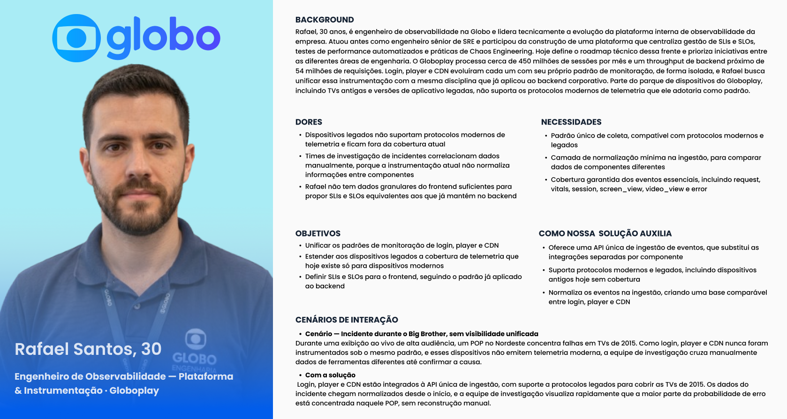
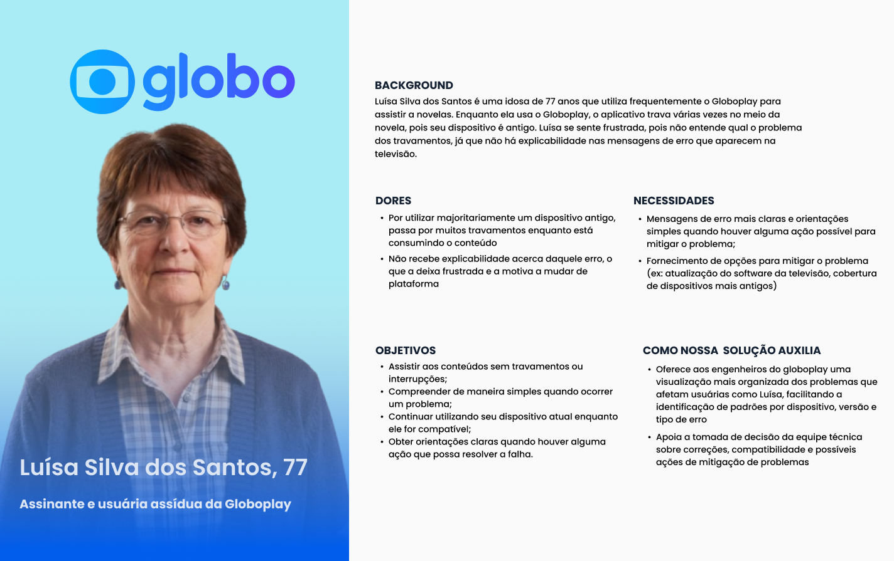

## 1. Contexto e escopo do projeto

&emsp; O projeto consiste no desenvolvimento de uma plataforma distribuída de backend para coleta, normalização, processamento e consulta de eventos de telemetria provenientes das aplicações frontend do Globoplay. A solução busca atender a diferentes tipos de dispositivos, sistemas operacionais, versões de aplicativos e condições de conectividade, incluindo equipamentos legados que não oferecem suporte completo aos padrões modernos de observabilidade.

&emsp; Atualmente, os componentes relacionados ao login, ao player de vídeo e à distribuição de conteúdo por CDN possuem padrões de monitoração distintos. Essa fragmentação dificulta a comparação das informações, exige correlação manual entre diferentes fontes e reduz a visibilidade sobre falhas que afetam plataformas ou dispositivos específicos.

&emsp; A solução proposta deverá oferecer uma API unificada de ingestão, suporte a formatos modernos e legados, normalização dos eventos recebidos e disponibilização de consultas e visualizações operacionais. Entre os eventos previstos estão `request`, `vitals`, `screen_view`, `video_view`, `session` e `error`.

&emsp; O principal usuário da plataforma será a equipe técnica responsável pela observabilidade e investigação de incidentes. Entretanto, os benefícios da solução também alcançam indiretamente os assinantes do Globoplay, especialmente aqueles que utilizam dispositivos antigos ou enfrentam condições de conectividade menos favoráveis.

---

## 2. Metodologia

&emsp; A metodologia adotada orienta-se pelos princípios do Human-Centered Design (HCD) e do Design Thinking, buscando compreender tanto as necessidades dos usuários diretos da plataforma quanto os efeitos da solução sobre os usuários finais do Globoplay.

&emsp; Como fontes primárias, foram consideradas as entrevistas, reuniões e sessões de alinhamento realizadas com os stakeholders da Globo. Essas interações contribuíram para o entendimento do contexto operacional, das limitações das ferramentas atuais, das características dos dispositivos legados e das necessidades das equipes de engenharia e observabilidade.

&emsp; Como fontes secundárias, foram utilizados o documento TAPI, o anexo técnico sobre as fontes de dados e os exemplos de eventos de telemetria disponibilizados pelo parceiro. Esses materiais permitiram compreender os tipos de mensagens recebidas, os campos associados a dispositivos e sessões, as fontes de QoS e QoE e os desafios relacionados à normalização e correlação das informações.

&emsp; A construção das personas ocorreu a partir da identificação de padrões de comportamento, objetivos, necessidades, dores e cenários de interação relacionados ao problema. Inicialmente, foram levantadas hipóteses pelo grupo de desenvolvimento e, posteriormente, essas hipóteses foram refinadas com base nas informações fornecidas pelo parceiro.

&emsp; Foram definidos dois perfis principais. O primeiro representa o usuário direto da solução, responsável pela monitoração e investigação de incidentes. O segundo representa o usuário final do Globoplay, que não interage diretamente com a plataforma de observabilidade, mas é impactado pela qualidade das análises e das decisões tomadas pelas equipes técnicas.

---

## 3. Personas

&emsp; Personas são representações fictícias de usuários reais, construídas a partir de padrões de comportamento, necessidades e objetivos. Funcionam como ferramentas estratégicas que humanizam dados abstratos e orientam decisões de produto, mantendo o foco nos usuários ao longo do processo de desenvolvimento (COOPER et al., 2014).

&emsp; As personas deste projeto foram construídas a partir da análise da problemática apresentada pela Globo, dos documentos disponibilizados pelo parceiro e dos alinhamentos realizados com os stakeholders. As representações foram elaboradas a partir das hipóteses iniciais do grupo e refinadas conforme o entendimento do contexto de observabilidade, dos dispositivos legados e dos impactos das falhas sobre os assinantes do Globoplay (PRUITT; ADLIN, 2006).

&emsp; Foram identificados dois perfis com relações diferentes com a solução. Rafael Santos representa a persona principal e usuária direta da plataforma, pois utiliza os dados e as ferramentas de observabilidade para investigar falhas e orientar decisões técnicas. Luísa Silva dos Santos representa uma persona secundária e indireta, pois não utiliza o sistema desenvolvido, mas é beneficiada pelas melhorias que ele pode proporcionar à experiência de reprodução.

### 3.1 Persona 1 - Rafael Santos, engenheiro de observabilidade

Figura 1 - Persona: Rafael Santos, engenheiro de observabilidade

Fonte: material produzido pelos autores (2026).

&emsp; Rafael Santos, 30 anos, é engenheiro de observabilidade na Globo e lidera tecnicamente a evolução da plataforma interna de observabilidade da empresa. Atuou anteriormente como engenheiro sênior de Site Reliability Engineering (SRE) e participou da construção de uma plataforma voltada à centralização da gestão de SLIs e SLOs, à automação de testes de desempenho e à aplicação de práticas de Chaos Engineering.

&emsp; Atualmente, Rafael define o roadmap técnico dessa frente e prioriza iniciativas entre diferentes áreas de engenharia. No Globoplay, os componentes de login, player e CDN evoluíram com padrões de monitoração próprios e pouco integrados. Como consequência, a investigação de incidentes exige a consulta e a correlação manual de dados provenientes de ferramentas diferentes.

&emsp; Parte dos dispositivos utilizados para acessar o Globoplay, incluindo televisores antigos e versões legadas do aplicativo, não suporta os protocolos modernos de telemetria que Rafael utilizaria como padrão. Isso reduz a cobertura de monitoração e dificulta a criação de indicadores de confiabilidade para o frontend semelhantes aos já utilizados no backend.

&emsp; Entre suas principais dores estão a falta de um padrão único para a coleta de eventos, a ausência de normalização entre os componentes, a baixa cobertura de dispositivos legados e a dificuldade de obter dados granulares suficientes para apoiar a definição de SLIs e SLOs para o frontend.

&emsp; Rafael necessita de uma plataforma que centralize os eventos de login, player e CDN, aceite dados provenientes de dispositivos modernos e legados e disponibilize informações comparáveis para consulta e análise. Seu objetivo é reduzir o esforço manual empregado na investigação de incidentes, ampliar a cobertura da observabilidade e melhorar a capacidade de identificar padrões de falha.

&emsp; A solução proposta auxilia Rafael ao oferecer uma API unificada de ingestão, uma camada de normalização mínima e interfaces de consulta capazes de organizar eventos por dispositivo, versão, componente, sessão e período. A plataforma não necessariamente determina de forma automática a causa raiz de cada problema, mas oferece evidências que apoiam a formulação e a validação de hipóteses durante a investigação.

#### Cenário de interação

&emsp; Durante uma transmissão ao vivo de grande audiência, ocorre um aumento de falhas em televisores fabricados em 2015. Sem uma visão unificada, Rafael e a equipe precisam consultar separadamente dados de login, player, CDN e infraestrutura para entender o alcance do problema.

&emsp; Com a solução, os eventos são recebidos por uma interface comum e normalizados desde a ingestão. Rafael aplica filtros por período, modelo de dispositivo, versão da aplicação, região e tipo de erro. A análise mostra que a maior concentração de falhas ocorre em um conjunto específico de televisores e em determinada região, permitindo que a equipe direcione a investigação técnica com maior rapidez.

### 3.2 Persona 2 - Luísa Silva dos Santos, assinante do Globoplay

Figura 2 - Persona: Luísa Silva dos Santos, assinante do Globoplay

Fonte: material produzido pelos autores (2026).

&emsp; Luísa Silva dos Santos, 77 anos, é assinante e usuária frequente do Globoplay, principalmente para assistir a novelas. Ela utiliza uma televisão antiga e possui pouca familiaridade com configurações técnicas, atualizações de software e mensagens de erro.

&emsp; Durante o uso da plataforma, Luísa enfrenta travamentos e interrupções na reprodução. As mensagens apresentadas na televisão nem sempre são suficientemente claras para que ela compreenda a natureza do problema ou saiba como agir. Como resultado, sente-se frustrada e pode interpretar a falha como um problema permanente da plataforma.

&emsp; Entre suas principais dores estão os travamentos frequentes, a falta de clareza das mensagens exibidas e a dificuldade de resolver problemas técnicos sem auxílio. Suas necessidades incluem uma experiência de reprodução mais estável e orientações simples quando uma falha puder ser resolvida por uma ação do usuário.

&emsp; Luísa não utilizará diretamente o dashboard ou a API desenvolvida pelo projeto. Sua relação com a solução é indireta. Ao ampliar a visibilidade sobre falhas em dispositivos legados, a plataforma permite que as equipes técnicas identifiquem quais modelos, versões ou condições de uso apresentam maior incidência de problemas.

&emsp; A solução auxilia Luísa ao fornecer dados mais completos para as equipes responsáveis pela manutenção do Globoplay. Esses dados podem apoiar a correção de falhas, a manutenção da compatibilidade com aparelhos antigos e a priorização de melhorias que reduzam travamentos e interrupções.

&emsp; A geração de mensagens explicativas diretamente na televisão não está necessariamente contemplada no escopo atual. Para que isso ocorra, seria necessária uma integração entre os diagnósticos ou classificações produzidos pela plataforma e a interface do aplicativo utilizada pelo assinante.

#### Cenário de impacto

&emsp; Luísa tenta assistir a uma novela, mas a reprodução apresenta interrupções repetidas. Os eventos enviados pelo dispositivo registram falhas de requisição, erros do player e informações sobre o modelo e a versão do aplicativo.

&emsp; A equipe de observabilidade identifica que o mesmo padrão ocorre em outros aparelhos semelhantes. Com base nessa evidência, os responsáveis podem priorizar a investigação, desenvolver uma correção compatível com o dispositivo ou orientar o suporte sobre uma possível ação de mitigação. Dessa forma, Luísa é beneficiada pela solução mesmo sem interagir diretamente com ela.

---

### 3.3. Relação entre as personas e a solução

&emsp; As duas personas representam níveis diferentes de interação com o projeto. Rafael é o usuário direto da plataforma e necessita de recursos de consulta, filtragem, correlação e visualização dos eventos. Luísa é uma usuária indireta, cuja experiência depende da capacidade das equipes técnicas de identificar e corrigir falhas que afetam seu dispositivo.

| Persona | Relação com a solução | Principais necessidades | Benefício esperado |
|---|---|---|---|
| Rafael Santos | Usuário direto | Dados normalizados, filtros, cobertura de dispositivos legados e apoio à investigação | Redução do tempo de identificação e análise de falhas |
| Luísa Silva dos Santos | Usuária indireta | Estabilidade, compatibilidade e orientações compreensíveis | Melhoria da experiência em dispositivos antigos |

&emsp; Essa distinção é importante para orientar as decisões de UX. O protótipo principal deverá ser desenvolvido para Rafael e outros profissionais de observabilidade, uma vez que são eles que interagem diretamente com o dashboard. As necessidades de Luísa devem ser consideradas como impactos esperados da solução e como critérios para avaliar a relevância das análises realizadas.

## 4. User Stories

&emsp; As User Stories conseguem traduzir ações específicas que precisam cumprir na solução, dada alguma necessidade/dor. Elas se tornam essenciais no Entendimento da Experiência do Usuário ao permitir uma validação de dores e necessidades que fazem sentido em relação à solução do problema, seguindo as boas práticas no formato INVEST que amplia a qualidade destas histórias. O acrônimo I.N.V.E.S.T. (Independente, Negociável, Valiosa, Estimável, Pequena e Testável) resume-se à um framework que auxilia na estruturação das User Stories (Bonilha, Diego; 2020).

| # | User Story | Persona | Dor atendida | Critérios de aceite |
|---|------------|---------|--------------|---------------------|
| US01 | Como Engenheiro de Observabilidade, eu quero uma API única de ingestão de eventos, para substituir as integrações separadas que hoje mantenho para login, player e CDN. | Rafael Santos | Cada componente foi instrumentado por um time diferente, sem padrão comum, o que exige uma integração específica a cada novo ponto de coleta. | Um único endpoint recebe eventos de qualquer componente frontend; suporte documentado para os tipos de evento mínimos (request, vitals, screen_view, video_view, session, error). |
| US02 | Como Engenheiro de Observabilidade, eu quero que a plataforma aceite tanto protocolos modernos quanto legados na coleta de eventos, para cobrir dispositivos que hoje ficam fora da telemetria (TVs antigas, apps desatualizados). | Rafael Santos | Parte do parque de dispositivos não suporta os protocolos modernos usados como padrão, criando pontos cegos permanentes de instrumentação. | Pipeline aceita eventos vindos de pelo menos um protocolo legado, além do moderno; eventos de dispositivos legados aparecem no mesmo dashboard que os demais, sem tratamento separado. |
| US03 | Como Engenheiro de Observabilidade, eu quero que os eventos recebidos passem por normalização mínima na ingestão, para que dados de login, player e CDN cheguem em formato comparável. | Rafael Santos | Sem normalização na origem, qualquer correlação entre componentes precisa ser feita manualmente por quem investiga um incidente. | Eventos de diferentes fontes usam o mesmo esquema de campos obrigatórios (timestamp, dispositivo, componente, status); divergências de formato entre fontes não impedem a consulta unificada dos dados. |
| US04 | Como Engenheiro de Observabilidade, eu quero visibilidade sobre a cobertura de instrumentação por dispositivo e componente, para identificar de forma objetiva onde ainda existem pontos cegos. | Rafael Santos | Hoje não há um jeito claro de saber quais dispositivos ou regiões estão mal cobertos até que um incidente revele a lacuna. | Painel mostra volume de eventos recebidos por tipo de dispositivo e componente; é possível identificar dispositivos com volume de eventos abaixo do esperado para o tráfego estimado. |
| US05 | Como Engenheiro de Observabilidade, eu quero que o pipeline de ingestão não perca eventos durante picos de tráfego, para manter a confiabilidade dos dados justamente nos momentos de maior audiência. | Rafael Santos | Eventos perdidos em picos comprometem a análise exatamente quando o volume de usuários afetados é maior. | Pipeline sustenta o pico de throughput de backend informado pelo parceiro sem descarte de eventos; testes de carga validam a ausência de perda antes de eventos sazonais de grande audiência. |
| US06 | Como Engenheiro de Observabilidade, eu quero definir SLIs e SLOs para o frontend com base nos dados coletados, para aplicar ao lado cliente a mesma disciplina de confiabilidade já usada no backend. | Rafael Santos | Hoje não há dados granulares suficientes do frontend para propor metas de confiabilidade equivalentes às já existentes no backend. | Dashboard permite acompanhar métricas de referência (ex: taxa de erro, latência) por período; é possível definir um limite aceitável e visualizar quando ele é ultrapassado. |

### 5.3 Conclusão

&emsp; 

---

## 6. Referências

BONILHA, Diego. **User Stories e o formato INVEST**. 2020. Disponível em fontes técnicas de metodologias ágeis. Acesso em: 29 abr. 2026.

COOPER, Alan; REIMANN, Robert; CRONIN, David; NOESSEL, Christopher. **About Face: The Essentials of Interaction Design**. 4. ed. Indianápolis: John Wiley & Sons, 2014.

KALBACH, James. **Mapping Experiences: A Complete Guide to Creating Value through Journeys, Blueprints, and Diagrams**. 1. ed. Sebastopol: O'Reilly Media, 2016.

PRUITT, John; ADLIN, Tamara. **The Persona Lifecycle: Keeping People in Mind Throughout Product Design**. São Francisco: Morgan Kaufmann, 2006.
