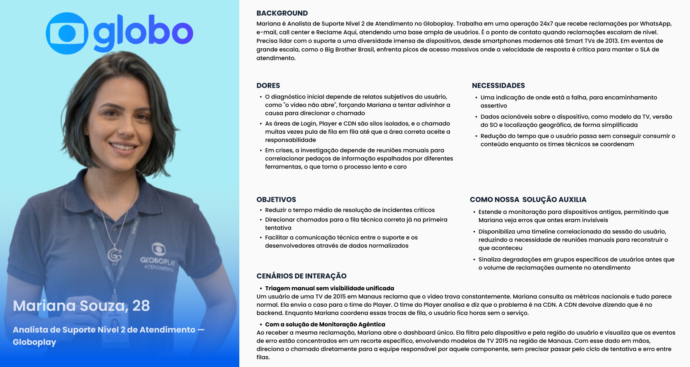
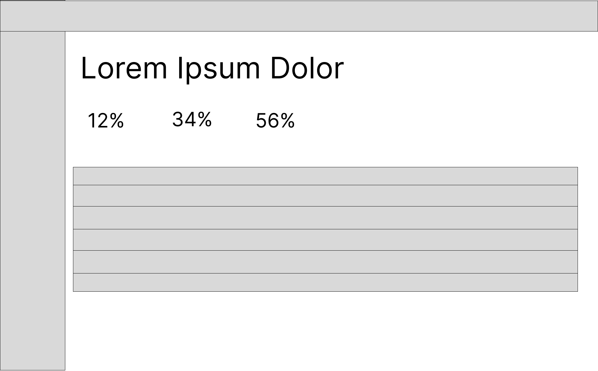
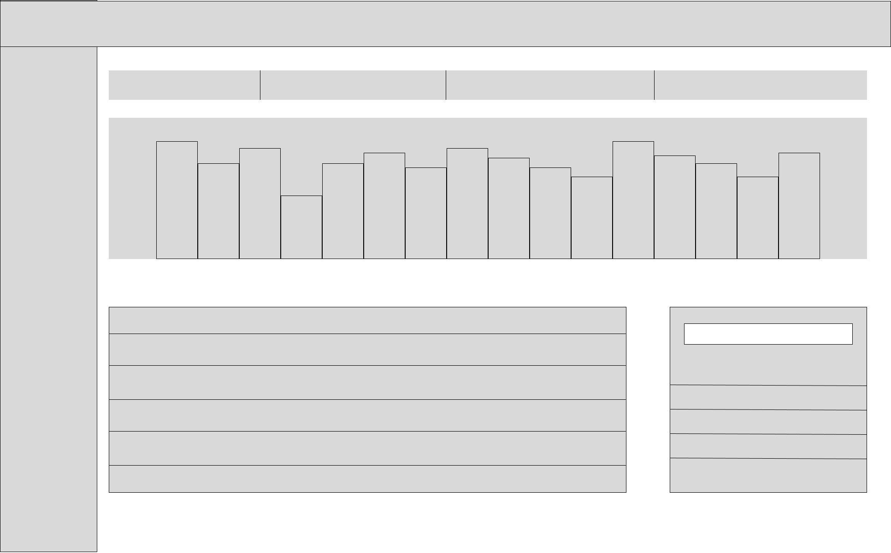
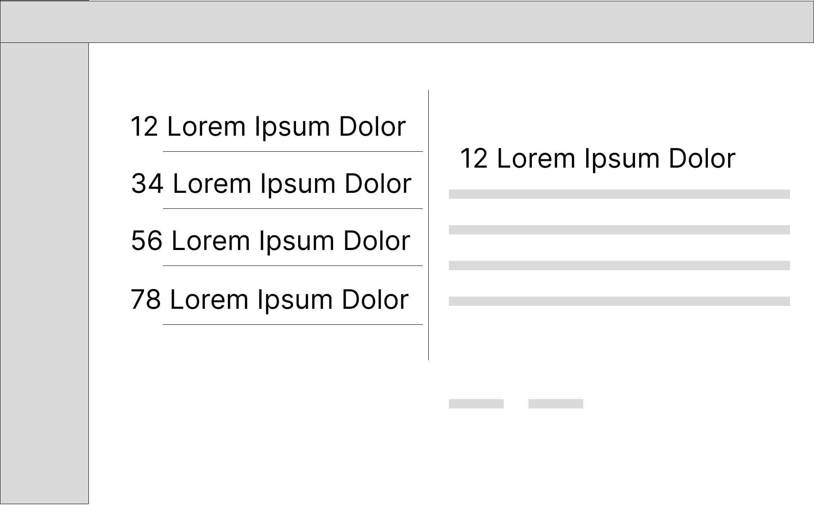
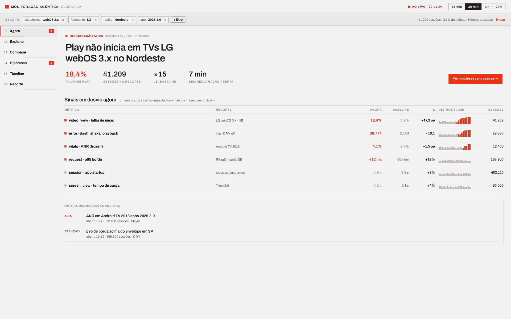
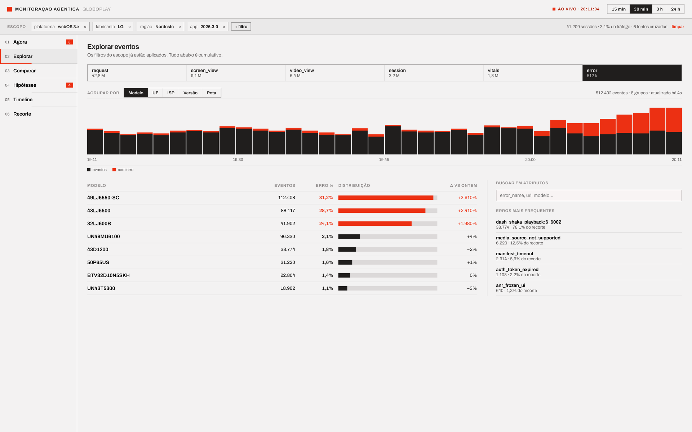
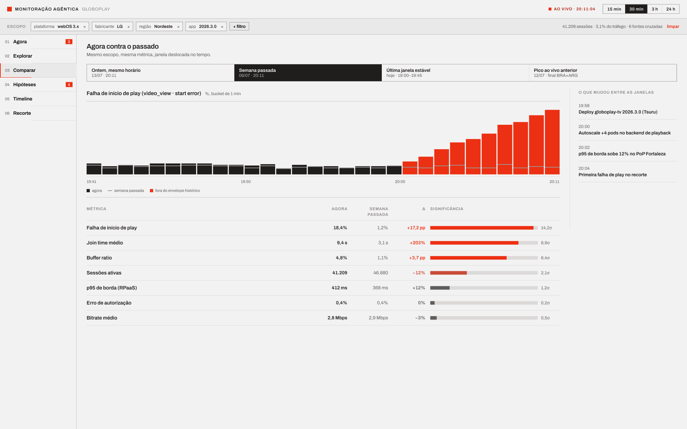
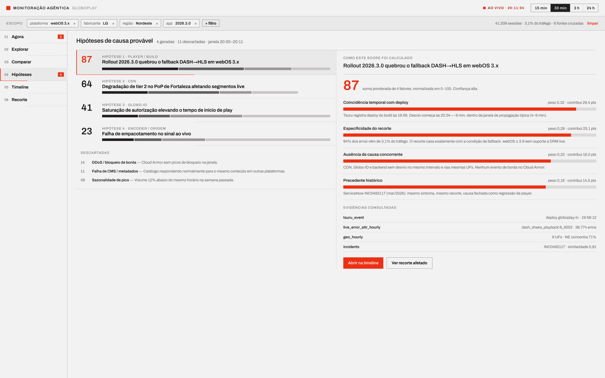
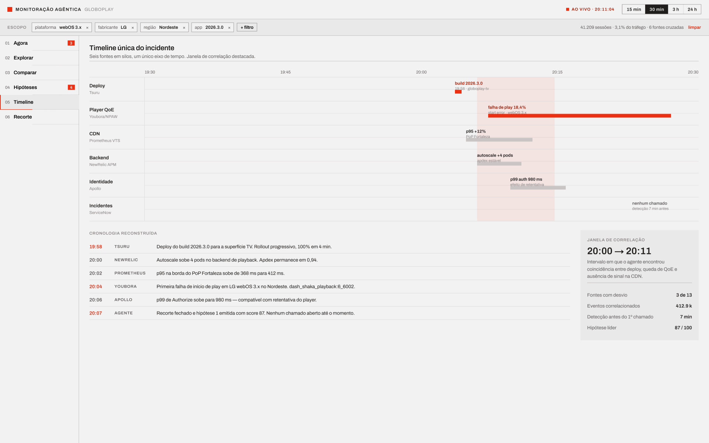
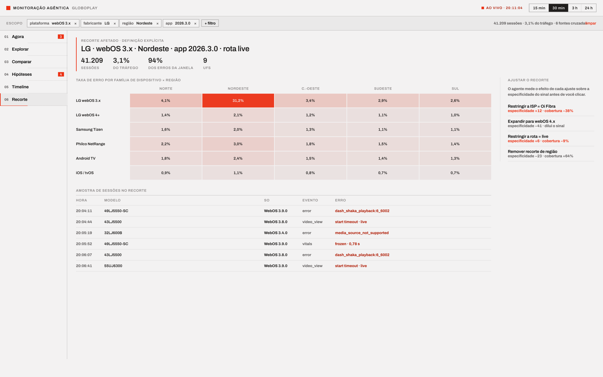

## 1. Contexto e escopo do projeto

&emsp; O projeto consiste no desenvolvimento de uma plataforma para coleta, normalização, processamento e consulta de eventos de telemetria das aplicações frontend do Globoplay, incluindo dispositivos modernos e legados.

&emsp; Hoje, componentes como login, player de vídeo e CDN possuem padrões de monitoração diferentes, o que dificulta a comparação dos dados e a identificação rápida de falhas. A solução proposta busca unificar a ingestão, normalizar eventos como `request`, `vitals`, `screen_view`, `video_view`, `session` e `error`, e apoiar a equipe técnica na investigação de incidentes.

&emsp; Os usuários diretos da plataforma são profissionais de observabilidade e suporte. Os assinantes do Globoplay são beneficiados indiretamente, principalmente quando usam dispositivos antigos ou enfrentam problemas de conectividade.

## 2. Metodologia

&emsp; A metodologia adotada foi baseada em Human-Centered Design (HCD) e Design Thinking, com foco na identificação das necessidades, dores e objetivos dos usuários envolvidos na solução.

&emsp; Para isso, foram considerados os alinhamentos com stakeholders da Globo, o documento TAPI, o anexo técnico sobre fontes de dados e os exemplos de eventos de telemetria fornecidos pelo parceiro.

&emsp; A partir dessas informações, foram definidas três personas: um engenheiro de observabilidade, uma analista de suporte e uma assinante do Globoplay impactada indiretamente pela qualidade da monitoração.

## 3. Personas

&emsp; Personas são representações fictícias de usuários reais, construídas a partir de padrões de comportamento, necessidades e objetivos. Funcionam como ferramentas estratégicas que humanizam dados abstratos e orientam decisões de produto, mantendo o foco nos usuários ao longo do processo de desenvolvimento (COOPER et al., 2014).

&emsp; As personas deste projeto foram construídas a partir da análise da problemática apresentada pela Globo, dos documentos disponibilizados pelo parceiro e dos operacionalalinhamentos realizados com os stakeholders. As representações foram elaboradas a partir das hipóteses iniciais do grupo e refinadas conforme o entendimento do contexto de observabilidade, dos dispositivos legados e dos impactos das falhas sobre os assinantes do Globoplay (PRUITT; ADLIN, 2006).

&emsp; Foram identificados três perfis com relações diferentes com a solução. Rafael Santos representa a persona principal e usuária direta da plataforma, pois utiliza os dados e as ferramentas de observabilidade para investigar falhas e orientar decisões técnicas. Mariana Souza representa uma persona  e também usuária direta, pois utiliza a plataforma para apoiar a triagem de chamados e o encaminhamento assertivo de incidentes às equipes responsáveis. Luísa Silva dos Santos representa uma persona secundária e indireta, pois não utiliza o sistema desenvolvido, mas é beneficiada pelas melhorias que ele pode proporcionar à experiência de reprodução.

### 3.1 Persona 1 - Rafael Santos, engenheiro de observabilidade

<div align="center">

<sub>Figura 1 - Persona: Rafael Santos, engenheiro de observabilidade</sub>


<sup>Fonte: material produzido pelos autores (2026).</sup>

</div>

&emsp; Rafael Santos, 30 anos, é engenheiro de observabilidade na Globo e representa o usuário principal da plataforma. Sua principal dor é a fragmentação dos dados entre login, player e CDN, além da baixa visibilidade sobre dispositivos legados. Na solução, Rafael utiliza filtros por dispositivo, versão, componente e período para investigar padrões de falha. Em uma transmissão ao vivo com aumento de erros em TVs antigas, por exemplo, ele consegue isolar o modelo e a região mais afetados.

### 3.2 Persona 2 - Mariana Souza, analista de suporte

<div align="center">

<sub>Figura 2 - Persona: Mariana Souza, analista de suporte</sub>



<sup>Fonte: material produzido pelos autores (2026).</sup>

</div>

&emsp; Mariana Souza, 28 anos, é Analista de Suporte Nível 2 no Globoplay e representa uma persona operacional secundária da solução. Sua principal dor é depender de relatos vagos dos usuários e de ferramentas fragmentadas para direcionar chamados. Na solução, Mariana consulta eventos por dispositivo, região e sessão para fazer uma triagem mais precisa. Ao receber uma reclamação de uma Smart TV de 2015 em Manaus, por exemplo, ela identifica se há erros recorrentes naquele recorte antes de encaminhar o chamado.


### 3.3 Persona 3 - Luísa Silva dos Santos, assinante do Globoplay

<div align="center">

<sub>Figura 3 - Persona: Luísa Silva dos Santos, assinante do Globoplay</sub>


<sup>Fonte: material produzido pelos autores (2026).</sup>

</div>

&emsp; Luísa Silva dos Santos, 77 anos, é assinante do Globoplay e representa a usuária impactada indiretamente pela solução. Sua principal dor são travamentos frequentes em sua televisão antiga e a dificuldade de resolver problemas técnicos sozinha. Embora não utilize a plataforma, Luísa se beneficia quando os eventos do seu dispositivo ajudam a equipe técnica a identificar falhas recorrentes. Ao enfrentar interrupções durante uma novela, por exemplo, seus eventos podem contribuir para priorizar uma correção em aparelhos semelhantes.


### 3.4. Relação entre as personas e a solução

&emsp; A relação entre as personas e a solução orienta quais funcionalidades devem ser priorizadas no projeto. As necessidades de Rafael e Mariana direcionam os fluxos principais do dashboard, enquanto a experiência de Luísa funciona como indicador do impacto final esperado: reduzir falhas percebidas pelos assinantes por meio de uma monitoração mais completa e acionável.

| Persona | Relação com a solução | Principais necessidades | Benefício esperado |
|---|---|---|---|
| Rafael Santos | Usuário direto | Dados normalizados, filtros, cobertura de dispositivos legados e apoio à investigação | Redução do tempo de identificação e análise de falhas |
| Mariana Souza | Usuária direta (operacional) | Timeline unificada, filtros por dispositivo e região, visibilidade de dispositivos legados | Encaminhamento assertivo de chamados e redução do tempo de resolução |
| Luísa Silva dos Santos | Usuária indireta | Estabilidade, compatibilidade e orientações compreensíveis | Melhoria da experiência em dispositivos antigos |

&emsp; Assim, as decisões de UX devem equilibrar profundidade técnica e clareza operacional. O protótipo precisa permitir análises detalhadas para investigação de incidentes, mas também oferecer caminhos simples para triagem e encaminhamento de problemas, mantendo como referência o efeito dessas decisões na experiência do assinante.


## 4. User Stories

&emsp; As User Stories traduzem ações específicas que as personas precisam cumprir na solução diante de necessidades e dores identificadas. Elas se tornam essenciais no Entendimento da Experiência do Usuário ao permitir a validação de necessidades relacionadas ao problema, seguindo as boas práticas do formato INVEST. O acrônimo I.N.V.E.S.T. (Independente, Negociável, Valiosa, Estimável, Pequena e Testável) resume um framework que auxilia na estruturação das User Stories (BONILHA, 2020).

| # | User Story | Persona | Dor atendida | Critérios de aceite |
|---|------------|---------|--------------|---------------------|
| US01 | Como Engenheiro de Observabilidade, eu quero uma API única de ingestão de eventos, para substituir as integrações separadas que hoje mantenho para login, player e CDN. | Rafael Santos | Cada componente foi instrumentado por um time diferente, sem padrão comum, o que exige uma integração específica a cada novo ponto de coleta. | Um único endpoint recebe eventos de qualquer componente frontend; suporte documentado para os tipos de evento mínimos (request, vitals, screen_view, video_view, session, error). |
| US02 | Como Engenheiro de Observabilidade, eu quero que a plataforma aceite tanto protocolos modernos quanto legados na coleta de eventos, para cobrir dispositivos que hoje ficam fora da telemetria (TVs antigas, apps desatualizados). | Rafael Santos | Parte do parque de dispositivos não suporta os protocolos modernos usados como padrão, criando pontos cegos permanentes de instrumentação. | Pipeline aceita eventos vindos de pelo menos um protocolo legado, além do moderno; eventos de dispositivos legados aparecem no mesmo dashboard que os demais, sem tratamento separado. |
| US03 | Como Engenheiro de Observabilidade, eu quero que os eventos recebidos passem por normalização mínima na ingestão, para que dados de login, player e CDN cheguem em formato comparável. | Rafael Santos | Sem normalização na origem, qualquer correlação entre componentes precisa ser feita manualmente por quem investiga um incidente. | Eventos de diferentes fontes usam o mesmo esquema de campos obrigatórios (timestamp, dispositivo, componente, status); divergências de formato entre fontes não impedem a consulta unificada dos dados. |
| US04 | Como Engenheiro de Observabilidade, eu quero visibilidade sobre a cobertura de instrumentação por dispositivo e componente, para identificar de forma objetiva onde ainda existem pontos cegos. | Rafael Santos | Hoje não há um jeito claro de saber quais dispositivos ou regiões estão mal cobertos até que um incidente revele a lacuna. | Painel mostra volume de eventos recebidos por tipo de dispositivo e componente; é possível identificar dispositivos com volume de eventos abaixo do esperado para o tráfego estimado. |
| US05 | Como Engenheiro de Observabilidade, eu quero que o pipeline de ingestão não perca eventos durante picos de tráfego, para manter a confiabilidade dos dados justamente nos momentos de maior audiência. | Rafael Santos | Eventos perdidos em picos comprometem a análise exatamente quando o volume de usuários afetados é maior. | Pipeline sustenta o pico de throughput de backend informado pelo parceiro sem descarte de eventos; testes de carga validam a ausência de perda antes de eventos sazonais de grande audiência. |
| US06 | Como Engenheiro de Observabilidade, eu quero definir SLIs e SLOs para o frontend com base nos dados coletados, para aplicar ao lado cliente a mesma disciplina de confiabilidade já usada no backend. | Rafael Santos | Hoje não há dados granulares suficientes do frontend para propor metas de confiabilidade equivalentes às já existentes no backend. | Dashboard permite acompanhar métricas de referência (ex: taxa de erro, latência) por período; é possível definir um limite aceitável e visualizar quando ele é ultrapassado. |
| US07 | Como Analista de Suporte, eu quero consultar a timeline de eventos de um usuário específico, para entender o que aconteceu na sessão sem depender de relatos subjetivos como "o vídeo não abre". | Mariana Souza | O diagnóstico inicial depende de relatos subjetivos do usuário, forçando a analista a adivinhar a causa para direcionar o chamado. | É possível localizar a sessão de um usuário e visualizar os eventos registrados nela em ordem cronológica; a timeline mostra ao menos os eventos de session, screen_view, video_view e error. |
| US08 | Como Analista de Suporte, eu quero filtrar eventos de erro por modelo de dispositivo e região, para identificar se um problema reportado é um caso isolado ou um padrão concentrado em um recorte específico. | Mariana Souza | Erros concentrados em dispositivos legados ou regiões específicas ficam mascarados pelas métricas nacionais agregadas, e a analista não consegue diferenciar isso na triagem. | Dashboard permite filtrar eventos por modelo de dispositivo e localização geográfica; é possível visualizar o volume de erros do recorte filtrado comparado ao total. |
| US09 | Como Analista de Suporte, eu quero visualizar em quais dispositivos legados os eventos estão sendo coletados, para confirmar que o suporte a um usuário de TV antiga não vai depender de investigação manual em outras ferramentas. | Mariana Souza | Dispositivos legados, como TVs de 2013 a 2015, não aparecem em logs ou métricas, dificultando a ajuda a esses usuários. | Dashboard exibe eventos de dispositivos legados no mesmo painel usado para dispositivos modernos; é possível confirmar, para um dispositivo legado específico, se ele está gerando eventos de request, session e error. |

### 4.1 Conclusão

&emsp; As nove User Stories contemplam as principais dores de Rafael e Mariana, cobrindo desde a ingestão unificada e a normalização dos eventos até a consulta por dispositivo, região e sessão. As histórias de Rafael (US01 a US06) concentram as necessidades de engenharia de observabilidade, enquanto as de Mariana (US07 a US09) endereçam a triagem operacional de chamados. Juntas, essas histórias também beneficiam Luísa de forma indireta, uma vez que a ampliação da cobertura e a agilidade na investigação resultam em correções mais rápidas para dispositivos legados.


## 5. Protótipo de Front-End

&emsp; O protótipo traduz as User Stories em telas navegáveis, permitindo validar as tarefas e interações planejadas antes de qualquer decisão de implementação. Sua construção seguiu duas etapas encadeadas: primeiro os wireframes de baixa fidelidade, que fixaram a hierarquia da informação e os padrões de layout sem interferência de cor ou tipografia, e depois o protótipo de alta fidelidade, que aplicou o design system e os dados reais de telemetria fornecidos pelo parceiro.

**Protótipo interativo:** *https://www.figma.com/design/QlqYW7stAUdAybIOQJy78V/Figma-Globo?node-id=0-1&t=qXG0fp9R1ioKiVnz-1*

### 5.1 Premissas e decisões de design

&emsp; A decisão estruturante do protótipo partiu da natureza da pergunta que Rafael e Mariana precisam responder. O operador de plantão não pergunta apenas "o que quebrou", mas sim "isso é problema nosso ou externo, quantos assinantes estão sendo afetados e o que mudou nos últimos minutos". Essa pergunta orientou três escolhas presentes em todas as telas.

&emsp; **A ordenação por impacto, não por magnitude.** Na tela principal, os sinais em desvio aparecem ordenados por número de sessões impactadas, e não pelo tamanho do desvio estatístico. A escolha é explicitada na própria interface, abaixo do título da tabela, porque inverte a convenção usual de ferramentas de monitoração: um desvio de 400% em um recorte de mil sessões é operacionalmente menos urgente que um desvio de 15% em quarenta mil.

&emsp; **O escopo como estado global.** A barra de filtros cumulativos permanece fixa no topo de todas as seis telas, e cada filtro aplicado é exibido como um *chip* removível individualmente. O recorte investigado não se perde ao navegar entre telas, o que atende diretamente ao item do MVP que pede filtros cumulativos com sugestão dos valores efetivamente recebidos. O contador à direita da barra ("41.209 sessões · 3,1% do tráfego · 6 fontes cruzadas") informa continuamente o custo de cobertura de cada filtro aplicado.

&emsp; **Cor como sinal, não como decoração.** A paleta é monocromática com um único acento, reservado exclusivamente para valores fora do envelope esperado. Métricas dentro do baseline aparecem em cinza, mesmo quando presentes na mesma tabela que as métricas em desvio, como se observa nas linhas `session · app startup` e `screen_view · tempo de carga` da tela principal. Em um painel lido sob pressão, a cor precisa carregar informação.

&emsp; Os dados exibidos no protótipo não são fictícios: os modelos de dispositivo (`49LJ5550-SC`, `43LJ5500`, `UN49MU6100`, `43D1200`, `50P65US`, `BTV32D10N5SKH`), o código de erro `dash_shaka_playback:6_6002` e os nomes dos seis tipos de evento foram extraídos das amostras de eventos disponibilizadas pelo parceiro. Os nomes das fontes correlacionadas (Youbora/NPAW, Prometheus VTS, NewRelic APM, Apollo, Tsuru e ServiceNow) e a contagem de treze fontes vêm do anexo técnico de fontes de dados. Essa ancoragem garante que os fluxos representem o dado que a plataforma efetivamente vai receber.

### 5.2 Wireframes iniciais

&emsp; Os wireframes foram produzidos em baixa fidelidade, com texto substituto e ausência total de cor, para forçar a discussão sobre disposição e prioridade dos elementos antes de qualquer definição estética. Cada rascunho estabeleceu um padrão de layout reaproveitado depois pelas telas de alta fidelidade.

<div align="center">

<sub>Figura 4 - Wireframe da tela de estado atual</sub>



<sup>Fonte: material produzido pelos autores (2026).</sup>

</div>

&emsp; O primeiro rascunho definiu o padrão de **cabeçalho fixo, navegação lateral e corpo em três blocos**: título do incidente, uma faixa de indicadores numéricos e uma tabela de sinais. A decisão de abrir a tela com um título em linguagem natural, e não com um gráfico, nasceu aqui: o operador precisa saber o que está acontecendo antes de ver qualquer série temporal.

<div align="center">

<sub>Figura 5 - Wireframe da tela de exploração de eventos</sub>



<sup>Fonte: material produzido pelos autores (2026).</sup>

</div>

&emsp; O segundo rascunho estabeleceu o padrão de **abas de segmentação, gráfico temporal e tabela agrupada com painel lateral de busca**. A faixa de abas no topo representa a troca de dimensão de análise, e o painel à direita concentra busca livre em atributos e uma lista de valores mais frequentes. Esse arranjo foi posteriormente reutilizado, com adaptações, na tela de comparação histórica.

<div align="center">

<sub>Figura 6 - Wireframe da tela de hipóteses</sub>



<sup>Fonte: material produzido pelos autores (2026).</sup>

</div>

&emsp; O terceiro rascunho definiu o padrão **mestre-detalhe com lista ranqueada**: à esquerda, uma lista de itens precedidos por um valor numérico de ordenação; à direita, o detalhamento do item selecionado, decomposto em barras, com ações ao final. O objetivo declarado desde o rascunho era que a interface nunca apresentasse um score sem apresentar simultaneamente sua decomposição.

&emsp; A tabela a seguir relaciona cada rascunho ao padrão que ele estabeleceu e às telas de alta fidelidade que o aplicam.

| Wireframe | Padrão de layout estabelecido | Telas que aplicam o padrão |
|---|---|---|
| Figura 4 | Título em linguagem natural + faixa de indicadores + tabela de sinais | Agora, Recorte |
| Figura 5 | Abas de segmentação + gráfico temporal + tabela agrupada + painel lateral | Explorar, Comparar |
| Figura 6 | Mestre-detalhe com lista ranqueada e decomposição do score | Hipóteses |

&emsp; Duas divergências entre rascunho e protótipo foram deliberadas. A faixa de indicadores do primeiro rascunho previa três valores e passou a quatro, com a inclusão do tempo decorrido sem reclamação aberta, métrica que evidencia o ganho de detecção proativa. As abas do segundo rascunho previam quatro segmentos e passaram a seis, um para cada tipo de evento mínimo do MVP. A tela de timeline, por sua vez, não possui rascunho antecedente: seu formato de raias paralelas foi definido diretamente em alta fidelidade, por depender da quantidade real de fontes a serem sobrepostas.

### 5.3 Protótipo de alta fidelidade

&emsp; O protótipo é composto por seis telas, numeradas na navegação lateral na ordem em que uma investigação tipicamente as percorre. A numeração é intencional: ela comunica sequência sem impedir acesso direto a qualquer etapa.

#### 5.3.1 Tela 01 — Agora

<div align="center">

<sub>Figura 7 - Tela Agora: estado atual da plataforma</sub>



<sup>Fonte: material produzido pelos autores (2026).</sup>

</div>

&emsp; A tela de entrada responde "o que está acontecendo agora e quem está sendo afetado". O cabeçalho declara a degradação ativa em linguagem natural ("Play não inicia em TVs LG webOS 3.x no Nordeste"), acompanhada do horário de detecção e do tempo decorrido. Os quatro indicadores quantificam o problema: taxa de falha, sessões no recorte, razão em relação ao baseline e tempo transcorrido sem reclamação aberta.

&emsp; A tabela de sinais em desvio apresenta, para cada métrica, o valor atual, o baseline, o delta, uma *sparkline* dos últimos trinta minutos e o volume de sessões. Métricas dentro do envelope permanecem em cinza, o que permite varrer a tabela e distinguir o que exige atenção sem ler número por número. Ao final, a lista de outras degradações abertas mantém a visibilidade de incidentes concorrentes, classificados por severidade.

#### 5.3.2 Tela 02 — Explorar

<div align="center">

<sub>Figura 8 - Tela Explorar: navegação cumulativa nos eventos</sub>



<sup>Fonte: material produzido pelos autores (2026).</sup>

</div>

&emsp; Esta tela materializa o item do MVP que pede navegação em gráficos com filtros cumulativos. As seis abas correspondem exatamente aos tipos de evento mínimos do escopo, cada uma exibindo o volume coletado no período. A faixa "agrupar por" permite trocar a dimensão de análise entre modelo, UF, ISP, versão e rota sem sair da tela nem perder o escopo.

&emsp; O gráfico de barras empilhadas separa o volume total do volume com erro no mesmo eixo temporal, tornando visível que a degradação é recente e crescente. A tabela abaixo ordena os grupos por volume e inclui a coluna de comparação com o dia anterior, que é o que distingue um patamar alto e normal de uma escalada anômala: três modelos LG apresentam variação superior a 1.900%, enquanto os demais permanecem em torno de zero. O painel lateral oferece busca livre em atributos e a distribuição dos erros mais frequentes do recorte.

#### 5.3.3 Tela 03 — Comparar

<div align="center">

<sub>Figura 9 - Tela Comparar: janela atual contra referências históricas</sub>



<sup>Fonte: material produzido pelos autores (2026).</sup>

</div>

&emsp; A tela de comparação existe para responder à pergunta que mais gera falso positivo em monitoração de streaming: o desvio observado é uma anomalia ou é sazonalidade esperada. As quatro referências disponíveis (ontem no mesmo horário, semana passada, última janela estável e pico ao vivo anterior) endereçam escalas distintas de sazonalidade, incluindo o caso do evento programado, em que o comportamento correto de comparação é contra outro pico e não contra a média.

&emsp; A tabela de métricas apresenta, além do delta, uma coluna de significância expressa em desvios-padrão. Esse acréscimo é o que permite hierarquizar: a falha de início de play está a 14,2σ do esperado, enquanto o p95 de borda, apesar de 12% acima, está a apenas 1,2σ e portanto dentro da variação normal. O painel lateral lista, em ordem cronológica, os eventos de infraestrutura ocorridos entre as duas janelas comparadas.

#### 5.3.4 Tela 04 — Hipóteses

<div align="center">

<sub>Figura 10 - Tela Hipóteses: causas prováveis ranqueadas e decompostas</sub>



<sup>Fonte: material produzido pelos autores (2026).</sup>

</div>

&emsp; As hipóteses de causa provável aparecem ranqueadas por score, acompanhadas da lista de hipóteses descartadas com a justificativa de cada descarte. Exibir o que foi descartado, e não apenas o que foi eleito, é uma decisão de projeto: sem ela, o operador não tem como saber se a ausência de uma causa na lista significa que ela foi avaliada e rejeitada ou que nunca foi considerada.

&emsp; O painel direito decompõe o score do item selecionado em quatro fatores ponderados, cada um com seu peso, sua contribuição em pontos e a frase que o justifica, além de listar as fontes de evidência consultadas. Essa transparência é o que torna o score utilizável em uma decisão técnica: o operador pode discordar de um fator específico sem descartar a hipótese inteira. As duas ações ao final conduzem à timeline e ao recorte afetado, encadeando os fluxos.

#### 5.3.5 Tela 05 — Timeline

<div align="center">

<sub>Figura 11 - Tela Timeline: seis fontes em um único eixo de tempo</sub>



<sup>Fonte: material produzido pelos autores (2026).</sup>

</div>

&emsp; A timeline é a resposta direta à dor central de Rafael, a fragmentação entre componentes instrumentados por times diferentes. Seis fontes que hoje vivem em ferramentas separadas aparecem como raias paralelas sobre um eixo temporal único, com a janela de correlação destacada. A leitura visual entrega a sequência causal: o deploy às 19:58 precede a subida de p95 na borda às 20:02, que precede a primeira falha de play às 20:04.

&emsp; A cronologia reconstruída abaixo do gráfico apresenta os mesmos fatos em formato textual, atribuindo cada linha à fonte que a originou, o que preserva a rastreabilidade da afirmação. O painel lateral consolida os números da janela de correlação, incluindo a antecedência de sete minutos em relação ao primeiro chamado, métrica que expressa o valor da detecção proativa.

#### 5.3.6 Tela 06 — Recorte

<div align="center">

<sub>Figura 12 - Tela Recorte: definição explícita e ajuste do recorte afetado</sub>



<sup>Fonte: material produzido pelos autores (2026).</sup>

</div>

&emsp; A tela de recorte declara explicitamente a população afetada e a quantifica em quatro dimensões, incluindo a relação entre participação no tráfego e participação nos erros: 3,1% do tráfego concentra 94% dos erros da janela. Esse contraste é a evidência de que o problema é específico de um segmento e não uma degradação geral da plataforma.

&emsp; O mapa de calor cruza família de dispositivo e região, e é onde o problema descrito no TAPI se torna visualmente inegável: a célula de LG webOS 3.x no Nordeste apresenta 31,2% de erro contra valores entre 0,7% e 4,1% em todas as demais combinações. A amostra de sessões abaixo desce ao nível do evento individual, com horário, modelo, versão de sistema operacional, tipo de evento e código de erro.

&emsp; O painel lateral de ajuste do recorte merece destaque por prevenir um erro específico de análise. Cada sugestão de ajuste informa antecipadamente seu efeito sobre a especificidade do sinal e sobre a cobertura, de modo que o operador saiba, antes de clicar, que expandir para webOS 4.x reduziria a especificidade em 41 pontos e diluiria o sinal.

### 5.4 Fluxos de usabilidade

&emsp; A navegação é organizada em torno de três fluxos completos, correspondentes às tarefas que as personas precisam concluir. As telas são acessíveis diretamente pela navegação lateral, mas o encadeamento entre elas é reforçado por chamadas de ação contextuais, que conduzem o operador ao próximo passo esperado da investigação.

```
                       ┌──────────────────────────────────────────┐
                       │  ESCOPO (filtros cumulativos) — global   │
                       └──────────────────────────────────────────┘
                                          │
                                    ┌─────▼─────┐
                                    │ 01 Agora  │
                                    └─────┬─────┘
                 ┌────────────────────────┼────────────────────────┐
                 │ Fluxo 1                │ Fluxo 2                │ Fluxo 3
                 ▼                        ▼                        ▼
         ┌──────────────┐         ┌──────────────┐         ┌──────────────┐
         │ 04 Hipóteses │         │ 02 Explorar  │         │ 03 Comparar  │
         └──────┬───────┘         └──────┬───────┘         └──────────────┘
                │                        │
                ▼                        ▼
         ┌──────────────┐         ┌──────────────┐
         │ 05 Timeline  │◄────────│ 06 Recorte   │
         └──────────────┘         └──────────────┘
```

#### 5.4.1 Fluxo 1 — Diagnosticar a causa provável de uma degradação ativa

&emsp; Persona: Rafael Santos. Percurso: **01 Agora → 04 Hipóteses → 05 Timeline**.

| # | Ação do usuário | Tela | O que o sistema apresenta |
|---|---|---|---|
| 1 | Abre a plataforma ao receber o alerta | Agora (Fig. 7) | Degradação ativa nomeada, detectada há 7 min, com 41.209 sessões afetadas e taxa de falha 15 vezes acima do baseline |
| 2 | Varre a tabela de sinais em desvio | Agora (Fig. 7) | Quatro métricas em desvio destacadas e duas dentro do baseline em cinza, ordenadas por sessões impactadas |
| 3 | Aciona "Ver hipóteses ranqueadas" | Hipóteses (Fig. 10) | Quatro hipóteses ranqueadas, onze descartadas com justificativa, e a hipótese líder com score 87 |
| 4 | Examina a decomposição do score | Hipóteses (Fig. 10) | Quatro fatores com peso e contribuição, mais as fontes de evidência consultadas |
| 5 | Aciona "Abrir na timeline" | Timeline (Fig. 11) | Seis fontes em um eixo único, com a janela de correlação destacada e a cronologia atribuída por fonte |

&emsp; O fluxo conclui com o operador em condições de afirmar, com evidência rastreável, que a regressão decorre do rollout da versão 2026.3.0 sobre o mecanismo de fallback em dispositivos webOS 3.x, e não de degradação de CDN ou de saturação de autorização, ambas avaliadas e pontuadas abaixo.

#### 5.4.2 Fluxo 2 — Isolar o recorte de um problema reportado

&emsp; Persona: Mariana Souza. Percurso: **01 Agora → 02 Explorar → 06 Recorte**.

| # | Ação do usuário | Tela | O que o sistema apresenta |
|---|---|---|---|
| 1 | Aplica filtros a partir do relato recebido (fabricante, plataforma, região) | Barra de escopo | Chips cumulativos e o custo de cobertura do recorte: 41.209 sessões, 3,1% do tráfego |
| 2 | Seleciona a aba do tipo de evento `error` | Explorar (Fig. 8) | Volume de erros do recorte e sua evolução temporal separada do volume total |
| 3 | Agrupa por modelo de dispositivo | Explorar (Fig. 8) | Três modelos LG com variação superior a 1.900% contra o dia anterior, e os demais estáveis |
| 4 | Consulta os erros mais frequentes no painel lateral | Explorar (Fig. 8) | `dash_shaka_playback:6_6002` concentrando 78,1% dos erros do recorte |
| 5 | Abre o recorte afetado | Recorte (Fig. 12) | Mapa de calor de dispositivo por região, isolando LG webOS 3.x no Nordeste em 31,2% |
| 6 | Confirma no nível do evento | Recorte (Fig. 12) | Amostra de sessões com horário, modelo, versão de sistema operacional, evento e código de erro |

&emsp; O fluxo permite que a analista determine se o relato é caso isolado ou padrão concentrado antes de encaminhar o chamado, e que informe à equipe responsável o recorte exato e o código de erro predominante, substituindo o relato subjetivo por evidência quantificada.

#### 5.4.3 Fluxo 3 — Distinguir anomalia de sazonalidade esperada

&emsp; Persona: Rafael Santos. Percurso: **01 Agora → 03 Comparar**.

| # | Ação do usuário | Tela | O que o sistema apresenta |
|---|---|---|---|
| 1 | Identifica o desvio na métrica de falha de play | Agora (Fig. 7) | Valor atual de 18,4% contra baseline de 1,2% |
| 2 | Abre a comparação histórica | Comparar (Fig. 9) | Quatro referências de comparação, entre elas o pico ao vivo anterior |
| 3 | Seleciona a referência adequada ao contexto | Comparar (Fig. 9) | Série atual sobreposta à série da referência, com destaque dos pontos fora do envelope histórico |
| 4 | Hierarquiza os desvios por significância | Comparar (Fig. 9) | Falha de play a 14,2σ e join time a 8,9σ, contra p95 de borda a 1,2σ e bitrate a 0,5σ |
| 5 | Verifica o que mudou entre as janelas | Comparar (Fig. 9) | Cronologia de deploy, autoscale e variação de borda no intervalo comparado |

&emsp; O fluxo descarta a hipótese de sazonalidade com dado explícito: o volume de sessões está 12% **abaixo** do mesmo horário da semana anterior, o que elimina sobrecarga por audiência como explicação e sustenta o descarte registrado na tela de hipóteses.

### 5.5 Correlação entre os fluxos e as User Stories

&emsp; A tabela relaciona cada User Story mapeada na seção 4 à tela e ao fluxo que a representa no protótipo, explicitando o grau de cobertura alcançado nesta etapa.

| US | Persona | Tela / fluxo que a representa | Cobertura |
|---|---|---|---|
| US01 — API única de ingestão | Rafael | Explorar (Fig. 8): seis abas correspondentes aos tipos de evento do MVP, todas na mesma interface | Indireta — requisito de backend, evidenciado na interface pela unificação dos tipos de evento |
| US02 — Protocolos modernos e legados | Rafael | Explorar (Fig. 8) e Recorte (Fig. 12): dispositivos legados e modernos na mesma tabela e no mesmo mapa de calor, sem tratamento separado | Integral |
| US03 — Normalização mínima na ingestão | Rafael | Timeline (Fig. 11): seis fontes heterogêneas sobre um eixo temporal comum, com atribuição de origem por linha | Integral |
| US04 — Visibilidade da cobertura de instrumentação | Rafael | Explorar (Fig. 8): volume de eventos por modelo e por tipo de evento | Parcial — falta a comparação entre volume recebido e volume esperado para o tráfego estimado |
| US05 — Pipeline sem perdas em picos de tráfego | Rafael | Explorar (Fig. 8): indicador de atualidade do dado ("atualizado há 4s") | Não coberta na interface — requisito não funcional, a ser validado por teste de carga |
| US06 — SLIs e SLOs para o frontend | Rafael | Comparar (Fig. 9) e Agora (Fig. 7): baseline por métrica, envelope histórico e significância em desvios-padrão | Parcial — os indicadores existem, mas falta a tela de definição do limite aceitável |
| US07 — Timeline de eventos de um usuário | Mariana | Recorte (Fig. 12): amostra de sessões com evento, horário e erro por dispositivo | Parcial — há o nível de evento, mas falta o detalhamento cronológico de uma sessão individual |
| US08 — Filtrar erros por modelo e região | Mariana | Recorte (Fig. 12), Fluxo 2: mapa de calor dispositivo por região e razão entre participação no tráfego e nos erros | Integral |
| US09 — Coleta em dispositivos legados | Mariana | Explorar (Fig. 8) e Recorte (Fig. 12): confirmação, por modelo legado, dos eventos efetivamente recebidos | Integral |

&emsp; Quatro das nove histórias estão integralmente representadas e três parcialmente, com as lacunas identificadas na subseção 5.7. As duas restantes correspondem a requisitos cuja verificação não ocorre pela interface, e sim por instrumentação e teste de carga do pipeline.

### 5.6 Avaliação heurística

&emsp; O protótipo foi submetido a uma inspeção baseada nas dez heurísticas de usabilidade de Nielsen (NIELSEN, 1994), com o objetivo de identificar violações antes da implementação. O resultado está sistematizado a seguir.

| Heurística | Como é atendida no protótipo | Situação |
|---|---|---|
| 1. Visibilidade do estado do sistema | Indicador "ao vivo" com relógio, horário de detecção e tempo decorrido, atualidade do dado na tela Explorar, contadores de pendência na navegação lateral | Atendida |
| 2. Correspondência com o mundo real | Vocabulário do domínio preservado (recorte, baseline, envelope, PoP, deploy) e nomes de evento e código de erro idênticos aos emitidos pelas aplicações | Atendida |
| 3. Controle e liberdade do usuário | Cada filtro é removível individualmente, há ação de limpar escopo, e toda navegação é reversível e não destrutiva | Atendida |
| 4. Consistência e padrões | Cabeçalho, barra de escopo e navegação numerada idênticos nas seis telas; o acento cromático significa desvio em todas elas | Atendida |
| 5. Prevenção de erros | O painel de ajuste do recorte antecipa o efeito de cada ajuste sobre especificidade e cobertura antes da ação | Atendida |
| 6. Reconhecimento em vez de memorização | Filtros sugerem os valores efetivamente recebidos, abas exibem seus volumes e o score é apresentado sempre acompanhado de sua decomposição | Atendida |
| 7. Flexibilidade e eficiência | Seletor de janela temporal, troca de dimensão de agrupamento, quatro referências de comparação e atalhos contextuais entre telas | Atendida |
| 8. Estética e design minimalista | Paleta monocromática com acento único, ausência de ornamento e ordenação por impacto operacional | Atendida |
| 9. Reconhecer, diagnosticar e recuperar de erros | Hipóteses descartadas são exibidas com justificativa, evitando que ausência seja lida como não avaliação | Parcialmente atendida — ver 5.7 |
| 10. Ajuda e documentação | Cada tela traz uma linha explicativa sob o título e os fatores do score são descritos textualmente | Parcialmente atendida — ver 5.7 |

### 5.7 Lacunas identificadas e próximos passos

&emsp; A inspeção do protótipo e o cruzamento com as User Stories evidenciaram cinco pontos a endereçar na próxima iteração, registrados aqui por constituírem parte do resultado da avaliação.

1. **Estados de ausência de dado.** O protótipo representa apenas o cenário em que há telemetria. Falta projetar o estado de coletor interrompido, situação em que a ausência de sinal pode ser interpretada equivocadamente como ausência de problema. Trata-se de um confundidor documentado na operação do parceiro e a lacuna mais relevante da inspeção heurística.
2. **Detalhamento de sessão individual.** A US07 pressupõe a reconstrução cronológica dos eventos de uma sessão específica. O protótipo chega ao nível do evento na amostra do recorte, mas não oferece o detalhamento de uma sessão isolada.
3. **Definição de limite aceitável.** A US06 requer que o operador estabeleça o limite de uma métrica e visualize quando ele é ultrapassado. O protótipo apresenta baseline e envelope, mas não a interface de definição desse limite.
4. **Cobertura esperada por dispositivo.** A US04 pede a identificação de dispositivos com volume de eventos abaixo do esperado para o tráfego estimado, o que exige exibir a razão entre volume recebido e volume previsto, ainda ausente.
5. **Glossário de termos técnicos.** Expressões como significância em desvios-padrão, envelope histórico e camada de erro pressupõem familiaridade com o domínio. Um glossário acessível na interface reduziria a barreira de entrada, especialmente para o perfil de suporte.

### 5.8 Conclusão

&emsp; O protótipo cobre os três fluxos de usabilidade exigidos e os encadeia em uma sequência única de investigação, sustentada por um escopo de filtros que persiste entre telas. A progressão do wireframe ao protótipo preservou os três padrões de layout definidos em baixa fidelidade, e as divergências introduzidas ao longo do processo estão registradas e justificadas na subseção 5.2.

&emsp; A contribuição central das telas para o problema do parceiro é tornar visível o que hoje não é observável: a concentração de falhas em um recorte específico de dispositivos legados, evidenciada pelo contraste entre 3,1% do tráfego e 94% dos erros da janela, e a sobreposição de seis fontes hoje isoladas em um único eixo temporal. As lacunas registradas na subseção 5.7 delimitam o trabalho da próxima iteração, mantendo rastreável a distância entre o que foi prototipado e o conjunto completo de User Stories mapeadas.

## 6. Referências

BONILHA, Diego. **User Stories e o formato INVEST**. 2020. Disponível em fontes técnicas de metodologias ágeis. Acesso em: 29 abr. 2026.

COOPER, Alan; REIMANN, Robert; CRONIN, David; NOESSEL, Christopher. **About Face: The Essentials of Interaction Design**. 4. ed. Indianápolis: John Wiley & Sons, 2014.

KALBACH, James. **Mapping Experiences: A Complete Guide to Creating Value through Journeys, Blueprints, and Diagrams**. 1. ed. Sebastopol: O'Reilly Media, 2016.

NIELSEN, Jakob. **Enhancing the Explanatory Power of Usability Heuristics**. In: Proceedings of the SIGCHI Conference on Human Factors in Computing Systems (CHI '94). Boston: ACM, 1994. p. 152-158.

PRUITT, John; ADLIN, Tamara. **The Persona Lifecycle: Keeping People in Mind Throughout Product Design**. São Francisco: Morgan Kaufmann, 2006.
