# Front-end

&emsp; Este artefato documenta a implementação da interface gráfica do Argus, plataforma de monitoração agêntica da telemetria do Globoplay. O relatório reúne a visão funcional das telas, a organização e a qualidade do código, os resultados dos testes de entradas do usuário, a rastreabilidade dos requisitos, a integração com o back-end e a publicação do site estático na AWS S3.

&emsp; A aplicação é construída em Next.js e exportada como site estático. Em execução, o navegador consulta a API Flask, que lê o PostgreSQL. As evidências automatizadas desta entrega foram produzidas com uma fixture pequena e determinística no banco isolado `argus_test`. Assim, os dados das capturas são sintéticos e controlados, mas percorrem o fluxo real **navegador → Flask → PostgreSQL**; não são respostas HTTP simuladas dentro do teste ponta a ponta.

## 1. Visão geral da interface

&emsp; O Argus oferece a engenheiros de observabilidade e analistas de suporte uma visão única para detectar degradações, explorar sua concentração, comparar o comportamento atual com referências históricas, examinar hipóteses e reconstruir o contexto de um incidente. A entrada `/` redireciona para `/agora`, e as seis áreas públicas compartilham cabeçalho, período, tema, escopo e navegação responsiva.

### 1.1 Funcionalidades implementadas

| Rota | Objetivo para o usuário | Dados consumidos do back-end |
|---|---|---|
| `/agora` | Identificar rapidamente sinais fora do comportamento esperado e degradações abertas | relógio simulado, facetas e sinais calculados |
| `/explorar` | Investigar volume, evolução temporal e concentração | facetas, séries temporais e agrupamentos |
| `/comparar` | Comparar a janela atual com referências históricas | séries, mudanças, janela estável e pico ao vivo anterior |
| `/hipoteses` | Priorizar causas possíveis e entender a composição do score | hipóteses publicadas, fatores e evidências |
| `/timeline` | Correlacionar seis fontes numa cronologia única | eventos de NPAW, New Relic, Prometheus, Apollo, deploy e incidente |
| `/recorte` | Delimitar a população afetada e inspecionar a cronologia de uma sessão | cruzamento de métricas, amostra de erros e timeline da sessão |

&emsp; As seis rotas consultam o backend. A única exceção intencional é o painel **Ajustar o recorte**, em `/recorte`: seus cenários são informativos, vêm de `_mocks/scenario.ts` e não executam ações. Hipóteses preserva uma fonte mockável para desenvolvimento, porém todos os testes integrados desta rodada usaram `NEXT_PUBLIC_HYPOTHESES_SOURCE=api`.

### 1.2 Tecnologias utilizadas

| Tecnologia | Finalidade | Versão declarada no projeto |
|---|---|---|
| Next.js | App Router e exportação estática compatível com S3 | 16.3.0 |
| React | Construção dos componentes e estados da interface | 19.2.8 |
| TypeScript | Tipagem dos contratos, componentes e regras de apresentação | ^5 |
| Tailwind CSS | Tokens e utilitários de layout e estilo | ^4 |
| TanStack Query | Consulta, cache, repetição e estados assíncronos | ^5.101.4 |
| next-themes | Alternância e persistência dos temas claro e escuro | ^0.4.6 |
| Radix UI e shadcn/ui | Primitivas acessíveis para select, toggle, dialog, sheet e tooltip | componentes Radix 1.x/2.x |
| Vitest, Testing Library e `user-event` | Testes de contratos e interação de componentes | Vitest ^4.1.11 |
| Playwright | Testes ponta a ponta no Chromium e geração das capturas | ^1.62.1 |
| ESLint | Análise estática e padronização do código | ^9 |

### 1.3 Telas e capturas integradas

&emsp; As imagens abaixo foram regeneradas em 28/08/2026 sobre o build estático conectado ao Flask e ao banco `argus_test`. O relógio da fixture está fixado em 14/07/2026 às 12:00 UTC (09:00 BRT), o que torna valores e janelas reproduzíveis.

#### 1.3.1 Agora

&emsp; A tela Agora responde primeiro à pergunta “o que está degradado neste momento?”. O destaque superior resume o sinal mais urgente, o horário de detecção e a diferença em relação ao baseline. Em seguida, a tabela ordena os sinais por magnitude do desvio e apresenta métrica, recorte, valor atual e referência. A lista de outras degradações abertas permite reconhecer ocorrências relacionadas antes de aprofundar a investigação.

<p align="center">
  
  
</p>

<p align="center"><sub>Figuras 1 e 2 — Tela Agora nos temas escuro e claro, respectivamente.</sub></p>

#### 1.3.2 Explorar

&emsp; A tela Explorar conduz a investigação do geral para o específico. O usuário escolhe métrica, fonte e forma de agrupamento, acompanha a evolução no período e identifica em qual entidade o comportamento se concentra. Os filtros de fonte e métrica são cumulativos: ambos permanecem visíveis e são enviados juntos à API. As opções dos selects vêm das facetas retornadas pelo back-end, reduzindo a possibilidade de consultar valores inexistentes.

<p align="center">
  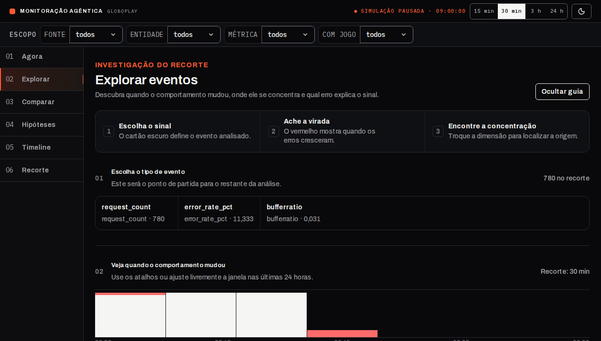
  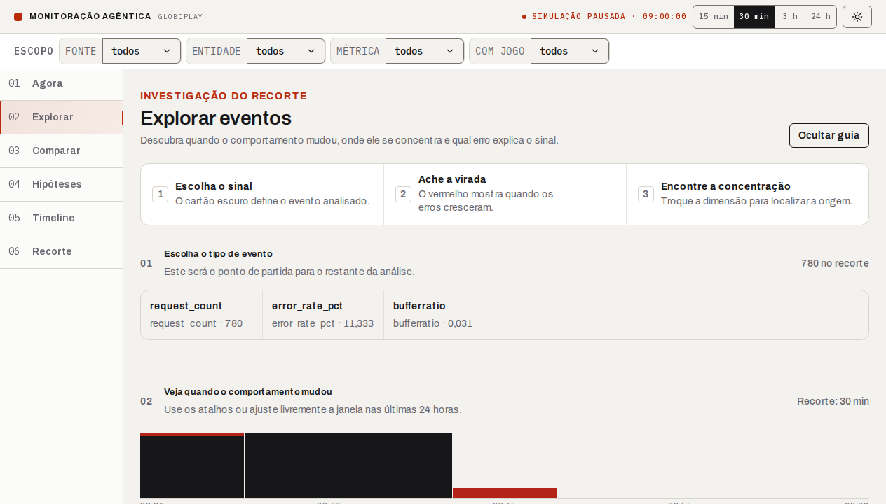
</p>

<p align="center"><sub>Figuras 3 e 4 — Tela Explorar nos temas escuro e claro, respectivamente.</sub></p>

#### 1.3.3 Comparar

&emsp; A tela Comparar posiciona o período atual diante de referências como o mesmo horário do dia anterior, a semana passada, a última janela estável e o pico ao vivo anterior. A seleção da referência atualiza os valores históricos e as mudanças retornadas pelo back-end, permitindo distinguir variação cotidiana de uma anomalia relevante.

<p align="center">
  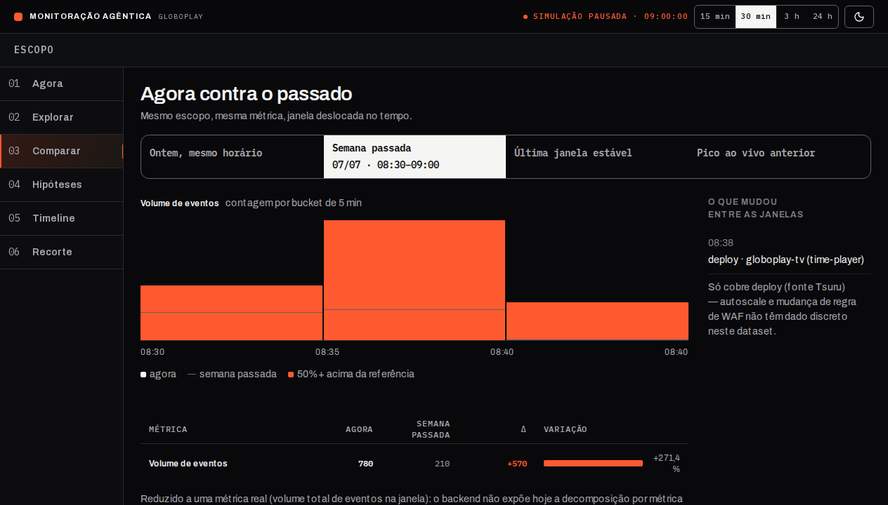
  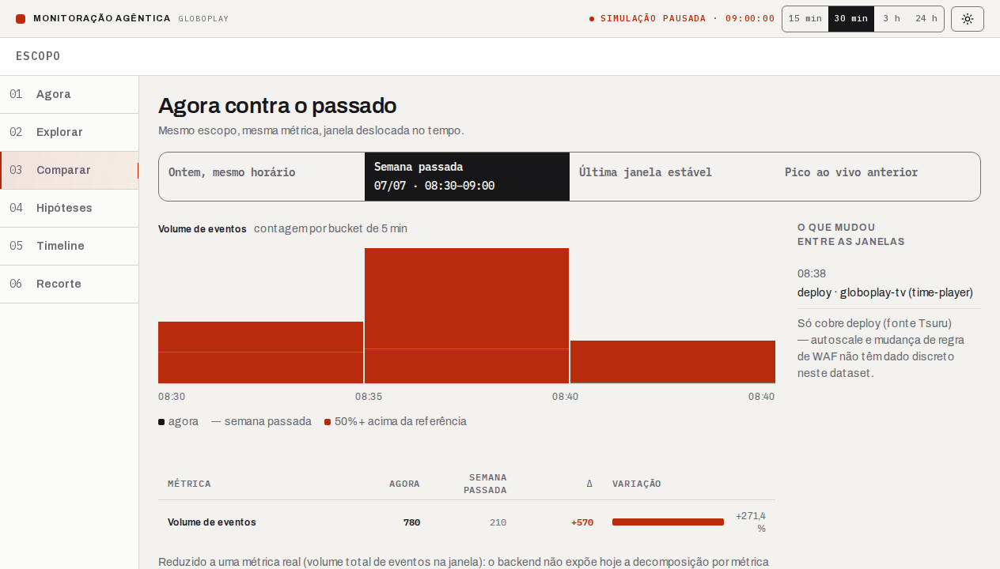
</p>

<p align="center"><sub>Figuras 5 e 6 — Tela Comparar nos temas escuro e claro, respectivamente.</sub></p>

#### 1.3.4 Hipóteses

&emsp; A tela Hipóteses organiza causas possíveis por relevância sem apresentá-las como conclusões. Ao selecionar uma hipótese, o painel lateral mostra o score, os fatores que contribuíram para a pontuação e as evidências publicadas. Alternativas com menor aderência continuam visíveis, preservando o raciocínio investigativo e evitando que o usuário confunda correlação com causalidade comprovada.

<p align="center">
  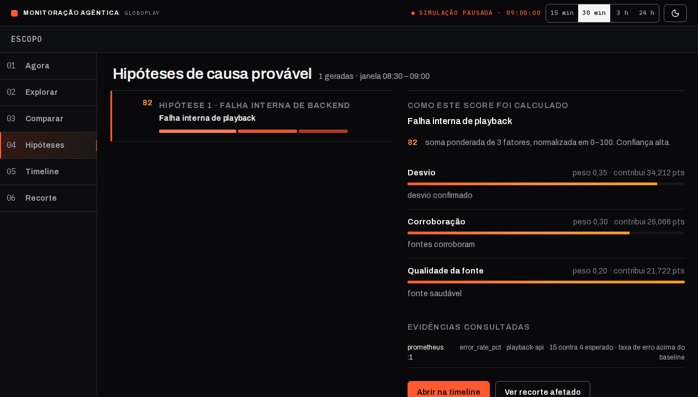
  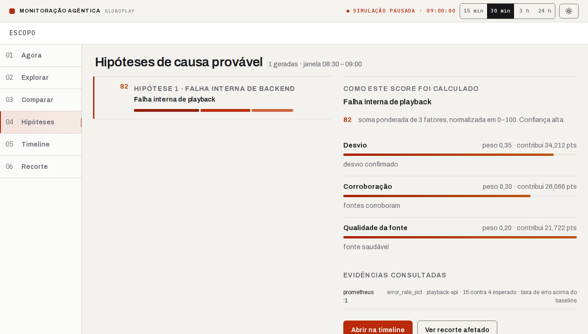
</p>

<p align="center"><sub>Figuras 7 e 8 — Tela Hipóteses em modo API nos temas escuro e claro.</sub></p>

#### 1.3.5 Timeline

&emsp; A tela Timeline cruza seis fontes operacionais no mesmo eixo temporal. A janela de correlação ajuda a reconhecer coincidências entre deploys, métricas, sinais de player e incidentes. A cronologia reconstruída apresenta os mesmos eventos em forma textual e ordenada, servindo tanto como apoio à leitura do gráfico quanto como alternativa acessível ao conteúdo espacial.

<p align="center">
  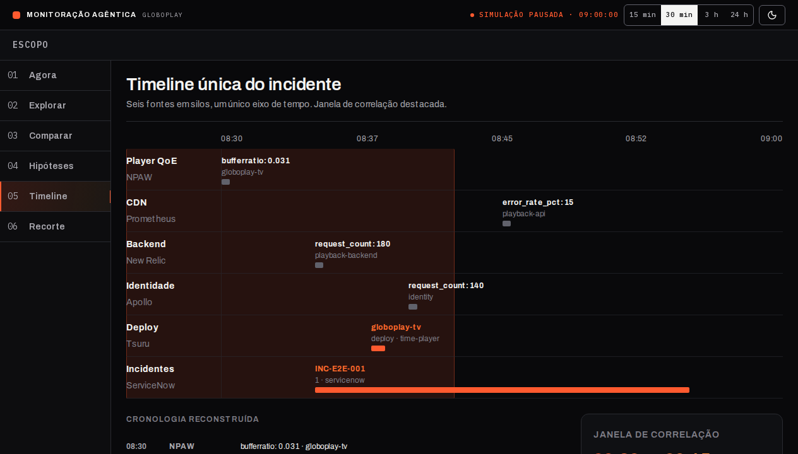
  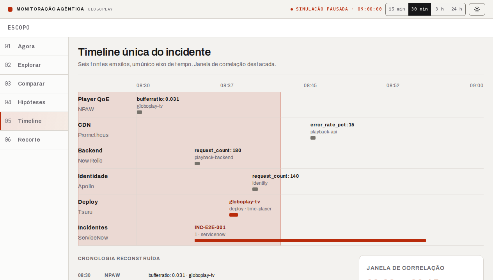
</p>

<p align="center"><sub>Figuras 9 e 10 — Tela Timeline nos temas escuro e claro, respectivamente.</sub></p>

#### 1.3.6 Recorte

&emsp; A tela Recorte delimita a população afetada por dispositivo e hora, apresenta uma amostra dos erros e permite abrir a cronologia pública de uma sessão. O diálogo da sessão reúne identificador, dispositivo, versão do aplicativo, horários, tipos de evento e código de erro. O painel “Ajustar o recorte” antecipa cenários de especificidade e cobertura, mas permanece propositalmente informativo nesta versão.

<p align="center">
  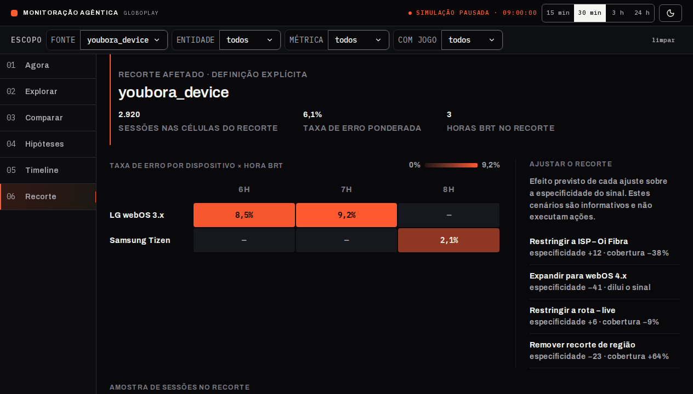
  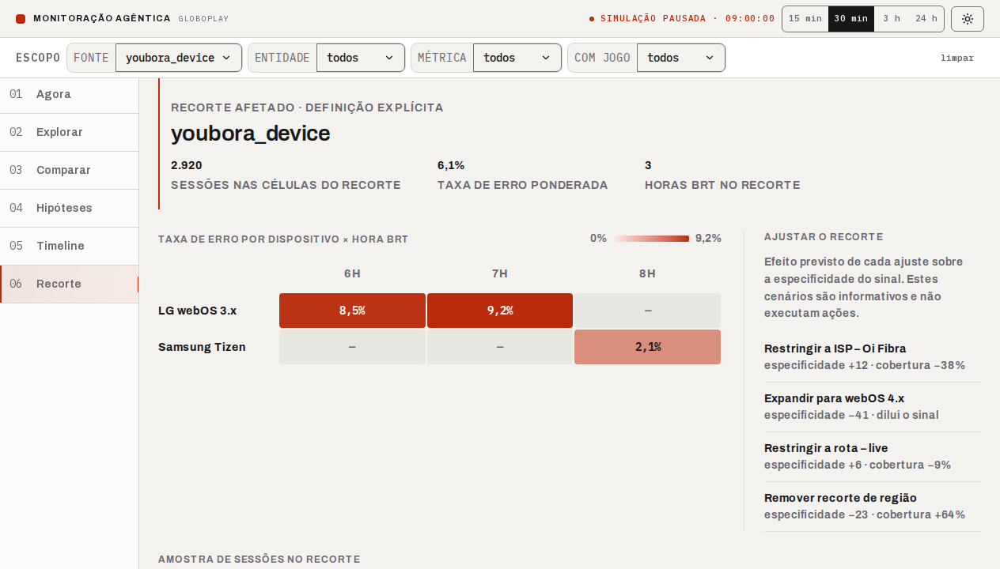
</p>

<p align="center"><sub>Figuras 11 e 12 — Tela Recorte nos temas escuro e claro, respectivamente.</sub></p>

### 1.4 Viewports responsivos

&emsp; Em 390×844 px, a navegação lateral é substituída por um menu de hambúrguer, os filtros são recolhidos no controle “Escopo · N filtros” e o conteúdo passa para uma coluna. O teste E2E também verificou que a largura total do documento não ultrapassa o viewport, evitando rolagem horizontal da página.

&emsp; Em 768×1024 px, a navegação lateral continua visível no ponto de corte, a barra de escopo é compactada e o conteúdo utiliza o espaço restante. Abaixo de 768 px entra a composição móvel mostrada na primeira captura.

<p align="center">
  
  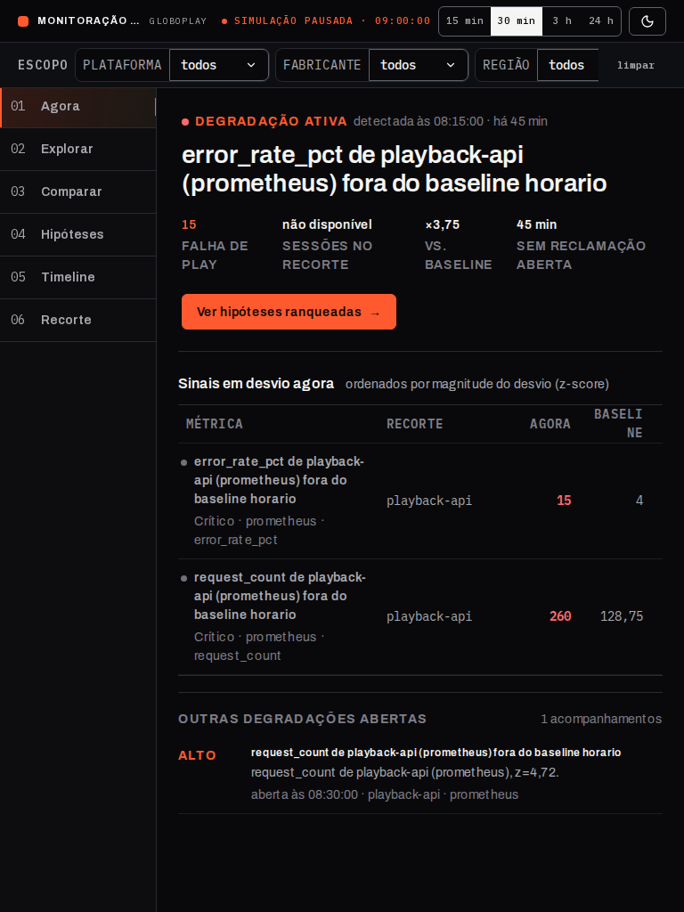
</p>

<p align="center"><sub>Figuras 13 e 14 — Tela Agora nos viewports móvel e tablet.</sub></p>

### 1.4 Demonstração em vídeo

&emsp; O vídeo abaixo registra a interface em execução e complementa as capturas estáticas da seção anterior.

<p align="center">
  <a href="https://drive.google.com/file/d/1HltsgZBqs5GeT-ADOx9BUANbAv2kHGSW/view?usp=sharing">Assistir à demonstração da interface (Google Drive)</a>
</p>

<p align="center"><sub>Vídeo 1 — Demonstração da interface do Argus.</sub></p>

## 2. Organização e qualidade do código

&emsp; O código-fonte está em [`apps/basica/frontend`](../apps/basica/frontend). A especificação de entrega usa o caminho genérico `/apps/frontend`; no monorepo Argus, o equivalente concreto é `/apps/basica/frontend`, ao lado do back-end, do worker, do banco e da infraestrutura do mesmo MVP. A documentação registra essa diferença para que o avaliador encontre o código sem sugerir uma migração artificial de diretório.

### 2.1 Estrutura de pastas

```text
apps/basica/frontend/
├── src/
│   ├── app/
│   │   ├── (operations)/
│   │   │   ├── _components/      moldura, escopo, tema e navegação
│   │   │   ├── _lib/             relógio e filtros compartilhados
│   │   │   ├── agora/            sinais e facetas
│   │   │   ├── explorar/         séries, facetas e agrupamentos
│   │   │   ├── comparar/         referências e mudanças
│   │   │   ├── hipoteses/        fonte HTTP ou mock explícito
│   │   │   ├── timeline/         adaptação das seis fontes
│   │   │   └── recorte/          crosstab, eventos e sessão
│   │   ├── globals.css           tokens globais, temas e tipografia
│   │   └── layout.tsx            metadados e estrutura-base
│   ├── components/ui/            primitivas reutilizáveis da interface
│   ├── lib/                      contratos e utilitários compartilhados
│   └── providers/                tema e TanStack Query
├── tests/
│   ├── contracts/                Vitest: fronteiras HTTP e adaptadores
│   ├── ui/                       Testing Library: interação de componente
│   └── e2e/                      Playwright e fixture SQL
├── playwright.config.ts
└── vitest.config.mts
```

&emsp; O código de cada rota permanece perto da própria rota, dividido entre `_components`, `_lib` e, quando necessário, `_mocks`. Somente contratos, utilitários e componentes usados por mais de uma fronteira sobem para `src/lib` ou `src/components/ui`. Essa organização reduz acoplamento, torna explícita a origem dos dados e evita misturar fixture de demonstração ao caminho HTTP real.

### 2.2 Convenções e decisões de implementação

- Componentes e tipos usam `PascalCase`; funções, variáveis e hooks usam `camelCase`.
- Cada `page.tsx` fica responsável por composição e metadados, enquanto interação e apresentação permanecem em componentes privados da rota.
- Os contratos de resposta da API são tipados e adaptados antes de chegar aos componentes visuais.
- Mocks ficam em `_mocks/` e são selecionados explicitamente; não há fallback silencioso de uma falha HTTP para dados sintéticos.
- O vocabulário visual é centralizado nos tokens de `globals.css`; arquivos `*.styles.ts` compõem esses tokens em vez de criar paletas paralelas.
- Comentários são usados para decisões não triviais, como exportação estática, escolha da origem de Hipóteses e proteção do banco E2E.
- O conjunto de primitivas shadcn/ui é fechado e reutilizado para manter semântica, foco e estados consistentes.
- O projeto usa TypeScript estrito, ESLint, testes de contrato, testes de componente e testes ponta a ponta.

### 2.3 Avaliação da qualidade

| Aspecto avaliado | Evidência no projeto | Resultado |
|---|---|---|
| Modularidade | Rotas, componentes, adaptadores, contratos e testes separados por responsabilidade | Adequado |
| Nomenclatura | Nomes do domínio, como `signals-source`, `comparar-source`, `hypotheses-source` e `operational-state` | Adequado |
| Organização | Código específico junto da rota; compartilhamento somente nas fronteiras comuns | Adequado |
| Tipagem | Tipos explícitos para respostas HTTP e modelos visuais | Adequado |
| Comentários | Decisões de build, fonte de dados e fixture documentadas sem comentar o óbvio | Adequado |
| Testabilidade | 11 testes Vitest/Testing Library e 8 cenários integrados Playwright executados | Adequado |
| Separação mock/API | Mock restrito e declarado; seis rotas exercitadas em modo API no E2E | Adequado, com a exceção informativa de `/recorte` já descrita |
| Exportação S3 | `output: "export"` e `trailingSlash: true`, gerando `/rota/index.html` | Adequado |

### 2.4 Configuração da integração

&emsp; `NEXT_PUBLIC_API_URL` é incorporada ao bundle no momento do build. A aplicação falha cedo se a variável não for informada, evitando publicar um bundle que tente ler JSON do próprio domínio estático. `NEXT_PUBLIC_HYPOTHESES_API_URL` pode apontar para outra origem; nos testes integrados foi configurada para a mesma API Flask.

```text
NEXT_PUBLIC_API_URL (definida no build)
        │
        ▼
adaptador HTTP tipado da rota
        │
        ├── URLSearchParams com período, filtros e agrupamentos
        ├── AbortSignal e classificação de falhas/timeout
        ▼
API Flask → PostgreSQL
        │
        ▼
TanStack Query → loading | vazio | erro | dados prontos
        │
        ▼
componente visual da rota
```

### 2.5 Fixture determinística e comandos de verificação

&emsp; O arquivo [`fixture.sql`](../apps/basica/frontend/tests/e2e/fixture.sql) limpa apenas as tabelas necessárias do banco de teste e insere:

- relógio simulado fixo;
- sinais atual e de baseline;
- séries para volume, taxa de erro e seis fontes operacionais;
- deploy, incidente e evento ao vivo;
- sessão de dispositivo legado com `session`, `video_view` e `error`;
- hipótese publicada com score, fator, evidência e qualidade de fonte.

&emsp; O dump de produção não participa da execução. O alvo E2E reaplica as migrations e a fixture a cada rodada, e nunca usa o banco `argus` para asserções.

```bash
make -C apps/basica db-local
make -C apps/basica test-frontend
make -C apps/basica test-frontend-e2e
```

&emsp; O primeiro comando sobe o PostgreSQL local. `test-frontend` executa Vitest. `test-frontend-e2e` migra e semeia `argus_test`, gera o build com Hipóteses em modo `api`, inicia Flask e servidor estático temporários e executa Playwright. O Chromium é instalado uma vez com `npx playwright install chromium` no diretório do front-end.

## 3. Relatório de testes e validação de entradas

### 3.1 Estratégia e limites da validação

&emsp; A validação foi executada em 28/08/2026 em três camadas complementares:

1. **Contratos HTTP com Vitest:** simulam somente a fronteira HTTP para conferir parâmetros, adaptação, timeout e rejeição de respostas inválidas. Esses testes não são usados como prova de PostgreSQL.
2. **Componentes com Testing Library e `user-event`:** exercitam controles públicos pelo nome acessível, incluindo alternância de tema e nova tentativa após erro.
3. **Fluxo integrado com Playwright:** opera o build estático no Chromium enquanto Flask consulta uma fixture real em PostgreSQL. Os cenários conferem requisições e conteúdo conhecido do banco, não apenas status HTTP 200.

&emsp; Os controles atuais são principalmente selects, radios, toggles e botões; não há formulário livre de criação ou edição de dados. Por isso, “validação de entrada” significa verificar valores fechados oferecidos pelo back-end, combinação cumulativa de filtros, acionamento por teclado, atualização coerente da tela e recuperação diante de falhas. Entradas ainda não oferecidas pela interface — como busca direta por `session_id` ou `device_id` — aparecem como lacuna, e não como teste aprovado.

### 3.2 Vitest e Testing Library

| ID | Verificação | Resultado |
|---|---|---|
| TA-01 | Janela e filtros cumulativos enviados ao agrupamento de Explorar | Aprovado |
| TA-02 | Conversão de sinal da API para o contrato visual de Agora | Aprovado |
| TA-03 | Timeout HTTP classificado como falha repetível | Aprovado |
| TA-04 | Comparação com ontem preserva duração e horário | Aprovado |
| TA-05 | Referência estável é consultada no backend | Aprovado |
| TA-06 | Hipótese publicada vira relatório explicável com score e evidência | Aprovado |
| TA-07 | Resposta inválida de Hipóteses é rejeitada | Aprovado |
| TA-08 | Recorte solicita sessões e taxa de erro no mesmo crosstab | Aprovado |
| TA-09 | Timeline mantém seis fontes ordenadas e atribuídas | Aprovado |
| TA-10 | Alternância de tema é anunciada e acionável pelo botão público | Aprovado |
| TA-11 | Loading, vazio e erro têm mensagens distintas e erro permite nova tentativa | Aprovado |

### 3.3 Playwright integrado

| ID | Fluxo exercitado no Chromium | Resultado |
|---|---|---|
| E2E-01 | Redirecionamento de `/` e navegação pelas seis rotas | Aprovado |
| E2E-02 | Sinal de Agora calculado pelo Flask a partir do PostgreSQL | Aprovado |
| E2E-03 | Métricas, facetas, agrupamento e filtros cumulativos em Explorar | Aprovado |
| E2E-04 | Troca de referência e mudanças retornadas pelo backend | Aprovado |
| E2E-05 | Hipóteses em modo API, score e evidência publicada | Aprovado |
| E2E-06 | Timeline correlacionando seis fontes | Aprovado |
| E2E-07 | Amostra de erro e cronologia da sessão `session-e2e` | Aprovado |
| E2E-08 | Tema por teclado, menu móvel, navegação e ausência de overflow horizontal | Aprovado |

### 3.4 Resultados específicos das entradas do usuário

| ID | Entrada ou ação | Resultado esperado | Resultado obtido | Situação | Evidência |
|---|---|---|---|---|---|
| VE-01 | Selecionar o agrupamento “Métrica” em Explorar | O controle fica selecionado e a tabela muda para métricas | O radio ficou marcado e a linha `error_rate_pct` foi exibida | Aprovado | E2E-03 |
| VE-02 | Selecionar fonte `prometheus` e métrica `request_count` | Os dois filtros permanecem ativos e seguem juntos na consulta | A requisição para `/series/breakdown` conteve `source=prometheus` e `metric=request_count`; ambos permaneceram visíveis | Aprovado | TA-01, E2E-03 |
| VE-03 | Trocar a referência para “Ontem, mesmo horário” | A opção fica marcada e os dados comparativos são atualizados | O radio ficou marcado e a referência “ontem” apareceu com dados do back-end | Aprovado | TA-04, E2E-04 |
| VE-04 | Selecionar a hipótese “Falha interna de playback” | O painel de composição atualiza score e evidências | O painel exibiu score `82` e a evidência de taxa de erro acima do baseline | Aprovado | TA-06, E2E-05 |
| VE-05 | Acionar o erro `PLAYER-500` na amostra de Recorte | Abre o detalhe da sessão correspondente | O diálogo abriu a sessão `session-e2e` e preservou o código `PLAYER-500` | Aprovado | E2E-07 |
| VE-06 | Focar o seletor de tema e pressionar Enter | O tema alterna e o nome acessível anuncia a próxima ação | O `aria-label` mudou entre “Usar modo claro/escuro” após a ativação por teclado | Aprovado | TA-10, E2E-08 |
| VE-07 | Abrir o menu móvel e navegar para Explorar | O menu permite navegação e a página cabe em 390 px | A rota mudou para `/explorar/`, o título foi exibido e não houve overflow horizontal | Aprovado | E2E-08 |
| VE-08 | Acionar “Tentar novamente” num estado de timeout | A falha é explicada e a consulta pode ser repetida | A mensagem, a referência `ARG-TEST-504` e o botão foram exibidos; o callback de nova tentativa foi chamado | Aprovado | TA-03, TA-11 |

&emsp; Os oito casos acima cobrem os controles efetivamente exercitados pela suíte desta entrega. Eles não autorizam afirmar que campos ausentes foram validados. Busca direta de sessão/dispositivo, filtro completo por SO/versão/app/código de erro e encaminhamento de chamado continuam fora do fluxo atual.

### 3.5 Síntese da execução

| Validação | Resultado em 28/08/2026 |
|---|---|
| Vitest/Testing Library | 7 arquivos; 11 testes aprovados |
| Playwright integrado | 8 testes aprovados no Chromium |
| Entradas do usuário explicitamente rastreadas | 8 casos aprovados |
| Capturas documentais | 1 cenário aprovado; 14 imagens regeneradas |
| Backend Flask | 143 testes aprovados contra PostgreSQL ativo |
| Build estático | 8 rotas geradas (`/`, `_not-found` e as seis áreas) |

&emsp; Durante a implementação, o E2E-07 revelou que `error_code` chegava no JSON, mas era substituído pelo texto genérico `error` na interface. O resumo passou a priorizar o código recebido; a sessão integrada agora exibe e testa `PLAYER-500`. O caso demonstra o valor da asserção ponta a ponta sobre conteúdo conhecido, pois um teste restrito ao status 200 não identificaria a perda de informação.

## 4. Acessibilidade, responsividade e estados da interface

### 4.1 Tratamento dos estados

| Estado | Comportamento documentado e testado |
|---|---|
| Carregamento | Região com papel `status` e nome “Carregando {conteúdo}”; dados antigos não são apresentados como prontos |
| Sucesso sem dados | Mensagem “Nenhum resultado para {conteúdo}” em vez de tabela vazia sem contexto |
| Erro repetível | Título de falha, causa, referência e ação “Tentar novamente” |
| Timeout | Classificado como falha repetível, sem ser confundido com resposta vazia |
| Dados prontos | Conteúdo da rota renderizado depois da adaptação do contrato HTTP |

### 4.2 Acessibilidade

- o documento declara `lang="pt-BR"`;
- a estrutura usa landmarks como navegação, cabeçalho, conteúdo principal, seções, áreas complementares e diálogos;
- existe link de salto para o conteúdo principal e foco visível nos controles;
- a rota ativa usa `aria-current="page"`;
- selects, radios, toggles, botões e diálogos são localizados nos testes por papel e nome acessível;
- a alternância de tema é operável por teclado e anuncia a ação seguinte;
- a Timeline oferece cronologia textual equivalente à representação espacial;
- o relógio que muda a cada segundo usa `aria-live="off"` para não interromper continuamente leitores de tela;
- `prefers-reduced-motion` é respeitado, e os testes desabilitam animações nas capturas;
- o menu móvel é exposto como navegação nomeada e pode ser percorrido por teclado.

&emsp; A suíte confirma semântica e interação de teclado nos fluxos descritos, mas não substitui uma avaliação humana com NVDA ou VoiceOver. Essa verificação com leitor de tela real permanece como melhoria recomendada.

### 4.3 Responsividade

| Área | Tela larga | Tela estreita |
|---|---|---|
| Navegação principal | Barra lateral persistente | Painel deslizante acionado por menu abaixo de 768 px |
| Barra de escopo | Filtros expostos em linha | Resumo “Escopo · N filtros” com abertura em painel |
| Conteúdo de Agora | Tabela de sinais e indicadores lado a lado | Conteúdo em uma coluna e sinais em cartões |
| Painéis de Comparar, Hipóteses, Timeline e Recorte | Conteúdo principal e painel complementar lado a lado | Empilhamento vertical nos breakpoints de cada tela |
| Timeline espacial | Raias e marcadores no eixo temporal | Cronologia textual preserva a informação em larguras menores |
| Recorte | Cruzamento denso e amostra de sessões | Blocos compactos e diálogo ajustado ao viewport |

&emsp; As capturas em 390×844 e 768×1024 documentam as duas composições, e o E2E-08 mede programaticamente a ausência de overflow horizontal em 390 px.

## 5. Matriz de rastreabilidade dos requisitos funcionais

&emsp; A matriz relaciona os requisitos pertinentes definidos em [`requisitos.md`](./requisitos.md) aos testes executados. **Atendido** significa que o comportamento foi observado no fluxo integrado; **Parcial** indica cobertura funcional incompleta; **Não atendido** registra ausência do comportamento. A classificação não transforma mock, inspeção estática ou simples status HTTP em prova ponta a ponta.

| Req. | Descrição resumida | Classificação | Evidência executada | Justificativa |
|---|---|---|---|---|
| RF08 | Pesquisar eventos por tipo, período e atributos | Parcial | TA-01, E2E-03, E2E-07, VE-01, VE-02 | Há tipo/métrica, período, fonte, entidade e acesso a uma sessão. Faltam busca direta por `session_id`/`device_id` e filtros completos de SO/versão, app e código de erro. |
| RF09 | Aplicar filtros cumulativos | Atendido | TA-01, E2E-03, VE-02 | Fonte e métrica foram combinadas e preservadas na mesma requisição real. |
| RF10 | Sugerir valores existentes nos dados | Atendido | E2E-03, VE-02 | Os selects usam valores retornados por `/series/facets`. |
| RF11 | Agrupar eventos por critérios pertinentes | Atendido | TA-01, TA-08, E2E-03, VE-01 | Agrupamentos por entidade, métrica, fonte, hora e dia estão conectados às séries agregadas. |
| RF12 | Exibir gráficos e indicadores | Atendido | TA-02, TA-08, E2E-02, E2E-03, E2E-04 | Indicadores, séries, comparação e cruzamentos foram renderizados a partir da API. |
| RF13 | Consultar falhas críticas de maior impacto | Parcial | TA-02, E2E-02 | Aumentos anômalos de erro e volume são consultáveis; não há consultas dedicadas para todas as falhas de autenticação, autorização e timeout citadas no requisito. |
| RF14 | Comparar período atual e referências anteriores | Atendido | TA-04, TA-05, E2E-04, VE-03 | Período atual e referências históricas são comparados com dados do back-end. |
| RF15 | Destacar aumentos e mudanças relevantes | Atendido | TA-02, E2E-02, E2E-04 | Sinais e mudanças aparecem com severidade, delta, baseline e destaque visual. |
| RF16 | Exibir contexto para investigação | Atendido | TA-09, E2E-06, E2E-07, VE-05 | Tipo, período, ocorrências, dispositivos, fontes e cronologia de sessão apoiam a investigação. |
| RF17 | Apresentar hipóteses de causa raiz | Atendido | TA-06, TA-07, E2E-05, VE-04 | Hipóteses publicadas são ordenadas, pontuadas e sustentadas por fatores e evidências, sem linguagem conclusiva. |

### 5.1 Síntese dos requisitos funcionais

| Situação | Total |
|---|---:|
| Atendido | 8 |
| Parcial | 2 |
| Não atendido | 0 |

## 6. Matriz complementar das User Stories

&emsp; A rubrica solicita requisitos funcionais, atendidos na seção anterior. A matriz abaixo mantém também a rastreabilidade com as User Stories de [`entendimento_ux.md`](./entendimento_ux.md), para deixar claras as capacidades do usuário e as lacunas do MVP.

| História | Classificação | Evidência executada | Lacuna ou atendimento observado |
|---|---|---|---|
| US01 | Atendido | TA-09, E2E-06 | Timeline única com seis fontes, origem e horário. |
| US02 | Parcial | E2E-03, E2E-07 | Dispositivo legado e moderno aparecem, mas os quatro filtros de plataforma/fabricante/modelo/versão não estão completos nem persistem globalmente. |
| US03 | Parcial | E2E-03 | Há volume por dispositivo e componente; não existe volume esperado nem limite textual de cobertura. |
| US04 | Não atendido | — | A interface não apresenta atraso de ingestão, recebidos, descartados e deduplicados por fonte/período. |
| US05 | Atendido | TA-04, TA-05, E2E-04, VE-03 | Referência selecionável, valores atuais/históricos, mudança e eventos entre janelas. |
| US06 | Parcial | E2E-07, VE-05 | A cronologia individual existe e é ordenada, porém falta localizar diretamente uma sessão e a fixture não cobre `screen_view`. |
| US07 | Parcial | TA-01, TA-08, E2E-03 | Há filtro cumulativo e recorte por dispositivo com volume/taxa; falta combinar modelo e região e manter esse recorte em todo o fluxo. |
| US08 | Atendido | E2E-07, VE-05 | Sessão de dispositivo legado mostra modelo, versão do app, horário, tipos e código de erro. |
| US09 | Não atendido | — | Não há registro, anexo ou encaminhamento de chamado com filtros e evidências. |

### 6.1 Síntese das User Stories

| Situação | Total |
|---|---:|
| Atendido | 3 |
| Parcial | 4 |
| Não atendido | 2 |

## 7. Evidência de integração com o back-end

| Área | Endpoints principais exercitados |
|---|---|
| Compartilhado | `GET /api/v1/clock` |
| Agora | `GET /api/v1/facets`, `GET /api/v1/signals` |
| Explorar | `GET /api/v1/series/facets`, `GET /api/v1/series/breakdown`, `GET /api/v1/series/timeseries` |
| Comparar | `GET /api/v1/changes`, `GET /api/v1/series/timeseries`, `GET /api/v1/references/stable-window` |
| Hipóteses | `GET /api/v1/hypotheses` |
| Timeline | `GET /api/v1/timeline` |
| Recorte | `GET /api/v1/series/crosstab`, `GET /api/v1/events`, `GET /api/v1/sessions/{session_id}` |

&emsp; Uma resposta HTTP 200 não é tratada isoladamente como prova. Os cenários E2E também verificam conteúdo específico semeado no banco — `playback-api`, `LG webOS 3.x`, `INC-E2E-001`, score `82`, `session-e2e` e `PLAYER-500` — depois de atravessar os adaptadores da interface. O banco de teste, o Flask e o servidor estático são processos separados, reproduzindo as fronteiras relevantes do sistema implantado.

## 8. Publicação na AWS S3 e vídeo

### 8.1 Site publicado

&emsp; **Dashboard publicado:** [http://argus-events-dev-site-492943717278.s3-website-us-east-1.amazonaws.com/](http://argus-events-dev-site-492943717278.s3-website-us-east-1.amazonaws.com/)

&emsp; O Next.js usa `output: "export"` e `trailingSlash: true`, produzindo arquivos como `/agora/index.html`, que o website hosting do S3 resolve diretamente. O alvo `frontend-deploy` executa o build com a URL da API e sincroniza `out/` para o bucket.

&emsp; Em 28/08/2026 foi feita uma verificação HTTP do endereço publicado:

| Verificação do deploy | Resultado observado |
|---|---|
| Entrada `/` | HTTP 200, `Content-Type: text/html`, servidor `AmazonS3`; redirecionamento estático para `/agora` presente no HTML |
| `/agora/`, `/explorar/`, `/comparar/`, `/hipoteses/`, `/timeline/`, `/recorte/` | HTTP 200 e documento HTML nas seis rotas |
| URL incorporada ao bundle | `https://58esy7yry6.execute-api.us-east-1.amazonaws.com` |
| API publicada | `GET /api/v1/clock` respondeu HTTP 200 e `Access-Control-Allow-Origin: *` |

&emsp; Essa checagem confirma a hospedagem pública, as rotas estáticas e a configuração do endereço da API no bundle. A comprovação funcional ponta a ponta das seis telas vem da suíte Playwright local descrita na seção 3; nesta revisão não foi executada uma nova sessão de navegador contra o website S3. O endpoint de website do S3 usa HTTP sem TLS; para um ambiente de produção, a evolução recomendada é colocar CloudFront com HTTPS à frente do bucket.

### 8.2 Vídeo de demonstração

&emsp; **Pendente:** ainda não há no repositório um link para o vídeo de 2 a 3 minutos desta versão integrada. O link deve ser preenchido abaixo depois da gravação; o vídeo precisa demonstrar o site S3, as interações do usuário e pelo menos uma evidência de que os dados vêm do back-end.

&emsp; **Link do vídeo desta entrega:** *(pendente)*

&emsp; Roteiro recomendado para cumprir o critério:

1. **0:00–0:20:** abrir o endereço S3 e apresentar o objetivo do Argus;
2. **0:20–1:20:** navegar por Agora, Explorar e Comparar, aplicando fonte + métrica e trocando a referência histórica;
3. **1:20–2:10:** abrir Hipóteses, Timeline e a sessão `PLAYER-500` em Recorte, destacando score, evidências e fontes;
4. **2:10–2:35:** demonstrar tema, teclado e viewport móvel;
5. **2:35–3:00:** mostrar a suíte automatizada aprovada e explicar o fluxo navegador → Flask → PostgreSQL.

&emsp; Existe um [vídeo histórico do protótipo inicial](https://youtu.be/Vhd8BgToZF4), registrado em `mvp-inicial.md`, mas ele não substitui a gravação exigida para esta versão integrada.

## 9. Referências internas

- [Requisitos](./requisitos.md)
- [Entendimento de UX e User Stories](./entendimento_ux.md)
- [Documentação do back-end](./backend.md)
- [MVP inicial](./mvp-inicial.md)
- [Contrato de rotas do front-end](../apps/basica/frontend/rotas-frontend.md)
- [Instruções do front-end](../apps/basica/frontend/README.md)
