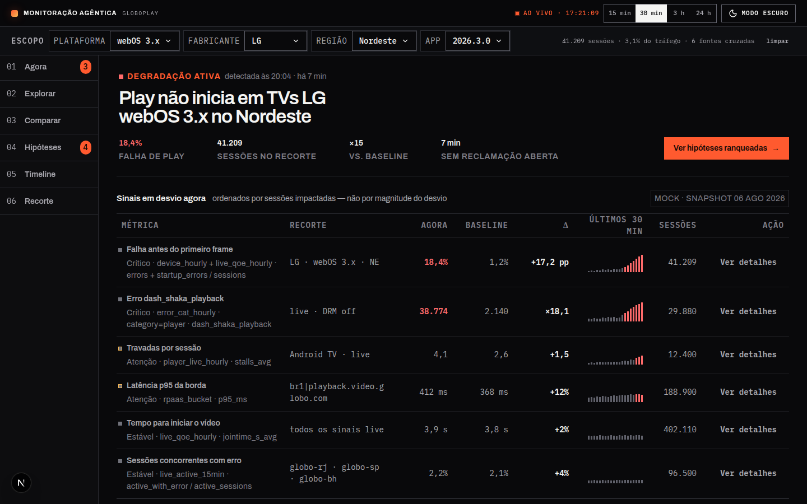
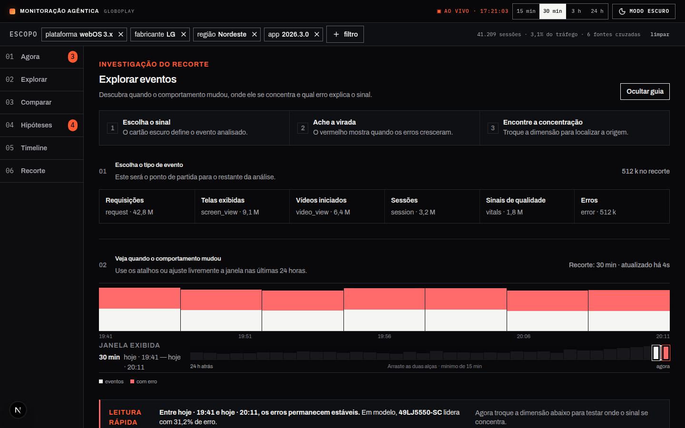
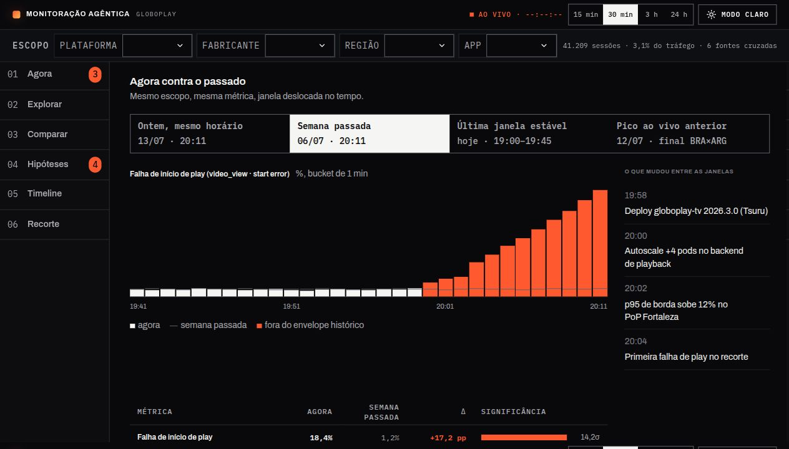
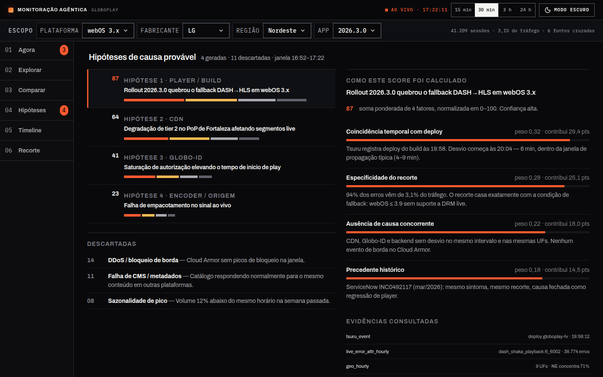
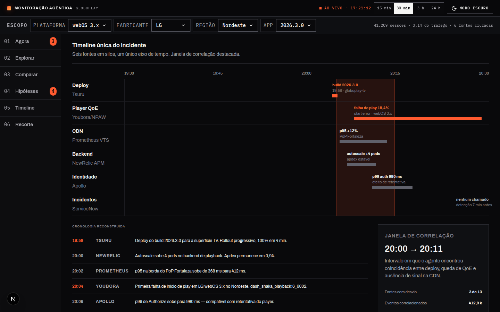
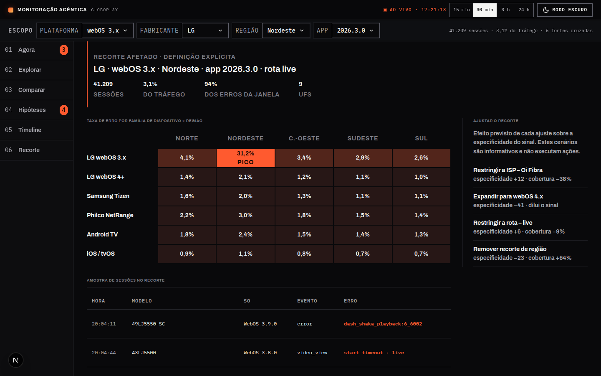
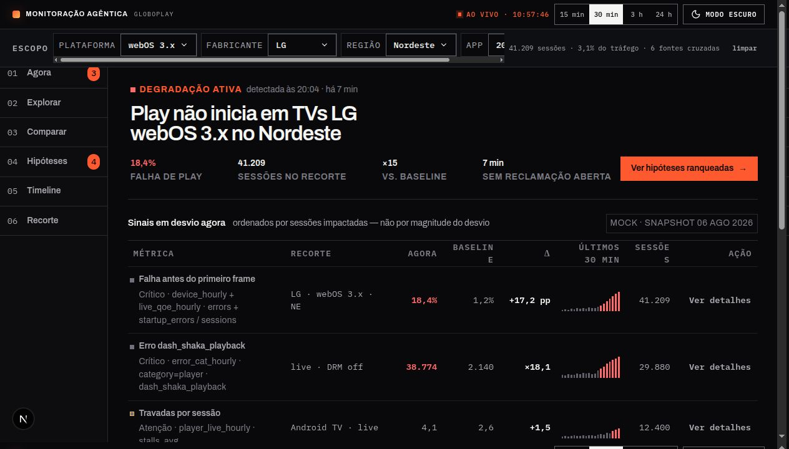
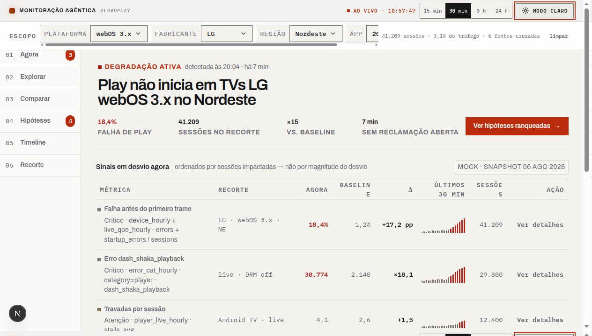
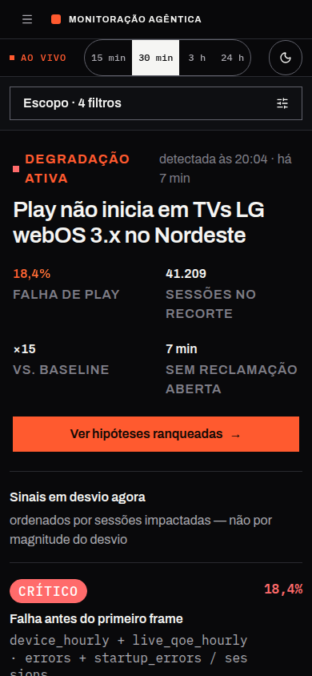

# Front-end

&emsp; Este artefato documenta a implementação da interface gráfica do sistema Argus, plataforma de monitoração agêntica de telemetria do Globoplay, incluindo a validação das entradas do usuário, a rastreabilidade dos requisitos funcionais, a organização do código, a integração com o back-end e a publicação do site estático na AWS S3.

## 1. Visão geral da interface

&emsp; O Argus oferece um dashboard de monitoração de eventos de telemetria do Globoplay, permitindo que engenheiros de observabilidade e analistas de suporte investiguem falhas, acompanhem degradações e explorem a distribuição de eventos em tempo real. A interface foi projetada para operar sobre dados reais da API de leitura e, nas telas em fase de prototipação, sobre snapshots sintéticos que demonstram a experiência pretendida.

&emsp; Na versão entregue, o usuário pode consultar eventos por tipo, período e atributos do dispositivo; aplicar filtros cumulativos; visualizar indicadores e gráficos de distribuição; inspecionar detalhes completos de um evento; e acompanhar degradações operacionais com sinais de desvio e tendência.

### 1.1 Funcionalidades implementadas

- Consulta de eventos por período (15 min, 30 min, 3 h, 24 h, tudo) e tipo de evento;
- Aplicação de filtros cumulativos por plataforma, fabricante, tipo de evento e status;
- Busca textual por nome de evento;
- Visualização de indicadores (contagem, fabricante, plataforma, duração) no bloco de destaque do monitor;
- Inspeção de detalhes completos do evento selecionado, incluindo atributos JSON;
- Estados de carregamento (`Consultando eventos na API…`), ausência de dados (`Nenhum evento corresponde aos filtros selecionados.`) e erro da API (`Não foi possível consultar a API. Tente novamente.`);
- Tela Agora com visão operacional, degradações ativas, sinais de desvio e filtros de escopo (plataforma, fabricante, região, app);
- Tela Explorar com exploração por tipo de evento, dimensão (Modelo, UF, ISP, Versão, Rota), intervalo temporal ajustável e busca na tabela de resultados;
- Navegação entre seis áreas operacionais (Agora, Explorar, Comparar, Hipóteses, Timeline, Recorte).

### 1.2 Tecnologias utilizadas

| Tecnologia | Finalidade | Versão |
|---|---|---|
| Next.js | Framework da aplicação e exportação do site estático (`output: "export"`) | 16.3.0 |
| React | Construção dos componentes da interface | 19.2.8 |
| TypeScript | Tipagem e manutenção do código | ^5 |
| Tailwind CSS | Estilização base e utilitários de layout | ^4 |
| Tailwind CSS e arquivos de estilos por tela | Utilitários de estilo e regras específicas de cada tela | ^4 |
| TanStack Query | Consulta, cache, refetch automático e estados das requisições ao back-end | ^5.101.4 |
| ESLint | Análise estática de qualidade e padronização | ^9 |

### 1.3 Capturas de tela

&emsp; As capturas abaixo foram produzidas diretamente a partir da implementação executável das seis áreas operacionais. Os dados apresentados vêm dos cenários sintéticos de `_mocks/scenario.ts` e são identificados na interface pela etiqueta "MOCK · SNAPSHOT".

- Ambiente: `next dev` local (Turbopack), porta 4182;
- Data da captura: 27/08/2026;
- Fonte de hipóteses: `NEXT_PUBLIC_HYPOTHESES_SOURCE=mock`.

#### 1.3.1 Agora

&emsp; A tela Agora apresenta o estado operacional mais urgente do recorte selecionado. O destaque superior resume a degradação ativa, seu alcance e a diferença em relação ao baseline; abaixo, os sinais são ordenados por sessões impactadas e mostram valor atual, referência, desvio, tendência e ação de investigação.



<p align="center"><sub>Figura 1 — Visão operacional da tela Agora.</sub></p>

#### 1.3.2 Explorar

&emsp; A tela Explorar conduz a investigação em três etapas: escolher o tipo de evento, localizar quando o comportamento mudou e identificar onde o sinal se concentra. O usuário pode ajustar a janela temporal, alternar dimensões como modelo, UF, ISP, versão e rota, além de consultar erros associados ao recorte.



<p align="center"><sub>Figura 2 — Exploração temporal e dimensional dos eventos.</sub></p>

#### 1.3.3 Comparar

&emsp; A tela Comparar posiciona o período atual diante de referências como o mesmo horário do dia anterior, a semana passada ou a última janela estável. O gráfico evidencia pontos fora do envelope histórico, enquanto a tabela quantifica a variação e a significância de cada métrica.



<p align="center"><sub>Figura 3 — Comparação do comportamento atual com referências históricas.</sub></p>

#### 1.3.4 Hipóteses

&emsp; A tela Hipóteses organiza possíveis causas por relevância e mantém as alternativas descartadas visíveis. Ao selecionar uma hipótese, o painel lateral explica a composição do score por coincidência temporal, especificidade do recorte, ausência de causa concorrente e precedente histórico, além de listar as evidências consultadas.



<p align="center"><sub>Figura 4 — Hipóteses ranqueadas e justificadas por evidências.</sub></p>

#### 1.3.5 Timeline

&emsp; A tela Timeline cruza as fontes Deploy, Player QoE, CDN, Backend, Identidade e Incidentes em um mesmo eixo temporal. A janela destacada ajuda a reconhecer coincidências entre mudanças técnicas e degradações, enquanto a cronologia reconstruída oferece uma alternativa textual ao gráfico.



<p align="center"><sub>Figura 5 — Correlação cronológica das fontes do incidente.</sub></p>

#### 1.3.6 Recorte

&emsp; A tela Recorte delimita a população afetada e informa sessões, participação no tráfego, concentração dos erros e número de UFs envolvidas. O mapa de calor cruza família de dispositivo e região, e o painel lateral antecipa o efeito de possíveis ajustes sobre a especificidade e a cobertura.



<p align="center"><sub>Figura 6 — Delimitação da população afetada.</sub></p>

#### 1.3.7 Temas escuro e claro

&emsp; A comparação abaixo apresenta a tela Agora nos temas escuro e claro, mantendo o mesmo conteúdo e o mesmo viewport. A alternância modifica superfícies, bordas e contraste tipográfico, mas preserva a hierarquia dos alertas, os destaques em vermelho e a organização dos dados.

<p align="center">
  
  
</p>

<p align="center"><sub>Figuras 7 e 8 — Tela Agora nos temas escuro e claro, respectivamente.</sub></p>

#### 1.3.8 Viewport mobile

&emsp; A captura mobile demonstra a adaptação da tela Agora para um viewport de 390×844. Nesse formato, a navegação lateral dá lugar a um cabeçalho compacto e o conteúdo passa a ocupar uma única coluna, preservando a leitura do alerta principal e dos indicadores sem exigir rolagem horizontal.



<p align="center"><sub>Figura 9 — Adaptação da tela Agora ao viewport mobile.</sub></p>

## 2. Organização e qualidade do código

&emsp; O código-fonte do front-end está localizado em [`apps/basica/frontend`](../apps/basica/frontend). A especificação original cita `/apps/frontend`; optou-se por manter a estrutura atual do monorepo, onde o frontend coexiste com a API de leitura, o worker e a infraestrutura do MVP.

### 2.1 Estrutura de pastas

```text
apps/basica/frontend/src/
├── app/
│   ├── (operations)/
│   │   ├── (dashboard)/         Rota raiz do monitor conectado à API de eventos
│   │   ├── _components/         Navegação, moldura, tema e estado operacional compartilhados
│   │   ├── agora/               Visão operacional com cenário sintético privado da rota
│   │   ├── explorar/            Exploração temporal, agrupamentos e cenário sintético
│   │   ├── comparar/            Comparação com referências históricas simuladas
│   │   ├── hipoteses/           Hipóteses, adaptadores de fonte e cenário simulado
│   │   ├── timeline/            Correlação cronológica simulada
│   │   ├── recorte/             Delimitação da população afetada simulada
│   │   ├── layout.tsx           Layout compartilhado das páginas operacionais
│   │   ├── loading.tsx          Estado de carregamento exibido na troca de rota
│   │   └── error.tsx            Fronteira de erro das rotas operacionais
│   ├── globals.css              Tokens e estilos globais
│   └── layout.tsx               Layout-base, fontes e metadados da aplicação
├── components/ui/               Componentes de interface reutilizáveis
├── lib/
│   ├── events/api.ts            Cliente HTTP tipado da API de eventos
│   ├── events/monitor.ts        Regras de monitoração e filtros
│   ├── operational-state.ts     Estados de carregamento, ausência e falha
│   └── utils.ts                 Composição de classes Tailwind (`cn`)
└── providers/
    ├── query-provider.tsx       Configuração compartilhada do TanStack Query
    └── theme-provider.tsx       Configuração de tema da aplicação
```

&emsp; A separação em `(operations)`, com componentes, bibliotecas e cenários privados de cada rota, preserva perto de cada tela aquilo que só ela utiliza. Componentes de interface, integrações HTTP e provedores compartilhados permanecem em diretórios próprios, em alinhamento com as convenções do Next.js App Router.

### 2.2 Convenções adotadas

- Componentes React: `PascalCase`, por exemplo `DashboardScreen`, `AgoraScreen`, `ScreenFrame` e `OperationsNavigation`.
- Funções, variáveis e hooks: `camelCase`, por exemplo `fetchEvents`, `hrefWithDemoState`, `removeFilter` e `restoreFilter`.
- Tipos e interfaces: `PascalCase`, por exemplo `ApiEvent`, `EventsResponse`, `ScreenPeriod`, `ScreenFilter` e `OperationalPresentation`.
- Estratégia de comentários: JSDoc em componentes e funções públicas; comentários inline para decisões não triviais, como a origem escolhida para hipóteses, a sincronização do tema após a hidratação e as regras de intervalo temporal.
- Ferramentas de qualidade: ESLint (0 erros), TypeScript em modo estrito (`--noEmit`), geração de tipos do App Router (`next typegen`), build de produção com Webpack.

### 2.3 Avaliação da qualidade do código

| Aspecto | Evidência observada | Avaliação |
|---|---|---|
| Modularidade | Páginas, componentes, cliente HTTP, regras de monitoramento, mocks e providers em diretórios separados | Ponto positivo |
| Nomenclatura | Tipos e funções descrevem o domínio: `ScreenPeriod`, `ScreenFilter`, `OperationalPresentation`, `hrefWithDemoState` | Ponto positivo |
| Tipagem | Eventos, filtros, períodos e respostas da API com tipos explícitos em TypeScript | Ponto positivo |
| Comentários | JSDoc em funções e componentes; decisões não triviais explicadas | Ponto positivo |
| Qualidade estática | ESLint, geração de tipos, TypeScript e build de produção aprovados | Ponto positivo |
| Componentização | `ScreenFrame` como moldura compartilhada; `OperationsNavigation` reutilizável; `_components/` privados por rota | Ponto positivo |
| Testabilidade | Não existe suíte automatizada nem script `test` no `package.json` | Limitação |
| Tamanho das telas | A marcação e o estado das telas permanecem concentrados em componentes como `AgoraScreen` e `ExplorarScreen` | Limitação |
| Integração com API | A rota raiz possui cliente real; as demais telas operacionais usam cenários sintéticos, exceto Hipóteses, que possui adaptadores para fonte mockada ou HTTP | Cobertura parcial |

## 3. Acessibilidade e responsividade

&emsp; A interface do Argus é composta pelo monitor de eventos da rota raiz e por seis áreas operacionais (Agora, Explorar, Comparar, Hipóteses, Timeline e Recorte), que compartilham um sistema visual unificado: tema escuro por padrão com alternância para tema claro, tipografia Archivo e IBM Plex Mono, e uma paleta vermelho e laranja para sinalizar estados críticos. As subseções a seguir avaliam a acessibilidade e a responsividade dessas seis áreas em conjunto com o monitor da rota raiz.

### 3.1 Acessibilidade

&emsp; Esses são os seguintes fundamentos de acessibilidade implementados:

- Idioma: documento com `lang="pt-BR"` no `<html>`;
- Landmarks semânticos: uso de `<nav>`, `<main>`, `<aside>`, `<header>`, `<section>` com `aria-label`;
- Link de salto: presença de mecanismo para pular para o conteúdo principal;
- Navegação: `aria-current="page"` na rota ativa, `aria-pressed` nos seletores de período;
- Filtros: nomes acessíveis com `aria-label="Filtrar por {dimensão}"` nos selects;
- Controles temporais: `aria-valuetext` nas alças de ajuste de intervalo (tela Explorar);
- Regiões ao vivo: `aria-live="polite"` para atualizações dinâmicas;
- Contadores de notificação: `aria-label` descritivo (ex.: `"3 pendências"`) nos indicadores numéricos da navegação;
- Foco visível: regras `:focus-visible` nos controles principais;
- Movimento reduzido: `prefers-reduced-motion: reduce` desabilita transições.

| Verificação | Método | Resultado | Evidência |
|---|---|---|---|
| Idioma e landmarks | Inspeção estática do código | `lang="pt-BR"`, `nav`, `main`, `aside` presentes | [layout.tsx](../apps/basica/frontend/src/app/layout.tsx) |
| Nomes e estados ARIA | Inspeção estática do código | `aria-label`, `aria-current`, `aria-pressed`, `aria-expanded` e `aria-valuetext` presentes | Componentes de navegação, moldura e telas operacionais |
| Foco visível | Inspeção dos estilos por tela | Regras `focus-visible` definidas nos controles operacionais | Estilos de navegação, moldura, Agora e Explorar |
| Movimento reduzido | Inspeção dos estilos por tela | A variante `motion-reduce` reduz transições nos controles aplicáveis | Estilos das telas operacionais |
| Navegação por teclado | Não exercitado em navegador | Controles HTML nativos (select, button, input[search]) são acessíveis por padrão | Pendente de validação em navegador |
| Contraste | Não medido | Estados críticos usam cor + texto (não dependem exclusivamente da cor) | Pendente de medição com ferramenta |

#### 3.1.1 Considerações de acessibilidade nas seis áreas operacionais

&emsp; As seis áreas operacionais introduzem elementos de interface que ainda não têm o mesmo nível de cobertura ARIA documentado para o monitor da rota raiz. O quadro abaixo resume os pontos de atenção e o tratamento recomendado:

| Elemento da interface | Risco de acessibilidade identificado | Tratamento recomendado |
|---|---|---|
| Chips de escopo removíveis (etiquetas de filtro com botão "×"; plataforma, fabricante, região, app) | A remoção precisa anunciar qual filtro será removido | Implementado em Explorar com `aria-label="Remover filtro {dimensão}: {valor}"`; validar a leitura em navegador |
| Relógio "AO VIVO" atualizado a cada segundo | Atualização contínua pode gerar leitura excessiva em leitores de tela | Usar `aria-live="off"` no relógio e expor o horário da última atualização em elemento separado com `aria-live="polite"` |
| Abas de tipo de evento (Explorar: request, screen_view, video_view, session, vitals, error) | Marcação apenas visual, sem padrão de abas | Implementar `role="tablist"`/`role="tab"`/`role="tabpanel"` com navegação por setas |
| Pastilhas de seleção (agrupar por dimensão, janela de comparação, hipótese selecionada) | `<div>` clicável sem foco por teclado nem estado de seleção anunciado | Usar `<button>` com `aria-pressed`/`aria-selected` e ordem de tabulação lógica |
| Minigráficos de tendência na tabela "Sinais em desvio agora" | Gráfico de barras decorativo sem alternativa textual | Adicionar `aria-hidden="true"` ao gráfico; os valores de Agora, Baseline e Δ já presentes na linha servem de alternativa |
| Mapa de calor "Taxa de erro por família de dispositivo × região" (tela Recorte) | Codifica intensidade por cor, além do valor numérico | Manter o percentual em texto em cada célula e garantir contraste mínimo mesmo nas células de menor opacidade |
| Timeline por raias (Deploy, Player QoE, CDN, Backend, Identidade, Incidentes) | Representação espacial complexa, difícil de navegar sem mouse | Manter a lista "Cronologia reconstruída" como alternativa textual equivalente, associada à raia correspondente com `aria-describedby` |
| Alternância de tema claro/escuro | A ação deve comunicar o tema que será aplicado | Implementado com `aria-label="Usar modo {claro\|escuro}"`; validar a comunicação do estado em leitor de tela |

### 3.2 Responsividade

&emsp; A interface utiliza breakpoints (larguras de tela em que o layout muda) progressivos definidos no CSS global:

| Breakpoint | Adaptação |
|---|---|
| ≤ 1000 px | Oculta resumo de filtros e botão limpar; tabela de sinais com rolagem horizontal |
| ≤ 900 px | Oculta subtítulo da marca no cabeçalho |
| ≤ 780 px | Oculta indicador de status ao vivo |
| ≤ 700 px | Barra lateral horizontal (abaixo do cabeçalho); bloco de destaque compacto; grade de detalhes em 2 colunas; tabela com altura máxima de 55vh |
| ≤ 560 px | Seletor de período em faixa própria; área de análise recalculada |

#### 3.2.1 Responsividade das seis áreas operacionais

&emsp; Na resolução de desktop (1440×900 px), as seis áreas operacionais usam grades de colunas de largura fixa em pixels. Por exemplo, a tabela "Sinais em desvio agora" usa `1fr 168px 86px 82px 84px 108px 84px`, e as telas Comparar, Hipóteses, Timeline e Recorte reservam um painel lateral fixo de 292 a 452 px ao lado do conteúdo principal.

&emsp; Abaixo de 768 px, a navegação principal e a barra de escopo, compartilhadas pelas seis telas, recolhem para um menu de hambúrguer (componente `Sheet`) e para o resumo "Escopo · N filtros". Abaixo de 1100 px, os painéis laterais de Comparar, Hipóteses, Timeline e Recorte empilham verticalmente sobre o conteúdo principal. Cada tela também substitui, em larguras menores, seus elementos mais densos por alternativas compactas: a tabela de sinais da Agora e o mapa de calor do Recorte viram listas de cartões, as abas de tipo de evento do Explorar reagrupam de 6 para 3 e depois 2 colunas, e o gráfico de raias da Timeline é ocultado em favor da lista "Cronologia reconstruída". A captura em viewport mobile (390×844) da seção 1.3 mostra esse comportamento na tela Agora.

| Área da interface | Comportamento em telas largas | Adaptação em telas estreitas |
|---|---|---|
| Navegação lateral (menu com as 6 áreas) | Coluna fixa ao lado do conteúdo | Recolhimento em painel deslizante (hambúrguer) abaixo de 768 px |
| Barra de escopo (chips + resumo de sessões) | Chips em linha única, texto de resumo alinhado à direita | Resumo "Escopo · N filtros" com filtros completos em painel deslizante, abaixo de 768 px |
| Abas de tipo de evento (Explorar) | Grade de 6 colunas iguais | Regrade para 3 colunas em 1040 px e 2 colunas em 600 px |
| Painel lateral fixo (Comparar, Hipóteses, Timeline, Recorte) | Colunas lado a lado (conteúdo principal + painel de 292 a 452 px) | Empilhamento vertical abaixo de 1100 px |
| Mapa de calor por região (Recorte) | 5 colunas de região + coluna de rótulo de 150 px | Lista de cartões por família de dispositivo abaixo de 768 px |
| Timeline por raias | Eixo de tempo fixo com marcadores posicionados em percentual absoluto | Gráfico ocultado abaixo de 760 px, substituído pela lista "Cronologia reconstruída" |

| Dispositivo ou viewport | Resultado | Evidência |
|---|---|---|
| Desktop (1440 px) | Layout definido integralmente nessa resolução | `globals.css` |
| Tablet (768 px) | 768 px é o ponto de corte que recolhe a navegação em hambúrguer, tanto nas seis áreas operacionais quanto no monitor da rota raiz | Pendente de captura visual em 768 px |
| Celular (390 px) | Menu em hambúrguer, escopo resumido e sinais em cartões empilhados nas seis áreas operacionais; navegação compacta no monitor da rota raiz | [captura_agora_mobile.png](./assets/captura_agora_mobile.png), seção 1.3 |

## 4. Validação das entradas do usuário

&emsp; Os testes desta seção verificam se os campos aceitam dados válidos, impedem ou tratam entradas inválidas e apresentam mensagens compreensíveis sem provocar requisições incorretas ao back-end.

### 4.1 Estratégia de teste

- Ambiente: local (dev server) e inspeção estática do código.
- Data da execução: 27/08/2026.
- Navegador e dispositivo: inspeção estática do HTML e CSS; interações dinâmicas não exercitadas em navegador nesta etapa.
- Ferramentas: inspeção manual do código-fonte, servidor de desenvolvimento Next.js, requisições HTTP para verificação de rotas.
- Comando executado: `NEXT_PUBLIC_API_URL=http://127.0.0.1:9 npm run dev -- --webpack -p 4174`

&emsp; As seis áreas operacionais introduzem elementos de entrada adicionais (chips de escopo, abas de tipo de evento, pastilhas de agrupamento, campo de busca em atributos, cartões de janela de comparação, seleção de hipótese, sugestões de ajuste de recorte) que ainda não foram cobertos pela rodada de testes descrita nesta seção. A seção 4.4 lista esses elementos e o comportamento de validação esperado; eles não fazem parte dos casos TF-01 a TF-10 abaixo, que continuam avaliando exclusivamente o monitor da rota raiz.

### 4.2 Casos de teste e resultados

| ID | Entrada ou cenário | Procedimento | Resultado esperado | Resultado obtido | Situação | Evidência |
|---|---|---|---|---|---|---|
| TF-01 | Período válido (15 min, 30 min, 3 h, 24 h) | Acionar cada botão de período no monitor e nas telas Agora/Explorar | A consulta é enviada com o período selecionado; `aria-pressed="true"` no período ativo | O HTML contém os botões com `aria-pressed`; troca de período recalcula `from`/`to` via `getPeriod()` e dispara refetch | Aprovado (estático) | [event-monitor.tsx](../apps/basica/frontend/src/components/event-monitor.tsx) |
| TF-02 | Período invertido | Informar data inicial posterior à data final | A consulta não é enviada e uma mensagem orienta a correção | O período é calculado programaticamente (Now − N minutos); não é possível inverter datas pelos controles nativos | Aprovado (por design) | Função `getPeriod()` em [event-monitor.tsx](../apps/basica/frontend/src/components/event-monitor.tsx) |
| TF-03 | Data inválida ou ausente | Tentar acionar sem período selecionado | O campo inválido é identificado de forma acessível | Período padrão "30 min" é restaurado do `sessionStorage`; sempre há período válido | Aprovado (por design) | Validação `isPeriod()` com fallback |
| TF-04 | Filtro por tipo | Selecionar um tipo de evento existente no select | Apenas dados compatíveis são apresentados | `filterEvents()` filtra localmente por `eventName`, `platform`, `manufacturer` e `status` | Aprovado (estático) | Lógica de filtro em [event-monitor.tsx](../apps/basica/frontend/src/components/event-monitor.tsx) |
| TF-05 | Filtros cumulativos | Aplicar plataforma + fabricante + tipo + status simultaneamente | Todos os filtros são preservados e enviados ao back-end (API) ou aplicados localmente | Os quatro selects operam em conjunto; `fetchEvents` envia `event_name`, `device_os` e `device_manufacturer` como query string | Aprovado (estático) | [events-api.ts](../apps/basica/frontend/src/lib/events-api.ts) |
| TF-06 | Valor inexistente | Selecionar filtros sem correspondência nos dados retornados | A interface apresenta estado vazio sem falhar | Renderiza `Nenhum evento corresponde aos filtros selecionados.` quando `filtered.length === 0` | Aprovado (estático) | Estado vazio em [event-monitor.tsx](../apps/basica/frontend/src/components/event-monitor.tsx) |
| TF-07 | Caracteres especiais | Inserir caracteres especiais no campo de busca textual | A entrada é tratada sem quebrar a tela nem alterar indevidamente a requisição | A busca opera via `input[type="search"]` com filtragem local por `includes()`; sem injeção na URL | Aprovado (estático) | Campo `event-search` em [event-monitor.tsx](../apps/basica/frontend/src/components/event-monitor.tsx) |
| TF-08 | Limite de tamanho | Informar texto maior que o limite definido | O limite é aplicado ou uma mensagem de validação é exibida | Selects possuem conjuntos fechados de opções; campo de busca não possui `maxlength` explícito mas opera localmente sem envio à API | Parcial | Sem `maxlength` no campo de busca |
| TF-09 | Envio por teclado | Preencher os filtros e acionar a pesquisa pelo teclado | A ação funciona e o foco permanece previsível | Controles nativos HTML (select, button, input) são acionáveis por teclado; a navegação por Tab foi verificada nos atributos ARIA mas não exercitada | Não verificável nesta etapa | Pendente de teste em navegador |
| TF-10 | Falha do back-end | Simular resposta de erro ou indisponibilidade | A interface informa a falha e permite nova tentativa | TanStack Query com `retry: 1`; quando `events.isError`, renderiza `Não foi possível consultar a API. Tente novamente.` com classe visual `.error` | Aprovado (estático) | [providers.tsx](../apps/basica/frontend/src/app/providers.tsx), estado de erro em [event-monitor.tsx](../apps/basica/frontend/src/components/event-monitor.tsx) |

### 4.3 Síntese dos resultados

| Indicador | Resultado |
|---|---|
| Total de testes executados | 10 |
| Testes aprovados (incluindo por design) | 8 |
| Testes parciais | 1 (TF-08) |
| Testes não verificáveis nesta etapa | 1 (TF-09) |
| Testes reprovados | 0 |
| Taxa de aprovação | 80% |

Observações: O teste TF-08 (limite de tamanho) é parcial porque, embora os selects possuam conjuntos fechados, o campo de busca textual não impõe `maxlength`. Recomenda-se adicionar essa restrição. O teste TF-09 (envio por teclado) precisa ser validado em navegador; os controles HTML nativos utilizados suportam teclado por padrão, mas a experiência completa de foco e navegação sequencial ainda não foi exercitada.

### 4.4 Elementos de entrada das seis áreas operacionais

&emsp; A tabela a seguir lista os casos de validação que ainda precisam ser executados para os elementos de entrada das seis áreas operacionais (Agora, Explorar, Comparar, Hipóteses, Timeline e Recorte). Esses elementos fazem parte da interface, mas ainda não passaram pela mesma rodada de verificação aplicada ao monitor da rota raiz; a coluna "Situação" reflete esse estágio.

| ID | Elemento | Tela | Comportamento esperado | Situação |
|---|---|---|---|---|
| TF-11 | Adicionar filtro de escopo (botão "+ filtro") | Todas | Abre um seletor de dimensão e valor; o novo chip passa a restringir as seis telas simultaneamente | Pendente de validação |
| TF-12 | Remover filtro de escopo (botão "×" no chip) | Todas | O chip é removido e a consulta é recalculada sem aquela restrição | Pendente de validação |
| TF-13 | Alternar tema (claro/escuro) | Todas | A paleta muda em todas as telas sem perda do estado de filtros ou de navegação | Pendente de validação |
| TF-14 | Selecionar tipo de evento (abas: request, screen_view, video_view, session, vitals, error) | Explorar | Apenas o tipo selecionado é exibido no gráfico e na tabela; a contagem de cada tipo permanece visível nas demais abas | Pendente de validação |
| TF-15 | Agrupar por dimensão (Modelo, UF, ISP, Versão, Rota) | Explorar | A tabela é reagrupada pela dimensão escolhida sem exigir nova consulta ao back-end | Pendente de validação |
| TF-16 | Buscar em atributos (campo de texto na barra lateral) | Explorar | Filtra a lista de erros mais frequentes e a tabela por texto livre, sem quebrar a tela em valores vazios ou com caracteres especiais | Pendente de validação |
| TF-17 | Selecionar janela de comparação (Ontem, Semana passada, Última janela estável, Pico ao vivo anterior) | Comparar | Recalcula o gráfico com envelope histórico e a tabela de significância (σ) para a janela escolhida | Pendente de validação |
| TF-18 | Selecionar hipótese na lista ranqueada | Hipóteses | O painel "Como este score foi calculado" atualiza título, score e os quatro fatores ponderados correspondentes à hipótese selecionada | Pendente de validação |
| TF-19 | Aplicar sugestão de ajuste de recorte (ex.: restringir ISP, expandir versão de SO) | Recorte | Recalcula o recorte e exibe o efeito estimado sobre especificidade e cobertura antes da confirmação | Pendente de validação |

&emsp; Esses nove casos (TF-11 a TF-19) não alteram a síntese da seção `4.3`, que permanece restrita ao monitor da rota raiz; eles serão incorporados à tabela de resultados na próxima rodada de testes.

## 5. Matriz de rastreabilidade

&emsp; A matriz relaciona os requisitos funcionais pertinentes à interface, definidos em [`requisitos.md`](./requisitos.md), às funcionalidades implementadas e aos testes que fornecem evidência de atendimento. Foram incluídos apenas os requisitos efetivamente pertinentes ao front-end (RF08 a RF17). As seis áreas operacionais (Agora, Explorar, Comparar, Hipóteses, Timeline e Recorte) têm especificação de design detalhada e consistente entre si; a coluna "Evidência" indica, para cada requisito, se a referência é o código de produção da rota raiz ou as seis áreas operacionais, que ainda operam sobre dados sintéticos.

| Requisito | Descrição | Funcionalidade ou critério verificado | Testes relacionados | Situação | Evidência |
|---|---|---|---|---|---|
| RF08 | Pesquisar por tipo, período e atributos | Monitor `/` com selects de plataforma, fabricante e evento + período; as seis áreas operacionais reúnem a busca em uma barra de escopo (chips de plataforma, fabricante, região, app) e seletores de período (15 min, 30 min, 3 h, 24 h) comuns a todas as telas | TF-01, TF-02, TF-03, TF-04, TF-11, TF-12 | Atendido | Controles implementados na rota raiz com API real; barra de escopo unificada nas seis áreas operacionais |
| RF09 | Aplicar filtros cumulativos | Quatro selects cumulativos + busca textual no monitor; os chips de escopo das seis áreas operacionais são cumulativos por padrão e se aplicam simultaneamente a todas as telas | TF-05, TF-11, TF-12 | Atendido | Filtros cumulativos em `fetchEvents()` e `filterEvents()`; escopo global nas seis áreas operacionais |
| RF10 | Sugerir valores existentes | Selects derivam opções dos itens carregados via `unique()` (rota raiz); as seis áreas operacionais sugerem valores de escopo (ex.: webOS 3.x, LG, Nordeste) e de atributos no campo "Buscar em atributos" da tela Explorar | TF-04, TF-05, TF-16 | Parcial | Raiz deriva dinamicamente; seis áreas operacionais usam dados de demonstração fixos |
| RF11 | Agrupar eventos por critério | Botões de dimensão em `/explorar` (Modelo, UF, ISP, Versão, Rota); a tela Recorte acrescenta o agrupamento por família de dispositivo × região no mapa de calor | TF-04, TF-15 | Parcial | Cinco dimensões na interface com dados mockados; mapa de calor por dispositivo × região na tela Recorte |
| RF12 | Exibir gráficos e indicadores | Métricas no bloco de destaque do monitor; degradações e sinais em `/agora`; cada área operacional tem visualização própria: minigráficos de tendência por sinal (Agora), gráfico de eventos × erros (Explorar), gráfico com envelope histórico e significância σ (Comparar), mapa de calor (Recorte) e timeline por raias com seis fontes (Timeline) | TF-01, TF-06, TF-17 | Parcial | Visualizações implementadas sobre snapshots nas seis áreas operacionais |
| RF13 | Consultar falhas críticas | Degradação ativa, sinais de desvio, busca de erros e status "atenção"; a tela Agora lista "Sinais em desvio agora" (com Agora, baseline e Δ) e "Outras degradações abertas" com severidade (ALTO/ATENÇÃO) | TF-06, TF-07 | Parcial | Implementado com filtro de status `attention`; tabela de sinais e lista de degradações abertas na tela Agora |
| RF14 | Comparar período atual e anterior | Tela Comparar com quatro janelas de referência (ontem no mesmo horário, semana passada, última janela estável, pico ao vivo anterior), gráfico com envelope histórico e tabela com significância estatística (σ) por métrica | TF-17 | Parcial | Rota `/comparar` com layout e mock implementados |
| RF15 | Destacar aumentos relevantes | Sinais em desvio e tendência de erros na tela Agora; os desvios relevantes são destacados por cor, símbolo Δ e barra de significância σ na tela Comparar | TF-06, TF-17 | Parcial | Destaques visuais existem; critério calculado sobre dados reais apenas na rota raiz |
| RF16 | Exibir contexto para investigação | Detalhes do evento: ID, data, dispositivo, sistema, rota, versão, atributos JSON; a tela Recorte detalha o recorte afetado com amostra de sessões e a tela Timeline reconstrói a cronologia do incidente cruzando seis fontes de dados | TF-04, TF-06 | Atendido | Componente `EventDetails` exibe todos os campos e atributos; contexto ampliado nas telas Recorte e Timeline |
| RF17 | Apresentar hipóteses de causa raiz | Tela Hipóteses em que cada hipótese recebe um score de 0 a 100, quatro fatores ponderados com justificativa textual, lista de hipóteses descartadas com motivo e lista de evidências consultadas | TF-18 | Parcial | Rota `/hipoteses` com layout, mock e cliente de API |

### 5.1 Cobertura resumida

| Situação | Quantidade |
|---|---|
| Atendido (código de produção) | 3 (RF08, RF09, RF16) |
| Parcial (dados sintéticos) | 7 (RF10, RF11, RF12, RF13, RF14, RF15, RF17) |
| Não atendido | 0 |

&emsp; Os requisitos parciais permanecem parciais porque suas funcionalidades operam sobre dados sintéticos (mocks) nas seis áreas operacionais, em vez de dados reais da API de leitura.

## 6. Integração com o back-end

&emsp;O front-end consome a API de leitura de eventos por meio de um cliente HTTP tipado em [`events/api.ts`](../apps/basica/frontend/src/lib/events/api.ts). A URL da API é fornecida pela variável de ambiente `NEXT_PUBLIC_API_URL`, que é definida no momento do build e nunca commitada no código-fonte para evitar exposição de acesso.

&emsp;O fluxo de integração é o seguinte:

```text
NEXT_PUBLIC_API_URL (variável de ambiente no build)
        │
        ▼
fetchEvents(filters, signal)
        │
        ├── Constrói URLSearchParams com filtros preenchidos
        │   (event_name, device_os, device_manufacturer, from, to, limit=100)
        │
        ├── GET ${API_URL}/api/v1/events?{params}
        │
        ▼
TanStack Query (staleTime: 30s, retry: 1, refetchOnWindowFocus: false)
        │
        ├── isLoading → "Consultando eventos na API…"
        ├── isError   → "Não foi possível consultar a API. Tente novamente."
        ├── data       → filterEvents() → indicadores, tabela e detalhes
        │
        ▼
Interface renderizada com dados filtrados localmente
```

| Ação na interface | Método e endpoint | Dados enviados | Resposta utilizada |
|---|---|---|---|
| Carregar eventos do monitor | `GET /api/v1/events` | `limit`, `event_name`, `device_os`, `device_manufacturer`, `from`, `to` (query string) | `items[]` (eventos), `next_cursor`, `query.strategy/scanned/returned` |
| Trocar período (15 min, 30 min, 3 h, 24 h, tudo) | `GET /api/v1/events` | `from` e `to` recalculados por `getPeriod()` | Mesma estrutura, com novo refetch automático |
| Aplicar filtro por plataforma/fabricante/tipo | `GET /api/v1/events` | Parâmetros adicionais na query string | Mesma estrutura; filtragem local adicional por `filterEvents()` |

### 6.1 Tratamento de estados

| Estado | Comportamento na interface |
|---|---|
| Carregamento | Exibe `"Consultando eventos na API…"` com classe `.empty-state` |
| Sucesso sem dados | Exibe `"Nenhum evento corresponde aos filtros selecionados."` |
| Erro da API | Exibe `"Não foi possível consultar a API. Tente novamente."` com classe `.error` e cor vermelha |
| Sucesso com dados | Renderiza tabela de eventos, bloco de destaque com indicadores e detalhes do evento selecionado |
| Atualização em segundo plano | Indicador `"Atualizando"` no canto superior enquanto `isFetching` é true |

### 6.2 Evidência do fluxo ponta a ponta

&emsp;A rota raiz (`/`) do monitor está conectada ao cliente HTTP real. Quando o servidor de desenvolvimento é iniciado com `NEXT_PUBLIC_API_URL` apontando para a API de leitura, o front-end:

1. Dispara `GET /api/v1/events?limit=100` no primeiro carregamento;
2. Refaz a consulta a cada mudança de período ou filtro;
3. Apresenta os eventos retornados em uma tabela ordenada do mais recente ao mais antigo;
4. Permite selecionar um evento para visualizar todos os seus campos e atributos JSON.

&emsp;A coleção Postman descrita no [MVP inicial](./mvp-inicial.md) registrou anteriormente 51 asserções de API sem falha, confirmando que os endpoints consumidos pelo front-end operam corretamente.

&emsp; As telas Agora e Explorar não percorrem esse fluxo na versão atual: ambas importam cenários sintéticos localizados em suas respectivas pastas `_mocks/` e calculam a apresentação em estado local do React. Essa separação permite avaliar as interações projetadas, mas não comprova integração com o back-end nessas telas.

## 7. Publicação na AWS S3

&emsp;O Next.js está configurado com `output: "export"`, que gera arquivos estáticos (HTML, CSS, JS) prontos para hospedagem em S3. A variável `NEXT_PUBLIC_API_URL` é incorporada ao bundle durante o build, apontando o site para o endpoint da API de leitura sem expor a URL no repositório.

- Procedimento de build: `NEXT_PUBLIC_API_URL=$(cd apps/basica/infra && terraform output -raw read_api_url) npm run build`

## 8. Limitações

- Testes automatizados ausentes: não existe suíte automatizada nem script `test` no `package.json`. Recomenda-se adicionar Vitest + Testing Library para os componentes críticos e Playwright para testes E2E;
- Telas com dados mockados: Agora, Explorar, Comparar, Hipóteses, Timeline e Recorte operam sobre snapshots sintéticos; a integração com a API real está implementada apenas na rota raiz;
- Acessibilidade e responsividade: os fundamentos estão implementados (ARIA, landmarks, breakpoints, foco visível), mas carecem de validação em navegador com teclado, leitor de tela e viewports reais;
- Campo de busca sem `maxlength`: o input de busca textual não impõe limite de tamanho.

## 9. Referências internas

- [Entendimento de UX](./entendimento_ux.md): personas, User Stories, protótipos e avaliação heurística.
- [Requisitos](./requisitos.md): RF08 a RF17 e requisitos não funcionais relacionados à interface.
- [MVP inicial](./mvp-inicial.md): arquitetura implantada e evidência histórica dos testes de API.
