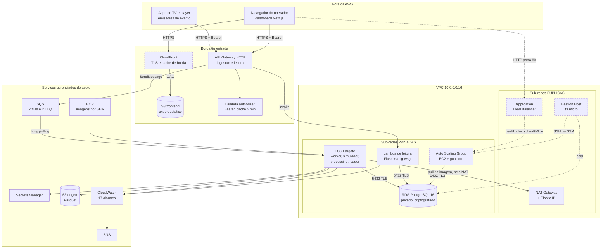
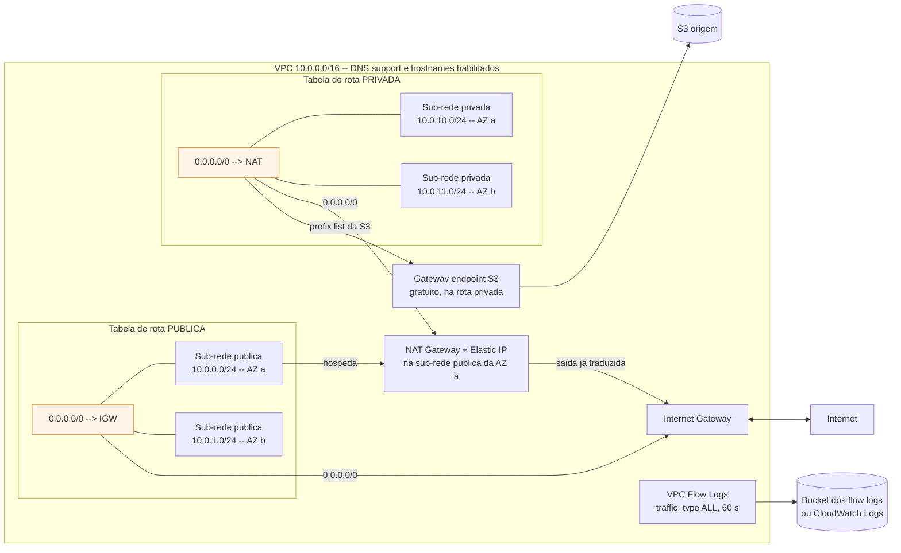

# Infraestrutura e integração

&emsp; Este artefato descreve a infraestrutura em nuvem do Argus v3 e a integração
entre o front-end e o back-end, com ênfase em operação distribuída, alta
disponibilidade, autoescalonamento, balanceamento de carga, observabilidade e
política de rollback.

&emsp; O documento segue a ordem dos três itens do relatório exigido, e a seção 5
registra as alterações de infraestrutura feitas nesta entrega.

&emsp; Este é o artefato da **Sprint 3**. A arquitetura entregue na Sprint 2 está em
[`arquitetura-inicial.md`](arquitetura-inicial.md), que **não continha camada de rede
gerenciada** — naquela entrega o stack consumia a VPC padrão da conta, sem sub-rede
privada e sem NAT Gateway. Toda a rede descrita aqui é acréscimo desta sprint, e as
seções afetadas do artefato anterior foram atualizadas com a marca `[Sprint 3]`.

| Item do relatório | Peso | Onde está |
|---|---:|---|
| (a) Diagrama de implantação com ênfase nos componentes em nuvem | 1.5 | Seção 2 |
| (b) Descrição de cada componente e justificativa da arquitetura e tecnologias | 1.5 | Seção 3 |
| (c) Plano de deploy detalhado, incluindo como incluir o AWS CloudFront | 1.0 | Seção 4 |
| Alterações desta entrega | — | Seção 5 |
| Links dos vídeos | — | Seção 6 |

---

## 1. Estado de implementação

&emsp; Esta seção existe para que o restante do documento possa ser lido sem
ambiguidade. **Nem tudo o que a rubrica dos vídeos exige está provisionado**, e
distinguir o que roda do que está planejado é mais útil do que descrever a intenção
como se fosse o estado.

&emsp; A legenda é a mesma de [`arquitetura-inicial.md`](arquitetura-inicial.md):

- **Implementado:** existe no código e na infraestrutura Terraform.
- **Condicional:** existe no Terraform, mas depende de variável do ambiente.
- **Planejado:** decisão registrada, ainda sem recurso Terraform.

| Cláusula do vídeo 1 | Estado | Observação |
|---|---|---|
| (a) VPC, sub-redes pública e privada, NAT Gateway, logs distribuídos | **Implementado e verificado na AWS** | `infra/vpc.tf`, criado nesta entrega. Evidências na seção 5.5 |
| (b) Bastion Host com regras seguras de acesso | **Planejado** | Desenho fechado em [`plano-entrega-infra.md`](plano-entrega-infra.md) §4 |
| (c) Auto Scaling Group de EC2 com política de escalonamento e ALB | **Planejado** | Desenho fechado em `plano-entrega-infra.md` §5 |
| (d) Banco de dados com AWS RDS | **Implementado** | `infra/rds.tf`, PostgreSQL 16 privado e criptografado |
| CloudFront no dashboard | **Planejado** | Procedimento completo na seção 4.5 |

&emsp; A camada de rede da cláusula (a) é pré-requisito das outras três: o balanceador
de (c) vive nas sub-redes públicas, as instâncias de (c) e o banco de (d) vivem nas
privadas, e o bastion de (b) é o que dá acesso administrativo a elas. É por isso que
ela foi a primeira a ser implementada.

---

## 2. Diagrama de implantação

&emsp; A Figura 1 mostra a implantação na região `us-east-1`. O traço tracejado marca
os componentes **planejados e ainda não provisionados**; o traço cheio, o que está no
ar. As setas indicam o mecanismo de comunicação efetivamente usado.

<div align="center">

<sub>Figura 1 — Implantação do Argus v3 na AWS, região `us-east-1`</sub>



<sup>Fonte: material produzido pelos autores (2026).</sup>

</div>

&emsp; **Como ler o diagrama.** O que separa a sub-rede pública da privada não é nada
na sub-rede em si: é a **tabela de rota** associada a ela. A pública manda
`0.0.0.0/0` para o Internet Gateway; a privada, para o NAT Gateway. Essa é a
distinção que sustenta toda a postura de segurança de rede descrita na seção 3.1.

<div align="center">

<sub>Figura 2 — Detalhe da camada de rede: rotas, NAT e observabilidade</sub>



<sup>Fonte: material produzido pelos autores (2026).</sup>

</div>

&emsp; A Figura 2 isola o mecanismo que sustenta a cláusula (a). Repare que as
sub-redes não se ligam à internet diretamente: elas se ligam a uma **tabela de rota**,
e é a tabela que decide o caminho. A privada só alcança a internet atravessando o NAT,
e o NAT só alcança a internet atravessando o IGW — três saltos que, lidos ao
contrário, explicam por que ninguém de fora chega à sub-rede privada: não existe rota
de volta que comece na internet.

&emsp; O diagrama é escrito em Mermaid e versionado como texto dentro deste arquivo —
o GitHub o renderiza nativamente, e editar não exige exportar imagem nem ferramenta
externa. O diagrama de implantação em notação UML da entrega anterior continua em
[`arquitetura-inicial.md`](arquitetura-inicial.md) §2.

---

## 3. Componentes e justificativas

### 3.1 Rede — VPC, sub-redes, NAT e Flow Logs

| Componente | Papel |
|---|---|
| `aws_vpc` 10.0.0.0/16 | Rede isolada do projeto, com DNS support e DNS hostnames habilitados |
| 2 × `aws_subnet` pública | NAT Gateway, e adiante o ALB e o bastion |
| 2 × `aws_subnet` privada | Tasks Fargate, Lambda de leitura, RDS e, adiante, o ASG |
| `aws_internet_gateway` | Saída e entrada das sub-redes públicas |
| `aws_nat_gateway` + `aws_eip` | Saída dos hosts privados, sem entrada correspondente |
| 2 × `aws_route_table` + 4 associações | A distinção real entre público e privado |
| `aws_vpc_endpoint` gateway S3 | Tráfego do `loader` fora do NAT, sem custo |
| `aws_flow_log` + bucket S3 | Observabilidade da camada de rede |

&emsp; **Por que gerenciar a VPC.** Até esta entrega o stack **consumia** a VPC
padrão da conta: a faixa de endereços, as rotas e a separação público/privado eram o
que a AWS entrega pronto, iguais em qualquer conta nova e não descritas em lugar
nenhum do código. Declarar a rede como recurso muda três coisas — o desenho passa a
ser reproduzível em qualquer conta, a separação público/privado passa a existir de
fato, e a rede entra no mesmo ciclo de revisão do resto da infraestrutura.

&emsp; **O que o NAT Gateway resolve.** As tasks, a Lambda e o banco deixam de ter IP
público. Elas continuam alcançando ECR, SQS, Secrets Manager e CloudWatch porque o
NAT deixa a conexão *sair* e a resposta voltar, mas ninguém de fora consegue iniciar
conexão para dentro. Antes, o único controle que impedia alguém de alcançar as tasks
era o security group sem regra de entrada; agora some também a rota. São dois
controles independentes em vez de um — defesa em profundidade no ingresso.

&emsp; **O que o NAT Gateway não resolve, e vale dizer.** Ele não protege a *saída*.
A regra `tasks_https` de `infra/ecs.tf` libera a porta 443 para `0.0.0.0/0`, e com NAT
ela continua idêntica. Do ponto de vista de exfiltração de dado a partir de um
contêiner comprometido, IP público e NAT são equivalentes. Quem fecha essa lacuna são
**VPC endpoints de interface** com política de endpoint restringindo o acesso a
recursos nomeados — ~US$ 7/mês por endpoint por AZ, fora do escopo desta entrega. O
gateway endpoint de S3, que é gratuito, já está provisionado justamente por isso.

&emsp; **Um NAT, não um por AZ.** Em produção o correto é um NAT por zona, com uma
tabela de rota privada por zona: com um só, a queda daquela AZ derruba a saída das
duas. A escolha aqui é de custo — US$ 33/mês contra US$ 66 — e é consciente. **A
limitação é declarada, não escondida.**

&emsp; **Flow Logs como observabilidade distribuída.** Os 17 alarmes de
`infra/observability.tf` medem a **aplicação**: profundidade de fila, mensagens em
DLQ, CPU e conexões do RDS, atraso do simulador, silêncio de fonte. Nenhum deles
enxerga a rede. Os VPC Flow Logs registram todo fluxo `ACCEPT` e `REJECT` nas
interfaces da VPC, com origem, destino, porta e bytes — é o que responde, sem
instrumentar nada, se a task privada está mesmo saindo pelo NAT e quem está batendo
na porta 5432 e sendo recusado.

&emsp; O destino padrão é um bucket **S3**, e a razão é o ambiente: entregar ao
CloudWatch Logs exige um papel IAM que confie em `vpc-flow-logs.amazonaws.com`, e a
`LabRole` do AWS Academy confia apenas em `apigateway`, `ecs-tasks` e `lambda`. Com
`create_iam_roles = false`, obrigatório no laboratório, esse caminho falharia por
confiança negada. O S3 usa política de bucket em vez de papel, elimina a dependência
e custa menos por GB. O caminho CloudWatch está implementado e é selecionável por
`flow_logs_destination = "cloudwatch"` — preferível numa conta normal, onde o Logs
Insights consulta os registros sem baixar arquivo.

### 3.2 Borda de ingestão e autenticação

| Componente | Papel | Justificativa |
|---|---|---|
| API Gateway HTTP API × 2 | Ingestão de eventos e de mudanças | Integração **direta** com o SQS, sem Lambda intermediária: nenhum cold start no caminho de ingestão, que é o de maior volume |
| Lambda `authorizer` | Verifica o token Bearer nas duas APIs | Cache de 5 min por token; hashes SHA-256 no Secrets Manager, nunca o valor em claro |
| SQS × 2 + DLQ × 2 | Buffer e redrive dos dois fluxos | Filas separadas para que uma rajada de CDC não bloqueie evento de sessão |

&emsp; A separação em duas filas é uma decisão de **confiabilidade**: o backlog de
cada fluxo é independente e tem alarme próprio. O evento inválido não é descartado —
vai para a DLQ com o motivo registrado, e `make dlq` mostra o que foi rejeitado.

### 3.3 Computação

| Componente | Papel | Estado |
|---|---|---|
| ECS Fargate | `worker` de merge, `worker` de eventos, `simulator`, `processing`, `loader`, `migration` | Implementado |
| Lambda `read_api` | API de leitura Flask, adaptada por `apig-wsgi` | Implementado |
| Auto Scaling Group de EC2 | A mesma API Flask sob gunicorn, atrás do ALB | Planejado |

&emsp; **Fargate para processamento contínuo, Lambda para leitura.** O uso do
dashboard é intermitente, então a leitura em Lambda custa próximo de zero ocioso. O
processamento é um laço permanente de consumo de fila, para o qual o modelo de
invocação da Lambda não serve.

&emsp; **O encaixe do ASG.** O `backend/pyproject.toml` já declara **Flask**,
**gunicorn** e `apig-wsgi`. A API de leitura é uma aplicação WSGI comum, e o
`apig-wsgi` é apenas o adaptador que a faz caber em Lambda. A mesma aplicação, **sem
alteração de código**, roda numa instância EC2 servida por gunicorn atrás de um ALB.
Isso separa este plano de criar uma aplicação descartável só para satisfazer a
rubrica: o critério é atendido com o código que já está em produção.

### 3.4 Persistência

&emsp; **RDS PostgreSQL 16**, `db.t3.medium`, armazenamento `gp3` criptografado em
repouso, `publicly_accessible = false`, nas sub-redes privadas. A senha do usuário
mestre é gerada aleatoriamente e guardada no Secrets Manager — nunca aparece em
variável de ambiente nem no `terraform.tfvars`.

&emsp; A escolha de PostgreSQL sobre DynamoDB é de **adequação funcional**: as telas
do dashboard fazem agregação e recorte por janela temporal, que em SQL são uma
consulta e no DynamoDB seriam varredura mais processamento na aplicação.

&emsp; O `gp3` em vez de `gp2` é de desempenho: no `gp2` o IOPS é amarrado ao tamanho
do disco, o que obrigaria a superdimensionar o armazenamento só para obter vazão
durante a carga inicial de 68,7 milhões de linhas.

&emsp; A API de leitura conecta com um usuário de **menos privilégio**, `argus_api`,
que só herda `SELECT` nas views `v_*` — ele não consegue ler tabela base.

### 3.5 Apresentação e distribuição

&emsp; O dashboard é um export estático do Next.js publicado num bucket S3 com
*website hosting*. Hoje ele é servido em **HTTP**, com leitura pública apenas dos
objetos do site. Essa é uma limitação conhecida e registrada: HTTP expõe a página e o
token do operador a intermediários de rede. A seção 4.5 descreve como o CloudFront
fecha essa lacuna.

### 3.6 Observabilidade

| Camada | Instrumento |
|---|---|
| Rede | VPC Flow Logs, `traffic_type = ALL`, agregação de 60 s |
| Aplicação | Log JSON por requisição, correlacionado por `X-Request-Id` |
| Métrica | Namespace `Argus/Ingestion` no CloudWatch |
| Alerta | 17 alarmes em `observability.tf`, notificando um tópico SNS |

&emsp; A agregação dos flow logs está em **60 segundos** e não nos 600 do padrão.
Numa apresentação ao vivo, esperar dez minutos pelo primeiro registro é a diferença
entre mostrar a evidência e falar sobre ela.

### 3.7 Alta disponibilidade, autoescalonamento e rollback

&emsp; Esta seção responde diretamente aos atributos exigidos pelo enunciado.

| Atributo | Como é atendido hoje | Lacuna declarada |
|---|---|---|
| **Alta disponibilidade** | Rede em duas AZs; SQS e S3 são multi-AZ por natureza; DLQ retém 4 dias | NAT em AZ única; `db_multi_az` desligado por custo (~US$ 800/mês em produção) |
| **Autoescalonamento** | Fargate por `desired_count`; Lambda escala por invocação | ASG com *target tracking* em CPU a 60% — planejado |
| **Balanceamento de carga** | API Gateway distribui entre execuções de Lambda | ALB nas duas sub-redes públicas — planejado |
| **Observabilidade** | Flow logs, log JSON correlacionado, 17 alarmes, SNS | Nenhum alarme verifica a API **de fora**; um canário sintético cobriria isso |
| **Rollback** | Imagem marcada pelo SHA do commit; reverter é apontar o SHA anterior e aplicar | Ver abaixo |

&emsp; **Política de rollback baseada em Auto Scaling Group.** O mecanismo previsto é
o *instance refresh* com `min_healthy_percentage`: o grupo substitui as instâncias em
lotes e só avança quando o lote anterior está `healthy` no target group. Se o
`user_data` da versão nova falhar, o alvo nunca fica saudável, o refresh trava e as
instâncias antigas permanecem servindo — o rollback é a ausência de progresso, não
uma ação manual. O `health_check_type` do ASG deve ser `"ELB"` e não `"EC2"`: assim
uma instância que responde a ping mas cuja aplicação morreu é substituída, e não
mantida de pé indefinidamente.

&emsp; Para as camadas já implementadas o rollback é o do Terraform: a tag da imagem é
o SHA do commit, então voltar uma versão é apontar o SHA anterior e aplicar. Para o
banco, o mecanismo é o snapshot — obrigatório antes de qualquer migração destrutiva.

### 3.8 Tabela de decisões desta entrega

| # | Decisão | Alternativa descartada | Atributo de qualidade | Custo | Rollback |
|---|---|---|---|---|---|
| 1 | VPC gerenciada em vez da VPC padrão | Continuar consumindo a default | Reprodutibilidade e segurança de rede | US$ 0 | `create_vpc = false` |
| 2 | Um NAT Gateway, não um por AZ | Um por zona | Custo, com disponibilidade reduzida declarada | ~US$ 33/mês | Acrescentar o segundo NAT e uma tabela de rota por AZ |
| 3 | Flow Logs em S3 | CloudWatch Logs | Compatibilidade com a `LabRole` e custo por GB | Centavos no volume do lab | `flow_logs_destination = "cloudwatch"` |
| 4 | Gateway endpoint de S3 | Todo o tráfego pelo NAT | Custo de transferência e superfície de rede | US$ 0 | Remover o recurso |
| 5 | Agregação dos flow logs em 60 s | Padrão de 600 s | Observabilidade utilizável em demonstração | Mais objetos no bucket | `max_aggregation_interval = 600` |
| 6 | Toda a rede sob `create_vpc` | Bifurcar o código | Capacidade de manutenção: um caminho de volta testável | — | A própria variável |

---

## 4. Plano de deploy

### 4.1 Pré-requisitos

1. AWS CLI, Docker, Terraform ≥ 1.9, Python 3.12, `uv`, Node.js 20 e `make`.
2. Confirmar a conta **antes de todo `plan` ou `apply`** — o id do Learner Lab muda a
   cada sessão e está dentro do `existing_role_arn`:
   ```bash
   export AWS_PROFILE=g4 AWS_REGION=us-east-1
   aws sts get-caller-identity --profile g4 --query Account --output text
   ```
3. Copiar `terraform.tfvars.example` para `terraform.tfvars` e preencher a role e as
   senhas. O arquivo é gitignored.
4. Preferir backend remoto para o `terraform.tfstate`. O state **não deve ser apagado
   enquanto ainda representar recursos existentes**.

### 4.2 Recursos provisionados

| Recurso AWS | Finalidade | Arquivo Terraform |
|---|---|---|
| VPC, sub-redes, IGW, NAT, rotas, endpoint S3, Flow Logs | Rede gerenciada e sua observabilidade | `vpc.tf` |
| API Gateway HTTP × 2 | Ingestão e leitura | `apigateway*.tf`, `api_read.tf` |
| Lambda `authorizer` | Token Bearer nas duas APIs | `auth.tf` |
| Secrets Manager | Senha do RDS e hashes dos tokens | `auth.tf`, `rds.tf` |
| SQS + DLQ | Buffer e redrive dos dois fluxos | `sqs.tf`, `sqs_changes.tf` |
| ECS Fargate | Workers, simulador, processamento, loader, migration | `ecs*.tf` |
| ECR | Quatro imagens marcadas pelo SHA do commit | `ecr.tf` |
| RDS PostgreSQL 16 | Persistência, privado e criptografado | `rds.tf` |
| S3 `origem` | Parquet e manifesto da carga inicial | `s3_origem.tf` |
| S3 `frontend` | Export estático do dashboard | `frontend_s3.tf` |
| Lambda `read_api` | API de leitura Flask | `api_read.tf` |
| IAM | Roles e policies | `iam.tf` |
| CloudWatch + SNS | Logs, métricas, 17 alarmes e notificação | `observability.tf` |

### 4.3 Ordem de execução

&emsp; A ordem separa **criar** de **mudar-se**, para que uma falha não derrube o
ambiente que está no ar.

```bash
# 0. Rede de segurança: a rede nova recria o banco (ver 4.4)
aws rds create-db-snapshot --profile g4 \
  --db-instance-identifier argus-events-<env> \
  --db-snapshot-identifier argus-events-<env>-pre-vpc

# 1. Imagens PRIMEIRO. As task definitions referenciam a imagem pelo SHA;
#    aplicar antes do push deixa os serviços procurando uma tag inexistente.
make -C apps/basica check
make -C apps/basica push

# 2. Só a rede, sem mover nada. O stack continua na VPC anterior.
cd apps/basica/infra
terraform apply \
  -target=aws_route_table_association.public \
  -target=aws_route_table_association.private \
  -target=aws_vpc_endpoint.s3 \
  -target=aws_flow_log.main \
  -target=aws_s3_bucket_server_side_encryption_configuration.flow_logs \
  -target=aws_s3_bucket_lifecycle_configuration.flow_logs

# 3. Validar o NAT ANTES de qualquer serviço depender dele (ver 4.6)

# 4. Aplicar o resto: move tasks, Lambda e RDS para as sub-redes privadas
make -C apps/basica tf-apply
make -C apps/basica auth-rotate        # a API responde 403 até este passo
make -C apps/basica migrate-aws
make -C apps/basica load               # 20 a 30 min
make -C apps/basica frontend-deploy
make -C apps/basica smoke
```

&emsp; **Os dois últimos alvos não são supérfluos.** O `-target` cria o recurso pedido
e as suas *dependências*, mas não os seus *dependentes*: a criptografia em repouso e a
regra de expiração do bucket de flow logs pendem do bucket, não do `aws_flow_log`, e
sem citá-las explicitamente o bucket nasce sem criptografia e sem retenção. Elas
entram sozinhas no `apply` completo do passo 4; num ambiente onde só a rede é
aplicada, precisam ser pedidas.

&emsp; **Entre o `tf-apply` e o `auth-rotate` a API responde 403 em tudo.** O segredo
nasce vazio e o authorizer falha fechado — é o comportamento correto, não um defeito.

### 4.4 Impacto no RDS

&emsp; **A AWS não permite mover uma instância RDS entre VPCs.** Um subnet group só
pode conter sub-redes da mesma VPC da instância, então criar a VPC própria **obriga a
recriar o banco**.

| Caminho | Como | Preserva o dado | Tempo |
|---|---|---|---|
| **A. Snapshot e restauração** | `aws_db_instance` com `snapshot_identifier` apontando para o novo subnet group | Sim | ~20 a 40 min |
| **B. Recriar e recarregar** | Deixar o Terraform recriar vazio, então `make migrate-aws` e `make load` | Não, mas reconstrói | ~15 a 30 min |

&emsp; **B é o recomendado** para o laboratório: `make load` é exercitado a cada
recriação da conta do Learner Lab, então é o percurso mais testado do projeto. Em
qualquer caso, o snapshot manual do passo 0 é barato e evita uma sessão perdida.

### 4.5 Como incluir o AWS CloudFront

&emsp; O dashboard é servido hoje pelo endpoint de *website* do S3, em **HTTP**. Isso
foi uma concessão às permissões do Learner Lab, e tem um custo de segurança explícito:
o token Bearer que o operador cola na interface trafega em claro, e um intermediário
de rede pode lê-lo. O CloudFront resolve três coisas de uma vez — **TLS**, **bucket
privado** e **cache de borda**.

&emsp; O ponto central é o **Origin Access Control (OAC)**: com ele o bucket deixa de
ter qualquer leitura pública e passa a aceitar requisição **apenas** do CloudFront,
identificado pela assinatura da distribuição. Isso é o oposto do desenho atual, em que
a política do bucket libera `s3:GetObject` para todos.

&emsp; **Recursos a acrescentar,** em `infra/cloudfront.tf`:

| Recurso | Propósito |
|---|---|
| `aws_cloudfront_origin_access_control` | Identidade da distribuição perante o bucket. `signing_behavior = "always"` |
| `aws_cloudfront_distribution` | A distribuição, com o bucket como origem **REST** (`bucket_regional_domain_name`) |
| `aws_cloudfront_response_headers_policy` | HSTS e cabeçalhos de segurança |

&emsp; **Alterações nos recursos existentes:**

1. **`aws_s3_bucket_policy.frontend`** — trocar o principal `*` por
   `cloudfront.amazonaws.com`, com condição `AWS:SourceArn` igual ao ARN da
   distribuição. É o que impede que outra distribuição use este bucket como origem.
2. **`aws_s3_bucket_public_access_block.frontend`** — os quatro bloqueios passam a
   `true`. O bucket deixa de ser público.
3. **`aws_s3_bucket_website_configuration.frontend`** — pode ser removido. Com OAC a
   origem é o endpoint REST, não o de website; o roteamento de SPA passa a ser feito
   por `custom_error_response`, mapeando 403 e 404 para `/index.html` com código 200.
4. **`local.dashboard_origins`** em `locals.tf` — a origem do CORS da API de leitura
   passa a ser `https://<domínio da distribuição>`, e não mais o endpoint de website.
5. **`make frontend-deploy`** — acrescentar a invalidação do cache após o `s3 sync`:
   ```bash
   aws cloudfront create-invalidation --distribution-id <id> --paths '/*'
   ```

&emsp; **Configuração da distribuição:**

- `default_root_object = "index.html"`.
- `viewer_protocol_policy = "redirect-to-https"` — é isto que fecha a lacuna do HTTP.
- `price_class = "PriceClass_100"` — só América do Norte e Europa; o público do
  projeto é interno e não justifica a distribuição global.
- Certificado: o `cloudfront_default_certificate` cobre o domínio
  `*.cloudfront.net` sem custo. Domínio próprio exigiria um certificado do ACM
  emitido **obrigatoriamente em `us-east-1`**, que é uma exigência do CloudFront
  independente da região do resto do stack.

&emsp; **Ordem de aplicação,** e ela importa: criar a distribuição **antes** de
endurecer a política do bucket. Invertido, o bucket fica inacessível para todo mundo,
inclusive para a distribuição que ainda não existe, e o dashboard sai do ar até o
apply seguinte. A distribuição leva de 5 a 15 minutos para propagar.

&emsp; **Custo:** a camada gratuita cobre 1 TB de transferência e 10 milhões de
requisições por mês — o consumo do projeto fica dentro dela. Estimativa: **US$ 0 a 5
por mês**.

&emsp; **Restrição do Learner Lab:** confirmar que a conta permite
`cloudfront:CreateDistribution`. Se não permitir, a limitação deve ser declarada e o
desenho registrado como planejado — que é o que este documento faz.

### 4.6 Verificação pós-implantação

&emsp; **A rede, antes de tudo.** O passo que separa um problema de rede de um
problema de aplicação:

```bash
cd apps/basica/infra
terraform output network_evidence_commands   # imprime os comandos prontos
```

- `subnets` — quatro sub-redes, duas com *auto-assign public IP* e duas sem.
- `rotas` — uma tabela com `0.0.0.0/0 → igw-…`, outra com `0.0.0.0/0 → nat-…`.
- `flow_logs` — os primeiros registros já capturados.

&emsp; **Depois de um `apply` com `-target`, essa saída pode não existir.** O
`network_evidence_commands`, o `vpc_id` e o `private_subnet_ids` passam por
`local.vpc_id` e `local.subnet_ids`, que referenciam tanto os recursos novos quanto os
`data` da VPC padrão. A análise de dependências do Terraform é estática e não sabe que
o condicional descarta um dos lados, então basta um dos referenciados estar fora do
conjunto alvo para a saída inteira ser podada. Ela aparece normalmente depois do
`apply` completo do passo 4. Enquanto isso, os mesmos comandos sem depender de output:

```bash
VPC=$(aws ec2 describe-vpcs --filters Name=tag:Name,Values=argus-events-<env> \
  --query 'Vpcs[0].VpcId' --output text)

aws ec2 describe-subnets --filters Name=vpc-id,Values=$VPC \
  --query 'Subnets[].{Nome:Tags[?Key==`Name`]|[0].Value,CIDR:CidrBlock,
           AZ:AvailabilityZone,IPPublico:MapPublicIpOnLaunch}' --output table

aws ec2 describe-route-tables --filters Name=vpc-id,Values=$VPC \
  --query 'RouteTables[].{Tabela:Tags[?Key==`Name`]|[0].Value,
           Rotas:Routes[].{Destino:DestinationCidrBlock,IGW:GatewayId,NAT:NatGatewayId}}' \
  --output json
```

&emsp; **O NAT, isoladamente.** A task avulsa `migration` roda na sub-rede privada e
precisa puxar a imagem do ECR. Se parar com `CannotPullContainerError`, o NAT não está
roteando; se o contêiner subir, o NAT funciona. Puxar centenas de MB do ECR sem IP
público só é possível pelo NAT.

&emsp; **A aplicação:**

```bash
make -C apps/basica smoke        # 401 sem token, 403 com token inválido, 200 nas rotas
make -C apps/basica count        # linhas carregadas por camada
make -C apps/basica dlq          # o que foi rejeitado, com o motivo
```

### 4.7 Custo

| Item | US$/mês |
|---|---:|
| Stack anterior (RDS, ECS, API Gateway, SQS, S3, CloudWatch) | ~106 |
| NAT Gateway, 1 unidade | ~33 |
| VPC, sub-redes, IGW, tabelas de rota, EIP em uso, endpoint S3 | 0 |
| Flow Logs | centavos a poucos dólares |
| CloudFront (planejado) | 0 a 5 |
| ALB + ASG + bastion (planejados) | ~41 |
| **Total com tudo provisionado** | **~185** |

&emsp; Todos os itens de rede e computação cobram **por hora existindo**, em uso ou
não. O `make pause` zera os serviços do ECS mas **não** remove NAT, ALB, ASG nem
bastion. A recomendação operacional é provisionar próximo à apresentação, capturar as
evidências e derrubar depois.

---

## 5. Alterações desta entrega

&emsp; Esta seção documenta o que mudou no código de infraestrutura. Todas as
alterações estão em `apps/basica/infra/`.

### 5.1 Arquivo novo

&emsp; **`vpc.tf`** — a camada de rede completa, com dez tipos de recurso, toda
condicionada a `var.create_vpc`:

| Recurso | Qtd | Propósito |
|---|---:|---|
| `aws_vpc` | 1 | 10.0.0.0/16, DNS support e hostnames habilitados |
| `aws_subnet` | 4 | Públicas 10.0.0.0/24 e 10.0.1.0/24; privadas 10.0.10.0/24 e 10.0.11.0/24 |
| `aws_internet_gateway` | 1 | Saída das públicas |
| `aws_eip` | 1 | IP fixo do NAT |
| `aws_nat_gateway` | 1 | Saída dos hosts privados |
| `aws_route_table` | 2 | Uma pública, uma privada |
| `aws_route_table_association` | 4 | Liga cada sub-rede à sua tabela |
| `aws_vpc_endpoint` | 1 | Gateway endpoint de S3, gratuito |
| `aws_flow_log` | 1 | `traffic_type = ALL`, agregação de 60 s |
| Bucket S3 **ou** log group | 1 | Destino dos flow logs, com retenção e criptografia |

&emsp; O salto de 10 no terceiro octeto das sub-redes privadas é legibilidade
deliberada: olhando um IP num registro de flow log, o octeto já diz de que lado da
rede ele veio.

### 5.2 Arquivos modificados

| Arquivo | Mudança |
|---|---|
| `locals.tf` | `vpc_id` e `subnet_ids` ganham três níveis de precedência; novo `public_subnet_ids`. Os `data` da VPC padrão viram caminho alternativo |
| `variables.tf` | Entram `create_vpc`, `vpc_cidr`, `azs` e `flow_logs_destination`; `assign_public_ip` passa a `false` por padrão; validação cruzada entre `vpc_id` e `subnet_ids` |
| `rds.tf` | O subnet group passa a `name_prefix` com `create_before_destroy` |
| `outputs.tf` | Sete saídas novas de rede, incluindo comandos prontos de evidência |
| `terraform.tfvars.example`, `README.md`, `AGENTS.md` | Documentação da rede, do rollout e das armadilhas |
| `.gitignore` (raiz) | `terraform.tfstate.d/` — o state de workspace ficava fora do padrão anterior |

&emsp; **A indireção é o que torna a mudança pequena.** Sete arquivos consomem rede —
`ecs.tf`, `ecs_processing.tf`, `ecs_simulator.tf`, `ecs_loader.tf`, `ecs_migration.tf`,
`api_read.tf` e `rds.tf` — e todos leem `local.vpc_id` e `local.subnet_ids` sem saber
de onde vieram. **Nenhum dos sete foi tocado.**

&emsp; **Por que `name_prefix` no subnet group.** Sem ele o apply trava: com nome
fixo o Terraform não consegue destruir o grupo antigo, que ainda está em uso pela
instância, nem criar o novo, que colidiria no mesmo nome. Com prefixo, o novo nasce ao
lado e o antigo sai depois.

### 5.3 Como voltar atrás

&emsp; As duas chaves andam juntas, e uma não vale sem a outra:

```hcl
create_vpc       = false   # volta a consumir a VPC padrão da conta
assign_public_ip = true    # task em sub-rede pública, sem NAT
```

&emsp; `create_vpc = false` com `assign_public_ip = false` deixa a task sem rota
nenhuma para o ECR: ela não baixa a imagem e o serviço entra em *crash loop*.

### 5.4 Verificação estática

| Verificação | Resultado |
|---|---|
| `terraform validate` com `create_vpc = true` | Success |
| `terraform validate` com `create_vpc = false` | Success |
| `terraform fmt -check` nos arquivos alterados | Limpo |
| Validação cruzada `vpc_id` sem `subnet_ids` | Recusa com a mensagem esperada |
| Curto-circuito do condicional sobre recurso com `count = 0` | Confirmado nos dois sentidos |

### 5.5 Aplicação real e evidências

&emsp; A camada de rede foi **provisionada e verificada** em 8 de setembro de 2026, numa
conta do AWS Academy Learner Lab, região `us-east-1`, em workspace próprio do Terraform
(`individual`) para não tocar o estado do ambiente principal. Foram 21 recursos: 16 na
aplicação da rede e 5 na dos flow logs.

| Cláusula | Evidência capturada |
|---|---|
| VPC gerenciada | `vpc-0fba74730439e3caf`, CIDR `10.0.0.0/16`, DNS support e hostnames habilitados |
| Sub-redes | Quatro, duas por AZ. `10.0.0.0/24` e `10.0.1.0/24` com *auto-assign public IP*; `10.0.10.0/24` e `10.0.11.0/24` sem |
| Rota pública | `0.0.0.0/0 → igw-0392604b075205f5a` |
| Rota privada | `0.0.0.0/0 → nat-0fb2306effb9b2662` |
| **NAT em operação** | EIP `52.4.149.88`. Ver o teste abaixo |
| Gateway endpoint S3 | `vpce-0ae7582c8f2415388`, associado à tabela de rota privada |
| Logs distribuídos | `fl-0894f5598c97e2016`, entregando no S3. 214 fluxos capturados só da instância de teste |
| Criptografia do destino | `AES256` no bucket dos flow logs |

#### O teste do NAT

&emsp; Provar que o NAT funciona exige mais do que ver o recurso `available` no console:
é preciso mostrar tráfego atravessando. O teste usado foi uma instância `t3.micro`
descartável na sub-rede privada `10.0.11.0/24`, **sem IP público**, cujo `user_data`
consulta o próprio endereço de saída e o grava como tag em si mesma:

> **Esta instância não faz parte da arquitetura.** Ela é instrumento de medição, não
> componente: foi criada por `aws ec2 run-instances` na linha de comando, **fora do
> Terraform** — não existe `aws_instance` em nenhum arquivo `.tf` do projeto, e ela
> nunca entrou no estado. Foi encerrada depois da captura. A rede funciona sem ela; a
> instância só torna o funcionamento visível.

```bash
IP=$(curl -s https://checkip.amazonaws.com)
aws ec2 create-tags --resources $ID --tags Key=IPDeSaida,Value=$IP
```

&emsp; Resultado:

| Atributo | Valor |
|---|---|
| `PublicIpAddress` | `null` |
| `PrivateIpAddress` | `10.0.11.120` |
| Tag `IPDeSaida` | **`52.4.149.88`** — o EIP do NAT Gateway |

&emsp; Uma máquina sem endereço público, cuja saída a internet enxerga com o IP do NAT,
só pode estar atravessando o NAT. É a demonstração direta da cláusula.

#### O que os flow logs mostram

&emsp; Os registros capturados são majoritariamente sondagens da internet contra a
interface pública do NAT Gateway (`10.0.0.110`):

```
162.216.149.183 -> 10.0.0.110 :36884   ACCEPT
116.90.227.175  -> 10.0.0.110 :1433    ACCEPT   <- varredura de SQL Server
91.230.168.92   -> 10.0.0.110 :1992    ACCEPT
```

&emsp; Isso é evidência de dois fatos ao mesmo tempo: a observabilidade de rede está
capturando fluxo real, e o único endereço público da VPC é sondado continuamente por
terceiros — sem que nada disso alcance as sub-redes privadas, que não têm rota de
entrada.

&emsp; A travessia do NAT também aparece nos registros. Foram 214 fluxos envolvendo a
instância de teste, e **todos** os que saem dela passam pela interface do NAT Gateway
(`10.0.0.110`), nenhum diretamente para a internet:

```
10.0.11.120 -> 10.0.0.110  :123    ACCEPT     <- NTP saindo pelo NAT
10.0.0.110  -> 10.0.11.120 :43766  ACCEPT     <- retorno, 15 pacotes
10.0.11.120 -> 10.0.0.110  :123    ACCEPT
10.0.0.110  -> 10.0.11.120 :52231  ACCEPT
```

&emsp; Ler esses quatro registros junto com a tabela de rota privada fecha o argumento
da cláusula sem depender de nenhuma tela: a máquina privada não tem caminho para a
internet que não seja o NAT, e o log prova que ela usou esse caminho.

&emsp; A entrega no S3 tem latência própria de cerca de cinco minutos, independente do
`max_aggregation_interval` de 60 segundos. É um detalhe operacional que importa numa
demonstração ao vivo: o primeiro arquivo não aparece imediatamente após gerar tráfego.

### 5.6 Restrições do ambiente descobertas na aplicação

&emsp; Duas limitações do AWS Academy só apareceram no `apply`, e as duas estavam
mapeadas como risco em [`plano-entrega-infra.md`](plano-entrega-infra.md) §10. Ambas se
confirmaram.

&emsp; **1. A `LabRole` não confia no serviço de Flow Logs.** A verificação da política
de confiança devolve 53 serviços — `apigateway`, `ecs-tasks`, `lambda`, `ec2`,
`elasticloadbalancing`, entre outros — e `vpc-flow-logs.amazonaws.com` **não** está
entre eles. Com `create_iam_roles = false`, obrigatório no laboratório, o destino
CloudWatch Logs é inviável. O padrão em S3, escolhido preventivamente, é o que permitiu
a cláusula ser atendida.

&emsp; **2. A SCP da organização nega `s3:GetBucketObjectLockConfiguration`.** O
provider AWS chama essa API ao reler qualquer `aws_s3_bucket` recém-criado. O bucket
nasce, o `apply` falha na releitura e o recurso fica no estado quebrando todo `plan`
seguinte. Verificou-se que **apenas essa chamada** é negada — `GetBucketPolicy`,
`GetPublicAccessBlock`, `GetBucketEncryption`, `GetBucketLifecycleConfiguration` e
`GetBucketVersioning` são permitidas.

&emsp; A solução foi a variável `flow_logs_bucket_name`: quando preenchida, o Terraform
não cria o bucket, mas continua gerenciando política, bloqueio público, criptografia e
ciclo de vida. Nenhum controle é perdido.

&emsp; **Esta segunda restrição não é específica desta entrega.** Ela atinge igualmente
`aws_s3_bucket.origem` e `aws_s3_bucket.frontend`, que já existiam — os dois foram
testados e recebem a mesma negação. Na prática, **o stack completo não roda `plan` nem
`apply` nessa conta sem contorno**. O paliativo imediato é `terraform plan
-refresh=false`, já que esses buckets estão no estado e sem refresh o provider não os
relê. A correção definitiva é estender o padrão de `flow_logs_bucket_name` aos outros
dois buckets, ou avaliar a migração para o provider 6.x — trabalho independente desta
camada de rede, registrado como pendência 9 na seção 7.

---

## 6. Vídeos

### Vídeo 1 — Infraestrutura provisionada (5 a 7 minutos)

**Link:** _(a preencher)_

| Cláusula | Peso | Tela do console | O que precisa aparecer |
|---|---:|---|---|
| (a) VPC gerenciada | 1.0 | VPC → Your VPCs | A VPC com CIDR `10.0.0.0/16` e as tags do projeto |
| (a) Pública e privada | | VPC → Subnets | Quatro sub-redes, duas com *auto-assign public IP* e duas sem |
| (a) NAT | | VPC → Route Tables | Uma tabela `0.0.0.0/0 → IGW`; outra `0.0.0.0/0 → NAT` |
| (a) Logs distribuídos | | Bucket dos flow logs, ou Logs Insights | Registros `ACCEPT` e `REJECT` com origem, destino e porta |
| (b) Bastion | 1.0 | EC2 → Instances, e o SG do bastion | Instância na sub-rede pública; entrada 22 **restrita a CIDR**, nunca `0.0.0.0/0` |
| (b) Acesso seguro | | Systems Manager → Session Manager | Sessão aberta sem uso de chave SSH |
| (c) Instâncias ativas | 1.0 | EC2 → Auto Scaling Groups → Instance management | Duas ou mais instâncias `InService`, em AZs diferentes |
| (c) Autoescalonamento | | ASG → Activity history | *Launching a new EC2 instance* após carga sintética |
| (c) Política | | ASG → Automatic scaling | Target tracking com alvo de 60% |
| (c) Balanceamento | | EC2 → Target Groups → Targets | Todos os alvos `healthy` em `/health/live` |
| (d) RDS | 1.0 | RDS → Connectivity & security | `Publicly accessible: No`, subnet group privado e o SG |
| (d) Segurança | | RDS → Configuration | Criptografia em repouso habilitada |

&emsp; A evidência mais forte do conjunto é a combinação de duas telas de (a) com uma
de (c): uma instância comprovadamente **sem** IP público que ainda assim responde ao
balanceador só pode estar saindo pelo NAT.

&emsp; Para a cláusula (a), o roteiro já foi executado e está documentado na seção 5.5,
com os identificadores reais dos recursos. O teste da tag `IPDeSaida` é filmável em
menos de um minuto e substitui, com vantagem, a tela estática do NAT no console.

### Vídeo 2 — Integração front-end e back-end (2 a 4 minutos)

**Link:** _(a preencher)_

| Cláusula | Peso | Roteiro | Comando |
|---|---:|---|---|
| (a) Validação funcional | 1.0 | 401 sem token, 403 com token inválido, 200 nas 12 rotas autenticadas, com latência abaixo do teto de 5 s do RNF02 | `make smoke` |
| (a) Validação funcional | | Suítes de teste dos seis módulos | `make test` |
| (b) Comunicação entre serviços | 1.0 | Evento entra pela API de ingestão, passa pela fila, é consumido pelo worker e aparece no banco | `make replay` e `make count` |
| (b) Ambiente integrado | | Coleção Postman contra as APIs publicadas | `make postman` |
| (b) Ambiente integrado | | Dashboard consumindo a API de leitura publicada | `make frontend-dev` |

&emsp; O caminho mais convincente para (b) é mostrar o dado atravessando: dispare
`make replay`, acompanhe `make logs SERVICO=worker` e feche com `make count`
mostrando a contagem subir na camada bronze. É a comunicação entre três serviços —
API Gateway, SQS e worker — visível numa sequência só.

---

## 7. Pendências e limitações declaradas

| # | Item | Impacto | Encaminhamento |
|---|---|---|---|
| 1 | Bastion Host não provisionado | Cláusula (b) do vídeo 1 sem evidência | Desenho pronto em `plano-entrega-infra.md` §4 |
| 2 | ASG e ALB não provisionados | Cláusula (c) do vídeo 1 sem evidência | Desenho pronto em `plano-entrega-infra.md` §5 |
| 3 | CloudFront não provisionado | Dashboard em HTTP; token exposto a intermediário | Procedimento completo na seção 4.5 |
| 4 | NAT em AZ única | Queda da AZ derruba a saída das duas sub-redes privadas | Decisão de custo consciente |
| 5 | `db_multi_az` desligado | RDS é ponto único de falha | Decisão de custo; em produção deve ser tratado como obrigatório |
| 6 | Saída irrestrita na porta 443 | NAT não protege exfiltração | VPC endpoints de interface com política de endpoint |
| 7 | Nenhum alarme verifica a API de fora | Indisponibilidade da ponta só aparece pelo usuário | Canário sintético do CloudWatch, ~US$ 10/mês |
| 8 | A aplicação está em `/apps/basica` | A especificação da entrega cita `/apps/fullstack` | Decisão de nomenclatura a alinhar com o time antes da tag da Sprint |
| 9 | SCP nega `s3:GetBucketObjectLockConfiguration` | `aws_s3_bucket.origem` e `.frontend` quebram no refresh; o stack completo não aplica sem contorno | `-refresh=false` como paliativo; ver seção 5.6 |

&emsp; Os itens 4, 5 e 6 são **decisões**, não esquecimentos, e devem ser declarados
na apresentação. Os itens 1, 2 e 3 são trabalho pendente com desenho fechado.

---

## 8. Referências internas

- [`plano-entrega-infra.md`](plano-entrega-infra.md) — plano de implantação dos quatro
  critérios de infraestrutura, com ordem de execução, custo e riscos.
- [`arquitetura-inicial.md`](arquitetura-inicial.md) — arquitetura consolidada, tabela
  de decisões arquiteturais (§4.9) e diagrama de implantação em notação UML (§2).
- [`apps/basica/infra/README.md`](../apps/basica/infra/README.md) — passo a passo
  operacional, adaptações do Learner Lab e a seção "Rede: pública vs privada".
- [`apps/basica/infra/AGENTS.md`](../apps/basica/infra/AGENTS.md) — regras de operação
  do Terraform neste repositório.
