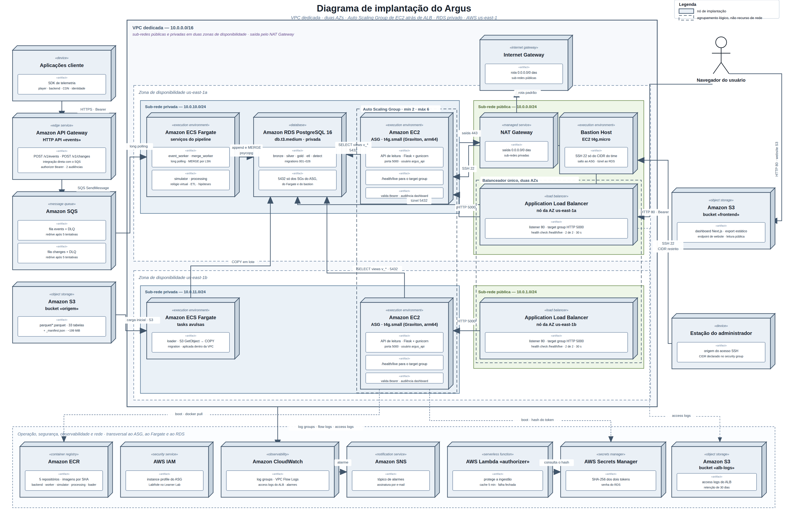

# Infraestrutura e integração

&emsp; Este artefato documenta a infraestrutura em nuvem do Argus e a integração
entre o dashboard e a API que o alimenta. Ele descreve a topologia implantada na
Amazon Web Services: a rede que isola as cargas, os componentes que executam cada
parte do sistema, a justificativa de cada escolha, o procedimento de implantação e
as verificações que atestam o resultado. A região de referência é a `us-east-1` e a
conta é do AWS Academy Learner Lab, ambiente cujas restrições condicionam parte das
decisões e estão registradas na seção 8.

## 1. Contexto e escopo

&emsp; O Argus é um sistema de telemetria e correlação de falhas para a cadeia de
entrega de streaming do Grupo Globo. Aplicações cliente enviam eventos a uma API de
ingestão; o pipeline normaliza, persiste e expõe os dados a um dashboard que
apresenta a linha do tempo do incidente e as hipóteses de causa provável. O desenho
funcional está em [`arquitetura-inicial.md`](arquitetura-inicial.md). Este artefato
trata da camada de infraestrutura que sustenta esse desenho e da comunicação entre
o front-end e o back-end.

&emsp; O sistema tem dois caminhos com exigências distintas, e a infraestrutura os
trata de forma distinta.

&emsp; O caminho síncrono é a requisição que o dashboard faz e cuja latência o
operador percebe. Ele executa em instâncias Amazon EC2 sob um Auto Scaling Group,
atrás de um Application Load Balancer, com política de escalonamento declarada. É
onde a variação de carga é observável e onde a perda de uma instância tem efeito
imediato sobre a experiência, e por isso é onde a elasticidade precisa ser um objeto
do sistema, e não uma propriedade implícita.

&emsp; O caminho assíncrono é a ingestão. Ele executa como filas do Amazon SQS com
consumidores no ECS Fargate, porque o desacoplamento por fila já absorve rajada por
construção e o tamanho da fila é a métrica de saúde natural desse fluxo. Executá-lo
sobre instâncias acrescentaria uma segunda camada de elasticidade sobre um mecanismo
que já a tem. A seção 3.8 registra a decisão junto com a alternativa descartada.

&emsp; As duas cargas rodam numa rede dedicada, com sub-redes públicas e privadas
distribuídas em duas zonas de disponibilidade. Nenhuma delas tem endereço roteável
da internet: a saída passa por um NAT Gateway, a entrada passa pelo balanceador, e o
acesso administrativo passa por um bastion host. O dashboard é um site estático
servido a partir de um bucket do Amazon S3, e chama o balanceador diretamente. Toda
a persistência fica num Amazon RDS PostgreSQL em sub-rede privada.


## 2. Diagrama de implantação do sistema

&emsp; A figura abaixo é o diagrama de implantação do sistema. Ela usa notação de
implantação: cada nó tridimensional é um ambiente de execução ou um serviço
gerenciado, marcado pelo estereótipo entre aspas angulares
(`«execution environment»`, `«database»`, `«message queue»`, `«object storage»`), e
cada seta traz o protocolo e a porta efetivamente usados. As fronteiras de rede, que
são a VPC, cada zona de disponibilidade e cada sub-rede, aparecem como retângulos com
o título no canto superior. Todo componente descrito na seção 3 aparece na figura, e
a matriz de conexões de 3.7 é o checklist cruzado dessa correspondência.

<div align="center">

<sub>Figura 1 — Implantação do Argus na AWS, região `us-east-1`</sub>



<sup>Fonte: material produzido pelos autores (2026).</sup>

</div>

&emsp; A figura mostra a região `us-east-1` inteira. No centro fica a VPC dedicada,
`10.0.0.0/16`, e dentro dela as duas zonas de disponibilidade, uma em cima da outra:
`us-east-1a` na faixa superior e `us-east-1b` na inferior. Cada zona é dividida ao
meio, com a sub-rede privada à esquerda e a pública à direita. Na privada estão as
tasks do ECS Fargate, o RDS e as instâncias EC2 do Auto Scaling Group; na pública, o
nó do balanceador, mais o NAT Gateway e o bastion, que existem apenas na primeira
zona. Dois retângulos tracejados atravessam as duas zonas para marcar o que é
agrupamento lógico e não recurso de rede: o Auto Scaling Group e o balanceador.

&emsp; Fora da VPC, a coluna da esquerda reúne o caminho de ingestão e a faixa
inferior reúne os serviços que atendem a todos os demais ao mesmo tempo: ECR, IAM,
CloudWatch, SNS, o Lambda authorizer, o Secrets Manager e o bucket de access logs do
balanceador. À direita ficam o bucket que guarda o dashboard e a estação do
administrador, de onde parte o SSH para o bastion.

&emsp; O caminho da requisição do dashboard é o que a figura mais precisa deixar
claro. O navegador busca os arquivos estáticos do dashboard no endpoint de website
do bucket, em HTTP, e chama a API diretamente no Application Load Balancer, também
em HTTP na porta 80, levando o token no cabeçalho `Authorization`. O balanceador
repassa a requisição a uma das instâncias do grupo,
na porta 5000, onde o gunicorn, que é o servidor que executa a aplicação Flask
dentro do container, responde. A instância consulta o RDS na porta 5432 como o
usuário `argus_api`, que só enxerga as views `v_*`. A resposta volta pelo mesmo
caminho. Nenhum salto desse percurso passa pelo NAT Gateway, que serve à saída das
instâncias e não à entrada do usuário.

### 2.1 Convenções de notação

| Elemento | Significado |
|---|---|
| Nó tridimensional | Nó de implantação: ambiente de execução, serviço gerenciado ou dispositivo |
| Caixa branca interna `«artifact»` | Artefato de software implantado naquele nó |
| Retângulo com título no canto superior | Fronteira de rede: VPC, zona de disponibilidade ou sub-rede |
| Retângulo tracejado sem preenchimento | Agrupamento lógico, como o Auto Scaling Group e o balanceador, que atravessa as zonas de disponibilidade e não é recurso de rede |
| `«…»` | Estereótipo do nó |
| Rótulo da seta | Protocolo e porta efetivamente usados |
| Faixa inferior | Serviços transversais ao Auto Scaling Group, ao Fargate e ao RDS |


## 3. Componentes e justificativa da arquitetura

&emsp; Esta seção descreve cada componente da topologia e justifica a escolha.
Descrição e justificativa são coisas distintas e as duas são exigidas: dizer que “o
balanceador distribui carga entre as instâncias” é descrever o que o serviço faz. A
justificativa está em qual alternativa foi descartada, contra qual atributo de
qualidade e a que custo. É isso que a ficha de cada componente registra, junto com o
modo de falha previsto e o arquivo Terraform que define o recurso. A tabela
consolidada das decisões está em 3.8.

### 3.1 Rede — VPC, sub-redes, NAT e rotas

&emsp; A rede é o componente que decide quem alcança quem. O sistema tem uma VPC
dedicada, e não a VPC padrão da conta: a padrão só tem sub-redes públicas, e sem
sub-rede privada não há como retirar o endereço roteável das cargas de trabalho, que
é a condição de tudo o mais nesta seção.

&emsp; Duas variáveis governam essa escolha, `create_network` e `assign_public_ip`,
e o Terraform recusa a combinação errada.
`create_network = true` com `assign_public_ip = true` põe a task numa sub-rede
privada, que não tem rota para o Internet Gateway: o endereço público não serve
para nada, o download da imagem no ECR falha e o serviço entra em ciclo de
reinicialização. Uma validação cruzada entre as duas variáveis transforma isso em
erro de `plan`, com a explicação junto. Sem ela o sintoma chega horas depois, como
serviço que não estabiliza, e nada aponta para a variável de rede que o causou. As
faixas das sub-redes são derivadas de `vpc_cidr` pelo mesmo motivo: listas fixas
deixariam sub-redes penduradas fora da VPC ao primeiro que trocasse o bloco. O
arquivo `rede.tftest.hcl` exercita as duas regras com um provider simulado, que
responde no lugar da AWS sem criar recurso nenhum.

&emsp; A VPC ocupa o bloco `10.0.0.0/16`. A notação `/16` é o CIDR, a forma de
escrever uma faixa de endereços IP pelo número de bits fixos: `10.0.0.0/16`
reserva os 65.536 endereços entre `10.0.0.0` e `10.0.255.255`, e cada `/24`
recortado dela reserva 256. A VPC tem `enable_dns_hostnames` ligado porque, sem
esse atributo, o endereço do RDS não recebe nome DNS resolvível de dentro da
própria VPC, e a `DATABASE_URL` montada em `locals.tf` apontaria para um host
inexistente. Dentro dela há quatro sub-redes, distribuídas em duas zonas de
disponibilidade. Duas zonas não é preferência de projeto: o Application Load
Balancer exige no mínimo duas sub-redes em zonas distintas e não chega a ser
criado com uma só, e o subnet group do RDS, que é a lista de sub-redes onde o
banco pode nascer, impõe a mesma condição.

| Sub-rede | Tipo | CIDR | AZ | Rota `0.0.0.0/0` | O que executa |
|---|---|---|---|---|---|
| `argus-events-dev-public-0` | pública | `10.0.0.0/24` | 1ª da conta | Internet Gateway | ALB, NAT Gateway, bastion |
| `argus-events-dev-public-1` | pública | `10.0.1.0/24` | 2ª da conta | Internet Gateway | ALB |
| `argus-events-dev-private-0` | privada | `10.0.10.0/24` | 1ª da conta | NAT Gateway | EC2 do ASG, tasks Fargate, RDS |
| `argus-events-dev-private-1` | privada | `10.0.11.0/24` | 2ª da conta | NAT Gateway | EC2 do ASG, tasks Fargate, RDS |

&emsp; As zonas saem de `data.aws_availability_zones.available` e não de
literais `us-east-1a`. O AWS Academy distribui as zonas por conta: o `us-east-1a`
de uma conta pode ser o hardware que outra enxerga como `us-east-1c`, e nem toda
conta recebe a lista completa. Fixar o nome faz o `apply` passar numa conta e
falhar em outra, com a causa aparecendo como “sub-rede inválida” muito depois do
erro real.

&emsp; A diferença entre os dois gateways é o que define a sub-rede privada. O
Internet Gateway é simétrico: deixa sair e deixa entrar. O NAT Gateway é
assimétrico, porque traduz o endereço de saída e não tem como encaminhar uma
conexão iniciada de fora: não existe tradução registrada para ela. A tabela de
rotas privada aponta `0.0.0.0/0` para o NAT e não tem nenhuma rota para o Internet
Gateway. É essa ausência, e não o nome da sub-rede, que impede alcance externo,
mesmo que um security group fosse afrouxado por engano.

&emsp; Os hosts privados precisam de saída por quatro motivos concretos, todos
exercitados no boot de cada instância: baixar pacotes do repositório do Amazon
Linux (`dnf install` de Docker e do agente CloudWatch), autenticar e puxar a
imagem do ECR, ler o segredo dos tokens no Secrets Manager, e entregar log e
métrica ao CloudWatch. Sem NAT, a instância sobe, não encontra o que executar e
reprova na verificação de saúde do balanceador; o grupo entra em ciclo de
substituição, com o sintoma aparecendo como falha da aplicação.

&emsp; Há um único NAT Gateway, na primeira sub-rede pública, e não um por zona. A
recomendação da AWS para produção é um por zona, justamente para que a queda de
uma não leve junto a saída da outra. Aqui a decisão é de custo: cada NAT custa
cerca de US$ 32/mês de hora parada mais o tráfego, e é o item mais caro da
topologia. A consequência está assumida e detalhada em 5.1. Se a zona do NAT cair,
as instâncias da outra zona continuam servindo tráfego, porque o caminho de
leitura não passa pelo NAT, mas perdem a saída, e o ASG não consegue subir
instância nova naquela zona até a zona voltar.

&emsp; Os VPC endpoints de interface não foram criados, e a decisão é consciente.
Um endpoint é uma porta de entrada privada para um serviço da AWS, criada dentro
da própria VPC; ele vem em duas formas. O *gateway endpoint* é uma entrada a mais
na tabela de rotas, serve só S3 e DynamoDB e é gratuito: esse foi criado, para
S3. O *endpoint de interface* é uma placa de rede dentro da sub-rede, atende os
demais serviços e cobra por hora em cada zona. Endpoints de interface para ECR,
Secrets Manager e CloudWatch Logs tirariam esse tráfego do NAT, reduzindo o custo
de transferência e mantendo as chamadas dentro da rede da AWS. O custo de não
usá-los é que todo `docker pull` e toda chamada de API paga tráfego de NAT, e o
caminho até o ECR sai e volta pela borda. Ficaram de fora porque seriam cinco
recursos adicionais, um para ECR API, ECR DKR, Secrets Manager, CloudWatch Logs e
STS, cada um com security group próprio e com custo horário que anula parte da
economia num volume tão pequeno. A decisão está registrada em 3.8 (decisão 4).

**Grupos de segurança**

&emsp; A regra que vale em todo o stack: sempre que a origem for um recurso
nosso, ela referencia outro security group, e não uma faixa de endereços. Uma
sub-rede pode ser renumerada e o IP de uma instância muda a cada substituição do
ASG, mas a identidade do grupo não muda. Há exatamente um `0.0.0.0/0` de entrada
em toda a topologia, e ele está na porta 80 do balanceador, que existe justamente
para aceitar conexão de qualquer origem.

| Security group | Regra de entrada | Origem | Regra de saída | Destino |
|---|---|---|---|---|
| `argus-events-dev-alb` | TCP 80 | `0.0.0.0/0` | TCP 5000 | `sg-app` |
| `argus-events-dev-app` | TCP 5000 · TCP 22 | `sg-alb` · `sg-bastion` | TCP 443, TCP 80, TCP 5432 | saída, `sg-rds` |
| `argus-events-dev-bastion` | TCP 22 | Endereço do time em `/32`; a validação recusa `0.0.0.0/0` | TCP 22, TCP 5432, TCP 443 | `sg-app`, `sg-rds`, saída |
| `argus-events-dev-rds` | TCP 5432 | `sg-worker`, `sg-app`, `sg-bastion` | — | — |
| `argus-events-dev-tasks` | — (nenhuma) | — | TCP 443, TCP 5432 | saída, `sg-rds` |

&emsp; O grupo das tasks Fargate não tem regra de entrada nenhuma, e isso é o
desenho: os workers buscam mensagem na fila por *long polling*, que é uma consulta
de saída que fica aberta esperando a mensagem chegar, e o simulador também só faz
chamada de saída. Ninguém conecta neles. A saída do bastion é restrita a três
destinos em vez de `0.0.0.0/0`: abrir a saída inteira daria a quem o comprometesse
um trampolim para qualquer lugar.

**Observabilidade da rede: logs distribuídos**

&emsp; O log da aplicação responde “o que a API fez com a requisição”. Ele não
responde “a conexão chegou?”, e essa é exatamente a pergunta que aparece quando
um security group está errado: a requisição some sem deixar rastro em lugar
nenhum, porque nunca alcançou o processo que sabe registrá-la. Por isso são três
fontes, em três níveis, e a utilidade está em cruzá-las.

| Fonte | Destino | Retenção | Pergunta que responde |
|---|---|---|---|
| VPC Flow Logs | Bucket `argus-events-dev-flow-logs-<conta>` | 30 dias | Tráfego aceito ou rejeitado, por par origem/destino; conexão inesperada |
| Aplicação nas EC2 do ASG | `/argus/argus-events-dev/app` | 30 dias | Erro por requisição, latência, `X-Request-Id` |
| Access logs do ALB | Bucket `argus-events-dev-alb-logs-<conta>` | 30 dias | Código de resposta e tempo do backend, por requisição |
| Tasks Fargate | `/ecs/argus-events-dev/<serviço>` | 30 dias | Ingestão, ETL, motor de hipóteses |
| API Gateway de ingestão | `/aws/apigateway/argus-events-dev` | 30 dias | Evento recusado na borda |

&emsp; Os Flow Logs usam formato customizado, e não o padrão, porque o padrão não
traz `pkt-srcaddr` e `pkt-dstaddr`, que são os endereços reais antes da tradução do
NAT. Sem eles, todo tráfego de saída das sub-redes privadas aparece originado no
NAT, e fica impossível dizer qual instância falou com quem. O intervalo de
agregação está em 60 segundos e não nos 600 do padrão: numa demonstração ao vivo,
esperar dez minutos pelo primeiro registro é a diferença entre evidenciar o
recurso e falar sobre ele. O destino é um bucket S3, e a razão está na seção 8.1:
o papel do laboratório não consegue assumir a identidade que o serviço usaria para
escrever no CloudWatch Logs.

&emsp; Os access logs do ALB vão para S3 porque o serviço não os entrega no
CloudWatch Logs. Não há escolha de destino aqui; o bucket existe porque o serviço
exige bucket. Ele tem bloqueio total de acesso público e uma regra de ciclo de
vida que expira os objetos em 30 dias: access log cresce por requisição e ninguém
volta nele depois de um mês.

&emsp; A correlação ponta a ponta usa o `X-Request-Id`. O cabeçalho já é
emitido em toda resposta por `telemetry/observability.py` e aparece na linha de
log estruturado da aplicação e no corpo dos erros. Esses erros seguem a RFC
7807, o formato padronizado em que a API devolve o problema como um JSON com
tipo, título e detalhe, em vez de uma mensagem livre. Uma requisição que
aparece no flow log e não no access log morreu no security group do balanceador;
uma que aparece no access log com 502 e não no log da aplicação morreu antes do
gunicorn; e uma que aparece nos três é rastreável do navegador até a consulta SQL
pelo mesmo identificador.

**Ficha — VPC e sub-redes**

| Campo | Conteúdo |
|---|---|
| Papel no sistema | Isolamento de rede: define quem alcança quem, e por qual caminho |
| Configuração efetiva | `10.0.0.0/16`; 2 sub-redes públicas `/24` e 2 privadas `/24`, em 2 AZs; DNS e hostnames habilitados |
| Entradas / saídas | Entrada só pelo IGW nas públicas; saída das privadas pelo NAT |
| Alternativa descartada | VPC padrão da conta: não tem sub-rede privada, e sem ela não há como remover o endereço público das cargas |
| Modo de falha previsto e mitigação | Sub-rede esgotada por crescimento do ASG: um `/24` dá 251 endereços úteis contra o teto de 6 instâncias, folga de duas ordens de grandeza |
| Custo estimado | Sem custo próprio |
| Arquivo Terraform | `apps/basica/infra/vpc.tf` |

**Ficha — NAT Gateway**

| Campo | Conteúdo |
|---|---|
| Papel no sistema | Saída para a internet das sub-redes privadas, sem permitir entrada |
| Configuração efetiva | Um NAT na primeira sub-rede pública, com Elastic IP fixo |
| Entradas / saídas | Recebe das tabelas de rota privadas; sai pelo IGW |
| Alternativa descartada | (a) endereço público na própria carga: mais barato, mas desfaz a rede privada; (b) um NAT por zona, que é a recomendação de produção e dobra o custo |
| Modo de falha previsto e mitigação | Queda da AZ do NAT: as instâncias da outra zona seguem servindo tráfego, mas sem saída; o ASG não sobe instância nova ali. Mitigação declarada: subir o segundo NAT (5.1) |
| Custo estimado | ~US$ 32/mês mais o tráfego; é o item mais caro da topologia |
| Arquivo Terraform | `apps/basica/infra/vpc.tf` |

**Ficha — VPC Flow Logs e access logs do ALB**

| Campo | Conteúdo |
|---|---|
| Papel no sistema | Observabilidade da camada de rede: responde “a conexão chegou?” |
| Configuração efetiva | Flow Logs de todo o tráfego, formato customizado com `pkt-srcaddr`, agregação de 60 s, retenção de 30 dias, entregues em bucket S3 com AES256; access logs do ALB em S3 com expiração de 30 dias |
| Entradas / saídas | VPC → S3 (ou CloudWatch Logs, por `flow_logs_destination`); ALB → S3 |
| Alternativa descartada | (a) Formato padrão de flow log, que oculta o endereço real por trás do NAT; (b) destino CloudWatch Logs, inviável no laboratório porque a `LabRole` não confia em `vpc-flow-logs.amazonaws.com` (seção 8) |
| Modo de falha previsto e mitigação | Volume de log inflando custo: retenção e ciclo de vida de 30 dias em ambos |
| Custo estimado | ~US$ 1–3/mês no volume do laboratório |
| Arquivo Terraform | `apps/basica/infra/vpc_logs.tf` |

### 3.2 Acesso administrativo — Bastion Host

&emsp; As instâncias do Auto Scaling Group e o RDS não têm endereço público, e
esse é o ponto. Mas alguém precisa conseguir abrir um `psql` para investigar um
incidente, ou entrar numa instância para ler um log que não chegou ao CloudWatch.
Havia três formas de permitir isso, e duas desfazem o trabalho da seção anterior:
dar IP público às instâncias anula a rede privada, e tornar o RDS publicamente
acessível o expõe à varredura contínua, deixando a senha como única barreira. A
terceira é um host intermediário, mínimo, com uma única porta aberta para uma
faixa de endereços conhecida, e nada além disso.

&emsp; O bastion é uma `t4g.micro`, o menor tipo disponível, na primeira
sub-rede pública. Pública porque precisa ser alcançável de fora, o que é a
definição do papel. Ele não roda aplicação, não guarda dado e não tem papel IAM
de escrita: se for comprometido, o atacante ganha o que já teria com a chave SSH,
e nada além. A única coisa instalada no boot é o cliente `postgresql16`, para
que uma investigação não dependa de baixar pacote no meio do incidente.

&emsp; A chave SSH não é versionada nem criada pelo Terraform. A
variável `bastion_key_name` recebe o nome de um key pair que já exista na conta,
criado no console ou por `aws ec2 create-key-pair --profile g4`, com o arquivo
`.pem` guardado fora da árvore. Quando a variável está vazia, que é o padrão, o
bastion não é criado: sem chave a instância seria inalcançável, e pagar por ela
seria desperdício. É também o que permite validar e planejar a configuração numa
conta que ainda não tem o par.

&emsp; A porta 22 aceita uma única faixa de endereços, e a validação da variável
`bastion_allowed_cidr` recusa `0.0.0.0/0`, pelo mesmo mecanismo que
`db_allowed_cidr` já usava para o banco. Um bastion aberto para a internet inteira
não reduz exposição nenhuma; apenas acrescenta um salto ao caminho do atacante. O
custo da restrição é real e está assumido: quem trocar de rede, saindo do campus
ou mudando de operadora, perde o acesso até atualizar a variável e reaplicar. É o
preço de a porta 22 não ficar visível para a varredura contínua da internet.

&emsp; A partir dele fazem-se duas coisas, e a segunda é a que aparece no vídeo:

```bash
# Salto para uma instância privada do Auto Scaling Group
ssh -J ec2-user@<ip-bastion> ec2-user@<ip-privado>

# Túnel até o RDS privado, para inspecionar com um psql local
ssh -N -L 5432:<endpoint-rds>:5432 ec2-user@<ip-bastion>
psql "postgresql://argus:<senha>@localhost:5432/argus"
```

&emsp; O AWS Systems Manager Session Manager foi avaliado e descartado, não
ignorado. Esse serviço abre a sessão pelo agente da própria AWS, o que elimina a
porta 22 aberta e a chave SSH por completo, e seria a escolha em produção: um
bastion sem porta 22 exposta é uma postura estritamente melhor. Aqui ele depende de
o papel `voclabs` conceder `ssm:StartSession` e de a instância carregar um perfil
com a política `AmazonSSMManagedInstanceCore`, duas coisas que a conta de
laboratório não garante e cuja falha só apareceria na hora da demonstração. O
bastion clássico funciona em qualquer conta. Há um segundo caminho administrativo,
de propósito diferente: a task ECS `migration`, que roda dentro da rede privada e é
por onde as migrations do banco são aplicadas. O bastion serve à inspeção
interativa; a task, à alteração de schema.

**Ficha — Bastion Host**

| Campo | Conteúdo |
|---|---|
| Papel no sistema | Único ponto de entrada humano na rede privada |
| Configuração efetiva | EC2 `t4g.micro`, Amazon Linux 2023 arm64, sub-rede pública, disco de 8 GiB criptografado, IMDSv2 obrigatório (a versão do serviço de metadados da instância que exige um token antes de entregar a credencial, fechando a leitura por requisição forjada) |
| Entradas / saídas | Entrada: TCP 22 da faixa de endereços do time. Saída: 22 → `sg-app`, 5432 → `sg-rds`, 443 |
| Alternativa descartada | SSM Session Manager (sem porta 22 nem chave), dependente de permissão que o `voclabs` pode recusar |
| Modo de falha previsto e mitigação | Perda da chave privada: recriar o key pair e reaplicar. Troca de rede do operador: atualizar `bastion_allowed_cidr` |
| Custo estimado | ~US$ 3/mês |
| Arquivo Terraform | `apps/basica/infra/bastion.tf` |

### 3.3 Camada de aplicação — Auto Scaling Group de EC2 e Application Load Balancer

&emsp; A API consumida pelo dashboard executa em instâncias Amazon EC2 sob um Auto
Scaling Group, atrás de um Application Load Balancer. A alternativa natural seria uma
função sem servidor, que escala sozinha e custa quase nada. O que ela não oferece é
elasticidade observável: a concorrência é implícita, não há política a declarar, nem
grupo a inspecionar, nem instância entrando em serviço a acompanhar. A capacidade de
absorver carga existe, mas não é um objeto do sistema, e o que não é objeto não se
mede nem se ajusta.

&emsp; Essa escolha vale só para o caminho síncrono. O caminho assíncrono de
ingestão fica em filas com consumidores no ECS Fargate, porque o desacoplamento por
SQS já absorve rajada por construção e o tamanho da fila é a métrica de saúde
natural daquele fluxo. A elasticidade declarada importa onde a latência é percebida
pelo usuário, que é no caminho de leitura.

**Launch template**

&emsp; O template é versionado, e é o versionamento que torna o rollback
possível: cada mudança gera uma versão nova, e voltar atrás é apontar o grupo
para a versão anterior e disparar um *instance refresh*, que é a substituição
gradual das instâncias em execução por instâncias criadas a partir da versão
escolhida. Sem ele, “rollback”
seria reconstruir a configuração à mão e torcer para não esquecer um campo.

&emsp; A AMI, que é a imagem de disco com a qual a instância nasce, é o Amazon
Linux 2023 para arm64, e vem do parâmetro público do SSM em vez de um `ami-` fixo.
O identificador muda a cada release e é diferente em cada região, então fixá-lo
significa subir uma imagem sem os patches dos últimos meses e quebrar o `apply` no
dia em que aquela AMI for desregistrada. A arquitetura arm64 não é escolha de
custo, é requisito de compatibilidade: todas as imagens dos containers são
construídas com `--platform linux/arm64`, e uma instância x86 falharia no
`docker run` com o erro *exec format error*, sintoma que chegaria como instância
reprovando na verificação de saúde, longe da causa. Por isso o tipo é `t4g.small`,
da família Graviton, e não `t3.small`.

&emsp; O código chega na instância como imagem do ECR. O `user_data`, que é o
script executado uma vez no primeiro boot, instala Docker e o agente CloudWatch,
autentica no ECR com a credencial do instance profile, puxa a imagem marcada pelo
SHA do commit e a executa com `--restart=always`. Ele reaproveita o
`backend/Dockerfile`, com gunicorn servindo 2 processos de 4 threads
na porta 5000, e o mesmo `make push` que publica as imagens dos workers, que passou
a incluir `backend` na lista `IMAGES`. A
alternativa de baixar um tarball do S3 duplicaria um empacotamento que o
Dockerfile já resolve, e um `git clone` no boot tornaria a versão que sobe não
reproduzível, esvaziando o sentido do rollback por versão de template.

&emsp; O `user_data` roda sob `set -euo pipefail`, o que faz o script abortar no
primeiro erro em vez de seguir adiante, e isso é parte do desenho: se qualquer
etapa falhar, o container nunca sobe, a verificação de saúde nunca passa, e o ASG
substitui a instância, em vez de deixá-la em serviço servindo erro.

&emsp; O token não entra na instância; o hash dele entra. Como um ALB não tem
authorizer, a validação do token Bearer passou para dentro do Flask
(`telemetry/interfaces/auth.py`). Mas a aplicação não fala com a AWS, porque a
biblioteca `boto3` foi removida dela de propósito, decisão registrada em
`backend/AGENTS.md`. Então quem consulta o Secrets Manager é o script de boot, que
extrai o SHA-256 da audiência
`dashboard` e o injeta como variável de ambiente do container. A consequência
está assumida: rotacionar o token com `make auth-rotate` exige um
`start-instance-refresh`, porque o hash foi congelado no boot; instâncias antigas
continuam aceitando o token antigo até serem substituídas.

**Auto Scaling Group**

| Parâmetro | Valor | Justificativa |
|---|---|---|
| Tipo de instância | `t4g.small` | Graviton, casando com as imagens arm64. `small` e não `micro`: gunicorn com 2×4 threads mais o agente CloudWatch deixa 1 GiB no limite durante o `docker pull` |
| `min` / `desired` / `max` | 2 / 2 / 6 | Mínimo 2 porque com uma só a perda da instância é indisponibilidade total até a substituta subir. Teto 6 limita o estrago de uma rajada anômala contra o crédito do laboratório |
| Sub-redes | as duas privadas | Sem endereço público; entrada só pelo ALB, saída só pelo NAT |
| Tipo de health check | `ELB` | Ver abaixo; é a decisão mais consequente do grupo |
| `health_check_grace_period` | 300 s | Cobre boot + `dnf install` + `docker pull` + subida do gunicorn |
| Métrica de escalonamento | `ALBRequestCountPerTarget` | Ver abaixo |
| Valor-alvo | 60 req/instância/min | Ver abaixo |
| Health check do target group | `/health/live`, 30 s, 2 de 2 para saudável, 3 para insalubre, código 200 | Ver abaixo |
| Zonas de disponibilidade | 2 | Exigência do ALB e condição para sobreviver à perda de uma zona |

&emsp; Duas linhas dessa tabela citam o *target group*, que é a lista de alvos
para os quais o balanceador encaminha tráfego, junto com a regra que decide se
cada alvo está apto a receber requisição. É nele que mora a verificação de saúde
discutida a seguir.

&emsp; O `health_check_type` é `ELB`, e não `EC2`. Com `EC2`, a única pergunta
que o grupo faz é “a máquina virtual está ligada?”. Uma instância cujo gunicorn
morreu, cujo container saiu, ou que nunca conseguiu puxar a imagem continua
respondendo “sim” para sempre: fica `InService`, recebe tráfego do balanceador e
erra toda requisição. Com `ELB`, a pergunta passa a ser a do target group: a
instância quebrada reprova, sai do grupo e é substituída. É a diferença entre um
grupo que funciona e um que apenas parece funcionar.

&emsp; A verificação de saúde aponta para `/health/live` e não para
`/health/ready`. As duas rotas existem: `live` responde `{"status":"ok"}` fixo, sem
tocar no banco; `ready` consulta o PostgreSQL e devolve 503 quando ele não
responde. A segunda parece a escolha mais rigorosa e é a errada aqui. Uma
indisponibilidade momentânea do RDS, por troca de instância, janela de manutenção
ou esgotamento de conexão, faria todas as instâncias reprovarem ao mesmo tempo; o
ASG as substituiria em
bloco, as substitutas encontrariam o mesmo banco indisponível e reprovariam
também, e o grupo entraria em ciclo de reciclagem sem que houvesse nada errado
com elas. O problema estaria no banco, e a reação teria derrubado também a camada
que ainda funcionava. A saúde do banco é assunto de alarme, não de health check
de target.

**Política de escalonamento**

&emsp; A política é de *target tracking*, o modo em que se declara o valor que uma
métrica deve manter e a AWS ajusta o número de instâncias sozinha para persegui-lo.
A métrica é `ALBRequestCountPerTarget` e o alvo, 60 requisições por instância por
minuto. A escolha da métrica é o que decide se a política funciona.

&emsp; Esta API passa a maior parte do tempo de cada requisição esperando o
PostgreSQL responder, e não calculando. Sob carga real a CPU da instância fica na
casa de 30 a 40% enquanto a latência percebida já dobrou. Uma política com alvo de
CPU em 70% simplesmente nunca dispararia: o grupo ficaria em duas instâncias
saturadas de conexão, com a métrica afirmando que está tudo bem.
`ALBRequestCountPerTarget` mede o que de fato cresce, que é quantas requisições
cada instância está tendo que atender, e, por vir do balanceador, é a mesma
métrica que o painel do CloudWatch mostra.

&emsp; O valor 60 vem do plano de teste, e não de estimativa:
`tests/carga/rnf02_tempo_resposta.js` sustenta cerca de 600 consultas por minuto
com 10 usuários virtuais. Contra duas instâncias são 300 por alvo, cinco vezes o
alvo, o que faz a política disparar de forma observável durante a gravação e não
no limite. Alvo baixo demais faz o grupo oscilar a cada variação; alto demais só
escala quando a latência já subiu, e aí o escalonamento chega tarde.

&emsp; O `estimated_instance_warmup` está em 300 s, igual ao período de carência.
É o tempo que a AWS espera antes de contar a instância nova na média. Sem ele, a
instância que ainda está puxando a imagem entra no cálculo com zero requisição,
derruba a média e a política conclui que já escalou o bastante, parando de crescer
no meio da rajada.

&emsp; A redução automática do grupo fica ligada, e é onde mora o risco.
Desligá-la evitaria cortar requisição em voo, mas deixaria o grupo no tamanho do
pico para sempre, o que num laboratório com crédito limitado esgota o orçamento
sozinho. O risco está coberto pelo `deregistration_delay` de 30 segundos do target
group: a instância sai do balanceador, termina o que já havia aceitado e só então
é encerrada. Trinta segundos cobrem com folga a consulta mais longa da API.

&emsp; O *step scaling* foi a alternativa descartada. Nele se declara uma tabela
de degraus, dizendo quantas instâncias somar em cada faixa da métrica; daria
controle fino sobre o tamanho de cada passo, ao custo de manter dois alarmes e a
tabela à mão. O ganho aparece com padrão de carga conhecido e irregular, que não é
o caso aqui.

**Application Load Balancer**

&emsp; O balanceador resolve três coisas que um grupo de instâncias, sozinho, não
resolve: um endereço estável, já que as instâncias nascem e morrem com o endereço
mudando junto; a distribuição entre as duas zonas, com retirada automática da
instância que reprova na verificação de saúde; e o ponto de medição, já que
`RequestCountPerTarget` e `TargetResponseTime` são métricas dele, e sem elas não há
o que observar nem sobre o que escalonar.

&emsp; Ele fica nas duas sub-redes públicas. É a fronteira interna do sistema, o
único componente da VPC que aceita conexão vinda de fora, e é por isso que as
instâncias podem ficar privadas. Colocá-lo na sub-rede privada é o erro que torna o
sistema inalcançável sem que nada no `plan` pareça errado. A distribuição entre zonas é sempre ativa no
ALB e não é configurável, o que a mantém uniforme mesmo com número desigual de
instâncias por zona. O `idle_timeout` fica nos 60 s padrão, e a fixação de sessão
está desligada: a API lê de views e não guarda estado entre requisições, então
prender o mesmo cliente ao mesmo alvo só reduziria a uniformidade que a política
mede.

&emsp; O listener é HTTP na porta 80, e não HTTPS na 443. Servir HTTPS no
balanceador exige um certificado emitido pelo ACM, e o ACM só emite para um domínio
cujo DNS possa ser validado; o projeto não tem domínio registrado. A consequência
está declarada como risco na seção 8: o token que o operador cola no dashboard
trafega em claro entre o navegador e o balanceador, e um intermediário de rede
consegue lê-lo. O plano que corrige isso, pondo uma distribuição CloudFront à frente
das duas origens e usando o certificado dela, está em 4.4.

&emsp; O grupo de segurança do balanceador é o que impede que alguém alcance as
instâncias por fora: ele aceita a porta 80 de qualquer origem, porque é o que um
balanceador público faz, mas as instâncias por trás só aceitam conexão vinda desse
grupo.

**Ficha — Application Load Balancer e target group**

| Campo | Conteúdo |
|---|---|
| Papel no sistema | Fronteira pública do caminho de leitura; distribuição, retirada de alvo insalubre e ponto de medição |
| Configuração efetiva | ALB público nas 2 sub-redes públicas; listener HTTP 80; target group HTTP 5000, `target_type = instance`, health check `/health/live` a cada 30 s, `deregistration_delay` 30 s; access logs em S3 |
| Entradas / saídas | Entrada: TCP 80 de `0.0.0.0/0`. Saída: TCP 5000 para `sg-app` |
| Alternativa descartada | API Gateway com função sem servidor, que não expõe métrica por alvo nem permite política de escalonamento declarada |
| Modo de falha previsto e mitigação | Zero alvo saudável → alarme `app-sem-alvo-saudavel`, que é o gatilho declarado de rollback (5.3) |
| Custo estimado | ~US$ 16/mês de hora parada, mais o consumo medido em LCU (a unidade de capacidade que o serviço cobra por conexão, requisição e banda) |
| Arquivo Terraform | `apps/basica/infra/alb.tf` |

**Ficha — Launch template e Auto Scaling Group**

| Campo | Conteúdo |
|---|---|
| Papel no sistema | Executa a API de leitura com elasticidade declarada e substituição automática de instância insalubre |
| Configuração efetiva | `t4g.small` arm64, AL2023 pelo SSM, IMDSv2, disco 20 GiB criptografado; ASG 2/2/6 nas sub-redes privadas, health check `ELB`, grace 300 s, `instance_refresh` rolling com `min_healthy_percentage = 50` |
| Entradas / saídas | Entrada: TCP 5000 do `sg-alb`, TCP 22 do `sg-bastion`. Saída: 443, 80, 5432 |
| Alternativa descartada | (a) função sem servidor, cuja concorrência é implícita e não expõe política de escalonamento; (b) ECS Fargate com autoscaling de serviço, que resolveria o mesmo problema mas repetiria a plataforma já usada no caminho assíncrono |
| Modo de falha previsto e mitigação | Imagem ausente no ECR → `user_data` aborta, health check reprova, instância substituída. Grace curto demais → ciclo de reciclagem; por isso 300 s |
| Custo estimado | ~US$ 12/mês por instância; 2 a 6 instâncias |
| Arquivo Terraform | `apps/basica/infra/asg.tf`, `apps/basica/infra/templates/user_data.sh.tftpl` |

### 3.4 Persistência — Amazon RDS

&emsp; A escolha do PostgreSQL sobre o DynamoDB está justificada em
[`arquitetura-inicial.md`](arquitetura-inicial.md) §3.5 e §4.2 e em
[`plano-argus-v3.md`](plano-argus-v3.md); não se repete aqui. O que esta seção
trata é a posição do banco na rede e quem consegue alcançá-lo.

&emsp; A instância é uma `db.t3.medium` com 100 GiB em `gp3`, PostgreSQL 16,
`publicly_accessible = false` e `storage_encrypted = true`. O `db_subnet_group`,
que é a lista de sub-redes onde a instância pode nascer, aponta para as duas
sub-redes privadas. As duas condições andam juntas e nenhuma basta sozinha: o
atributo desligado impede que a AWS atribua um endereço público à instância, e o
subnet group privado garante que não exista rota da internet até a sub-rede onde
ela está.

&emsp; Três origens alcançam a porta 5432, todas por referência de security group
e nenhuma por CIDR: o grupo das tasks Fargate (workers, simulador, ETL, loader,
migration), o grupo das instâncias EC2 do ASG, e o grupo do bastion. A regra do
ASG é separada da regra das tasks de propósito: se um dia a API de leitura
precisar de tratamento diferente do dos workers, há onde expressar isso sem
afrouxar a regra para os dois.

&emsp; A API entra no banco como `argus_api`, e não como o usuário mestre. Esse
usuário só herda `argus_reader`, que tem `SELECT` apenas nas views `v_*`, e toda
view filtra `available_at <= sim.now()`. É essa barreira, e não um `WHERE`
esquecido numa rota, que impede vazamento de futuro. O `user_data` da instância
monta a `DATABASE_URL` com esse usuário de menor privilégio, e não com o mestre,
que fica reservado às tasks que escrevem.

&emsp; O banco roda em instância única, sem réplica síncrona em outra zona, e isso
o torna o ponto único de falha da topologia. A decisão é de custo: a réplica
síncrona dobra o preço da instância, e o crédito do laboratório não comporta. A
consequência está escrita com todas as letras em 5.1, a perda da instância é
indisponibilidade total do sistema até a restauração a partir de backup, com perda
possível de até 24 horas de dados, que é o intervalo entre backups automáticos. A
decisão é reversível por uma variável, `db_multi_az`, sem mudança na aplicação,
porque o nome DNS do endpoint não muda quando a réplica assume. O backup automático
tem 1 dia de retenção, a proteção contra remoção vale só em produção e o snapshot
final é dispensado fora dela.

&emsp; O Terraform provisiona a instância e para por aí. O DDL, que são os comandos
de criação e alteração de tabela, vem de `tools/migrate.py` e é aplicado pela task
ECS `migration`, que executa na sub-rede privada junto do banco. Separar
provisionamento de schema é o que permite alterar tabela sem um `apply`, e um
`apply` custa minutos onde a alteração custa segundos. O bastion oferece um segundo
caminho, por túnel, para inspeção interativa.

**Ficha — Amazon RDS PostgreSQL**

| Campo | Conteúdo |
|---|---|
| Papel no sistema | Toda a persistência: bronze, silver, gold, detect, sim, etl |
| Configuração efetiva | PostgreSQL 16, `db.t3.medium`, 100 GiB `gp3`, criptografado, subnet group privado, `publicly_accessible = false`, Multi-AZ desligado, backup 1 dia |
| Entradas / saídas | TCP 5432 dos SGs das tasks, do ASG e do bastion; `sslmode=require` |
| Alternativa descartada | DynamoDB, justificado em `arquitetura-inicial.md` §4.2; réplica síncrona em segunda zona, descartada por custo (5.1) |
| Modo de falha previsto e mitigação | Perda da instância = indisponibilidade total, sem failover automático. Mitigação: restaurar do backup; reversão da decisão por `db_multi_az = true` |
| Custo estimado | ~US$ 60/mês |
| Arquivo Terraform | `apps/basica/infra/rds.tf` |

### 3.5 Entrega do front-end — Amazon S3

&emsp; O dashboard é um site estático, gerado pelo Next.js com `output: "export"` e
sincronizado para um bucket do Amazon S3. Quem o entrega ao navegador é o endpoint de
website do próprio bucket. A alternativa seria servi-lo pelo balanceador, o que
exigiria um processo entregando arquivo estático e desperdiçaria a natureza estática
do bundle: um conjunto de arquivos que não muda entre requisições não precisa de
aplicação para ser devolvido.

&emsp; O endpoint de website exige leitura anônima, e é por isso que o bucket tem os
quatro bloqueios de acesso público desativados e uma policy com `Principal: "*"` para
`s3:GetObject`. O conteúdo é público por natureza, já que é o bundle que qualquer
navegador precisa baixar antes de pedir o token; o que ele não contém é dado do
sistema, que só vem depois, pela API e mediante autenticação.

&emsp; Esse endpoint atende somente em HTTP, e a consequência é direta: o token que o
operador cola na página trafega em claro, e um intermediário de rede consegue lê-lo ou
alterar o JavaScript entregue. A limitação está registrada na seção 8, e o plano que a
corrige, com uma distribuição CloudFront à frente do bucket e do balanceador, está em
4.4.

**Ficha — S3 do front-end**

| Campo | Conteúdo |
|---|---|
| Papel no sistema | Guarda e entrega o bundle estático do dashboard |
| Configuração efetiva | Bucket com website configuration, leitura anônima de objeto, criptografia SSE-S3 |
| Entradas / saídas | HTTP 80 do navegador; escrita por `aws s3 sync` na publicação do front |
| Alternativa descartada | Servir o front pelo próprio balanceador, o que exigiria um processo entregando arquivo estático |
| Modo de falha previsto e mitigação | Token em claro no transporte, porque o endpoint não fala HTTPS; a correção está planejada em 4.4 |
| Custo estimado | < US$ 1/mês |
| Arquivo Terraform | `apps/basica/infra/frontend_s3.tf` |

### 3.6 Pipeline assíncrono e demais serviços

&emsp; O desenho funcional do fluxo de ingestão está em
[`arquitetura-inicial.md`](arquitetura-inicial.md) §3 e não se repete aqui. O que
importa nesta seção é onde ele executa: as tasks do Fargate rodam nas sub-redes
privadas, sem endereço público, e alcançam a internet pelo NAT Gateway. Essa rota
tem um custo de tráfego que a saída direta pelo Internet Gateway não teria, e é a
contrapartida de as cargas não serem endereçáveis de fora.

&emsp; Os componentes, com ponteiro para o detalhe: o API Gateway HTTP recebe
`POST /v1/events` e `POST /v1/changes` com integração direta ao SQS, sem compute
no caminho; o SQS tem duas filas, cada uma com uma DLQ (*dead letter queue*, a
fila para onde vai a mensagem que falhou repetidas vezes, para não travar as
demais) e reencaminhamento após 5 tentativas;
o ECS Fargate roda os dois workers de ingestão, o simulador do relógio virtual e
o container de processamento, mais as tasks avulsas `loader` e `migration`;
o ECR guarda em cinco repositórios as imagens dos containers, cada uma marcada
pelo identificador do código que a originou; o Secrets Manager guarda o SHA-256 dos
dois tokens e a senha do banco; e o Lambda authorizer protege a API de ingestão. A
API de leitura não depende dele, porque a validação do token acontece dentro do
Flask (3.3).

### 3.7 Matriz de conexões

&emsp; Uma linha por seta do diagrama da seção 2. Seta sem linha aqui é seta não
justificada; linha sem seta é componente esquecido no desenho.

| Origem | Destino | Protocolo / porta | Autenticação | Rede |
|---|---|---|---|---|
| Aplicações cliente | API Gateway «events» | HTTPS 443 | Bearer, audiência `ingest` | internet → borda |
| API Gateway «events» | SQS `events` / `changes` | AWS SDK, integração direta | IAM (role do gateway) | serviço gerenciado |
| ECS `event_worker` / `merge_worker` | SQS | HTTPS 443, long polling | IAM (task role) | privada → NAT |
| ECS `loader` | S3 «origem» | HTTPS 443, `GetObject` | IAM (task role) | privada → NAT |
| ECS (workers, simulador, ETL) | RDS | PostgreSQL 5432, `sslmode=require` | usuário mestre | privada |
| ECS `migration` | RDS | PostgreSQL 5432 | usuário mestre | privada |
| Navegador do usuário | S3 «frontend» | HTTP 80 | anônima; o bundle é público | internet → serviço gerenciado |
| Navegador do usuário | Application Load Balancer | HTTP 80 | Bearer, audiência `dashboard` | internet → pública |
| ALB | EC2 do ASG | HTTP 5000 | — (rede: só o `sg-alb` alcança) | pública → privada |
| ALB | Target group (health check) | HTTP 5000 `/health/live` | nenhuma, por desenho | pública → privada |
| EC2 do ASG | RDS | PostgreSQL 5432, `sslmode=require` | usuário `argus_api` (só views `v_*`) | privada |
| EC2 do ASG (boot) | ECR | HTTPS 443 | IAM (instance profile) | privada → NAT |
| EC2 do ASG (boot) | Secrets Manager | HTTPS 443 | IAM (instance profile) | privada → NAT |
| EC2 do ASG | CloudWatch Logs | HTTPS 443 | IAM (instance profile) | privada → NAT |
| Estação do administrador | Bastion | SSH 22 | chave SSH, CIDR restrito | internet → pública |
| Bastion | EC2 do ASG | SSH 22 | chave SSH | pública → privada |
| Bastion | RDS | PostgreSQL 5432 (túnel) | usuário do banco | pública → privada |
| Sub-redes privadas | NAT Gateway | rota `0.0.0.0/0` | — | privada → pública |
| NAT Gateway, ALB e bastion | Internet Gateway | rota `0.0.0.0/0` | — | pública → internet |
| VPC | S3 (Flow Logs) | serviço gerenciado | policy do bucket, com `aws:SourceAccount` e `aws:SourceArn` | — |
| ALB | S3 (access logs) | serviço gerenciado | policy do bucket | — |
| CloudWatch (alarmes) | SNS | serviço gerenciado | IAM | — |

### 3.8 Tabela de decisões arquiteturais

&emsp; Cada linha traz a decisão, a alternativa que foi descartada, o atributo de
qualidade que motivou a escolha, a falha que ela admite e a variável ou o comando
que a reverte. A última coluna importa tanto quanto as outras: uma decisão sem
caminho de volta é uma aposta, não uma escolha.

| # | Decisão | Alternativa descartada | Atributo de qualidade | Falha prevista e mitigação | Custo | Como reverter |
|---|---|---|---|---|---|---|
| 1 | EC2 em Auto Scaling Group no caminho síncrono, Fargate no assíncrono | Uma plataforma só para os dois caminhos | Elasticidade observável onde a latência é percebida, sem duplicar mecanismo onde a fila já a resolve | Duas plataformas a operar; mitigado por observabilidade comum no CloudWatch | ~US$ 24/mês em 2 instâncias | Repontar o front ao HTTP API da função de leitura |
| 2 | NAT Gateway em vez de endereço público nas cargas | `assign_public_ip = true` | Segurança: saída sem entrada | É o item mais caro da topologia | ~US$ 32/mês mais o tráfego | `create_network = false` |
| 3 | Um NAT em vez de um por zona | Um NAT por zona, que é a recomendação da AWS | Custo sobre disponibilidade | Queda da zona do NAT deixa a outra zona sem saída | Metade do custo de NAT | Acrescentar o segundo NAT e a tabela de rotas por zona |
| 4 | Sem VPC endpoints de interface | Endpoints para ECR, Secrets Manager e CloudWatch Logs | Simplicidade sobre custo de tráfego | Todo `docker pull` paga tráfego de NAT | Economia não realizada | Acrescentar os endpoints, sem mudança na aplicação |
| 5 | Bastion com porta 22 restrita a um `/32` | SSM Session Manager, sem porta nem chave | Portabilidade entre contas do laboratório | Chave perdida ou faixa desatualizada bloqueia o acesso | ~US$ 3/mês | Trocar por Session Manager onde o papel permitir |
| 6 | Verificação de saúde do tipo `ELB` sobre `/health/live` | Tipo `EC2`, ou `ELB` sobre `/health/ready` | Disponibilidade: evita reciclagem em massa por falha do banco | Processo travado sem morrer não é detectado; coberto pelo alarme de latência | — | Trocar o `path` do target group |
| 7 | Escalonamento por `ALBRequestCountPerTarget` | CPU média, ou degraus declarados à mão | Elasticidade efetiva numa carga limitada por espera de banco | Rajada muito curta termina antes de a instância entrar em serviço | — | Trocar `predefined_metric_type` |
| 8 | Banco em instância única | Réplica síncrona em segunda zona | Custo sobre disponibilidade | Ponto único de falha: a perda da instância é indisponibilidade total | Metade do custo do RDS | `db_multi_az = true` |
| 9 | Balanceador e dashboard em HTTP, sem TLS | Listener 443 com certificado do ACM, que exige um domínio cujo DNS possa ser validado | Independência de domínio registrado, ao custo do transporte em claro | O token trafega em claro entre o navegador e o balanceador | — | Acrescentar a distribuição CloudFront de 4.4, que traz o certificado `*.cloudfront.net` |
| 10 | Validação do token dentro do Flask | Authorizer na borda, como no caminho de ingestão | Necessidade: um balanceador não tem authorizer | Rotação de token exige substituir as instâncias | — | Voltar a expor a API pelo API Gateway |
| 11 | Imagem do ECR puxada pelo `user_data` | Pacote no S3, ou clone do código no boot | Reprodutibilidade: é o que dá sentido ao rollback por versão de template | Imagem ausente aborta o boot; coberto pela verificação de saúde | — | Trocar o `user_data` do template |
| 12 | Instâncias Graviton (`t4g`, arm64) | Família x86 (`t3`) | Compatibilidade com as imagens arm64 dos containers | Trocar de família sem trocar a AMI causa *exec format error* | ~10% mais barato | Trocar tipo, AMI e plataforma de build juntos |


## 4. Plano de deploy na AWS

&emsp; Esta seção descreve a implantação de forma que alguém que nunca viu o
projeto consiga reproduzir o ambiente do zero: pré-requisitos, ordem dos passos,
motivo de cada precedência e roteiro de aceite ao fim. O runbook do dia a dia,
com os comandos de deploy incremental e os atalhos de diagnóstico, vive em
[`apps/basica/infra/README.md`](../apps/basica/infra/README.md). As duas peças se
referenciam em vez de se duplicarem, porque um mesmo procedimento mantido em dois
arquivos diverge no commit seguinte.

### 4.1 Pré-requisitos

&emsp; A implantação parte de uma conta vazia do AWS Academy Learner Lab. O
computador usado no deploy precisa das ferramentas abaixo. Os comandos do `Makefile` devem ser executados no Git Bash ou WSL, pois usam
recursos de shell POSIX; os comandos de preparação desta subseção podem ser executados
no PowerShell.

| Ferramenta | Versão mínima ou requisito | Uso no projeto |
|---|---|---|
| Git | Versão estável atual | Obter o código e identificar a versão usada para marcar as imagens |
| AWS CLI | 2.x | Autenticar no Learner Lab e consultar ou operar os recursos AWS |
| Terraform | 1.11 ou superior | Inicializar, validar, planejar, aplicar e executar os testes com `override_during = plan` |
| Docker Desktop | Buildx habilitado e suporte a `linux/arm64` | Construir as imagens dos serviços para o Amazon ECR |
| Python | 3.12 ou superior | Executar migrations, carga, testes e ferramentas do projeto |
| uv | Versão estável atual | Criar os ambientes Python a partir dos arquivos `pyproject.toml` |
| Node.js e npm | Node.js 20 ou superior | Instalar, testar e gerar o export estático do dashboard |
| GNU Make e Bash | Disponíveis no Git Bash ou WSL | Executar os alvos de instalação, build, deploy e verificação |

&emsp; Antes de configurar credenciais, as versões instaladas devem ser conferidas. A
execução pode continuar quando todos os comandos abaixo responderem sem erro e o
Terraform indicar uma versão igual ou superior a 1.11. Essa versão é necessária
porque os testes mockados usam `override_during = plan`, recurso introduzido no
Terraform 1.11.

```powershell
git --version
aws --version
terraform version
docker version
docker buildx version
python --version
uv --version
node --version
npm --version
make --version
```

#### 4.1.1 Credenciais e validação da conta

&emsp; As credenciais temporárias devem ser copiadas de AWS Details → AWS CLI no
Learner Lab e armazenadas somente no profile local `g4`. O access key, o secret key e
o session token não são versionados, nem no `.env` nem no `terraform.tfvars`. Como
as credenciais expiram, a validação é repetida antes de cada `plan` e `apply`.

```powershell
$env:AWS_PROFILE = "g4"
$env:AWS_REGION = "us-east-1"

$taskAccountId = aws sts get-caller-identity `
  --profile g4 `
  --query Account `
  --output text

if ($LASTEXITCODE -ne 0 -or $taskAccountId -notmatch '^\d{12}$') {
  throw "Não foi possível confirmar a conta ativa do Learner Lab."
}

aws ec2 describe-vpcs `
  --profile g4 `
  --region us-east-1 `
  --max-results 5 `
  --query 'Vpcs[].{VpcId:VpcId,Cidr:CidrBlock}' `
  --output table

if ($LASTEXITCODE -ne 0) {
  throw "A sessão existe, mas não possui uma credencial válida para operar a EC2."
}
```

&emsp; A segunda chamada é necessária porque testa uma permissão usada pelo deploy,
em vez de verificar apenas a identidade. O valor de `$taskAccountId` deve corresponder
à conta em uso. O ARN a informar em `existing_role_arn` pode ser conferido
sem digitação manual:

```powershell
$taskRoleArn = "arn:aws:iam::${taskAccountId}:role/LabRole"
$taskRoleArn
```

&emsp; Se a conta não for a esperada, nenhum comando Terraform deve ser executado.

#### 4.1.2 Estado do Terraform

&emsp; O estado do Terraform é o arquivo que relaciona cada recurso declarado ao
recurso correspondente na conta. Ele não pode ser reaproveitado entre contas: um
estado que descreve outra conta faz o Terraform procurar recursos que não existem na
sessão atual, e o `plan` fica coerente consigo mesmo e descolado da realidade. Em
conta vazia, a implantação começa sem estado algum.

&emsp; Antes da inicialização, qualquer `terraform.tfstate`, `terraform.tfstate.backup`
ou `terraform.tfvars` presente no diretório de configuração é movido para um local
protegido fora da árvore de trabalho, e o `terraform.tfvars` é recriado a partir do
exemplo.

```powershell
Set-Location apps/basica/infra

$taskStamp = Get-Date -Format "yyyyMMdd-HHmmss"
$taskStateArchive = Join-Path $env:USERPROFILE "argus-state-archive\$taskStamp"
New-Item -ItemType Directory -Path $taskStateArchive -Force | Out-Null

foreach ($taskLocalFile in @("terraform.tfstate", "terraform.tfstate.backup", "terraform.tfvars")) {
  if (Test-Path -LiteralPath $taskLocalFile) {
    Move-Item -LiteralPath $taskLocalFile -Destination $taskStateArchive
  }
}

Copy-Item -LiteralPath "terraform.tfvars.example" -Destination "terraform.tfvars"
```

&emsp; Esse diretório de arquivo contém estado e valores sensíveis, e por isso fica
fora do controle de versão. O destino recomendado do estado é um backend remoto
criptografado, com bucket e mecanismo de trava, cujo modelo é
[`backend.tf.example`](../apps/basica/infra/backend.tf.example): sem ele, o estado
fica no disco de quem aplicou, mais ninguém consegue aplicar e a perda da máquina
leva junto a referência de tudo que foi criado. Onde o laboratório nega a criação
desses recursos, o estado permanece local e sob responsabilidade de um único operador
por janela de implantação.

#### 4.1.3 Configuração do ambiente

&emsp; O `terraform.tfvars` é preenchido com valores próprios da conta em uso.
Nenhuma senha, token ou identificador de conta entra em arquivo versionado.

| Campo | Configuração para a primeira aplicação | Motivo |
|---|---|---|
| `region` | `"us-east-1"` | Região adotada pelo diagrama e pelos recursos do projeto |
| `create_iam_roles` | `false` | O Learner Lab normalmente bloqueia `iam:CreateRole` |
| `existing_role_arn` | ARN da `LabRole` formado com o account ID confirmado em 4.1.1 | O identificador de conta do laboratório muda a cada sessão nova, e um ARN desatualizado faz o apply falhar |
| `db_password_from_secrets_manager` | Conforme as permissões da conta; `false` quando o Secrets Manager for negado | Mantém um caminho compatível com o laboratório |
| `db_password`, `read_api_db_password` e `user_id_hash_salt` | Valores longos e distintos entre si | Um segredo reaproveitado entre ambientes transforma o comprometimento de um no comprometimento de todos |
| `db_publicly_accessible` | `false` | O RDS deve permanecer nas sub-redes privadas |
| `db_allowed_cidr` | `""` | Remove acesso direto ao PostgreSQL pela internet |
| `assign_public_ip` | `false` | As cargas privadas obtêm saída pelo NAT Gateway |
| `worker_desired_count` | `0` | Evita iniciar workers antes de as imagens existirem no ECR |
| `processing_desired_count` | `0` | Evita iniciar processamento antes da carga e das imagens |
| `simulator_desired_count` | `0` | Simular mudança sobre tabela vazia não produz nada; o relógio virtual é ligado depois da carga inicial |
| `db_multi_az` | `false` | Instância única, pela decisão de custo registrada em 3.8 e 5.1 |

&emsp; Antes do `terraform init`, os valores de exemplo devem ser eliminados e a
classe escolhida para o RDS precisa estar disponível na região.

```powershell
$taskExampleValues = Select-String `
  -LiteralPath "terraform.tfvars" `
  -Pattern "000000000000|troque-|203\.0\.113\.10"

if ($taskExampleValues) {
  throw "O terraform.tfvars ainda contém valores de exemplo."
}

aws rds describe-orderable-db-instance-options `
  --profile g4 `
  --region us-east-1 `
  --engine postgres `
  --engine-version 16 `
  --db-instance-class db.t3.medium `
  --query 'OrderableDBInstanceOptions[].DBInstanceClass' `
  --output text

terraform init -reconfigure
terraform fmt -check -recursive
terraform validate
```

&emsp; A consulta do RDS deve retornar `db.t3.medium`; se retornar vazio, a classe
precisa ser trocada por outra oferecida pelo laboratório e a limitação deve ser
registrada. A preparação termina quando `terraform validate` responde
`Success! The configuration is valid.`. O `plan` e os dois `apply` ficam para a ordem
de implantação da seção 4.3.

#### 4.1.4 Dados necessários para a carga

&emsp; O dump bruto do parceiro não é versionado. Antes do deploy, a equipe deve
confirmar a disponibilidade autorizada de `argus_dump.sql` ou dos Parquet já gerados.
Sem nenhum dos dois, é possível validar a integração com fixtures, mas não reproduzir
a carga das 33 tabelas nem os testes sobre 68,7 milhões de linhas.

```powershell
Set-Location ../../..

Test-Path -LiteralPath "argus_dump.sql"
Test-Path -LiteralPath "data/parquet/_manifest.json"
```

&emsp; Pelo menos uma das duas verificações deve retornar `True`. Se apenas o dump
estiver disponível, `make -C apps/basica parquet` gera os Parquet antes da
sincronização com o bucket de origem.

### 4.2 Recursos provisionados

&emsp; Os arquivos abaixo são todos de `apps/basica/infra/`. A convenção do
diretório é um arquivo por conjunto de recursos, sem módulos.

| Recurso AWS | Finalidade | Arquivo Terraform |
|---|---|---|
| VPC, 4 sub-redes, Internet Gateway, NAT, tabelas de rota, gateway endpoint de S3 | Isolamento de rede; saída sem entrada para as cargas privadas. O endpoint é gratuito e tira o tráfego do `loader` de cima do NAT | `vpc.tf` |
| VPC Flow Logs e seu bucket, bucket de access logs do balanceador | Observabilidade da camada de rede. O destino em S3 responde à restrição descrita em 8.1 | `vpc_logs.tf` |
| Bastion host e seu security group | Único ponto de entrada humano na rede privada | `bastion.tf` |
| Balanceador, target group, listener e security group | Fronteira interna e ponto de medição do caminho de leitura | `alb.tf` |
| Launch template, Auto Scaling Group, política de escalonamento e security group | Execução elástica da API de leitura | `asg.tf` e `templates/user_data.sh.tftpl` |
| Alarmes do balanceador e do grupo, e painel do CloudWatch | Observabilidade do caminho síncrono | `asg_observability.tf` |
| RDS PostgreSQL 16 e subnet group privado | Toda a persistência | `rds.tf` |
| ECR, cinco repositórios | Imagens dos containers, marcadas pelo identificador do código | `ecr.tf` |
| ECS Fargate: cluster, 4 serviços e 2 tasks avulsas | Ingestão, simulador, ETL, carga inicial e migrations | `ecs.tf`, `ecs_*.tf` |
| API Gateway HTTP e SQS, com 2 filas e 2 DLQs | Caminho assíncrono de ingestão | `apigateway*.tf`, `sqs*.tf` |
| Função de leitura e seu HTTP API | Caminho de leitura alternativo, sem grupo de escalonamento | `api_read.tf` |
| Lambda authorizer e Secrets Manager | Token da ingestão; hashes dos tokens e senha do banco | `auth.tf` |
| Bucket do dashboard e bucket de origem | Bundle estático do front e Parquet da carga inicial | `frontend_s3.tf`, `s3_origem.tf` |
| SNS e 23 alarmes do CloudWatch | Notificação de falha | `observability.tf`, `asg_observability.tf` |
| Papéis e políticas IAM | Condicionais: colapsam na `LabRole` quando a conta não permite criar papel | `iam.tf` |

&emsp; Duas linhas dessa tabela merecem explicação. A função de leitura de
`api_read.tf` expõe as mesmas rotas da API pelo API Gateway, sem passar pelo
balanceador; ela existe como caminho alternativo para o dashboard, acionável trocando
o endereço da API, e não recebe tráfego enquanto o grupo de escalonamento responde.
Os papéis IAM de `iam.tf` são condicionais porque o papel `voclabs` do laboratório
recusa `iam:CreateRole`: com `create_iam_roles = false`, todos os recursos que
precisariam de papel próprio passam a usar a `LabRole` da conta.

### 4.3 Ordem de implantação

&emsp; A ordem abaixo é ditada por dependência real, e não por conveniência. O
valor da subseção está nos motivos: quase todo passo, se antecipado, falha com um
sintoma que aponta para o lugar errado.

&emsp; Os comandos assumem o Git Bash ou o WSL, com o diretório corrente na raiz
do repositório e a sessão do Learner Lab já validada como em 4.1.1. Uma armadilha
do ambiente Windows vale registrar antes: no PowerShell, um argumento da forma
`-var=chave=valor` precisa vir entre aspas, escrito `-var="chave=valor"`, senão o
shell quebra o par no sinal de igual e o Terraform recebe um argumento
incompleto. Vale também lembrar que `make tf-plan` e `make tf-apply` dependem de
`lambda-build`, que é um script de shell, por isso os dois só rodam no Git Bash
ou no WSL.

**1. Portão de qualidade, antes de tocar na conta**

```bash
export AWS_PROFILE=g4 AWS_REGION=us-east-1
make -C apps/basica check
# saída esperada: lint, testes unitários, build do dashboard, terraform validate
# e terraform test terminando sem falha
```

&emsp; Este passo vem primeiro porque é o único que não gasta tempo de sessão. O
`make check` inclui o `terraform test`, que exercita a rede contra um provider
simulado, isto é, um substituto que responde no lugar da AWS sem criar recurso
nenhum. É ele que pega a combinação inválida de variáveis, como uma faixa de
sub-rede fora do bloco da VPC ou uma task privada pedindo endereço público, antes
que o erro apareça como serviço que não estabiliza, horas depois.

**2. Repositórios do ECR primeiro, sozinhos**

```bash
cd apps/basica/infra
terraform apply -target=aws_ecr_repository.images
cd ../../..
# saída esperada: 5 repositórios criados (backend, worker, simulator, processing, loader)
```

&emsp; Numa conta nova o registro de imagens nasce vazio, e o `make push` lê a
URL de cada repositório do output `ecr_repository_urls`, que só existe depois que
eles são criados. A opção `-target` limita o apply a esses recursos. Um apply
completo aqui subiria o Auto Scaling Group antes de haver imagem: as instâncias
abortariam no `docker pull`, reprovariam na verificação de saúde e o grupo
entraria em ciclo de substituição, com o sintoma chegando como falha da
aplicação.

**3. Imagens publicadas com a tag do commit**

```bash
make -C apps/basica push
# saída esperada: as cinco imagens construídas em arm64 e publicadas com a tag
# do SHA do commit corrente
```

&emsp; O alvo recusa rodar com a árvore de trabalho suja. Uma imagem construída a
partir de código não commitado não corresponde a commit nenhum, e o rollback,
que é justamente voltar para a versão anterior, deixaria de ter para onde voltar.

**4. O apply completo: rede, segurança, banco, balanceador e grupo**

```bash
make -C apps/basica tf-apply
# saída esperada: plano revisado e aplicado; o RDS é o recurso mais demorado
```

&emsp; Dentro de um mesmo apply o Terraform já respeita a ordem interna, porque
as referências entre recursos a declaram: as sub-redes nascem antes do subnet
group do RDS e antes do balanceador; os security groups e o perfil da instância
nascem antes de quem os referencia; o launch template e o target group nascem
antes do Auto Scaling Group. O que o grafo de dependências não expressa é tempo, e é
aí que a ordem importa para quem está operando: o RDS leva de dez a vinte minutos
para ficar disponível e é o recurso mais demorado do apply. No Learner Lab, este
apply
depende de `create_iam_roles = false` e de `existing_role_arn` apontando para a
`LabRole` da conta atual, como fixado em 4.1.3.

**5. Tokens de acesso**

```bash
make -C apps/basica auth-rotate
# saída esperada: os dois tokens impressos UMA vez; só o de ingestão é recuperável depois
```

&emsp; Entre o apply e este passo a API responde 403 em tudo, porque o segredo
nasce vazio e a validação falha fechada. Esse é o comportamento correto, não um
defeito, mas convém fazer os dois na mesma sessão do laboratório para não
confundir quem estiver acompanhando.

**6. Migrations antes de liberar tráfego**

```bash
make -C apps/basica migrate-status-aws
make -C apps/basica migrate-aws
# saída esperada: as migrations pendentes aplicadas, uma por linha, com o tempo de cada
```

&emsp; Uma instância saudável contra um banco sem schema responde `/health/live`
com 200, entra em serviço e erra toda consulta. A rota de vivacidade não toca no
banco de propósito, pelo motivo explicado em 3.3, então não é ela que protege
contra isso: quem protege é a ordem. As migrations rodam pela task `migration`,
dentro da sub-rede privada, junto do banco.

**7. Usuário de leitura e carga inicial**

```bash
make -C apps/basica db-reader-aws
make -C apps/basica origem-sync
make -C apps/basica load
# saída esperada: 33 tabelas carregadas em 20 a 30 minutos, 68,7 milhões de linhas
```

&emsp; O usuário `argus_api` precisa existir antes de a API responder qualquer
consulta, porque é com ele que a aplicação entra no banco. A carga inicial vem
depois das migrations pela razão óbvia, e antes de ligar o simulador pela razão
menos óbvia: simular mudança sobre tabela vazia não produz nada.

**8. Serviços do pipeline religados**

```bash
make -C apps/basica resume
make -C apps/basica sim-on
# saída esperada: workers e processamento em 1 task cada; relógio virtual andando
```

&emsp; Os três contadores de serviço ficaram em zero desde 4.1.3 para que nada
tentasse consumir fila antes de haver imagem e schema. Este é o passo que os
religa.

**9. Dashboard publicado**

```bash
make -C apps/basica env
make -C apps/basica frontend-deploy
# saída esperada: bundle sincronizado no bucket e a URL do dashboard impressa
```

&emsp; O `make env` grava `ARGUS_API_URL` a partir dos outputs do Terraform,
preferindo o endereço do balanceador, e é esse valor que o bundle passa a chamar. O
endereço entra em tempo de compilação e não em tempo de execução: trocar a URL da API
exige compilar de novo e republicar, não basta mexer numa variável do servidor.

**10. Aceite**

```bash
make -C apps/basica smoke
# saída esperada: 401 sem token, 403 com token inválido, 200 nas doze rotas
# autenticadas, todas abaixo de 5 s
```

&emsp; O roteiro completo de verificação, com o resultado esperado de cada checagem,
está em 4.5.

### 4.4 Inclusão do Amazon CloudFront

&emsp; Esta subseção é o plano de inclusão da distribuição CloudFront no ambiente
descrito acima: por que ela entra, em que topologia, com qual configuração e com que
consequências. O CloudFront é a rede de distribuição de conteúdo da AWS: um conjunto
de pontos de presença espalhados pelo mundo que ficam na frente da origem, encerram a
conexão do usuário e servem o conteúdo.

**Por que**

&emsp; O motivo é de segurança antes de ser de latência. O dashboard é servido pelo
endpoint de website do bucket, que atende somente em HTTP, e o balanceador escuta na
porta 80 pelo mesmo motivo: servir HTTPS exigiria um certificado do ACM, e o ACM só
emite para um domínio cujo DNS possa ser validado. Sem domínio registrado, os dois
ficam em texto claro, e o token que o operador cola na página pode ser lido por um
intermediário de rede, assim como o JavaScript entregue pode ser alterado.

&emsp; A distribuição resolve os dois casos ao mesmo tempo, porque traz um certificado
próprio no domínio `*.cloudfront.net` sem exigir domínio registrado nem validação de
DNS. O ganho de desempenho existe, mas é secundário: o volume deste sistema não
justificaria uma CDN por latência.

**Em que topologia**

&emsp; Há duas formas de montar a distribuição, e a escolha entre elas é o ponto de
decisão desta subseção.

&emsp; A primeira é uma origem só, com a distribuição apenas à frente do bucket. O
dashboard passaria a HTTPS, mas as chamadas à API continuariam indo direto ao
balanceador em HTTP. Uma página servida em HTTPS que chama um endereço HTTP cai no
que o navegador chama de conteúdo misto, e ele bloqueia a chamada. A mudança criaria
um problema que hoje não existe.

&emsp; A segunda é duas origens na mesma distribuição, e é a topologia recomendada
aqui. O comportamento padrão resolve `/*` no bucket e um segundo comportamento resolve
`/api/*` no balanceador. Front e API passam a ser servidos pelo mesmo endereço, o que
elimina o conteúdo misto e dispensa o CORS, já que deixa de haver origem cruzada e o
navegador não precisa mais do preflight que o `make smoke` verifica hoje. Um
comportamento é a regra que associa um padrão de caminho a uma origem e a uma política
de cache.

| Comportamento | Caminho | Origem | Cache | Cabeçalhos encaminhados |
|---|---|---|---|---|
| Padrão | `/*` | Bucket do dashboard, por Origin Access Control | validade longa, com invalidação na publicação | nenhum |
| API | `/api/*` | Balanceador, por origem HTTP na porta 80 | desabilitado | `Authorization`, `Origin` |

&emsp; O padrão `/api/*` cobre a superfície inteira da API sem exceção, porque todas
as rotas ficam sob `/api/v1/`. As duas rotas de saúde, `/health/live` e
`/health/ready`, ficam de fora dele de propósito: quem as consulta é o target group do
balanceador, dentro da VPC, e não o navegador.

**Com qual configuração**

&emsp; São quatro os pontos onde um descuido custa caro.

&emsp; O primeiro é o Origin Access Control, o mecanismo pelo qual apenas a
distribuição consegue ler o bucket. Com ele, o bucket do dashboard deixa de precisar
de leitura anônima: os quatro bloqueios de acesso público voltam a ficar ligados e a
policy com `Principal: "*"` sai. É uma melhoria de segurança independente do TLS,
porque hoje qualquer pessoa pode buscar o bundle direto no bucket, contornando
qualquer controle que a distribuição venha a ter.

&emsp; O segundo é o cabeçalho `Authorization`. Por padrão o CloudFront remove os
cabeçalhos que não estão declarados na política de requisição de origem. Sem esse
cabeçalho declarado, toda chamada autenticada chega ao balanceador sem token e volta
401, e o sintoma aparece como se a autenticação tivesse quebrado, longe da linha de
configuração que o causou. É a falha mais comum desta topologia.

&emsp; O terceiro é o cache do comportamento `/api/*`, que precisa ficar desabilitado.
Guardar em cache uma resposta autenticada significa servir a um operador a resposta
montada para outro, e a API devolve recortes que dependem do token apresentado.

&emsp; O quarto é o `viewer_protocol_policy`, que fica em `redirect-to-https`: uma
chamada que chegue em HTTP é redirecionada em vez de atendida, o que fecha a porta de
o cliente cair para texto claro sem perceber. O certificado vive no ACM da região
`us-east-1`, exigência do próprio CloudFront, e o nome coberto é o `*.cloudfront.net`
que acompanha a distribuição.

&emsp; Duas mudanças fora da distribuição acompanham a inclusão. O bundle do dashboard
precisa ser recompilado com `ARGUS_API_URL` apontando para o domínio da distribuição,
porque o endereço da API entra em tempo de compilação. E toda publicação do front
passa a terminar com uma invalidação, senão os pontos de presença continuam servindo o
bundle anterior até o cache vencer:

```bash
make -C apps/basica frontend-deploy
aws cloudfront create-invalidation \
  --distribution-id "$(cd apps/basica/infra && terraform output -raw cloudfront_distribution_id)" \
  --paths "/*" --profile g4
```

**Como verificar**

&emsp; Duas checagens fecham a inclusão, e ambas devem ser feitas antes de considerar
o front publicado:

```bash
DOM=$(cd apps/basica/infra && terraform output -raw cloudfront_domain)

curl -s -o /dev/null -w '%{http_code}\n' "https://$DOM/"
# esperado: 200; a mesma URL em http:// responde 301 para HTTPS

curl -s -o /dev/null -w '%{http_code}\n' \
  -H "Authorization: Bearer $ARGUS_READ_TOKEN" "https://$DOM/api/v1/clock"
# esperado: 200. Um 401 aqui, com 200 direto no balanceador, significa que o
# cabeçalho Authorization não está sendo encaminhado
```

**Com que consequências**

&emsp; Criar ou alterar uma distribuição leva de dez a quinze minutos para propagar,
o que precisa entrar no planejamento da janela: não é um recurso que se conserta em
cima da hora. O custo é baixo no volume deste sistema, na casa de um dólar por mês,
porque a cobrança é por tráfego servido e por requisição.

&emsp; A distribuição também não substitui o controle de acesso da aplicação. Ela
encaminha o token, não o valida: quem decide se a requisição prossegue continua sendo
o Flask dentro da instância, como descrito em 3.3. E o trecho entre a distribuição e o
balanceador segue em HTTP; ele passa a correr dentro da rede da AWS, sem atravessar a
internet pública, mas fechá-lo exigiria um certificado no próprio balanceador e,
portanto, um domínio validável.

&emsp; O risco que pesa mais é o de permissão.
[`arquitetura-inicial.md`](arquitetura-inicial.md) §4.8 registra que operações de CDN
não eram permitidas pelo papel `voclabs` do AWS Academy Learner Lab, e isso precisa ser
revalidado na conta antes de abrir a janela. Havendo negação, o procedimento é capturar
a mensagem de erro como evidência e manter o dashboard no endpoint de website do
bucket, com a limitação de HTTP declarada na seção 8 e sem apresentá-la como
equivalente.

### 4.5 Verificação pós-implantação

&emsp; O roteiro abaixo é o aceite da implantação: cada linha traz o comando e o
resultado que ele precisa devolver. As verificações 3, 4 e 7 trazem o resultado
capturado na aplicação da camada de rede de 08/09/2026, documentada em 4.6, e o
roteiro completo foi repetido em 10 de setembro de 2026. Os comandos assumem o
diretório `apps/basica/infra` e a variável `AWS_PROFILE=g4`.

| # | Verificação | Comando | Resultado esperado |
|---|---|---|---|
| 1 | Instâncias saudáveis no target group | `aws elbv2 describe-target-health --target-group-arn "$(terraform output -raw target_group_arn)" --query 'TargetHealthDescriptions[].TargetHealth.State'` | `healthy` nas duas instâncias |
| 2 | Balanceador responde | `curl -s -o /dev/null -w '%{http_code}\n' "$(terraform output -raw api_url_alb)/health/live"` | `200` |
| 3 | Rotas: uma tabela para o IGW, outra para o NAT | `aws ec2 describe-route-tables --filters Name=vpc-id,Values=$VPC --query 'RouteTables[].Routes[].{Destino:DestinationCidrBlock,IGW:GatewayId,NAT:NatGatewayId}'` | Verificado. Pública `0.0.0.0/0 → igw-…`; privada `0.0.0.0/0 → nat-…` |
| 4 | Instância privada sem IP público, mas com saída | Instância descartável na sub-rede privada; o `user_data` grava o IP de saída como tag em si mesma (ver 4.6) | Verificado. `PublicIpAddress: null`, e a internet enxerga a saída com o Elastic IP do NAT, que é o endereço público fixo associado a ele |
| 5 | RDS fechado para fora, aberto pelo bastion | `aws rds describe-db-instances --query 'DBInstances[0].{Status:DBInstanceStatus,Publico:PubliclyAccessible,Subnets:DBSubnetGroup.DBSubnetGroupName,MultiAZ:MultiAZ}'` e o túnel de 3.2 | Verificado: `available`, `Publico: false` e subnet group privado; a conexão direta de fora expira, a mesma consulta pelo túnel devolve a linha, e a entrada na porta 5432 fica limitada aos SGs da aplicação, das tasks e do bastion |
| 6 | Dashboard no ar | `curl -s -o /dev/null -w '%{http_code}\n' "$(terraform output -raw frontend_url)"` | `200`. O endpoint atende em HTTP; CloudFront não está implantado e permanece corretamente marcado como planejado (plano em 4.4) |
| 7 | Flow logs capturando fluxo real | `aws s3 ls --recursive "$(terraform output -raw flow_log_destino)/"` | Verificado. 214 fluxos da instância de teste, com `ACCEPT` e `REJECT` |
| 8 | Logs de aplicação chegando ao log group | `aws logs tail "$(terraform output -raw app_log_group_name)" --since 10m` | Uma linha JSON por requisição, com `request_id`, `route`, `status` e `latency_ms` |
| 9 | Contrato da API publicada | `make -C apps/basica smoke` | `401` sem token, `403` com token inválido, `200` em `/health/live` e nas doze rotas autenticadas, todas abaixo de 5 s |
| 10 | Alarmes com destinatário | `aws sns list-subscriptions-by-topic --topic-arn "$(terraform output -raw alarms_topic_arn)"` | Ao menos uma assinatura de e-mail confirmada; se a lista vier vazia, `alarm_email` não foi preenchida (ver 5.4) |

### 4.6 Evidências da camada de rede

&emsp; A camada de rede foi provisionada e verificada em 8 de setembro de 2026, numa
conta do AWS Academy Learner Lab, região `us-east-1`, em workspace próprio do
Terraform, isto é, num estado separado dentro do mesmo diretório de configuração.
Foram 21 recursos: 16 na aplicação da rede e 5 na dos Flow Logs. Os identificadores
abaixo são os capturados nessa aplicação.

| Item verificado | Evidência capturada |
|---|---|
| VPC gerenciada | `vpc-0fba74730439e3caf`, CIDR `10.0.0.0/16`, DNS support e hostnames habilitados |
| Sub-redes | Quatro, duas por AZ. `10.0.0.0/24` e `10.0.1.0/24` com *auto-assign public IP*; `10.0.10.0/24` e `10.0.11.0/24` sem |
| Rota pública | `0.0.0.0/0 → igw-0392604b075205f5a` |
| Rota privada | `0.0.0.0/0 → nat-0fb2306effb9b2662` |
| NAT em operação | Elastic IP `52.4.149.88`. Ver o teste abaixo |
| Gateway endpoint S3 | `vpce-0ae7582c8f2415388`, associado à tabela de rota privada |
| Logs distribuídos | `fl-0894f5598c97e2016`, entregando no S3. 214 fluxos capturados só da instância de teste |
| Criptografia do destino | `AES256` no bucket dos Flow Logs |

#### O teste do NAT

&emsp; Provar que o NAT funciona exige mais do que ver o recurso `available` no console:
é preciso mostrar tráfego atravessando. O teste usado foi uma instância `t3.micro`
descartável na sub-rede privada `10.0.11.0/24`, sem IP público, cujo `user_data`
consulta o próprio endereço de saída e o grava como tag em si mesma:

> Esta instância não faz parte da arquitetura. Ela é instrumento de medição e não
> componente: foi criada por `aws ec2 run-instances` na linha de comando, fora do
> Terraform. Não existe `aws_instance` de teste em nenhum arquivo `.tf` do projeto, e
> ela nunca entrou no estado. Foi encerrada depois da captura. A rede funciona sem
> ela; a instância só torna o funcionamento visível.

```bash
IP=$(curl -s https://checkip.amazonaws.com)
aws ec2 create-tags --resources $ID --tags Key=IPDeSaida,Value=$IP
```

&emsp; A instância nasceu com `PublicIpAddress` nulo e `PrivateIpAddress`
`10.0.11.120`, e a tag `IPDeSaida` que ela mesma gravou registrou `52.4.149.88`,
que é exatamente o Elastic IP do NAT Gateway.

&emsp; Uma máquina sem endereço público, cuja saída a internet enxerga com o IP do NAT,
só pode estar atravessando o NAT. É a demonstração direta da cláusula, e não depende de
nenhuma tela de console.

#### O que os Flow Logs mostram

&emsp; Os registros capturados são majoritariamente sondagens da internet contra a
interface pública do NAT Gateway (`10.0.0.110`):

```
162.216.149.183 -> 10.0.0.110 :36884   ACCEPT
116.90.227.175  -> 10.0.0.110 :1433    ACCEPT   <- varredura de SQL Server
91.230.168.92   -> 10.0.0.110 :1992    ACCEPT
```

&emsp; Isso é evidência de dois fatos ao mesmo tempo: a observabilidade de rede está
capturando fluxo real, e o único endereço público da VPC é sondado continuamente por
terceiros, sem que nada disso alcance as sub-redes privadas, que não têm rota de
entrada.

&emsp; A travessia do NAT também aparece nos registros. Foram 214 fluxos envolvendo a
instância de teste, e todos os que saem dela passam pela interface do NAT Gateway
(`10.0.0.110`), nenhum diretamente para a internet:

```
10.0.11.120 -> 10.0.0.110  :123    ACCEPT     <- NTP saindo pelo NAT
10.0.0.110  -> 10.0.11.120 :43766  ACCEPT     <- retorno, 15 pacotes
10.0.11.120 -> 10.0.0.110  :123    ACCEPT
10.0.0.110  -> 10.0.11.120 :52231  ACCEPT
```

&emsp; Ler esses quatro registros junto com a tabela de rota privada fecha o argumento
da cláusula: a máquina privada não tem caminho para a internet que não seja o NAT, e o
log prova que ela usou esse caminho.


## 5. Alta disponibilidade, escalonamento e rollback

### 5.1 Alta disponibilidade

&emsp; O que sobrevive e o que não sobrevive, item a item. A tabela é explícita
sobre o segundo caso: há um ponto único de falha nesta topologia, e ele é o banco.

| Falha | Efeito | Recuperação | Automática? |
|---|---|---|---|
| Uma instância do ASG | Capacidade cai pela metade; o ALB para de enviar tráfego para ela em até 90 s (3 checks de 30 s) | O ASG substitui a instância para voltar ao `desired`; ~5 min até entrar em serviço | Sim |
| Uma zona de disponibilidade | As instâncias da zona somem; o ALB concentra o tráfego no nó da outra zona | O ASG sobe as substitutas na zona sobrevivente. Se for a zona do NAT, a outra zona fica sem saída e não consegue subir instância nova até a zona voltar | Parcial |
| Instância do RDS | Indisponibilidade total do sistema; sem réplica, não há para onde o tráfego migrar | Restauração a partir do backup automático: até 24 h de dados perdidos, no pior caso, e dezenas de minutos até o sistema voltar | Não |
| NAT Gateway | O tráfego já em curso não é afetado, porque o caminho de leitura não passa pelo NAT. As instâncias perdem a saída: não puxam imagem, não leem segredo e não entregam log | O NAT é gerenciado e redundante dentro da própria zona; a perda real é a perda da zona inteira | Sim, dentro da zona |
| Application Load Balancer | O ALB tem nós em duas AZs e é gerenciado; a perda de um nó é absorvida pelo DNS do serviço | — | Sim |
| Bastion | Nenhum efeito sobre o sistema: ele não está no caminho de nenhuma requisição | Recriar com `terraform apply` | Não, e não precisa ser |

&emsp; O banco é o ponto único de falha, e a decisão é deliberada. A réplica
síncrona em segunda zona dobra o custo da instância, de cerca de US$ 60 para US$ 120
por mês, e o crédito do laboratório não comporta. A decisão é reversível por
`db_multi_az = true`, que provisiona a réplica com troca automática de endereço em
um a dois minutos e sem alteração na aplicação, porque o nome DNS do endpoint não
muda. Custa uma linha de configuração e uma janela de conversão de dezenas de
minutos.

&emsp; O NAT único é o segundo compromisso. Um NAT por zona é a recomendação da AWS
e custaria mais US$ 32 por mês. O que essa decisão não compromete merece registro:
como o tráfego de leitura entra pelo balanceador e vai direto às instâncias, a perda
da zona do NAT não derruba o serviço; ela impede o grupo de crescer e de substituir
instância naquela zona. O impacto é sobre a capacidade de recuperação, não sobre a
disponibilidade imediata.

### 5.2 Política de escalonamento

&emsp; A política é *target tracking* sobre `ALBRequestCountPerTarget`, com alvo
de 60 requisições por instância por minuto, `min` 2 e `max` 6. O raciocínio por
trás da métrica e do número está em 3.3 e não se repete; o que interessa aqui é o
comportamento nas duas direções.

&emsp; Crescimento do grupo. O CloudWatch avalia a métrica a cada minuto.
Cruzado o alvo, a política calcula quantas instâncias faltam para trazer a média de
volta a 60 e ajusta o `desired` de uma vez, e não de uma em uma. A instância nova
leva cerca de cinco minutos até entrar em serviço: boot do Amazon Linux,
`dnf install` de Docker e do agente CloudWatch, `docker pull` da imagem e subida do
gunicorn. Durante esse período ela fica fora do cálculo da média por causa do
`estimated_instance_warmup` de 300 s. Sem isso, uma instância ainda inicializando
entraria na conta com zero requisição, derrubaria a média e faria a política
concluir que já escalou o bastante, parando de crescer no meio da rajada.

&emsp; A redução do grupo é onde mora o risco, e ele está tratado em três camadas.
Quando a média cai de forma sustentada, a política reduz o `desired` e o ASG
escolhe uma instância para encerrar. Antes de encerrá-la:

1. O ALB a coloca em `draining`, o estado em que o alvo termina o que já aceitou
   e não recebe requisição nova.
2. O `deregistration_delay` do target group segura o encerramento por 30 segundos,
   tempo em que as requisições já aceitas terminam de ser servidas. Trinta
   segundos cobrem com folga a consulta mais longa desta API; se houvesse
   processamento longo, o valor teria de subir, ou seria caso de proteger a
   instância contra o encerramento automático.
3. `min_size = 2` impede que o grupo encolha a ponto de deixar uma única
   instância servindo.

&emsp; Não há proteção contra terminação configurada, e não precisa haver: a API
de leitura é sem estado, não mantém trabalho em andamento entre requisições, e
não consome fila. O único trabalho que poderia ser interrompido é a requisição em
voo, e é dela que o `deregistration_delay` cuida.

&emsp; Não há tempo de espera fixo entre ajustes, o chamado cooldown. Ele é
desaconselhado neste tipo de política, porque a própria natureza do algoritmo já
amortece a oscilação: a AWS impede um novo crescimento enquanto o anterior não
tiver efeito medido, e por padrão reduz o grupo de forma mais conservadora do que o
faz crescer. O que controla o ritmo aqui é o `instance_warmup`.

### 5.3 Estratégia de deploy e rollback

&emsp; “Política de rollback baseada em auto scale groups” tem um significado
técnico preciso, e não é “usamos Git”. Significa versão de launch template.

**Deploy**

&emsp; Uma versão nova da aplicação percorre este caminho:

1. `make push` constrói a imagem `backend` em arm64 e a publica no ECR com a tag
   do SHA do commit. O alvo recusa rodar com a árvore suja: uma imagem
   construída a partir de código não commitado não corresponde a commit nenhum,
   e o rollback deixaria de ter para onde voltar.
2. `make tf-apply` propaga a tag nova para o `user_data`, o que produz uma nova
   versão do launch template: o `user_data` faz parte do template, e mudá-lo é o
   que gera a versão.
3. O ASG aponta para `$Latest` e o `instance_refresh` substitui as instâncias de
   forma gradual, com `min_healthy_percentage = 50`. Com `min_size = 2`, isso
   significa que sempre resta uma instância servindo: o refresh derruba uma,
   espera a substituta passar no health check e no `instance_warmup` de 300 s, e
   só então segue para a próxima.

&emsp; Uma versão que não sobe não chega a receber tráfego. O `user_data` roda
sob `set -euo pipefail`: se o `docker pull` falhar, o container não é iniciado,
`/health/live` não responde, o target group reprova a instância e o refresh trava
em vez de continuar substituindo. A versão antiga permanece servindo.

**Rollback**

&emsp; O gatilho é declarado, e não deixado a critério: o alarme
`argus-events-dev-app-sem-alvo-saudavel` dispara quando `HealthyHostCount` fica
abaixo de 1 por dois períodos de 60 segundos. Ele publica no tópico SNS de alarmes
e é o sinal de que a versão nova não sobe. Quem decide é quem está conduzindo o
deploy, e o rollback não é automático de propósito: um rollback automático
disparado por uma indisponibilidade momentânea do banco reverteria uma versão que
estava correta.

&emsp; O procedimento é apontar o grupo para a versão anterior do launch template e
disparar novo refresh. O número da versão anterior sai do output
`launch_template_latest_version`, que deve ser anotado antes de publicar:

```bash
# 1. Descobrir as versões disponíveis
aws autoscaling describe-auto-scaling-groups \
  --auto-scaling-group-names argus-events-dev-app \
  --profile g4 --query 'AutoScalingGroups[0].LaunchTemplate'

# 2. Apontar o grupo para a versão anterior
aws autoscaling update-auto-scaling-group \
  --auto-scaling-group-name argus-events-dev-app \
  --launch-template LaunchTemplateId=<lt-id>,Version=<versao-anterior> \
  --profile g4

# 3. Substituir as instâncias em execução
aws autoscaling start-instance-refresh \
  --auto-scaling-group-name argus-events-dev-app \
  --profile g4

# 4. Acompanhar
aws autoscaling describe-instance-refreshes \
  --auto-scaling-group-name argus-events-dev-app \
  --profile g4 --query 'InstanceRefreshes[0].[Status,PercentageComplete]'
```

&emsp; O output `rollback_command` do Terraform imprime os passos 2 e 3 já
preenchidos com os identificadores da conta. Depois do rollback, `terraform apply`
proporia voltar para `$Latest`, então a reversão precisa ser acompanhada de
`backend_image_tag` fixada na tag boa em `terraform.tfvars`, senão o próximo
`apply` desfaz o rollback.

&emsp; O rollback do banco é separado e não é automático. Migration aplicada é
imutável por construção, porque `tools/migrate.py` guarda o checksum e aborta se o
arquivo mudar, e uma alteração destrutiva de schema não é revertida por trocar a
versão do launch template. O procedimento é outro: snapshot manual antes da
migration destrutiva, e restauração a partir dele se necessário, o que implica
substituir a instância e reapontar a `DATABASE_URL`. Por isso migration
destrutiva e deploy de aplicação não devem ir na mesma janela.

### 5.4 Observabilidade e alarmes

&emsp; São 23 alarmes no CloudWatch. Dezessete cobrem a ingestão, o ETL, o motor de
hipóteses e o banco, e estão descritos em
[`arquitetura-inicial.md`](arquitetura-inicial.md). Os seis da tabela abaixo cobrem o
caminho síncrono, que é o que o balanceador e o grupo de escalonamento atendem. Todos
publicam no mesmo tópico SNS: destino único é o que evita metade dos alarmes ir para
um lugar que ninguém acompanha.

| Alarme | Métrica | Limiar | Ação |
|---|---|---|---|
| `app-sem-alvo-saudavel` | `HealthyHostCount` (mínimo) | < 1 por 2× 60 s | SNS → e-mail. É o gatilho de rollback declarado em 5.3 |
| `alb-5xx` | `HTTPCode_ELB_5XX_Count` | > 5 em 5 min | SNS → e-mail. Erro do balanceador, não da aplicação |
| `app-5xx` | `HTTPCode_Target_5XX_Count` | > 5 em 5 min | SNS → e-mail. Erro devolvido pela aplicação |
| `app-latencia` | `TargetResponseTime` p95 | > 5 s por 2× 5 min | SNS → e-mail. Alvo do RNF02 |
| `app-cpu` | `CPUUtilization` do ASG | > 80% por 3× 5 min | SNS → e-mail. Se a carga não subiu junto, é consulta cara |
| `app-no-maximo` | `GroupInServiceInstances` | ≥ `asg_max_size` por 2× 5 min | SNS → e-mail. Sem margem para a próxima rajada |

&emsp; Dois detalhes de configuração que mudam o comportamento e valem registro.
O alarme de alvo saudável usa `treat_missing_data = "breaching"`, ao contrário dos
demais: ausência de dado nessa métrica não é silêncio benigno, é o balanceador sem
nada para medir. E o alarme de latência observa o percentil 95, não a média: a
média esconde a cauda, e é a cauda que o usuário percebe. O percentil 95 é o valor
abaixo do qual 95% das respostas ficaram; alarmá-lo no limite que o RNF02 exige do
percentil 99 dá margem para agir antes de o requisito ser violado.

&emsp; Um alarme sem destinatário não é observabilidade. A assinatura de e-mail do
tópico SNS depende da variável `alarm_email`: sem ela, o tópico existe e ninguém é
avisado. Preenchê-la é pré-requisito de aceite, e a verificação 10 de 4.5 é o que
confirma que há assinatura confirmada.

**Painel**

&emsp; Alarme diz que algo quebrou; painel mostra o sistema funcionando. O painel
`argus-events-dev` no CloudWatch agrega quatro visões, que são a leitura do caminho
síncrono de cima para baixo:

1. Requisições e erros no ALB: `RequestCount`, `HTTPCode_Target_5XX_Count` e
   `HTTPCode_Target_4XX_Count`.
2. Tempo de resposta do alvo: `TargetResponseTime` nos percentis 50, 95 e 99, com
   linha de anotação no alvo do RNF02.
3. Escalonamento: `GroupInServiceInstances`, `HealthyHostCount` e
   `RequestCountPerTarget`, com linha de anotação no valor-alvo da política. É
   este quadro que torna o escalonamento visível numa tela só: a carga sobe, cruza
   a linha, e a contagem de instâncias sobe atrás.
4. Banco: `CPUUtilization` e `DatabaseConnections` do RDS.

&emsp; O terceiro quadro é o que torna o escalonamento legível: ele mostra causa e
efeito na mesma imagem, o que a aba *Activity* do grupo, sozinha, não faz.


## 6. Vídeo 1 — Infraestrutura provisionada

&emsp; O primeiro vídeo percorre a infraestrutura no console da AWS, mostrando o
recurso e o valor configurado em cada tela. A tabela serve de índice: a primeira
coluna dá o instante, a segunda diz o que aparece e a terceira, qual afirmação deste
artefato aquele trecho sustenta.

**Link:** [Vídeo 1 — Infraestrutura provisionada](https://drive.google.com/file/d/1mkoyWfkYK4TOf163Gpez1w779KHUotQt/view?usp=sharing)

| Tempo | O que o vídeo mostra | Evidência na tela |
|---|---|---|
| 0:00–0:30 | Apresentação do grupo e do que será percorrido | — |
| 0:30–2:00 | A rede: VPC, sub-redes, tabelas de rota e NAT Gateway | CIDR `10.0.0.0/16`; quatro sub-redes, duas públicas e duas privadas, em zonas distintas; rota `0.0.0.0/0` para o Internet Gateway na tabela pública e para o NAT na privada (3.1) |
| 2:00–2:40 | A observabilidade de rede: flow logs, bucket de destino e log groups | Flow log ativo com destino em S3; objetos no bucket; um registro `ACCEPT` de sub-rede privada para o NAT ao lado de uma linha de log da aplicação, correlacionadas pelo mesmo identificador (3.1) |
| 2:40–3:30 | O bastion e os grupos de segurança | Bastion na sub-rede pública; entrada na porta 22 restrita a um `/32`; grupo da aplicação aceitando a porta 22 apenas do grupo do bastion (3.2) |
| 3:30–3:50 | O salto pelo bastion, no terminal | `ssh -J` até uma instância privada, ou o túnel até o RDS com um `psql` respondendo (3.2) |
| 3:50–5:20 | O grupo de escalonamento e o balanceador | `min` 2, `desired` 2, `max` 6; política com métrica `ALBRequestCountPerTarget` e valor-alvo 60; alvos em `healthy`; listener na porta 80 e verificação de saúde em `/health/live` (3.3) |
| 5:20–6:10 | O escalonamento acontecendo | Carga sustentada no terminal, alarme disparando e instância nova entrando em serviço, com o painel do CloudWatch mostrando a métrica cruzar o alvo e a contagem de instâncias subir atrás (5.2 e 5.4) |
| 6:10–6:50 | O banco | `Publicly accessible: No`; subnet group privado; grupos de segurança de entrada; janela de backup (3.4) |
| 6:50–7:00 | Encerramento | — |

## 7. Vídeo 2 — Integração front-end e back-end

&emsp; O segundo vídeo cobre a validação funcional do sistema e a comunicação entre
serviços em ambiente integrado. Não basta a tela funcionar: o vídeo acompanha uma
mesma requisição atravessando os serviços, usando o `X-Request-Id` como fio condutor.
Esse é o identificador que a API devolve em toda resposta e repete na linha de log.

**Link:** [Vídeo 2 — Integração front-end e back-end](https://drive.google.com/file/d/125nh0PC_9Dq5Mtutgv6KJw86Plm8RIA1/view?usp=sharing)

| Tempo | O que o vídeo mostra | Evidência na tela |
|---|---|---|
| 0:00–0:20 | O dashboard aberto pela URL pública | A aplicação no ar, servida pelo endpoint de website do bucket, com a tela de acesso pedindo o token |
| 0:20–1:20 | O fluxo principal ponta a ponta | O token aceito, a tela Agora carregando os sinais e a navegação passando por Explorar, Comparar, Hipóteses, Timeline e Recorte, cada uma com dado vindo da API (7.1) |
| 1:20–2:00 | O caminho de erro | Token com forma inválida recusado na própria página, sem ir à rede; chamada à API sem cabeçalho `Authorization` devolvendo 401 e com token errado devolvendo 403, em corpo RFC 7807 e sem stack trace (7.1) |
| 2:00–3:00 | A comunicação entre os serviços | Aba Network do navegador com a chamada do front à API: o endereço do balanceador, status 200, cabeçalho `Authorization` enviado e `X-Request-Id` na resposta (7.2) |
| 3:00–3:40 | O rastro da mesma requisição | O identificador da resposta localizado no log da aplicação no CloudWatch, na linha JSON com `route`, `status` e `latency_ms` (7.2) |
| 3:40–4:00 | Encerramento | O caminho completo recapitulado: navegador, balanceador, instância e banco |

### 7.1 Testes de validação funcional

&emsp; A validação funcional não é navegação manual. Uma suíte automatizada compila
o dashboard, sobe a API Flask contra um PostgreSQL real carregado a partir de
`frontend/tests/e2e/fixture.sql` e dirige um navegador sobre o conjunto. Cada caso
verifica a resposta que veio do banco, e não uma resposta simulada.

```bash
make -C apps/basica db-local
make -C apps/basica test-frontend-e2e
```

&emsp; A tabela lista os casos. A coluna de resultado obtido registra a execução de
10 de setembro de 2026, em que os nove testes de navegador passaram em 14,1 segundos.
Os dois últimos casos vêm do `make smoke`, que exercita a API publicada de fora, sem
navegador.

| # | Caso | Pré-condição | Passos | Resultado esperado | Resultado obtido |
|---|---|---|---|---|---|
| E2E-00 | Acesso sem token, token malformado e token válido | Sessão limpa | Abrir `/agora/`; digitar um valor curto; digitar o token válido; sair | Sem token nenhuma tela é montada, nem a navegação; o valor malformado é recusado na própria página, sem ir à rede; o token válido monta o painel; sair devolve à tela de acesso | Aprovado |
| E2E-01 | Navegação alcança as seis áreas | Sessão aberta | Abrir `/` e percorrer os cinco links da navegação | A raiz redireciona para Agora e cada link abre a tela correspondente | Aprovado |
| E2E-02 | Agora exibe sinal calculado pelo Flask sobre o PostgreSQL | Fixture carregado | Abrir `/agora/` e aguardar `GET /api/v1/signals` | A resposta 200 alimenta a tela, que mostra a fonte `playback-api` e o sinal crítico de `error_rate_pct` | Aprovado |
| E2E-03 | Explorar usa métricas, facetas e agrupamentos reais | Fixture carregado | Abrir `/explorar/`; trocar o agrupamento para Métrica; filtrar por fonte e por métrica | Cada mudança dispara uma chamada nova a `/api/v1/series/breakdown` com os parâmetros escolhidos, e a tabela responde a ela | Aprovado |
| E2E-04 | Comparar troca a referência temporal | Fixture carregado | Abrir `/comparar/` e escolher "Ontem, mesmo horário" | A comparação passa a usar a referência escolhida e a tela mostra as mudanças vindas do back-end | Aprovado |
| E2E-05 | Hipóteses em modo API, com score e evidência | `HYPOTHESES_SOURCE=api` | Abrir `/hipoteses/` e expandir uma hipótese | `GET /api/v1/hypotheses` devolve 200; o painel lateral mostra a composição do score e a evidência textual | Aprovado |
| E2E-06 | Timeline correlaciona as seis fontes | Fixture carregado | Abrir `/timeline/` | A janela de correlação indica 6 de 6 fontes e o incidente aparece identificado | Aprovado |
| E2E-07 | Recorte abre a timeline pública de uma sessão | Fixture carregado | Abrir `/recorte/` e clicar num erro do recorte | O diálogo abre com a sessão e o código do erro | Aprovado |
| E2E-08 | Tema e navegação móvel acessíveis | Viewport de 390 px | Alternar o tema pelo teclado e navegar pelo menu móvel | O botão de tema muda de rótulo acessível e o menu móvel leva à tela escolhida | Aprovado |
| API-01 | Autenticação da API publicada | API no ar | `make smoke` | 401 sem token, 403 com token inválido, 200 em `/health/live` sem autenticação | Executado na janela de implantação |
| API-02 | Doze rotas autenticadas dentro do teto de resposta | API no ar e banco carregado | `make smoke` | 200 em todas, cada uma abaixo dos 5 s exigidos pelo RNF02 | Executado na janela de implantação |

### 7.2 Comunicação entre serviços

&emsp; A requisição que o operador dispara ao abrir uma tela percorre quatro saltos
até o banco e volta pelo mesmo caminho. Cada salto tem um mecanismo de autenticação
próprio e falha de um jeito reconhecível, o que é justamente o que torna o
diagnóstico possível. As duas últimas linhas da tabela não fazem parte dessa
requisição, mas condicionam a resposta dela: o boot da instância, que precisa ter
dado certo antes, e a ingestão, que é quem põe no banco o dado que a tela mostra.

| Salto | Origem → destino | Protocolo | Autenticação | Falha esperada se indisponível |
|---|---|---|---|---|
| 1 | Navegador → bucket do dashboard | HTTP 80, pelo endpoint de website | nenhuma; o bundle é público | A página não carrega e nada da aplicação chega a rodar |
| 2 | Navegador → Application Load Balancer | HTTP 80 | token no cabeçalho `Authorization`, audiência `dashboard` | O dashboard monta e cada painel mostra erro de rede; nada aparece no log da aplicação, porque a requisição não chegou nela |
| 3 | Balanceador → instância EC2 do grupo | HTTP 5000 | nenhuma; quem restringe é a rede, já que só o grupo de segurança do balanceador alcança a porta | Sem alvo saudável, o balanceador devolve 503 e o alarme `app-sem-alvo-saudavel` dispara, que é o gatilho de rollback de 5.3 |
| 4 | Instância EC2 → RDS | PostgreSQL 5432, com `sslmode=require` | usuário `argus_api`, restrito às views `v_*` | `/health/ready` passa a devolver 503 e as rotas de consulta devolvem erro em corpo RFC 7807; `/health/live` continua respondendo 200, de propósito, para o grupo não reciclar em massa |
| 5 | Instância EC2 no boot → ECR e Secrets Manager | HTTPS 443, saindo pelo NAT | perfil da instância, sem chave no disco | O `user_data` aborta, o container não sobe, a verificação de saúde reprova e o grupo substitui a instância |
| 6 | App cliente → API Gateway → SQS → ECS Fargate → RDS | HTTPS 443 na borda, depois chamadas internas | token com audiência `ingest` na borda; papel da task no restante | A ingestão para de gravar, mas a leitura continua servindo o que já está no banco: é o desacoplamento por fila fazendo o trabalho dele |

&emsp; O que costura os saltos é o `X-Request-Id`. A aplicação devolve esse cabeçalho
em toda resposta e repete o mesmo valor na linha de log estruturado, como nesta linha
capturada durante a execução da suíte integrada:

```json
{"ts": "2026-09-10T17:30:28-0300", "level": "INFO", "logger": "telemetry.app",
 "event": "http_request", "request_id": "199ea833-3597-431c-8d0e-f96c6cffe1e1",
 "route": "/api/v1/series/timeseries", "method": "GET", "status": 200,
 "latency_ms": 19.6, "bytes": 620}
```

&emsp; Com esse identificador em mãos, a posição da falha se lê pela ausência.
Uma requisição que aparece no flow log e não no access log do balanceador morreu
no grupo de segurança. Uma que aparece no access log com 502 e não no log da
aplicação morreu antes do gunicorn. Uma que aparece nas três fontes é rastreável do
navegador até a consulta SQL pelo mesmo número.


## 8. Riscos e limitações conhecidas

| Risco | Impacto | Probabilidade | Mitigação | Responsável |
|---|---|---|---|---|
| A `LabRole` não confia em `vpc-flow-logs.amazonaws.com` | Flow Logs no CloudWatch são criados sem erro e nunca escrevem, deixando a cláusula (a) sem evidência | Confirmado | Destino padrão em S3, que usa política de bucket em vez de papel IAM | Infraestrutura |
| A política da organização (uma SCP, ou *Service Control Policy*, regra imposta acima da conta e que nenhuma permissão local supera) nega `s3:GetBucketObjectLockConfiguration` | Todo `aws_s3_bucket` criado pelo stack quebra o `plan` seguinte; sem contorno, o stack completo não aplica | Confirmado | `flow_logs_bucket_name` e `alb_logs_bucket_name` aceitam bucket criado fora do Terraform; `-refresh=false` como paliativo para os buckets antigos | Infraestrutura |
| Trocar `create_network` recria o RDS | Perda das 33 tabelas carregadas | Alta, por desenho: a AWS não move instância entre VPCs | Snapshot manual antes do `apply`; `make load` reconstrói o conteúdo em 20 a 30 min | Infraestrutura |
| NAT em zona única | A queda dessa zona tira a saída das duas sub-redes privadas, e o grupo não sobe instância nova ali | Certa, por decisão de custo | Consequência declarada em 5.1; o segundo NAT dobra o custo (~US$ 32/mês) | Decisão de projeto |
| Banco em instância única | O RDS é o ponto único de falha da topologia | Certa, por decisão de custo | Consequência declarada em 5.1, com o custo e o tempo de reversão | Decisão de projeto |
| A sessão do Learner Lab expira em horas e o identificador da conta muda a cada recriação | Um `apply` interrompido no meio; uma configuração fixada apontando para conta inexistente | Alta | Nenhum identificador de conta é fixado na configuração; `make tf-test` valida a rede sem sessão ativa | Infraestrutura |
| Estado do Terraform em disco local | Estado perdido significa recursos órfãos, invisíveis ao Terraform e ainda cobrando | Média | Backend remoto criptografado, com bucket e trava, conforme 4.1.2; um único operador por janela enquanto ele não existir | Infraestrutura |
| Custo dos recursos ociosos contra o crédito do laboratório | NAT, balanceador, grupo de escalonamento e bastion cobram por hora existindo, em uso ou não (~US$ 74/mês somados) | Alta | Manter o ambiente no ar apenas durante a janela de uso; o `make pause` desliga os serviços do pipeline, mas não remove esses quatro | Infraestrutura |
| Saída irrestrita na porta 443 pelas sub-redes privadas | O NAT não protege contra exfiltração, apenas contra conexão de entrada | Média | VPC endpoints de interface com política de endpoint, ao custo de ~US$ 7/mês por endpoint por zona; fora da topologia pela decisão 4 de 3.8 | Infraestrutura |
| `alarm_email` não preenchida | Os 23 alarmes existem e ninguém é avisado quando algum dispara; a falha só aparece pelo usuário | Média | Preencher `alarm_email` no `terraform.tfvars` e confirmar a assinatura pelo e-mail; a verificação 10 de 4.5 checa isso | Infraestrutura |
| Nenhum alarme verifica a API de fora | Uma indisponibilidade da ponta chega pelo usuário, e não pelo alarme | Média | Os alarmes de 5.4 cobrem alvo saudável, erro e latência medidos no balanceador; a checagem externa exigiria um canário sintético, a ~US$ 10/mês | Infraestrutura |
| Carga inicial indisponível sem o dump de 4,15 GB | Um banco recriado não volta ao conteúdo anterior | Baixa | Os arquivos Parquet no bucket de origem são a fonte do `make load` e ficam guardados fora do controle de versão | Infraestrutura |
| Dashboard e balanceador atendem em HTTP, sem TLS | O token que o operador cola na página trafega em claro, e o JavaScript entregue pode ser alterado por um intermediário de rede | Certa, por falta de domínio validável | O plano de 4.4 corrige a limitação com uma distribuição CloudFront e o certificado `*.cloudfront.net`; até lá, o acesso deve ser feito em rede confiável | Infraestrutura e segurança |
| A `LabRole` pode recusar a criação de distribuição e de Origin Access Control | O plano de 4.4 funciona numa conta AWS comum e falha no laboratório | Alta | Validar as chamadas antes de abrir a janela; havendo negação, capturar o erro como evidência e manter o endpoint de website do bucket, com a limitação declarada | Infraestrutura |
| A porta 22 do bastion depende do endereço de quem opera | Uma faixa ampla expõe a porta à varredura; uma faixa desatualizada tranca o acesso quando o time troca de rede | Média | `bastion_allowed_cidr` restrito a um `/32`, com a validação recusando `0.0.0.0/0`; chave individual por pessoa; conferir a faixa antes de cada janela | Infraestrutura |
| Comportamento `/api/*` mal configurado, ao incluir a distribuição | Sem encaminhar `Authorization`, toda chamada volta 401; com cache ligado, a resposta montada para um operador é servida a outro | Média | As quatro regras de 4.4, conferidas com dois tokens distintos pelas checagens da própria subseção | Infraestrutura e back-end |
| Versão nova da API incompatível com o schema no ar | A instância sobe, reprova na verificação de saúde e entra em ciclo de substituição, ou entra em serviço antes da migration que ela exige | Média | Migrations retrocompatíveis e aplicadas antes de liberar a versão, como no passo 6 de 4.3; a versão anterior do launch template fica disponível para o rollback de 5.3 | Back-end e infraestrutura |

### 8.1 As duas restrições do ambiente, em detalhe

&emsp; As duas apareceram apenas na aplicação em conta, e as duas condicionam o
desenho da camada de rede em vez de serem incômodos de operação.

&emsp; **1. A `LabRole` não confia no serviço de Flow Logs.** A verificação da política
de confiança devolve 53 serviços, entre eles `apigateway`, `ecs-tasks`, `lambda`,
`ec2` e `elasticloadbalancing`, e `vpc-flow-logs.amazonaws.com` não está na lista. Com `create_iam_roles = false`, obrigatório no laboratório, o destino
CloudWatch Logs é inviável. O padrão em S3, escolhido preventivamente, é o que permitiu
a cláusula ser atendida.

```bash
aws iam get-role --role-name LabRole \
  --query 'Role.AssumeRolePolicyDocument.Statement[].Principal.Service' --output json
```

&emsp; **2. A SCP da organização nega `s3:GetBucketObjectLockConfiguration`.** O
provider AWS chama essa API ao reler qualquer `aws_s3_bucket` recém-criado. O bucket
nasce, o `apply` falha na releitura e o recurso fica no estado quebrando todo `plan`
seguinte. Verificou-se que apenas essa chamada é negada: `GetBucketPolicy`,
`GetPublicAccessBlock`, `GetBucketEncryption`, `GetBucketLifecycleConfiguration` e
`GetBucketVersioning` são permitidas.

&emsp; A solução foram as variáveis `flow_logs_bucket_name` e `alb_logs_bucket_name`:
quando preenchidas, o Terraform não cria o bucket, mas continua gerenciando política,
bloqueio público, criptografia e ciclo de vida. Nenhum controle é perdido.

&emsp; A restrição alcança todos os buckets da topologia, e não apenas os desta
camada: `aws_s3_bucket.origem` e `aws_s3_bucket.frontend` recebem a mesma negação. O
contorno imediato é `terraform plan -refresh=false`, já que os buckets constam do
estado e, sem releitura, o provider não faz a chamada negada. O contorno estrutural é
o mesmo padrão de `flow_logs_bucket_name`, estendido aos demais buckets: o nome vem de
fora e o Terraform gerencia policy, bloqueio público, criptografia e ciclo de vida sem
criar o recurso.

## Apêndice A — Variáveis e saídas do Terraform

&emsp; As variáveis abaixo são as que governam a rede, o acesso administrativo e a
camada de aplicação. As demais estão documentadas com um parágrafo cada em
`apps/basica/infra/variables.tf`.

| Variável | Padrão | Efeito |
|---|---|---|
| `create_network` | `true` | Cria a VPC dedicada e tudo que depende dela: NAT, bastion, ALB, ASG. `false` volta à VPC padrão da conta. trocar para `false` num ambiente aplicado substitui o RDS e apaga o banco |
| `vpc_cidr` | `10.0.0.0/16` | Bloco da VPC |
| `public_subnet_cidrs` | `["10.0.0.0/24","10.0.1.0/24"]` | Sub-redes públicas; validação exige no mínimo duas |
| `private_subnet_cidrs` | `["10.0.10.0/24","10.0.11.0/24"]` | Sub-redes privadas; validação exige no mínimo duas |
| `bastion_key_name` | `""` | Nome de um key pair existente. vazio não cria o bastion |
| `bastion_allowed_cidr` | `0.0.0.0/32` | Única faixa de endereços na porta 22. A validação recusa `0.0.0.0/0` |
| `bastion_instance_type` | `t4g.micro` | Tipo do bastion |
| `app_port` | `5000` | Porta do gunicorn e do target group. Mudar aqui sem mudar o `Dockerfile` reprova todas as instâncias |
| `app_instance_type` | `t4g.small` | Instâncias do grupo. Graviton por compatibilidade com as imagens arm64, não por custo |
| `asg_min_size` | `2` | Validação exige ≥ 2 |
| `asg_max_size` | `6` | Teto; limita o estrago de rajada anômala |
| `asg_desired_capacity` | `2` | Tamanho inicial |
| `asg_target_requests_per_target` | `60` | Valor-alvo da política, em req/instância/min |
| `asg_health_check_grace_period` | `300` | Também serve como `instance_warmup`. Curto demais causa ciclo de reciclagem |
| `instance_profile_name` | `LabInstanceProfile` | Perfil das instâncias; no lab vem anexado à `LabRole` |
| `backend_image_tag` | `""` | Identificador da imagem do backend. Vazio segue `worker_image_tag`, mantendo backend e workers na mesma versão |
| `alb_access_logs_enabled` | `true` | Access logs do ALB em S3 |
| `alb_access_logs_retention_days` | `30` | Expiração dos access logs |
| `alarm_latencia_p95_segundos` | `5` | Limiar do alarme de latência; alvo do RNF02 |

**Saídas úteis**

| Saída | Para quê |
|---|---|
| `api_url_alb` | URL base da API pelo ALB; é o valor de `ARGUS_API_URL` no `.env` |
| `alb_dns_name` / `alb_zone_id` | DNS do balanceador e zona hospedada, para alias futuro |
| `target_group_arn` | Alvo de `aws elbv2 describe-target-health` |
| `asg_name` | Nome do grupo, usado em todo comando de escalonamento e rollback |
| `launch_template_id` / `launch_template_latest_version` | A versão para a qual o rollback volta; anotar antes de todo deploy |
| `rollback_command` | O comando de rollback já preenchido com os identificadores da conta |
| `bastion_public_ip` | Destino do SSH e do túnel para o RDS |
| `vpc_id`, `private_subnet_ids`, `public_subnet_ids` | Conferência da topologia |
| `nat_gateway_ip` | IP de saída das sub-redes privadas; é o que um terceiro liberaria numa allowlist |
| `flow_log_destino`, `app_log_group_name` | Bucket S3 dos Flow Logs e log group da aplicação |
| `dashboard_url` | Link direto do painel do CloudWatch |

## Apêndice B — Comandos de verificação e diagnóstico

&emsp; Os comandos que apareceram repetidas vezes durante o provisionamento,
agrupados pela pergunta que respondem. Todos assumem `AWS_PROFILE=g4` e, quando
usam `terraform output`, o diretório `apps/basica/infra`.

**A sessão do laboratório ainda vale?**

```bash
aws sts get-caller-identity --profile g4 --query Account --output text
# devolve os 12 dígitos da conta; erro de credencial expirada significa
# recarregar o AWS Details do Learner Lab
```

**A rede está como o diagrama diz?**

```bash
VPC=$(terraform output -raw vpc_id)

aws ec2 describe-subnets --filters Name=vpc-id,Values=$VPC --profile g4 \
  --query 'Subnets[].{Sub:CidrBlock,AZ:AvailabilityZone,IPpub:MapPublicIpOnLaunch}' \
  --output table
# quatro linhas: duas com IPpub true (públicas) e duas com false (privadas)

aws ec2 describe-route-tables --filters Name=vpc-id,Values=$VPC --profile g4 \
  --query 'RouteTables[].Routes[].{Destino:DestinationCidrBlock,IGW:GatewayId,NAT:NatGatewayId}' \
  --output table
# a tabela pública aponta 0.0.0.0/0 para o igw-; a privada, para o nat-
```

**O grupo e o balanceador estão saudáveis?**

```bash
aws elbv2 describe-target-health --profile g4 \
  --target-group-arn "$(terraform output -raw target_group_arn)" \
  --query 'TargetHealthDescriptions[].{Alvo:Target.Id,Estado:TargetHealth.State,Motivo:TargetHealth.Reason}' \
  --output table
# alvo em unhealthy com motivo Target.FailedHealthChecks: o container não subiu;
# comece pelo /var/log/argus-boot.log da instância

aws autoscaling describe-scaling-activities --profile g4 \
  --auto-scaling-group-name "$(terraform output -raw asg_name)" \
  --max-items 5 --query 'Activities[].{Quando:StartTime,Causa:Cause,Estado:StatusCode}'
# a coluna Causa diz se a instância entrou por política de escalonamento, por
# substituição de alvo insalubre ou por instance refresh
```

**Por que a instância não subiu?**

```bash
# de dentro da instância, pelo bastion
sudo tail -100 /var/log/argus-boot.log
sudo docker ps -a
sudo docker logs $(sudo docker ps -aq | head -1)
```

&emsp; O log de boot é a primeira parada porque o `user_data` roda sob
`set -euo pipefail`: ele aborta na primeira etapa que falha, e a última linha do
arquivo é a etapa que falhou.

**O que a aplicação registrou?**

```bash
aws logs tail "$(terraform output -raw app_log_group_name)" --since 15m --profile g4

# uma requisição específica, pelo identificador que o navegador mostrou
aws logs filter-log-events --profile g4 \
  --log-group-name "$(terraform output -raw app_log_group_name)" \
  --filter-pattern '"199ea833-3597-431c-8d0e-f96c6cffe1e1"'
```

**A conexão chegou a existir?**

```bash
aws s3 ls --recursive "$(terraform output -raw flow_log_destino)/" --profile g4 | tail -5
# a entrega no S3 tem latência própria de cerca de 5 minutos, independente do
# intervalo de agregação de 60 segundos
```

**O que está no ar corresponde ao commit?**

```bash
make -C apps/basica digests     # cada serviço roda o digest da tag publicada?
make -C apps/basica image-tag   # qual é a tag do commit corrente
cd apps/basica/infra && terraform plan   # precisa dar zero mudanças
```

**Quanto disso está custando?**

```bash
aws ec2 describe-nat-gateways --profile g4 \
  --query 'NatGateways[?State==`available`].[NatGatewayId,SubnetId]' --output text
aws elbv2 describe-load-balancers --profile g4 --query 'LoadBalancers[].LoadBalancerName'
aws autoscaling describe-auto-scaling-groups --profile g4 \
  --query 'AutoScalingGroups[].[AutoScalingGroupName,DesiredCapacity]' --output text
```

&emsp; NAT, balanceador, grupo e bastion cobram por hora existindo, em uso ou
não. O `make pause` desliga os serviços do pipeline, mas não remove esses quatro:
fora da janela de apresentação, o que economiza crédito é o `make tf-destroy`.
