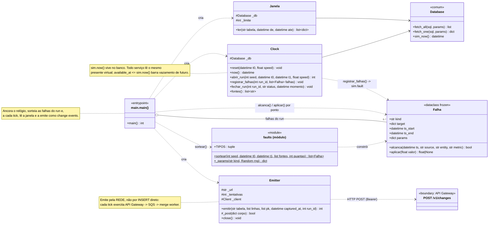
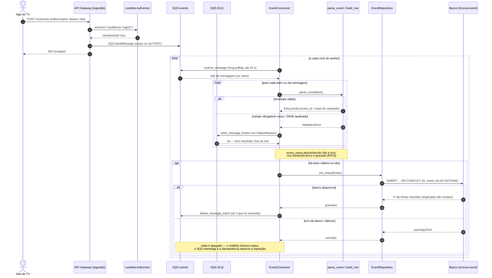
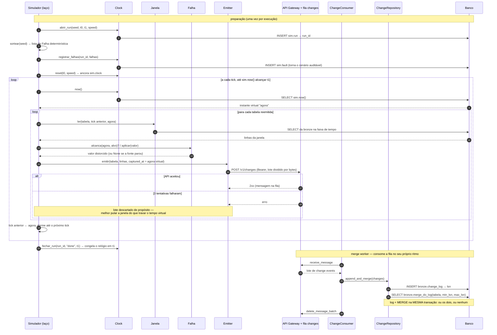
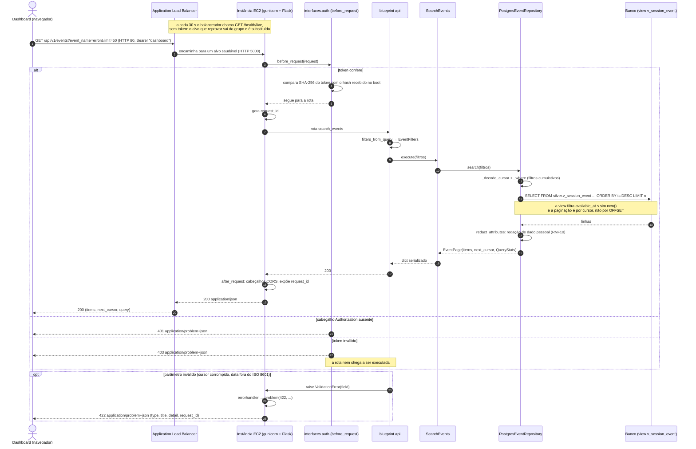
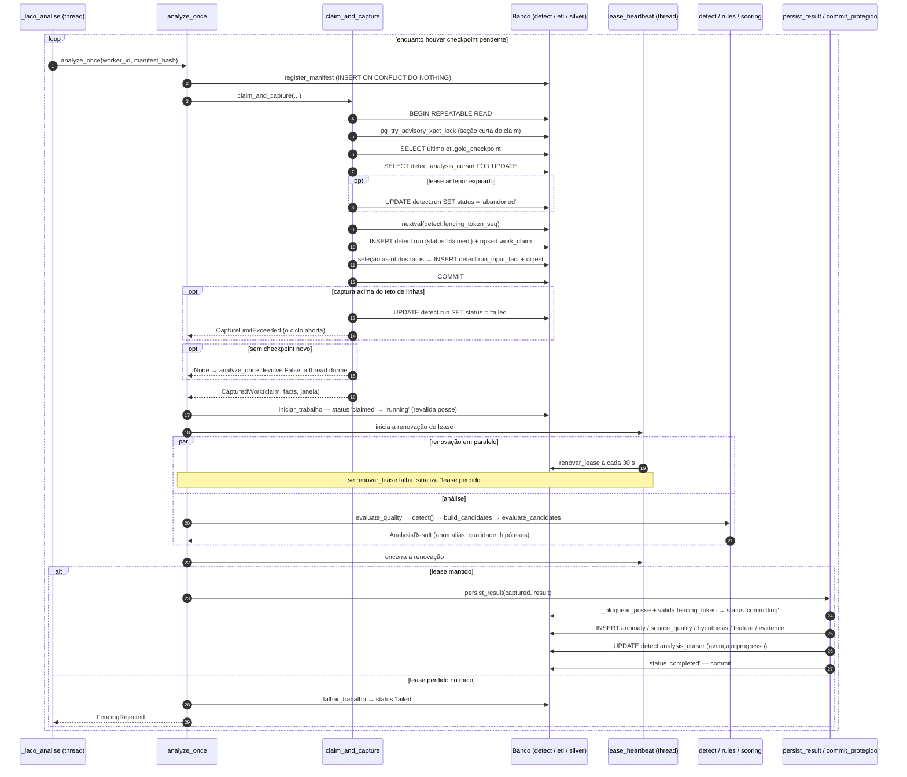

# Modelagem de Software

&emsp;Este documento reúne a modelagem de software da Plataforma Argus em três
visões complementares. Os casos de uso descrevem o comportamento observável do
sistema a partir dos seus atores. O diagrama de classes detalha o modelo de
domínio e o vocabulário das aplicações. Os diagramas de sequência acompanham,
passo a passo, os principais fluxos de execução. As três se apoiam umas nas
outras: um único caso de uso costuma mobilizar classes de mais de um serviço, e é
no diagrama de sequência que a ordem dessa colaboração fica visível.

---

## 1. Casos de uso

### 1.1 Objetivo e fronteira

&emsp;Esta seção descreve o comportamento da Plataforma Argus a partir do
diagrama de casos de uso e dos requisitos já definidos para o projeto (GRUPO
GLOBO; INTELI, 2026). O foco está nas interações observáveis entre a plataforma,
as fontes de telemetria, o usuário operacional, o evento temporal que inicia o
processamento e o serviço de apoio à observabilidade.

&emsp;As descrições foram escritas em nível essencial: apresentam a intenção dos
atores e as responsabilidades do sistema, sem transformar decisões internas de
implementação em passos do usuário. Detalhes técnicos aparecem apenas em
Requisitos especiais, quando representam restrições de segurança, desempenho,
confiabilidade, rastreabilidade ou qualidade dos dados.

&emsp;A fronteira considerada vai do recebimento da telemetria até a
apresentação de evidências e o registro da avaliação humana. A correção da
aplicação monitorada, o tratamento de chamados e a execução de mudanças em
produção ficam fora dela.

### 1.2 Atores

| Ator | Tipo | Responsabilidade e interesse principal |
|---|---|---|
| Fontes de telemetria | Sistema externo | Publicar eventos de sessão e mudanças das fontes monitoradas para que sejam armazenados e analisados pelo Argus. |
| Novo checkpoint disponível | Evento temporal | Informar que uma nova fotografia consistente da camada analítica está pronta para processamento. Não representa uma pessoa, mas o estímulo temporal que inicia o UC02. |
| Usuário Operacional | Ator humano principal | Monitorar a plataforma, explorar dados e investigar degradações. Abrange, sobretudo, os perfis de Engenharia de Observabilidade e Suporte N2 definidos no [entendimento de UX](entendimento_ux.md) (EQUIPE ARGUS, 2026b). |
| Amazon CloudWatch | Sistema de apoio | Disponibilizar logs, métricas e alarmes sobre a saúde da ingestão e dos componentes da plataforma. |

O Usuário Operacional aparece duas vezes no diagrama, o que serve apenas para reduzir o cruzamento de associações. As duas figuras são o mesmo papel, com as mesmas permissões conceituais.

### 1.3 Diagrama de casos de uso

<p align="center"><sub>Figura 1 - Diagrama de casos de uso da Plataforma Argus</sub></p>

<div align="center">


</div>

<p align="center"><sup>Fonte: autoria própria (2026).</sup></p>

O diagrama separa os comportamentos em três grupos. Em Processamento Automático ficam a entrada e a análise contínua da telemetria, que correm sem intervenção. Monitoramento e Investigação Inicial reúne o que ajuda o operador a perceber um problema e começar a apurá-lo. Diagnóstico e Avaliação guarda os aprofundamentos: explicar, delimitar e depois revisar uma degradação.

#### 1.3.1 Relações entre os casos de uso

| Caso base | Relação | Caso relacionado | Interpretação |
|---|---|---|---|
| UC02 - Processar telemetria e detectar | `<<include>>` | UC03 - Produzir hipóteses de causa provável | Toda execução válida tenta produzir explicações candidatas; o resultado pode conter zero hipóteses quando não há evidência suficiente. |
| UC06 - Investigar uma degradação | `<<include>>` | UC07 - Identificar e ajustar o recorte afetado | Delimitar a população afetada faz parte de toda investigação. |
| UC06 - Investigar uma degradação | `<<include>>` | UC08 - Comparar com períodos anteriores | Toda investigação confronta a janela atual com uma referência adequada. |
| UC06 - Investigar uma degradação | `<<extend>>` | UC10 - Analisar hipóteses de causa provável | A análise de hipóteses ocorre quando existem hipóteses publicadas e o operador decide aprofundá-las. |
| UC06 - Investigar uma degradação | `<<extend>>` | UC11 - Reconstruir a timeline do incidente | A reconstrução temporal é usada quando a ordem dos sinais e mudanças é relevante para o diagnóstico. |
| UC07 - Identificar e ajustar o recorte afetado | `<<extend>>` | UC12 - Consultar a trajetória de uma sessão | Uma sessão representativa pode ser aberta para validar o comportamento observado no agregado. |
| UC10 - Analisar hipóteses de causa provável | `<<extend>>` | UC13 - Registrar validade sobre uma hipótese | Depois de avaliar as evidências, o operador pode registrar sua conclusão sobre a hipótese. |

Em UML, `<<include>>` indica um comportamento obrigatório do caso base e `<<extend>>` representa um comportamento condicional, executado somente quando sua condição de extensão é satisfeita (OBJECT MANAGEMENT GROUP, 2017).

### 1.4 Visão geral e rastreabilidade

| ID | Caso de uso | Ator iniciador | Relação principal | Requisitos relacionados |
|---|---|---|---|---|
| UC01 | Ingerir telemetria | Fontes de telemetria | Independente | RF01 a RF07; RNF01, RNF03 a RNF06, RNF09 a RNF11 |
| UC02 | Processar telemetria e detectar | Novo checkpoint disponível | Inclui UC03 | RF15 e RF17; RNF04, RNF05 e RNF11 |
| UC03 | Produzir hipóteses de causa provável | UC02 | Incluído por UC02 | RF17 e RNF08 |
| UC04 | Monitorar o estado atual da plataforma | Usuário Operacional | Independente | RF12, RF13, RF15 e RF16 |
| UC05 | Explorar a telemetria coletada | Usuário Operacional | Independente | RF08 a RF12 |
| UC06 | Investigar uma degradação | Usuário Operacional | Inclui UC07 e UC08; pode ser estendido por UC10 e UC11 | RF13 a RF17 |
| UC07 | Identificar e ajustar o recorte afetado | UC06 | Incluído por UC06; pode ser estendido por UC12 | RF08 a RF11 e RF16 |
| UC08 | Comparar com períodos anteriores | UC06 | Incluído por UC06 | RF14 |
| UC09 | Acompanhar a integridade da ingestão | Usuário Operacional | Apoiado pelo Amazon CloudWatch | RNF04, RNF05 e RNF11 |
| UC10 | Analisar hipóteses de causa provável | Usuário Operacional | Extensão de UC06; pode ser estendido por UC13 | RF17 e RNF08 |
| UC11 | Reconstruir a timeline do incidente | Usuário Operacional | Extensão de UC06 | RF16; US01 |
| UC12 | Consultar a trajetória de uma sessão | Usuário Operacional | Extensão de UC07 | RF08 e RF16; US06 e US08 |
| UC13 | Registrar validade sobre uma hipótese | Usuário Operacional | Extensão de UC10 | RF17 |

A rastreabilidade indica afinidade entre cada caso de uso e os [requisitos](requisitos.md) (EQUIPE ARGUS, 2026c), sem impor uma relação de um para um. Um requisito pode participar de mais de um objetivo do usuário, assim como um caso de uso pode reunir vários requisitos complementares.

### 1.5 Descrições dos casos de uso

&emsp;As descrições seguem o gabarito de Cockburn (2001): escopo e nível, atores,
interessados, pré e pós-condições, fluxo básico, fluxos alternativos e exceções,
requisitos especiais e, por fim, variantes, frequência e questões ainda abertas.

#### 1.5.1 UC01 - Ingerir telemetria

**Escopo e nível.** Plataforma Argus, da recepção de um evento até sua persistência rastreável na camada de entrada. Objetivo de sistema externo.

**Atores.** Iniciador: Fontes de telemetria. Apoio: serviço de autorização e infraestrutura de mensageria, ambos internos à fronteira do Argus.

**Interessados e interesses.** As fontes querem entregar dados sem depender da capacidade instantânea de processamento; o operador precisa de dados íntegros e recentes; a plataforma depende de reprocessamento, idempotência e falhas rastreáveis; segurança exige autenticação e ausência de dado pessoal desnecessário.

**Pré-condições.** A fonte conhece o contrato da rota, tem credencial válida com audiência de ingestão e o endpoint está publicado. Para eventos de mudança, a tabela de origem e a chave da linha precisam pertencer ao catálogo aceito.

**Pós-condições.** Com sucesso, o evento foi aceito, enfileirado, validado e persistido no histórico de entrada. Com falha, nenhum estado válido anterior é corrompido e o motivo pode ser localizado por logs, métricas ou pela fila de mensagens não processadas.

**Fluxo básico.**

1. A fonte prepara um evento conforme o contrato aplicável.
2. A fonte o envia ao ponto único de ingestão por conexão segura, apresentando sua credencial.
3. O Argus autentica a origem e identifica se o conteúdo é um evento de sessão ou uma mudança de dado monitorado.
4. O Argus aceita a mensagem e a encaminha ao fluxo assíncrono correspondente.
5. O consumidor valida envelope, identificadores, instante, tipo e demais campos obrigatórios.
6. O Argus registra o evento no histórico de entrada e atualiza a visão corrente quando aplicável.
7. O consumidor confirma o processamento e registra métricas e rastreabilidade.

**Fluxos alternativos e exceções.**

- A1. Evento de sessão: traz a trajetória de uso do cliente e é persistido com os identificadores de evento, sessão e dispositivo.
- A2. Evento de mudança: informa operação, chave, estado anterior e posterior, posição da origem e instante de captura; entra no log de mudanças e materializa a versão mais recente.
- A3. Reentrega: a mensagem repetida é reconhecida pela identidade ou pela posição, sem duplicar o estado lógico.
- A4. Mudança fora de ordem: fica rastreável no histórico, mas não sobrescreve o estado corrente mais novo.
- E1. Credencial ausente ou inválida: a requisição é recusada antes de alcançar a fila.
- E2. Payload inválido: o consumidor rejeita a mensagem, registra o motivo e continua processando as válidas.
- E3. Falha temporária de persistência: a mensagem volta à fila e, passado o limite de tentativas, segue para a fila de mensagens não processadas.
- E4. Fonte ou operação não permitida: o evento não altera as tabelas correntes e fica registrado.

**Requisitos especiais.** Suportar pelo menos 1.000 requisições por minuto; autenticar com audiência exclusiva de ingestão; tolerar reentregas; preservar a ordem lógica pela posição da origem; não perder silenciosamente mensagens já aceitas; e produzir rastreabilidade sem registrar tokens ou dados pessoais desnecessários.

**Variantes, frequência e questões abertas.** Rotas de sessão e de mudança; plataformas web, móveis e TVs; eventos `request`, `vitals`, `screen_view`, `video_view`, `session` e `error`. Ocorrência contínua, no volume das fontes. Em aberto: a lista definitiva de plataformas do MVP, a retenção dos dados de entrada e a calibragem dos limites de reentrega e capacidade com volume de produção.

#### 1.5.2 UC02 - Processar telemetria e detectar

**Escopo e nível.** Plataforma Argus, do reconhecimento de um novo checkpoint analítico até a publicação de uma execução consistente de qualidade, detecção e hipóteses. Objetivo de processamento automático.

**Atores.** Iniciador: Novo checkpoint disponível. O serviço de processamento executa o comportamento dentro da fronteira do Argus.

**Interessados e interesses.** O operador precisa que as degradações sejam detectadas com os dados que realmente estariam disponíveis naquele instante; a equipe de dados quer resultados reproduzíveis; a plataforma precisa evitar publicação duplicada ou incompleta diante de concorrência, falha ou retomada de workers.

**Pré-condições.** Um checkpoint Gold foi concluído com `ready_through` e posição de origem conhecidas; existe um manifesto de análise habilitado; e as versões de fatos até a barreira do checkpoint estão disponíveis.

**Pós-condições.** Com sucesso, a execução guarda a fotografia de entrada, o resultado de qualidade, o estado do baseline, as anomalias e as hipóteses, e avança o cursor de análise na mesma confirmação protegida. Com falha, nada é publicado como concluído nem o cursor avança.

**Fluxo básico.**

1. Um novo checkpoint analítico fica disponível.
2. O Argus identifica o checkpoint elegível ainda não concluído para o manifesto ativo.
3. Reserva o trabalho, define o instante simulado e a posição máxima da origem e obtém uma concessão temporária exclusiva.
4. Captura uma fotografia com os fatos de versão e disponibilidade compatíveis com o checkpoint.
5. Calcula e registra um resumo verificável das entradas.
6. Avalia a qualidade e a recência de cada fonte.
7. Compara as séries com seus baselines causais e identifica anomalias materiais.
8. Executa o UC03.
9. Confirma, numa única operação protegida, os resultados e o avanço do cursor.
10. Publica métricas de duração, volume, anomalias, hipóteses, atraso e fila de checkpoints.

**Fluxos alternativos e exceções.**

- A1. Nenhum checkpoint novo: o ciclo termina sem criar execução.
- A2. Trabalho já reservado: outra réplica mantém concessão válida e a atual não repete o checkpoint.
- A3. Retomada: concessão expirada libera o checkpoint para outra réplica, com novo token de exclusão.
- A4. Nenhuma anomalia material: conclui com resultado vazio de incidentes e hipóteses, preservando qualidade e baseline.
- A5. Fonte atrasada ou incompleta: o canário registra o estado da fonte; a ausência reduz cobertura e pode virar diagnóstico de qualidade, sem inventar degradação operacional.
- E1. Fotografia acima do limite: a tentativa termina com `input_limit_exceeded`, sem truncar entradas em silêncio.
- E2. Resumo de entrada divergente numa retentativa: termina com `input_digest_mismatch` e o cursor não avança.
- E3. Perda de concessão ou de token de exclusão: o worker antigo não publica seus resultados.
- E4. Falha de cálculo ou de banco: a transação final é revertida e o checkpoint segue elegível.

**Requisitos especiais.** Respeitar a causalidade (`available_at` menor ou igual ao instante da execução), o isolamento consistente, o determinismo e a idempotência; concessão de 120 segundos, heartbeat de 30 segundos, limite de 250 mil fatos por fotografia e confirmação protegida por fencing (o número crescente que impede um worker antigo de gravar). O processamento deve terminar antes que o acúmulo de checkpoints comprometa a atualidade do diagnóstico.

**Variantes, frequência e questões abertas.** Execução simulada ou ao vivo; primeira tentativa ou retomada; fonte saudável, atrasada, incompleta, silenciosa ou desconhecida. Uma execução por checkpoint elegível, com consulta a trabalho novo a cada 30 segundos. Em aberto: calibrar limites de anomalia com dados de produção, medir se cada execução conclui antes do próximo checkpoint e definir a retenção dos artefatos analíticos.

#### 1.5.3 UC03 - Produzir hipóteses de causa provável

**Escopo e nível.** Motor de hipóteses do Argus, das anomalias detectadas até a persistência de explicações candidatas e suas evidências. Subfunção incluída no processamento automático.

**Atores.** Iniciador indireto: UC02.

**Interessados e interesses.** O operador quer uma lista curta, ordenada e explicável de possíveis causas; observabilidade precisa entender por que uma hipótese recebeu determinada pontuação; o parceiro quer evitar afirmação conclusiva sem validação humana; a equipe de dados exige resultados reproduzíveis e temporalmente corretos.

**Pré-condições.** Existe uma execução com fotografia consistente, resultados do canário e ao menos a avaliação do detector. O catálogo de regras, métricas, fontes e relações entre entidades está versionado.

**Pós-condições.** As hipóteses geradas, descartadas ou não avaliáveis são persistidas com estado, pontuação, cobertura, confiança, fatores, evidências, versão das regras e vínculo com a execução. Nenhuma é marcada automaticamente como causa confirmada.

**Fluxo básico.**

1. O motor recebe as anomalias e o contexto da fotografia da execução.
2. Agrupa achados relacionados, sem obrigar que cada achado pertença a um só grupo.
3. Avalia as assinaturas das famílias de hipótese aplicáveis.
4. Para cada candidata, coleta evidências favoráveis, contrárias e indisponíveis, respeitando alinhamento temporal e relação conhecida entre entidades.
5. Calcula força, coincidência temporal, corroboração, especificidade, impacto e qualidade.
6. Aplica penalidades, calcula score, cobertura e confiança e registra a contribuição de cada fator.
7. Classifica a candidata como gerada, descartada ou com evidência insuficiente.
8. Ordena as hipóteses geradas e persiste candidatos, fatores, evidências e estatísticas. Com a execução concluída, as hipóteses geradas ficam disponíveis para análise humana nas visões de leitura.

**Fluxos alternativos e exceções.**

- A1. Evidência suficiente: a hipótese atinge os limites de score e cobertura, é classificada como gerada e fica visível para revisão assim que a execução conclui; a promoção do manifesto pelo portão de qualidade fica registrada como evento de auditoria.
- A2. Evidência indisponível: a ausência é registrada, reduz a cobertura e não vira contradição.
- A3. Evidência contrária determinante: a candidata é descartada, com a justificativa preservada.
- A4. Pico ao vivo esperado: volume que cresce durante um evento compatível, sem piora proporcional de erro ou experiência, vira contexto e não degradação.
- A5. Problema na própria fonte: baixa qualidade gera hipótese de atraso ou falha de dados, separada das causas operacionais.
- E1. Catálogo ou manifesto inválido: a execução não conclui, nenhuma hipótese fica visível e o erro de configuração fica registrado.
- E2. Limite de candidatos excedido: o corte determinístico é aplicado e auditado nas estatísticas da execução; truncamento incompatível com o portão de qualidade impede promover o manifesto, e a recusa fica registrada sem ocultar as hipóteses geradas dentro do teto.
- E3. Relação semântica desconhecida: sem ligar entidades por aproximação textual, a evidência fica não relacionada.
- E4. Falha ao persistir: a transação é desfeita e nenhum resultado parcial fica visível.

**Nota de revisão (24/09/2026).** Até 23/09/2026, a visibilidade dependia da publicação do manifesto. As migrations `032_hypotheses_visible_on_generation.sql` e `033_all_generated_hypothesis_revisions.sql` mudaram a regra: toda hipótese gerada em execução concluída aparece nas visões de leitura, respeitando o relógio virtual, e os eventos de publicação passaram a servir de auditoria do manifesto. Nenhuma hipótese continua a ser marcada como causa confirmada sem validação humana. Os testes CT01b, CT29 e CT13c de `testes-funcionais.md` verificam a regra atual.

**Requisitos especiais.** Toda hipótese parte de ao menos uma detecção, usa somente evidências disponíveis no instante analisado e mantém linguagem não conclusiva; a mesma entrada e configuração geram o mesmo resultado. Hipótese gerada exige score mínimo de 40 e cobertura mínima de 0,50; confiança alta exige score 80, cobertura 0,80 e qualidade 0,70. Os tetos são de 10 mil candidatos, 2 mil por família e 500 hipóteses geradas por execução.

**Variantes, frequência e questões abertas.** As 11 famílias cobrem regressão após deploy, falha interna de backend, playback ou autorização, degradação de CDN, origem ou encoding, região ou ISP, bloqueio de WAF, player ou dispositivo, qualidade de experiência sem erro explícito, pico ao vivo esperado e atraso ou falha de fonte. Uma tentativa por execução válida do UC02. Em aberto: validar pesos e limites com especialistas, ampliar o conjunto rotulado para medir precisão e cobertura e revisar as relações entre entidades conforme o catálogo evoluir.

#### 1.5.4 UC04 - Monitorar o estado atual da plataforma

**Escopo e nível.** Dashboard Argus, na visão consolidada do estado operacional atual. Objetivo do usuário.

**Atores.** Iniciador: Usuário Operacional.

**Interessados e interesses.** Observabilidade quer reconhecer desvios relevantes rapidamente; Suporte N2 quer saber se um relato isolado coincide com uma degradação ampla; produto e operação precisam entender impacto e abrangência sem interpretar dados brutos.

**Pré-condições.** O usuário tem acesso de leitura autorizado; existe uma janela temporal corrente; e há dados publicados nas visões de consulta, ainda que alguma fonte esteja atrasada ou indisponível.

**Pós-condições.** O usuário vê uma fotografia coerente do estado atual, com sinais, severidade, tendência, baseline e escopo. A consulta não altera dados, e período e filtros ficam disponíveis para aprofundamento.

**Fluxo básico.**

1. O usuário abre a visão atual do dashboard.
2. O Argus identifica o instante de referência, o período e o escopo ativos.
3. O sistema consulta sinais e anomalias publicados para essa janela.
4. O Argus apresenta os principais indicadores e destaca as degradações por severidade e impacto.
5. O usuário seleciona um sinal para ver valor atual, referência, limiar, tendência e contexto.
6. O Argus mostra os detalhes e os caminhos para hipóteses, timeline e recorte.
7. O usuário encerra o acompanhamento ou inicia o UC06.

**Fluxos alternativos e exceções.**

- A1. Operação sem degradação: estado saudável, com atualidade e cobertura das fontes à vista.
- A2. Mais de uma degradação: os sinais saem ordenados por severidade e impacto.
- A3. Mudança de período ou escopo: os filtros cumulativos são preservados e os indicadores recalculados.
- A4. Dados parciais ou antigos: o último resultado válido é mantido, marcado como parcial ou desatualizado.
- E1. Falha ou timeout: falha é distinguida de resultado vazio, com referência rastreável e nova tentativa.
- E2. Resposta inválida: os dados não são apresentados como válidos e o usuário recebe mensagem compreensível.
- E3. Acesso não autorizado: a visualização é impedida, sem expor dados operacionais.

**Requisitos especiais.** Consultas simples respondem em até cinco segundos. A tela distingue carregamento, atualização, vazio, parcial, desatualizado e erro; funciona por teclado; apresenta nomes acessíveis; respeita redução de movimento; e evita expor identificadores ou atributos pessoais desnecessários.

**Variantes, frequência e questões abertas.** Janelas de 15 minutos, 30 minutos, 3 horas e 24 horas; temas claro e escuro; escopo por plataforma, fabricante, região e versão do aplicativo. Uso frequente durante todo o turno. Em aberto: validar com o parceiro os limiares e nomes de severidade e definir quais degradações ocupam a visão principal.

#### 1.5.5 UC05 - Explorar a telemetria coletada

**Escopo e nível.** Dashboard e API de leitura do Argus, para pesquisa, agrupamento e visualização dos dados coletados. Objetivo do usuário.

**Atores.** Iniciador: Usuário Operacional.

**Interessados e interesses.** O operador quer responder perguntas pontuais sem escrever consultas técnicas; Suporte N2 precisa localizar padrões por sessão, dispositivo, plataforma ou erro; observabilidade quer avaliar volume, distribuição e comportamento temporal; segurança exige dimensões controladas.

**Pré-condições.** O usuário está autorizado; existe telemetria publicada para leitura; e as dimensões consultáveis estão registradas em uma lista segura.

**Pós-condições.** O Argus apresenta o conjunto, a série ou o agrupamento do período e dos filtros escolhidos, preserva o estado da investigação para refinamento e não altera dado de origem.

**Fluxo básico.**

1. O usuário abre a área de exploração.
2. O Argus apresenta a janela temporal atual, os filtros ativos e um resumo dos dados disponíveis.
3. O usuário escolhe um tipo de evento ou métrica.
4. O usuário aplica um ou mais filtros de escopo.
5. O usuário escolhe como agrupar ou cruzar os resultados.
6. O Argus valida os parâmetros e consulta as visões publicadas.
7. O sistema apresenta indicadores, série temporal e distribuição por grupo, mantendo visíveis período, filtros e unidade.
8. O usuário refina a consulta, abre um recorte relevante ou encerra a exploração.

**Fluxos alternativos e exceções.**

- A1. Sugestão de filtros: só valores existentes e permitidos são oferecidos.
- A2. Filtros cumulativos: cada filtro restringe a consulta anterior; remover ou limpar recalcula.
- A3. Outro agrupamento: fonte, entidade, métrica, tipo, modelo, versão, rota ou intervalo de tempo.
- A4. Resultado paginado: um cursor continua a leitura sem repetir nem saltar registros.
- A5. Nenhum resultado: o recorte vazio é informado e os filtros podem ser revistos.
- E1. Dimensão ou intervalo inválido: a API recusa com erro de validação e o dashboard preserva o estado anterior.
- E2. Timeout, rede indisponível ou resposta inválida: o tipo de falha é identificado e nova tentativa é oferecida.
- E3. Campo sensível: a dimensão não autorizada é recusada e seus valores não viram sugestão.

**Requisitos especiais.** Consultas simples retornam em até cinco segundos; filtros são cumulativos; datas usam UTC e ISO 8601 no contrato (INTERNATIONAL ORGANIZATION FOR STANDARDIZATION, 2019); dimensões seguem lista permitida; a paginação é estável; e os estados de carregamento, vazio e erro são acessíveis e distintos.

**Variantes, frequência e questões abertas.** Eventos ou séries Gold; lista, indicador, gráfico temporal, agrupamento ou matriz de duas dimensões; filtros de sessão, dispositivo, tipo, aplicativo, sistema operacional, fabricante, modelo, rota, fonte, entidade e métrica. Uso sob demanda, várias vezes por investigação. Em aberto: quais dimensões regionais e de ISP podem ser combinadas, a busca segura por códigos em atributos livres e os limites de paginação com o volume definitivo.

#### 1.5.6 UC06 - Investigar uma degradação

**Escopo e nível.** Plataforma Argus, da seleção de uma degradação até a reunião de evidências suficientes para orientar uma decisão humana. Objetivo do usuário.

**Atores.** Iniciador: Usuário Operacional.

**Interessados e interesses.** Observabilidade quer reduzir o tempo de diagnóstico e distinguir causa interna, externa ou de qualidade de dados; Suporte N2 precisa ligar sintomas de usuários a um problema conhecido; o parceiro quer evidências atribuídas às fontes e conclusões apresentadas como hipóteses, não como certezas.

**Pré-condições.** O usuário está autorizado; existe um sinal, anomalia, hipótese ou relato que justifique a investigação; e há ao menos uma janela de dados consultável.

**Pós-condições.** O problema fica descrito por janela, escopo afetado, comparação histórica e evidências. O usuário forma uma conclusão provisória, registra feedback sobre hipótese ou reconhece que faltam dados. A telemetria original não muda.

**Fluxo básico.**

1. O usuário seleciona uma degradação ou parte de um sinal, hipótese, sessão ou relato.
2. O Argus preserva a janela, o escopo e a âncora que originaram a investigação.
3. O sistema apresenta o resumo do problema, com métricas desviantes, severidade, início e impacto conhecido.
4. O Argus executa o UC07.
5. O Argus executa o UC08.
6. O usuário confronta o recorte, a referência histórica e as fontes disponíveis.
7. Quando necessário, o usuário aprofunda por hipótese, timeline ou sessão.
8. O Argus mantém as evidências e sua proveniência vinculadas ao mesmo contexto.
9. O usuário encerra com uma conclusão provisória ou registra que faltam evidências.

**Fluxos alternativos e exceções.**

- A1. Início por sinal: o contexto traz métrica, entidade e instante do desvio.
- A2. Início por hipótese: começa pela explicação candidata, suas evidências e o segmento associado.
- A3. Início por sessão: parte da trajetória individual e amplia para o recorte agregado.
- A4. Hipóteses publicadas: cabe executar o UC10.
- A5. Ordem temporal relevante: cabe executar o UC11.
- A6. Dados parciais: segue com o último resultado válido, com as fontes ou períodos ausentes em destaque.
- E1. Contexto inicial inexistente: a indisponibilidade é informada, com retorno à visão atual.
- E2. Sem referência histórica adequada: prossegue sem comparação, com a limitação registrada.
- E3. Falha numa consulta complementar: os resultados válidos ficam e só a etapa que falhou é repetida.
- E4. Perda de autorização: a investigação é interrompida sem expor dados adicionais.

**Requisitos especiais.** Período, filtros, sinal, hipótese e âncora temporal permanecem coerentes entre as telas. Toda evidência indica fonte e instante. Informação ausente não é apresentada como evidência contrária. A interface evita linguagem conclusiva e permite navegação acessível entre resumo e detalhe.

**Variantes, frequência e questões abertas.** Início por sinal, hipótese, sessão ou monitoramento manual; degradação global ou segmentada; investigação curta pelo resumo ou aprofundada. Ocorre sempre que uma degradação relevante é detectada ou relatada. Em aberto: critérios formais de abertura e encerramento, como compartilhar o contexto entre operadores e a integração com o processo externo de incidentes, que segue fora da fronteira.

#### 1.5.7 UC07 - Identificar e ajustar o recorte afetado

**Escopo e nível.** Área de diagnóstico do Argus que delimita população, entidades e dimensões relacionadas a uma degradação. Subfunção obrigatória de objetivo do usuário.

**Atores.** Iniciador indireto: UC06. Participante: Usuário Operacional.

**Interessados e interesses.** O operador precisa distinguir problema global de concentração em plataforma, modelo, versão, região, rota, entidade ou fonte; Suporte N2 quer reconhecer aparelhos representativos; produto quer estimar alcance sem confundir volume com taxa de erro.

**Pré-condições.** Uma investigação está ativa com janela definida; há dados agregados para pelo menos uma dimensão; e o usuário tem acesso de leitura.

**Pós-condições.** O recorte ativo contém dimensões, valores, janela, volume, participação, taxa e cobertura conhecidos, disponível para comparação, hipóteses, timeline e consulta de sessões.

**Fluxo básico.**

1. O Argus recebe a janela e o escopo da investigação.
2. O sistema apresenta a distribuição do sinal ou dos erros entre as dimensões relevantes.
3. O usuário seleciona uma dimensão com concentração significativa.
4. O Argus aplica o valor escolhido ao conjunto de filtros cumulativos.
5. O sistema recalcula volume, participação no tráfego, participação nos erros, taxa e diferença em relação aos demais grupos.
6. O usuário adiciona, substitui ou remove filtros até obter um recorte explicativo e com cobertura suficiente.
7. O Argus registra o recorte ativo no contexto da investigação.
8. O usuário confirma o recorte ou abre uma sessão representativa pelo UC12.

**Fluxos alternativos e exceções.**

- A1. Sugestões existentes: só valores presentes nos dados, o que reduz filtros inválidos.
- A2. Problema global: nenhuma dimensão concentra o desvio e o recorte segue amplo.
- A3. Mais de um segmento afetado: os grupos são comparados e fica o conjunto que melhor representa o impacto.
- A4. Sessão representativa disponível: cabe executar o UC12.
- A5. Dimensão ausente: a análise segue com menor especificidade e a cobertura fica explícita.
- E1. Combinação não suportada: cruzamento sem contrato ou granularidade compatível é impedido, com a limitação explicada.
- E2. Filtro inválido ou sensível: a consulta é recusada sem expor valores não permitidos.
- E3. Recorte sem dados: o vazio é informado e o último ajuste pode ser desfeito.
- E4. Falha de consulta: o recorte anterior fica visível como último resultado válido, marcado como desatualizado.

**Requisitos especiais.** Filtros cumulativos e reproduzíveis; métricas de participação que distinguem tráfego de erros; valores desconhecidos não formam recortes específicos; dimensões opcionais reduzem cobertura sem invalidar análises que não dependem delas; consultas respeitam as listas seguras de facetas e agrupamentos.

**Variantes, frequência e questões abertas.** Recorte por fonte, entidade, métrica, plataforma, sistema operacional, fabricante, modelo, versão, região, ISP, rota, sessão ou dispositivo; agrupamento simples ou matriz de duas dimensões. Ocorre uma ou mais vezes por investigação. Em aberto: a base traz UF e ISP como dimensões marginais separadas, sem garantir o cruzamento entre elas, e falta validar com o parceiro os mínimos de volume e diferença que tornam um recorte material.

#### 1.5.8 UC08 - Comparar com períodos anteriores

**Escopo e nível.** Área de comparação do Argus, que confronta a janela investigada com uma referência histórica equivalente. Subfunção obrigatória de objetivo do usuário.

**Atores.** Iniciador indireto: UC06. Participante: Usuário Operacional.

**Interessados e interesses.** O operador quer saber o que realmente mudou, sem tomar padrão sazonal por incidente; observabilidade precisa comparar valor, variação e dispersão; produto quer distinguir pico esperado de degradação de experiência.

**Pré-condições.** A investigação tem janela e filtros definidos; existem dados históricos potencialmente comparáveis; e o usuário está autorizado.

**Pós-condições.** A plataforma apresenta janela atual e referência com duração, escopo, valores e variações coerentes, e associa a referência ao contexto da investigação. Sem referência adequada, a limitação fica explícita.

**Fluxo básico.**

1. O Argus recebe a janela e o recorte atuais.
2. O sistema sugere uma referência histórica compatível.
3. O usuário confirma ou escolhe outra referência.
4. O Argus valida se as janelas têm duração, granularidade e filtros comparáveis.
5. O sistema consulta os dados atuais e históricos sem incluir informação posterior ao instante analisado.
6. O Argus apresenta as séries alinhadas, os valores de cada janela, a variação absoluta e percentual e, quando houver, a significância estatística.
7. Destaca mudanças de infraestrutura, eventos editoriais ou diferenças de cobertura entre os períodos.
8. O usuário incorpora a comparação à investigação.

**Fluxos alternativos e exceções.**

- A1. Período imediatamente anterior: janela contígua de mesma duração.
- A2. Ontem ou semana anterior: mesmo horário em outro dia, preservando duração e fuso de apresentação.
- A3. Última janela estável: janela anterior sem incidente compatível.
- A4. Último pico ao vivo: evento editorial anterior comparável.
- A5. Outra referência: janela válida escolhida manualmente.
- E1. Referência não encontrada: a ausência é informada e outra comparação pode ser escolhida.
- E2. Janela ou duração inválida: os parâmetros são recusados e a seleção anterior fica.
- E3. Cobertura desigual: a comparação sai com ressalva ou é bloqueada quando a diferença inviabiliza a leitura.
- E4. Falha de consulta: variações não são calculadas sobre dados parciais tratados como completos.

**Requisitos especiais.** As janelas usam a mesma duração, granularidade, unidade e escopo, salvo quando a diferença for mostrada. Baselines são causais. Horários trafegam em UTC e são apresentados com fuso identificável. Consultas simples concluem em até cinco segundos.

**Variantes, frequência e questões abertas.** Período anterior, ontem no mesmo horário, semana anterior, janela estável, pico ao vivo anterior ou intervalo manual; comparação de contagem, taxa, percentual, latência ou qualidade de experiência. Ao menos uma vez por investigação. Em aberto: o critério definitivo de janela estável, como selecionar eventos ao vivo equivalentes e como tratar mudanças de cobertura entre fontes.

#### 1.5.9 UC09 - Acompanhar a integridade da ingestão

**Escopo e nível.** Operação da Plataforma Argus, com métricas, logs e alarmes para avaliar a saúde do caminho de entrada dos dados. Objetivo do usuário.

**Atores.** Iniciador: Usuário Operacional. Apoio: Amazon CloudWatch.

**Interessados e interesses.** O operador precisa distinguir ausência real de sinal de um atraso ou falha no caminho de entrada; a plataforma quer detectar backlog (o acúmulo de mensagens à espera), mensagens não processadas, serviços indisponíveis e latência crescente; segurança exige observabilidade sem vazar credenciais.

**Pré-condições.** Os componentes publicam métricas e logs operacionais; o usuário tem acesso autorizado à visão correspondente; e o CloudWatch está recebendo as observações configuradas.

**Pós-condições.** O usuário conhece o estado de cada fluxo de ingestão: recência, backlog, falhas e alarmes ativos. Havendo anomalia, a evidência para encaminhar a investigação fica identificada. Nenhuma mensagem é removida manualmente aqui.

**Fluxo básico.**

1. O usuário abre a visão de integridade da ingestão ou recebe indicação de um alarme.
2. O Argus consulta o estado publicado das fontes, filas, consumidores e persistência, com métricas, logs e alarmes vindos do CloudWatch.
3. A plataforma apresenta recência, volume recebido, backlog, tentativas, mensagens não processadas, saúde dos serviços e atraso dos checkpoints.
4. O usuário compara o comportamento atual com os limites operacionais.
5. O usuário seleciona um componente ou uma fonte com desvio.
6. O Argus mostra a referência da falha, o período e a evidência disponível.
7. O usuário registra ou encaminha a ocorrência pelo processo operacional externo.

**Fluxos alternativos e exceções.**

- A1. Operação saudável: fluxos dentro dos limites e filas de mensagens não processadas vazias.
- A2. Atraso estrutural conhecido: a latência esperada da fonte é distinguida de um atraso anormal.
- A3. Backlog transitório: a fila cresce, mas os consumidores avançam; a recuperação é acompanhada antes de elevar a severidade.
- A4. Falha de uma fonte: os resultados dependentes são marcados como parciais, para que silêncio não seja lido como melhora.
- E1. CloudWatch indisponível: a falta da observabilidade de apoio é informada e a ingestão não é declarada saudável.
- E2. Consumidor sem progresso: heartbeat ausente, idade da fila e mensagens em falha ficam em destaque.
- E3. Persistência indisponível: as mensagens aguardam nova tentativa e, passado o limite, são isoladas de forma rastreável.
- E4. Métricas incoerentes: tratadas como problema de observabilidade, não como perda de dados confirmada.

**Requisitos especiais.** Logs estruturados com identificador de requisição, componente, status e latência. Tokens nunca são registrados e parâmetros sensíveis são redigidos. Os alarmes cobrem filas de falha, idade e backlog das filas, réplicas abaixo do desejado, falhas consecutivas de análise, perda de concessão e ausência prolongada de execução concluída.

**Variantes, frequência e questões abertas.** Fluxo de eventos de sessão ou de mudanças; acompanhamento preventivo ou iniciado por alarme; falha na API, fila, worker, banco, processamento ou na própria observabilidade. Acompanhamento contínuo por métricas e alarmes, com consulta humana recorrente. Em aberto: validar limites de alarme com a carga real, definir metas de atualidade por fonte e documentar o reprocessamento das filas de falha.

#### 1.5.10 UC10 - Analisar hipóteses de causa provável

**Escopo e nível.** Dashboard e API de hipóteses do Argus, da listagem das explicações candidatas até a avaliação detalhada de uma delas. Extensão de objetivo do usuário.

**Atores.** Iniciador: Usuário Operacional, durante o UC06.

**Interessados e interesses.** O operador quer priorizar caminhos de investigação e entender cada evidência; especialistas precisam distinguir suporte, contradição e indisponibilidade; o parceiro exige que a solução apoie, e não substitua, a decisão humana.

**Pré-condições.** Existe uma investigação ativa; há execução publicada do motor de hipóteses compatível com a janela; e o usuário tem autorização de leitura.

**Pós-condições.** O usuário compreende a hipótese selecionada: score, confiança, cobertura, fatores, evidências e limitações. A seleção pode orientar timeline, recorte ou registro de validade, e a consulta não altera o estado de revisão.

**Fluxo básico.**

1. O usuário solicita as hipóteses associadas à investigação.
2. O Argus lista as hipóteses publicadas em ordem de relevância, com resumo do escopo e das fontes.
3. O usuário seleciona uma hipótese.
4. O sistema apresenta a explicação candidata, o estado da revisão e a execução que a produziu.
5. O Argus detalha score, confiança, cobertura e contribuição dos fatores.
6. O sistema separa evidências favoráveis, contrárias e indisponíveis, indicando origem e instante.
7. O usuário confronta a hipótese com o recorte e a comparação da investigação.
8. O usuário abre a âncora na timeline, revisa o recorte ou executa o UC13.

**Fluxos alternativos e exceções.**

- A1. Confiança alta, média ou baixa: o nível fica claro na ordenação e na tela, sem virar certeza.
- A2. Evidência insuficiente: a candidata aparece como não avaliável, com o que faltou.
- A3. Hipótese descartada: exibida para auditoria com a evidência contrária e o motivo, separada das geradas.
- A4. Revisão posterior: aparece a revisão mais recente elegível, com referência à versão substituída.
- A5. Nenhuma hipótese publicada: a investigação continua por recorte, comparação e timeline.
- E1. Hipótese inexistente ou não publicada: a indisponibilidade é informada sem expor dados internos.
- E2. Timeout ou falha de rede: o contexto é preservado e nova tentativa é oferecida.
- E3. Resposta inválida: a tela recusa o conteúdo e não calcula score ou confiança sobre campos inconsistentes.
- E4. Evidência temporalmente indisponível: o dado não é mostrado como se existisse no instante da execução.

**Requisitos especiais.** A linguagem usa termos como "possível", "provável" ou "as evidências sugerem". A soma das contribuições corresponde ao score e os pesos formam o total esperado. Cada evidência indica fonte, instante e disponibilidade. Apenas execuções concluídas e manifestos publicados chegam ao usuário.

**Variantes, frequência e questões abertas.** Hipótese operacional, de contexto ou de qualidade de dados; confiança alta, média ou baixa; estado não revisado, confirmado, parcialmente confirmado ou rejeitado. Uso sob demanda, para cada degradação com hipóteses publicadas. Em aberto: validar a redação com os operadores, definir quando hipóteses descartadas ficam visíveis e medir utilidade e precisão com feedback real.

#### 1.5.11 UC11 - Reconstruir a timeline do incidente

**Escopo e nível.** Área de timeline do Argus, que ordena sinais, mudanças e contexto de várias fontes ao redor de uma degradação. Extensão de objetivo do usuário.

**Atores.** Iniciador: Usuário Operacional, durante o UC06.

**Interessados e interesses.** Observabilidade quer reconhecer precedência e coincidência temporal entre deploy, infraestrutura, backend, experiência, identidade e incidentes; Suporte N2 precisa de uma narrativa compreensível; auditoria quer preservar a fonte de cada item.

**Pré-condições.** Existe uma investigação com janela ou âncora temporal; ao menos uma fonte tem dados disponíveis; e o usuário está autorizado.

**Pós-condições.** O usuário vê uma cronologia ordenada, atribuída às fontes e limitada à disponibilidade temporal da investigação, útil para avaliar hipóteses ou ajustar o recorte, sem alterar os eventos originais.

**Fluxo básico.**

1. O usuário abre a timeline a partir da investigação.
2. O Argus recupera a âncora, a janela e o escopo ativos.
3. O sistema consulta sinais e eventos disponíveis nas fontes relacionadas.
4. O Argus normaliza os instantes para uma escala comum, preservando horário e granularidade originais.
5. O sistema ordena os itens e os distribui por fonte ou domínio operacional.
6. A plataforma apresenta a timeline visual e uma cronologia textual equivalente.
7. O usuário seleciona um item para ler valor, descrição, origem e relação com a degradação.
8. O usuário ajusta a janela, volta à hipótese ou segue pelo recorte.

**Fluxos alternativos e exceções.**

- A1. Abertura por hipótese: a timeline é centralizada no instante de referência da hipótese.
- A2. Abertura por sinal: a cronologia destaca a série e a entidade em desvio.
- A3. Fonte sem eventos na janela: a raia fica marcada como vazia ou indisponível, sem se confundir com normalidade.
- A4. Granularidades diferentes: os dados vão para o intervalo compatível, com a precisão declarada da fonte.
- A5. Janela ampliada: o período cresce para procurar causas anteriores ou efeitos posteriores.
- E1. Âncora ou intervalo inválido: o Argus pede uma janela válida e preserva o contexto anterior.
- E2. Falha parcial de fonte: os demais itens são apresentados com aviso de cobertura incompleta.
- E3. Nenhuma fonte disponível: a timeline não é reconstruída, e cronologia vazia não vira evidência.
- E4. Falha de consulta: a tela mostra referência rastreável e permite nova tentativa.

**Requisitos especiais.** Ordenação determinística, com fonte e horário à vista, respeitando `available_at` e sem misturar relógio real de infraestrutura com relógio simulado sem identificação. A representação visual tem alternativa textual acessível e funciona em telas estreitas.

**Variantes, frequência e questões abertas.** Timeline iniciada por sinal ou hipótese; janela curta ou ampliada; fontes de experiência, Prometheus, New Relic, Apollo, Tsuru, identidade, atendimento ou eventos ao vivo; visão por raias ou cronologia textual. Uso sob demanda, sobretudo quando a sequência dos fatos diferencia causas concorrentes. Em aberto: consolidar o conjunto de raias, relacionar entidades de fontes diferentes sem correspondência explícita e definir o detalhe adequado para janelas longas.

#### 1.5.12 UC12 - Consultar a trajetória de uma sessão

**Escopo e nível.** Consulta de eventos do Argus, para reconstruir a sequência individual de uma sessão ou, como variação, o histórico de um dispositivo. Extensão de subfunção de investigação.

**Atores.** Iniciador: Usuário Operacional, a partir do UC07.

**Interessados e interesses.** Suporte N2 quer entender o que ocorreu antes e depois de um erro relatado; observabilidade quer validar se o padrão agregado aparece numa trajetória real; privacidade exige expor apenas os atributos necessários.

**Pré-condições.** O usuário está autorizado; o recorte tem uma sessão ou dispositivo representativo; e o identificador escolhido está disponível na consulta.

**Pós-condições.** O usuário vê os eventos ordenados e os atributos permitidos da sessão ou do dispositivo, com a trajetória ligada ao recorte que a originou. Nenhum dado é alterado.

**Fluxo básico.**

1. O usuário seleciona uma sessão representativa no recorte.
2. O Argus valida o identificador e consulta os eventos da sessão.
3. O sistema ordena os eventos pelo instante de ocorrência, resume dispositivo e aplicativo e destaca início, navegação, reprodução, requisições e erros.
4. O usuário seleciona um evento para consultar seus detalhes permitidos.
5. O sistema apresenta tipo, instante, código de erro, duração, rota e contexto técnico disponível.
6. O usuário relaciona a trajetória ao comportamento agregado e volta ao recorte ou à investigação.

**Fluxos alternativos e exceções.**

- A1. Histórico do dispositivo: a análise se amplia para outras sessões do mesmo aparelho, dentro de janela autorizada.
- A2. Sessão longa: os eventos são paginados, com continuação estável.
- A3. Evento sem atributos opcionais: saem os campos disponíveis, sem preencher ausências por inferência.
- A4. Relógio divergente: possível `clock_skew` é sinalizado, com os instantes recebidos e de ingestão preservados.
- E1. Sessão ou dispositivo inexistente: a API devolve não encontrado e a interface mantém o recorte anterior.
- E2. Evento não pertence à sessão: o detalhe não é retornado.
- E3. Limite ou cursor inválido: a consulta é recusada com orientação para corrigir o parâmetro.
- E4. Atributo sensível: o campo é omitido ou redigido antes da apresentação.

**Requisitos especiais.** Ordem determinística e paginação sem duplicidade. Campos identificadores só quando necessários. O dashboard não expõe dados pessoais desnecessários. Os estados de carregamento, vazio, não encontrado e erro são distintos e acessíveis.

**Variantes, frequência e questões abertas.** Consulta por sessão ou dispositivo; sessão completa ou paginada; trajetória com ou sem erro; com ou sem divergência de relógio. Uso sob demanda durante triagens e investigações. Em aberto: quais identificadores podem ser expostos a cada perfil, a política de retenção e anonimização e quantas sessões compõem uma amostra representativa.

#### 1.5.13 UC13 - Registrar validade sobre uma hipótese

**Escopo e nível.** API de feedback e histórico de revisões do Argus, para registrar a avaliação humana de uma hipótese publicada. Extensão de objetivo do usuário.

**Atores.** Iniciador: Usuário Operacional, após analisar uma hipótese no UC10.

**Interessados e interesses.** O operador quer registrar se as evidências confirmam, confirmam em parte ou rejeitam a hipótese; a equipe de dados precisa de feedback auditável para calibração; auditoria exige histórico imutável e proteção contra duplicidade; o parceiro precisa distinguir avaliação humana de conclusão automática.

**Pré-condições.** A hipótese existe, está publicada e foi apresentada ao usuário; o usuário tem autorização para enviar feedback; e a solicitação traz uma chave de idempotência válida, que é o identificador que permite reconhecer um reenvio.

**Pós-condições.** O feedback válido é persistido de forma auditável e passa a compor o estado de revisão da hipótese. Reenvios idênticos não duplicam o registro, e a avaliação automática original permanece inalterada.

**Fluxo básico.**

1. O usuário conclui a análise das evidências de uma hipótese.
2. O usuário escolhe um veredito: concorda, concorda parcialmente ou discorda.
3. Opcionalmente, informa uma observação dentro do limite aceito.
4. O dashboard envia a hipótese, o veredito e a chave de idempotência.
5. O Argus valida autorização, publicação da hipótese, tamanho e conteúdo do pedido.
6. O feedback é registrado em estrutura que só aceita acréscimos (*append-only*).
7. O Argus recalcula o estado de revisão da hipótese e confirma o registro ao usuário.

**Fluxos alternativos e exceções.**

- A1. Confirmação: o estado de revisão passa a confirmado.
- A2. Confirmação parcial: o estado registra que apenas parte da causa ou do escopo foi validada.
- A3. Rejeição: o estado passa a rejeitado, sem apagar a hipótese original.
- A4. Reenvio idêntico: mesma chave e mesmo conteúdo devolvem o resultado já criado, sem novo registro.
- A5. Nova revisão da hipótese: o feedback fica na versão analisada, e a hipótese posterior referencia a anterior sem reescrever o histórico.
- E1. Veredito ou payload inválido: a solicitação é rejeitada com a indicação dos campos inválidos.
- E2. Hipótese inexistente ou não publicada: nenhum feedback é criado.
- E3. Conflito de idempotência: a mesma chave com conteúdo diferente é recusada.
- E4. Acesso sem permissão: a solicitação é negada e o estado da hipótese não muda.
- E5. Falha de persistência: a operação é revertida e pode ser repetida com a mesma chave.

**Requisitos especiais.** O feedback é idempotente, aceita apenas acréscimos e fica vinculado à execução e à revisão avaliadas. O corpo da requisição tem no máximo 4 KiB. A rota tem limite inicial de 5 requisições por segundo, com rajada de 10. Enquanto não houver identidade individual verificada, o campo de verificação do revisor permanece falso e não pode ser apresentado como autoria comprovada.

**Variantes, frequência e questões abertas.** Veredito de concordância, concordância parcial ou discordância; com ou sem observação; primeira submissão ou reenvio idempotente. Uso eventual, após cada análise humana concluída. Em aberto: implementar identidade individual e trilha de autoria verificável, definir governança para divergência entre revisores e integrar os rótulos à avaliação do motor.

---

## 2. Diagrama UML de classes

&emsp;Esta seção trata do modelo de domínio da plataforma, o vocabulário com que
o sistema foi construído. A apresentação é feita por um diagrama de classes em
UML (OBJECT MANAGEMENT GROUP, 2017), acompanhado da descrição de cada classe e
das suas dependências. A seção 1 ficou na superfície do comportamento; aqui a
leitura desce para a estrutura que o sustenta, atravessando os quatro serviços
Python, a carga inicial e a biblioteca compartilhada.

### 2.1 Escopo e método

#### 2.1.1 O que o diagrama cobre

&emsp; O diagrama modela as classes de aplicação do repositório. Estão ali as
entidades de domínio e os objetos de valor na acepção de Evans (2003), além dos
adaptadores, casos de uso, consumidores e repositórios que a arquitetura
hexagonal organiza, e que a seção 2.7 detalha. São cerca de 45 classes em seis
contextos:

| Contexto | Serviço / pasta | Papel |
|---|---|---|
| Ingestão | `apps/fullstack/worker` | Consome as duas filas SQS, valida e grava na camada `bronze`, onde o dado fica como chegou, sem tratamento |
| Carga inicial | `apps/fullstack/loader` | Sobe as 33 tabelas do dump do parceiro, de arquivos Parquet para a `bronze` |
| Relógio virtual | `apps/fullstack/simulator` | Anda `sim.now()` e reemite o dump como mudanças, pela rede |
| Análise | `apps/fullstack/processing` | ETL incremental de uma camada para a seguinte, detector causal e motor das 11 famílias de hipótese |
| Leitura | `apps/fullstack/backend` | API em Flask sobre instâncias EC2 de um Auto Scaling Group, atrás de um Application Load Balancer, em arquitetura hexagonal (seção 2.7); é quem serve o dashboard |
| Comum | `apps/fullstack/common` | Conexão, observabilidade e ciclo de vida, compartilhados pelos quatro serviços |

#### 2.1.2 O que fica de fora, e onde encontrar

&emsp; Três coisas ficaram deliberadamente fora deste recorte. O esquema físico
do PostgreSQL, com as camadas `bronze`, `silver` e `gold` mais `detect`, `sim` e
`etl`, está descrito na [arquitetura inicial](arquitetura-inicial.md) (EQUIPE
ARGUS, 2026a) e nos diagramas entidade-relacionamento em [`assets/`](assets/);
aqui o banco entra como um único nó de fronteira. O diagrama de implantação, com
nós, contêineres e serviços AWS, está na mesma referência. Já o frontend não
aparece classe a classe: o dashboard é feito em React, com módulos de tipos e
chamadas `fetch`, e no diagrama unificado ele comparece só como cliente da API
de leitura.

#### 2.1.3 Notação

| Símbolo | Significado |
|---|---|
| `A <|-- B` | Herança: `B` estende `A` |
| `A <|.. B` | Realização: `B` implementa a interface/`Protocol` `A` |
| `A *-- B` | Composição: `B` faz parte de `A` e não vive sem ele |
| `A o-- B` | Agregação: `A` mantém uma referência a `B`, com ciclo de vida próprio |
| `A --> B` | Associação direcionada: `A` usa `B` de forma duradoura |
| `A ..> B` | Dependência: `A` usa `B` de forma pontual (parâmetro, retorno, construção) |
| `«...»` | Estereótipo, que indica o papel da classe: `dataclass` e `pydantic`, `Protocol` (contrato de métodos, sem implementação), `abstract`, `exception`, `module` e `boundary`, esta última para a fronteira com um sistema externo |
| `$` após um método | Método estático / função de módulo |
| `*` após um método | Método abstrato |

&emsp; Alguns nomes de classe se repetem entre contextos (`Config`, `Clock`,
`EventRepository`). No diagrama unificado eles recebem um rótulo desambiguador
entre colchetes; nos recortes, o contexto já resolve a ambiguidade.

#### 2.1.4 Fontes e reprodução

&emsp; O texto-fonte de cada diagrama está em [`assets/`](assets/), em arquivos
`.mmd` escritos em Mermaid (MERMAID, 2026). O GitLab renderiza os blocos
`mermaid` deste documento; os PNG ao lado de cada seção são a exportação para
apresentação. Para regenerá-los:

```bash
cd artefatos/assets
npx @mermaid-js/mermaid-cli -i diagrama-classes.mmd -o diagrama-classes.png -s 3 -b white
# idem para diagrama-classes-{ingestao,relogio,analise,leitura}.mmd
```

### 2.2 Visão geral: os seis contextos

&emsp; Os contextos não trocam objetos entre si. Toda a comunicação passa por
duas fronteiras, as filas SQS na entrada e o banco PostgreSQL no centro. O que
acopla um serviço ao outro, portanto, é o contrato de dados que atravessa essas
fronteiras, e nenhum deles importa código do outro.

<p align="center"><sub>Figura 2 - Visão geral dos seis contextos e das duas fronteiras de integração</sub></p>

```
 App de TV ─┐                          ┌─ Dashboard (Next.js) → ALB → EC2 (ASG)
            ▼                          │
   [Ingestão] BaseEvent/ChangeEvent    ▼
       │  BaseConsumer → ChangeRepository   [Leitura] EventRepository (porta)
       ▼                                     PostgresEventRepository / GoldRepository
   ┌───────────────── Banco Argus (PostgreSQL) ─────────────────┐
   │  bronze  ·  silver  ·  gold  ·  detect  ·  sim  ·  etl     │
   └───────────────────────────────────────────────────────────┘
       ▲                                     ▲
       │  Loader (COPY)                      │  [Análise]
   [Carga inicial]                           │  CapturedWork → detect() → Hypothesis
                                             │
   [Relógio virtual] Clock/Janela/Emitter ───┘  (reemite o dump como ChangeEvent)
```

<p align="center"><sup>Fonte: autoria própria (2026).</sup></p>

&emsp; O conceito central é o relógio virtual. O conjunto de dados (dataset) é um
dump do passado; o sistema tem um presente próprio, `sim.now()`, que vive no banco. Toda linha
carrega `available_at` (o instante em que a informação existiria na vida real,
contando a latência da fonte) e toda leitura filtra `available_at <= sim.now()`.
As classes `Clock` (simulador), `Fact.available_at` (análise) e
`Clock`/`GoldRepository.clock()` (leitura) são as três pontas desse mesmo
conceito.

### 2.3 Diagrama de classes unificado

&emsp; A visão completa, com os seis contextos agrupados em `namespace` e as
fronteiras de infraestrutura. A densidade é inevitável num diagrama que cobre 45
classes de uma vez; quem preferir ler por partes encontra o mesmo conteúdo
recortado nas seções 2.4 a 2.8.

```mermaid
classDiagram
    direction TB

    namespace comum {
        class Database {
            +connection()
            +fetch_one(sql, params) dict
            +fetch_all(sql, params) list
            +sim_now() datetime
        }
        class Heartbeat {
            +touch() void
        }
        class ShutdownSignal {
            +running bool
            +sleep(seconds) void
        }
        class Metrics {
            +count(name, value) void
            +duration_ms(name, value) void
            +flush() void
        }
    }

    namespace ingestao {
        class BaseEvent {
            <<pydantic>>
            +datetime timestamp
            +str event_name
            +str session_id
            +str device_id
        }
        class RequestEvent
        class ScreenViewEvent
        class SessionEvent
        class VideoViewEvent
        class VitalsEvent
        class ErrorEvent
        class GenericEvent
        class ChangeEvent {
            <<pydantic>>
            +str source_table
            +str op
            +dict pk
            +dict after
            +datetime captured_at
        }
        class BaseConsumer {
            <<abstract>>
            +run() void
            +run_once() int
        }
        class ChangeConsumer
        class EventConsumer
        class ChangeRepository {
            +append_and_merge(list) tuple
            +lag_sim_seconds() float
        }
        class WEventRepository["EventRepository"] {
            +put_many(list) int
        }
        class WConfig["Config"] {
            <<dataclass>>
            +str modo
            +str queue_url
        }
    }

    namespace carga_inicial {
        class Loader {
            +run(list) Resultado
        }
        class Resultado {
            <<dataclass>>
            +list tabelas
        }
        class ResultadoTabela {
            <<dataclass>>
            +str tabela
            +int linhas
            +confere() bool
        }
    }

    namespace relogio_virtual {
        class SimClock["Clock"] {
            +reset(t0, speed) void
            +now() datetime
            +abrir_run(seed, t0, t1, speed) int
        }
        class Janela {
            +ler(tabela, de, ate) list
        }
        class Emitter {
            +emitir(tabela, linhas, pk, captured_at, run_id) int
        }
        class Falha {
            <<dataclass>>
            +str kind
            +dict target
            +datetime ts_start
            +datetime ts_end
            +alcanca(ts, source, entity, metric) bool
            +aplicar(valor) float
        }
    }

    namespace analise {
        class Fact {
            <<dataclass>>
            +str fact_key
            +int version_lsn
            +str source
            +str metric
            +float value
            +datetime available_at
        }
        class Baseline {
            <<dataclass>>
            +float mean
            +float variance
            +int n
        }
        class Anomaly {
            <<dataclass>>
            +Fact fact
            +float z
            +float strength
        }
        class SourceQuality {
            <<dataclass>>
            +str source
            +float quality_score
            +str status
        }
        class Feature {
            <<dataclass>>
            +str name
            +str applicability
            +float weight
        }
        class Evidence {
            <<dataclass>>
            +str role
            +str polarity
            +Fact fact
        }
        class Hypothesis {
            <<dataclass>>
            +str family
            +str title
            +float score
            +str confidence
            +str evaluation_status
        }
        class Candidate {
            <<dataclass>>
            +str family
            +Fact subject
        }
        class AnalysisResult {
            <<dataclass>>
            +tuple anomalies
            +tuple quality
            +tuple hypotheses
        }
        class WorkClaim {
            <<dataclass>>
            +int run_id
            +int checkpoint_id
            +str manifest_hash
            +int fencing_token
        }
        class CapturedWork {
            <<dataclass>>
            +WorkClaim claim
            +tuple facts
        }
        class Catalog {
            +str manifest_hash
            +metric(name) MetricPolicy
            +related(a, b) bool
        }
        class MetricPolicy {
            <<dataclass>>
            +str direction
            +str transform
        }
    }

    namespace leitura {
        class TelemetryEvent {
            <<dataclass>>
            +str event_id
            +str event_name
            +datetime occurred_at
            +str session_id
            +bool clock_skew
        }
        class EventRepoPort["EventRepository (porta)"] {
            <<Protocol>>
            +search(EventFilters) EventPage
            +get(session_id, event_id) TelemetryEvent
            +breakdown(...) list
            +timeseries(...) list
        }
        class PostgresEventRepository
        class GoldRepository {
            +series(...) dict
            +clock() Clock
        }
        class HypothesisRepository {
            +list(...) list
            +detail(id) dict
            +submit_feedback(...) dict
        }
        class SignalsRepository {
            +desvios(desde, ate, limiar, escopo) list
        }
        class GoldClock["Clock"] {
            <<dataclass>>
            +datetime sim_now
            +float speed
        }
        class EventFilters {
            <<dataclass>>
            +str session_id
            +str event_name
            +int limit
            +str cursor
        }
        class EventPage {
            <<dataclass>>
            +Sequence items
            +str next_cursor
            +QueryStats stats
        }
        class QueryStats {
            <<dataclass>>
            +str strategy
            +int scanned
            +int returned
        }
        class UseCases["SearchEvents / GetSessionTimeline / GetTimeseries / GetBreakdown / GetCrosstab / GetFacets / GetEvent / GenerateSignals"] {
            +execute(...) dict
        }
        class AppFactory["app.create_app()"] {
            <<factory>>
            +create_app(...) Flask
        }
        class AuthGuard["interfaces.auth"] {
            <<module>>
            +register_auth(Flask) void
            +hash_do_token(str) str$
        }
        class TelemetryError {
            <<exception>>
        }
    }

    class APIIngestao["API Gateway: ingestão + mudanças"] {
        <<boundary: HTTP API>>
    }
    class FilaSQS["SQS events + changes (com DLQ)"] {
        <<boundary: fila>>
    }
    class LambdaAuthorizer["Lambda Authorizer (só ingestão)"] {
        <<boundary: Lambda>>
        +handler(event) policy
    }
    class ALB["Application Load Balancer + Auto Scaling Group"] {
        <<boundary: EC2>>
        +listener HTTP 80
        +target group HTTP 5000
        +health check /health/live
    }
    class Banco["Banco Argus: bronze / silver / gold / detect / sim / etl"] {
        <<RDS PostgreSQL 16>>
    }
    class Dashboard["Dashboard (Next.js, export estático)"] {
        <<cliente>>
    }

    BaseEvent <|-- RequestEvent
    BaseEvent <|-- ScreenViewEvent
    BaseEvent <|-- SessionEvent
    BaseEvent <|-- VideoViewEvent
    BaseEvent <|-- VitalsEvent
    BaseEvent <|-- ErrorEvent
    BaseEvent <|-- GenericEvent
    BaseConsumer <|-- ChangeConsumer
    BaseConsumer <|-- EventConsumer
    EventRepoPort <|.. PostgresEventRepository

    ChangeConsumer *-- ChangeRepository
    EventConsumer *-- WEventRepository
    BaseConsumer o-- WConfig
    BaseConsumer o-- Metrics
    BaseConsumer o-- Heartbeat
    BaseConsumer o-- ShutdownSignal
    Loader *-- Resultado
    Resultado *-- "0..*" ResultadoTabela
    Anomaly *-- Fact
    Evidence o-- Fact
    Candidate o-- Fact
    Hypothesis *-- "0..*" Feature
    Hypothesis *-- "0..*" Evidence
    AnalysisResult *-- "0..*" Anomaly
    AnalysisResult *-- "0..*" SourceQuality
    AnalysisResult *-- "0..*" Hypothesis
    AnalysisResult *-- "0..*" Baseline
    CapturedWork *-- WorkClaim
    CapturedWork *-- "0..*" Fact
    Catalog ..> MetricPolicy
    EventPage *-- "0..*" TelemetryEvent
    EventPage o-- QueryStats
    EventRepoPort ..> EventFilters
    EventRepoPort ..> EventPage
    GoldRepository *-- GoldClock
    UseCases ..> EventRepoPort
    UseCases ..> SignalsRepository
    AppFactory ..> PostgresEventRepository
    AppFactory ..> GoldRepository
    AppFactory ..> HypothesisRepository
    AppFactory ..> SignalsRepository
    AppFactory ..> UseCases
    AppFactory ..> TelemetryError

    SessionEvent ..> APIIngestao : app de TV POST /v1/events
    Emitter ..> APIIngestao : POST /v1/changes
    APIIngestao ..> LambdaAuthorizer : valida Bearer
    APIIngestao ..> FilaSQS : SQS-SendMessage
    FilaSQS ..> ChangeConsumer : consome changes
    FilaSQS ..> EventConsumer : consome events
    ChangeRepository --> Banco : bronze.change_log + MERGE
    WEventRepository --> Banco : bronze.event
    Loader --> Banco : COPY -> bronze
    SimClock --> Banco : sim.clock / sim.run
    Janela --> Banco : lê bronze (dump)
    Emitter ..> Falha : distorce ponto
    CapturedWork ..> Banco : silver.analysis_fact_version
    AnalysisResult ..> Banco : grava gold / detect
    Catalog ..> Banco : detect.manifest
    PostgresEventRepository --> Banco : silver.v_session_event
    GoldRepository --> Banco : views gold / silver / sim
    HypothesisRepository --> Banco : views gold + função de feedback
    SignalsRepository --> Banco : gold.v_feature_bucket
    Dashboard ..> ALB : HTTP 80 (Bearer)
    ALB ..> AppFactory : encaminha para gunicorn na porta 5000
    AppFactory ..> AuthGuard : registra before_request
    AuthGuard ..> ALB : /health/live dispensa token
    Database --> Banco

    note for Banco "Fonte de verdade única dos dois fluxos de ingestão.<br/>Toda view v_* filtra available_at &lt;= sim.now()."
    note for ALB "A API de leitura roda em instâncias EC2 de um Auto Scaling Group.<br/>Como o balanceador não tem authorizer, quem valida o Bearer é o Flask."
    note for EventRepoPort "Referências a DynamoDB nas docstrings são históricas;<br/>a implementação atual é PostgreSQL."
```

<p align="center"><sub>Figura 3 - Diagrama de classes unificado da Plataforma Argus</sub></p>

<div align="center">


</div>



<p align="center"><sup>Fonte: autoria própria (2026).</sup></p>

### 2.4 Recorte 1: Ingestão

&emsp; O contexto de ingestão tem duas hierarquias paralelas: a dos modelos de
evento (o que chega e como é validado) e a dos consumidores (o laço de
consumo do SQS). Cada consumidor casa com um repositório de escrita. A carga
inicial (`Loader`) escreve nas mesmas tabelas por outro caminho.

```mermaid
classDiagram
    direction TB

    class BaseEvent {
        <<pydantic BaseModel>>
        +datetime timestamp
        +str event_name
        +str session_id
        +str device_id
        +str|None user_id
        +float|None duration
        +str|None route_path
        +dict|str|None route_params
        +str|None event_id
        +str|None app_bucket
        +str|None app_env
        +str|None app_version
        +str|None device_manufacturer
        +str|None device_model
        +int|str|None device_model_year
        +str|None device_os
        +_to_utc(datetime) datetime
        +_not_blank(str) str
    }
    class RequestEvent {
        +str|None request_method
        +int|None request_status
        +dict|str|None request_headers
        +dict|str|None response_headers
    }
    class ScreenViewEvent
    class SessionEvent {
        +bool|None capabilities_https
        +bool|None capabilities_video_hdr
        +bool|None capabilities_video_vod_drm
    }
    class VideoViewEvent {
        +str|int|None media_id
        +str|None media_kind
        +bool|None media_drm
        +bool|None media_ads
    }
    class VitalsEvent
    class ErrorEvent {
        +str|None error_name
        +str|None error_message
        +str|None error_stack
    }
    class GenericEvent

    class ChangeEvent {
        <<pydantic BaseModel>>
        +str source_table
        +str op
        +dict pk
        +dict|None before
        +dict|None after
        +datetime captured_at
        +int|None run_id
        +_tabela_conhecida(str) str
        +_pk_nao_vazia(dict) dict
        +_para_utc(datetime) datetime
    }

    class WorkerConfig["Config"] {
        <<dataclass frozen>>
        +str modo
        +str queue_url
        +str dlq_url
        +str database_url
        +int batch_size
        +int wait_time_seconds
        +int visibility_timeout_seconds
        +int max_clock_skew_days
        +tuple recommended_fields
        +from_env(str modo)$ Config
    }

    class BaseConsumer {
        <<abstract>>
        #Config _config
        #_sqs
        #Metrics _metrics
        #Heartbeat _heartbeat
        #ShutdownSignal _shutdown
        +run() void
        +run_once() int
        #_parse(dict raw)* Any
        #_persist(list itens)* int
        #_chave_lista()* str
        #_receive() list
        #_process_message(dict) tuple
        #_quarantine(payload, motivo, id) bool
        #_delete(list) void
    }
    class ChangeConsumer {
        #ChangeRepository _repo
        #_chave_lista : "changes"
        #_parse(dict raw) dict
        #_persist(list itens) int
        #_emit_lag() void
    }
    class EventConsumer {
        #EventRepository _repo
        #_chave_lista : "events"
        #_parse(dict raw) dict
        #_persist(list itens) int
    }

    class ChangeRepository {
        #Database _db
        +append_and_merge(list changes) tuple~int,int~
        +lag_sim_seconds() float|None
        +sources_silent(timedelta limite) int
    }
    class EventRepository {
        #Database _db
        +COLUNAS : tuple
        +put_many(list linhas) int
    }
    class ChangeTooLarge {
        <<exception>>
    }

    class Loader {
        #Database _db
        #Path _dir
        #datetime _captured_at
        #bool _change_log
        #dict _esperado
        +run(list|None tabelas) Resultado
        #_carregar(str tabela) ResultadoTabela
        #_copy(tabela, caminho, pk) int
        #_conferir(Resultado) void
    }
    class Resultado {
        <<dataclass>>
        +list~ResultadoTabela~ tabelas
        +linhas() int
        +divergentes() list~ResultadoTabela~
    }
    class ResultadoTabela {
        <<dataclass>>
        +str tabela
        +int linhas
        +int|None esperadas
        +float segundos
        +bool pulada
        +confere() bool
    }
    class ManifestoDivergente {
        <<exception>>
    }

    class Database {
        <<comum>>
        +connection()
        +fetch_one(sql, params) dict
        +fetch_all(sql, params) list
    }

    BaseEvent <|-- RequestEvent
    BaseEvent <|-- ScreenViewEvent
    BaseEvent <|-- SessionEvent
    BaseEvent <|-- VideoViewEvent
    BaseEvent <|-- VitalsEvent
    BaseEvent <|-- ErrorEvent
    BaseEvent <|-- GenericEvent

    BaseConsumer <|-- ChangeConsumer
    BaseConsumer <|-- EventConsumer
    BaseConsumer o-- WorkerConfig : _config

    ChangeConsumer *-- ChangeRepository : _repo
    EventConsumer *-- EventRepository : _repo
    ChangeConsumer ..> ChangeEvent : valida (parse_change)
    EventConsumer ..> BaseEvent : valida (parse_event)
    ChangeRepository ..> ChangeTooLarge : levanta

    ChangeRepository --> Database
    EventRepository --> Database
    Loader --> Database
    Loader ..> Resultado : produz
    Resultado *-- "0..*" ResultadoTabela
    Loader ..> ManifestoDivergente : levanta
    Loader ..> ChangeEvent : grava snapshot (op='r')

    note for GenericEvent "Fallback para event_name ainda desconhecido:<br/>o evento é gravado, não descartado (RF03)."
    note for ChangeConsumer "merge worker: change_log + MERGE na tabela corrente,<br/>na mesma transação."
    note for EventConsumer "event worker: grava o grão de sessão em bronze.event<br/>com id derivado do conteúdo (idempotência)."
```

<p align="center"><sub>Figura 4 - Diagrama de classes: contexto de ingestão</sub></p>

<div align="center">


</div>



<p align="center"><sup>Fonte: autoria própria (2026).</sup></p>

#### 2.4.1 Modelos de evento

| Classe | Responsabilidade |
|---|---|
| `BaseEvent` | Envelope comum a todo evento de sessão. Modelo Pydantic (biblioteca Python de validação de dados; PYDANTIC, 2026) com `extra="allow"`: campo novo enviado pelo app é preservado, não rejeitado. Só quatro campos são obrigatórios (`timestamp`, `event_name`, `session_id`, `device_id`). Os validadores `_to_utc` e `_not_blank` normalizam fuso e recusam string em branco. |
| `RequestEvent` | Chamada HTTP feita pelo app: método, URL, status, cabeçalhos. |
| `ScreenViewEvent` | Entrada em uma tela, só o envelope. |
| `SessionEvent` | Ciclo de vida da sessão, com as *capabilities*, as capacidades técnicas negociadas com o aparelho, como HDR, DRM e Dolby Atmos. |
| `VideoViewEvent` | Reprodução de vídeo, ao vivo ou sob demanda (VOD, de *video on demand*): mídia, DRM (trava de direitos autorais), anúncios. |
| `VitalsEvent` | Sinal de saúde do player: travamento, buffering. Só o envelope. |
| `ErrorEvent` | Erro exibido ao usuário: nome, mensagem, *stack*. |
| `GenericEvent` | *Fallback* (rota de reserva) para `event_name` ainda desconhecido. Valida só o envelope e guarda o resto; existe para que um tipo novo apareça no banco no mesmo dia em que for lançado, em vez de acumular na DLQ, sigla de *dead-letter queue*, a fila para onde vão as mensagens que não puderam ser processadas (RF03, RNF06). |
| `ChangeEvent` | Uma mudança em uma linha de uma das 33 tabelas do parceiro. Envelope validado com rigor (`source_table` na lista fechada, `op` ∈ `i/u/d/r`, `pk`, a chave primária da linha, não vazia); `pk`/`before`/`after` são `jsonb` livre (campo JSON sem esquema fixo, recurso do PostgreSQL), para absorver coluna nova sem alterar a estrutura do banco. |

#### 2.4.2 Consumidores

| Classe | Responsabilidade |
|---|---|
| `BaseConsumer` *(abstrata)* | O laço de consumo do SQS, idêntico nos dois workers: `receive` → `parse` → `persist` → `delete` (receber, interpretar, gravar, apagar). Nenhuma exceção de ciclo derruba o processo; a mensagem só é apagada depois que tudo nela foi gravado ou desviado para a DLQ. Métodos abstratos `_parse`, `_persist`, `_chave_lista` são o que cada worker define. Compõe-se de `Config`, `Metrics`, `Heartbeat` e `ShutdownSignal` (todos de `common`). |
| `ChangeConsumer` | *Merge worker*, o processo que funde cada mudança na tabela correspondente. Valida `ChangeEvent`, delega a `ChangeRepository` e emite as métricas `LagSimSeconds`/`SourcesSilent` em cadência fixa. |
| `EventConsumer` | *Event worker*, o processo dos eventos de sessão. Valida com `parse_event`, monta a linha com `keys.build_row` e delega a `EventRepository`. Conta `EventsUnknownType` e `EventsIncomplete` sem descartar. |

#### 2.4.3 Repositórios de escrita

| Classe | Responsabilidade |
|---|---|
| `ChangeRepository` | Anexa o lote a `bronze.change_log` e dispara `bronze.merge_do_log` na mesma transação: ou os dois acontecem ou nenhum. `lag_sim_seconds` e `sources_silent` são consultas de métrica com teto de tempo, para que a observabilidade nunca derrube a ingestão. |
| `EventRepository` (worker) | Grava o grão de sessão (o nível de detalhe adotado: uma linha por sessão) em `bronze.event` com `ON CONFLICT (ts, event_id) DO NOTHING` (se a linha já existir, ignora). `event_id` deriva do hash do conteúdo, o que dá efeito de *exactly-once*, ou seja, cada evento gravado uma única vez, sobre a entrega *at-least-once* do SQS, que pode repetir a mesma mensagem (AMAZON WEB SERVICES, 2026b). |
| `ChangeTooLarge` | Exceção: evento de mudança maior que 4 MB; repetir a tentativa (*retry*) nunca resolveria, então vai direto para a DLQ. |
| `Config` (worker) | *Dataclass* congelada, imutável depois de criada, com toda a configuração vinda do ambiente (`modo`, URLs de fila e DLQ, `DATABASE_URL`, tamanhos de lote, tolerância de desvio de relógio). `from_env` valida a presença das variáveis obrigatórias. |

#### 2.4.4 Carga inicial

| Classe | Responsabilidade |
|---|---|
| `Loader` | Lê os Parquet do dump em lotes e despeja por `COPY FROM STDIN` na `bronze` corrente; opcionalmente grava o snapshot inicial também no `change_log` com `op='r'`. Retomável por tabela: uma tabela cuja contagem já bate com o `_manifest.json` é pulada. |
| `Resultado` / `ResultadoTabela` | *Dataclasses* que acumulam o que aconteceu com cada tabela (linhas, esperadas, tempo, se foi pulada). `confere()` e `divergentes()` são a validação final contra o manifesto (RNF05: não perder dado em silêncio). |
| `ManifestoDivergente` | Exceção: a contagem carregada não bate com o `_manifest.json`; a carga falha de forma explícita, em vez de seguir em silêncio. |

### 2.5 Recorte 2: Relógio virtual

&emsp; O dado que o simulador emite já existe: ele lê o dump gravado na `bronze` e
o reemite pela rede, no ritmo de `sim.now()`, de modo que cada passo do relógio
exercita o fluxo de ingestão inteiro. `Clock` conversa com o banco, que é onde o
relógio vive. `Janela` lê a faixa de tempo recém-vencida. `Falha` distorce pontos
de forma determinística, sempre com o mesmo resultado para a mesma entrada.
`Emitter` publica em `POST /v1/changes`.

<p align="center"><sub>Figura 5 - Diagrama de classes: contexto do relógio virtual</sub></p>

<div align="center">


</div>



<p align="center"><sup>Fonte: autoria própria (2026).</sup></p>

| Classe | Responsabilidade |
|---|---|
| `Clock` | Lê e avança `sim.clock`. `reset` ancora o relógio no início da janela; `now` lê o presente virtual; `abrir_run`/`fechar_run` registram a execução em `sim.run`; `registrar_falhas` grava o cenário sorteado em `sim.fault` (é o que torna o cenário auditável, isto é, verificável depois); `fontes` lista as fontes presentes na `bronze`. |
| `Janela` | Lê da `bronze` as linhas cujo tempo caiu na faixa que acabou de passar, com teto por tabela por tick (uma mensagem do SQS tem limite de tamanho). |
| `Emitter` | Publica os eventos de mudança em `POST /v1/changes`, repetindo a tentativa (*retry*) quando falha e reaproveitando o cliente HTTP entre os ticks. Divide o lote por bytes do JSON (o corpo viaja na *query string*, os parâmetros no fim da URL, da integração do API Gateway, o serviço da AWS que recebe as requisições da internet, cujo limite de tamanho de URL é menor que os 256 KB do SQS). Desistir de um lote o perde de propósito: melhor pular uma janela do que travar o tempo virtual. |
| `Falha` *(dataclass congelada)* | Uma falha injetada, com alvo e janela. `alcanca` diz se a falha atinge um ponto (tempo + alvo); `aplicar` distorce o valor conforme o tipo (`error_spike`, `latency` e `drift`, que são pico de erro, latência e deriva, multiplicam o valor; `source_outage` devolve `None`: a fonte parou, que é diferente de reportar zero). |
| `faults` *(módulo)* | `sortear` produz a lista de falhas de uma execução a partir da `seed` (o número que inicializa o sorteio aleatório): mesma seed, mesmo cenário, o que permite comparar dois detectores sabendo que viram os mesmos incidentes. |

### 2.6 Recorte 3: Análise

&emsp; O contexto de análise se divide em três blocos. Os contratos imutáveis
(`Fact`, `Anomaly`, `Hypothesis` e afins) são *dataclasses* congeladas que
passam de uma etapa para a outra sem serem alteradas no caminho. A coordenação
(`WorkClaim`, `CapturedWork`) garante que um só processo analise cada checkpoint
por vez, e para isso combina duas técnicas: o *lease*, que é uma posse com prazo
de validade, e o *fencing*, um número crescente que invalida quem perdeu essa
posse enquanto ainda tentava gravar. O terceiro bloco é o catálogo versionado
(`Catalog`, `MetricPolicy`), cujo `manifest_hash` amarra cada resultado à
configuração exata que o produziu.

<p align="center"><sub>Figura 6 - Diagrama de classes: contexto de análise</sub></p>

<div align="center">


</div>


<p align="center"><sup>Fonte: autoria própria (2026).</sup></p>

#### 2.6.1 Contratos do detector e do motor

| Classe | Responsabilidade |
|---|---|
| `Fact` | Uma observação de fonte já normalizada, no grão em que a análise trabalha. Sai de `bronze.change_log` (não da tabela corrente), o que conserva duas mudanças da mesma chave primária (PK) entre ciclos. `available_at` é a barreira causal: nenhuma regra olha um fato cujo `available_at` esteja à frente de `sim.now()`. |
| `Baseline` | Média e variância acumuladas de uma série, pelo método de Welford (1962), que atualiza os dois números a cada novo ponto, sem guardar o histórico. Mutável de propósito: o detector atualiza a cada bucket (cada intervalo de tempo agregado). `n < 3` significa histórico insuficiente. |
| `Anomaly` | Um fato que se afastou do baseline (o comportamento esperado, calculado a partir do histórico) o suficiente para virar sinal. Guarda `z` (o desvio em relação à média, medido em desvios-padrão σ), `strength` e um `baseline_snapshot` (a foto do baseline naquele instante) para a evidência poder citar o número original. |
| `SourceQuality` | Veredito do canário (a verificação contínua que acusa quando uma fonte para de responder) sobre uma fonte num ciclo. Existe porque uma fonte silenciosa é indistinguível de uma fonte saudável: as duas produzem zero anomalia. Quatro dimensões ponderadas em `quality_score`: `freshness`, `completeness`, `validity` e `consistency`, ou seja, atualidade, completude, validade e consistência. |
| `Feature` | Um componente do score (a nota) de uma hipótese, com sua explicação. `applicability` (`available` / `unavailable` / `not_applicable`) distingue "calculada", "fonte não respondeu" e "não faz sentido para esta família"; sem isso, ausência de dado viraria zero e puxaria o score para baixo. |
| `Evidence` | Um fato citado a favor ou contra uma hipótese. `polarity` permite mostrar ao operador também o que não fecha com a explicação. |
| `Hypothesis` | Uma explicação candidata e auditável, para revisão humana; não é causa-raiz confirmada. `evaluation_status` e `contradiction_strength` carregam o quanto a própria evidência contradiz a explicação; `dedup_key`/`lineage_key` (chaves de deduplicação e de linhagem) agrupam e ligam versões entre ciclos. |
| `Candidate` | Uma hipótese antes da avaliação: o formato, sem o score. Separar geração de avaliação é o que permite contar quantos candidatos existiam antes de qualquer corte. |
| `AnalysisResult` | Tudo que um ciclo produziu, para gravação numa transação. Os três contadores de candidato distinguem "não há hipótese" de "havia candidatos demais e o ciclo parou no teto". |

#### 2.6.2 Coordenação e captura

| Classe | Responsabilidade |
|---|---|
| `WorkClaim` | Fotografia da posse de uma unidade de análise: `run_id`, `checkpoint_id`, `manifest_hash`, `lease_expires_at`, `fencing_token`. O *advisory lock* (trava cooperativa do PostgreSQL) só existe durante o *claim* (o instante em que o processo reivindica o trabalho); o trabalho demorado é protegido por *lease* e *fencing* gravados no banco. |
| `CapturedWork` | Um instantâneo: o *claim* mais os `Fact` já lidos, capturados sob `REPEATABLE READ` (o nível de isolamento em que a transação vê um retrato fixo do banco) antes da análise: é o que faz o ciclo inteiro enxergar o mesmo estado do banco mesmo com o ETL escrevendo em paralelo. |
| `CoordinationError` / `FencingRejected` | Erros de contrato da coordenação; `FencingRejected` é lançada quando o processo perdeu o *lease* e tenta gravar. |
| `CaptureLimitExceeded` / `InputDigestMismatch` | A unidade excedeu o limite de linhas, ou um *retry* reconstruiu entrada diferente para o mesmo checkpoint. |

#### 2.6.3 Catálogo e fluxo

| Classe | Responsabilidade |
|---|---|
| `Catalog` | Os cinco catálogos versionados (`sources`, `metrics`, `entity_relations`, `playback`, `rules`) e o `manifest_hash` canônico. `related` reconhece hierarquia de entidades (um POP, ponto de presença da rede, dentro do cluster que passou por um deploy, que é a publicação de uma nova versão); `normalize_entity` reduz nomes à forma canônica (uma grafia única). |
| `MetricPolicy` | Como uma métrica deve ser tratada pelo detector: direção que importa (`up`/`down`), transformação (`log1p`, um logaritmo, para distribuições de cauda longa), limiares de materialidade e piso de σ. |
| `pipeline` / `detector` / `rules` / `scoring` / `quality` *(módulos)* | As funções que executam o ciclo: `detect` (média móvel com peso exponencial, sigla EWMA, ajustada ao ciclo de 24 h e estritamente causal, isto é, sem olhar o futuro), `evaluate_quality` (canário), `build_candidates` (as 11 famílias), `evaluate_candidates` + `score_features` (pontuação determinística), `run_captured`/`analyze_once` (orquestração). |
| `orchestration` / `analysis_repository` *(módulos)* | `reivindicar_trabalho`, `renovar_lease`, `commit_protegido`, `claim_and_capture`, `persist_result`, `promote_manifest`: o *claim*, a captura consistente e a gravação transacional protegida por *fencing*. |

### 2.7 Recorte 4: Leitura

&emsp;A API de leitura segue a arquitetura hexagonal, também chamada portas e
adaptadores (COCKBURN, 2005). A ideia é manter o núcleo de regras ignorante
quanto à tecnologia por onde o dado entra e sai: o `domain` não menciona Flask
nem PostgreSQL em lugar nenhum. Quem declara o que a aplicação precisa é a porta
`EventRepository`, um `Protocol` do Python, e quem cumpre esse contrato é o
adaptador `PostgresEventRepository`. Entre os dois ficam os casos de uso,
`SearchEvents`, `GetTimeseries` e os demais, que orquestram porta e entidades,
com `create_app` injetando os adaptadores na montagem. Vale notar que os
repositórios são especializados por grão, um para evento individual, outro para
bucket agregado, hipótese publicada e sinal ativo. A alternativa seria um
repositório único reunindo métodos que nunca se cruzam.

&emsp;O ambiente em que essa aplicação roda mudou. Até a versão anterior ela era
uma função AWS Lambda exposta por um API Gateway, com o Lambda Authorizer
checando o token antes de a aplicação chegar a ser chamada. Hoje ela roda em
instâncias EC2 de um Auto Scaling Group (AMAZON WEB SERVICES, 2026a), atrás de
um Application Load Balancer (AMAZON WEB SERVICES, 2026c). Como um balanceador
não tem authorizer, a checagem do Bearer teve de entrar no próprio Flask, no
módulo `interfaces.auth`. O recorte incorpora só essa mudança. A arquitetura
hexagonal e os adaptadores ficaram intactos, já que nenhum deles depende de como
a aplicação é hospedada.

```mermaid
classDiagram
    direction TB

    class TelemetryEvent {
        <<dataclass frozen>>
        +str event_id
        +str event_name
        +datetime occurred_at
        +str session_id
        +str device_id
        +datetime|None ingested_at
        +float|None duration_ms
        +str|None route_path
        +str|None user_id_hash
        +bool clock_skew
        +dict attributes
    }
    class TelemetryError {
        <<exception>>
    }
    class ValidationError {
        +str|None field
    }
    class UnsupportedMediaTypeError
    class EventNotFoundError
    class ResourceNotFoundError
    class ConflictError

    class EventRepositoryPort["EventRepository"] {
        <<Protocol>>
        +search(EventFilters) EventPage
        +get(str session_id, str event_id) TelemetryEvent|None
        +breakdown(EventFilters, str dimension, int limit) Sequence~EventMetric~
        +crosstab(EventFilters, str x, str y, int limit) Sequence~dict~
        +timeseries(EventFilters, int interval_minutes) Sequence~TimeBucket~
        +facets(Sequence~str~ fields, int limit) dict
        +ping() bool
    }
    class EventFilters {
        <<dataclass frozen>>
        +str|None session_id
        +str|None device_id
        +str|None event_name
        +str|None app_env
        +str|None route_path
        +datetime|None occurred_from
        +datetime|None occurred_to
        +int limit
        +str|None cursor
    }
    class QueryStats {
        <<dataclass frozen>>
        +str strategy
        +int queries
        +int scanned
        +int returned
    }
    class EventPage {
        <<dataclass frozen>>
        +Sequence~TelemetryEvent~ items
        +str|None next_cursor
        +QueryStats|None stats
    }
    class EventMetric {
        <<dataclass frozen>>
        +str key
        +int count
        +float|None average_duration_ms
    }
    class TimeBucket {
        <<dataclass frozen>>
        +datetime bucket
        +int count
        +dict by_event_name
    }

    class SearchEvents {
        +EventRepository repository
        +execute(EventFilters) dict
    }
    class GetSessionTimeline {
        +execute(str session_id, int limit) dict
    }
    class GetEvent {
        +execute(str session_id, str event_id) dict
    }
    class GetBreakdown {
        +execute(EventFilters, str dimension, int limit) dict
    }
    class GetCrosstab {
        +execute(EventFilters, str x, str y, int limit) dict
    }
    class GetTimeseries {
        +execute(EventFilters, int interval_minutes, bool compare_previous) dict
    }
    class GetFacets {
        +execute(Sequence~str~ fields, int limit) dict
    }
    class GenerateSignals {
        +repository
        +execute(datetime desde, datetime ate, dict escopo, int limite) dict
    }

    class PostgresEventRepository {
        #ConnectionPool _pool
        #str _salt
        +search(EventFilters) EventPage
        +get(str, str) TelemetryEvent|None
        +breakdown(...) Sequence~EventMetric~
        +crosstab(...) Sequence~dict~
        +timeseries(...) Sequence~TimeBucket~
        +facets(...) dict
        +ping() bool
    }
    class GoldRepository {
        #ConnectionPool _pool
        #int _teto
        +pool() ConnectionPool
        +clock() Clock
        +series(...) dict
        +serie_breakdown(...) list
        +incidents(...) list
        +anomalies(run_id, limite) list
    }
    class HypothesisRepository {
        #ConnectionPool _pool
        +runs(limit, before_run_id) list
        +list(...) list
        +detail(int hypothesis_id) dict|None
        +submit_feedback(...) dict
    }
    class SignalsRepository {
        #ConnectionPool _pool
        +DIMENSOES : tuple
        +max_active_series() int
        +desvios(datetime desde, datetime ate, float limiar, dict escopo) list
    }
    class Clock {
        <<dataclass>>
        +datetime sim_now
        +float speed
        +datetime updated_at
    }

    class AppFactory["app.create_app()"] {
        <<factory>>
        +create_app(config, repository, gold, hypotheses, signals) Flask
        +register_cors(Flask) void
        +register_error_handlers(Flask) void
    }
    class HttpBlueprints["interfaces.http / hypotheses_http / signals_http"] {
        <<Flask blueprint>>
        +events() Response
        +event_detail() Response
        +session_timeline() Response
        +series() Response
        +hypotheses() Response
        +signals() Response
        +submit_feedback() Response
    }
    class OpenApiSpec["interfaces.openapi"] {
        <<module>>
        +build_spec() dict
        +ROTAS_PUBLICAS
    }
    class AuthGuard["interfaces.auth"] {
        <<module>>
        +register_auth(Flask) void
        +hash_do_token(str) str$
        +rota_publica(str) bool$
    }
    class ALB["Application Load Balancer + Auto Scaling Group"] {
        <<boundary: EC2>>
        +listener HTTP 80
        +target group HTTP 5000
        +health check /health/live
    }

    class Config {
        +str DATABASE_URL
        +str USER_ID_HASH_SALT
        +int DEFAULT_WINDOW_HOURS
        +int MAX_ITEMS_SCANNED
        +str CORS_ORIGINS
        +bool AUTH_REQUIRED
        +str DASHBOARD_TOKEN_SHA256
    }
    class TestConfig

    class BancoPostgres["Banco: views v_* de silver / gold / sim"] {
        <<RDS PostgreSQL>>
    }

    TelemetryError <|-- ValidationError
    TelemetryError <|-- UnsupportedMediaTypeError
    TelemetryError <|-- EventNotFoundError
    TelemetryError <|-- ResourceNotFoundError
    TelemetryError <|-- ConflictError
    Config <|-- TestConfig

    EventRepositoryPort <|.. PostgresEventRepository : implementa

    SearchEvents ..> EventRepositoryPort
    GetSessionTimeline ..> EventRepositoryPort
    GetEvent ..> EventRepositoryPort
    GetBreakdown ..> EventRepositoryPort
    GetCrosstab ..> EventRepositoryPort
    GetTimeseries ..> EventRepositoryPort
    GetFacets ..> EventRepositoryPort
    SearchEvents ..> EventFilters
    GetTimeseries ..> EventFilters
    GenerateSignals ..> SignalsRepository

    EventRepositoryPort ..> EventPage : retorna
    EventRepositoryPort ..> EventFilters : recebe
    EventPage *-- "0..*" TelemetryEvent
    EventPage o-- QueryStats
    EventRepositoryPort ..> EventMetric
    EventRepositoryPort ..> TimeBucket

    PostgresEventRepository ..> TelemetryEvent : monta
    PostgresEventRepository ..> EventPage
    GoldRepository *-- Clock : produz
    PostgresEventRepository --> BancoPostgres
    GoldRepository --> BancoPostgres
    HypothesisRepository --> BancoPostgres
    SignalsRepository --> BancoPostgres

    AppFactory ..> PostgresEventRepository : instancia
    AppFactory ..> GoldRepository : instancia
    AppFactory ..> HypothesisRepository : instancia
    AppFactory ..> SignalsRepository : instancia
    AppFactory ..> HttpBlueprints : registra
    AppFactory ..> AuthGuard : registra before_request
    AppFactory o-- Config
    AuthGuard ..> OpenApiSpec : lê ROTAS_PUBLICAS
    AuthGuard ..> Config : AUTH_REQUIRED, hash do token
    ALB ..> AppFactory : HTTP 5000 (gunicorn)
    ALB ..> AuthGuard : /health/live sem token
    HttpBlueprints ..> SearchEvents
    HttpBlueprints ..> GenerateSignals
    HttpBlueprints ..> TelemetryError : traduz p/ Problem Details (RFC 7807)
    HttpBlueprints ..> OpenApiSpec

    note for EventRepositoryPort "Porta só de leitura: sem add/delete.<br/>A escrita pertence ao pipeline de ingestão."
    note for PostgresEventRepository "Lê de silver.v_session_event.<br/>Redação de dado pessoal na saída (RNF10)."
    note for AuthGuard "Recebe o hash do token, nunca o token.<br/>401 sem cabeçalho, 403 com token errado."
    note for QueryStats "strategy/scanned/returned vão na resposta:<br/>tornam visível o custo de cada consulta."
```

<p align="center"><sub>Figura 7 - Diagrama de classes: contexto de leitura</sub></p>

<div align="center">


</div>



<p align="center"><sup>Fonte: autoria própria (2026).</sup></p>

#### 2.7.1 `domain` (o núcleo de regras)

| Classe | Responsabilidade |
|---|---|
| `TelemetryEvent` | Um evento de telemetria como a API o devolve. `event_id` é `str` (o hash do conteúdo, não um UUID aleatório); `duration_ms` é derivado (o banco guarda segundos); `user_id_hash` nunca é o id cru; campos específicos de cada tipo ficam em `attributes`. |
| `TelemetryError` e subclasses | Hierarquia de erros de domínio previstos: `ValidationError` (→ 422, aponta o campo), `UnsupportedMediaTypeError` (→ 415), `EventNotFoundError` (→ 404), `ResourceNotFoundError` (→ 404), `ConflictError` (→ 409). `create_app` traduz cada uma em uma resposta no formato *Problem Details*, o padrão de corpo de erro para APIs HTTP (NOTTINGHAM; WILDE, 2016). |

#### 2.7.2 `ports` (as portas: contratos que o núcleo exige)

| Classe | Responsabilidade |
|---|---|
| `EventRepository` *(`Protocol`)* | A porta de leitura: `search`, `get`, `breakdown`, `crosstab`, `timeseries`, `facets`, `ping`. Sem `add`/`delete` de propósito: a escrita pertence ao pipeline de ingestão. |
| `EventFilters` | Filtros de busca cumulativos (RF08, RF09). Os três primeiros (`session_id`, `device_id`, `event_name`) decidem qual índice responde a consulta; o resto é aplicado depois. Paginação por cursor opaco (uma marca de posição codificada em base64 que o cliente não precisa interpretar) em vez de `OFFSET`. |
| `EventPage` | Página resultante: `items`, `next_cursor` e `stats`. |
| `QueryStats` | `strategy`, `queries`, `scanned`, `returned`: vão na resposta para tornar visível o custo de cada consulta (RNF02). |
| `EventMetric` / `TimeBucket` | Ponto de agregação por dimensão (RF11) e ponto de série temporal (RF12). |

#### 2.7.3 `application` (casos de uso)

| Classe | RF | Responsabilidade |
|---|---|---|
| `SearchEvents` | RF08, RF09 | Busca com filtros cumulativos e paginação por cursor. |
| `GetSessionTimeline` | RF16 | Todos os eventos de uma sessão, em ordem cronológica, mais o resumo executivo. |
| `GetEvent` | RF16 | Detalhes completos de um evento por sessão + id. |
| `GetBreakdown` | RF11 | Agrupamento por uma dimensão, com distribuição percentual. |
| `GetCrosstab` | RF16 | Cruzamento por duas dimensões (o mapa de calor do Recorte). |
| `GetTimeseries` | RF12, RF14, RF15 | Série temporal do volume; com `compare_previous`, a janela anterior de mesma duração e a variação entre as duas. |
| `GetFacets` | RF10 | Valores existentes para preencher os filtros. |
| `GenerateSignals` | RF15 | Lista de sinais em desvio ativo (tela Agora), a partir de `SignalsRepository.desvios`. |

#### 2.7.4 `infrastructure` (adaptadores)

| Classe | Grão | Responsabilidade |
|---|---|---|
| `PostgresEventRepository` | Evento de sessão | Implementa a porta `EventRepository`. Lê de `silver.v_session_event`, aplica a redação de dado pessoal na saída (RNF10) e reporta a `strategy` de cada consulta. |
| `GoldRepository` | Bucket agregado de 15 min | Séries, janelas estáveis, incidentes, deploys e o relógio (`clock()` → `Clock`), a partir das views (consultas SQL salvas e consultáveis como se fossem tabelas) de `gold`, `silver` e `sim`. |
| `HypothesisRepository` | Hipótese publicada | Lista e detalha hipóteses do motor; registra o retorno (feedback) do operador pela função `gold.submit_hypothesis_feedback`, marcada como `SECURITY DEFINER` (roda com os privilégios de quem a criou, não de quem a chama). É a única escrita da API. |
| `SignalsRepository` | Sinal ativo | Desvios ativos de `gold.v_feature_bucket`, com baseline por hora do dia. |
| `Clock` *(dataclass)* | n/a | O presente virtual como o banco o enxerga: `sim_now`, `speed`, `updated_at`. |

#### 2.7.5 `interfaces` e `config` (entrada HTTP e configuração)

| Classe | Responsabilidade |
|---|---|
| `create_app` *(factory)* | Monta a aplicação Flask (PALLETS PROJECTS, 2026): um único *pool* de conexões para todos os adaptadores, registra os *blueprints*, o CORS manual, a observabilidade e os *error handlers*. Aceita adaptadores injetados (é o que os testes usam). |
| `interfaces.http` / `hypotheses_http` / `signals_http` *(blueprints)* | As rotas HTTP. Cada rota nova exige entrada correspondente no OpenAPI, verificada por teste nos dois sentidos. |
| `interfaces.openapi` | Monta a especificação OpenAPI 3.1 em código, importando as mesmas constantes que os adaptadores usam para validar. Também define `ROTAS_PUBLICAS`, a lista de caminhos que dispensam token. |
| `interfaces.auth` | Valida o token Bearer (JONES; HARDT, 2012) em um `before_request`, checagem que o Flask roda antes de qualquer rota (RNF09). Compara o SHA-256 do token apresentado com o hash que a instância recebeu no boot; responde 401 quando o cabeçalho `Authorization` falta e 403 quando o token está errado. Dispensa as rotas públicas e `/health/live`, usada pela verificação de saúde do balanceador, que não envia cabeçalho. Assumiu o papel que era do Lambda Authorizer no caminho de leitura. |
| `Config` / `TestConfig` | Configuração vinda do ambiente: `DATABASE_URL`, `USER_ID_HASH_SALT` (RNF10; o *salt* é um valor secreto somado ao identificador antes de aplicar o hash), janelas e tetos de varredura, origens de CORS, além de `AUTH_REQUIRED` e `DASHBOARD_TOKEN_SHA256`, que ligam e alimentam a checagem de token. |

### 2.8 Código comum (`common`)

&emsp;As quatro classes que os serviços de ingestão, simulação e análise
compartilham. Aparecem nos recortes como dependências externas.

| Classe | Responsabilidade |
|---|---|
| `Database` | *Pool* de conexões com o PostgreSQL (POSTGRESQL GLOBAL DEVELOPMENT GROUP, 2026). `sim_now()` lê o relógio virtual do banco, nunca do relógio do contêiner: se cada serviço derivasse o próprio tempo, dois contêineres discordariam sobre o que já aconteceu. Sobrevive ao *failover* do RDS, o PostgreSQL gerenciado da AWS, que troca automaticamente para uma réplica quando o servidor principal cai: a conexão morta é descartada. |
| `Heartbeat` | Marca presença para o *healthcheck* do contêiner. Precisa bater a cada ciclo, inclusive com fila vazia: um worker saudável num domingo de madrugada seria reiniciado sem parar se o heartbeat (esse sinal de vida) só batesse quando houvesse mensagem. |
| `ShutdownSignal` | Encerramento ordenado (*graceful shutdown*): o sinal `SIGTERM` faz o processo parar só depois de terminar o ciclo atual. O `sleep` acorda mais cedo quando a parada é pedida, para o sistema não precisar recorrer ao `SIGKILL` (o encerramento forçado, que interrompe no meio). |
| `Metrics` | Coletor de métricas para o CloudWatch: `count`, `duration_ms` e `flush` em cadência. |

### 2.9 Relacionamentos principais

| Origem | Tipo | Destino | Mult. | Significado |
|---|---|---|---|---|
| `RequestEvent` a `GenericEvent` | herança | `BaseEvent` | n/a | Sete tipos de evento sobre o mesmo envelope |
| `ChangeConsumer`, `EventConsumer` | herança | `BaseConsumer` | n/a | O laço do SQS é comum; muda o que validar e onde gravar |
| `PostgresEventRepository` | realização | `EventRepository` (`Protocol`) | n/a | Único adaptador concreto da porta de leitura |
| `ValidationError` a `ConflictError` | herança | `TelemetryError` | n/a | Erros de domínio traduzidos em *Problem Details* |
| `FencingRejected` | herança | `CoordinationError` → `RuntimeError` | n/a | Perda de posse no meio do ciclo |
| `BaseConsumer` | agregação | `Config`, `Metrics`, `Heartbeat`, `ShutdownSignal` | 1 cada | Injetados na construção |
| `ChangeConsumer` / `EventConsumer` | composição | `ChangeRepository` / `EventRepository` | 1 | Cada consumidor tem o seu repositório de escrita |
| `Resultado` | composição | `ResultadoTabela` | 0..* | Uma entrada por tabela carregada |
| `Anomaly` | composição | `Fact` | 1 | A anomalia é sobre um fato |
| `Hypothesis` | composição | `Feature`, `Evidence` | 0..* | Score decomposto e evidência a favor/contra |
| `AnalysisResult` | composição | `Anomaly`, `SourceQuality`, `Hypothesis`, `Baseline` | 0..* | Tudo que um ciclo produziu |
| `CapturedWork` | composição | `WorkClaim`, `Fact` | 1 / 0..* | Instantâneo consistente do trabalho |
| `EventPage` | composição / agregação | `TelemetryEvent` / `QueryStats` | 0..* / 0..1 | Página + custo da consulta |
| `GoldRepository` | composição | `Clock` | 1 | Produz o relógio para a resposta |
| `SessionEvent`, `Emitter` | dependência | `API Gateway` | n/a | Entrada dos dois fluxos de ingestão |
| `Dashboard` | dependência | `Application Load Balancer` | n/a | Entrada do fluxo de leitura, distribuída entre as instâncias do Auto Scaling Group |
| `create_app` | dependência | `interfaces.auth` | n/a | A checagem do token Bearer passou do Lambda Authorizer para dentro da aplicação |
| `*Repository` (ingestão, análise, leitura) | associação | `Banco (PostgreSQL)` | n/a | O acoplamento entre contextos é o contrato de dados |
| `create_app` | dependência | os quatro adaptadores + casos de uso | n/a | Composição da aplicação (injeção de dependência: as dependências são passadas de fora, não criadas dentro) |

### 2.10 Rastreabilidade classe e requisitos

| Requisito | Classes que o realizam |
|---|---|
| RF01 API única de ingestão | `BaseConsumer`, `ChangeConsumer`, `EventConsumer` (+ API Gateway) |
| RF03 / RF07 protocolos e tipos de evento; aceitar tipo novo | `BaseEvent` e subclasses, `GenericEvent`, `ChangeEvent` |
| RF04 validar campos obrigatórios, rejeitar de forma rastreável | `BaseEvent._not_blank`, `parse_event`, `BaseConsumer._quarantine`, `ChangeTooLarge` |
| RF05 esquema comum, UTC/ISO 8601, preservar campos de origem | `BaseEvent._to_utc`, `keys.build_row`, `TelemetryEvent.attributes` |
| RF06 armazenar para consulta posterior | `ChangeRepository`, `EventRepository`, `Loader` |
| RF08 / RF09 busca por atributos, filtros cumulativos | `EventFilters`, `SearchEvents`, `PostgresEventRepository.search` |
| RF10 sugerir valores dos filtros | `GetFacets`, `PostgresEventRepository.facets` |
| RF11 agrupamento | `GetBreakdown`, `EventMetric`, `GoldRepository.serie_breakdown` |
| RF12 / RF14 / RF15 gráficos, comparação de períodos, picos | `GetTimeseries`, `TimeBucket`, `GenerateSignals`, `SignalsRepository` |
| RF16 informações de investigação | `GetSessionTimeline`, `GetEvent`, `GetCrosstab`, `GoldRepository.incidents` |
| RF17 / RNF08 possíveis causas ordenadas, com evidências | `Hypothesis`, `Feature`, `Evidence`, `Candidate`, `HypothesisRepository` |
| RNF03 aumentar capacidade sem mudar o envio | `BaseConsumer` (consumo por lote), filas SQS |
| RNF04 / RNF05 evento inválido não bloqueia; não perder aceito | `BaseConsumer._quarantine`, `_persist_isolando`, `ChangeRepository.append_and_merge` (transação única), `Resultado.divergentes` |
| RNF02 consulta simples em até 5 s | `QueryStats`, tetos em `GoldRepository`/`PostgresEventRepository`, `timeline.amostrar_raia` |
| RNF09 acesso só a autorizados | `interfaces.auth.register_auth` (leitura), `Lambda Authorizer` (ingestão), `Config` (tokens fora do código) |
| RNF10 não expor dado pessoal | `application/redaction.py`, `TelemetryEvent.user_id_hash`, `Config.USER_ID_HASH_SALT` |
| RNF11 registrar falhas de ingestão/processamento | `Metrics`, DLQ, `AnalysisResult` (contadores de corte), log JSON por requisição |

---

## 3. Diagramas de sequência UML

&emsp;Esta seção acompanha, no tempo, a colaboração entre as classes da seção 2
para realizar os casos de uso da seção 1. Foram escolhidos quatro fluxos: a
ingestão de um evento de sessão, um passo do relógio virtual, uma consulta do
dashboard à API de leitura e um ciclo do motor de análise. O texto que segue
cada diagrama se limita ao que a figura deixa implícito.

### 3.1 Ingestão de um evento de sessão

<p align="center"><sub>Figura 8 - Diagrama de sequência: ingestão de um evento de sessão</sub></p>



<p align="center"><sup>Fonte: autoria própria (2026).</sup></p>

O `202 Accepted` responde pelo recebimento do lote para processamento, e a
persistência dos eventos ainda não aconteceu nesse ponto. Quem autoriza a
entrada é o Lambda Authorizer, checando a audiência `ingest` do token, e o corpo
original segue para a fila. A migração da API de leitura para EC2 não alterou
esse caminho. O que mudou foi a posição dos consumidores, hoje em sub-rede
privada, com saída pelo NAT Gateway.

Em segundo plano, o `EventConsumer` valida cada item. Um tipo de evento ainda
desconhecido é aceito e guardado como `GenericEvent`; um item com JSON inválido
ou campo obrigatório vazio vai para a fila de mensagens não processadas com o
motivo da rejeição, sem impedir os demais itens do lote.

A gravação em `bronze.event` é idempotente: se a combinação de instante e
identificador já existir, a duplicata é ignorada. Só as mensagens resolvidas são
removidas da fila. Com o banco indisponível, nada é apagado; passado o tempo de
invisibilidade, o SQS reentrega e a idempotência absorve a repetição.

### 3.2 Um passo do relógio virtual

<p align="center"><sub>Figura 9 - Diagrama de sequência: um passo do relógio virtual</sub></p>



<p align="center"><sup>Fonte: autoria própria (2026).</sup></p>

A semente da execução gera uma lista determinística de falhas, registrada no
banco: mesma semente, mesmo cenário, o que permite auditar e reproduzir a
simulação. Em seguida o relógio virtual é ancorado no instante inicial.

A cada tick, o simulador lê a faixa de tempo que acabou de passar, aplica as
falhas previstas para aquele momento, que podem distorcer um valor ou
interromper uma fonte inteira, e envia o resultado em lotes compatíveis com o
limite de bytes. Se três tentativas falharem, apenas aquela janela é descartada:
travar o tempo virtual por uma indisponibilidade custaria mais do que perder um
lote.

O `ChangeConsumer` processa a fila no próprio ritmo, independentemente do
simulador. Para cada lote, o repositório registra as alterações em
`bronze.change_log` e as incorpora às tabelas de destino na mesma transação: ou
as duas etapas são confirmadas, ou nenhuma. Só então a mensagem sai da fila.

### 3.3 Uma consulta do dashboard à API de leitura

<p align="center"><sub>Figura 10 - Diagrama de sequência: consulta do dashboard à API de leitura</sub></p>



<p align="center"><sup>Fonte: autoria própria (2026).</sup></p>

O fluxo começa quando o dashboard pede eventos à API de leitura e envia um token
com a audiência `dashboard`. A requisição chega pelo Application Load Balancer,
que a encaminha para uma das instâncias EC2 do Auto Scaling Group, escolhida
entre as que passaram na última verificação de saúde. Essa verificação usa a
rota `/health/live`, que responde sem consultar o banco e dispensa token: uma
sonda que dependesse do PostgreSQL derrubaria todas as instâncias ao mesmo tempo
numa indisponibilidade momentânea do banco.

Dentro da instância, o Flask executa a checagem de token antes de qualquer rota.
Ela compara o resumo criptográfico do token apresentado com o hash que a
instância recebeu do Secrets Manager durante o boot. Sem o cabeçalho
`Authorization`, a resposta é `401`; com um token que não confere, é `403`. A
distinção separa cliente mal configurado de tentativa com credencial inválida
quando alguém examina os registros. Nos dois casos a rota não chega a ser
executada. Essa checagem substitui o Lambda Authorizer, que continua protegendo
apenas o caminho de ingestão: um balanceador não tem esse degrau de autorização.

Autorizada a requisição, cada chamada recebe um identificador de rastreamento. A
rota converte os parâmetros da URL em filtros cumulativos e aciona o caso de uso
de busca. O repositório decodifica o cursor de paginação, monta as condições e
consulta a visão `silver.v_session_event`, ordenando do evento mais recente para
o mais antigo. A visão só expõe dados cuja data de disponibilidade já foi
alcançada pelo relógio virtual, e a paginação usa o último registro retornado
como referência, em vez de percorrer resultados anteriores por deslocamento.

Antes de devolver os dados, o repositório remove ou mascara informações pessoais
dos atributos. A resposta reúne os eventos, o cursor da próxima página e as
estatísticas da consulta, recebe os cabeçalhos CORS e inclui o identificador da
requisição para facilitar o diagnóstico. Caso algum parâmetro seja inválido,
como um cursor corrompido ou uma data fora do padrão ISO 8601, a aplicação
retorna `422` no formato `application/problem+json`, informando o campo e o
identificador associados ao erro.

### 3.4 Um ciclo do motor de análise

<p align="center"><sub>Figura 11 - Diagrama de sequência: um ciclo do motor de análise</sub></p>



<p align="center"><sup>Fonte: autoria própria (2026).</sup></p>

O ciclo começa numa transação de leitura consistente: trava curta, consulta ao
checkpoint mais recente e bloqueio do cursor de análise. Uma execução anterior
com prazo de posse vencido é marcada como abandonada antes de o trabalho ser
reservado para o novo worker.

A reserva recebe um token de cercamento exclusivo e captura uma fotografia dos
fatos disponíveis naquele instante, com um resumo criptográfico. É essa
fotografia que mantém as entradas estáveis e auditáveis mesmo que novos dados
cheguem durante o processamento. Captura acima do teto de linhas marca a
execução como falha; sem checkpoint novo, nenhuma reserva é criada e a thread
espera.

Durante a análise, uma thread auxiliar renova a posse a cada 30 segundos
enquanto o motor avalia a qualidade das fontes, detecta anomalias, monta
candidatos e pontua hipóteses. No fim, o token de cercamento é validado de novo
antes da gravação: resultados, avanço do cursor e conclusão acontecem na mesma
etapa protegida. Se a posse foi perdida no meio do cálculo, o resultado obsoleto
não é gravado, e é isso que impede dois workers de confirmarem resultados
concorrentes para o mesmo intervalo de dados.

---

## Referências

&emsp;As citações no corpo do documento seguem o formato autor-data. Entradas da
mesma autoria e do mesmo ano recebem uma letra (2026a, 2026b, 2026c) para que a
citação aponte a fonte exata.

- AMAZON WEB SERVICES. *Amazon EC2 Auto Scaling User Guide*, 2026a. Disponível em: [https://docs.aws.amazon.com/autoscaling/ec2/userguide/](https://docs.aws.amazon.com/autoscaling/ec2/userguide/). Acesso em: 9 set. 2026.
- AMAZON WEB SERVICES. *Amazon Simple Queue Service Developer Guide*, 2026b. Disponível em: [https://docs.aws.amazon.com/AWSSimpleQueueService/latest/SQSDeveloperGuide/](https://docs.aws.amazon.com/AWSSimpleQueueService/latest/SQSDeveloperGuide/). Acesso em: 9 set. 2026.
- AMAZON WEB SERVICES. *User Guide for Application Load Balancers*, 2026c. Disponível em: [https://docs.aws.amazon.com/elasticloadbalancing/latest/application/](https://docs.aws.amazon.com/elasticloadbalancing/latest/application/). Acesso em: 9 set. 2026.
- COCKBURN, Alistair. *Hexagonal Architecture (Ports and Adapters)*. 2005. Disponível em: [https://alistair.cockburn.us/hexagonal-architecture/](https://alistair.cockburn.us/hexagonal-architecture/). Acesso em: 9 set. 2026.
- COCKBURN, Alistair. *Writing Effective Use Cases*. Boston: Addison-Wesley, 2001.
- EQUIPE ARGUS (Inteli, T15, Grupo 4). *Arquitetura inicial da Plataforma Argus*, 2026a. Artefato do repositório: [arquitetura-inicial.md](arquitetura-inicial.md).
- EQUIPE ARGUS (Inteli, T15, Grupo 4). *Entendimento de UX*, 2026b. Artefato do repositório: [entendimento_ux.md](entendimento_ux.md).
- EQUIPE ARGUS (Inteli, T15, Grupo 4). *Requisitos funcionais e não funcionais*, 2026c. Artefato do repositório: [requisitos.md](requisitos.md).
- EVANS, Eric. *Domain-Driven Design: Tackling Complexity in the Heart of Software*. Boston: Addison-Wesley, 2003.
- GRUPO GLOBO; INTELI. *TAPI - Turma 15 - Ciência da Computação - Módulo 7: Monitoração Agêntica*. Documento de definição do projeto parceiro, 2026.
- INTERNATIONAL ORGANIZATION FOR STANDARDIZATION. *ISO 8601-1:2019 — Date and time — Representations for information interchange — Part 1: Basic rules*. Genebra: ISO, 2019.
- JONES, Michael; HARDT, Dick. *RFC 6750: The OAuth 2.0 Authorization Framework: Bearer Token Usage*. IETF, 2012. Disponível em: [https://www.rfc-editor.org/rfc/rfc6750](https://www.rfc-editor.org/rfc/rfc6750). Acesso em: 9 set. 2026.
- MERMAID. *Mermaid Documentation*, 2026. Disponível em: [https://mermaid.js.org/](https://mermaid.js.org/). Acesso em: 9 set. 2026.
- NOTTINGHAM, Mark; WILDE, Erik. *RFC 7807: Problem Details for HTTP APIs*. IETF, 2016. Disponível em: [https://www.rfc-editor.org/rfc/rfc7807](https://www.rfc-editor.org/rfc/rfc7807). Acesso em: 9 set. 2026.
- OBJECT MANAGEMENT GROUP. *OMG Unified Modeling Language (OMG UML), version 2.5.1*. 2017. Disponível em: [https://www.omg.org/spec/UML/](https://www.omg.org/spec/UML/). Acesso em: 9 set. 2026.
- PALLETS PROJECTS. *Flask Documentation*, 2026. Disponível em: [https://flask.palletsprojects.com/](https://flask.palletsprojects.com/). Acesso em: 9 set. 2026.
- POSTGRESQL GLOBAL DEVELOPMENT GROUP. *PostgreSQL 16 Documentation*, 2026. Disponível em: [https://www.postgresql.org/docs/16/](https://www.postgresql.org/docs/16/). Acesso em: 9 set. 2026.
- PYDANTIC. *Pydantic Documentation*, 2026. Disponível em: [https://docs.pydantic.dev/](https://docs.pydantic.dev/). Acesso em: 9 set. 2026.
- WELFORD, B. P. Note on a method for calculating corrected sums of squares and products. *Technometrics*, v. 4, n. 3, p. 419-420, 1962.
