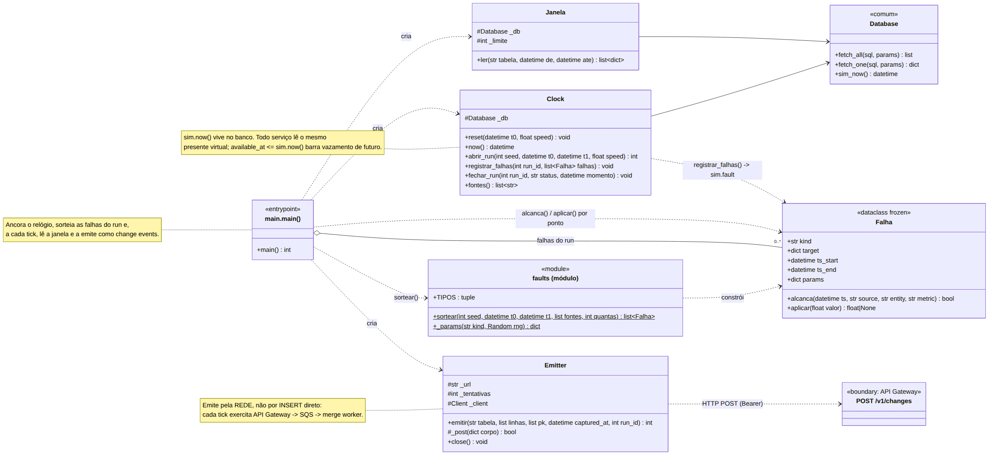
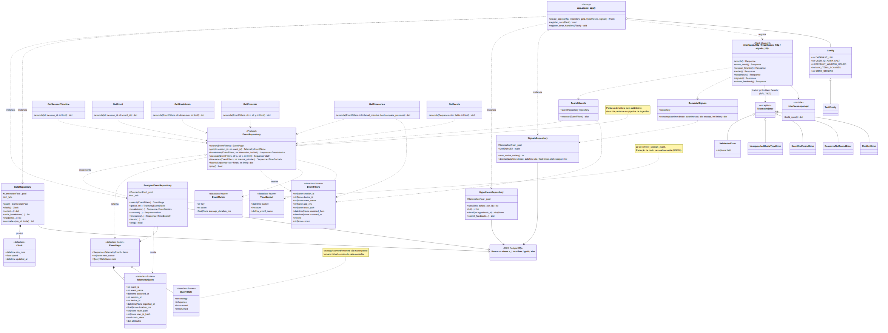

# Modelagem de Software

## 1. Diagrama UML de classes

&emsp; Nesse tópico, é descrito o modelo de domínio da plataforma Argus — o conjunto
de abstrações e o vocabulário centrais do sistema — por meio de um diagrama de
classes UML (Unified Modeling Language, a notação-padrão para modelagem de
software) e da descrição textual de cada classe. O objetivo é dar
uma visão única das abstrações que atravessam os quatro serviços Python, a carga
inicial e a biblioteca compartilhada: o que cada classe representa, o que ela
guarda, o que ela faz e de quem ela depende.

### 1.1 Escopo e método

#### 1.1.1 O que o diagrama cobre

&emsp; O diagrama modela as classes de aplicação do repositório: entidades de
domínio, objetos de valor (tipos sem identidade própria, definidos apenas pelo
conteúdo), adaptadores, casos de uso, consumidores e repositórios — as categorias
da arquitetura hexagonal, detalhadas na seção 1.7. São cerca de 45 classes,
agrupadas em seis contextos:

| Contexto | Serviço / pasta | Papel |
|---|---|---|
| **Ingestão** | `apps/basica/worker` | Consome as duas filas SQS (o serviço de filas de mensagens da AWS), valida e grava na camada `bronze` (dados crus, ainda sem tratamento) |
| **Carga inicial** | `apps/basica/loader` | Sobe as 33 tabelas do dump (a cópia de exportação do banco do parceiro), de arquivos Parquet (formato de arquivo colunar compactado) para a `bronze` |
| **Relógio virtual** | `apps/basica/simulator` | Anda `sim.now()` e reemite o dump como mudanças, pela rede |
| **Análise** | `apps/basica/processing` | ETL incremental (do inglês *extract, transform, load* — extrair, transformar e carregar os dados de uma camada para a seguinte), detector causal e motor das 11 famílias de hipótese |
| **Leitura** | `apps/basica/backend` | API em Flask (framework web Python) sobre AWS Lambda (código que roda sob demanda, sem servidor fixo), com arquitetura hexagonal (regras de negócio isoladas da infraestrutura; ver seção 1.7), serve o dashboard (o painel de visualização) |
| **Comum** | `apps/basica/common` | Conexão, observabilidade (métricas e sinais que revelam o estado interno do sistema em produção) e ciclo de vida compartilhados pelos serviços |

#### 1.1.2 O que o diagrama não é

- **Não é o modelo de dados.** O esquema físico do PostgreSQL — organizado em
  camadas, dos dados crus (`bronze`) aos já limpos (`silver`) e aos agregados
  prontos para consulta (`gold`), mais `detect`, `sim` e `etl` — está na
  [arquitetura inicial](arquitetura-inicial.md) e nos diagramas
  entidade-relacionamento (DER) em [`assets/`](assets/). Aqui o banco aparece
  como um único nó de fronteira.
- **Não é o diagrama de implantação.** Nós, contêineres e serviços AWS estão na
  [arquitetura inicial](arquitetura-inicial.md), seção 2.
- **Não cobre o frontend classe a classe.** O dashboard é feito em React
  (biblioteca de interface) com módulos de tipos e funções `fetch` (as chamadas
  HTTP feitas pelo navegador), não classes; ele aparece no diagrama unificado
  como o cliente da API de leitura.

#### 1.1.3 Notação

| Símbolo | Significado |
|---|---|
| `A <|-- B` | Herança: `B` estende `A` |
| `A <|.. B` | Realização: `B` implementa a interface/`Protocol` `A` |
| `A *-- B` | Composição: `B` faz parte de `A` e não vive sem ele |
| `A o-- B` | Agregação: `A` mantém uma referência a `B`, com ciclo de vida próprio |
| `A --> B` | Associação direcionada: `A` usa `B` de forma duradoura |
| `A ..> B` | Dependência: `A` usa `B` de forma pontual (parâmetro, retorno, construção) |
| `«...»` | Estereótipo — indica o papel da classe: `dataclass` e `pydantic` (formas de classe de dados em Python), `Protocol` (contrato de métodos, sem implementação), `abstract` (classe abstrata), `exception` (exceção), `module` (módulo de funções), `boundary` (fronteira com um sistema externo) |
| `$` após um método | Método estático / função de módulo |
| `*` após um método | Método abstrato |

&emsp; Alguns nomes de classe se repetem entre contextos (`Config`, `Clock`,
`EventRepository`). No diagrama unificado eles recebem um rótulo desambiguador
entre colchetes; nos recortes, o contexto já resolve a ambiguidade.

#### 1.1.4 Fontes e reprodução

&emsp; O texto-fonte de cada diagrama está versionado em
[`assets/`](assets/) com extensão `.mmd` (Mermaid, a linguagem de texto que
descreve os diagramas). O GitLab renderiza os blocos
`mermaid` deste documento diretamente; as imagens PNG ao lado de cada seção são a
exportação para uso em apresentação. Para regenerar os PNG:

```bash
cd artefatos/assets
npx @mermaid-js/mermaid-cli -i diagrama-classes.mmd -o diagrama-classes.png -s 3 -b white
# idem para diagrama-classes-{ingestao,relogio,analise,leitura}.mmd
```

### 1.2 Visão geral: os seis contextos

&emsp; Os contextos não trocam objetos entre si diretamente. Eles se comunicam por
duas fronteiras: as filas SQS (na entrada) e o banco PostgreSQL (no centro).
O acoplamento entre serviços é, portanto, o contrato de dados, não uma
dependência de código.

```
 App de TV ─┐                                    ┌─ Dashboard (Next.js)
            ▼                                    │
   [Ingestão] BaseEvent/ChangeEvent              ▼
       │  BaseConsumer → ChangeRepository   [Leitura] EventRepository (porta)
       ▼                                     PostgresEventRepository / GoldRepository
   ┌───────────────── Banco Argus (PostgreSQL) ─────────────────┐
   │  bronze  ·  silver  ·  gold  ·  detect  ·  sim  ·  etl     │
   └───────────────────────────────────────────────────────────┘
       ▲                                     ▲
       │  Loader (COPY)                      │  [Análise]
   [Carga inicial]                           │  CapturedWork → detect() → Hypothesis
                                             │
   [Relógio virtual] Clock/Janela/Emitter ───┘  (reemite o dump como ChangeEvent)
```

&emsp; O conceito central é o relógio virtual. O conjunto de dados (dataset) é um
dump do passado; o sistema tem um presente próprio, `sim.now()`, que vive no banco. Toda linha
carrega `available_at` (o instante em que a informação existiria na vida real,
contando a latência da fonte) e toda leitura filtra `available_at <= sim.now()`.
As classes `Clock` (simulador), `Fact.available_at` (análise) e
`Clock`/`GoldRepository.clock()` (leitura) são as três pontas desse mesmo
conceito.


### 1.3 Diagrama de classes unificado

&emsp; A visão completa, com os seis contextos agrupados em `namespace` (as caixas
nomeadas do Mermaid) e as fronteiras de infraestrutura. É densa por natureza; as
seções 1.4 a 1.8 trazem o mesmo conteúdo em recortes legíveis.

```mermaid
classDiagram
    direction TB

    namespace comum {
        class Database {
            +connection()
            +fetch_one(sql, params) dict
            +fetch_all(sql, params) list
            +sim_now() datetime
        }
        class Heartbeat {
            +touch() void
        }
        class ShutdownSignal {
            +running bool
            +sleep(seconds) void
        }
        class Metrics {
            +count(name, value) void
            +duration_ms(name, value) void
            +flush() void
        }
    }

    namespace ingestao {
        class BaseEvent {
            <<pydantic>>
            +datetime timestamp
            +str event_name
            +str session_id
            +str device_id
        }
        class RequestEvent
        class ScreenViewEvent
        class SessionEvent
        class VideoViewEvent
        class VitalsEvent
        class ErrorEvent
        class GenericEvent
        class ChangeEvent {
            <<pydantic>>
            +str source_table
            +str op
            +dict pk
            +dict after
            +datetime captured_at
        }
        class BaseConsumer {
            <<abstract>>
            +run() void
            +run_once() int
        }
        class ChangeConsumer
        class EventConsumer
        class ChangeRepository {
            +append_and_merge(list) tuple
            +lag_sim_seconds() float
        }
        class WEventRepository["EventRepository"] {
            +put_many(list) int
        }
        class WConfig["Config"] {
            <<dataclass>>
            +str modo
            +str queue_url
        }
    }

    namespace carga_inicial {
        class Loader {
            +run(list) Resultado
        }
        class Resultado {
            <<dataclass>>
            +list tabelas
        }
        class ResultadoTabela {
            <<dataclass>>
            +str tabela
            +int linhas
            +confere() bool
        }
    }

    namespace relogio_virtual {
        class SimClock["Clock"] {
            +reset(t0, speed) void
            +now() datetime
            +abrir_run(seed, t0, t1, speed) int
        }
        class Janela {
            +ler(tabela, de, ate) list
        }
        class Emitter {
            +emitir(tabela, linhas, pk, captured_at, run_id) int
        }
        class Falha {
            <<dataclass>>
            +str kind
            +dict target
            +datetime ts_start
            +datetime ts_end
            +alcanca(ts, source, entity, metric) bool
            +aplicar(valor) float
        }
    }

    namespace analise {
        class Fact {
            <<dataclass>>
            +str fact_key
            +int version_lsn
            +str source
            +str metric
            +float value
            +datetime available_at
        }
        class Baseline {
            <<dataclass>>
            +float mean
            +float variance
            +int n
        }
        class Anomaly {
            <<dataclass>>
            +Fact fact
            +float z
            +float strength
        }
        class SourceQuality {
            <<dataclass>>
            +str source
            +float quality_score
            +str status
        }
        class Feature {
            <<dataclass>>
            +str name
            +str applicability
            +float weight
        }
        class Evidence {
            <<dataclass>>
            +str role
            +str polarity
            +Fact fact
        }
        class Hypothesis {
            <<dataclass>>
            +str family
            +str title
            +float score
            +str confidence
            +str evaluation_status
        }
        class Candidate {
            <<dataclass>>
            +str family
            +Fact subject
        }
        class AnalysisResult {
            <<dataclass>>
            +tuple anomalies
            +tuple quality
            +tuple hypotheses
        }
        class WorkClaim {
            <<dataclass>>
            +int run_id
            +int checkpoint_id
            +str manifest_hash
            +int fencing_token
        }
        class CapturedWork {
            <<dataclass>>
            +WorkClaim claim
            +tuple facts
        }
        class Catalog {
            +str manifest_hash
            +metric(name) MetricPolicy
            +related(a, b) bool
        }
        class MetricPolicy {
            <<dataclass>>
            +str direction
            +str transform
        }
    }

    namespace leitura {
        class TelemetryEvent {
            <<dataclass>>
            +str event_id
            +str event_name
            +datetime occurred_at
            +str session_id
            +bool clock_skew
        }
        class EventRepoPort["EventRepository (porta)"] {
            <<Protocol>>
            +search(EventFilters) EventPage
            +get(session_id, event_id) TelemetryEvent
            +breakdown(...) list
            +timeseries(...) list
        }
        class PostgresEventRepository
        class GoldRepository {
            +series(...) dict
            +clock() Clock
        }
        class HypothesisRepository {
            +list(...) list
            +detail(id) dict
            +submit_feedback(...) dict
        }
        class SignalsRepository {
            +desvios(desde, ate, limiar, escopo) list
        }
        class GoldClock["Clock"] {
            <<dataclass>>
            +datetime sim_now
            +float speed
        }
        class EventFilters {
            <<dataclass>>
            +str session_id
            +str event_name
            +int limit
            +str cursor
        }
        class EventPage {
            <<dataclass>>
            +Sequence items
            +str next_cursor
            +QueryStats stats
        }
        class QueryStats {
            <<dataclass>>
            +str strategy
            +int scanned
            +int returned
        }
        class UseCases["SearchEvents / GetSessionTimeline / GetTimeseries / GetBreakdown / GetCrosstab / GetFacets / GetEvent / GenerateSignals"] {
            +execute(...) dict
        }
        class AppFactory["app.create_app()"] {
            <<factory>>
            +create_app(...) Flask
        }
        class TelemetryError {
            <<exception>>
        }
    }

    class APIIngestao["API Gateway: ingestão + mudanças"] {
        <<boundary: HTTP API>>
    }
    class FilaSQS["SQS events + changes (com DLQ)"] {
        <<boundary: fila>>
    }
    class LambdaAuthorizer["Lambda Authorizer"] {
        <<boundary: Lambda>>
        +handler(event) policy
    }
    class Banco["Banco Argus: bronze / silver / gold / detect / sim / etl"] {
        <<RDS PostgreSQL 16>>
    }
    class Dashboard["Dashboard (Next.js, export estático)"] {
        <<cliente>>
    }

    BaseEvent <|-- RequestEvent
    BaseEvent <|-- ScreenViewEvent
    BaseEvent <|-- SessionEvent
    BaseEvent <|-- VideoViewEvent
    BaseEvent <|-- VitalsEvent
    BaseEvent <|-- ErrorEvent
    BaseEvent <|-- GenericEvent
    BaseConsumer <|-- ChangeConsumer
    BaseConsumer <|-- EventConsumer
    EventRepoPort <|.. PostgresEventRepository

    ChangeConsumer *-- ChangeRepository
    EventConsumer *-- WEventRepository
    BaseConsumer o-- WConfig
    BaseConsumer o-- Metrics
    BaseConsumer o-- Heartbeat
    BaseConsumer o-- ShutdownSignal
    Loader *-- Resultado
    Resultado *-- "0..*" ResultadoTabela
    Anomaly *-- Fact
    Evidence o-- Fact
    Candidate o-- Fact
    Hypothesis *-- "0..*" Feature
    Hypothesis *-- "0..*" Evidence
    AnalysisResult *-- "0..*" Anomaly
    AnalysisResult *-- "0..*" SourceQuality
    AnalysisResult *-- "0..*" Hypothesis
    AnalysisResult *-- "0..*" Baseline
    CapturedWork *-- WorkClaim
    CapturedWork *-- "0..*" Fact
    Catalog ..> MetricPolicy
    EventPage *-- "0..*" TelemetryEvent
    EventPage o-- QueryStats
    EventRepoPort ..> EventFilters
    EventRepoPort ..> EventPage
    GoldRepository *-- GoldClock
    UseCases ..> EventRepoPort
    UseCases ..> SignalsRepository
    AppFactory ..> PostgresEventRepository
    AppFactory ..> GoldRepository
    AppFactory ..> HypothesisRepository
    AppFactory ..> SignalsRepository
    AppFactory ..> UseCases
    AppFactory ..> TelemetryError

    SessionEvent ..> APIIngestao : app de TV POST /v1/events
    Emitter ..> APIIngestao : POST /v1/changes
    APIIngestao ..> LambdaAuthorizer : valida Bearer
    APIIngestao ..> FilaSQS : SQS-SendMessage
    FilaSQS ..> ChangeConsumer : consome changes
    FilaSQS ..> EventConsumer : consome events
    ChangeRepository --> Banco : bronze.change_log + MERGE
    WEventRepository --> Banco : bronze.event
    Loader --> Banco : COPY -> bronze
    SimClock --> Banco : sim.clock / sim.run
    Janela --> Banco : lê bronze (dump)
    Emitter ..> Falha : distorce ponto
    CapturedWork ..> Banco : silver.analysis_fact_version
    AnalysisResult ..> Banco : grava gold / detect
    Catalog ..> Banco : detect.manifest
    PostgresEventRepository --> Banco : silver.v_session_event
    GoldRepository --> Banco : views gold / silver / sim
    HypothesisRepository --> Banco : views gold + função de feedback
    SignalsRepository --> Banco : gold.v_feature_bucket
    Dashboard ..> AppFactory : HTTP (Bearer)
    Dashboard ..> LambdaAuthorizer : valida Bearer
    Database --> Banco

    note for Banco "Fonte de verdade única dos dois fluxos de ingestão.<br/>Toda view v_* filtra available_at &lt;= sim.now()."
    note for EventRepoPort "Docstrings herdadas da v2 ainda citam DynamoDB;<br/>a implementação real é PostgreSQL."
```





### 1.4 Recorte 1: Ingestão

&emsp; O contexto de ingestão tem duas hierarquias paralelas: a dos modelos de
evento (o que chega e como é validado) e a dos consumidores (o laço de
consumo do SQS). Cada consumidor casa com um repositório de escrita. A carga
inicial (`Loader`) escreve nas mesmas tabelas por outro caminho.

```mermaid
classDiagram
    direction TB

    class BaseEvent {
        <<pydantic BaseModel>>
        +datetime timestamp
        +str event_name
        +str session_id
        +str device_id
        +str|None user_id
        +float|None duration
        +str|None route_path
        +dict|str|None route_params
        +str|None event_id
        +str|None app_bucket
        +str|None app_env
        +str|None app_version
        +str|None device_manufacturer
        +str|None device_model
        +int|str|None device_model_year
        +str|None device_os
        +_to_utc(datetime) datetime
        +_not_blank(str) str
    }
    class RequestEvent {
        +str|None request_method
        +int|None request_status
        +dict|str|None request_headers
        +dict|str|None response_headers
    }
    class ScreenViewEvent
    class SessionEvent {
        +bool|None capabilities_https
        +bool|None capabilities_video_hdr
        +bool|None capabilities_video_vod_drm
    }
    class VideoViewEvent {
        +str|int|None media_id
        +str|None media_kind
        +bool|None media_drm
        +bool|None media_ads
    }
    class VitalsEvent
    class ErrorEvent {
        +str|None error_name
        +str|None error_message
        +str|None error_stack
    }
    class GenericEvent

    class ChangeEvent {
        <<pydantic BaseModel>>
        +str source_table
        +str op
        +dict pk
        +dict|None before
        +dict|None after
        +datetime captured_at
        +int|None run_id
        +_tabela_conhecida(str) str
        +_pk_nao_vazia(dict) dict
        +_para_utc(datetime) datetime
    }

    class WorkerConfig["Config"] {
        <<dataclass frozen>>
        +str modo
        +str queue_url
        +str dlq_url
        +str database_url
        +int batch_size
        +int wait_time_seconds
        +int visibility_timeout_seconds
        +int max_clock_skew_days
        +tuple recommended_fields
        +from_env(str modo)$ Config
    }

    class BaseConsumer {
        <<abstract>>
        #Config _config
        #_sqs
        #Metrics _metrics
        #Heartbeat _heartbeat
        #ShutdownSignal _shutdown
        +run() void
        +run_once() int
        #_parse(dict raw)* Any
        #_persist(list itens)* int
        #_chave_lista()* str
        #_receive() list
        #_process_message(dict) tuple
        #_quarantine(payload, motivo, id) bool
        #_delete(list) void
    }
    class ChangeConsumer {
        #ChangeRepository _repo
        #_chave_lista : "changes"
        #_parse(dict raw) dict
        #_persist(list itens) int
        #_emit_lag() void
    }
    class EventConsumer {
        #EventRepository _repo
        #_chave_lista : "events"
        #_parse(dict raw) dict
        #_persist(list itens) int
    }

    class ChangeRepository {
        #Database _db
        +append_and_merge(list changes) tuple~int,int~
        +lag_sim_seconds() float|None
        +sources_silent(timedelta limite) int
    }
    class EventRepository {
        #Database _db
        +COLUNAS : tuple
        +put_many(list linhas) int
    }
    class ChangeTooLarge {
        <<exception>>
    }

    class Loader {
        #Database _db
        #Path _dir
        #datetime _captured_at
        #bool _change_log
        #dict _esperado
        +run(list|None tabelas) Resultado
        #_carregar(str tabela) ResultadoTabela
        #_copy(tabela, caminho, pk) int
        #_conferir(Resultado) void
    }
    class Resultado {
        <<dataclass>>
        +list~ResultadoTabela~ tabelas
        +linhas() int
        +divergentes() list~ResultadoTabela~
    }
    class ResultadoTabela {
        <<dataclass>>
        +str tabela
        +int linhas
        +int|None esperadas
        +float segundos
        +bool pulada
        +confere() bool
    }
    class ManifestoDivergente {
        <<exception>>
    }

    class Database {
        <<comum>>
        +connection()
        +fetch_one(sql, params) dict
        +fetch_all(sql, params) list
    }

    BaseEvent <|-- RequestEvent
    BaseEvent <|-- ScreenViewEvent
    BaseEvent <|-- SessionEvent
    BaseEvent <|-- VideoViewEvent
    BaseEvent <|-- VitalsEvent
    BaseEvent <|-- ErrorEvent
    BaseEvent <|-- GenericEvent

    BaseConsumer <|-- ChangeConsumer
    BaseConsumer <|-- EventConsumer
    BaseConsumer o-- WorkerConfig : _config

    ChangeConsumer *-- ChangeRepository : _repo
    EventConsumer *-- EventRepository : _repo
    ChangeConsumer ..> ChangeEvent : valida (parse_change)
    EventConsumer ..> BaseEvent : valida (parse_event)
    ChangeRepository ..> ChangeTooLarge : levanta

    ChangeRepository --> Database
    EventRepository --> Database
    Loader --> Database
    Loader ..> Resultado : produz
    Resultado *-- "0..*" ResultadoTabela
    Loader ..> ManifestoDivergente : levanta
    Loader ..> ChangeEvent : grava snapshot (op='r')

    note for GenericEvent "Fallback para event_name ainda desconhecido:<br/>o evento é gravado, não descartado (RF03)."
    note for ChangeConsumer "merge worker: change_log + MERGE na tabela corrente,<br/>na mesma transação."
    note for EventConsumer "event worker: grava o grão de sessão em bronze.event<br/>com id derivado do conteúdo (idempotência)."
```




#### 1.4.1 Modelos de evento

| Classe | Responsabilidade |
|---|---|
| **`BaseEvent`** | Envelope comum a todo evento de sessão. Modelo Pydantic (biblioteca Python de validação de dados) com `extra="allow"`: campo novo enviado pelo app é preservado, não rejeitado. Só quatro campos são obrigatórios (`timestamp`, `event_name`, `session_id`, `device_id`). Os validadores `_to_utc` e `_not_blank` normalizam fuso e recusam string em branco. |
| **`RequestEvent`** | Chamada HTTP feita pelo app: método, URL, status, cabeçalhos. |
| **`ScreenViewEvent`** | Entrada em uma tela, só o envelope. |
| **`SessionEvent`** | Ciclo de vida da sessão, com as *capabilities* (capacidades técnicas — HDR, DRM, Dolby Atmos…) negociadas com o aparelho. |
| **`VideoViewEvent`** | Reprodução de vídeo (ao vivo ou VOD — vídeo sob demanda): mídia, DRM (trava de direitos autorais), anúncios. |
| **`VitalsEvent`** | Sinal de saúde do player (o reprodutor de vídeo): travamento, buffering (as pausas para o vídeo carregar). Só o envelope. |
| **`ErrorEvent`** | Erro exibido ao usuário: nome, mensagem, *stack* (a pilha de chamadas até o ponto do erro). |
| **`GenericEvent`** | *Fallback* (rota de reserva) para `event_name` ainda desconhecido. Valida só o envelope e guarda o resto; existe para que um tipo novo apareça no banco no mesmo dia em que for lançado, em vez de acumular na DLQ — sigla de *dead-letter queue*, a fila para onde vão as mensagens que não puderam ser processadas (RF03, RNF06). |
| **`ChangeEvent`** | Uma mudança em uma linha de uma das 33 tabelas do parceiro. Envelope validado com rigor (`source_table` na lista fechada, `op` ∈ `i/u/d/r`, `pk` — a chave primária da linha — não vazia); `pk`/`before`/`after` são `jsonb` livre (campo JSON sem esquema fixo, recurso do PostgreSQL), para absorver coluna nova sem alterar a estrutura do banco. |

#### 1.4.2 Consumidores

| Classe | Responsabilidade |
|---|---|
| **`BaseConsumer`** *(abstrata)* | O laço de consumo do SQS, idêntico nos dois workers (os processos que leem a fila continuamente, em segundo plano): `receive` → `parse` → `persist` → `delete` (receber, interpretar, gravar, apagar). Nenhuma exceção de ciclo derruba o processo; a mensagem só é apagada depois que tudo nela foi gravado ou desviado para a DLQ. Métodos abstratos `_parse`, `_persist`, `_chave_lista` são o que cada worker define. Compõe-se de `Config`, `Metrics`, `Heartbeat` e `ShutdownSignal` (todos de `common`). |
| **`ChangeConsumer`** | *Merge worker* — o processo que funde cada mudança na tabela correspondente. Valida `ChangeEvent`, delega a `ChangeRepository` e emite as métricas `LagSimSeconds`/`SourcesSilent` em cadência fixa. |
| **`EventConsumer`** | *Event worker* — o processo dos eventos de sessão. Valida com `parse_event`, monta a linha com `keys.build_row` e delega a `EventRepository`. Conta `EventsUnknownType` e `EventsIncomplete` sem descartar. |

#### 1.4.3 Repositórios de escrita

| Classe | Responsabilidade |
|---|---|
| **`ChangeRepository`** | Anexa o lote a `bronze.change_log` e dispara `bronze.merge_do_log` na mesma transação: ou os dois acontecem ou nenhum. `lag_sim_seconds` e `sources_silent` são consultas de métrica com teto de tempo, para que a observabilidade nunca derrube a ingestão. |
| **`EventRepository`** (worker) | Grava o grão de sessão (o nível de detalhe adotado: uma linha por sessão) em `bronze.event` com `ON CONFLICT (ts, event_id) DO NOTHING` (se a linha já existir, ignora). `event_id` deriva do hash (a impressão digital) do conteúdo, o que dá efeito de *exactly-once* — cada evento gravado uma única vez — sobre a entrega *at-least-once* do SQS, que pode repetir a mesma mensagem. |
| **`ChangeTooLarge`** | Exceção: evento de mudança maior que 4 MB; repetir a tentativa (*retry*) nunca resolveria, então vai direto para a DLQ. |
| **`Config`** (worker) | *Dataclass* (classe de dados do Python) congelada — imutável depois de criada — com toda a configuração vinda do ambiente (`modo`, URLs de fila e DLQ, `DATABASE_URL`, tamanhos de lote, tolerância de desvio de relógio). `from_env` valida a presença das variáveis obrigatórias. |

#### 1.4.4 Carga inicial

| Classe | Responsabilidade |
|---|---|
| **`Loader`** | Lê os Parquet do dump em lotes e despeja por `COPY FROM STDIN` (a carga em massa do PostgreSQL) na `bronze` corrente; opcionalmente grava o snapshot (a foto do estado inicial) também no `change_log` com `op='r'`. Retomável por tabela: uma tabela cuja contagem já bate com o `_manifest.json` é pulada. |
| **`Resultado`** / **`ResultadoTabela`** | *Dataclasses* que acumulam o que aconteceu com cada tabela (linhas, esperadas, tempo, se foi pulada). `confere()` e `divergentes()` são a validação final contra o manifesto (RNF05: não perder dado em silêncio). |
| **`ManifestoDivergente`** | Exceção: a contagem carregada não bate com o `_manifest.json`; a carga falha de forma explícita, em vez de seguir em silêncio. |

---

### 1.5 Recorte 2: Relógio virtual

&emsp; O simulador não inventa dado: lê o dump que já está na `bronze` e o reemite, no
ritmo de `sim.now()`, pela rede: cada tick (cada passo do relógio virtual)
exercita o fluxo de ingestão inteiro. `Clock` fala com o banco (o relógio vive
lá), `Janela` lê a faixa de tempo que acabou de passar, `Falha` distorce pontos
de forma determinística (mesma entrada, sempre o mesmo resultado) e `Emitter`
publica em `POST /v1/changes`.




| Classe | Responsabilidade |
|---|---|
| **`Clock`** | Lê e avança `sim.clock`. `reset` ancora o relógio no início da janela; `now` lê o presente virtual; `abrir_run`/`fechar_run` registram a execução em `sim.run`; `registrar_falhas` grava o cenário sorteado em `sim.fault` (é o que torna o cenário auditável, isto é, verificável depois); `fontes` lista as fontes presentes na `bronze`. |
| **`Janela`** | Lê da `bronze` as linhas cujo tempo caiu na faixa que acabou de passar, com teto por tabela por tick (uma mensagem do SQS tem limite de tamanho). |
| **`Emitter`** | Publica os eventos de mudança em `POST /v1/changes`, repetindo a tentativa (*retry*) quando falha e reaproveitando o cliente HTTP entre os ticks. Divide o lote por bytes do JSON (o corpo viaja na *query string* — os parâmetros no fim da URL — da integração do API Gateway, o serviço da AWS que recebe as requisições da internet, cujo limite de tamanho de URL é menor que os 256 KB do SQS). Desistir de um lote o perde de propósito: melhor pular uma janela do que travar o tempo virtual. |
| **`Falha`** *(dataclass congelada)* | Uma falha injetada, com alvo e janela. `alcanca` diz se a falha atinge um ponto (tempo + alvo); `aplicar` distorce o valor conforme o tipo (`error_spike`, `latency`, `drift` — pico de erro, latência e deriva — multiplicam; `source_outage` devolve `None`: a fonte parou, que é diferente de reportar zero). |
| **`faults`** *(módulo)* | `sortear` produz a lista de falhas de uma execução a partir da `seed` (o número que inicializa o sorteio aleatório): mesma seed, mesmo cenário, o que permite comparar dois detectores sabendo que viram os mesmos incidentes. |


### 1.6 Recorte 3: Análise

&emsp; O contexto de análise tem três blocos: os contratos imutáveis (`Fact`,
`Anomaly`, `Hypothesis`…), que são *dataclasses* congeladas (imutáveis) passadas
entre as etapas; a coordenação (`WorkClaim`, `CapturedWork`), que garante que um
só processo analise um checkpoint (um ponto de progresso salvo) por vez, usando
*lease* (posse com prazo de validade) e *fencing* (um número crescente que
invalida quem perdeu a posse); e o catálogo versionado (`Catalog`,
`MetricPolicy`), cujo `manifest_hash` amarra cada resultado à configuração exata
que o produziu.

```mermaid
classDiagram
    direction TB

    class Fact {
        <<dataclass frozen>>
        +str fact_key
        +int version_lsn
        +str role
        +str kind
        +datetime event_start
        +datetime|None event_end
        +datetime available_at
        +str source
        +str entity
        +str metric
        +str|None dimension_type
        +str|None dimension_value
        +float|None value
        +int|None sample_size
        +dict attributes
    }
    class Baseline {
        <<dataclass>>
        +float|None mean
        +float|None variance
        +int n
        +datetime|None last_event_at
    }
    class Anomaly {
        <<dataclass frozen>>
        +Fact fact
        +float observed
        +float expected
        +str direction
        +float deviation
        +float z
        +float strength
        +dict baseline_snapshot
        +int|None persisted_id
    }
    class SourceQuality {
        <<dataclass frozen>>
        +str source
        +int expected_cadence_seconds
        +float|None freshness
        +float|None completeness
        +float|None validity
        +float|None consistency
        +float|None quality_score
        +str status
    }
    class Feature {
        <<dataclass frozen>>
        +str name
        +str applicability
        +float|None value
        +float weight
        +float|None contribution
        +str explanation
    }
    class Evidence {
        <<dataclass frozen>>
        +str role
        +str polarity
        +str explanation
        +Fact|None fact
        +float|None observed
        +float|None expected
        +float|None strength
        +float|None quality
    }
    class Hypothesis {
        <<dataclass frozen>>
        +str family
        +str kind
        +str title
        +str summary
        +dict scope
        +datetime effect_start
        +datetime effect_end
        +float score
        +float coverage
        +str confidence
        +str evaluation_status
        +float contradiction_strength
        +str dedup_key
        +str lineage_key
        +tuple~Feature~ features
        +tuple~Evidence~ evidence
        +tuple~int~ anomaly_indexes
    }
    class Candidate {
        <<dataclass frozen>>
        +str family
        +str kind
        +int|None anomaly_index
        +Fact|None subject
        +tuple~Fact~ supporting
        +tuple~str~ required_missing
        +tuple~Evidence~ contrary
        +dict scope
        +str title
        +float|None temporal_score
    }
    class AnalysisResult {
        <<dataclass frozen>>
        +tuple~Anomaly~ anomalies
        +tuple~Anomaly~ finding_anomalies
        +dict baseline_updates
        +tuple~SourceQuality~ quality
        +tuple~Hypothesis~ hypotheses
        +int candidates_prefiltered
        +int candidates_evaluated
        +int candidates_truncated
    }

    class WorkClaim {
        <<dataclass frozen>>
        +int run_id
        +int checkpoint_id
        +str manifest_hash
        +datetime sim_now
        +str claimed_by
        +datetime lease_expires_at
        +int fencing_token
        +int attempt
        +int input_lsn
        +str status
    }
    class CapturedWork {
        <<dataclass frozen>>
        +WorkClaim claim
        +tuple~Fact~ facts
        +datetime window_start
        +datetime window_end
        +datetime|None simulator_end
    }
    class CoordinationError {
        <<exception>>
    }
    class FencingRejected {
        <<exception>>
    }
    class CaptureLimitExceeded {
        <<exception>>
    }
    class InputDigestMismatch {
        <<exception>>
    }

    class Catalog {
        +dict raw
        +dict manifest_payload
        +str manifest_hash
        +source(str name) dict
        +metric(str name) MetricPolicy|None
        +normalize_entity(str value) str
        +related(str left, str right) bool
        +playback_vhost(str entity) bool
        +rule(str family) dict
    }
    class MetricPolicy {
        <<dataclass frozen>>
        +str direction
        +str transform
        +float materiality_absolute
        +float materiality_relative
        +float sigma_floor
    }

    class Pipeline["pipeline / detector / rules / scoring / quality (módulos)"] {
        <<module>>
        +analyze_once(db, metrics, catalog, ...)$ bool
        +run_captured(db, CapturedWork, Catalog, ...)$ AnalysisResult
        +detect(facts, baselines, catalog)$ tuple
        +evaluate_quality(facts, catalog, ...)$ tuple~SourceQuality~
        +build_candidates(anomalies, facts, qualities, catalog)$ tuple~Candidate~
        +evaluate_candidates(candidates, anomalies, qualities, catalog, ...)$ tuple
        +score_features(values, contradiction)$ tuple
    }
    class Orchestration["orchestration (módulo)"] {
        <<module>>
        +reivindicar_trabalho(db, worker_id, manifest_hash, ...)$ WorkClaim|None
        +iniciar_trabalho(db, WorkClaim)$ bool
        +renovar_lease(db, WorkClaim, lease_seconds)$ bool
        +commit_protegido(db, WorkClaim)$ Connection
        +falhar_trabalho(db, WorkClaim, msg)$ bool
    }
    class AnalysisRepository["analysis_repository (módulo)"] {
        <<module>>
        +claim_and_capture(db, worker_id, manifest_hash, ...)$ CapturedWork|None
        +load_baselines(db, manifest_hash, stream_key)$ dict
        +load_run_input(db, run_id)$ tuple~Fact~
        +persist_result(db, CapturedWork, AnalysisResult, duration_ms)$ void
        +promote_manifest(db, manifest_hash, gate_metrics, withdraw)$ void
    }

    class Database {
        <<comum>>
    }
    class BancoPostgres["Banco: silver / gold / detect"] {
        <<RDS PostgreSQL>>
    }

    RuntimeError <|-- CoordinationError
    CoordinationError <|-- FencingRejected
    RuntimeError <|-- CaptureLimitExceeded
    RuntimeError <|-- InputDigestMismatch

    Anomaly *-- Fact : fact
    Evidence o-- Fact : fact
    Candidate o-- "0..*" Fact : subject / supporting
    Candidate o-- "0..*" Evidence : contrary
    Hypothesis *-- "0..*" Feature : features
    Hypothesis *-- "0..*" Evidence : evidence
    AnalysisResult *-- "0..*" Anomaly
    AnalysisResult *-- "0..*" SourceQuality
    AnalysisResult *-- "0..*" Hypothesis
    AnalysisResult *-- "0..*" Baseline : baseline_updates
    CapturedWork *-- WorkClaim : claim
    CapturedWork *-- "0..*" Fact : facts
    Catalog ..> MetricPolicy : cria

    Pipeline ..> CapturedWork
    Pipeline ..> AnalysisResult : produz
    Pipeline ..> Catalog
    Pipeline ..> Anomaly
    Pipeline ..> Hypothesis
    Pipeline ..> Candidate
    Pipeline ..> SourceQuality
    Orchestration ..> WorkClaim : produz
    Orchestration ..> FencingRejected : levanta
    AnalysisRepository ..> CapturedWork : produz
    AnalysisRepository ..> CaptureLimitExceeded
    AnalysisRepository ..> Database
    Orchestration ..> Database
    Database --> BancoPostgres

    note for Fact "Sai de bronze.change_log, não da tabela corrente.<br/>Nenhuma regra olha um fato com available_at &gt; sim.now()."
    note for Hypothesis "Explicação candidata e auditável, para revisão humana;<br/>não é causa-raiz confirmada."
    note for Catalog "manifest_hash amarra o resultado à configuração exata<br/>(catálogos + pesos + parâmetros do detector)."
```




#### 1.6.1 Contratos do detector e do motor

| Classe | Responsabilidade |
|---|---|
| **`Fact`** | Uma observação de fonte já normalizada, no grão em que a análise trabalha. Sai de `bronze.change_log` (não da tabela corrente), o que conserva duas mudanças da mesma chave primária (PK) entre ciclos. `available_at` é a barreira causal: nenhuma regra olha um fato cujo `available_at` esteja à frente de `sim.now()`. |
| **`Baseline`** | Média e variância acumuladas de uma série, pelo método de Welford (que atualiza os dois números a cada novo ponto, sem guardar o histórico). Mutável de propósito: o detector atualiza a cada bucket (cada intervalo de tempo agregado). `n < 3` significa histórico insuficiente. |
| **`Anomaly`** | Um fato que se afastou do baseline (o comportamento esperado, calculado a partir do histórico) o suficiente para virar sinal. Guarda `z` (o desvio em relação à média, medido em desvios-padrão σ), `strength` (a magnitude normalizada) e um `baseline_snapshot` (a foto do baseline naquele instante) para a evidência poder citar o número original. |
| **`SourceQuality`** | Veredito do canário (a verificação contínua que acusa quando uma fonte para de responder) sobre uma fonte num ciclo. Existe porque uma fonte silenciosa é indistinguível de uma fonte saudável: as duas produzem zero anomalia. Quatro dimensões — `freshness`, `completeness`, `validity`, `consistency` (atualidade, completude, validade e consistência) — ponderadas em `quality_score`. |
| **`Feature`** | Um componente do score (a nota) de uma hipótese, com sua explicação. `applicability` (`available` / `unavailable` / `not_applicable`) distingue "calculada", "fonte não respondeu" e "não faz sentido para esta família"; sem isso, ausência de dado viraria zero e puxaria o score para baixo. |
| **`Evidence`** | Um fato citado a favor ou contra uma hipótese. `polarity` permite mostrar ao operador também o que não fecha com a explicação. |
| **`Hypothesis`** | Uma explicação candidata e auditável, para revisão humana; não é causa-raiz confirmada. `evaluation_status` e `contradiction_strength` carregam o quanto a própria evidência contradiz a explicação; `dedup_key`/`lineage_key` (chaves de deduplicação e de linhagem) agrupam e ligam versões entre ciclos. |
| **`Candidate`** | Uma hipótese antes da avaliação: o formato, sem o score. Separar geração de avaliação é o que permite contar quantos candidatos existiam antes de qualquer corte. |
| **`AnalysisResult`** | Tudo que um ciclo produziu, para gravação numa transação. Os três contadores de candidato distinguem "não há hipótese" de "havia candidatos demais e o ciclo parou no teto". |

#### 1.6.2 Coordenação e captura

| Classe | Responsabilidade |
|---|---|
| **`WorkClaim`** | Fotografia da posse de uma unidade de análise: `run_id`, `checkpoint_id`, `manifest_hash`, `lease_expires_at`, `fencing_token`. O *advisory lock* (trava cooperativa do PostgreSQL) só existe durante o *claim* (o instante em que o processo reivindica o trabalho); o trabalho demorado é protegido por *lease* e *fencing* gravados no banco. |
| **`CapturedWork`** | Um instantâneo: o *claim* mais os `Fact` já lidos, capturados sob `REPEATABLE READ` (o nível de isolamento em que a transação vê um retrato fixo do banco) antes da análise: é o que faz o ciclo inteiro enxergar o mesmo estado do banco mesmo com o ETL escrevendo em paralelo. |
| **`CoordinationError` / `FencingRejected`** | Erros de contrato da coordenação; `FencingRejected` é lançada quando o processo perdeu o *lease* e tenta gravar. |
| **`CaptureLimitExceeded` / `InputDigestMismatch`** | A unidade excedeu o limite de linhas, ou um *retry* reconstruiu entrada diferente para o mesmo checkpoint. |

#### 1.6.3 Catálogo e fluxo

| Classe | Responsabilidade |
|---|---|
| **`Catalog`** | Os cinco catálogos versionados (`sources`, `metrics`, `entity_relations`, `playback`, `rules`) e o `manifest_hash` canônico. `related` reconhece hierarquia de entidades (um POP — ponto de presença da rede — dentro do cluster que passou por um deploy, a publicação de uma nova versão); `normalize_entity` reduz nomes à forma canônica (uma grafia única). |
| **`MetricPolicy`** | Como uma métrica deve ser tratada pelo detector: direção que importa (`up`/`down`), transformação (`log1p`, um logaritmo, para distribuições de cauda longa), limiares de materialidade e piso de σ. |
| **`pipeline` / `detector` / `rules` / `scoring` / `quality`** *(módulos)* | As funções que executam o ciclo: `detect` (média móvel com peso exponencial — EWMA — ajustada ao ciclo de 24 h e estritamente causal, isto é, sem olhar o futuro), `evaluate_quality` (canário), `build_candidates` (as 11 famílias), `evaluate_candidates` + `score_features` (pontuação determinística), `run_captured`/`analyze_once` (orquestração). |
| **`orchestration` / `analysis_repository`** *(módulos)* | `reivindicar_trabalho`, `renovar_lease`, `commit_protegido`, `claim_and_capture`, `persist_result`, `promote_manifest`: o *claim*, a captura consistente e a gravação transacional protegida por *fencing*. |


### 1.7 Recorte 4: Leitura

&emsp;A API de leitura segue a arquitetura hexagonal (também chamada portas e
adaptadores): o núcleo de regras não sabe por qual tecnologia o dado entra ou
sai. O centro (`domain`) não conhece Flask nem PostgreSQL. A porta
`EventRepository` (um `Protocol` do Python — um contrato de métodos, sem
implementação) declara o que a aplicação exige; `PostgresEventRepository` é o
adaptador concreto. Os casos de uso (`SearchEvents`, `GetTimeseries`…) orquestram
porta e entidades; `create_app` injeta os adaptadores. Repositórios
especializados por grão (evento individual, bucket agregado, hipótese publicada,
sinal ativo) em vez de um repositório único com métodos que nunca se cruzam.




#### 1.7.1 `domain` (o núcleo de regras)

| Classe | Responsabilidade |
|---|---|
| **`TelemetryEvent`** | Um evento de telemetria como a API o devolve. `event_id` é `str` (o hash do conteúdo, não um UUID aleatório); `duration_ms` é derivado (o banco guarda segundos); `user_id_hash` nunca é o id cru; campos específicos de cada tipo ficam em `attributes`. |
| **`TelemetryError`** e subclasses | Hierarquia de erros de domínio previstos: `ValidationError` (→ 422, aponta o campo), `UnsupportedMediaTypeError` (→ 415), `EventNotFoundError` (→ 404), `ResourceNotFoundError` (→ 404), `ConflictError` (→ 409). `create_app` traduz cada uma em uma resposta no formato *Problem Details* (RFC 7807, o padrão de corpo de erro para APIs HTTP). |

#### 1.7.2 `ports` (as portas: contratos que o núcleo exige)

| Classe | Responsabilidade |
|---|---|
| **`EventRepository`** *(`Protocol`)* | A porta de leitura: `search`, `get`, `breakdown`, `crosstab`, `timeseries`, `facets`, `ping`. Sem `add`/`delete` de propósito: a escrita pertence ao pipeline de ingestão (a esteira que recebe e grava os dados). |
| **`EventFilters`** | Filtros de busca cumulativos (RF08, RF09). Os três primeiros (`session_id`, `device_id`, `event_name`) decidem qual índice responde a consulta; o resto é aplicado depois. Paginação por cursor opaco (uma marca de posição codificada em base64 que o cliente não precisa interpretar) em vez de `OFFSET`. |
| **`EventPage`** | Página resultante: `items`, `next_cursor` e `stats`. |
| **`QueryStats`** | `strategy`, `queries`, `scanned`, `returned`: vão na resposta para tornar visível o custo de cada consulta (RNF02). |
| **`EventMetric`** / **`TimeBucket`** | Ponto de agregação por dimensão (RF11) e ponto de série temporal (RF12). |

#### 1.7.3 `application` (casos de uso)

| Classe | RF | Responsabilidade |
|---|---|---|
| **`SearchEvents`** | RF08, RF09 | Busca com filtros cumulativos e paginação por cursor. |
| **`GetSessionTimeline`** | RF16 | Todos os eventos de uma sessão, em ordem cronológica, mais o resumo executivo. |
| **`GetEvent`** | RF16 | Detalhes completos de um evento por sessão + id. |
| **`GetBreakdown`** | RF11 | Agrupamento por uma dimensão, com distribuição percentual. |
| **`GetCrosstab`** | RF16 | Cruzamento por duas dimensões (o heatmap, ou mapa de calor, do Recorte). |
| **`GetTimeseries`** | RF12, RF14, RF15 | Série temporal do volume; com `compare_previous`, a janela anterior de mesma duração e a variação entre as duas. |
| **`GetFacets`** | RF10 | Valores existentes para preencher os filtros. |
| **`GenerateSignals`** | RF15 | Lista de sinais em desvio ativo (tela Agora), a partir de `SignalsRepository.desvios`. |

#### 1.7.4 `infrastructure` (adaptadores)

| Classe | Grão | Responsabilidade |
|---|---|---|
| **`PostgresEventRepository`** | Evento de sessão | Implementa a porta `EventRepository`. Lê de `silver.v_session_event`, aplica a redação de dado pessoal na saída (RNF10) e reporta a `strategy` de cada consulta. |
| **`GoldRepository`** | Bucket agregado de 15 min | Séries, janelas estáveis, incidentes, deploys e o relógio (`clock()` → `Clock`), a partir das views (consultas SQL salvas e consultáveis como se fossem tabelas) de `gold`, `silver` e `sim`. |
| **`HypothesisRepository`** | Hipótese publicada | Lista e detalha hipóteses do motor; registra o retorno (feedback) do operador pela função `gold.submit_hypothesis_feedback`, marcada como `SECURITY DEFINER` (roda com os privilégios de quem a criou, não de quem a chama) — a única escrita da API. |
| **`SignalsRepository`** | Sinal ativo | Desvios ativos de `gold.v_feature_bucket`, com baseline por hora do dia. |
| **`Clock`** *(dataclass)* | n/a | O presente virtual como o banco o enxerga: `sim_now`, `speed`, `updated_at`. |

#### 1.7.5 `interfaces` e `config` (entrada HTTP e configuração)

| Classe | Responsabilidade |
|---|---|
| **`create_app`** *(factory)* | Monta a aplicação Flask: um único *pool* de conexões (conjunto de conexões com o banco abertas e reaproveitadas) para todos os adaptadores, registra os *blueprints* (os grupos de rotas do Flask), o CORS manual (as regras que autorizam o navegador a chamar a API de outra origem), a observabilidade e os *error handlers* (os tratadores de erro). Aceita adaptadores injetados (é o que os testes usam). |
| **`interfaces.http` / `hypotheses_http` / `signals_http`** *(blueprints)* | As rotas HTTP. Cada rota nova exige entrada correspondente no OpenAPI (a descrição da API em formato legível por máquina), verificada por teste nos dois sentidos. |
| **`interfaces.openapi`** | Monta a especificação OpenAPI 3.1 em código, importando as mesmas constantes que os adaptadores usam para validar. |
| **`Config` / `TestConfig`** | Configuração vinda do ambiente: `DATABASE_URL`, `USER_ID_HASH_SALT` (RNF10 — o *salt*, valor secreto somado ao identificador antes de aplicar o hash), janelas e tetos de varredura, origens de CORS. |


### 1.8 Código comum (`common`)

&emsp;As quatro classes que os serviços de ingestão, simulação e análise
compartilham. Aparecem nos recortes como dependências externas.

| Classe | Responsabilidade |
|---|---|
| **`Database`** | *Pool* de conexões com o PostgreSQL. `sim_now()` lê o relógio virtual do banco, nunca do relógio do contêiner: se cada serviço derivasse o próprio tempo, dois contêineres discordariam sobre o que já aconteceu. Sobrevive ao *failover* do RDS (o PostgreSQL gerenciado da AWS) — a troca automática para uma réplica quando o servidor principal cai — descartando a conexão morta. |
| **`Heartbeat`** | Marca presença para o *healthcheck* do contêiner (a checagem periódica de que o processo está vivo). Precisa bater a cada ciclo, inclusive com fila vazia: um worker saudável num domingo de madrugada seria reiniciado sem parar se o heartbeat (esse sinal de vida) só batesse quando houvesse mensagem. |
| **`ShutdownSignal`** | Encerramento ordenado (*graceful shutdown*): o sinal `SIGTERM` faz o processo parar só depois de terminar o ciclo atual. O `sleep` acorda mais cedo quando a parada é pedida, para o sistema não precisar recorrer ao `SIGKILL` (o encerramento forçado, que interrompe no meio). |
| **`Metrics`** | Coletor de métricas para o CloudWatch (o serviço de métricas e logs da AWS): `count`, `duration_ms` e `flush` (o envio do que se acumulou) em cadência. |


### 1.9 Relacionamentos principais

| Origem | Tipo | Destino | Mult. | Significado |
|---|---|---|---|---|
| `RequestEvent` … `GenericEvent` | herança | `BaseEvent` | n/a | Sete tipos de evento sobre o mesmo envelope |
| `ChangeConsumer`, `EventConsumer` | herança | `BaseConsumer` | n/a | O laço do SQS é comum; muda o que validar e onde gravar |
| `PostgresEventRepository` | realização | `EventRepository` (`Protocol`) | n/a | Único adaptador concreto da porta de leitura |
| `ValidationError` … `ConflictError` | herança | `TelemetryError` | n/a | Erros de domínio traduzidos em *Problem Details* |
| `FencingRejected` | herança | `CoordinationError` → `RuntimeError` | n/a | Perda de posse no meio do ciclo |
| `BaseConsumer` | agregação | `Config`, `Metrics`, `Heartbeat`, `ShutdownSignal` | 1 cada | Injetados na construção |
| `ChangeConsumer` / `EventConsumer` | composição | `ChangeRepository` / `EventRepository` | 1 | Cada consumidor tem o seu repositório de escrita |
| `Resultado` | composição | `ResultadoTabela` | 0..* | Uma entrada por tabela carregada |
| `Anomaly` | composição | `Fact` | 1 | A anomalia é sobre um fato |
| `Hypothesis` | composição | `Feature`, `Evidence` | 0..* | Score decomposto e evidência a favor/contra |
| `AnalysisResult` | composição | `Anomaly`, `SourceQuality`, `Hypothesis`, `Baseline` | 0..* | Tudo que um ciclo produziu |
| `CapturedWork` | composição | `WorkClaim`, `Fact` | 1 / 0..* | Instantâneo consistente do trabalho |
| `EventPage` | composição / agregação | `TelemetryEvent` / `QueryStats` | 0..* / 0..1 | Página + custo da consulta |
| `GoldRepository` | composição | `Clock` | 1 | Produz o relógio para a resposta |
| `SessionEvent`, `Emitter` | dependência | `API Gateway` | n/a | Entrada dos dois fluxos de ingestão |
| `*Repository` (ingestão, análise, leitura) | associação | `Banco (PostgreSQL)` | n/a | O acoplamento entre contextos é o contrato de dados |
| `create_app` | dependência | os quatro adaptadores + casos de uso | n/a | Composição da aplicação (injeção de dependência: as dependências são passadas de fora, não criadas dentro) |


### 1.10 Rastreabilidade classe e requisitos

| Requisito | Classes que o realizam |
|---|---|
| **RF01** API única de ingestão | `BaseConsumer`, `ChangeConsumer`, `EventConsumer` (+ API Gateway) |
| **RF03 / RF07** protocolos e tipos de evento; aceitar tipo novo | `BaseEvent` e subclasses, `GenericEvent`, `ChangeEvent` |
| **RF04** validar campos obrigatórios, rejeitar de forma rastreável | `BaseEvent._not_blank`, `parse_event`, `BaseConsumer._quarantine`, `ChangeTooLarge` |
| **RF05** esquema comum, UTC/ISO 8601, preservar campos de origem | `BaseEvent._to_utc`, `keys.build_row`, `TelemetryEvent.attributes` |
| **RF06** armazenar para consulta posterior | `ChangeRepository`, `EventRepository`, `Loader` |
| **RF08 / RF09** busca por atributos, filtros cumulativos | `EventFilters`, `SearchEvents`, `PostgresEventRepository.search` |
| **RF10** sugerir valores dos filtros | `GetFacets`, `PostgresEventRepository.facets` |
| **RF11** agrupamento | `GetBreakdown`, `EventMetric`, `GoldRepository.serie_breakdown` |
| **RF12 / RF14 / RF15** gráficos, comparação de períodos, picos | `GetTimeseries`, `TimeBucket`, `GenerateSignals`, `SignalsRepository` |
| **RF16** informações de investigação | `GetSessionTimeline`, `GetEvent`, `GetCrosstab`, `GoldRepository.incidents` |
| **RF17 / RNF08** possíveis causas ordenadas, com evidências | `Hypothesis`, `Feature`, `Evidence`, `Candidate`, `HypothesisRepository` |
| **RNF03** aumentar capacidade sem mudar o envio | `BaseConsumer` (consumo por lote), filas SQS |
| **RNF04 / RNF05** evento inválido não bloqueia; não perder aceito | `BaseConsumer._quarantine`, `_persist_isolando`, `ChangeRepository.append_and_merge` (transação única), `Resultado.divergentes` |
| **RNF02** consulta simples em até 5 s | `QueryStats`, tetos em `GoldRepository`/`PostgresEventRepository`, `timeline.amostrar_raia` |
| **RNF09** acesso só a autorizados | `Lambda Authorizer`, `Config` (tokens fora do código) |
| **RNF10** não expor dado pessoal | `application/redaction.py`, `TelemetryEvent.user_id_hash`, `Config.USER_ID_HASH_SALT` |
| **RNF11** registrar falhas de ingestão/processamento | `Metrics`, DLQ, `AnalysisResult` (contadores de corte), log JSON por requisição |


### 1.11 Notas de fidelidade

1. **Docstrings herdadas da v2.** Algumas docstrings (os textos de documentação
   embutidos no próprio código) de `backend/` (em `domain/entities.py`,
   `ports/event_repository.py`, `application/use_cases.py`) ainda descrevem o
   armazenamento como DynamoDB (o banco NoSQL da AWS), herança do MVP anterior (a
   primeira versão mínima do produto). A
   implementação real, e o que o diagrama reflete, é PostgreSQL: os
   adaptadores concretos leem das views `v_*`.

2. **Módulos como "classes".** `pipeline`, `detector`, `rules`, `scoring`,
   `quality`, `orchestration`, `analysis_repository` e `faults` são módulos de
   funções, não classes. Aparecem no diagrama com o estereótipo `«module»` e os
   métodos marcados como estáticos (`$`) porque é a forma de mostrar o fluxo de
   dados entre os contratos imutáveis.

3. **Pontos de entrada.** Cada serviço tem um `__main__.main()` que cria e liga as
   classes umas às outras (o *composition root*, o ponto único de montagem). Só o
   do simulador aparece no diagrama, como `«entrypoint»` (ponto de entrada do
   processo), por ser o que melhor mostra a colaboração; os demais são
   equivalentes.

4. **Frontend.** O dashboard não tem classes de domínio: são tipos TypeScript
   (`ApiEvent`, `EventScope`) e funções `fetch` (`apiFetch`, `withScope`). No
   diagrama unificado ele é o nó `«cliente» Dashboard`.

5. **O `EventRepository` aparece duas vezes.** Há uma classe `EventRepository` em
   `worker/` (repositório de escrita concreto) e um `Protocol` `EventRepository`
   em `backend/ports/` (porta de leitura). São classes diferentes, em contextos
   diferentes; o diagrama unificado as rotula para desambiguar.
