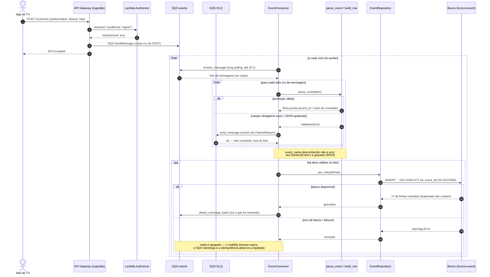
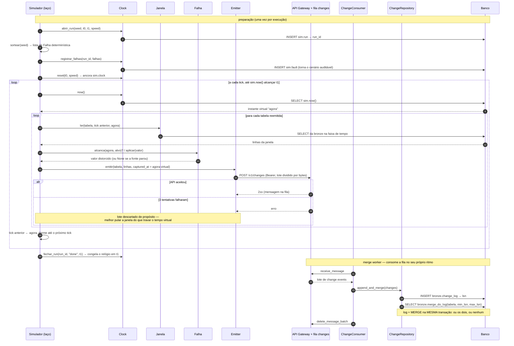
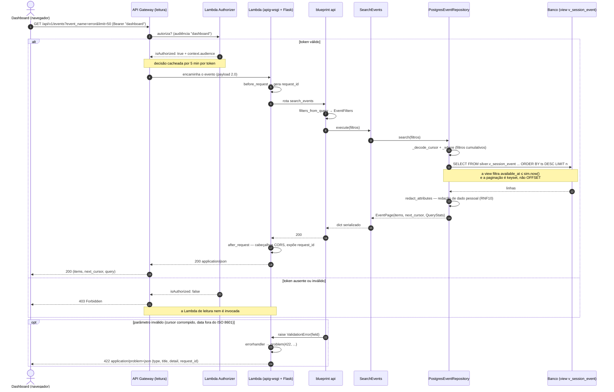
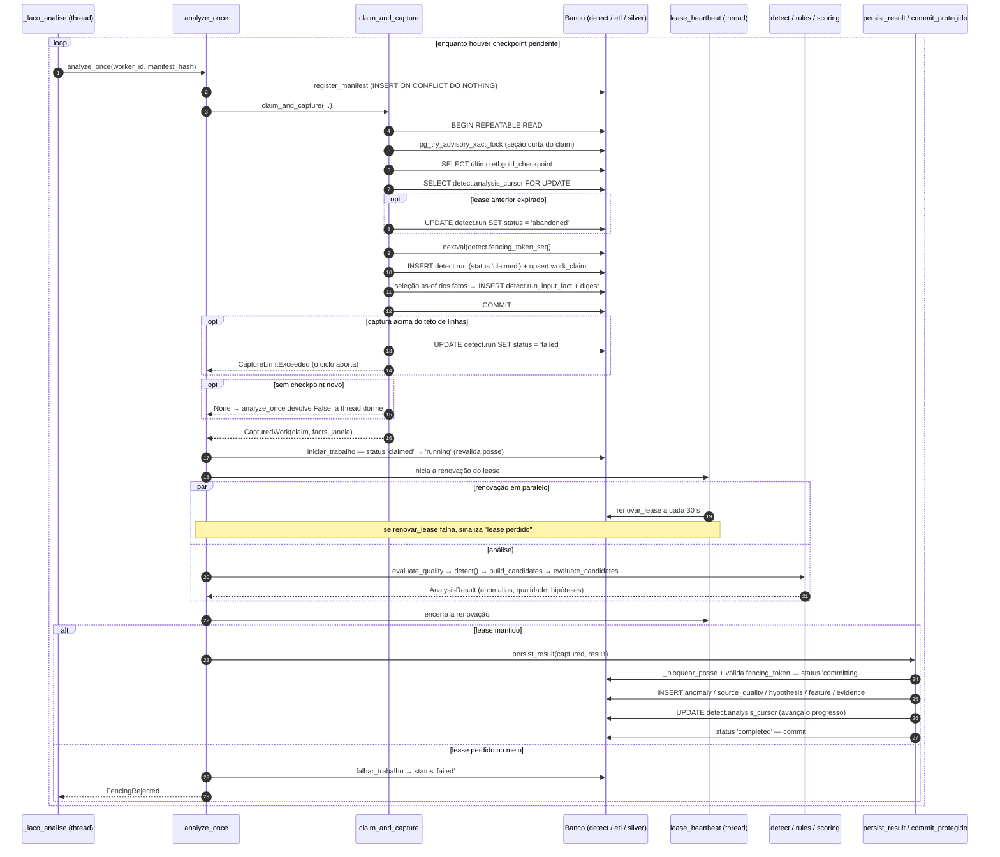

# Modelagem de Software

&emsp;Este documento apresenta a modelagem de software da Plataforma Argus, com foco em três visões complementares: os
**casos de uso**, que descrevem o comportamento observável do sistema a partir
dos seus atores, o **diagrama de classes**, que detalha o modelo de domínio,
as abstrações e o vocabulário centrais das aplicações, e os **diagramas de
sequência**, que ilustram passo a passo os principais fluxos de execução. Os
casos de uso explicam *o quê* e *por quê*, o
diagrama de classes explica *com que* o sistema é construído, e os diagramas de
sequência explicam *como*, no tempo, essas classes colaboram para realizar cada
caso de uso.

---

## 1. Casos de uso

&emsp;Esta seção descreve o comportamento da Plataforma Argus a partir do
diagrama de casos de uso e dos requisitos já definidos para o projeto. O foco
está nas interações observáveis entre a plataforma, as fontes de telemetria, o
usuário operacional, o evento temporal que inicia o processamento e o serviço
de apoio à observabilidade.

&emsp;As descrições foram escritas em nível essencial: apresentam a intenção
dos atores e as responsabilidades do sistema sem transformar decisões internas
de implementação em passos do usuário. Detalhes técnicos relevantes aparecem
apenas em **Requisitos especiais**, quando representam restrições de
segurança, desempenho, confiabilidade, rastreabilidade ou qualidade dos dados.

&emsp;A fronteira considerada é a **Plataforma Argus**, desde o recebimento da
telemetria até a apresentação de evidências e o registro da avaliação humana.
A correção da aplicação monitorada, o tratamento de chamados e a execução de
mudanças em produção não fazem parte desta fronteira.

### 1.1 Objetivo

Este artefato descreve o comportamento da Plataforma Argus a partir do diagrama de casos de uso e dos requisitos já definidos para o projeto. O foco está nas interações observáveis entre a plataforma, as fontes de telemetria, o usuário operacional, o evento temporal que inicia o processamento e o serviço de apoio à observabilidade.

As descrições foram escritas em nível essencial: apresentam a intenção dos atores e as responsabilidades do sistema sem transformar decisões internas de implementação em passos do usuário. Detalhes técnicos relevantes aparecem apenas em **Requisitos especiais**, quando representam restrições de segurança, desempenho, confiabilidade, rastreabilidade ou qualidade dos dados.

A fronteira considerada é a **Plataforma Argus**, desde o recebimento da telemetria até a apresentação de evidências e o registro da avaliação humana. A correção da aplicação monitorada, o tratamento de chamados e a execução de mudanças em produção não fazem parte desta fronteira.

### 1.2 Atores

| Ator | Tipo | Responsabilidade e interesse principal |
|---|---|---|
| **Fontes de telemetria** | Sistema externo | Publicar eventos de sessão e mudanças das fontes monitoradas para que sejam armazenados e analisados pelo Argus. |
| **Novo checkpoint disponível** | Evento temporal | Informar que uma nova fotografia consistente da camada analítica está pronta para processamento. Não representa uma pessoa, mas o estímulo temporal que inicia o UC02. |
| **Usuário Operacional** | Ator humano principal | Monitorar a plataforma, explorar dados e investigar degradações. Abrange, sobretudo, os perfis de Engenharia de Observabilidade e Suporte N2 definidos no entendimento de UX. |
| **Amazon CloudWatch** | Sistema de apoio | Disponibilizar logs, métricas e alarmes sobre a saúde da ingestão e dos componentes da plataforma. |

O ator **Usuário Operacional** aparece duas vezes no diagrama somente para reduzir o cruzamento de associações. As duas figuras representam o mesmo papel e possuem as mesmas permissões conceituais.

### 1.3 Diagrama de casos de uso

<div align="center">

<sub>Figura 1 - Diagrama de casos de uso da Plataforma Argus</sub>


<sup>Fonte: material produzido pelos autores (2026).</sup>

</div>

O diagrama separa os comportamentos em três grupos. **Processamento Automático** contém a entrada e a análise contínua da telemetria. **Monitoramento e Investigação Inicial** reúne as ações que ajudam o operador a reconhecer e começar a apurar um problema. **Diagnóstico e Avaliação** contém os aprofundamentos usados para explicar, delimitar e revisar uma degradação.

#### 1.3.1 Relações entre os casos de uso

| Caso base | Relação | Caso relacionado | Interpretação |
|---|---|---|---|
| UC02 - Processar telemetria e detectar | `<<include>>` | UC03 - Produzir hipóteses de causa provável | Toda execução válida tenta produzir explicações candidatas; o resultado pode conter zero hipóteses quando não há evidência suficiente. |
| UC06 - Investigar uma degradação | `<<include>>` | UC07 - Identificar e ajustar o recorte afetado | Delimitar a população afetada faz parte de toda investigação. |
| UC06 - Investigar uma degradação | `<<include>>` | UC08 - Comparar com períodos anteriores | Toda investigação confronta a janela atual com uma referência adequada. |
| UC06 - Investigar uma degradação | `<<extend>>` | UC10 - Analisar hipóteses de causa provável | A análise de hipóteses ocorre quando existem hipóteses publicadas e o operador decide aprofundá-las. |
| UC06 - Investigar uma degradação | `<<extend>>` | UC11 - Reconstruir a timeline do incidente | A reconstrução temporal é usada quando a ordem dos sinais e mudanças é relevante para o diagnóstico. |
| UC07 - Identificar e ajustar o recorte afetado | `<<extend>>` | UC12 - Consultar a trajetória de uma sessão | Uma sessão representativa pode ser aberta para validar o comportamento observado no agregado. |
| UC10 - Analisar hipóteses de causa provável | `<<extend>>` | UC13 - Registrar validade sobre uma hipótese | Depois de avaliar as evidências, o operador pode registrar sua conclusão sobre a hipótese. |

Em UML, `<<include>>` indica um comportamento obrigatório do caso base. `<<extend>>` representa um comportamento condicional, executado somente quando sua condição de extensão é satisfeita.

### 1.4 Visão geral e rastreabilidade

| ID | Caso de uso | Ator iniciador | Relação principal | Requisitos relacionados |
|---|---|---|---|---|
| UC01 | Ingerir telemetria | Fontes de telemetria | Independente | RF01 a RF07; RNF01, RNF03 a RNF06, RNF09 a RNF11 |
| UC02 | Processar telemetria e detectar | Novo checkpoint disponível | Inclui UC03 | RF15 e RF17; RNF04, RNF05 e RNF11 |
| UC03 | Produzir hipóteses de causa provável | UC02 | Incluído por UC02 | RF17 e RNF08 |
| UC04 | Monitorar o estado atual da plataforma | Usuário Operacional | Independente | RF12, RF13, RF15 e RF16 |
| UC05 | Explorar a telemetria coletada | Usuário Operacional | Independente | RF08 a RF12 |
| UC06 | Investigar uma degradação | Usuário Operacional | Inclui UC07 e UC08; pode ser estendido por UC10 e UC11 | RF13 a RF17 |
| UC07 | Identificar e ajustar o recorte afetado | UC06 | Incluído por UC06; pode ser estendido por UC12 | RF08 a RF11 e RF16 |
| UC08 | Comparar com períodos anteriores | UC06 | Incluído por UC06 | RF14 |
| UC09 | Acompanhar a integridade da ingestão | Usuário Operacional | Apoiado pelo Amazon CloudWatch | RNF04, RNF05 e RNF11 |
| UC10 | Analisar hipóteses de causa provável | Usuário Operacional | Extensão de UC06; pode ser estendido por UC13 | RF17 e RNF08 |
| UC11 | Reconstruir a timeline do incidente | Usuário Operacional | Extensão de UC06 | RF16; US01 |
| UC12 | Consultar a trajetória de uma sessão | Usuário Operacional | Extensão de UC07 | RF08 e RF16; US06 e US08 |
| UC13 | Registrar validade sobre uma hipótese | Usuário Operacional | Extensão de UC10 | RF17 |

A rastreabilidade indica afinidade entre cada caso de uso e os requisitos, sem impor uma relação de um para um. Um requisito pode participar de mais de um objetivo do usuário, assim como um caso de uso pode reunir vários requisitos complementares.

### 1.5 Descrições dos casos de uso

#### 1.5.1 UC01 - Ingerir telemetria

**Escopo.** Plataforma Argus, da recepção de um evento até sua persistência rastreável na camada de entrada.

**Nível.** Objetivo de sistema externo.

**Atores.** Ator iniciador: Fontes de telemetria. Atores de apoio: serviço de autorização e infraestrutura de mensageria, considerados mecanismos internos à fronteira do Argus.

**Interessados e interesses.** As fontes de telemetria desejam entregar os dados sem acoplamento à capacidade instantânea de processamento. O usuário operacional precisa de dados íntegros, recentes e identificáveis. A equipe de plataforma precisa de reprocessamento, idempotência e falhas rastreáveis. Segurança e privacidade exigem autenticação e ausência de dados pessoais desnecessários.

**Pré-condições.** A fonte conhece o contrato da rota correspondente; possui credencial válida com audiência de ingestão; e o endpoint de ingestão está publicado. Para eventos de mudança, a tabela de origem e a chave da linha precisam pertencer ao catálogo aceito.

**Pós-condições.** Em caso de sucesso, o evento foi aceito, enfileirado, validado e persistido no histórico de entrada apropriado, ficando disponível para os ciclos posteriores. Em caso de falha, nenhum estado válido anterior é corrompido e o motivo pode ser localizado por logs, métricas ou fila de mensagens não processadas.

**Fluxo Básico.**

1. A fonte prepara um evento de telemetria conforme o contrato aplicável.
2. A fonte envia o evento ao ponto único de ingestão por uma conexão segura e apresenta sua credencial.
3. O Argus autentica a origem e identifica se o conteúdo representa um evento de sessão ou uma mudança de dado monitorado.
4. O Argus aceita a mensagem e a encaminha para o fluxo assíncrono correspondente.
5. O consumidor valida o envelope, os identificadores, o instante, o tipo e os demais campos obrigatórios.
6. O Argus registra o evento no histórico de entrada e atualiza a visão corrente quando aplicável.
7. O consumidor confirma o processamento da mensagem e registra métricas e informações de rastreabilidade.

**Fluxos alternativos.**

Alternativos:

- **A1 - Evento de sessão:** a mensagem recebida contém a trajetória de uso de uma aplicação cliente e é persistida com os identificadores de evento, sessão e dispositivo.
- **A2 - Evento de mudança:** a mensagem informa operação, chave, estado anterior, estado posterior, posição da origem e instante de captura; o Argus a adiciona ao log de mudanças e materializa a versão mais recente.
- **A3 - Reentrega:** se a mesma mensagem for entregue novamente, o Argus reconhece sua identidade ou posição e mantém apenas o efeito esperado, sem duplicar o estado lógico.
- **A4 - Mudança fora de ordem:** se uma mudança possui posição anterior à já aplicada, ela permanece rastreável no histórico, mas não sobrescreve o estado corrente mais novo.

Exceções:

- **E1 - Credencial ausente ou inválida:** a requisição é recusada antes de alcançar a fila.
- **E2 - Payload inválido:** o consumidor rejeita a mensagem, registra o motivo e permite que as mensagens válidas seguintes continuem sendo processadas.
- **E3 - Falha temporária de persistência:** a mensagem volta a ficar disponível para nova tentativa; depois do limite de tentativas, segue para a fila de mensagens não processadas.
- **E4 - Fonte ou operação não permitida:** o evento não altera as tabelas correntes e a ocorrência fica registrada para investigação.

**Requisitos especiais.** A ingestão deve suportar inicialmente pelo menos 1.000 requisições por minuto; usar autenticação com audiência exclusiva de ingestão; tolerar reentregas; preservar a ordem lógica por posição da origem; não perder silenciosamente mensagens já aceitas; e produzir rastreabilidade sem registrar tokens ou dados pessoais desnecessários.

**Lista de variantes.** Rotas de evento de sessão e de mudança; plataformas web, móveis e TVs; protocolos modernos e legados priorizados; operações de inclusão, atualização e exclusão; eventos `request`, `vitals`, `screen_view`, `video_view`, `session` e `error`.

**Frequência de ocorrência.** Contínua e alta, acompanhando o volume das fontes; a meta inicial de capacidade é de 1.000 requisições por minuto em operação normal.

**Problemas em aberto.** Confirmar com o parceiro a lista definitiva de plataformas e protocolos do MVP; definir a política de retenção e expurgo dos dados de entrada; e calibrar limites de reentrega, alarme e capacidade com volume de produção.

#### 1.5.2 UC02 - Processar telemetria e detectar

**Escopo.** Plataforma Argus, do reconhecimento de um novo checkpoint analítico até a publicação de uma execução consistente de qualidade, detecção e hipóteses.

**Nível.** Objetivo de processamento automático.

**Atores.** Ator iniciador: Novo checkpoint disponível. O serviço de processamento executa o comportamento dentro da fronteira do Argus.

**Interessados e interesses.** O usuário operacional precisa que as degradações sejam detectadas com dados que realmente estariam disponíveis naquele instante. A equipe de dados deseja resultados determinísticos e reproduzíveis. A equipe de plataforma precisa evitar publicação duplicada ou incompleta quando houver concorrência, falha ou retomada de workers.

**Pré-condições.** Um checkpoint Gold foi concluído com `ready_through` e posição de origem conhecidas; existe um manifesto de análise habilitado; e as versões de fatos até a barreira do checkpoint estão disponíveis.

**Pós-condições.** Em caso de sucesso, a execução guarda sua fotografia de entrada, resultado de qualidade, estado do baseline, anomalias e hipóteses, e avança o cursor de análise na mesma confirmação protegida. Em caso de falha, a execução não é publicada como concluída nem avança o cursor indevidamente.

**Fluxo Básico.**

1. Um novo checkpoint analítico fica disponível.
2. O Argus identifica o checkpoint elegível ainda não concluído para o manifesto ativo.
3. O Argus reserva o trabalho, define o instante simulado e a posição máxima da origem e obtém uma concessão temporária exclusiva.
4. O Argus captura uma fotografia consistente contendo somente fatos com versão e disponibilidade compatíveis com o checkpoint.
5. O Argus calcula e registra um resumo verificável das entradas da execução.
6. O Argus avalia a qualidade e a recência de cada fonte.
7. O Argus compara as séries com seus baselines causais e identifica anomalias materiais.
8. O Argus executa o UC03 - Produzir hipóteses de causa provável.
9. O Argus confirma, numa única operação protegida, os resultados e o avanço do cursor.
10. O Argus publica métricas sobre duração, volume, anomalias, hipóteses, atraso e fila de checkpoints.

**Fluxos alternativos.**

Alternativos:

- **A1 - Nenhum checkpoint novo:** o ciclo termina sem criar uma execução.
- **A2 - Trabalho já reservado:** outra réplica mantém uma concessão válida; a réplica atual não processa o mesmo checkpoint.
- **A3 - Retomada:** uma concessão expirada permite que outra réplica retome o checkpoint com novo token de exclusão.
- **A4 - Nenhuma anomalia material:** a execução é concluída com resultado vazio de incidentes e hipóteses, preservando o registro de qualidade e baseline.
- **A5 - Fonte atrasada ou incompleta:** o canário registra o estado da fonte; a ausência reduz cobertura e pode originar diagnóstico de qualidade, sem inventar uma degradação operacional.

Exceções:

- **E1 - Fotografia acima do limite:** a tentativa termina com `input_limit_exceeded`; entradas não são truncadas silenciosamente.
- **E2 - Resumo de entrada divergente numa retentativa:** a tentativa termina com `input_digest_mismatch` e o cursor não avança.
- **E3 - Perda de concessão ou token de exclusão:** o worker antigo não pode publicar seus resultados.
- **E4 - Falha de cálculo ou banco:** a transação final é revertida e o checkpoint permanece elegível para nova tentativa.

**Requisitos especiais.** A execução deve respeitar causalidade (`available_at` menor ou igual ao instante da execução), isolamento consistente, determinismo, idempotência, concessão de 120 segundos, heartbeat de 30 segundos, limite de 250 mil fatos por fotografia e confirmação protegida por fencing. O processamento deve terminar antes que o acúmulo de checkpoints comprometa a atualidade do diagnóstico.

**Lista de variantes.** Execução simulada ou ao vivo; primeira tentativa ou retomada; fonte saudável, atrasada, incompleta, silenciosa, inválida ou desconhecida; série de contagem/latência transformada ou taxa/percentual em escala original.

**Frequência de ocorrência.** A cada checkpoint elegível. O serviço consulta trabalho novo periodicamente, com intervalo operacional padrão de 30 segundos.

**Problemas em aberto.** Calibrar os limites de anomalia e materialidade com dados de produção; medir se a capacidade atual conclui cada execução antes do próximo checkpoint; e definir retenção para fotografias, execuções e artefatos analíticos.

#### 1.5.3 UC03 - Produzir hipóteses de causa provável

**Escopo.** Motor de hipóteses do Argus, desde as anomalias detectadas até a persistência de explicações candidatas e suas evidências.

**Nível.** Subfunção incluída no processamento automático.

**Atores.** Iniciador indireto: UC02 - Processar telemetria e detectar.

**Interessados e interesses.** O usuário operacional deseja uma lista curta, ordenada e explicável de possíveis causas. A equipe de observabilidade precisa entender por que uma hipótese recebeu determinada pontuação. O parceiro precisa evitar afirmações conclusivas sem validação humana. A equipe de dados exige resultados reproduzíveis e temporalmente corretos.

**Pré-condições.** Existe uma execução com fotografia consistente, resultados do canário e pelo menos a avaliação do detector. O catálogo de regras, métricas, fontes e relações entre entidades está versionado.

**Pós-condições.** As hipóteses geradas, descartadas ou não avaliáveis são persistidas com estado, pontuação, cobertura, confiança, fatores, evidências, versão das regras e vínculo com a execução. Nenhuma hipótese é marcada automaticamente como causa confirmada.

**Fluxo Básico.**

1. O motor recebe as anomalias e o contexto disponíveis na fotografia da execução.
2. O Argus agrupa achados relacionados sem obrigar que um achado pertença a apenas um grupo.
3. O motor avalia as assinaturas das famílias de hipótese aplicáveis.
4. Para cada candidata, o motor coleta evidências favoráveis, contrárias e indisponíveis, respeitando alinhamento temporal e relação conhecida entre entidades.
5. O motor calcula força, coincidência temporal, corroboração, especificidade, impacto e qualidade.
6. O motor aplica penalidades, calcula score, cobertura e confiança e registra a contribuição de cada fator.
7. O motor classifica a candidata como gerada, descartada ou com evidência insuficiente.
8. O Argus ordena as hipóteses geradas e persiste candidatos, fatores, evidências e estatísticas da execução.
9. O resultado fica disponível para publicação e posterior análise humana.

**Fluxos alternativos.**

Alternativos:

- **A1 - Evidência suficiente:** a hipótese atinge os limites de score e cobertura e é publicada como candidata gerada.
- **A2 - Evidência indisponível:** a ausência é registrada como indisponível e reduz a cobertura, mas não é tratada automaticamente como contradição.
- **A3 - Evidência contrária determinante:** a candidata é descartada e preserva a justificativa.
- **A4 - Pico ao vivo esperado:** o motor produz contexto de aumento esperado quando volume cresce durante um evento compatível sem piora proporcional de erro ou experiência.
- **A5 - Problema na própria fonte:** baixa qualidade pode produzir uma hipótese de atraso ou falha de dados, separada das causas operacionais.

Exceções:

- **E1 - Catálogo ou manifesto inválido:** a execução não é publicada e registra o erro de configuração.
- **E2 - Limite de candidatos excedido:** o corte determinístico é aplicado e auditado; se houver truncamento incompatível com o portão de qualidade, o manifesto não pode ser promovido.
- **E3 - Relação semântica desconhecida:** o motor não usa aproximação textual para ligar entidades; a evidência permanece não relacionada.
- **E4 - Falha ao persistir:** nenhuma publicação parcial é confirmada.

**Requisitos especiais.** Toda hipótese deve partir de ao menos uma detecção, usar somente evidências disponíveis no instante analisado e manter linguagem não conclusiva. A mesma entrada e configuração devem gerar o mesmo resultado. Hipótese gerada exige score mínimo de 40 e cobertura mínima de 0,50; confiança alta exige score mínimo de 80, cobertura mínima de 0,80 e qualidade mínima de 0,70. Os limites operacionais são de 10 mil candidatos, 2 mil por família e 500 hipóteses geradas por execução.

**Lista de variantes.** Regressão após deploy; falha interna de backend; playback ou autorização; degradação de CDN; origem ou encoding; região ou ISP; bloqueio de WAF; player ou dispositivo; QoE sem erro explícito; pico ao vivo esperado; atraso ou falha de fonte.

**Frequência de ocorrência.** Uma tentativa por execução válida do UC02; a quantidade de hipóteses resultantes varia de zero até o limite configurado.

**Problemas em aberto.** Validar com especialistas os pesos e limites de cada família; ampliar o conjunto rotulado para medir precisão e cobertura; revisar relações entre entidades conforme o catálogo evoluir; e definir a política de retenção das revisões.

#### 1.5.4 UC04 - Monitorar o estado atual da plataforma

**Escopo.** Dashboard Argus, na visão consolidada do estado operacional atual.

**Nível.** Objetivo do usuário.

**Atores.** Ator iniciador: Usuário Operacional.

**Interessados e interesses.** Engenharia de Observabilidade quer reconhecer rapidamente desvios relevantes. Suporte N2 deseja saber se um relato isolado coincide com uma degradação ampla. Produto e operação precisam compreender impacto, severidade e abrangência sem interpretar dados brutos.

**Pré-condições.** O usuário possui acesso de leitura autorizado; existe uma janela temporal corrente; e há dados publicados nas visões de consulta, ainda que algumas fontes estejam atrasadas ou indisponíveis.

**Pós-condições.** O usuário visualiza uma fotografia coerente do estado atual, com sinais, severidade, tendência, baseline e escopo. A consulta não altera os dados analíticos. O período e os filtros selecionados permanecem disponíveis para aprofundamento.

**Fluxo Básico.**

1. O usuário abre a visão atual do dashboard.
2. O Argus identifica o instante de referência, o período e o escopo ativos.
3. O sistema consulta sinais e anomalias publicados para essa janela.
4. O Argus apresenta os principais indicadores e destaca as degradações por severidade e impacto.
5. O usuário seleciona um sinal para compreender valor atual, referência, limiar, tendência e contexto.
6. O Argus mostra os detalhes e os caminhos disponíveis para hipóteses, timeline e recorte.
7. O usuário decide encerrar o acompanhamento ou iniciar o UC06 - Investigar uma degradação.

**Fluxos alternativos.**

Alternativos:

- **A1 - Operação sem degradação:** o Argus apresenta estado saudável e mantém visíveis a atualidade e a cobertura das fontes.
- **A2 - Mais de uma degradação:** o sistema ordena os sinais por severidade e impacto, permitindo que o usuário escolha um deles.
- **A3 - Alteração de período ou escopo:** o Argus preserva os filtros cumulativos e atualiza indicadores e sinais.
- **A4 - Dados parciais ou antigos:** o último resultado válido pode ser mantido com indicação explícita de parcialidade ou desatualização.

Exceções:

- **E1 - Falha ou timeout de consulta:** o sistema diferencia falha de resultado vazio, mostra uma referência rastreável e oferece nova tentativa.
- **E2 - Resposta inválida:** os dados não são apresentados como válidos; o usuário recebe uma mensagem compreensível.
- **E3 - Acesso não autorizado:** a plataforma impede a visualização e não expõe dados operacionais.

**Requisitos especiais.** Consultas simples devem responder em até cinco segundos. A tela deve distinguir carregamento, atualização, vazio, parcial, desatualizado e erro; funcionar por teclado; apresentar nomes acessíveis; respeitar redução de movimento; e evitar exposição de identificadores ou atributos pessoais desnecessários.

**Lista de variantes.** Janelas de 15 minutos, 30 minutos, 3 horas e 24 horas; temas claro e escuro; visualização larga, tablet ou móvel; estado saudável, degradado, parcial ou desatualizado; escopo por plataforma, fabricante, região e versão do aplicativo.

**Frequência de ocorrência.** Frequente durante todo o turno operacional, com atualização periódica e novas consultas sempre que período ou escopo mudam.

**Problemas em aberto.** Validar com o parceiro os limiares e nomes de severidade; definir quais degradações devem ocupar a visão principal; e consolidar a cobertura regional e de fontes no ambiente definitivo.

#### 1.5.5 UC05 - Explorar a telemetria coletada

**Escopo.** Dashboard e API de leitura do Argus, para pesquisa, agrupamento e visualização dos dados coletados.

**Nível.** Objetivo do usuário.

**Atores.** Ator iniciador: Usuário Operacional.

**Interessados e interesses.** O operador deseja responder perguntas ad hoc sem escrever consultas técnicas. Suporte N2 precisa localizar padrões por sessão, dispositivo, plataforma ou erro. Engenharia de Observabilidade quer avaliar volume, distribuição e comportamento temporal. Segurança exige campos e dimensões de consulta controlados.

**Pré-condições.** O usuário está autorizado; existe telemetria publicada para leitura; e as dimensões consultáveis estão registradas em uma lista segura.

**Pós-condições.** O Argus apresenta o conjunto, série ou agrupamento correspondente ao período e aos filtros escolhidos. O estado da investigação é preservado para refinamento ou navegação. Nenhum dado de origem é alterado.

**Fluxo Básico.**

1. O usuário abre a área de exploração.
2. O Argus apresenta a janela temporal atual, os filtros ativos e um resumo dos dados disponíveis.
3. O usuário escolhe um tipo de evento ou métrica.
4. O usuário aplica um ou mais filtros de escopo.
5. O usuário escolhe como agrupar ou cruzar os resultados.
6. O Argus valida os parâmetros e consulta as visões publicadas.
7. O sistema apresenta indicadores, série temporal e distribuição por grupo, mantendo visíveis período, filtros e unidade.
8. O usuário refina a consulta, abre um recorte relevante ou encerra a exploração.

**Fluxos alternativos.**

Alternativos:

- **A1 - Sugestão de filtros:** ao escolher uma dimensão, o Argus oferece somente valores existentes e permitidos no conjunto consultável.
- **A2 - Filtros cumulativos:** cada novo filtro restringe a consulta anterior; remover ou limpar filtros recalcula o resultado.
- **A3 - Outro agrupamento:** o usuário alterna entre fonte, entidade, métrica, tipo, modelo, versão, rota ou intervalo de tempo.
- **A4 - Resultado paginado:** quando houver mais itens, o Argus entrega um cursor para continuar a leitura sem repetir ou saltar registros.
- **A5 - Nenhum resultado:** a plataforma informa que o recorte é vazio e permite rever os filtros.

Exceções:

- **E1 - Dimensão ou intervalo inválido:** a API recusa a consulta com erro de validação e o dashboard preserva o estado anterior.
- **E2 - Timeout, rede indisponível ou resposta inválida:** o sistema identifica o tipo de falha e oferece nova tentativa.
- **E3 - Campo sensível solicitado:** o Argus recusa a dimensão não autorizada e não retorna seus valores como sugestão.

**Requisitos especiais.** Consultas simples devem retornar em até cinco segundos; filtros devem ser cumulativos; datas devem usar UTC/ISO 8601 no contrato; dimensões devem ser controladas por lista permitida; paginação deve ser estável; e estados de carregamento, vazio e erro devem ser acessíveis e distintos.

**Lista de variantes.** Eventos ou séries Gold; lista, indicador, gráfico temporal, agrupamento ou matriz de duas dimensões; filtros de sessão, dispositivo, tipo, aplicativo, sistema operacional, fabricante, modelo, rota, fonte, entidade e métrica; intervalos de agregação configuráveis.

**Frequência de ocorrência.** Sob demanda, normalmente várias vezes durante uma investigação ou análise exploratória.

**Problemas em aberto.** Confirmar quais dimensões regionais e de ISP podem ser combinadas; definir busca segura por códigos presentes em atributos livres; e revisar limites de paginação e agregação com o volume definitivo.

#### 1.5.6 UC06 - Investigar uma degradação

**Escopo.** Plataforma Argus, da seleção de uma degradação até a reunião de evidências suficientes para orientar uma decisão humana.

**Nível.** Objetivo do usuário.

**Atores.** Ator iniciador: Usuário Operacional.

**Interessados e interesses.** Engenharia de Observabilidade quer reduzir o tempo de diagnóstico e distinguir causa interna, externa ou de qualidade de dados. Suporte N2 precisa relacionar sintomas de usuários a um problema conhecido. O parceiro deseja evidências atribuídas às fontes e conclusões apresentadas como hipóteses, não certezas automáticas.

**Pré-condições.** O usuário está autorizado; existe um sinal, anomalia, hipótese ou relato que justifique a investigação; e a plataforma possui ao menos uma janela de dados consultável.

**Pós-condições.** O problema fica descrito por janela, escopo afetado, comparação histórica e evidências disponíveis. O usuário pode formar uma conclusão provisória, registrar feedback sobre hipótese ou reconhecer que ainda faltam dados. A consulta não altera a telemetria original.

**Fluxo Básico.**

1. O usuário seleciona uma degradação ou inicia a investigação a partir de um sinal, hipótese, sessão ou relato.
2. O Argus preserva a janela, o escopo e a âncora que originaram a investigação.
3. O sistema apresenta o resumo do problema, incluindo métricas desviantes, severidade, início e impacto conhecido.
4. O Argus executa o UC07 - Identificar e ajustar o recorte afetado.
5. O Argus executa o UC08 - Comparar com períodos anteriores.
6. O usuário confronta o recorte, a referência histórica e as fontes disponíveis.
7. Quando necessário, o usuário aprofunda a análise por hipótese, timeline ou sessão.
8. O Argus mantém as evidências e sua proveniência vinculadas ao mesmo contexto de investigação.
9. O usuário encerra a análise com uma conclusão provisória ou registra que são necessárias mais evidências.

**Fluxos alternativos.**

Alternativos:

- **A1 - Investigação iniciada por sinal:** o contexto inicial contém a métrica, a entidade e o instante do desvio.
- **A2 - Investigação iniciada por hipótese:** o contexto começa com a explicação candidata, suas evidências e o segmento associado.
- **A3 - Investigação iniciada por sessão:** o Argus parte da trajetória individual e amplia para o recorte agregado.
- **A4 - Hipóteses publicadas:** o usuário pode executar o UC10 - Analisar hipóteses de causa provável.
- **A5 - Ordem temporal relevante:** o usuário pode executar o UC11 - Reconstruir a timeline do incidente.
- **A6 - Dados parciais:** o usuário continua com o último resultado válido, desde que a plataforma destaque quais fontes ou períodos estão ausentes.

Exceções:

- **E1 - Contexto inicial inexistente ou removido:** o Argus informa que o item não está disponível e oferece retorno à visão atual.
- **E2 - Nenhuma referência histórica adequada:** a investigação prossegue sem comparação, com a limitação registrada.
- **E3 - Falha numa consulta complementar:** o sistema preserva os resultados já válidos e permite repetir somente a etapa que falhou.
- **E4 - Perda de autorização:** a investigação é interrompida sem expor dados adicionais.

**Requisitos especiais.** Período, filtros, sinal, hipótese e âncora temporal devem permanecer coerentes entre as telas. Toda evidência deve indicar fonte e instante. Informações ausentes não podem ser apresentadas como evidência contrária. A interface deve evitar linguagem conclusiva e permitir navegação acessível entre resumo e detalhe.

**Lista de variantes.** Início por sinal, hipótese, sessão ou monitoramento manual; degradação global ou segmentada; fonte saudável, parcial ou atrasada; investigação curta pelo resumo ou aprofundada por recorte, comparação, timeline e hipótese.

**Frequência de ocorrência.** Sempre que uma degradação relevante é detectada ou relatada; pode ocorrer várias vezes para o mesmo incidente à medida que chegam novas evidências.

**Problemas em aberto.** Definir critérios formais de abertura e encerramento de uma investigação; decidir como persistir e compartilhar seu contexto entre operadores; e integrar o resultado com o processo externo de incidentes ou chamados, que permanece fora da fronteira atual.

#### 1.5.7 UC07 - Identificar e ajustar o recorte afetado

**Escopo.** Área de diagnóstico do Argus responsável por delimitar a população, as entidades e as dimensões relacionadas a uma degradação.

**Nível.** Subfunção obrigatória de objetivo do usuário.

**Atores.** Iniciador indireto: UC06 - Investigar uma degradação. Ator participante: Usuário Operacional.

**Interessados e interesses.** O operador precisa distinguir um problema global de uma concentração em plataforma, modelo, versão, região, rota, entidade ou fonte. Suporte N2 quer reconhecer usuários e aparelhos representativos. Produto deseja estimar alcance e participação no tráfego sem confundir volume com taxa de erro.

**Pré-condições.** Uma investigação está ativa com janela inicial definida; há dados agregados para pelo menos uma dimensão; e o usuário possui acesso de leitura.

**Pós-condições.** O recorte ativo contém dimensões, valores, janela, volume, participação, taxa e cobertura conhecidos. O contexto atualizado fica disponível para comparação, hipóteses, timeline e consulta de sessões.

**Fluxo Básico.**

1. O Argus recebe a janela e o escopo da investigação.
2. O sistema apresenta a distribuição do sinal ou dos erros entre dimensões relevantes.
3. O usuário seleciona uma dimensão com concentração significativa.
4. O Argus aplica o valor escolhido ao conjunto de filtros cumulativos.
5. O sistema recalcula volume, participação no tráfego, participação nos erros, taxa e diferença em relação aos demais grupos.
6. O usuário adiciona, substitui ou remove filtros até obter um recorte explicativo e com cobertura suficiente.
7. O Argus registra o recorte ativo no contexto da investigação.
8. O usuário confirma o recorte ou abre uma sessão representativa pelo UC12.

**Fluxos alternativos.**

Alternativos:

- **A1 - Sugestões existentes:** o Argus oferece valores presentes nos dados para reduzir filtros inválidos.
- **A2 - Problema global:** nenhuma dimensão concentra o desvio; o usuário mantém o recorte amplo.
- **A3 - Mais de um segmento afetado:** o usuário compara grupos e mantém o conjunto de filtros que melhor representa o impacto.
- **A4 - Sessão representativa disponível:** o usuário executa o UC12 - Consultar a trajetória de uma sessão.
- **A5 - Dimensão ausente:** a análise continua com menor especificidade e a cobertura é apresentada explicitamente.

Exceções:

- **E1 - Combinação não suportada:** o Argus impede cruzamentos sem contrato ou sem granularidade compatível e explica a limitação.
- **E2 - Filtro inválido ou sensível:** a consulta é recusada sem expor valores não permitidos.
- **E3 - Recorte sem dados:** o sistema informa o vazio e permite desfazer o último ajuste.
- **E4 - Falha de consulta:** o recorte anterior permanece visível como último resultado válido, marcado como desatualizado quando necessário.

**Requisitos especiais.** Os filtros devem ser cumulativos e reproduzíveis. As métricas de participação precisam distinguir tráfego de erros. Valores desconhecidos não devem formar recortes específicos. Dimensões opcionais reduzem cobertura, mas não invalidam análises que não dependem delas. Consultas devem respeitar as listas seguras de facetas e agrupamentos.

**Lista de variantes.** Recorte por fonte, entidade, métrica, plataforma, sistema operacional, fabricante, modelo, versão, região, ISP, rota, sessão ou dispositivo; agrupamento simples ou matriz de duas dimensões; escopo global, segmentado ou sem resultado.

**Frequência de ocorrência.** Uma ou mais vezes por investigação, com refinamentos sucessivos até que o escopo esteja claro.

**Problemas em aberto.** A base possui UF e ISP como dimensões marginais separadas, sem garantir o cruzamento entre ambas; também é necessário validar com o parceiro os mínimos de volume, lift e diferença usados para considerar um recorte material.

#### 1.5.8 UC08 - Comparar com períodos anteriores

**Escopo.** Área de comparação do Argus, responsável por confrontar a janela investigada com uma referência histórica equivalente.

**Nível.** Subfunção obrigatória de objetivo do usuário.

**Atores.** Iniciador indireto: UC06 - Investigar uma degradação. Ator participante: Usuário Operacional.

**Interessados e interesses.** O usuário operacional quer saber o que realmente mudou, evitando interpretar padrões sazonais como incidentes. Engenharia de Observabilidade precisa comparar valor, variação e dispersão. Produto deseja distinguir pico esperado de degradação de experiência.

**Pré-condições.** A investigação possui janela e filtros definidos; existem dados históricos potencialmente comparáveis; e o usuário está autorizado.

**Pós-condições.** A plataforma apresenta a janela atual e a referência com duração, escopo, valores e variações coerentes. A referência escolhida fica associada ao contexto da investigação. Se nenhuma referência for adequada, a limitação fica explícita.

**Fluxo Básico.**

1. O Argus recebe a janela e o recorte atuais.
2. O sistema sugere uma referência histórica compatível.
3. O usuário confirma ou escolhe outra referência.
4. O Argus valida se as janelas possuem duração, granularidade e filtros comparáveis.
5. O sistema consulta os dados atuais e históricos sem incluir informações futuras ao instante analisado.
6. O Argus apresenta as séries alinhadas, os valores de cada janela, a variação absoluta e percentual e, quando disponível, a significância estatística.
7. O sistema destaca mudanças de infraestrutura, eventos editoriais ou diferenças de cobertura relevantes entre os períodos.
8. O usuário incorpora a comparação à investigação.

**Fluxos alternativos.**

Alternativos:

- **A1 - Período imediatamente anterior:** o Argus compara com uma janela contígua de mesma duração.
- **A2 - Ontem ou semana anterior:** o sistema alinha o mesmo horário em outro dia, preservando duração e fuso de apresentação.
- **A3 - Última janela estável:** o Argus utiliza uma janela anterior sem incidente compatível.
- **A4 - Último pico ao vivo:** o sistema seleciona um evento editorial anterior comparável.
- **A5 - Outra referência:** o usuário escolhe manualmente uma janela válida.

Exceções:

- **E1 - Referência não encontrada:** o sistema informa a ausência e permite escolher outro tipo de comparação.
- **E2 - Janela ou duração inválida:** o Argus recusa os parâmetros e preserva a seleção anterior.
- **E3 - Cobertura desigual:** a comparação é exibida com ressalva ou bloqueada quando a diferença inviabiliza uma leitura responsável.
- **E4 - Falha de consulta:** a plataforma não calcula variações com dados parciais apresentados como completos e oferece nova tentativa.

**Requisitos especiais.** As janelas devem usar a mesma duração, granularidade, unidade e escopo, salvo quando a diferença for explicitamente mostrada. Baselines devem ser causais. Horários devem ser transportados em UTC e apresentados com fuso identificável. Consultas simples devem concluir em até cinco segundos.

**Lista de variantes.** Período anterior, ontem no mesmo horário, semana anterior, janela estável, pico ao vivo anterior ou intervalo manual; comparação de contagem, taxa, percentual, latência, Apdex ou QoE; referência encontrada ou ausente.

**Frequência de ocorrência.** Ao menos uma vez por investigação, podendo ser repetida com referências diferentes.

**Problemas em aberto.** Definir o critério definitivo de janela estável; estabelecer como selecionar eventos ao vivo equivalentes; validar o cálculo de significância e envelope histórico; e tratar mudanças de cobertura entre fontes.

#### 1.5.9 UC09 - Acompanhar a integridade da ingestão

**Escopo.** Operação da Plataforma Argus, com uso de métricas, logs e alarmes para avaliar a saúde do caminho de entrada dos dados.

**Nível.** Objetivo do usuário.

**Atores.** Ator iniciador: Usuário Operacional. Ator de apoio: Amazon CloudWatch.

**Interessados e interesses.** O operador precisa distinguir ausência real de sinal de atraso ou falha no pipeline. A equipe de plataforma deseja detectar backlog, mensagens não processadas, serviços indisponíveis e latência crescente. Segurança exige observabilidade sem vazamento de credenciais ou identificadores sensíveis.

**Pré-condições.** Os componentes publicam métricas e logs operacionais; o usuário possui acesso autorizado à visão correspondente; e o CloudWatch está recebendo as observações configuradas.

**Pós-condições.** O usuário conhece o estado de cada fluxo de ingestão, sua recência, backlog, falhas e alarmes ativos. Quando existe anomalia operacional, a evidência necessária para encaminhar a investigação fica identificada. Nenhuma mensagem é removida manualmente por este caso de uso.

**Fluxo Básico.**

1. O usuário abre a visão de integridade da ingestão ou recebe indicação de um alarme.
2. O Argus consulta o estado publicado das fontes, filas, consumidores e persistência.
3. O CloudWatch fornece métricas, logs e alarmes dos componentes monitorados.
4. A plataforma apresenta recência, volume recebido, backlog, tentativas, mensagens não processadas, saúde dos serviços e atraso dos checkpoints.
5. O usuário compara o comportamento atual com os limites operacionais.
6. O usuário seleciona um componente ou uma fonte com desvio.
7. O Argus mostra a referência da falha, o período e a evidência disponível para diagnóstico.
8. O usuário registra ou encaminha a ocorrência pelo processo operacional externo.

**Fluxos alternativos.**

Alternativos:

- **A1 - Operação saudável:** todos os fluxos estão dentro dos limites e as filas de mensagens não processadas permanecem vazias.
- **A2 - Atraso estrutural conhecido:** o Argus diferencia a latência esperada da fonte de um atraso anormal.
- **A3 - Backlog transitório:** a fila cresce, mas os consumidores continuam avançando; o sistema acompanha a recuperação antes de elevar a severidade.
- **A4 - Falha de uma fonte:** o Argus marca resultados analíticos dependentes como parciais e evita interpretar silêncio como melhora.

Exceções:

- **E1 - CloudWatch indisponível:** o sistema informa que a observabilidade de apoio está indisponível e não declara a ingestão como saudável.
- **E2 - Consumidor sem progresso:** o Argus destaca heartbeat ausente, idade da fila ou mensagens na fila de falhas para investigação.
- **E3 - Persistência indisponível:** as mensagens permanecem para nova tentativa; após o limite configurado, são isoladas de forma rastreável.
- **E4 - Métricas incoerentes:** a condição é tratada como problema de observabilidade, não como confirmação de perda de dados.

**Requisitos especiais.** Logs devem ser estruturados e incluir identificador de requisição, componente, status e latência. Tokens nunca podem ser registrados; parâmetros sensíveis devem ser redigidos. Alarmes devem cobrir filas de falha, idade e backlog das filas, réplicas abaixo do desejado, falhas consecutivas de análise, perda de concessão e ausência prolongada de execução concluída.

**Lista de variantes.** Fluxo de eventos de sessão ou de mudanças; acompanhamento preventivo ou iniciado por alarme; fonte com latência imediata, de minutos ou batch; falha na API, fila, worker, banco, processamento ou mecanismo de observabilidade.

**Frequência de ocorrência.** Contínua por métricas e alarmes, com consulta humana recorrente durante o turno e sempre que houver alerta.

**Problemas em aberto.** Validar limites de alarme com a carga real; definir objetivos formais de atualidade por fonte; documentar o procedimento de reprocessamento das filas de falha; e integrar a tela do Argus ao fluxo de resposta operacional do parceiro.

#### 1.5.10 UC10 - Analisar hipóteses de causa provável

**Escopo.** Dashboard e API de hipóteses do Argus, da listagem das explicações candidatas até a avaliação detalhada de uma delas.

**Nível.** Extensão de objetivo do usuário.

**Atores.** Ator iniciador: Usuário Operacional, durante o UC06 - Investigar uma degradação.

**Interessados e interesses.** O operador deseja priorizar caminhos de investigação e compreender cada evidência. Especialistas de domínio precisam distinguir suporte, contradição e indisponibilidade. O parceiro exige que a solução apoie, mas não substitua, a decisão humana.

**Pré-condições.** Existe uma investigação ativa; há uma execução publicada do motor de hipóteses compatível com a janela; e o usuário possui autorização de leitura.

**Pós-condições.** O usuário compreende a hipótese selecionada, seu score, confiança, cobertura, fatores, evidências e limitações. A seleção pode orientar a timeline, o recorte ou o registro de validade. A simples consulta não altera o estado de revisão.

**Fluxo Básico.**

1. O usuário solicita as hipóteses associadas à investigação.
2. O Argus lista as hipóteses publicadas em ordem de relevância e apresenta um resumo do escopo e das fontes.
3. O usuário seleciona uma hipótese.
4. O sistema apresenta a explicação candidata, o estado da revisão e a execução que a produziu.
5. O Argus detalha score, confiança, cobertura e contribuição dos fatores.
6. O sistema separa evidências favoráveis, contrárias e indisponíveis, indicando origem e instante.
7. O usuário confronta a hipótese com o recorte e a comparação da investigação.
8. O usuário pode abrir a âncora na timeline, revisar o recorte afetado ou executar o UC13 - Registrar validade sobre uma hipótese.

**Fluxos alternativos.**

Alternativos:

- **A1 - Hipótese com confiança alta, média ou baixa:** a ordenação e a apresentação deixam claro o nível atribuído sem transformar confiança em certeza.
- **A2 - Evidência insuficiente:** o Argus apresenta a candidata como não avaliável e mostra quais informações faltaram.
- **A3 - Hipótese descartada:** quando disponibilizada para auditoria, a tela exibe a evidência contrária e o motivo do descarte separadamente das hipóteses geradas.
- **A4 - Revisão posterior:** o sistema apresenta a revisão mais recente elegível e mantém a referência à versão anterior substituída.
- **A5 - Nenhuma hipótese publicada:** a investigação continua por recorte, comparação e timeline.

Exceções:

- **E1 - Hipótese inexistente ou não publicada:** o Argus não expõe dados internos e informa que o item não está disponível.
- **E2 - Timeout, falha de rede ou servidor:** o sistema preserva o contexto e oferece nova tentativa.
- **E3 - Resposta inválida:** a tela recusa o conteúdo e não calcula score ou confiança a partir de campos inconsistentes.
- **E4 - Evidência temporalmente indisponível:** o dado não é mostrado como se existisse no instante da execução.

**Requisitos especiais.** A linguagem deve usar termos como “possível”, “provável” ou “as evidências sugerem”. A soma das contribuições deve corresponder ao score e os pesos devem formar o total esperado. Evidências precisam indicar fonte, instante e disponibilidade. Apenas execuções concluídas e manifestos publicados podem aparecer ao usuário.

**Lista de variantes.** Hipótese operacional, de contexto ou de qualidade de dados; confiança alta, média ou baixa; estado não revisado, confirmado, parcialmente confirmado ou rejeitado; revisão original ou posterior; evidência favorável, contrária ou indisponível.

**Frequência de ocorrência.** Sob demanda, normalmente para cada degradação que possua uma ou mais hipóteses publicadas.

**Problemas em aberto.** Validar a redação e a explicabilidade com os operadores; definir quando hipóteses descartadas devem ficar visíveis; verificar identidade individual do revisor; e medir utilidade e precisão com feedback real.

#### 1.5.11 UC11 - Reconstruir a timeline do incidente

**Escopo.** Área de timeline do Argus, responsável por ordenar sinais, mudanças e contexto de múltiplas fontes ao redor de uma degradação.

**Nível.** Extensão de objetivo do usuário.

**Atores.** Ator iniciador: Usuário Operacional, durante o UC06 - Investigar uma degradação.

**Interessados e interesses.** Engenharia de Observabilidade quer reconhecer precedência e coincidência temporal entre deploy, infraestrutura, backend, experiência, identidade e incidentes. Suporte N2 precisa de uma narrativa compreensível do que aconteceu. Auditoria deseja preservar a fonte de cada item.

**Pré-condições.** Existe uma investigação com janela ou âncora temporal; pelo menos uma fonte possui dados disponíveis; e o usuário está autorizado.

**Pós-condições.** O usuário visualiza uma cronologia ordenada, atribuída às fontes e limitada à disponibilidade temporal da investigação. O contexto pode ser usado para avaliar hipóteses ou ajustar o recorte, sem alterar os eventos originais.

**Fluxo Básico.**

1. O usuário abre a timeline a partir da investigação.
2. O Argus recupera a âncora, a janela e o escopo ativos.
3. O sistema consulta sinais e eventos disponíveis nas fontes relacionadas.
4. O Argus normaliza os instantes para uma escala comum, preservando o horário e a granularidade originais.
5. O sistema ordena os itens e os distribui por fonte ou domínio operacional.
6. A plataforma apresenta a timeline visual e uma cronologia textual equivalente.
7. O usuário seleciona um item para ler valor, descrição, origem e relação com a degradação.
8. O usuário ajusta a janela, retorna à hipótese ou continua a investigação pelo recorte.

**Fluxos alternativos.**

Alternativos:

- **A1 - Abertura por hipótese:** a timeline é centralizada no instante de referência da hipótese.
- **A2 - Abertura por sinal:** a cronologia destaca a série e a entidade que apresentaram desvio.
- **A3 - Fonte sem eventos na janela:** a raia permanece identificada como vazia ou indisponível, sem ser confundida com comportamento normal.
- **A4 - Granularidades diferentes:** o sistema associa os dados ao intervalo compatível e conserva a precisão declarada da fonte.
- **A5 - Janela ampliada:** o usuário expande o período para procurar causas anteriores ou efeitos posteriores.

Exceções:

- **E1 - Âncora ou intervalo inválido:** o Argus solicita uma janela válida e preserva o contexto anterior.
- **E2 - Falha parcial de fonte:** os demais itens são apresentados com aviso de cobertura incompleta.
- **E3 - Nenhuma fonte disponível:** o sistema informa que a timeline não pode ser reconstruída e não exibe uma cronologia vazia como evidência.
- **E4 - Falha de consulta:** a tela mostra referência rastreável e permite nova tentativa.

**Requisitos especiais.** Os itens devem ser ordenados de forma determinística, exibir fonte e horário, respeitar `available_at` e não misturar relógio real de infraestrutura com relógio simulado sem identificação. A representação visual deve possuir alternativa textual acessível e funcionar em telas estreitas.

**Lista de variantes.** Timeline iniciada por sinal ou hipótese; janela curta ou ampliada; fontes de experiência, Prometheus, New Relic, Apollo, Tsuru, identidade, atendimento ou eventos ao vivo; visão por raias ou cronologia textual.

**Frequência de ocorrência.** Sob demanda, principalmente quando a sequência dos fatos pode diferenciar causas concorrentes.

**Problemas em aberto.** Consolidar o conjunto definitivo de raias; melhorar o relacionamento entre entidades de fontes diferentes sem correspondência explícita; e definir o nível de detalhe adequado para janelas longas.

#### 1.5.12 UC12 - Consultar a trajetória de uma sessão

**Escopo.** Consulta de eventos do Argus, para reconstruir a sequência individual de uma sessão ou, como variação, o histórico de um dispositivo.

**Nível.** Extensão de subfunção de investigação.

**Atores.** Ator iniciador: Usuário Operacional, a partir do UC07 - Identificar e ajustar o recorte afetado.

**Interessados e interesses.** Suporte N2 deseja compreender o que ocorreu antes e depois de um erro relatado. Engenharia de Observabilidade quer validar se o padrão agregado aparece numa trajetória real. Privacidade exige exposição apenas dos atributos necessários à investigação.

**Pré-condições.** O usuário está autorizado; o recorte possui uma sessão ou dispositivo representativo; e o identificador selecionado está disponível na consulta.

**Pós-condições.** O usuário visualiza os eventos ordenados e os atributos permitidos da sessão ou do dispositivo. A trajetória permanece ligada ao recorte que a originou. Nenhum dado é alterado.

**Fluxo Básico.**

1. O usuário seleciona uma sessão representativa no recorte.
2. O Argus valida o identificador e consulta os eventos da sessão.
3. O sistema ordena os eventos pelo instante de ocorrência e apresenta o resumo do dispositivo e do aplicativo.
4. O Argus destaca eventos relevantes, como início, navegação, reprodução, requisições e erros.
5. O usuário seleciona um evento para consultar seus detalhes permitidos.
6. O sistema apresenta tipo, instante, código de erro, duração, rota e contexto técnico disponível.
7. O usuário relaciona a trajetória ao comportamento agregado e retorna ao recorte ou à investigação.

**Fluxos alternativos.**

Alternativos:

- **A1 - Histórico do dispositivo:** o usuário amplia a análise para outras sessões do mesmo dispositivo dentro de uma janela autorizada.
- **A2 - Sessão longa:** o Argus pagina os eventos e fornece continuação estável.
- **A3 - Evento sem atributos opcionais:** a trajetória é exibida com os campos disponíveis, sem preencher valores ausentes por inferência.
- **A4 - Relógio do dispositivo divergente:** o Argus sinaliza possível `clock_skew` e preserva os instantes recebidos e de ingestão para análise.

Exceções:

- **E1 - Sessão ou dispositivo inexistente:** a API devolve não encontrado e a interface mantém o recorte anterior.
- **E2 - Evento não pertence à sessão:** o detalhe não é retornado.
- **E3 - Limite ou cursor inválido:** a consulta é recusada com orientação para corrigir o parâmetro.
- **E4 - Atributo sensível:** o campo é omitido ou redigido antes da apresentação.

**Requisitos especiais.** Os eventos devem manter ordem determinística e paginação sem duplicidade. Campos identificadores devem ser usados apenas quando necessários. O dashboard não deve expor dados pessoais desnecessários. Estados de carregamento, vazio, não encontrado e erro precisam ser distintos e acessíveis.

**Lista de variantes.** Consulta por sessão ou dispositivo; sessão completa ou paginada; detalhe de evento; plataformas modernas ou legadas; trajetória com ou sem erro; presença ou ausência de divergência de relógio.

**Frequência de ocorrência.** Sob demanda durante triagens e investigações de recortes específicos; pode ser repetida para várias sessões representativas.

**Problemas em aberto.** Definir quais identificadores e atributos podem ser expostos a cada perfil; estabelecer retenção e anonimização; e decidir quantas sessões devem compor uma amostra representativa do recorte.

#### 1.5.13 UC13 - Registrar validade sobre uma hipótese

**Escopo.** API de feedback e histórico de revisões do Argus, para registrar a avaliação humana de uma hipótese publicada.

**Nível.** Extensão de objetivo do usuário.

**Atores.** Ator iniciador: Usuário Operacional, após analisar uma hipótese no UC10.

**Interessados e interesses.** O operador deseja registrar se as evidências confirmam, confirmam parcialmente ou rejeitam a hipótese. A equipe de dados precisa de feedback auditável para avaliação e calibração. Auditoria exige histórico imutável e proteção contra duplicidade. O parceiro precisa distinguir avaliação humana de conclusão automática.

**Pré-condições.** A hipótese existe, está publicada e foi apresentada ao usuário; o usuário possui autorização para enviar feedback; e a solicitação possui uma chave de idempotência válida.

**Pós-condições.** Um feedback válido é persistido de forma auditável e passa a compor o estado de revisão da hipótese. Reenvios idênticos não duplicam o registro. A avaliação automática original e as revisões anteriores permanecem inalteradas.

**Fluxo Básico.**

1. O usuário conclui a análise das evidências de uma hipótese.
2. O usuário escolhe um veredito: concorda, concorda parcialmente ou discorda.
3. Opcionalmente, o usuário informa uma observação dentro do limite aceito.
4. O dashboard envia a hipótese, o veredito e uma chave única de idempotência.
5. O Argus valida autorização, publicação da hipótese, tamanho e conteúdo do pedido.
6. O sistema registra o feedback em estrutura append-only.
7. O Argus recalcula o estado de revisão derivado da hipótese.
8. O sistema confirma o registro e apresenta o novo estado ao usuário.

**Fluxos alternativos.**

Alternativos:

- **A1 - Confirmação:** o estado de revisão passa a confirmado.
- **A2 - Confirmação parcial:** o estado registra que apenas parte da causa ou do escopo foi validada.
- **A3 - Rejeição:** o estado de revisão passa a rejeitado, sem apagar a hipótese original.
- **A4 - Reenvio idêntico:** a mesma chave e o mesmo conteúdo retornam o resultado já criado, sem novo registro lógico.
- **A5 - Nova revisão da hipótese:** o feedback permanece associado à versão analisada; uma hipótese posterior referencia a anterior sem reescrever seu histórico.

Exceções:

- **E1 - Veredito ou payload inválido:** o Argus rejeita a solicitação e explica os campos inválidos.
- **E2 - Hipótese inexistente ou não publicada:** nenhum feedback é criado.
- **E3 - Conflito de idempotência:** a mesma chave usada com conteúdo diferente é recusada.
- **E4 - Acesso sem permissão:** a solicitação é negada e não altera o estado da hipótese.
- **E5 - Falha de persistência:** a operação é revertida e pode ser repetida com a mesma chave.

**Requisitos especiais.** O feedback deve ser idempotente, append-only e vinculado à execução e à revisão avaliadas. O corpo da requisição deve ter no máximo 4 KiB. A rota possui limite inicial de 5 requisições por segundo e rajada de 10. Enquanto não existir identidade individual verificada, o campo de verificação do revisor permanece falso e não pode ser apresentado como autoria comprovada.

**Lista de variantes.** Veredito de concordância, concordância parcial ou discordância; feedback com ou sem observação; primeira submissão ou reenvio idempotente; hipótese original ou revisão posterior.

**Frequência de ocorrência.** Eventual, depois de uma análise humana concluída; idealmente ao menos uma vez para cada hipótese efetivamente investigada.

**Problemas em aberto.** Implementar identidade individual e trilha de autoria verificável; definir governança para divergência entre revisores; decidir se o feedback poderá ser complementado sem alterar o registro anterior; e integrar os rótulos ao processo de avaliação do motor.

---

## 2. Diagrama UML de classes

&emsp;Esta seção descreve o modelo de domínio da plataforma Argus — o conjunto
de abstrações e o vocabulário centrais do sistema — por meio de um diagrama de
classes UML (Unified Modeling Language, a notação-padrão para modelagem de
software) e da descrição textual de cada classe. O objetivo é dar
uma visão única das abstrações que atravessam os quatro serviços Python, a carga
inicial e a biblioteca compartilhada: o que cada classe representa, o que ela
guarda, o que ela faz e de quem ela depende. Enquanto os casos de uso da seção
1 descrevem o comportamento observável do sistema, esta seção descreve a
estrutura interna que sustenta esse comportamento.

### 2.1 Escopo e método

#### 2.1.1 O que o diagrama cobre

&emsp; O diagrama modela as classes de aplicação do repositório: entidades de
domínio, objetos de valor (tipos sem identidade própria, definidos apenas pelo
conteúdo), adaptadores, casos de uso, consumidores e repositórios — as categorias
da arquitetura hexagonal, detalhadas na seção 2.7. São cerca de 45 classes,
agrupadas em seis contextos:

| Contexto | Serviço / pasta | Papel |
|---|---|---|
| **Ingestão** | `apps/basica/worker` | Consome as duas filas SQS (o serviço de filas de mensagens da AWS), valida e grava na camada `bronze` (dados crus, ainda sem tratamento) |
| **Carga inicial** | `apps/basica/loader` | Sobe as 33 tabelas do dump (a cópia de exportação do banco do parceiro), de arquivos Parquet (formato de arquivo colunar compactado) para a `bronze` |
| **Relógio virtual** | `apps/basica/simulator` | Anda `sim.now()` e reemite o dump como mudanças, pela rede |
| **Análise** | `apps/basica/processing` | ETL incremental (do inglês *extract, transform, load* — extrair, transformar e carregar os dados de uma camada para a seguinte), detector causal e motor das 11 famílias de hipótese |
| **Leitura** | `apps/basica/backend` | API em Flask (framework web Python) sobre AWS Lambda (código que roda sob demanda, sem servidor fixo), com arquitetura hexagonal (regras de negócio isoladas da infraestrutura; ver seção 2.7), serve o dashboard (o painel de visualização) |
| **Comum** | `apps/basica/common` | Conexão, observabilidade (métricas e sinais que revelam o estado interno do sistema em produção) e ciclo de vida compartilhados pelos serviços |

#### 2.1.2 O que o diagrama não é

- **Não é o modelo de dados.** O esquema físico do PostgreSQL — organizado em
  camadas, dos dados crus (`bronze`) aos já limpos (`silver`) e aos agregados
  prontos para consulta (`gold`), mais `detect`, `sim` e `etl` — está na
  [arquitetura inicial](arquitetura-inicial.md) e nos diagramas
  entidade-relacionamento (DER) em [`assets/`](assets/). Aqui o banco aparece
  como um único nó de fronteira.
- **Não é o diagrama de implantação.** Nós, contêineres e serviços AWS estão na
  [arquitetura inicial](arquitetura-inicial.md), seção 2.
- **Não cobre o frontend classe a classe.** O dashboard é feito em React
  (biblioteca de interface) com módulos de tipos e funções `fetch` (as chamadas
  HTTP feitas pelo navegador), não classes; ele aparece no diagrama unificado
  como o cliente da API de leitura.

#### 2.1.3 Notação

| Símbolo | Significado |
|---|---|
| `A <|-- B` | Herança: `B` estende `A` |
| `A <|.. B` | Realização: `B` implementa a interface/`Protocol` `A` |
| `A *-- B` | Composição: `B` faz parte de `A` e não vive sem ele |
| `A o-- B` | Agregação: `A` mantém uma referência a `B`, com ciclo de vida próprio |
| `A --> B` | Associação direcionada: `A` usa `B` de forma duradoura |
| `A ..> B` | Dependência: `A` usa `B` de forma pontual (parâmetro, retorno, construção) |
| `«...»` | Estereótipo — indica o papel da classe: `dataclass` e `pydantic` (formas de classe de dados em Python), `Protocol` (contrato de métodos, sem implementação), `abstract` (classe abstrata), `exception` (exceção), `module` (módulo de funções), `boundary` (fronteira com um sistema externo) |
| `$` após um método | Método estático / função de módulo |
| `*` após um método | Método abstrato |

&emsp; Alguns nomes de classe se repetem entre contextos (`Config`, `Clock`,
`EventRepository`). No diagrama unificado eles recebem um rótulo desambiguador
entre colchetes; nos recortes, o contexto já resolve a ambiguidade.

#### 2.1.4 Fontes e reprodução

&emsp; O texto-fonte de cada diagrama está versionado em
[`assets/`](assets/) com extensão `.mmd` (Mermaid, a linguagem de texto que
descreve os diagramas). O GitLab renderiza os blocos
`mermaid` deste documento diretamente; as imagens PNG ao lado de cada seção são a
exportação para uso em apresentação. Para regenerar os PNG:

```bash
cd artefatos/assets
npx @mermaid-js/mermaid-cli -i diagrama-classes.mmd -o diagrama-classes.png -s 3 -b white
# idem para diagrama-classes-{ingestao,relogio,analise,leitura}.mmd
```

### 2.2 Visão geral: os seis contextos

&emsp; Os contextos não trocam objetos entre si diretamente. Eles se comunicam por
duas fronteiras: as filas SQS (na entrada) e o banco PostgreSQL (no centro).
O acoplamento entre serviços é, portanto, o contrato de dados, não uma
dependência de código.

```
 App de TV ─┐                                    ┌─ Dashboard (Next.js)
            ▼                                    │
   [Ingestão] BaseEvent/ChangeEvent              ▼
       │  BaseConsumer → ChangeRepository   [Leitura] EventRepository (porta)
       ▼                                     PostgresEventRepository / GoldRepository
   ┌───────────────── Banco Argus (PostgreSQL) ─────────────────┐
   │  bronze  ·  silver  ·  gold  ·  detect  ·  sim  ·  etl     │
   └───────────────────────────────────────────────────────────┘
       ▲                                     ▲
       │  Loader (COPY)                      │  [Análise]
   [Carga inicial]                           │  CapturedWork → detect() → Hypothesis
                                             │
   [Relógio virtual] Clock/Janela/Emitter ───┘  (reemite o dump como ChangeEvent)
```

&emsp; O conceito central é o relógio virtual. O conjunto de dados (dataset) é um
dump do passado; o sistema tem um presente próprio, `sim.now()`, que vive no banco. Toda linha
carrega `available_at` (o instante em que a informação existiria na vida real,
contando a latência da fonte) e toda leitura filtra `available_at <= sim.now()`.
As classes `Clock` (simulador), `Fact.available_at` (análise) e
`Clock`/`GoldRepository.clock()` (leitura) são as três pontas desse mesmo
conceito.

### 2.3 Diagrama de classes unificado

&emsp; A visão completa, com os seis contextos agrupados em `namespace` (as caixas
nomeadas do Mermaid) e as fronteiras de infraestrutura. É densa por natureza; as
seções 2.4 a 2.8 trazem o mesmo conteúdo em recortes legíveis.


### 2.4 Recorte 1: Ingestão

&emsp; O contexto de ingestão tem duas hierarquias paralelas: a dos modelos de
evento (o que chega e como é validado) e a dos consumidores (o laço de
consumo do SQS). Cada consumidor casa com um repositório de escrita. A carga
inicial (`Loader`) escreve nas mesmas tabelas por outro caminho.


#### 2.4.1 Modelos de evento

| Classe | Responsabilidade |
|---|---|
| **`BaseEvent`** | Envelope comum a todo evento de sessão. Modelo Pydantic (biblioteca Python de validação de dados) com `extra="allow"`: campo novo enviado pelo app é preservado, não rejeitado. Só quatro campos são obrigatórios (`timestamp`, `event_name`, `session_id`, `device_id`). Os validadores `_to_utc` e `_not_blank` normalizam fuso e recusam string em branco. |
| **`RequestEvent`** | Chamada HTTP feita pelo app: método, URL, status, cabeçalhos. |
| **`ScreenViewEvent`** | Entrada em uma tela, só o envelope. |
| **`SessionEvent`** | Ciclo de vida da sessão, com as *capabilities* (capacidades técnicas — HDR, DRM, Dolby Atmos…) negociadas com o aparelho. |
| **`VideoViewEvent`** | Reprodução de vídeo (ao vivo ou VOD — vídeo sob demanda): mídia, DRM (trava de direitos autorais), anúncios. |
| **`VitalsEvent`** | Sinal de saúde do player (o reprodutor de vídeo): travamento, buffering (as pausas para o vídeo carregar). Só o envelope. |
| **`ErrorEvent`** | Erro exibido ao usuário: nome, mensagem, *stack* (a pilha de chamadas até o ponto do erro). |
| **`GenericEvent`** | *Fallback* (rota de reserva) para `event_name` ainda desconhecido. Valida só o envelope e guarda o resto; existe para que um tipo novo apareça no banco no mesmo dia em que for lançado, em vez de acumular na DLQ — sigla de *dead-letter queue*, a fila para onde vão as mensagens que não puderam ser processadas (RF03, RNF06). |
| **`ChangeEvent`** | Uma mudança em uma linha de uma das 33 tabelas do parceiro. Envelope validado com rigor (`source_table` na lista fechada, `op` ∈ `i/u/d/r`, `pk` — a chave primária da linha — não vazia); `pk`/`before`/`after` são `jsonb` livre (campo JSON sem esquema fixo, recurso do PostgreSQL), para absorver coluna nova sem alterar a estrutura do banco. |

#### 2.4.2 Consumidores

| Classe | Responsabilidade |
|---|---|
| **`BaseConsumer`** *(abstrata)* | O laço de consumo do SQS, idêntico nos dois workers (os processos que leem a fila continuamente, em segundo plano): `receive` → `parse` → `persist` → `delete` (receber, interpretar, gravar, apagar). Nenhuma exceção de ciclo derruba o processo; a mensagem só é apagada depois que tudo nela foi gravado ou desviado para a DLQ. Métodos abstratos `_parse`, `_persist`, `_chave_lista` são o que cada worker define. Compõe-se de `Config`, `Metrics`, `Heartbeat` e `ShutdownSignal` (todos de `common`). |
| **`ChangeConsumer`** | *Merge worker* — o processo que funde cada mudança na tabela correspondente. Valida `ChangeEvent`, delega a `ChangeRepository` e emite as métricas `LagSimSeconds`/`SourcesSilent` em cadência fixa. |
| **`EventConsumer`** | *Event worker* — o processo dos eventos de sessão. Valida com `parse_event`, monta a linha com `keys.build_row` e delega a `EventRepository`. Conta `EventsUnknownType` e `EventsIncomplete` sem descartar. |

#### 2.4.3 Repositórios de escrita

| Classe | Responsabilidade |
|---|---|
| **`ChangeRepository`** | Anexa o lote a `bronze.change_log` e dispara `bronze.merge_do_log` na mesma transação: ou os dois acontecem ou nenhum. `lag_sim_seconds` e `sources_silent` são consultas de métrica com teto de tempo, para que a observabilidade nunca derrube a ingestão. |
| **`EventRepository`** (worker) | Grava o grão de sessão (o nível de detalhe adotado: uma linha por sessão) em `bronze.event` com `ON CONFLICT (ts, event_id) DO NOTHING` (se a linha já existir, ignora). `event_id` deriva do hash (a impressão digital) do conteúdo, o que dá efeito de *exactly-once* — cada evento gravado uma única vez — sobre a entrega *at-least-once* do SQS, que pode repetir a mesma mensagem. |
| **`ChangeTooLarge`** | Exceção: evento de mudança maior que 4 MB; repetir a tentativa (*retry*) nunca resolveria, então vai direto para a DLQ. |
| **`Config`** (worker) | *Dataclass* (classe de dados do Python) congelada — imutável depois de criada — com toda a configuração vinda do ambiente (`modo`, URLs de fila e DLQ, `DATABASE_URL`, tamanhos de lote, tolerância de desvio de relógio). `from_env` valida a presença das variáveis obrigatórias. |

#### 2.4.4 Carga inicial

| Classe | Responsabilidade |
|---|---|
| **`Loader`** | Lê os Parquet do dump em lotes e despeja por `COPY FROM STDIN` (a carga em massa do PostgreSQL) na `bronze` corrente; opcionalmente grava o snapshot (a foto do estado inicial) também no `change_log` com `op='r'`. Retomável por tabela: uma tabela cuja contagem já bate com o `_manifest.json` é pulada. |
| **`Resultado`** / **`ResultadoTabela`** | *Dataclasses* que acumulam o que aconteceu com cada tabela (linhas, esperadas, tempo, se foi pulada). `confere()` e `divergentes()` são a validação final contra o manifesto (RNF05: não perder dado em silêncio). |
| **`ManifestoDivergente`** | Exceção: a contagem carregada não bate com o `_manifest.json`; a carga falha de forma explícita, em vez de seguir em silêncio. |

### 2.5 Recorte 2: Relógio virtual

&emsp; O simulador não inventa dado: lê o dump que já está na `bronze` e o reemite, no
ritmo de `sim.now()`, pela rede: cada tick (cada passo do relógio virtual)
exercita o fluxo de ingestão inteiro. `Clock` fala com o banco (o relógio vive
lá), `Janela` lê a faixa de tempo que acabou de passar, `Falha` distorce pontos
de forma determinística (mesma entrada, sempre o mesmo resultado) e `Emitter`
publica em `POST /v1/changes`.


| Classe | Responsabilidade |
|---|---|
| **`Clock`** | Lê e avança `sim.clock`. `reset` ancora o relógio no início da janela; `now` lê o presente virtual; `abrir_run`/`fechar_run` registram a execução em `sim.run`; `registrar_falhas` grava o cenário sorteado em `sim.fault` (é o que torna o cenário auditável, isto é, verificável depois); `fontes` lista as fontes presentes na `bronze`. |
| **`Janela`** | Lê da `bronze` as linhas cujo tempo caiu na faixa que acabou de passar, com teto por tabela por tick (uma mensagem do SQS tem limite de tamanho). |
| **`Emitter`** | Publica os eventos de mudança em `POST /v1/changes`, repetindo a tentativa (*retry*) quando falha e reaproveitando o cliente HTTP entre os ticks. Divide o lote por bytes do JSON (o corpo viaja na *query string* — os parâmetros no fim da URL — da integração do API Gateway, o serviço da AWS que recebe as requisições da internet, cujo limite de tamanho de URL é menor que os 256 KB do SQS). Desistir de um lote o perde de propósito: melhor pular uma janela do que travar o tempo virtual. |
| **`Falha`** *(dataclass congelada)* | Uma falha injetada, com alvo e janela. `alcanca` diz se a falha atinge um ponto (tempo + alvo); `aplicar` distorce o valor conforme o tipo (`error_spike`, `latency`, `drift` — pico de erro, latência e deriva — multiplicam; `source_outage` devolve `None`: a fonte parou, que é diferente de reportar zero). |
| **`faults`** *(módulo)* | `sortear` produz a lista de falhas de uma execução a partir da `seed` (o número que inicializa o sorteio aleatório): mesma seed, mesmo cenário, o que permite comparar dois detectores sabendo que viram os mesmos incidentes. |

### 2.6 Recorte 3: Análise

&emsp; O contexto de análise tem três blocos: os contratos imutáveis (`Fact`,
`Anomaly`, `Hypothesis`…), que são *dataclasses* congeladas (imutáveis) passadas
entre as etapas; a coordenação (`WorkClaim`, `CapturedWork`), que garante que um
só processo analise um checkpoint (um ponto de progresso salvo) por vez, usando
*lease* (posse com prazo de validade) e *fencing* (um número crescente que
invalida quem perdeu a posse); e o catálogo versionado (`Catalog`,
`MetricPolicy`), cujo `manifest_hash` amarra cada resultado à configuração exata
que o produziu.


#### 2.6.1 Contratos do detector e do motor

| Classe | Responsabilidade |
|---|---|
| **`Fact`** | Uma observação de fonte já normalizada, no grão em que a análise trabalha. Sai de `bronze.change_log` (não da tabela corrente), o que conserva duas mudanças da mesma chave primária (PK) entre ciclos. `available_at` é a barreira causal: nenhuma regra olha um fato cujo `available_at` esteja à frente de `sim.now()`. |
| **`Baseline`** | Média e variância acumuladas de uma série, pelo método de Welford (que atualiza os dois números a cada novo ponto, sem guardar o histórico). Mutável de propósito: o detector atualiza a cada bucket (cada intervalo de tempo agregado). `n < 3` significa histórico insuficiente. |
| **`Anomaly`** | Um fato que se afastou do baseline (o comportamento esperado, calculado a partir do histórico) o suficiente para virar sinal. Guarda `z` (o desvio em relação à média, medido em desvios-padrão σ), `strength` (a magnitude normalizada) e um `baseline_snapshot` (a foto do baseline naquele instante) para a evidência poder citar o número original. |
| **`SourceQuality`** | Veredito do canário (a verificação contínua que acusa quando uma fonte para de responder) sobre uma fonte num ciclo. Existe porque uma fonte silenciosa é indistinguível de uma fonte saudável: as duas produzem zero anomalia. Quatro dimensões — `freshness`, `completeness`, `validity`, `consistency` (atualidade, completude, validade e consistência) — ponderadas em `quality_score`. |
| **`Feature`** | Um componente do score (a nota) de uma hipótese, com sua explicação. `applicability` (`available` / `unavailable` / `not_applicable`) distingue "calculada", "fonte não respondeu" e "não faz sentido para esta família"; sem isso, ausência de dado viraria zero e puxaria o score para baixo. |
| **`Evidence`** | Um fato citado a favor ou contra uma hipótese. `polarity` permite mostrar ao operador também o que não fecha com a explicação. |
| **`Hypothesis`** | Uma explicação candidata e auditável, para revisão humana; não é causa-raiz confirmada. `evaluation_status` e `contradiction_strength` carregam o quanto a própria evidência contradiz a explicação; `dedup_key`/`lineage_key` (chaves de deduplicação e de linhagem) agrupam e ligam versões entre ciclos. |
| **`Candidate`** | Uma hipótese antes da avaliação: o formato, sem o score. Separar geração de avaliação é o que permite contar quantos candidatos existiam antes de qualquer corte. |
| **`AnalysisResult`** | Tudo que um ciclo produziu, para gravação numa transação. Os três contadores de candidato distinguem "não há hipótese" de "havia candidatos demais e o ciclo parou no teto". |

#### 2.6.2 Coordenação e captura

| Classe | Responsabilidade |
|---|---|
| **`WorkClaim`** | Fotografia da posse de uma unidade de análise: `run_id`, `checkpoint_id`, `manifest_hash`, `lease_expires_at`, `fencing_token`. O *advisory lock* (trava cooperativa do PostgreSQL) só existe durante o *claim* (o instante em que o processo reivindica o trabalho); o trabalho demorado é protegido por *lease* e *fencing* gravados no banco. |
| **`CapturedWork`** | Um instantâneo: o *claim* mais os `Fact` já lidos, capturados sob `REPEATABLE READ` (o nível de isolamento em que a transação vê um retrato fixo do banco) antes da análise: é o que faz o ciclo inteiro enxergar o mesmo estado do banco mesmo com o ETL escrevendo em paralelo. |
| **`CoordinationError` / `FencingRejected`** | Erros de contrato da coordenação; `FencingRejected` é lançada quando o processo perdeu o *lease* e tenta gravar. |
| **`CaptureLimitExceeded` / `InputDigestMismatch`** | A unidade excedeu o limite de linhas, ou um *retry* reconstruiu entrada diferente para o mesmo checkpoint. |

#### 2.6.3 Catálogo e fluxo

| Classe | Responsabilidade |
|---|---|
| **`Catalog`** | Os cinco catálogos versionados (`sources`, `metrics`, `entity_relations`, `playback`, `rules`) e o `manifest_hash` canônico. `related` reconhece hierarquia de entidades (um POP — ponto de presença da rede — dentro do cluster que passou por um deploy, a publicação de uma nova versão); `normalize_entity` reduz nomes à forma canônica (uma grafia única). |
| **`MetricPolicy`** | Como uma métrica deve ser tratada pelo detector: direção que importa (`up`/`down`), transformação (`log1p`, um logaritmo, para distribuições de cauda longa), limiares de materialidade e piso de σ. |
| **`pipeline` / `detector` / `rules` / `scoring` / `quality`** *(módulos)* | As funções que executam o ciclo: `detect` (média móvel com peso exponencial — EWMA — ajustada ao ciclo de 24 h e estritamente causal, isto é, sem olhar o futuro), `evaluate_quality` (canário), `build_candidates` (as 11 famílias), `evaluate_candidates` + `score_features` (pontuação determinística), `run_captured`/`analyze_once` (orquestração). |
| **`orchestration` / `analysis_repository`** *(módulos)* | `reivindicar_trabalho`, `renovar_lease`, `commit_protegido`, `claim_and_capture`, `persist_result`, `promote_manifest`: o *claim*, a captura consistente e a gravação transacional protegida por *fencing*. |

### 2.7 Recorte 4: Leitura

&emsp;A API de leitura segue a arquitetura hexagonal (também chamada portas e
adaptadores): o núcleo de regras não sabe por qual tecnologia o dado entra ou
sai. O centro (`domain`) não conhece Flask nem PostgreSQL. A porta
`EventRepository` (um `Protocol` do Python — um contrato de métodos, sem
implementação) declara o que a aplicação exige; `PostgresEventRepository` é o
adaptador concreto. Os casos de uso (`SearchEvents`, `GetTimeseries`…) orquestram
porta e entidades; `create_app` injeta os adaptadores. Repositórios
especializados por grão (evento individual, bucket agregado, hipótese publicada,
sinal ativo) em vez de um repositório único com métodos que nunca se cruzam.

```mermaid
classDiagram
    direction TB

    class TelemetryEvent {
        <<dataclass frozen>>
        +str event_id
        +str event_name
        +datetime occurred_at
        +str session_id
        +str device_id
        +datetime|None ingested_at
        +float|None duration_ms
        +str|None route_path
        +str|None user_id_hash
        +bool clock_skew
        +dict attributes
    }
    class TelemetryError {
        <<exception>>
    }
    class ValidationError {
        +str|None field
    }
    class UnsupportedMediaTypeError
    class EventNotFoundError
    class ResourceNotFoundError
    class ConflictError

    class EventRepositoryPort["EventRepository"] {
        <<Protocol>>
        +search(EventFilters) EventPage
        +get(str session_id, str event_id) TelemetryEvent|None
        +breakdown(EventFilters, str dimension, int limit) Sequence~EventMetric~
        +crosstab(EventFilters, str x, str y, int limit) Sequence~dict~
        +timeseries(EventFilters, int interval_minutes) Sequence~TimeBucket~
        +facets(Sequence~str~ fields, int limit) dict
        +ping() bool
    }
    class EventFilters {
        <<dataclass frozen>>
        +str|None session_id
        +str|None device_id
        +str|None event_name
        +str|None app_env
        +str|None route_path
        +datetime|None occurred_from
        +datetime|None occurred_to
        +int limit
        +str|None cursor
    }
    class QueryStats {
        <<dataclass frozen>>
        +str strategy
        +int queries
        +int scanned
        +int returned
    }
    class EventPage {
        <<dataclass frozen>>
        +Sequence~TelemetryEvent~ items
        +str|None next_cursor
        +QueryStats|None stats
    }
    class EventMetric {
        <<dataclass frozen>>
        +str key
        +int count
        +float|None average_duration_ms
    }
    class TimeBucket {
        <<dataclass frozen>>
        +datetime bucket
        +int count
        +dict by_event_name
    }

    class SearchEvents {
        +EventRepository repository
        +execute(EventFilters) dict
    }
    class GetSessionTimeline {
        +execute(str session_id, int limit) dict
    }
    class GetEvent {
        +execute(str session_id, str event_id) dict
    }
    class GetBreakdown {
        +execute(EventFilters, str dimension, int limit) dict
    }
    class GetCrosstab {
        +execute(EventFilters, str x, str y, int limit) dict
    }
    class GetTimeseries {
        +execute(EventFilters, int interval_minutes, bool compare_previous) dict
    }
    class GetFacets {
        +execute(Sequence~str~ fields, int limit) dict
    }
    class GenerateSignals {
        +repository
        +execute(datetime desde, datetime ate, dict escopo, int limite) dict
    }

    class PostgresEventRepository {
        #ConnectionPool _pool
        #str _salt
        +search(EventFilters) EventPage
        +get(str, str) TelemetryEvent|None
        +breakdown(...) Sequence~EventMetric~
        +crosstab(...) Sequence~dict~
        +timeseries(...) Sequence~TimeBucket~
        +facets(...) dict
        +ping() bool
    }
    class GoldRepository {
        #ConnectionPool _pool
        #int _teto
        +pool() ConnectionPool
        +clock() Clock
        +series(...) dict
        +serie_breakdown(...) list
        +incidents(...) list
        +anomalies(run_id, limite) list
    }
    class HypothesisRepository {
        #ConnectionPool _pool
        +runs(limit, before_run_id) list
        +list(...) list
        +detail(int hypothesis_id) dict|None
        +submit_feedback(...) dict
    }
    class SignalsRepository {
        #ConnectionPool _pool
        +DIMENSOES : tuple
        +max_active_series() int
        +desvios(datetime desde, datetime ate, float limiar, dict escopo) list
    }
    class Clock {
        <<dataclass>>
        +datetime sim_now
        +float speed
        +datetime updated_at
    }

    class AppFactory["app.create_app()"] {
        <<factory>>
        +create_app(config, repository, gold, hypotheses, signals) Flask
        +register_cors(Flask) void
        +register_error_handlers(Flask) void
    }
    class HttpBlueprints["interfaces.http / hypotheses_http / signals_http"] {
        <<Flask blueprint>>
        +events() Response
        +event_detail() Response
        +session_timeline() Response
        +series() Response
        +hypotheses() Response
        +signals() Response
        +submit_feedback() Response
    }
    class OpenApiSpec["interfaces.openapi"] {
        <<module>>
        +build_spec() dict
    }

    class Config {
        +str DATABASE_URL
        +str USER_ID_HASH_SALT
        +int DEFAULT_WINDOW_HOURS
        +int MAX_ITEMS_SCANNED
        +str CORS_ORIGINS
    }
    class TestConfig

    class BancoPostgres["Banco: views v_* de silver / gold / sim"] {
        <<RDS PostgreSQL>>
    }

    TelemetryError <|-- ValidationError
    TelemetryError <|-- UnsupportedMediaTypeError
    TelemetryError <|-- EventNotFoundError
    TelemetryError <|-- ResourceNotFoundError
    TelemetryError <|-- ConflictError
    Config <|-- TestConfig

    EventRepositoryPort <|.. PostgresEventRepository : implementa

    SearchEvents ..> EventRepositoryPort
    GetSessionTimeline ..> EventRepositoryPort
    GetEvent ..> EventRepositoryPort
    GetBreakdown ..> EventRepositoryPort
    GetCrosstab ..> EventRepositoryPort
    GetTimeseries ..> EventRepositoryPort
    GetFacets ..> EventRepositoryPort
    SearchEvents ..> EventFilters
    GetTimeseries ..> EventFilters
    GenerateSignals ..> SignalsRepository

    EventRepositoryPort ..> EventPage : retorna
    EventRepositoryPort ..> EventFilters : recebe
    EventPage *-- "0..*" TelemetryEvent
    EventPage o-- QueryStats
    EventRepositoryPort ..> EventMetric
    EventRepositoryPort ..> TimeBucket

    PostgresEventRepository ..> TelemetryEvent : monta
    PostgresEventRepository ..> EventPage
    GoldRepository *-- Clock : produz
    PostgresEventRepository --> BancoPostgres
    GoldRepository --> BancoPostgres
    HypothesisRepository --> BancoPostgres
    SignalsRepository --> BancoPostgres

    AppFactory ..> PostgresEventRepository : instancia
    AppFactory ..> GoldRepository : instancia
    AppFactory ..> HypothesisRepository : instancia
    AppFactory ..> SignalsRepository : instancia
    AppFactory ..> HttpBlueprints : registra
    AppFactory o-- Config
    HttpBlueprints ..> SearchEvents
    HttpBlueprints ..> GenerateSignals
    HttpBlueprints ..> TelemetryError : traduz p/ Problem Details (RFC 7807)
    HttpBlueprints ..> OpenApiSpec

    note for EventRepositoryPort "Porta só de leitura: sem add/delete.<br/>A escrita pertence ao pipeline de ingestão."
    note for PostgresEventRepository "Lê de silver.v_session_event.<br/>Redação de dado pessoal na saída (RNF10)."
    note for QueryStats "strategy/scanned/returned vão na resposta:<br/>tornam visível o custo de cada consulta."
```




#### 2.7.1 `domain` (o núcleo de regras)

| Classe | Responsabilidade |
|---|---|
| **`TelemetryEvent`** | Um evento de telemetria como a API o devolve. `event_id` é `str` (o hash do conteúdo, não um UUID aleatório); `duration_ms` é derivado (o banco guarda segundos); `user_id_hash` nunca é o id cru; campos específicos de cada tipo ficam em `attributes`. |
| **`TelemetryError`** e subclasses | Hierarquia de erros de domínio previstos: `ValidationError` (→ 422, aponta o campo), `UnsupportedMediaTypeError` (→ 415), `EventNotFoundError` (→ 404), `ResourceNotFoundError` (→ 404), `ConflictError` (→ 409). `create_app` traduz cada uma em uma resposta no formato *Problem Details* (RFC 7807, o padrão de corpo de erro para APIs HTTP). |

#### 2.7.2 `ports` (as portas: contratos que o núcleo exige)

| Classe | Responsabilidade |
|---|---|
| **`EventRepository`** *(`Protocol`)* | A porta de leitura: `search`, `get`, `breakdown`, `crosstab`, `timeseries`, `facets`, `ping`. Sem `add`/`delete` de propósito: a escrita pertence ao pipeline de ingestão (a esteira que recebe e grava os dados). |
| **`EventFilters`** | Filtros de busca cumulativos (RF08, RF09). Os três primeiros (`session_id`, `device_id`, `event_name`) decidem qual índice responde a consulta; o resto é aplicado depois. Paginação por cursor opaco (uma marca de posição codificada em base64 que o cliente não precisa interpretar) em vez de `OFFSET`. |
| **`EventPage`** | Página resultante: `items`, `next_cursor` e `stats`. |
| **`QueryStats`** | `strategy`, `queries`, `scanned`, `returned`: vão na resposta para tornar visível o custo de cada consulta (RNF02). |
| **`EventMetric`** / **`TimeBucket`** | Ponto de agregação por dimensão (RF11) e ponto de série temporal (RF12). |

#### 2.7.3 `application` (casos de uso)

| Classe | RF | Responsabilidade |
|---|---|---|
| **`SearchEvents`** | RF08, RF09 | Busca com filtros cumulativos e paginação por cursor. |
| **`GetSessionTimeline`** | RF16 | Todos os eventos de uma sessão, em ordem cronológica, mais o resumo executivo. |
| **`GetEvent`** | RF16 | Detalhes completos de um evento por sessão + id. |
| **`GetBreakdown`** | RF11 | Agrupamento por uma dimensão, com distribuição percentual. |
| **`GetCrosstab`** | RF16 | Cruzamento por duas dimensões (o heatmap, ou mapa de calor, do Recorte). |
| **`GetTimeseries`** | RF12, RF14, RF15 | Série temporal do volume; com `compare_previous`, a janela anterior de mesma duração e a variação entre as duas. |
| **`GetFacets`** | RF10 | Valores existentes para preencher os filtros. |
| **`GenerateSignals`** | RF15 | Lista de sinais em desvio ativo (tela Agora), a partir de `SignalsRepository.desvios`. |

#### 2.7.4 `infrastructure` (adaptadores)

| Classe | Grão | Responsabilidade |
|---|---|---|
| **`PostgresEventRepository`** | Evento de sessão | Implementa a porta `EventRepository`. Lê de `silver.v_session_event`, aplica a redação de dado pessoal na saída (RNF10) e reporta a `strategy` de cada consulta. |
| **`GoldRepository`** | Bucket agregado de 15 min | Séries, janelas estáveis, incidentes, deploys e o relógio (`clock()` → `Clock`), a partir das views (consultas SQL salvas e consultáveis como se fossem tabelas) de `gold`, `silver` e `sim`. |
| **`HypothesisRepository`** | Hipótese publicada | Lista e detalha hipóteses do motor; registra o retorno (feedback) do operador pela função `gold.submit_hypothesis_feedback`, marcada como `SECURITY DEFINER` (roda com os privilégios de quem a criou, não de quem a chama) — a única escrita da API. |
| **`SignalsRepository`** | Sinal ativo | Desvios ativos de `gold.v_feature_bucket`, com baseline por hora do dia. |
| **`Clock`** *(dataclass)* | n/a | O presente virtual como o banco o enxerga: `sim_now`, `speed`, `updated_at`. |

#### 2.7.5 `interfaces` e `config` (entrada HTTP e configuração)

| Classe | Responsabilidade |
|---|---|
| **`create_app`** *(factory)* | Monta a aplicação Flask: um único *pool* de conexões (conjunto de conexões com o banco abertas e reaproveitadas) para todos os adaptadores, registra os *blueprints* (os grupos de rotas do Flask), o CORS manual (as regras que autorizam o navegador a chamar a API de outra origem), a observabilidade e os *error handlers* (os tratadores de erro). Aceita adaptadores injetados (é o que os testes usam). |
| **`interfaces.http` / `hypotheses_http` / `signals_http`** *(blueprints)* | As rotas HTTP. Cada rota nova exige entrada correspondente no OpenAPI (a descrição da API em formato legível por máquina), verificada por teste nos dois sentidos. |
| **`interfaces.openapi`** | Monta a especificação OpenAPI 3.1 em código, importando as mesmas constantes que os adaptadores usam para validar. |
| **`Config` / `TestConfig`** | Configuração vinda do ambiente: `DATABASE_URL`, `USER_ID_HASH_SALT` (RNF10 — o *salt*, valor secreto somado ao identificador antes de aplicar o hash), janelas e tetos de varredura, origens de CORS. |

### 2.8 Código comum (`common`)

&emsp;As quatro classes que os serviços de ingestão, simulação e análise
compartilham. Aparecem nos recortes como dependências externas.

| Classe | Responsabilidade |
|---|---|
| **`Database`** | *Pool* de conexões com o PostgreSQL. `sim_now()` lê o relógio virtual do banco, nunca do relógio do contêiner: se cada serviço derivasse o próprio tempo, dois contêineres discordariam sobre o que já aconteceu. Sobrevive ao *failover* do RDS (o PostgreSQL gerenciado da AWS) — a troca automática para uma réplica quando o servidor principal cai — descartando a conexão morta. |
| **`Heartbeat`** | Marca presença para o *healthcheck* do contêiner (a checagem periódica de que o processo está vivo). Precisa bater a cada ciclo, inclusive com fila vazia: um worker saudável num domingo de madrugada seria reiniciado sem parar se o heartbeat (esse sinal de vida) só batesse quando houvesse mensagem. |
| **`ShutdownSignal`** | Encerramento ordenado (*graceful shutdown*): o sinal `SIGTERM` faz o processo parar só depois de terminar o ciclo atual. O `sleep` acorda mais cedo quando a parada é pedida, para o sistema não precisar recorrer ao `SIGKILL` (o encerramento forçado, que interrompe no meio). |
| **`Metrics`** | Coletor de métricas para o CloudWatch (o serviço de métricas e logs da AWS): `count`, `duration_ms` e `flush` (o envio do que se acumulou) em cadência. |

### 2.9 Relacionamentos principais

| Origem | Tipo | Destino | Mult. | Significado |
|---|---|---|---|---|
| `RequestEvent` … `GenericEvent` | herança | `BaseEvent` | n/a | Sete tipos de evento sobre o mesmo envelope |
| `ChangeConsumer`, `EventConsumer` | herança | `BaseConsumer` | n/a | O laço do SQS é comum; muda o que validar e onde gravar |
| `PostgresEventRepository` | realização | `EventRepository` (`Protocol`) | n/a | Único adaptador concreto da porta de leitura |
| `ValidationError` … `ConflictError` | herança | `TelemetryError` | n/a | Erros de domínio traduzidos em *Problem Details* |
| `FencingRejected` | herança | `CoordinationError` → `RuntimeError` | n/a | Perda de posse no meio do ciclo |
| `BaseConsumer` | agregação | `Config`, `Metrics`, `Heartbeat`, `ShutdownSignal` | 1 cada | Injetados na construção |
| `ChangeConsumer` / `EventConsumer` | composição | `ChangeRepository` / `EventRepository` | 1 | Cada consumidor tem o seu repositório de escrita |
| `Resultado` | composição | `ResultadoTabela` | 0..* | Uma entrada por tabela carregada |
| `Anomaly` | composição | `Fact` | 1 | A anomalia é sobre um fato |
| `Hypothesis` | composição | `Feature`, `Evidence` | 0..* | Score decomposto e evidência a favor/contra |
| `AnalysisResult` | composição | `Anomaly`, `SourceQuality`, `Hypothesis`, `Baseline` | 0..* | Tudo que um ciclo produziu |
| `CapturedWork` | composição | `WorkClaim`, `Fact` | 1 / 0..* | Instantâneo consistente do trabalho |
| `EventPage` | composição / agregação | `TelemetryEvent` / `QueryStats` | 0..* / 0..1 | Página + custo da consulta |
| `GoldRepository` | composição | `Clock` | 1 | Produz o relógio para a resposta |
| `SessionEvent`, `Emitter` | dependência | `API Gateway` | n/a | Entrada dos dois fluxos de ingestão |
| `*Repository` (ingestão, análise, leitura) | associação | `Banco (PostgreSQL)` | n/a | O acoplamento entre contextos é o contrato de dados |
| `create_app` | dependência | os quatro adaptadores + casos de uso | n/a | Composição da aplicação (injeção de dependência: as dependências são passadas de fora, não criadas dentro) |

### 2.10 Rastreabilidade classe e requisitos

| Requisito | Classes que o realizam |
|---|---|
| **RF01** API única de ingestão | `BaseConsumer`, `ChangeConsumer`, `EventConsumer` (+ API Gateway) |
| **RF03 / RF07** protocolos e tipos de evento; aceitar tipo novo | `BaseEvent` e subclasses, `GenericEvent`, `ChangeEvent` |
| **RF04** validar campos obrigatórios, rejeitar de forma rastreável | `BaseEvent._not_blank`, `parse_event`, `BaseConsumer._quarantine`, `ChangeTooLarge` |
| **RF05** esquema comum, UTC/ISO 8601, preservar campos de origem | `BaseEvent._to_utc`, `keys.build_row`, `TelemetryEvent.attributes` |
| **RF06** armazenar para consulta posterior | `ChangeRepository`, `EventRepository`, `Loader` |
| **RF08 / RF09** busca por atributos, filtros cumulativos | `EventFilters`, `SearchEvents`, `PostgresEventRepository.search` |
| **RF10** sugerir valores dos filtros | `GetFacets`, `PostgresEventRepository.facets` |
| **RF11** agrupamento | `GetBreakdown`, `EventMetric`, `GoldRepository.serie_breakdown` |
| **RF12 / RF14 / RF15** gráficos, comparação de períodos, picos | `GetTimeseries`, `TimeBucket`, `GenerateSignals`, `SignalsRepository` |
| **RF16** informações de investigação | `GetSessionTimeline`, `GetEvent`, `GetCrosstab`, `GoldRepository.incidents` |
| **RF17 / RNF08** possíveis causas ordenadas, com evidências | `Hypothesis`, `Feature`, `Evidence`, `Candidate`, `HypothesisRepository` |
| **RNF03** aumentar capacidade sem mudar o envio | `BaseConsumer` (consumo por lote), filas SQS |
| **RNF04 / RNF05** evento inválido não bloqueia; não perder aceito | `BaseConsumer._quarantine`, `_persist_isolando`, `ChangeRepository.append_and_merge` (transação única), `Resultado.divergentes` |
| **RNF02** consulta simples em até 5 s | `QueryStats`, tetos em `GoldRepository`/`PostgresEventRepository`, `timeline.amostrar_raia` |
| **RNF09** acesso só a autorizados | `Lambda Authorizer`, `Config` (tokens fora do código) |
| **RNF10** não expor dado pessoal | `application/redaction.py`, `TelemetryEvent.user_id_hash`, `Config.USER_ID_HASH_SALT` |
| **RNF11** registrar falhas de ingestão/processamento | `Metrics`, DLQ, `AnalysisResult` (contadores de corte), log JSON por requisição |

---

## 3. Diagramas de sequência UML

&emsp;Esta seção complementa o diagrama de classes com diagramas de sequência
UML que ilustram, passo a passo, os principais fluxos de execução da
Plataforma Argus: a ingestão de um evento de sessão, um passo do relógio
virtual, uma consulta do dashboard à API de leitura e um ciclo do motor de
análise. Cada diagrama mostra a colaboração no tempo entre as classes
apresentadas na seção 2 para realizar os casos de uso descritos na seção 1.

### 3.1 Ingestão de um evento de sessão



O fluxo começa quando o aplicativo de TV envia um lote de eventos para o endpoint de ingestão, acompanhado de um token de acesso. Antes de aceitar a requisição, o API Gateway consulta o Lambda Authorizer, que verifica se o token possui a audiência `ingest`. Quando a autorização é concedida, o corpo original da requisição é colocado na fila de eventos e o aplicativo recebe a resposta `202 Accepted`. Essa resposta confirma que o lote foi recebido para processamento, mas não que os eventos já foram gravados no banco.

Em segundo plano, o `EventConsumer` consulta periodicamente a fila e valida cada item recebido. Os eventos válidos são convertidos para o formato de persistência e recebem um identificador calculado a partir de seu conteúdo. Um tipo de evento ainda desconhecido continua sendo aceito e armazenado como `GenericEvent`. Já um item com JSON inválido ou campo obrigatório vazio é enviado para a fila de mensagens mortas, junto com o motivo da rejeição, sem impedir o processamento dos demais itens do lote.

Depois da validação, o consumidor grava os itens válidos em `bronze.event`. A operação é idempotente: se a combinação de instante e identificador já existir, a duplicata é ignorada. Quando a gravação termina, o consumidor remove da fila somente as mensagens resolvidas. Se o banco estiver indisponível, nenhuma mensagem pendente é apagada; após o tempo de invisibilidade, a fila entrega o conteúdo novamente, e a idempotência evita que a repetição produza registros duplicados.

### 3.2 Um passo do relógio virtual



Antes de iniciar a simulação, o sistema abre uma execução com a semente, os limites de tempo e a velocidade escolhidos. A semente gera uma lista determinística de falhas, que é registrada no banco para que o cenário possa ser auditado e reproduzido. Em seguida, o relógio virtual é posicionado no instante inicial.

A cada avanço do relógio, o simulador consulta o novo instante virtual e, para cada tabela monitorada, lê os dados compreendidos entre o tick anterior e o atual. As falhas previstas para aquele momento são aplicadas aos valores: elas podem distorcer um dado ou interromper completamente uma fonte. O resultado é dividido em lotes compatíveis com o limite de bytes e enviado ao endpoint de mudanças. Se a API aceitar o lote, ele permanece na fila para processamento assíncrono. Se três tentativas falharem, o simulador descarta apenas aquela janela e continua avançando, evitando que uma indisponibilidade paralise todo o tempo virtual.

Ao alcançar o instante final, a execução é encerrada e o relógio fica congelado nesse ponto. Independentemente do ritmo do simulador, o `ChangeConsumer` processa a fila de mudanças em segundo plano. Para cada lote, o repositório primeiro registra as alterações em `bronze.change_log` e depois as incorpora às tabelas de destino. As duas etapas pertencem à mesma transação: ou o log e a atualização são concluídos juntos, ou nenhum deles é confirmado. A mensagem só é removida da fila depois dessa operação.

### 3.3 Uma consulta do dashboard à API de leitura



O fluxo começa quando o dashboard solicita eventos à API de leitura e envia um token com a audiência `dashboard`. O API Gateway pede ao Lambda Authorizer que valide esse token. Uma autorização válida pode ser reutilizada por até cinco minutos e permite que a requisição chegue à Lambda da aplicação. Se o token estiver ausente ou for inválido, o gateway responde com `403 Forbidden` e a Lambda de leitura nem chega a ser executada.

Na aplicação, cada requisição recebe um identificador de rastreamento. A rota converte os parâmetros da URL em filtros cumulativos e aciona o caso de uso de busca. O repositório decodifica o cursor de paginação, monta as condições e consulta a visão `silver.v_session_event`, ordenando os eventos do mais recente para o mais antigo. A visão só expõe dados cuja data de disponibilidade já foi alcançada pelo relógio virtual, e a paginação usa o último registro retornado como referência, em vez de percorrer resultados anteriores por deslocamento.

Antes de devolver os dados, o repositório remove ou mascara informações pessoais dos atributos. A resposta reúne os eventos, o cursor da próxima página e as estatísticas da consulta; depois, ela é serializada como JSON, recebe os cabeçalhos CORS e inclui o identificador da requisição para facilitar o diagnóstico. Caso algum parâmetro seja inválido, como um cursor corrompido ou uma data fora do padrão ISO 8601, a aplicação retorna `422` no formato `application/problem+json`, informando o campo e o identificador associados ao erro.

### 3.4 Um ciclo do motor de análise



Enquanto existirem checkpoints ainda não analisados, a thread de processamento inicia um novo ciclo e registra a versão do manifesto de regras utilizada. Em uma transação com leitura consistente, o sistema tenta obter uma trava curta, consulta o checkpoint mais recente e bloqueia o cursor de análise. Se encontrar uma execução anterior cujo prazo de posse expirou, marca-a como abandonada antes de reservar o trabalho para o novo worker.

A reserva recebe um token de cercamento exclusivo, registra quem assumiu o trabalho e captura uma fotografia dos fatos disponíveis naquele instante, acompanhada de um resumo criptográfico. Essa fotografia garante que a análise use um conjunto estável e auditável de entradas, mesmo que novos dados cheguem durante o processamento. Se a captura ultrapassar o limite de linhas, a execução é marcada como falha e o ciclo é interrompido. Se não houver checkpoint novo, nenhuma reserva é criada e a thread aguarda antes de tentar novamente.

Quando há trabalho, a execução passa de `claimed` para `running` após uma nova validação de posse. Durante a análise, uma thread auxiliar renova essa posse a cada 30 segundos, enquanto o motor avalia a qualidade das fontes, detecta anomalias, cria candidatos e pontua hipóteses. Ao final, a renovação é encerrada.

Se o worker ainda mantiver a posse, o sistema valida novamente o token de cercamento, grava anomalias, indicadores de qualidade, hipóteses e suas evidências, avança o cursor e conclui a execução na mesma etapa protegida de persistência. Se a posse tiver sido perdida durante o cálculo, o resultado obsoleto não é gravado: a execução é marcada como falha e o ciclo termina com uma rejeição de cercamento. Assim, dois workers não conseguem confirmar resultados concorrentes para o mesmo intervalo de dados.