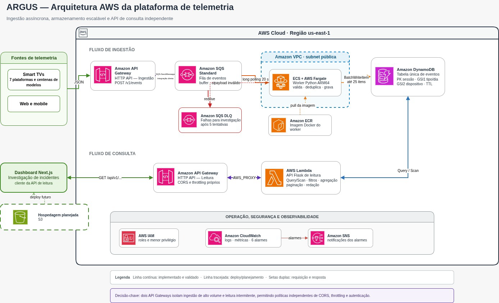
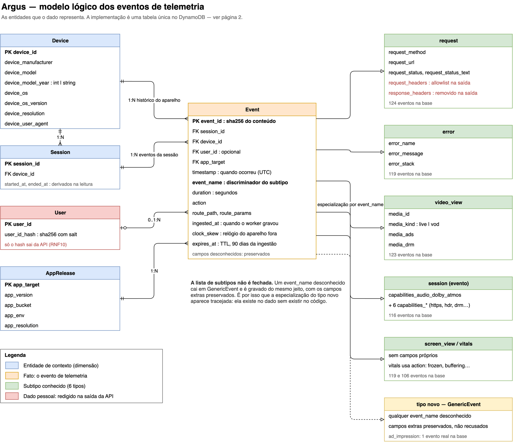
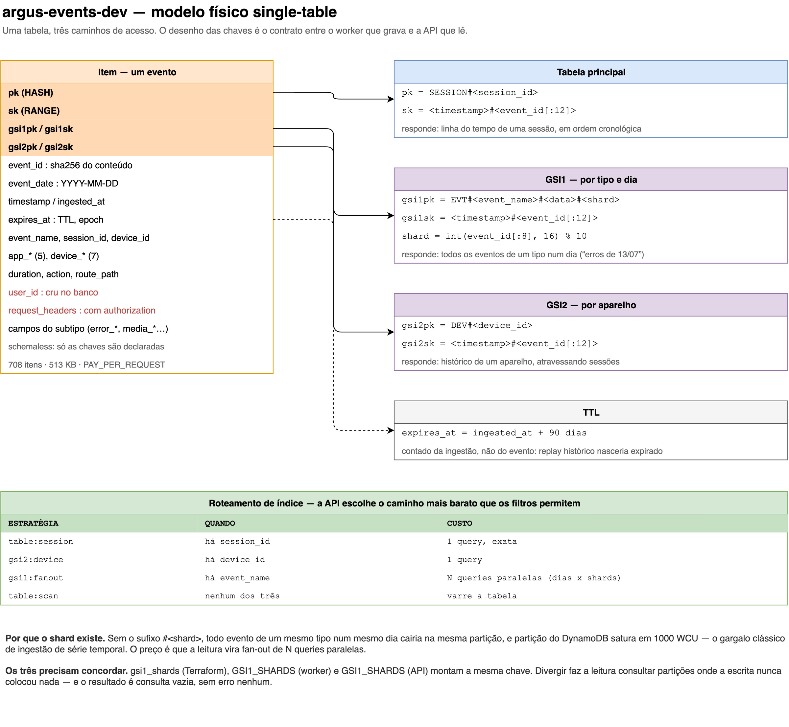
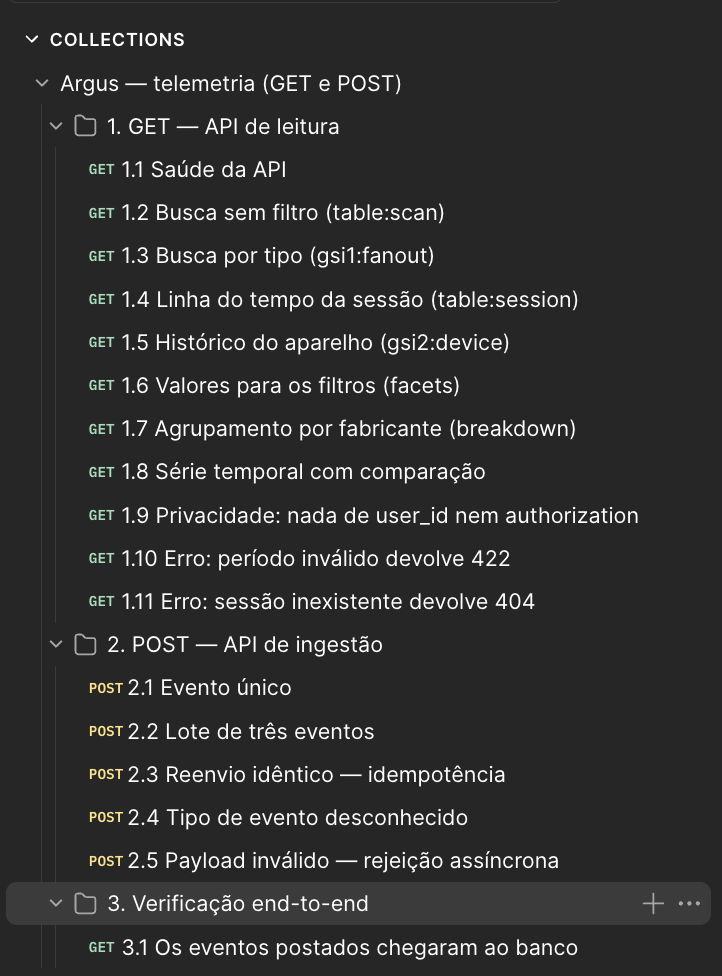
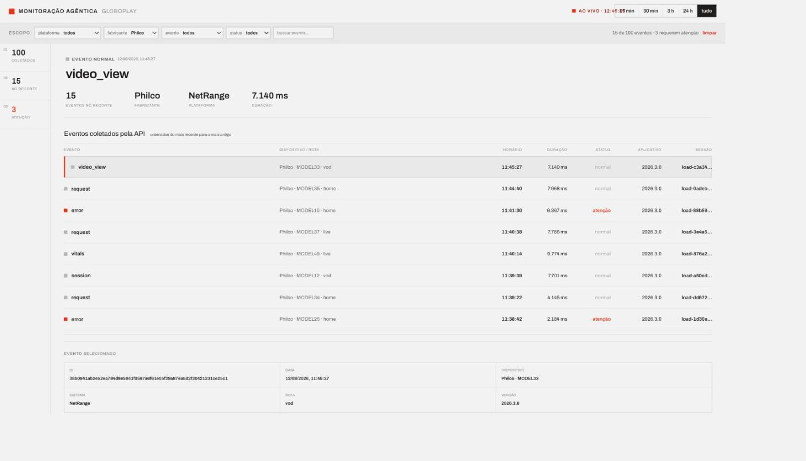

# MVP inicial

Primeiro protótipo funcional da plataforma de telemetria, implantado em AWS.

O sistema recebe eventos emitidos pelo app de TV, valida e grava em escala, e os
devolve a um dashboard para investigação de incidentes. Este documento registra o
que está no ar, como o dado é modelado, e o resultado dos testes de GET e POST
executados contra o ambiente real.

---

## 1. A arquitetura no ar

São dois fluxos independentes, ligados por um banco em comum:

- **Ingestão**: aceita o evento na borda, enfileira, valida de forma assíncrona
  e grava.
- **Leitura**: consulta o que foi gravado, agrega e serve o dashboard.

Nenhum dos dois chama o outro, e o contrato entre eles é o desenho de chaves do
DynamoDB (§2). É essa separação que isola as falhas: um pico de audiência represa
a fila sem tirar o dashboard do ar, e uma consulta cara no dashboard não alcança o
caminho de gravação.

### 1.1 Visão geral

```
   App de TV                                   Dashboard (S3)
       │                                             ▲
       │ POST /v1/events                             │ GET /api/v1/*
       ▼                                             │
┌──────────────────┐                        ┌────────┴─────────┐
│  API Gateway     │                        │  API Gateway     │
│  ingestão        │                        │  leitura         │
└────────┬─────────┘                        └────────▲─────────┘
         │ integração direta                         │
         ▼ (sem Lambda)                              │
┌──────────────────┐     ┌──────────┐       ┌────────┴─────────┐
│  SQS             │────▶│ SQS DLQ  │       │  Lambda          │
│  argus-events    │ 5t. │ inválido │       │  Flask + apig    │
└────────┬─────────┘     └──────────┘       └────────▲─────────┘
         │ long polling 20s                          │
         ▼                                           │
┌──────────────────┐                                 │
│  ECS Fargate     │                                 │
│  worker (Python) │                                 │
└────────┬─────────┘                                 │
         │ BatchWriteItem                            │
         ▼                                           │
┌─────────────────────────────────────────────────┐  │
│  DynamoDB: tabela única + GSI1 + GSI2           │──┘
└─────────────────────────────────────────────────┘
```



<sup>Fonte: material produzido pelos autores (2026).</sup>

| Etapa | Papel | Por que assim |
|---|---|---|
| API Gateway (ingestão) | aceita e enfileira | responde rápido; a TV não espera a gravação |
| SQS | absorve pico e garante entrega | pico de audiência não derruba a ingestão |
| ECS Fargate | valida e grava | processo longo, com polling contínuo |`
| DynamoDB | armazena | escrita barata, schemaless, TTL nativo |
| Lambda | consulta e agrega | uso intermitente; container ocioso seria desperdício |
| API Gateway (leitura) | expõe ao dashboard | HTTPS e URL estável de graça |
| S3 | serve o dashboard | são arquivos, não um processo |

**Por que dois API Gateways.** São serviços com exigências opostas: um recebe
evento de TV em volume alto e não pode recusar nada; o outro serve consulta para
uma tela interna e vai precisar de autenticação. Separar deixa throttling, CORS e
authorizer independentes. Hoje a ingestão aceita 500 req/s, com pico de 1000, e a
leitura aceita 50, com pico de 100. O HTTP API cobra por requisição e não por API,
então ter dois não custa a mais.

**Recursos provisionados**, verificados na conta do AWS Academy Learner Lab
(`us-east-1`):

| Serviço | Recurso | Estado |
|---|---|---|
| API Gateway (HTTP) | ingestão: `POST /v1/events` → SQS | ativo, sem autenticação |
| API Gateway (HTTP) | leitura: `ANY /{proxy+}` → Lambda | ativo, sem autenticação |
| SQS | `argus-events-dev` + DLQ com redrive de 5 tentativas | 0 mensagens em espera |
| ECS Fargate | worker, ARM64, 0.25 vCPU / 0.5 GB | 1/1 task rodando |
| DynamoDB | `argus-events-dev`, on-demand, 2 GSI | 718 itens · 513 KB |
| Lambda | `argus-events-dev-read-api`, Python 3.12 ARM64 | 1024 MB, timeout 30 s |
| S3 | site estático do dashboard | público, website hosting |

Os endereços das duas APIs não são versionados (ver §6.4). Obtêm-se com
`terraform output`.

### 1.2 Ingestão: a borda não tem Lambda

O API Gateway publica direto na fila pelo subtype `SQS-SendMessage`. Sem cold
start, um ponto de falha a menos, e o HTTP API custa US$ 1,00/milhão contra
US$ 3,50 do REST API.

O preço dessa escolha é que o HTTP API não tem request validator, recurso que só
existe no REST API. Não há validação de schema na borda: o payload entra cru na
fila e quem valida é o worker. Daí vêm duas consequências que quem consome a API
precisa saber, ambas confirmadas nos testes de §4.3: a resposta vem como XML do
SQS, e não como JSON, e payload inválido recebe HTTP 200, porque a rejeição é
assíncrona.

Aceitamos essa troca porque, para telemetria, aceitar rápido e validar depois é
melhor que segurar a TV do usuário esperando validação. O evento inválido não se
perde: vai para a DLQ com o motivo anexado.

A fila é SQS Standard, e não FIFO. O FIFO garantiria ordem e deduplicação, mas
limita a cerca de 3.000 msg/s e custa mais. Não precisamos de nenhuma das duas
garantias: a ordem é reconstruída na leitura pela sort key, e a deduplicação vem
da chave derivada do hash do conteúdo (§1.4), que inclusive pega duplicata
separada por mais de 5 minutos, fora da janela do FIFO. A mensagem sobrevive 4
dias na fila principal e 14 dias na DLQ, com visibilidade de 60 s e long polling
de 20 s.

A validação é permissiva de propósito: só `timestamp`, `event_name`, `session_id`
e `device_id` são obrigatórios, campos desconhecidos são preservados e
`event_name` novo vira evento genérico em vez de erro (§2.1). O parque de TVs
atualiza devagar e de forma desigual, e um modelo estrito transformaria qualquer
mudança de schema do app em perda de dados em massa, sem chance de hotfix numa TV.
O que a validação deixa de rejeitar ela registra como métrica (§1.7).

### 1.3 O worker: Fargate, não Lambda

Lambda com trigger de SQS seria mais simples e escalaria a zero, mas o worker se
beneficia de conexão persistente e long polling de 20 s. Uma task 24/7 sai por
cerca de US$ 7/mês sem cold start, sem limite de 15 minutos e sem concorrência a
gerenciar. O ARM64 (Graviton) custa cerca de 20% menos que x86 e é nativo na
máquina de desenvolvimento do time, que é Apple Silicon, então o build não precisa
de emulação.

> **Quando reconsiderar:** abaixo de cerca de 150 eventos por segundo sustentados,
> Lambda sai mais barato. Acima disso, Fargate ganha, e a diferença cresce com o
> volume.

A task roda em subnet pública com IP público e security group sem nenhuma regra de
entrada, então ela alcança as APIs da AWS, mas ninguém alcança a task. Isso evita
o NAT Gateway, que a cerca de US$ 32/mês seria o item mais caro do fluxo inteiro,
mais que o dobro de todo o resto somado.

### 1.4 Armazenamento

Tabela única no DynamoDB, on-demand, compartilhada pelos dois fluxos, com TTL de
90 dias contado a partir da ingestão, e não do horário do evento. O modelo de
dados e o desenho das três chaves de acesso estão em §2.

Dois pontos da gravação que o modelo de dados sozinho não mostra:

**Idempotência sem leitura prévia.** O `event_id` é o `sha256` do conteúdo
canônico do evento, e a chave do item deriva dele. Duas entregas do mesmo evento
produzem a mesma chave, então a reentrega *at-least-once* do SQS vira um overwrite
idêntico em vez de linha duplicada, sem `ConditionExpression` e sem leitura
prévia. O caso 2.3 dos testes verifica isso (§4.3).

**O banco guarda o evento cru.** O worker grava exatamente o que o aparelho
enviou, sem transformar, então o DynamoDB contém `user_id` em claro e o header
`authorization` dentro de `request_headers`. A remoção desses dados acontece na
saída da API (§1.5), e não na entrada. Se fosse na entrada, nunca rodaria para o
dado que já está gravado, e a investigação perderia o original.

### 1.5 Leitura: Flask em Lambda

Arquitetura hexagonal: `EventRepository` é um `Protocol`, e o adaptador DynamoDB é
a única peça que conhece o banco. A API é somente leitura, sem POST e sem DELETE.
A entrada de eventos é o pipeline de ingestão, que já resolve idempotência, retry
e DLQ; uma segunda porta significaria duas validações para manter em sincronia. O
expurgo é feito pelo TTL, e a task role do worker nem tem `DeleteItem`.

O roteamento de índice é o que governa o custo. A API escolhe o caminho mais
barato que os filtros permitem, e devolve a estratégia escolhida no bloco `query`
de toda resposta (§3.2):

| Estratégia | Quando | Custo |
|---|---|---|
| `table:session` | há `session_id` | 1 query, exata |
| `gsi2:device` | há `device_id` | 1 query |
| `gsi1:fanout` | há `event_name` | N queries paralelas (dias × 10 shards) |
| `table:scan` | nenhum dos três | varre a tabela |

O `Scan` existe porque não há alternativa: sem `event_name` não há chave de
partição, e fazer fan-out pelos tipos conhecidos esconderia justamente os tipos
novos que o pipeline aceita de propósito. Entre ler demais e esconder evento,
optamos por ler demais.

O fan-out roda em paralelo. Uma busca por tipo cobrindo uma semana abre dezenas de
queries (dias × 10 shards). Em sequência isso somava cerca de 11 segundos, quatro
vezes o teto de 3 s do RNF02, com o banco ocioso, porque o custo era o round-trip
e não o trabalho. Em paralelo cai para cerca de 1,5 s. É também por causa desse
fan-out que a Lambda tem 1024 MB e não 512: na Lambda a fatia de CPU é
proporcional à memória, e medindo contra a tabela real a mesma busca caiu de 2,8 s
para 1,5 s só com a troca de memória.

`breakdown`, `timeseries` e `facets` são calculados em memória, porque o DynamoDB
não tem `GROUP BY` nem `SELECT DISTINCT`. O custo é ler o período inteiro para
contar, limitado por `MAX_ITEMS_SCANNED` (20.000 itens). Funciona no volume do
MVP. O caminho para escalar é manter contadores pré-agregados alimentados por
DynamoDB Streams, decisão que ficou registrada para depois.

É também na saída da API que acontece a redação de dado pessoal do RNF10:
`user_id` vira hash com salt, `request_headers` passa por allowlist e
`authorization` nunca sai. O caso 1.9 dos testes verifica em todas as rotas
(§4.3).

A documentação é montada em código importando as mesmas constantes que o adaptador
usa para validar, então não consegue divergir da regra. Dois testes travam isso
nos dois sentidos: rota sem entrada na spec, e entrada na spec sem rota.

### 1.6 Dashboard estático

Next.js com `output: "export"`, ou seja, um site estático sem servidor Node,
hospedado em S3 com website hosting. A escolha de S3 sobre EC2 e o custo aceito
(HTTP puro, sem TLS) estão em §5.

A consequência para a API é que, como o dashboard vem de outra origem, o CORS é
obrigatório. Ele é tratado nos dois lugares: no API Gateway, para responder ao
preflight `OPTIONS` sem acordar a Lambda, e no Flask, para a resposta em si.

> CORS não é controle de acesso. Ele só impede JavaScript de outra origem de *ler*
> a resposta; `curl` e qualquer cliente servidor ignoram por completo.

### 1.7 Observabilidade e custo

As métricas do worker saem em EMF no namespace `Argus/Ingestion`, extraídas do
próprio log, sem chamada de `PutMetricData`. `EventsUnknownType` subindo é o sinal
de que o app começou a mandar um evento novo, e `EventsDeduplicated` é a taxa de
reentrega do SQS. `CycleLatency` mede só o processamento, com a espera do long
polling separada em `PollWait`, porque somar as duas faria a métrica reportar 13 s
onde o trabalho real levou 400 ms.

Cinco alarmes cobrem os modos de falha silenciosa: DLQ com mensagem, fila
atrasada, worker fora do ar, 5xx na borda e throttle de escrita.

Custo estimado para ~1 milhão de eventos/mês:

| Item | Estimativa |
|---|---|
| Fargate 0.25 vCPU / 0.5 GB ARM, 24/7 | ~US$ 7 |
| DynamoDB on-demand (escrita + 2 GSI) | ~US$ 4 |
| API Gateway (ingestão + leitura) | ~US$ 1 |
| CloudWatch Logs + alarmes | ~US$ 2 |
| Lambda da API de leitura | ~US$ 0 |
| SQS | ~US$ 0 (free tier) |
| S3 + ECR (site e imagem do worker) | ~US$ 0 |
| **Total** | **~US$ 14/mês** |


### 1.9 Estrutura do repositório

```
apps/basica/
  backend/    API de leitura (Flask em Lambda)
    src/telemetry/
      domain/          entidade alinhada ao que o worker grava
      ports/           contrato de leitura
      infrastructure/  adaptador DynamoDB
      application/     casos de uso e redação de dado pessoal
      interfaces/      rotas Flask e OpenAPI
  worker/     worker de ingestão (SQS → DynamoDB)
  infra/      Terraform de tudo
  tools/      conversão de CSV, replay de eventos, ETL do dump
  frontend/   dashboard Next.js
  notebooks/  análise exploratória dos eventos
artefatos/    documentação do projeto
data/         dump do parceiro em Parquet
Makefile      comandos
```

---

## 2. Modelo de dados

### 2.1 Modelo lógico


<sup>Fonte: material produzido pelos autores (2026).</sup>

Um **evento** é o fato central, e carrega referências para as entidades de
contexto: a **sessão** em que ocorreu, o **aparelho** que o emitiu, a **versão do
app** e, quase sempre, o **usuário**.

Os seis tipos conhecidos (`request`, `screen_view`, `session`, `video_view`,
`vitals`, `error`) são especializações que acrescentam campos próprios ao mesmo
envelope. **A lista não é fechada:** um `event_name` desconhecido cai em
`GenericEvent` e é gravado do mesmo jeito, com os campos extras preservados. A
base tem hoje um evento `ad_impression`, tipo que nenhuma linha de código conhece,
gravado e legível pela API.

A razão é operacional: o parque de TVs atualiza devagar e de forma desigual, e um
modelo estrito transformaria qualquer mudança de schema no app em perda de dados
em massa, sem chance de hotfix num aparelho.

### 2.2 Modelo físico


<sup>Fonte: material produzido pelos autores (2026).</sup>

Tabela única no DynamoDB, com três caminhos de acesso. O desenho das chaves é o
contrato entre o worker que grava e a API que lê:

| Índice | Chave | Responde |
|---|---|---|
| tabela | `pk=SESSION#<id>` · `sk=<ts>#<event_id[:12]>` | linha do tempo de uma sessão |
| GSI1 | `gsi1pk=EVT#<tipo>#<data>#<shard>` | eventos de um tipo num dia |
| GSI2 | `gsi2pk=DEV#<device_id>` | histórico de um aparelho |

Dois pontos que o diagrama registra e que não são óbvios:

**O sufixo `#<shard>` na GSI1.** Sem ele, todo evento de um mesmo tipo num mesmo
dia cairia na mesma partição, e uma partição do DynamoDB satura em 1000 WCU. Esse
é o gargalo clássico de ingestão de série temporal. O shard vem do hash do evento,
que é uniforme e determinístico. O preço é que a leitura vira um fan-out de N
queries paralelas.

**O TTL é contado da ingestão, não do horário do evento.** Se fosse do evento, um
replay de dado histórico nasceria já expirado.

---

## 3. A aplicação: GET e POST

### 3.1 POST: ingestão

```
POST <ingest_url>
Content-Type: application/json
```

Aceita um evento, uma lista, ou o envelope `{"events": [...]}`. Quatro campos são
obrigatórios: `timestamp`, `event_name`, `session_id`, `device_id`. O resto é
opcional e campos desconhecidos são preservados.

```json
{
  "timestamp": "2026-08-13T14:20:00Z",
  "event_name": "error",
  "session_id": "sessao-123",
  "device_id": "dev-000492",
  "error_name": "Erro ao reproduzir vídeo",
  "error_stack": "dash_shaka_playback:6_6002"
}
```

O API Gateway publica direto no SQS, sem Lambda no caminho. Isso gera duas
consequências que quem consome a API precisa saber, e que os testes documentam em
§4.3: a resposta é o XML do SQS, e não JSON, e payload inválido recebe HTTP 200,
porque a rejeição é assíncrona, na DLQ.

### 3.2 GET: leitura

```
GET <read_url>/api/v1/events?event_name=error&device_os=Tizen&limit=50
```

| Rota | O que devolve |
|---|---|
| `GET /api/v1/events` | busca paginada com filtros cumulativos |
| `GET /api/v1/sessions/{id}` | linha do tempo da sessão + resumo |
| `GET /api/v1/sessions/{id}/events/{event_id}` | detalhe de um evento |
| `GET /api/v1/devices/{id}` | histórico do aparelho |
| `GET /api/v1/metrics/breakdown?dimension=…` | agrupamento e contagem |
| `GET /api/v1/metrics/timeseries?compare=true` | série temporal e comparação |
| `GET /api/v1/facets?field=…` | valores existentes para os filtros |
| `GET /docs` · `GET /openapi.json` | Swagger UI e especificação OpenAPI 3.1 |

Toda resposta de busca traz um bloco `query` com a estratégia usada e quantos
itens foram lidos:

```json
{
  "items": [ … ],
  "next_cursor": null,
  "query": { "strategy": "gsi1:fanout", "queries": 40, "scanned": 119, "returned": 20 }
}
```

O bloco serve para dimensionar custo, não para depurar. Num banco que cobra por
item lido, a diferença entre `scanned` e `returned` é a conta do filtro que roda
depois da consulta ao índice, e uma tela barata não pode parecer igual a uma cara
para quem constrói o dashboard.

---

## 4. Relatório de testes no Postman

### 4.1 Metodologia

A coleção está em [`postman/argus.postman_collection.json`](postman/argus.postman_collection.json)
e roda contra o ambiente implantado, não contra mock. São 17 requisições em três
grupos:

1. **GET** na API de leitura: os quatro caminhos de acesso, agregações e os casos
   de erro
2. **POST** na API de ingestão: evento único, lote, reenvio, tipo desconhecido e
   payload inválido
3. **Verificação end-to-end**: consulta pela API de leitura a sessão que o grupo
   2 criou pela API de ingestão

O grupo 3 é o que dá valor ao conjunto: em vez de testar as duas APIs em
isolamento, ele fecha o ciclo `POST → SQS → worker → DynamoDB → GET` e verifica o
resultado. Como o worker faz long polling de 20 s, a requisição repete a si mesma
até os eventos aparecerem, com teto de 20 tentativas.

Execução por linha de comando, para que o resultado seja reproduzível:

```bash
make -C apps/basica postman
```

### 4.2 Resultados

**51 asserções, 0 falhas.** Execução de 13/08/2026, duração total 34,7 s.

| Caso | Método | Status | Tempo | Asserts |
|---|---|---|---|---|
| 1.1 Saúde da API | GET | 200 | 592 ms | 2/2 |
| 1.2 Busca sem filtro (`table:scan`) | GET | 200 | 977 ms | 5/5 |
| 1.3 Busca por tipo (`gsi1:fanout`) | GET | 200 | 1308 ms | 5/5 |
| 1.4 Linha do tempo da sessão (`table:session`) | GET | 200 | 228 ms | 5/5 |
| 1.5 Histórico do aparelho (`gsi2:device`) | GET | 200 | 180 ms | 3/3 |
| 1.6 Valores para os filtros (facets) | GET | 200 | 218 ms | 3/3 |
| 1.7 Agrupamento por fabricante | GET | 200 | 721 ms | 3/3 |
| 1.8 Série temporal com comparação | GET | 200 | 1130 ms | 3/3 |
| 1.9 Privacidade: sem `user_id` nem `authorization` | GET | 200 | 1291 ms | 4/4 |
| 1.10 Erro: período inválido | GET | **422** | 218 ms | 3/3 |
| 1.11 Erro: sessão inexistente | GET | **404** | 205 ms | 1/1 |
| 2.1 Evento único | POST | 200 | 553 ms | 3/3 |
| 2.2 Lote de três eventos | POST | 200 | 206 ms | 1/1 |
| 2.3 Reenvio idêntico | POST | 200 | 232 ms | 1/1 |
| 2.4 Tipo de evento desconhecido | POST | 200 | 204 ms | 1/1 |
| 2.5 Payload inválido | POST | 200 | 236 ms | 2/2 |
| 3.1 Os eventos postados chegaram ao banco | GET | 200 | 193 ms | 6/6 |

Latência: mínima 180 ms, média 511 ms, máxima 1308 ms. O RNF02 exige resposta em
até 3 s, e a consulta mais cara ficou em 44% do orçamento.

A consulta mais cara é a busca por tipo (1.3), e o motivo está no modelo: ela abre
uma query por (dia × shard). É o custo escolhido quando se resolveu o gargalo de
partição da GSI1.


<sup>Fonte: material produzido pelos autores (2026).</sup>

### 4.3 Achados

**A ingestão é idempotente.** O caso 2.3 reenvia um corpo byte a byte idêntico ao
de 2.1. Como o `event_id` é o sha256 do conteúdo, os dois produzem a mesma chave e
o segundo vira um overwrite idêntico. O caso 3.1 confirma: a sessão tem 5 eventos,
e não 6.

**Tipo desconhecido entra e sai inteiro.** O caso 2.4 envia `postman_probe`, que
não existe em nenhuma linha de código, com dois campos inventados. O caso 3.1
confirma que o evento foi gravado e que `campo_que_o_backend_nunca_viu` sobreviveu
até a resposta da API.

**Payload inválido recebe HTTP 200, de forma deliberada.** O caso 2.5 envia um
evento sem `timestamp`, `session_id` nem `device_id`. A resposta é 200. O motivo é
que a integração direta API Gateway → SQS não tem request validator (só o REST API
tem; o HTTP API não), então o payload entra cru na fila e quem valida é o worker.

A rejeição acontece, só que assíncrona. Verificado na DLQ:

```
corpo:  {"event_name": "error", "sem_timestamp": true, …}
motivo: validacao: 3 validation errors for ErrorEvent
        timestamp — Field required
```

A troca é deliberada: para telemetria, aceitar rápido e validar depois é melhor
que segurar a TV do usuário esperando validação, e o evento inválido não se perde.
Ainda assim, quem consome a API precisa saber que 200 aqui significa
"enfileirado", e não "válido". Foi por isso que este caso entrou na coleção em vez
de ficar de fora.

**A redação de dado pessoal funciona em todas as rotas.** O caso 1.9 varre o corpo
da resposta atrás do header `authorization` e do `user_id` cru. O worker grava o
evento como o aparelho enviou, então os dois estão no banco; a remoção acontece na
saída da API (RNF10).

---

## 5. Frontend

Dashboard em Next.js com `output: "export"`, ou seja, um site estático sem
servidor Node, hospedado em S3 com website hosting. Ele consome a API de leitura
pelo navegador e mostra os eventos em tempo quase real.


<sup>Fonte: material produzido pelos autores (2026).</sup>

A entrega aceitava S3 ou EC2. Escolhemos S3 por uma razão prática: o Learner Lab
desliga as instâncias EC2 ao fim da sessão, e o IP público muda ao religar, então
o link deste relatório e do vídeo morreria entre a gravação e a correção. O
endereço do bucket é estável e atravessa o ciclo do lab. O deploy também vira um
`aws s3 sync`, sem nginx e sem instância para manter viva.

Custo aceito: o website endpoint do S3 é HTTP puro, sem TLS. O caminho para HTTPS
é CloudFront na frente, registrado como evolução.

> **Vídeo de demonstração:** `<INSERIR O LINK AQUI>`

---

## 6. Como executar

O ponto que costuma confundir quem chega agora é a posição do `.env`: ele vem no
fim, e não no começo. As duas URLs que ele guarda são geradas pelo API Gateway no
primeiro `terraform apply`, então antes disso não existe valor para preencher, e
copiar o `.env.example` só produz um arquivo de chaves vazias. A ordem real é:

```
credenciais do lab  →  terraform apply  →  make -C apps/basica env  →  deploy  →  URL do dashboard
```

Quem só quer inspecionar o código não precisa de nada disso: `make -C apps/basica install &&
make -C apps/basica test` roda as duas suítes contra um DynamoDB falso (moto), sem conta AWS.

### 6.1 Pré-requisitos

| Ferramenta | Para quê | Conferir com |
|---|---|---|
| Python 3.12+ | backend, worker e tools | `python3 --version` |
| [uv](https://docs.astral.sh/uv/) | monta os ambientes Python pelo `pyproject.toml` | `uv --version` |
| Node.js 20+ | build do dashboard e execução da coleção Postman | `node --version` |
| Docker | imagem ARM64 do worker | `docker info` |
| Terraform 1.x | toda a infraestrutura | `terraform version` |
| AWS CLI v2 | credenciais, `s3 sync`, logs e DLQ | `aws --version` |

```bash
git clone https://git.inteli.edu.br/graduacao/2026-2a/t15/g04.git && cd g04
```

### 6.2 Conectar o Terraform ao AWS Academy Learner Lab

O `providers.tf` não tem `access_key` nem `profile` de propósito: o provider AWS
lê a cadeia de credenciais padrão do SDK. Configurar o ambiente é, portanto, todo
o trabalho de autenticação, e nenhum segredo chega perto do repositório.

**1. Iniciar o laboratório.** No AWS Academy, abra o módulo do Learner Lab e
clique em **Start Lab**. Espere o indicador ao lado de **AWS** ficar verde; com
ele amarelo a conta ainda está sendo provisionada e as credenciais não funcionam.

**2. Copiar as credenciais.** Clique em **AWS Details**, no topo do painel, e
depois em **Show**, ao lado de *AWS CLI*. Aparece um bloco assim:

```ini
[default]
aws_access_key_id=ASIA...
aws_secret_access_key=...
aws_session_token=...
```

São credenciais temporárias (STS). O `aws_session_token` é parte obrigatória
delas, e sem ele a AWS recusa a chamada. Os três valores mudam a cada reinício do
lab.

**3. Gravar num profile nomeado.** Cole o bloco em `~/.aws/credentials`,
trocando `[default]` por `[g4]`. O profile nomeado evita sobrescrever credenciais
de outra conta que você já tenha na máquina:

```ini
# ~/.aws/credentials
[g4]
aws_access_key_id=ASIA...
aws_secret_access_key=...
aws_session_token=...
```

```ini
# ~/.aws/config
[profile g4]
region=us-east-1
output=json
```

Aponte o ambiente para ele e confirme antes de aplicar qualquer coisa:

```bash
export AWS_PROFILE=g4
aws sts get-caller-identity
```

A resposta traz o número da conta e um `Arn` terminando em `user/voclabs`, que é
como se confirma que a conta é a do lab, e não outra. `ExpiredToken` ou
`InvalidClientTokenId` significa lab parado ou credencial de uma sessão anterior:
volte ao passo 1.

**4. Escrever o `terraform.tfvars`.** O lab exige duas concessões, ambas por
variável, nenhuma delas bifurcando o código:

```bash
cd apps/basica/infra
cp terraform.tfvars.example terraform.tfvars
```

Descomente o bloco `AWS Academy` do arquivo e preencha o ARN da `LabRole`. Para
montar o ARN sem abrir o console:

```bash
echo "arn:aws:iam::$(aws sts get-caller-identity --query Account --output text):role/LabRole"
```

O conteúdo mínimo para o lab é:

```hcl
region      = "us-east-1"
environment = "dev"

# O lab nega iam:CreateRole e obriga a reusar a LabRole, que já confia em
# apigateway.amazonaws.com e ecs-tasks.amazonaws.com, os dois papéis de que
# este fluxo precisa. Numa conta normal, create_iam_roles = true dá permissão
# mínima a cada componente.
create_iam_roles  = false
existing_role_arn = "arn:aws:iam::<sua-conta>:role/LabRole"

# O lab não provisiona a chave gerenciada aws/dynamodb, e sem esta linha o
# CreateTable falha com "KMS validation error ... does not exist". A tabela
# continua criptografada em repouso: a flag só troca a chave gerenciada pela
# AWS-owned, que é a padrão.
dynamodb_kms_managed_key = false

assign_public_ip = true
gsi1_shards      = 10
```

`terraform.tfvars` está no `.gitignore`, porque guarda o número da conta.

### 6.3 Primeira subida, do zero até a URL

```bash
# 0. ambientes Python do backend e do worker
make -C apps/basica install

# 1. empacotar a API de leitura ANTES do primeiro plan
make -C apps/basica lambda-build
```

O passo 1 não é opcional e não pode vir depois: o Terraform calcula
`filebase64sha256` do zip da Lambda para decidir se a função mudou, e isso
acontece já no `plan`. Sem o arquivo, o primeiro `terraform apply` aborta antes de
criar qualquer recurso.

```bash
# 2. criar a infraestrutura com o worker desligado
cd apps/basica/infra
terraform init
terraform apply -var="worker_desired_count=0"
```

O `-var` existe porque o ECR nasce vazio: subir o service ECS antes da primeira
imagem existir o deixa em crash loop. Não quebra nada, mas assusta e polui o log.

```bash
# 3. construir a imagem ARM64 do worker e publicá-la no ECR
cd ../../..
make -C apps/basica worker-deploy

# 4. ligar o worker
cd apps/basica/infra && terraform apply -var="worker_desired_count=1"
cd ../../..
```

```bash
# 5. gerar o .env com as URLs que acabaram de nascer
make -C apps/basica env
```

`make env` lê `terraform output` e escreve as quatro chaves do `.env.example` já
preenchidas, substituindo o `cp .env.example .env` feito à mão. Ele se recusa a
sobrescrever um `.env` existente, então apague o arquivo antes de
regerar. Se a infraestrutura ainda não tiver sido aplicada, o arquivo nasce com
os valores vazios: apague e repita depois do passo 2. O `AWS_PROFILE` gravado é o
que estiver no shell, então exporte `g4` antes (passo 3 de §6.2).

```bash
# 6. publicar o dashboard
make -C apps/basica frontend-install
make -C apps/basica frontend-deploy
```

O `frontend-deploy` injeta `ARGUS_API_URL` no bundle em tempo de build, sincroniza
o export estático no bucket e imprime o endereço público do dashboard ao final.
Esse é o link que vai no relatório e no vídeo.

```bash
# 7. verificar
make -C apps/basica smoke      # confere as rotas da API publicada
make -C apps/basica postman    # roda as 17 requisições da coleção (§4)
make -C apps/basica count      # conta os eventos armazenados
```

Nos deploys seguintes nada disso se repete: `make -C apps/basica deploy` testa, empacota,
aplica e roda o smoke num comando só.

### 6.4 De onde vem cada URL

Todo endereço do sistema é um output do Terraform. Nenhum é versionado, e é
por isso que o `.env.example` traz as chaves sem valor.

```bash
cd apps/basica/infra && terraform output
```

| Output | O que é | Quem consome |
|---|---|---|
| `read_api_url` | base da API de leitura | `.env` → `ARGUS_API_URL`; entra no bundle do dashboard |
| `ingest_url` | endpoint do `POST` de eventos | `.env` → `ARGUS_INGEST_URL`; `make -C apps/basica replay` e a coleção Postman |
| `frontend_url` | endereço público do dashboard | o link do relatório e do vídeo |
| `table_name` · `dlq_url` · `log_group_worker` | nomes de recurso | `make -C apps/basica count`, `make -C apps/basica dlq`, `make -C apps/basica logs-worker` |

Para um valor isolado, `-raw` devolve a string limpa, sem aspas:

```bash
terraform output -raw read_api_url
```

O environment do Postman segue a mesma regra: `make -C apps/basica postman-env` o gera a partir
do `.env`, e o arquivo com as URLs reais fica fora do repositório.

### 6.5 Rodar local

```bash
make -C apps/basica test                     # 58 testes do worker + 72 do backend, sem AWS
make -C apps/basica api                      # API de leitura na porta 5000, contra o DynamoDB real
make -C apps/basica frontend-install
make -C apps/basica frontend-dev             # dashboard na porta 3000, contra a API publicada
```

`make -C apps/basica test` e `make -C apps/basica lint` não precisam de credencial nenhuma. `make -C apps/basica api`,
`make -C apps/basica frontend-dev` e os alvos de operação precisam do `.env` preenchido.

O backend também sobe sozinho com `python apps/basica/backend/run.py`, ou pelo
**Run and Debug** do VS Code (configuração `Backend Flask`, em
`apps/basica/backend/.vscode/`).

### 6.6 Quando o lab reinicia

A infraestrutura, o estado do Terraform e as URLs sobrevivem, e foi por isso que o
dashboard foi para o S3 e a API de leitura para a Lambda (§5). O que morre é a
credencial: refaça os passos 1 a 3 de §6.2 com o token novo e siga de onde parou,
sem reaplicar nada.

Se um comando falhar com `ExpiredToken` no meio de um `apply`, o remédio é o
mesmo: renove a credencial e rode de novo, porque o Terraform retoma a partir do
estado. Se o worker não estiver consumindo a fila depois do reinício,
`make resume` recria a task e o consumo retoma de onde parou, já que a fila retém
as mensagens por 4 dias.


