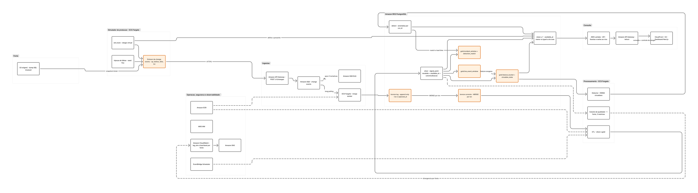

# Plano — Argus v3: RDS PostgreSQL, CDC e camadas bronze/silver/gold

Plano de migração da arquitetura de dados: de DynamoDB single-table para RDS
PostgreSQL com quatro camadas, ingestão por change events e simulador de produção
com relógio virtual.

Este documento é o contrato escrito da migração. Registra o que muda, por que muda,
e em que ordem — antes de qualquer código.

---

## 1. Por que a arquitetura mudou

&emsp;A arquitetura descrita em [`mvp-inicial.md`](mvp-inicial.md) foi desenhada para
um firehose de telemetria: API Gateway → SQS → worker Fargate → DynamoDB, com Lambda
de leitura por cima. Ela funciona e está no ar. Mas parte de uma premissa que o
entendimento com o parceiro derrubou: a de que o sistema **produz** o dado.

&emsp;Na prática o Argus já existe em produção na Globo e já tem 33 tabelas com o dado
tratado — desde fonte bruta (Prometheus, New Relic, Apollo, RPaaS, Cloud Armor, Tsuru)
até camada canônica (`signal_point`, `signal_bucket`), ground truth (`incidents`,
`incident_label`) e saída do sistema atual (`dashboard_artifact`). O que o projeto tem
que fazer é **ler dessas tabelas**, subi-las na nossa infraestrutura, e construir em
paralelo um esquema que simule como o fluxo funcionaria em produção, mantendo essas
tabelas atualizadas ao longo do tempo.

&emsp;Isso muda a natureza do sistema. Ele deixa de ser um coletor e passa a ser um
**consumidor de change data capture** com replay: recebe as mudanças que a origem
publica, materializa o estado corrente, e deriva as camadas analíticas a partir disso.

### 1.1 As sete decisões que orientam o plano

| # | Decisão | Consequência |
|---|---|---|
| 1 | Substituir o DynamoDB por completo | `dynamodb.tf` sai; toda a persistência vira PostgreSQL |
| 2 | Carregar as 33 tabelas inteiras, incluindo `prom_point` | 68,7 M linhas — ver a justificativa em §1.2 |
| 3 | Dois fluxos de ingestão | CDC das tabelas já mapeadas **e** eventos de grain de sessão, que chegam por outro fluxo do Argus |
| 4 | Bronze otimizada para **mudar**, não para performance | O ETL ainda está em aprimoramento; o custo de errar tem que ser baixo |
| 5 | Carga inicial via Parquet | `tools/etl_dump.py` já converte o dump e gera os 33 arquivos (199 MB) |
| 6 | Não re-normalizar `signal_point` | A silver faz canonicalização de tipo e tempo, não normalização multi-fonte |
| 7 | Detecção segue embrionária; ETL deixou de ser no-op | Worker de processamento roda o ETL incremental (seção 12); detector e canário seguem no-op, infraestrutura provisionada e observável para quando chegarem |

### 1.2 Por que `prom_point` entra, apesar de ser 60% das linhas

&emsp;`prom_point` é a tabela-fato do Prometheus — 41,2 M das 68,7 M linhas do dump.
É camada de fonte bruta, e o `signal_bucket` já traz o Prometheus normalizado, então a
tentação de deixá-la de fora é real. Três telas do dashboard não fecham sem ela:

- **Timeline** — "CDN · Prometheus VTS" é uma das seis raias nomeadas do eixo de tempo,
  e a cronologia reconstruída tem entradas que são fatos do Prometheus ("p95 na borda do
  PoP Fortaleza sobe de 368 ms para 412 ms"). O painel lateral conta "fontes com desvio:
  3 de 13" — as 13 fontes do vocabulário do dataset (§6.1).
- **Hipóteses** — o fator de score "ausência de causa concorrente" afirma que CDN,
  Globo-ID e backend **não** desviaram na janela. Provar ausência exige a série inteira,
  não só os pontos anômalos. O motor de descarte consome mais dado bruto que o de
  detecção, e é ele que separa 4 hipóteses de 11 descartadas.
- **Comparar** — "p95 de borda 412 ms vs 368 ms · +12% · 1,2σ". O σ vem da distribuição
  histórica da série.

&emsp;O argumento decisivo é de **granularidade**. O gráfico da tela Comparar declara
"bucket de 1 min", e a Timeline resolve eventos em 19:58, 20:00, 20:02, 20:04, 20:06 e
20:07. O `signal_bucket` é de 15 minutos — colapsaria a janela de correlação inteira em
um único ponto. Só o `prom_point` tem cadência de 1 minuto.

&emsp;Soma-se que `prom_series.labels_json` traz `pop` em claro (é de lá que sai "PoP
Fortaleza") e `prom_query.section` dá o agrupamento das raias. E que as fontes NPAW têm
~28 h de latência estrutural (§5.3): para uma tela marcada **ao vivo**, o sinal de
infraestrutura quase-real-time é Prometheus (1 min) e `rpaas_bucket` (15 min).

---

## 2. Visão geral

```
┌── FONTE ──────────────┐   ┌── SIMULADOR (ECS Fargate) ────────────────┐
│ S3 origem/            │   │ sim.clock — relógio virtual               │
│ dump SQL imutável     │──▶│ injeção de falhas — seed fixa             │
│ + Parquet derivado    │   │ emissor de change events (op/before/after)│
└───────────────────────┘   └──────────────────┬────────────────────────┘
        snapshot inicial                       │ HTTPS
                                               ▼
┌── INGESTÃO ───────────────────────────────────────────────────────────┐
│ API Gateway  POST /v1/changes  ─┐                                     │
│ API Gateway  POST /v1/events   ─┴─▶ SQS ──▶ ECS Fargate merge worker  │
│                                     └─ 5 tentativas ─▶ SQS DLQ        │
└──────────────────────────────────┬────────────────────────────────────┘
                                   ▼
┌── RDS PostgreSQL ─────────────────────────────────────────────────────┐
│ bronze.change_log   append-only, lsn + captured_at, jsonb genérico    │
│      └─ MERGE por lsn ─▶ bronze corrente (33 tabelas + bronze.event)  │
│               └─▶ silver  signal_point recebido + available_at        │
│                      └─▶ gold  feature_bucket · circadian_state       │
│                              incident_window · detection_match        │
│                              live_event_window                        │
│                      └─▶ detect  anomalias por run_id                 │
│ views v_*  —  available_at <= sim.now()                               │
└──────────────────────────────────┬────────────────────────────────────┘
                                   ▼
┌── CONSULTA ───────────────────┐  ┌── PROCESSAMENTO (ECS Fargate) ─────┐
│ Lambda API                    │  │ detector EWMA circadiano           │
│   └─▶ API Gateway leitura     │  │ canário de qualidade               │
│         └─▶ S3 Dashboard Next │  │ ETL silver e gold                  │
└───────────────────────────────┘  └────────────────────────────────────┘
```


<sup>Fonte: material produzido pelos autores (2026).</sup>

---

## 3. O princípio que sustenta a decisão 4

&emsp;A bronze precisa acomodar a Globo acrescentar uma coluna nova ao longo do tempo,
sem que isso vire migração. O diagrama já traz a resposta na separação entre log e
corrente:

```
change_log  (jsonb genérico, absorve qualquer coluna nova, zero DDL)
     └─ MERGE por lsn ─▶ bronze corrente (tipada) ─▶ silver ─▶ gold
                         └────── descartável e reconstruível ──────┘
```

&emsp;Enquanto o log estiver íntegro, `TRUNCATE` em silver e gold seguido de replay
reconstrói tudo. É isso que torna a iteração do ETL barata: mudar uma transformação não
custa migração de dado, custa um rebuild.

> **Requisito de projeto.** Nenhuma tabela de silver ou gold pode conter informação que
> não seja derivável do `change_log`. Se precisar, ela vira uma coluna do log.

&emsp;Dois corolários importantes:

1. **As telas nunca consultam bronze.** Elas leem `gold.v_*`. Isso desacopla o
   desempenho do dashboard do tamanho do `prom_point` — e é o que faz a classe da
   instância RDS deixar de ser um bloqueio de projeto.
2. **A bronze corrente é tipada, com escape.** Cada tabela tem as colunas conhecidas
   tipadas mais um `_extra jsonb`. Coluna nova cai no `_extra` sem DDL, e vira promoção
   explícita a coluna real quando estabilizar. É o desenho que dá plano de execução
   bom para as telas ao vivo **e** custo zero para absorver mudança de schema.

---

## 4. Schemas do banco

&emsp;Migrations em `apps/basica/db/migrations/`, aplicadas por `tools/migrate.py`
(runner mínimo com psycopg, controle em `public.schema_migrations`). O Terraform **não**
cria schema: provisiona a instância e para aí. Separar as duas coisas é o que permite
iterar o DDL sem `terraform apply`.

```
001_schemas_e_extensoes.sql
002_sim_relogio_e_falhas.sql
003_bronze_change_log.sql
004_bronze_corrente_argus.sql      -- 33 tabelas, geradas
005_bronze_event.sql               -- grain de sessão
006_silver.sql
007_gold.sql
008_detect.sql
009_views_v.sql
010_merge_e_etl.sql                -- funções de MERGE e de build das camadas
011_poda_de_particao_nas_views.sql -- ensina o planner a ignorar o futuro
012_indice_de_observabilidade.sql  -- lag_sim sem varrer o change_log
013_relogio_pausavel.sql           -- run pausado congela sim.now()
014_catalogo_de_fontes.sql         -- /sources sem agregar 4,9 M buckets
015_etl_incremental.sql            -- watermarks e os dois workers de ETL
```

&emsp;As migrations `010`–`015` não estavam neste plano quando ele foi escrito; elas
apareceram na implementação e na validação contra a carga real. O MERGE do change log e
o `build_*` de cada camada precisavam existir como **função no banco**, e não como SQL
montado em Python, por duas razões: o loader e o merge worker aplicam a mesma regra de
idempotência (só sobrescreve quando o `_lsn` que chega é maior que o corrente) e duas
cópias dela divergiriam; e `gold.rebuild_tudo()` precisa ser chamável de um `psql`
avulso, sem subir aplicação nenhuma. As `011` e `012` corrigem planos de execução
medidos já com 68,7 M linhas; a `013` torna a pausa do run e do relógio atômica; a
`014` substitui a agregação de 47,4 s de `/sources` por um catálogo derivado pequeno; e
a `015` implementa a ETL incremental por watermark que a seção 12 documenta — até ali,
o único caminho para popular silver/gold era `gold.rebuild_tudo()`, que varre as
tabelas de origem inteiras a cada chamada.

### 4.1 `sim` — o relógio virtual

&emsp;É o que define "o presente" para todo o resto do sistema. Uma linha só, travada
por `CHECK`.

```sql
CREATE TABLE sim.clock (
  id          smallint PRIMARY KEY DEFAULT 1 CHECK (id = 1),
  sim_now     timestamptz NOT NULL,
  speed       numeric     NOT NULL DEFAULT 1.0,  -- 1.0 = tempo real; 60 = 1 min/s
  anchor_wall timestamptz NOT NULL,              -- relógio de parede no último set
  updated_at  timestamptz NOT NULL DEFAULT now()
);

-- Deriva o instante virtual do relógio de parede: não precisa de tick.
CREATE FUNCTION sim.now() RETURNS timestamptz LANGUAGE sql STABLE AS $$
  SELECT sim_now + (now() - anchor_wall) * speed FROM sim.clock WHERE id = 1;
$$;

CREATE TABLE sim.run (
  run_id     bigserial PRIMARY KEY,
  seed       bigint      NOT NULL,   -- injeção de falhas determinística
  t0         timestamptz NOT NULL,
  t1         timestamptz NOT NULL,
  speed      numeric     NOT NULL,
  status     text        NOT NULL,   -- pending | running | paused | done
  created_at timestamptz NOT NULL DEFAULT now()
);

CREATE TABLE sim.fault (
  fault_id bigserial PRIMARY KEY,
  run_id   bigint REFERENCES sim.run,
  kind     text  NOT NULL,   -- error_spike | latency | source_outage | ...
  target   jsonb NOT NULL,   -- {source, entity, metric} ou {device_model, uf}
  ts_start timestamptz NOT NULL,
  ts_end   timestamptz NOT NULL,
  params   jsonb NOT NULL DEFAULT '{}'
);
```

&emsp;`sim.now()` é `STABLE` e não `IMMUTABLE`: o planner pode avaliá-la uma vez por
statement, mas não pode cachear o resultado entre statements. Marcar como `IMMUTABLE`
congelaria o relógio dentro de uma view.

&emsp;A `seed` em `sim.run` é o que torna a injeção de falhas reprodutível. Duas
execuções com a mesma seed produzem a mesma sequência de falhas, que é o que permite
comparar dois detectores sobre exatamente o mesmo cenário.

### 4.2 `bronze.change_log` — o log append-only

&emsp;Genérico de propósito: cobre as 33 tabelas com schemas diferentes e absorve
coluna nova sem DDL.

```sql
CREATE TABLE bronze.change_log (
  lsn          bigserial   NOT NULL,
  source_table text        NOT NULL,
  op           char(1)     NOT NULL CHECK (op IN ('i','u','d','r')),  -- r = snapshot
  pk           jsonb       NOT NULL,
  before       jsonb,
  after        jsonb,
  captured_at  timestamptz NOT NULL,   -- quando a origem observou a mudança
  received_at  timestamptz NOT NULL DEFAULT now(),
  run_id       bigint,
  PRIMARY KEY (lsn)
) PARTITION BY RANGE (lsn);
```

&emsp;Partições de 10 M em `lsn`, mais uma `DEFAULT`. Índice em `(source_table, lsn)`
para o replay por tabela. Sem índice em `after`: o log é escrito e relido em ordem,
nunca consultado ad-hoc — indexar jsonb aqui custaria escrita sem comprar leitura.

&emsp;A distinção entre `captured_at` e `received_at` é o que permite medir o `lag_sim`
(§5.4): quanto tempo virtual o pipeline está atrasado em relação à origem.

### 4.3 `bronze` corrente — as 33 tabelas do Argus

&emsp;Geradas a partir de `data/parquet/_schema.json`, que já tem coluna e tipo de todas
as 33. Escrever um gerador (`tools/gen_ddl.py`) em vez das 33 à mão — o mapa
MySQL→Arrow já existe em `tools/etl_dump.py` (`ARROW_TYPE`), e MySQL→PostgreSQL é o
mesmo exercício.

&emsp;O padrão, com `signal_bucket` de exemplo:

```sql
CREATE TABLE bronze.signal_bucket (
  bts          bigint  NOT NULL,
  source       text    NOT NULL,
  entity       text    NOT NULL,
  metric       text    NOT NULL,
  value        double precision,
  _extra       jsonb   NOT NULL DEFAULT '{}',  -- coluna nova cai aqui, sem DDL
  _lsn         bigint  NOT NULL,
  _op          char(1) NOT NULL,
  _captured_at timestamptz NOT NULL,
  PRIMARY KEY (bts, source, entity, metric)
);
```

&emsp;A chave primária é a identidade natural documentada no dataset (§3.4) — é o que
torna o MERGE idempotente sem precisar de coluna de controle extra.

&emsp;**Atenção ao nome da coluna de tempo.** Não existe um `ts` universal: cada tabela
herdou o nome da sua fonte (§3.2) — `ts`, `bts`, `hour_ts`, `bucket_ts`, `bucket_ts_ms`,
`epoch_ms`, `ts_ms`, `timestamp`, `start_ts`, `start_time_ms`, `opened_at`, `ts_start`.
O gerador lê isso do `_schema.json`; nada no código pode assumir `ts`.

**Particionadas por RANGE** (`bigint` epoch_ms, diária, com partição `DEFAULT`):

| Tabela | Linhas |
|---|---|
| `prom_point` | 41.191.820 |
| `signal_point` | 18.218.743 |
| `signal_bucket` | 4.936.530 |
| `ca_point` | 1.399.048 |
| `device_hourly` | 933.436 |
| `operation_metrics` | 788.556 |

As outras 27 são pequenas o bastante para tabela simples.

> **Nulos conhecidos.** Em `rpaas_bucket`, as colunas `p50_ms`, `p90_ms`, `p95_ms`,
> `p99_ms` e `latency_samples` vêm 100% nulas nas 52.560 linhas — some o sinal que
> separaria "borda lenta" de "borda falhando". Manter as colunas e registrar isso em
> `COMMENT ON COLUMN`, para que ninguém redescubra na análise.

### 4.4 `bronze.event` — o grain de sessão

&emsp;O segundo fluxo de ingestão. Envelope comum tipado (é por ele que as telas
Explorar e Recorte filtram), campos específicos do tipo em `payload`.

```sql
CREATE TABLE bronze.event (
  event_id            text        NOT NULL,
  ts                  timestamptz NOT NULL,
  event_name          text        NOT NULL,  -- request | screen_view | session
                                             -- video_view | vitals | error
  session_id          text        NOT NULL,
  device_id           text,
  user_id             text,
  app_bucket          text,
  app_env             text,
  app_target          text,
  app_version         text,
  device_manufacturer text,
  device_model        text,
  device_model_year   integer,
  device_os           text,
  device_os_version   text,
  route_path          text,
  route_params        jsonb,
  duration            double precision,
  payload             jsonb NOT NULL DEFAULT '{}',  -- request_*, media_*,
                                                    -- error_*, capabilities_*
  _lsn                bigint NOT NULL,
  _captured_at        timestamptz NOT NULL,
  PRIMARY KEY (ts, event_id)
) PARTITION BY RANGE (ts);
```

&emsp;O envelope sai do schema real dos exports do BI e dos modelos Pydantic que já
existem em `apps/basica/worker/src/argus_worker/models.py`. **Reusar `EVENT_TYPES` e o
fallback `GenericEvent`**, que já resolve `event_name` desconhecido — é o mecanismo que
sustenta o RF03 (o parque de TVs atualiza devagar, e schema estrito viraria perda de
dado em massa). `tools/events_csv_to_json.py` já faz a ponte CSV→JSON, incluindo a
correção de timezone (o BI renderiza em BRT sem indicar) e o typo `Dobly`→`Dolby` do
fornecedor.

> **Item em aberto, não bloqueante.** As telas Explorar e Recorte filtram por **UF** e
> **ISP**, e o schema dos seis eventos não tem nenhum dos dois — o `request` carrega
> apenas `x-country-code: BR`. Ou o outro fluxo do Argus traz esses campos, ou vira
> enriquecimento na silver. Resolver com o parceiro quando o fluxo for especificado; o
> `payload jsonb` acomoda os campos sem migração quando aparecerem.

### 4.5 `silver` — canonicalização e `available_at`

&emsp;Sem re-normalização (decisão 6): `signal_point` e `signal_bucket` chegam prontos
da origem e são consumidos como vêm. Não reimplementamos o `build_signal_db.py`. O que
a silver faz é quatro coisas:

1. `bigint` epoch_ms → `timestamptz`. Todo timestamp do dataset é milissegundo UTC
   (§3.1) — não é segundo, não é ISO, não é horário de Brasília.
2. As exceções em texto ISO-8601 → `timestamptz`: `signal_meta.last_run_at`,
   `cdn_entity_tier.updated_at`, `investigation_feedback.investigated_at` e as colunas
   das tabelas `*_run` legadas.
3. `tags text` → `jsonb`, **tolerando falha de parse**: é JSON na maioria das fontes,
   mas a string literal `"live"` em `youbora_player_live`, e `NULL` em várias (§5.1).
4. Carimba `available_at` — é o que faz o replay ser honesto.

```sql
CREATE TABLE silver.source_latency (
  source    text PRIMARY KEY,
  latency   interval NOT NULL,
  rationale text
);
-- youbora_* / npaw : 28h   — latência estrutural do batch BigQuery (§5.3)
-- newrelic         : 5min ou 1h — granularidade mista (§3.3)
-- prometheus       : 1min
-- default          : 0

CREATE TABLE silver.signal_point (
  ts           timestamptz NOT NULL,
  source       text NOT NULL,
  entity       text NOT NULL,
  metric       text NOT NULL,
  value        double precision,
  tags         jsonb,
  available_at timestamptz NOT NULL,   -- ts + source_latency
  _lsn         bigint NOT NULL,
  PRIMARY KEY (ts, source, entity, metric)
) PARTITION BY RANGE (ts);

CREATE TABLE silver.session_event ( ... );  -- mesmo tratamento sobre bronze.event
```

&emsp;`available_at` é o que impede vazamento de futuro. Uma métrica NPAW das 21 h só
fica visível à 01 h do dia seguinte, exatamente como em produção. Sem isso, qualquer
detector "acerta" usando dado que ele não teria em tempo real — e o resultado da
avaliação vira ficção.

### 4.6 `gold` — features e janelas

```sql
CREATE TABLE gold.feature_bucket (
  bucket_ts    timestamptz NOT NULL,   -- 15 min, alinhado ao signal_bucket
  source       text NOT NULL,
  entity       text NOT NULL,
  metric       text NOT NULL,
  value        double precision,
  hora_brt     smallint NOT NULL,      -- para modelar o ciclo circadiano
  dow          smallint NOT NULL,      -- para modelar o ciclo semanal
  tem_jogo     boolean  NOT NULL DEFAULT false,   -- feature exógena
  available_at timestamptz NOT NULL,
  PRIMARY KEY (bucket_ts, source, entity, metric)
) PARTITION BY RANGE (bucket_ts);

CREATE TABLE gold.circadian_state (    -- estado EWMA do baseline, estritamente causal
  series_key text NOT NULL,
  hora_brt   smallint NOT NULL,
  mean       double precision,
  var        double precision,
  n          integer,
  updated_at timestamptz NOT NULL,
  PRIMARY KEY (series_key, hora_brt)
);

CREATE TABLE gold.live_event_window (  -- calendário de transmissões ao vivo
  event_key   text NOT NULL,           -- identidade do confronto, estável entre feeds
  tid         integer NOT NULL,
  ts_start    timestamptz NOT NULL,
  ts_end      timestamptz NOT NULL,
  slug        text,
  channel     text,
  competition text,
  sport       text,
  team_home   text,
  team_away   text,
  event_date  date NOT NULL,           -- dia de programação em BRT
  first_seen  timestamptz,
  PRIMARY KEY (tid, ts_start)
);

CREATE TABLE gold.incident_window (
  window_id  bigserial PRIMARY KEY,
  ts_start   timestamptz NOT NULL,
  ts_end     timestamptz NOT NULL,
  origem     text NOT NULL,            -- incidents | incident_label | detector
  ref_id     text,
  verdict    text,                     -- internal | external | mixed
  severity   text,
  provenance text
);

CREATE TABLE gold.detection_match (
  window_id    bigint REFERENCES gold.incident_window,
  run_id       bigint,
  detection_id bigint,
  lead_time_s  integer,                -- negativo = detectou antes do ticket
  matched      boolean NOT NULL,
  PRIMARY KEY (window_id, run_id, detection_id)
);
```

&emsp;`gold.source_series` é um catálogo derivado de `feature_bucket`, com uma linha por
`(source, entity, metric)` e o primeiro `available_at`. Ele existe porque listar fontes
com dois `count(DISTINCT ...)` sobre os 4,9 M buckets levou 47,4 s no RDS do Learner
Lab, acima do timeout de 30 s da API. A view `gold.v_source_series` preserva o corte do
relógio virtual; o catálogo é reconstruído junto de `gold.rebuild_tudo()` e não cria
uma segunda fonte de verdade.

&emsp;**`gold.live_event_window` tem duas armadilhas no ETL** (§5.6). Primeira: `tid`
994 e 995 não são o mesmo canal em horários diferentes — são feeds simultâneos com jogos
diferentes, porque a Globo transmite partidas distintas em praças distintas no mesmo
horário. Agrupar por `start_ts` funde dois jogos num só; agrupar por `event_key` é o
correto. Segunda: popular `tem_jogo` com `EXISTS`, nunca com `JOIN` — o join duplica o
bucket justamente por causa dos dois feeds. E `slug` chega sempre como `globo` (a
família) enquanto a QoE vem por praça (`globo-rj`, `globo-sp`), então o casamento é
`LIKE 'globo%'` tratado como agregado nacional, não como praça específica.

&emsp;**`gold.incident_window` carrega `provenance` de propósito.** Sete dos vinte
rótulos de `incident_label` são `detector-derived` — foram criados olhando a saída do
próprio Argus. Avaliar um detector novo contra eles mede concordância com o baseline, e
não acurácia: um modelo que encontre incidentes reais que o Argus perdeu seria
penalizado. A coluna existe para que a filtragem seja obrigatória e visível no schema,
não uma lembrança de quem escreve a query.

### 4.7 `detect` — saída do detector, por `run_id`

```sql
CREATE TABLE detect.run (
  run_id      bigserial PRIMARY KEY,
  sim_run_id  bigint REFERENCES sim.run,
  detector    text  NOT NULL,
  params      jsonb NOT NULL,
  started_at  timestamptz,
  finished_at timestamptz
);

CREATE TABLE detect.anomaly (
  run_id    bigint REFERENCES detect.run,
  bucket_ts timestamptz NOT NULL,
  source    text NOT NULL,
  entity    text NOT NULL,
  metric    text NOT NULL,
  z         double precision,
  score     double precision,
  n_sources smallint,
  PRIMARY KEY (run_id, bucket_ts, source, entity, metric)
);
```

&emsp;Tabelas criadas agora, **sem lógica que as popule** (decisão 7). O `run_id` entra
desde já porque é o que permite rodar dois detectores sobre a mesma janela e comparar —
e retrofitar identificador de execução depois é caro.

### 4.8 As views `v_*` — o recorte do presente

```sql
CREATE VIEW gold.v_feature_bucket AS
  SELECT * FROM gold.feature_bucket
   WHERE available_at <= sim.now();
```

&emsp;Uma view por tabela consultável. **É o único caminho de leitura da API.** A Lambda
não recebe permissão de `SELECT` nas tabelas base: a barreira contra vazamento de futuro
é do banco, imposta por `GRANT`, não da aplicação. Aplicação esquece o filtro; `GRANT`
não.

---

## 5. Terraform

&emsp;Base: `apps/basica/infra/`. Manter o padrão que o repositório já estabeleceu —
default correto para conta normal, flag para o Learner Lab, e **nenhuma facilidade em
arquivo versionado** (o que o ambiente exige cabe em `terraform.tfvars`, que é
gitignored, ou no runbook).

### 5.1 Removido

- `dynamodb.tf`

### 5.2 Novo

| Arquivo | Conteúdo |
|---|---|
| `rds.tf` | subnet group, parameter group, security group, `aws_db_instance`, gestão de senha |
| `s3_origem.tf` | bucket `origem/` com versionamento — o dump e o Parquet imutáveis |
| `sqs_changes.tf` | fila de change events + DLQ, espelhando `sqs.tf` |
| `apigateway_changes.tf` | rota `POST /v1/changes` → SQS, integração direta sem Lambda |
| `ecs_simulator.tf` | serviço do simulador: relógio, falhas com seed fixa, emissor |
| `ecs_processing.tf` | serviço no-op (detector / canário / ETL) |
| `ecs_loader.tf` | task definition one-shot da carga inicial |

### 5.3 Modificado

| Arquivo | Mudança |
|---|---|
| `ecs.tf` | worker de merge SQS→PostgreSQL; sai `EVENTS_TABLE_NAME`, entra `DATABASE_URL`; egress 5432 para o SG do RDS |
| `api_read.tf` | Lambda passa a ler as views; sai `GSI1_SHARDS`, entra `DATABASE_URL` |
| `iam.tf` | sai `dynamodb:*`; entram `secretsmanager:GetSecretValue` e `s3:GetObject` restrito ao `origem/` |
| `observability.tf` | sai o alarme de throttle do DynamoDB; entram CPU / storage / conexões do RDS, `lag_sim` e heartbeat por fonte |
| `variables.tf` | bloco DynamoDB sai; bloco RDS entra |
| `locals.tf`, `outputs.tf` | endpoint do RDS, URL de `/v1/changes` |

### 5.4 Decisões de infraestrutura

**Rede.** RDS público, pelo mesmo raciocínio que já justifica o `assign_public_ip` do
worker no repositório. A alternativa (RDS privado + Lambda dentro da VPC) é a postura de
produção e fica documentada, mas custa cold start de ENI na Lambda e impede o
desenvolvedor de inspecionar o banco sem bastion. Segue o precedente da base:
`var.db_publicly_accessible` com default `false`, e o tfvars do lab liga.

```hcl
resource "aws_security_group_rule" "rds_from_dev" {
  count = var.db_allowed_cidr != "" ? 1 : 0
  # ingress 5432 apenas do CIDR informado — nunca 0.0.0.0/0
}
```

**Senha.** Dois modos, no mesmo formato de `create_iam_roles`. Default:
`aws_secretsmanager_secret` com `random_password`. Com
`var.db_password_from_secrets_manager = false`, cai para `var.db_password` (marcada
`sensitive`, vinda do tfvars gitignored), porque o ambiente de laboratório pode negar o
Secrets Manager. Em nenhum dos dois caminhos a senha entra em arquivo versionado.

**Instância.** `db.t3.medium` com 100 GB gp3, engine `postgres` 16. A conta: bronze
~13 GB, silver ~6 GB (`signal_point` duplicado), mais o `change_log` crescendo com o
replay e o WAL. Os 199 MB de Parquet expandem bastante porque o PostgreSQL não comprime
heap — `prom_point` são 41,2 M × ~52 B ≈ 2,1 GB de dados mais ~1,2 GB de índice.

**Proteção contra destruição.** `deletion_protection` e `skip_final_snapshot` seguem
`var.environment == "prod"`, igual ao que `dynamodb.tf` já fazia. Em laboratório,
`skip_final_snapshot = true`: snapshot final de uma conta que vai deixar de existir é
lixo com custo.

**CloudFront** aparece no diagrama, mas o `frontend_s3.tf` de hoje é website S3 puro.
**Fora do escopo deste plano** — o S3 website já entrega o dashboard com endereço
estável, e não está confirmado que o laboratório libera CloudFront. Fica registrado
como pendência do diagrama.

---

## 6. Carga inicial

```
argus_dump.sql (4,15 GB)
  └─ tools/etl_dump.py            [JÁ EXISTE]
       └─ data/parquet/*.parquet  (199 MB, 33 tabelas)
            └─ aws s3 sync --profile g4 → s3://<name>-origem-<conta>/parquet/
                 └─ ECS task loader (one-shot)
                      pyarrow batches → COPY ... FROM STDIN → bronze corrente
                      + change_log com op = 'r' (snapshot)
```

&emsp;O `.sql` continua sendo a fonte de verdade; o Parquet é formato de transporte.
Vale subir os dois para o `origem/` para que a proveniência feche por completo.

&emsp;Loader novo em `apps/basica/loader/`, reusando o mapa de tipos de
`tools/etl_dump.py`. Requisitos não negociáveis: `COPY` por batch (nunca `INSERT` linha
a linha), índices criados **depois** da carga de cada tabela, `ANALYZE` no fim. Alvo de
20 a 30 minutos para as 68,7 M linhas — precisa caber com folga numa sessão do
laboratório.

&emsp;O `_manifest.json` já traz `row_counts` das 33 tabelas. **O loader valida contra
ele e falha alto se divergir.** É a diferença entre "carregou" e "carregou tudo", e é o
tipo de erro que passa despercebido por semanas se ninguém checar.

---

## 7. Serviços

**Merge worker** (`apps/basica/worker/`) — reescrito. SQS → `change_log` (append) →
MERGE por `lsn` na corrente. Aproveitar `consumer.py`, `observability.py` e o mecanismo
de heartbeat, que são independentes do destino; `repository.py` e `keys.py` passam a
falar PostgreSQL. Trocar `boto3` + DynamoDB por `psycopg[binary,pool]`.
**Regra do MERGE:** aplicar apenas se o `_lsn` recebido for maior que o `_lsn` corrente.
Evento fora de ordem é descartado, nunca sobrescreve — é o que torna o consumo
idempotente e tolerante a reentrega do SQS.

**Event worker** — segundo consumidor, mesma estrutura, escreve em `bronze.event`.
Reusa `models.py` inteiro.

**Simulador** (`apps/basica/simulator/`) — avança o `sim.clock`, lê a janela de
bronze/silver à frente do relógio virtual, aplica as falhas de `sim.fault` com a seed
fixa da `sim.run`, e emite os change events em `POST /v1/changes` por HTTPS.

**Processing worker** (`apps/basica/processing/`) — decisão 7 agora **parcial**: o ETL
incremental (bronze→silver e silver→gold, seção 12) roda dentro deste serviço; detector
e canário de qualidade continuam **no-op**, pelo mesmo motivo de sempre — dependem de
lógica que ainda não existe (EWMA circadiano, cadência esperada por fonte). O container
segue provisionado e observável para os dois quando chegarem: a task definition, o log
group, o alarme de `RunningTaskCount` e o `DATABASE_URL` já ficam corretos, e a primeira
versão do detector entra sem tocar em Terraform — exatamente como o ETL entrou.

---

## 8. Ordem de execução

| # | Passo |
|---|---|
| 0 | Este documento + PNG do diagrama em `artefatos/assets/` |
| 1 | `tools/gen_ddl.py` a partir de `_schema.json` → migrations 003–005 |
| 2 | Migrations 001–009 escritas e validadas contra PostgreSQL 16 local (docker) |
| 3 | `tools/migrate.py` |
| 4 | Terraform: `rds.tf` e `s3_origem.tf` primeiro, com `terraform plan` isolado |
| 5 | Terraform: remoção do DynamoDB e ajuste de `iam` / `observability` / `api_read` |
| 6 | Loader + carga inicial; validar contra `_manifest.json` |
| 7 | Merge worker e event worker |
| 8 | Simulador |
| 9 | Processing worker no-op |
| 10 | Lambda de leitura sobre as views |

&emsp;O passo 0 entra primeiro e sozinho: é o que dá ao time o contrato escrito antes de
qualquer código. Depois dele, os blocos 1–3 e 4–5 são independentes e podem ser tocados
em paralelo por pessoas diferentes.

---

## 9. Verificação

**Schemas.** Subir PostgreSQL 16 local, rodar as migrations e checar:

```sql
SELECT sim.now();                       -- avança sozinho, conforme o speed

SELECT table_schema, count(*)
  FROM information_schema.tables
 WHERE table_schema IN ('bronze','silver','gold','sim','detect')
 GROUP BY table_schema;

-- a view não pode enxergar o futuro:
INSERT INTO gold.feature_bucket (..., available_at)
VALUES (..., sim.now() + interval '1 hour');
SELECT count(*) FROM gold.v_feature_bucket;   -- deve ignorar a linha inserida
```

**Rebuild** — é a propriedade que sustenta a decisão 4, então tem que ser testada:

```sql
TRUNCATE silver.signal_point, gold.feature_bucket CASCADE;
-- replay do change_log → as contagens voltam idênticas
```

**Carga.** `row_counts` do `_manifest.json` igual a `count(*)` das 33 tabelas de bronze.
Divergência é falha, não aviso.

**Terraform.** `make lint` (já roda `terraform fmt -check`), `terraform validate`, e
`terraform plan` revisado antes do apply. O plan deve mostrar destroy **apenas** da
tabela DynamoDB e dos recursos IAM associados a ela — qualquer outra destruição no plan
é sinal de erro.

**Fim a fim.** `POST /v1/changes` com um change event sintético → aparece em
`bronze.change_log` → MERGE na corrente → ETL → visível em `gold.v_*` somente quando
`sim.now()` ultrapassar o `available_at`.

**Learner Lab.** Antes do apply: buscar o account ID com
`aws sts get-caller-identity --profile g4` e atualizar `existing_role_arn` no tfvars.
Para confirmar que a sessão está viva **de verdade**, usar uma chamada com permissão
real, como `aws ec2 describe-vpcs --profile g4` — o `get-caller-identity` continua
respondendo normalmente mesmo depois de a credencial ser cancelada.

O provider do Terraform usa a cadeia padrão de credenciais, portanto também é
obrigatório executar `export AWS_PROFILE=g4 AWS_REGION=us-east-1` antes de `plan` ou
`apply`. Passar `--profile` apenas nos comandos da CLI não afeta o Terraform.

---

## 10. Riscos

| Risco | Mitigação |
|---|---|
| **O Learner Lab pode negar RDS ou limitar a classe de instância.** Não foi possível verificar durante o planejamento (credenciais expiradas). | Confirmar com `aws rds describe-orderable-db-instance-options --engine postgres --profile g4` assim que o laboratório subir. Plano B: `db.t3.small` ou `micro` — sustentável justamente porque as telas leem `gold.v_*` e nunca `bronze` (§3) |
| Carga de 68,7 M linhas não caber na sessão do laboratório | Parquet + `COPY` (20–30 min); loader idempotente e retomável por tabela, usando `_manifest.json` como checkpoint |
| Secrets Manager negado no laboratório | `var.db_password_from_secrets_manager = false` → senha via tfvars |
| Laboratório novo zera a conta e o `terraform.tfstate` vira lixo | Procedimento já conhecido: resetar o state antes de aplicar num lab novo |
| `sim.now()` no `WHERE` das views degradar o plano de execução | A função é `STABLE`, avaliada uma vez por statement. Medir com `EXPLAIN ANALYZE` sobre `gold.v_feature_bucket` já com a carga cheia |
| UF e ISP ausentes no schema de evento (§4.4) | Não bloqueia: o `payload jsonb` acomoda os campos quando o outro fluxo do Argus for especificado |
| O diagrama v3 mostra CloudFront e o plano não entrega | Pendência registrada; o S3 website atende enquanto isso |

---

## 11. Proveniência das decisões

&emsp;Para que a revisão consiga auditar o porquê de cada escolha:

| Origem | O que definiu |
|---|---|
| `ARGUS v3 - CDC, replay e camada gold em AWS.pdf` | A arquitetura-alvo: RDS PostgreSQL, bronze log + corrente, silver com `available_at`, gold com `feature_bucket` / `circadian_state` / `incident_window` / `detection_match` / `live_event_window`, views `v_*`, simulador com relógio virtual, ingestão por `POST /v1/changes` |
| Conversas com o parceiro (Globo) | A virada de premissa: ler das tabelas que já existem em vez de produzir o dado; o segundo fluxo com grain de sessão |
| `DATASET.md` v1.3 (documentação do dump) | Todas as referências de seção citadas aqui: convenções de tempo (§3.1–§3.3), identidade das chaves (§3.4), dicionário (§5), vocabulários (§6), armadilhas conhecidas (§7) |
| Telas do dashboard | A justificativa de `prom_point` (§1.2) e o grain exigido pelas telas Explorar e Recorte (§4.4) |
| EDA do dump (`notebooks/eda_argus.ipynb`) | Os nulos de `rpaas_bucket`, a exclusão mútua entre UF e ISP em `geo_hourly`, e a sobreposição fraca entre rótulos e telemetria |
| `apps/basica/infra/` (arquitetura v2) | Os padrões mantidos: flag de Learner Lab, nada de facilidade em arquivo versionado, separação entre execution role e task role, alarmes por sintoma |

---

## 12. ETL incremental (watermarks)

&emsp;Até a migration `015`, o único caminho para popular silver/gold era
`gold.rebuild_tudo()` (seção 4, `010_merge_e_etl.sql`): um recompute completo das
tabelas de origem a cada chamada, correto e idempotente (é o que sustenta o teste de
rebuild da seção 9), mas que não escala para rodar a cada 1–5 min sobre 18 M linhas de
`signal_point`. O desenho abaixo — registrado primeiro numa publicação interna de apoio
("Watermarks e workers de transição de camada", 20/08/2026) e implementado na migration
`015_etl_incremental.sql` — substitui isso por dois workers incrementais, cada um dono
do seu watermark, sem tocar nas funções `build_*` existentes além de acrescentar
parâmetros de faixa com `DEFAULT` (compatível com `gold.rebuild_tudo()`, que continua
chamando sem argumento nenhum).

| Worker | Watermark | Marcador | Cadência | Tabela de controle |
|---|---|---|---|---|
| bronze→silver | `etl.watermark_bronze_silver` | sequencial (`lsn`) | 60 s | `etl.execucoes` |
| silver→gold | `etl.watermark_silver_gold` | temporal (`available_at`, com margem que sempre reabre) | 900 s | `etl.execucoes` |

&emsp;Cada ciclo é **uma única chamada SQL** (`etl.executar_bronze_silver()` /
`etl.executar_silver_gold()`): lê o watermark com `SELECT ... FOR UPDATE`, chama os
`build_*` na faixa certa, grava o resultado em `etl.execucoes` e avança o watermark —
tudo no mesmo commit, para que dado e watermark nunca fiquem inconsistentes entre si.

### 12.1 Onde este desenho diverge da publicação original

1. **Schema `etl`, não tabelas soltas.** A publicação original propunha
   `etl_watermark_bronze_silver` como tabela solta; aqui viraram
   `etl.watermark_bronze_silver` etc., num schema `etl` novo — consistente com a
   separação por schema que já organiza `bronze`/`silver`/`gold`/`sim`/`detect` (seção 1).
2. **`live_event_window` e `incident_window` continuam de tabela inteira** dentro do
   ciclo silver→gold, em vez de também janelados por `available_at`. As origens
   (`bronze.live_event`, `bronze.incidents`, `bronze.incident_label`) são pequenas —
   centenas a poucos milhares de linhas — contra os quase 5 M de `signal_bucket`;
   recomputá-las por inteiro a cada ciclo custa menos do que o esforço de as tornar
   incrementais compraria. Só `gold.build_feature_bucket` ganhou janela.
3. **Watermark `silver_gold` semeado em `2026-07-01`, não em epoch.** A publicação
   original semeava `1970-01-01`. Como não há dado possível antes do limite inferior das
   partições de silver/gold, semear em epoch faria o primeiro dreno percorrer ~56 anos em
   janelas de minutos até achar a primeira linha real — correto, só que muito lento.
4. **Dois workers, uma task ECS.** A publicação (e o `docs.md` histórico do pivot,
   anterior a este plano) descrevia dois workers como unidades separadas, plausivelmente
   dois `RunTask` do EventBridge Scheduler. O que existe hoje (`ecs_processing.tf`) é um
   único serviço ECS sempre ativo, de laço próprio — não scheduler. Os dois workers viraram
   **duas threads dentro do mesmo container** (`argus_processing/__main__.py`), cada uma
   com seu laço, seu watermark e sua cadência, sem interferir uma na outra. Criar dois
   serviços ECS novos exigiria Terraform novo para separar uma cadência que duas threads
   já resolvem — a atomicidade de cada ciclo mora no banco (uma chamada SQL), não em
   memória compartilhada, então threads bastam.
5. **Guarda de configuração nova, não prevista na publicação original:**
   `p_janela_max_segundos` (silver→gold) precisa ser **estritamente maior** que
   `margem_seguranca`, senão o watermark não apenas trava — **regride** a cada chamada,
   porque a margem é subtraída nas duas pontas do ciclo (na leitura e no novo watermark).
   `etl.executar_silver_gold` agora falha alto (`RAISE EXCEPTION`) se essa condição não
   for satisfeita, em vez de deixar o worker girar para trás silenciosamente até alguém
   notar que a gold parou de crescer. Default em produção: `janela_max_segundos = 14400`
   (4h) contra `margem_seguranca = 2h`, dando 2h de progresso real por ciclo com backlog.
6. **Índice novo:** `silver.signal_bucket` não tinha índice em `available_at`
   (`006_silver.sql` indexou `signal_point` e `session_event`, mas não `signal_bucket`) —
   lacuna inofensiva enquanto o único leitor era o rebuild completo. O worker incremental
   filtra por `available_at` a cada ciclo; a migration `015` acrescenta
   `signal_bucket_disponivel`.

### 12.2 Limitação conhecida, fora do escopo desta mudança

&emsp;Nem `gold.rebuild_tudo()` nem os novos `build_*` incrementais removem de
silver/gold uma linha cujo registro de origem foi apagado na bronze (`bronze.merge_do_log`
processa `op = 'd'` fazendo `DELETE` na bronze corrente, mas os `build_*` são
`INSERT ... ON CONFLICT DO UPDATE`, nunca `DELETE`). Não é uma regressão desta mudança —
o comportamento já existia em `010_merge_e_etl.sql` — mas o desenho incremental o torna
mais visível, por rodar em produção de verdade em vez de só em teste pontual. Registrado
aqui como pendência para decisão futura, não corrigido nesta entrega.

---

<sup>Documento produzido pelos autores (2026). Grupo 04 · Turma T15 · 2026-2A · Parceiro: Grupo Globo.</sup>
