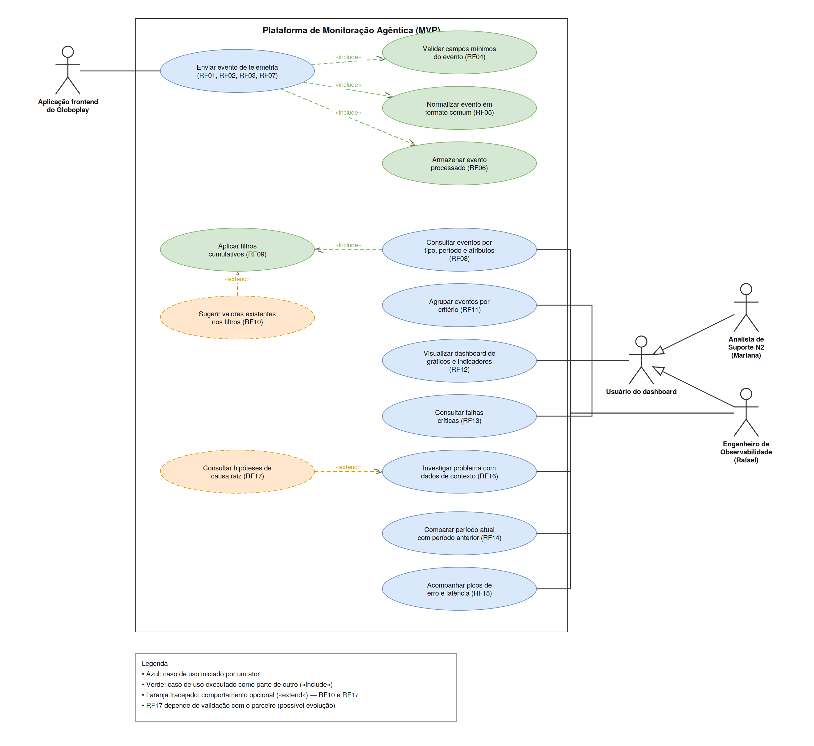

# Requisitos Funcionais, Não Funcionais e Restrições do Projeto

&emsp;A definição de requisitos representa uma etapa importante para transformar as necessidades apresentadas pelo parceiro em características que possam orientar o desenvolvimento e, posteriormente, ser verificadas pela equipe. No projeto de Monitoração Agêntica, esse entendimento foi construído a partir da análise do TAPI e das conversas realizadas com representantes do Grupo Globo durante o kick-off e os primeiros alinhamentos.

## Requisitos funcionais

&emsp;Segundo o livro [Engenharia de Software Moderna](https://engsoftmoderna.info/cap3.html), os requisitos funcionais descrevem os serviços que um sistema deve oferecer, isto é, as funcionalidades que estarão disponíveis para seus usuários ou para outros sistemas. Neste projeto, eles representam as ações necessárias para receber, tratar, armazenar e consultar os eventos de telemetria gerados pelas aplicações frontend do Globoplay.

&emsp;A tabela a seguir apresenta os requisitos funcionais identificados. A coluna **Evidência** relaciona cada requisito às necessidades levantadas junto ao parceiro, enquanto a coluna **Fonte da evidência** indica onde essa necessidade foi registrada ou discutida.

| Requisito funcional | Descrição | Evidência | Fonte da evidência |
|---|---|---|---|
| RF01 | O sistema deve receber eventos de telemetria por meio de uma API única de ingestão. | O MVP deve possuir um ponto unificado para o recebimento dos eventos. | TAPI |
| RF02 | O sistema deve receber eventos originados de diferentes plataformas, como TVs, dispositivos móveis e aplicações web. | O Globoplay está presente em diferentes plataformas e dispositivos. | TAPI e kick-off |
| RF03 | O sistema deve receber eventos provenientes dos protocolos modernos e legados selecionados pelo parceiro para o MVP. | Parte dos dispositivos utilizados não suporta os padrões modernos de coleta de telemetria. | TAPI e kick-off |
| RF04 | O sistema deve verificar se os eventos recebidos possuem as informações mínimas esperadas para o seu tipo. | Os dados precisam estar adequados antes de serem armazenados e analisados. | Elicitação com o parceiro |
| RF05 | O sistema deve padronizar os eventos recebidos em um formato comum. | O MVP prevê a normalização mínima dos eventos provenientes de diferentes dispositivos. | TAPI |
| RF06 | O sistema deve armazenar os eventos processados para permitir consultas e análises posteriores. | O MVP prevê um fluxo de ingestão e armazenamento de eventos em escala. | TAPI e kick-off |
| RF07 | O sistema deve coletar, no mínimo, eventos dos tipos `request`, `vitals`, `screen_view`, `video_view`, `session` e `error`. | Esses foram os eventos mínimos definidos para o MVP. | TAPI |
| RF08 | O sistema deve permitir a pesquisa de eventos por tipo, período e demais informações disponíveis sobre a aplicação ou o dispositivo. | Os usuários precisam localizar eventos específicos para investigar falhas. | Elicitação com o parceiro |
| RF09 | O sistema deve permitir a utilização de mais de um filtro em uma mesma consulta. | O dashboard deve possuir filtros cumulativos. | TAPI |
| RF10 | O sistema deve sugerir valores existentes nos dados durante o preenchimento dos filtros. | O MVP prevê sugestão de valores recebidos nos filtros. | TAPI |
| RF11 | O sistema deve permitir o agrupamento de eventos por critérios disponíveis, como tipo, período, plataforma ou região. | O agrupamento facilita a análise da frequência e da distribuição dos eventos. | Elicitação com o parceiro |
| RF12 | O sistema deve apresentar gráficos e indicadores construídos a partir dos eventos coletados. | O MVP prevê um dashboard para navegação pelos dados e gráficos dos eventos. | TAPI |
| RF13 | O sistema deve disponibilizar consultas simples para análise das falhas consideradas críticas pelo parceiro. | A consulta de falhas críticas faz parte do escopo mínimo do projeto. | TAPI |
| RF14 | O sistema deve permitir a comparação entre eventos e métricas do período atual e de um período anterior selecionado. | A comparação histórica pode ajudar a reconhecer mudanças no comportamento da aplicação. | Elicitação com o parceiro |
| RF15 | O sistema deve destacar aumentos relevantes na ocorrência de eventos, como picos de erros ou de latência, segundo critérios definidos com o parceiro. | Os times precisam perceber com clareza os problemas que estão ocorrendo no momento. | Elicitação com o parceiro |
| RF16 | O sistema deve exibir informações que auxiliem a investigação de um problema, como tipo de evento, período, quantidade de ocorrências e dispositivos relacionados. | O sistema deve contribuir para a identificação de padrões e para a análise de falhas. | TAPI e elicitação com o parceiro |
| RF17 | O sistema poderá apresentar possíveis causas para um problema, ordenando as hipóteses por relevância e indicando os dados que contribuíram para a análise. | Durante a elicitação, foi levantada a possibilidade de apoiar a identificação da causa raiz por meio de hipóteses. | Elicitação com o parceiro |

&emsp;Os requisitos RF01 a RF13 estão diretamente relacionados ao escopo mínimo apresentado no TAPI. Os requisitos RF14 a RF16 complementam a experiência de análise discutida durante a elicitação. Já o RF17 deve ser tratado inicialmente como uma possível evolução, pois depende da quantidade e da qualidade dos dados coletados e ainda precisa ser validado com o parceiro. Caso seja implementado, suas hipóteses deverão apoiar a investigação humana, sem serem apresentadas como conclusões definitivas.

## Diagrama de casos de uso

&emsp;O diagrama de casos de uso representa, em notação UML, os requisitos funcionais apresentados na seção anterior. Ele mostra quem interage com a plataforma (atores), quais serviços o sistema oferece (casos de uso) e como esses serviços se relacionam entre si. O arquivo editável está em `assets/diagrama_casos_de_uso.drawio` e pode ser aberto no [diagrams.net](https://app.diagrams.net).

Figura 1 - Diagrama de casos de uso dos requisitos funcionais

Fonte: material produzido pelos autores (2026).

&emsp;O diagrama contempla apenas os requisitos funcionais. Os requisitos não funcionais descrevem qualidades do sistema, e não serviços oferecidos aos atores, de modo que sua verificação permanece nos planos de teste apresentados adiante.

### Atores

| Ator | Tipo | Papel no sistema |
|---|---|---|
| Aplicação frontend do Globoplay | Sistema externo | Emite os eventos de telemetria. Representa o conjunto das plataformas em que o Globoplay está presente, sem enumerá-las, uma vez que cada uma pode apresentar falhas próprias e a lista definitiva ainda será priorizada com o parceiro. |
| Usuário do dashboard | Ator generalizado | Reúne o comportamento de consulta e análise comum aos dois perfis operacionais. Não é instanciado diretamente. |
| Engenheiro de Observabilidade | Ator especializado | Investiga padrões de falha, acompanha limites de confiabilidade e compara períodos. |
| Analista de Suporte N2 | Ator especializado | Faz a triagem de chamados a partir dos eventos registrados. |

&emsp;O ator "Aplicação frontend do Globoplay" foi mantido genérico de forma proposital. O RF02 e o RF03 tratam de plataformas e protocolos diversos, incluindo dispositivos legados, e enumerar categorias no diagrama daria a impressão de um escopo fechado. A definição das plataformas e dos protocolos priorizados para o MVP é validada com o parceiro.

### Relação entre os atores e as personas

&emsp;Os atores do diagrama derivam das personas definidas em [entendimento_ux.md](./entendimento_ux.md). A correspondência é a seguinte:

| Persona | Relação com a solução | Ator correspondente | Casos de uso associados |
|---|---|---|---|
| Rafael Santos - engenheiro de observabilidade | Usuário direto (persona principal) | Engenheiro de Observabilidade | Todos os casos do "Usuário do dashboard", além de comparar períodos (RF14), acompanhar picos de erro e latência (RF15) e consultar hipóteses de causa raiz (RF17) |
| Mariana Souza - analista de suporte N2 | Usuária direta (operacional) | Analista de Suporte N2 | Casos herdados do "Usuário do dashboard": consultar eventos (RF08), agrupar (RF11), dashboard (RF12), falhas críticas (RF13) e investigar problema (RF16) |
| Luísa Silva dos Santos - assinante do Globoplay | Usuária indireta | Não é modelada como ator | Nenhum |

&emsp;Luísa não aparece como ator porque não interage com a plataforma. Em UML, um ator representa quem troca informação com o sistema, e a relação de Luísa é de benefício indireto: seus eventos chegam pelo ator "Aplicação frontend do Globoplay" e o resultado da investigação se traduz em correções no dispositivo dela. Representá-la como ator sugeriria uma interação que não existe.

&emsp;A distinção entre os dois atores diretos segue a diferença registrada nas User Stories: as histórias US01 a US05, de Rafael, tratam de cobertura, confiabilidade da ingestão e definição de limites de confiabilidade; as histórias US06 a US08, de Mariana, tratam de triagem por sessão, dispositivo e região. Como ambas partem das mesmas consultas ao dashboard, a generalização evita repetir as mesmas associações duas vezes.

&emsp;O perfil de produto, citado no RNF07 como um dos públicos do dashboard, não foi modelado como ator porque não possui persona correspondente no entendimento de UX. Caso venha a ser considerado um usuário do MVP, será necessário criar a persona antes de incluí-lo no diagrama.

### Rastreabilidade entre casos de uso e requisitos

| Caso de uso | Ator ou caso de uso de origem | Requisitos atendidos |
|---|---|---|
| Enviar evento de telemetria | Aplicação frontend do Globoplay | RF01, RF02, RF03, RF07 |
| Validar campos mínimos do evento | «include» de "Enviar evento de telemetria" | RF04 |
| Normalizar evento em formato comum | «include» de "Enviar evento de telemetria" | RF05 |
| Armazenar evento processado | «include» de "Enviar evento de telemetria" | RF06 |
| Consultar eventos por tipo, período e atributos | Usuário do dashboard | RF08 |
| Aplicar filtros cumulativos | «include» de "Consultar eventos" | RF09 |
| Sugerir valores existentes nos filtros | «extend» de "Aplicar filtros cumulativos" | RF10 |
| Agrupar eventos por critério | Usuário do dashboard | RF11 |
| Visualizar dashboard de gráficos e indicadores | Usuário do dashboard | RF12 |
| Consultar falhas críticas | Usuário do dashboard | RF13 |
| Investigar problema com dados de contexto | Usuário do dashboard | RF16 |
| Consultar hipóteses de causa raiz | «extend» de "Investigar problema" | RF17 |
| Comparar período atual com período anterior | Engenheiro de Observabilidade | RF14 |
| Acompanhar picos de erro e latência | Engenheiro de Observabilidade | RF15 |

&emsp;Todos os requisitos funcionais de RF01 a RF17 estão representados no diagrama.

### Convenções adotadas

- **«include»** indica um comportamento sempre executado como parte do caso de uso base. É o caso da validação, da normalização e do armazenamento, que ocorrem em toda ingestão de evento.
- **«extend»** indica um comportamento opcional, executado apenas em determinadas condições. Foi aplicado ao RF10 (sugestão de valores) e ao RF17 (hipóteses de causa raiz).
- O RF17 aparece com contorno tracejado por ser tratado como uma possível evolução, conforme registrado na seção anterior, e depende de validação com o parceiro.

## Requisitos não funcionais

&emsp;Ainda conforme o livro [Engenharia de Software Moderna](https://engsoftmoderna.info/cap3.html), os requisitos não funcionais estabelecem características de qualidade e restrições sobre o funcionamento do sistema. Eles não descrevem uma funcionalidade isolada, mas definem condições importantes para que as funcionalidades sejam utilizadas de forma adequada.

&emsp;Os requisitos abaixo foram organizados de acordo com características de qualidade presentes na norma ISO/IEC 25010. As metas numéricas já discutidas pela equipe foram mantidas, enquanto definições ainda não fornecidas pelo parceiro foram registradas de maneira mais aberta para evitar compromissos que não tenham sido validados.

| Requisito não funcional | Descrição | Aspecto de qualidade relacionado à ISO 25010 | Fonte da evidência |
|---|---|---|---|
| RNF01 | A API de ingestão deve processar, inicialmente, pelo menos 1.000 requisições por minuto em condições normais de operação. | Eficiência de desempenho - capacidade | Definição inicial da equipe |
| RNF02 | Consultas simples realizadas no dashboard sobre dados já processados devem apresentar o resultado em até 3 segundos. | Eficiência de desempenho - comportamento em relação ao tempo | Definição inicial da equipe |
| RNF03 | A solução deve permitir o aumento gradual de sua capacidade de ingestão e processamento sem alterar a forma como os sistemas enviam eventos. | Flexibilidade - escalabilidade | TAPI |
| RNF04 | Um evento inválido não deve impedir o recebimento dos eventos válidos seguintes, e sua falha deve ser identificável. | Confiabilidade - tolerância a falhas | TAPI e elicitação com o parceiro |
| RNF05 | Após uma falha temporária, o sistema deve voltar a receber e processar novos eventos sem perder silenciosamente os eventos que já tenham sido aceitos. | Confiabilidade - recuperabilidade | TAPI |
| RNF06 | A API deve receber eventos das plataformas e dos protocolos modernos e legados selecionados pelo parceiro para o MVP. | Compatibilidade - interoperabilidade | TAPI e kick-off |
| RNF07 | Os usuários devem conseguir localizar eventos, aplicar filtros e interpretar os principais gráficos sem orientação técnica detalhada. | Capacidade de interação - operabilidade | TAPI e elicitação com o parceiro |
| RNF08 | Caso sejam apresentadas hipóteses, o sistema deve indicar os eventos ou métricas que justificam a relação sugerida com o problema. | Capacidade de interação - reconhecibilidade da adequação | Elicitação com o parceiro |
| RNF09 | O acesso às consultas e aos dados deve ser permitido apenas a usuários ou serviços autorizados. | Segurança - confidencialidade e autenticidade | Necessidade identificada pela equipe |
| RNF10 | Os eventos devem conter apenas as informações necessárias para a monitoração e não devem expor dados pessoais desnecessários no dashboard. | Segurança - confidencialidade | Necessidade identificada pela equipe |
| RNF11 | O sistema deve registrar informações suficientes sobre falhas de ingestão e processamento para apoiar sua investigação. | Capacidade de manutenção - analisabilidade | Objetivo do projeto e elicitação com o parceiro |
| RNF12 | Eventos equivalentes enviados por plataformas diferentes devem resultar em informações padronizadas e comparáveis após o processamento. | Adequação funcional - correção funcional | TAPI |

## Planos de teste dos requisitos não funcionais

&emsp;Os planos de teste a seguir apresentam uma forma inicial de verificar cada requisito não funcional. As condições de infraestrutura, o volume representativo de dados e os protocolos utilizados deverão ser refinados conforme o desenvolvimento do MVP.

### Teste de capacidade de ingestão (RNF01)

- **Objetivo:** Verificar se a API suporta o volume inicial definido pela equipe.
- **Ação:** Utilizar uma ferramenta de teste de carga para enviar 1.000 eventos válidos durante o intervalo de um minuto e, ao final, comparar a quantidade de requisições enviadas, recebidas e registradas.
- **Critérios de aceite:**
  - A API recebe as 1.000 requisições dentro do período definido.
  - O serviço não fica indisponível durante o teste.
  - Não ocorre perda silenciosa de eventos; uma eventual recusa deve apresentar resposta ou registro que permita identificar seu motivo.

### Teste de tempo de resposta das consultas (RNF02)

- **Objetivo:** Verificar o tempo necessário para retornar consultas simples no dashboard.
- **Ação:** Preparar uma base com volume representativo do MVP e executar pesquisas simples, como busca por tipo de evento e período. Cada cenário deve ser repetido ao menos cinco vezes.
- **Critérios de aceite:**
  - Todas as consultas testadas apresentam o resultado em até 5 segundos.
  - Os resultados retornados correspondem aos filtros aplicados.

### Teste de crescimento da capacidade (RNF03)

- **Objetivo:** Verificar se a capacidade do sistema pode ser ampliada sem alterar o formato utilizado no envio dos eventos.
- **Ação:** Executar o teste do RNF01, ampliar de maneira controlada os recursos de processamento e repetir a carga com um volume superior.
- **Critérios de aceite:**
  - A API e o formato dos eventos permanecem os mesmos após a ampliação.
  - O sistema apresenta aumento de capacidade em relação ao primeiro teste.
  - A meta ampliada deve ser registrada e validada de acordo com a infraestrutura disponível.

### Teste de tratamento de eventos inválidos (RNF04)

- **Objetivo:** Garantir que um evento incorreto não interrompa o recebimento dos demais.
- **Ação:** Enviar uma sequência contendo eventos válidos e eventos com campos ausentes ou formatos incorretos.
- **Critérios de aceite:**
  - Os eventos inválidos são identificados.
  - Os eventos válidos enviados antes e depois deles continuam sendo processados.
  - A falha pode ser consultada posteriormente por meio de resposta ou registro.

### Teste de recuperação após falha temporária (RNF05)

- **Objetivo:** Verificar se o sistema retoma o processamento depois de uma falha controlada.
- **Ação:** Durante um fluxo de eventos, interromper temporariamente um componente de processamento e depois restaurá-lo. Em seguida, comparar os eventos aceitos com os armazenados ou registrados para reprocessamento.
- **Critérios de aceite:**
  - O recebimento e o processamento voltam a funcionar após a restauração.
  - Os eventos aceitos não desaparecem sem registro.
  - O tempo de recuperação é documentado para posterior validação com o parceiro.

### Teste de compatibilidade (RNF06)

- **Objetivo:** Verificar o recebimento de eventos das plataformas e dos protocolos previstos para o MVP.
- **Ação:** Criar ao menos um evento válido para cada plataforma e protocolo priorizado e enviá-lo à API.
- **Critérios de aceite:**
  - Todos os exemplos previstos para o MVP são aceitos.
  - Os eventos são normalizados e disponibilizados para consulta.
  - A lista de plataformas e protocolos utilizada no teste está validada pelo parceiro.

### Teste de usabilidade do dashboard (RNF07)

- **Objetivo:** Avaliar se os principais recursos de consulta podem ser utilizados de forma compreensível.
- **Ação:** Convidar representantes dos perfis de engenharia, observabilidade ou produto para localizar erros de um período, aplicar dois filtros e identificar o grupo com mais ocorrências.
- **Critérios de aceite:**
  - A maioria dos participantes conclui as três tarefas sem ajuda direta.
  - Os participantes conseguem explicar o significado dos principais gráficos apresentados.
  - Dificuldades recorrentes são registradas para melhoria da interface.

### Teste de clareza das hipóteses (RNF08)

- **Objetivo:** Verificar se as possíveis causas apresentadas são compreensíveis e possuem uma justificativa visível.
- **Ação:** Caso o RF17 seja implementado, apresentar exemplos de hipóteses a usuários dos times envolvidos e pedir que identifiquem o problema, a possível causa e as evidências utilizadas.
- **Critérios de aceite:**
  - A maioria dos participantes consegue explicar a relação apresentada.
  - Os dados que contribuíram para a hipótese podem ser identificados.
  - A interface deixa claro que a hipótese precisa ser validada por uma pessoa.

### Teste de controle de acesso (RNF09)

- **Objetivo:** Verificar se os dados ficam disponíveis somente para acessos autorizados.
- **Ação:** Tentar acessar uma consulta sem identificação, com uma identificação inválida e com uma identificação válida.
- **Critérios de aceite:**
  - Os acessos sem autorização são recusados.
  - O acesso autorizado funciona conforme esperado.
  - As tentativas recusadas podem ser identificadas nos registros do sistema.

### Teste de proteção dos dados coletados (RNF10)

- **Objetivo:** Verificar se dados pessoais desnecessários não são expostos pela solução.
- **Ação:** Processar eventos de teste contendo campos permitidos e um campo não permitido que simule uma informação pessoal, observando o dado armazenado e exibido.
- **Critérios de aceite:**
  - Os campos necessários para a monitoração são mantidos.
  - O campo não autorizado é rejeitado, removido ou mascarado conforme regra acordada com o parceiro.
  - A informação não aparece nas consultas do dashboard.

### Teste dos registros de falha (RNF11)

- **Objetivo:** Verificar se os registros ajudam a diferenciar problemas de ingestão e processamento.
- **Ação:** Provocar erros conhecidos, como evento incompleto, formato incorreto e indisponibilidade temporária de um componente, e analisar os registros gerados.
- **Critérios de aceite:**
  - Os registros informam o horário, a etapa afetada e uma indicação do erro.
  - A equipe consegue diferenciar os cenários testados.
  - Os registros não exibem dados sensíveis desnecessários.

### Teste de consistência da normalização (RNF12)

- **Objetivo:** Verificar se eventos equivalentes de plataformas diferentes podem ser analisados em conjunto.
- **Ação:** Criar eventos que representem a mesma ocorrência em dois ou mais formatos de origem e comparar os resultados após a normalização.
- **Critérios de aceite:**
  - As informações comuns mantêm o mesmo significado depois do processamento.
  - Os eventos podem ser encontrados e agrupados em uma mesma consulta.
  - Os campos específicos de cada plataforma não alteram indevidamente os campos comuns.

## Restrições do projeto

&emsp;Além dos requisitos, a elicitação identificou uma restrição que deve orientar o trabalho da equipe:

- Os dados, documentos e desafios fornecidos pelo parceiro não devem ser compartilhados com terceiros.

&emsp;Outras decisões de arquitetura, infraestrutura e tecnologias ainda deverão ser discutidas pela equipe e validadas com o parceiro. Por esse motivo, escolhas como provedor de nuvem, estilo de arquitetura ou ferramentas específicas não são apresentadas neste documento como restrições já definidas.

## Considerações finais

&emsp;A documentação dos requisitos fornece uma referência inicial para o planejamento e a avaliação do sistema. Os requisitos funcionais descrevem as capacidades esperadas da plataforma e são representados de forma gráfica no diagrama de casos de uso, enquanto os requisitos não funcionais e seus respectivos planos de teste estabelecem critérios para observar a qualidade da solução. Como a elicitação é uma atividade contínua, o conteúdo deverá ser revisado sempre que uma nova necessidade, restrição ou decisão for validada com o parceiro.

## Referências

- GRUPO GLOBO; INTELI. *TAPI - Turma 15 - Ciência da Computação - Módulo 7: Monitoração Agêntica*. Documento de definição do projeto parceiro, 2026.
- OBJECT MANAGEMENT GROUP. *OMG Unified Modeling Language (OMG UML), version 2.5.1*. Disponível em: [https://www.omg.org/spec/UML/](https://www.omg.org/spec/UML/). Acesso em: 12 ago. 2026.
- VALENTE, Marco Tulio. *Engenharia de Software Moderna: princípios e práticas para desenvolvimento de software com produtividade*. Disponível em: [https://engsoftmoderna.info/](https://engsoftmoderna.info/). Acesso em: 10 ago. 2026.
