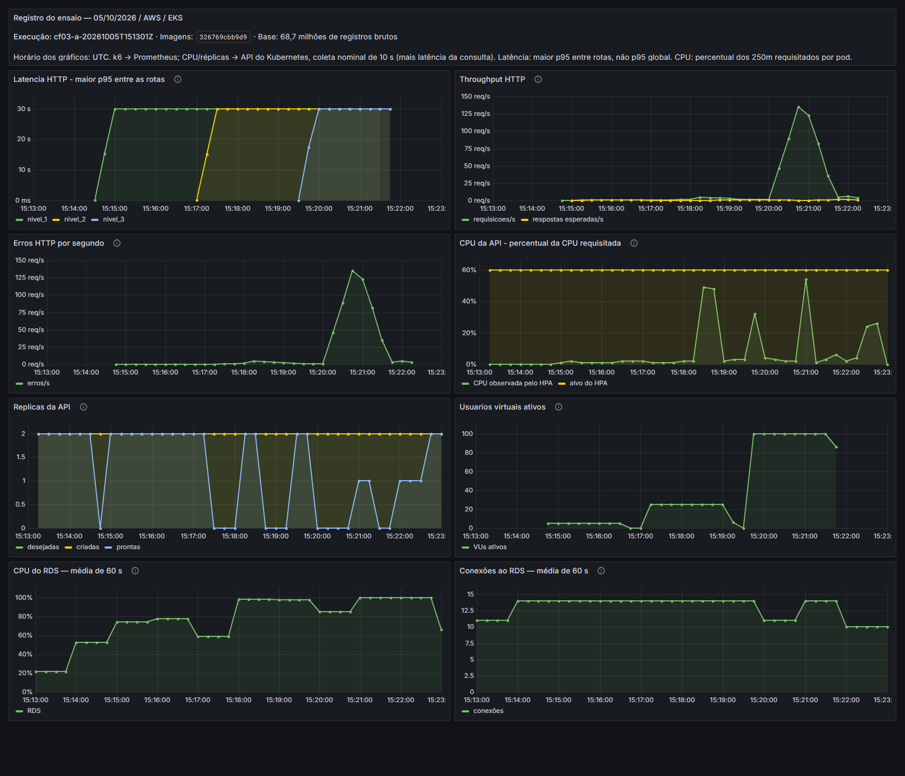
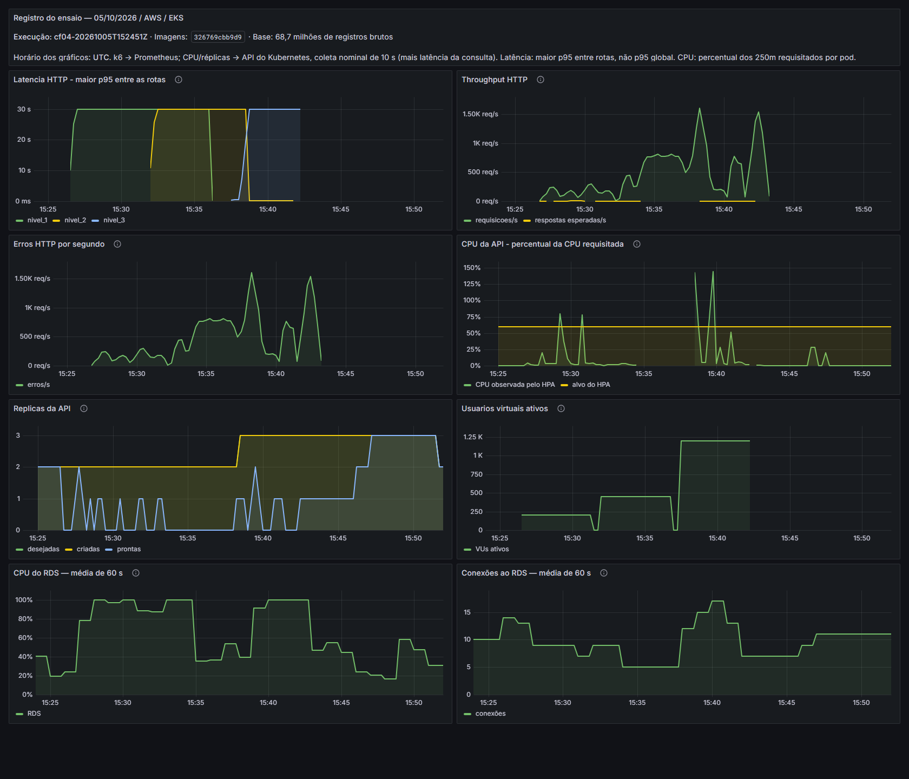
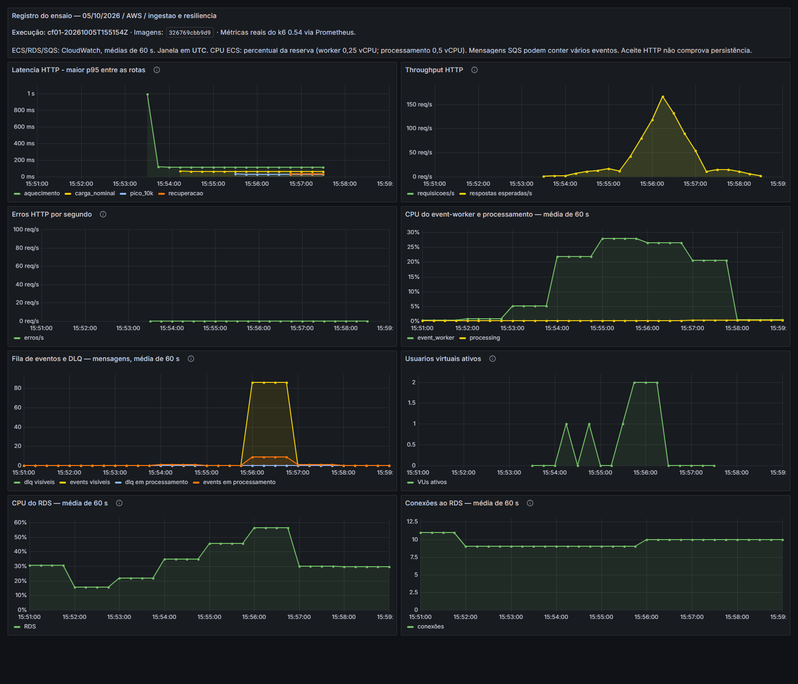
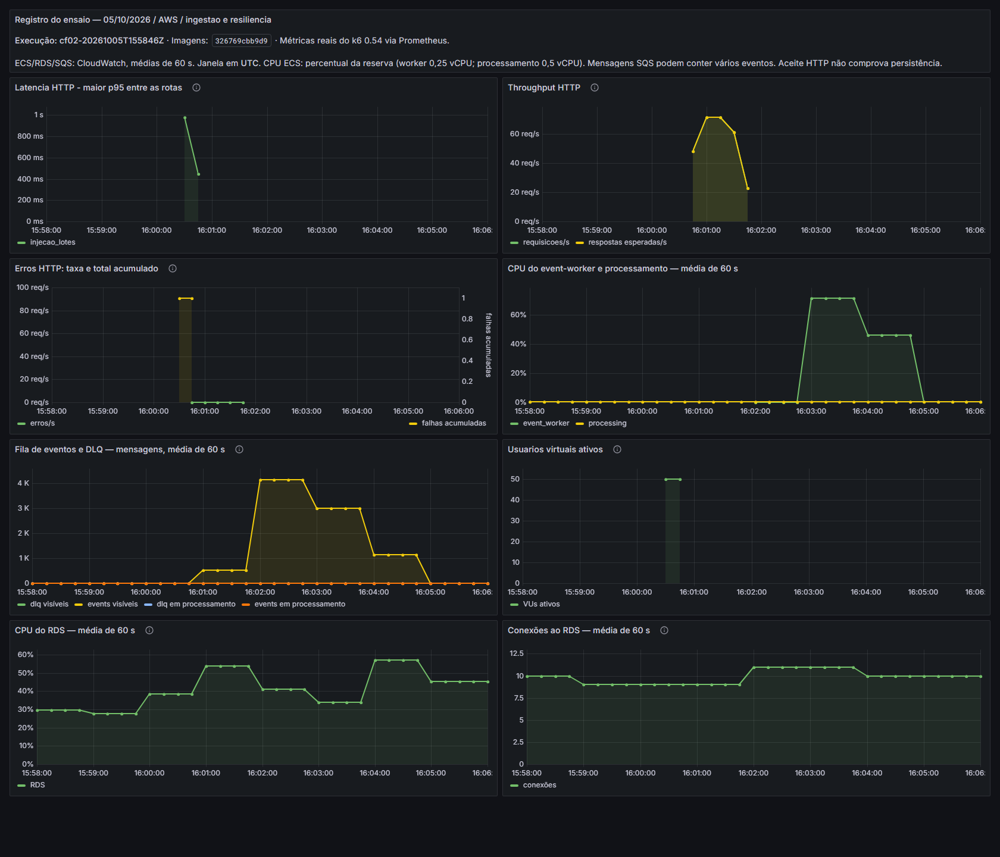
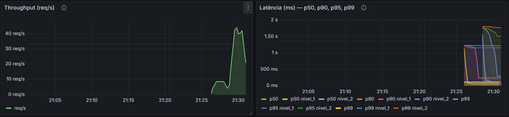
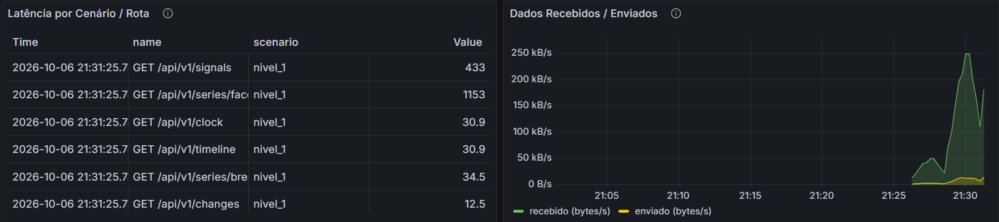
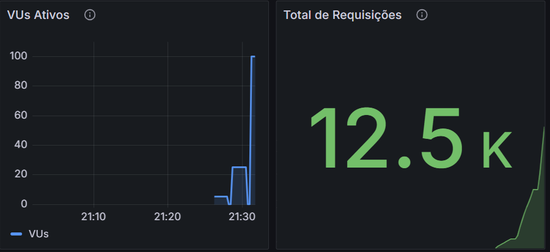

# Testes finais de carga, resiliência e observabilidade

Este documento amplia os [testes de carga da Sprint 3](testes-carga-inicial.md) para avaliar a arquitetura atual. Os cenários acompanham o recebimento de eventos, o acesso às telas, a recuperação de falhas e o aumento automático de réplicas. Os resultados relacionam os requisitos não funcionais (RNF) às decisões de arquitetura.

A carga foi gerada pelo k6 e acompanhada no Grafana. Também foi repetido o teste de integração (TI) que verifica se um evento enviado fica disponível na interface de programação de aplicações (API), identificado como TI-05.2 no artefato funcional. Os códigos de cenário final (CF) identificam os cenários de carga deste documento.

Como na Sprint 3, os resultados ficam concentrados em dois arquivos no formato JSON: um com os [cenários gerais](evidencias/testes-carga-finais/evidencias-2026-10-05.json) e outro com as [remessas de eventos](evidencias/testes-carga-finais/evidencias-lotes-2026-10-05.json). Cada remessa contém 150.000 eventos. Nesta rodada, foram enviadas duas remessas juntas, com o consumidor parado. Os ensaios de uma, três e quatro remessas continuam como evidência histórica, sem nova execução.

O acesso às telas foi repetido como **CF03-B**, com evidência própria na seção 3.2.1 e três capturas feitas durante a execução. Essa repetição passou nos limites medidos, em outra janela do relógio virtual. A reprovação do CF03-A permanece válida para as condições em que foi medida.

A repetição **CF03-C**, com 200/450/900 usuários, reprovou nos três níveis e está detalhada na seção 3.2.2. O aumento de réplicas foi observado, junto de CPU elevada no banco e reinícios da API.

A repetição **CF02-B**, na seção 3.5.1, aprovou o recebimento e a recuperação dos 300.000 eventos, sem rejeições ou duplicidades. A falha da execução original permanece registrada.

## 1. Evolução dos testes e critérios de aprovação

### 1.1 O que foi aproveitado da Sprint 3

O recebimento de eventos mantém os serviços da Amazon Web Services (AWS): API Gateway, fila no Amazon Simple Queue Service (SQS), consumidores no Amazon Elastic Container Service (ECS) com Fargate e PostgreSQL no Amazon Relational Database Service (RDS).

A API de leitura passou a ser atendida pelo Kubernetes no Amazon Elastic Kubernetes Service (EKS). Nesse caminho, o Ingress encaminha as consultas à aplicação, e o Horizontal Pod Autoscaler (HPA) ajusta a quantidade de réplicas conforme o uso da unidade central de processamento (CPU).

| Evidência anterior | Resultado e contribuição para esta etapa |
|---|---|
| Pico de eventos na Sprint 3 | 10.000 eventos/min e 12.152 eventos aceitos e gravados no ensaio completo. Os lotes de 150 mil a 600 mil demonstraram recuperação do acúmulo |
| Consultas na Sprint 3 | 4.587 consultas, com máximo de 1.581 ms e ressalva sobre a representatividade da base |
| Carga das telas no artefato funcional | Aprovação até 100 usuários. A rodada com 200 usuários ultrapassou limites por tela, mesmo com os indicadores agregados dentro dos limites |
| Eventos inválidos | 18/18 falhas identificadas e 150/150 eventos válidos preservados. O RNF04 mantém essa evidência, sem nova execução nesta etapa |
| Recuperação local no kind | A remoção de um dos dois pods não causou falhas nas 2.262 requisições. O resultado sustenta a redundância naquele ambiente, sem extrapolar os tempos para a AWS |

Os [resultados iniciais](assets/performance/evidencias-2026-09-02.json), os [ensaios por lote](assets/performance/evidencias-lotes-2026-09-09.json) e os [testes funcionais](testes-funcionais.md#testes-de-carga) preservam a análise histórica. A [rodada A no EKS](evidencias/carga-kubernetes/rodada-a-resultado.json) e a [rodada B](evidencias/carga-kubernetes/rodada-b-resultado.json) registram os testes anteriores à correção da coleta de métricas do HPA. A [repetição após o ajuste](evidencias/carga-kubernetes-2026-09-24/carga-ui_resultado_20260925T004042Z.json) confirmou a coleta, mas ainda sem aumento de réplicas.

### 1.2 Planos de teste aprimorados

No Argus, o exemplo de abertura de venda é representado por uma rajada de 10 mil eventos/minuto. O cenário de “fila cheia” foi representado pelo acúmulo de mensagens com o consumidor parado, seguido de retomada. Ele avalia a recuperação da fila, sem afirmar que uma cota da SQS foi atingida.

Nos critérios abaixo, o percentil 95 (p95) e o percentil 99 (p99) indicam os tempos até os quais se encontram, respectivamente, 95% e 99% das medições. As chamadas usam o protocolo de transferência de hipertexto (HTTP).

| Cenário e requisito | Procedimento | Resultado esperado |
|---|---|---|
| Pico de eventos, CF01 / RNF01 | Enviar 1.000, 10.000 e 1.000 eventos/min, por 60 s em cada fase, além do aquecimento | Aceitar ao menos 1.000/10.000/1.000 eventos, com p95 <2 s/<5 s/<2 s nas respectivas fases, zero rejeições e descartes do gerador, gravar todos os aceitos sem duplicidade e terminar com a fila principal e a fila de mensagens não processadas normalmente (DLQ) vazias |
| Acúmulo e recuperação, CF02 / RNF01 e RNF05 | Enviar dois lotes de 150.000 eventos com o consumidor parado e depois retomar o consumo | Aceitar todos os eventos, gravá-los sem perda ou duplicação e esvaziar as filas. Referência de recuperação de 450 s a partir do pedido de retomada |
| Acesso às telas, CF03 / RNF02 | Executar as chamadas das seis telas com 5/25/100 usuários virtuais, por dois minutos em cada nível | Erros <1%, p95 HTTP < 3 s, p99 HTTP <5 s, p95 de abertura <5 s e telas completas >99%, no conjunto e por tela. Conferir também o máximo de 5 s do RNF02 |
| Escala automática, CF04 | Usar 200/450/1.200 usuários virtuais por cinco minutos em cada nível, acompanhando também a recuperação | Observar criação, disponibilidade e redução de réplicas, mantendo os critérios de desempenho do CF03 |
| Timeout do cliente, CF05 / RNF05 | Limitar 100 consultas a 1 ms e iniciar cinco consultas com prazo de 7 s aos 35 s do ensaio | Detectar ao menos um timeout, obter HTTP 200 nas cinco consultas posteriores, zero falhas e p95 <5 s |
| Eventos inválidos, CF06 / RNF04 | Preservar a verificação de entradas válidas e inválidas da Sprint 3 | Identificar a causa das rejeições e manter o processamento dos eventos válidos |
| Registros de falha, CF07 / RNF11 | Conferir amostras das falhas observadas | Identificar horário, etapa e erro, distinguindo os cenários |
| Disponibilidade na API, CF08 / TI-05.2 | Enviar um evento e consultar a API após a correção do índice no banco | Encontrar o evento em até 300 s, com os campos preservados e sem expor `user_id` |

Os critérios vêm de [requisitos.md](requisitos.md) e do [plano registrado antes da execução](evidencias/testes-carga-finais/evidencias-2026-10-05.json), preservado no campo `plano_execucao`. Os limites auxiliares do k6 e os 450 s de recuperação são critérios do ensaio. No CF01, o roteiro também exige falhas <1%/<5%/<1% por fase. A exigência adicional de zero rejeições é mais restritiva. O veredito combina os limites do k6 com a conferência posterior no banco, não apenas `aprovado_http`. O RNF03 trata de ampliar a capacidade de ingestão de pelo menos 1.000 para 2.000 requisições/minuto. Sua evidência continua sendo a da Sprint 3, pois o CF04 avalia a escala das consultas.

No roteiro `carga_ui.js`, p99 e proporção de telas completas são limiares por nível. Por tela, os limiares automáticos cobrem p95 HTTP, p95 de abertura e falhas HTTP. A auditoria do CF03-B conferiu também o p99 por tela, os tempos máximos e os checks de HTTP 200 nos resumos brutos. A aprovação não foi deduzida apenas do campo `aprovado` produzido pelo roteiro.

## 2. Ambiente e forma de medição

A campanha que inclui CF03-A e CF04 usou a base histórica do parceiro, com **68.717.811 registros em 32 tabelas**, carregada a partir de `argus_dump.sql`. A camada bronze guarda os dados recebidos, a silver contém os dados tratados e a gold reúne resultados para consulta. Essas camadas foram preparadas antes da carga, sem avanço manual dos marcadores de processamento. A tabela abaixo descreve essa campanha. As condições do CF03-B estão na seção 3.2.1.

| Componente | Configuração utilizada |
|---|---|
| Gerador de carga | k6 0.54.0 em Amazon Elastic Compute Cloud (EC2) `t4g.large`, dentro da rede privada da AWS |
| Aplicação | EKS 1.33, com duas réplicas iniciais da API e possibilidade de chegar a seis. |
| Banco | PostgreSQL 16.13 em `db.t3.medium`, com 100 gibibytes (GiB) |
| Escala automática | HPA com alvo de 60% dos `250m` de CPU requisitados por pod. Redução com janela de estabilização de 300 s |
| Processamento regular | Lotes de 5.000 registros a cada 60 s entre bronze e silver, e ciclo de 900 s entre silver e gold |
| Registro das execuções | Identificador `test_id`, roteiro, versão, horários, critérios, base e recursos disponíveis |

A configuração, as contagens e os intervalos da base estão no campo `ambiente` das [evidências consolidadas](evidencias/testes-carga-finais/evidencias-2026-10-05.json).

O CF03-A e o CF04 consultaram uma janela com mais histórico acumulado. O CF03-B usou o relógio virtual próximo ao início dos dados. Por isso, os resultados não isolam apenas o efeito da mudança de arquitetura ou do HPA. As estatísticas da base e os registros das execuções preservam essas condições.

Para interpretar os resultados, foram consideradas as seguintes medidas:

- **Usuários virtuais (VUs):** sequências de chamadas executadas pelo k6. Nos testes das telas, há pausa de 2 s entre aberturas. Mais usuários não representam uma taxa fixa de requisições.
- **p95 e p99:** tempos até os quais se encontram 95% e 99% das medições. O máximo mostra a resposta mais lenta.
- **Throughput:** quantidade de requisições ou eventos por segundo. Uma mensagem da SQS pode conter vários eventos.
- **Recuperação:** tempo para retomar o serviço e processar o acúmulo. A fila vazia é conferida junto dos registros no banco e da DLQ, a fila de mensagens que não foram processadas normalmente.

A confirmação de recebimento de um evento, sua gravação na bronze e sua disponibilidade na API são etapas distintas. A comparação entre eventos aceitos e gravados, chamada de reconciliação, verifica perdas e duplicidades. O tempo de resposta também é analisado junto dos erros, pois uma falha pode ser devolvida rapidamente.

### 2.1 Ajustes nas reexecuções e seus motivos

Os ajustes das reexecuções concentraram-se no executor dos testes e na coleta das evidências. Os limites de aprovação das consultas e a referência de 450 s para recuperação dos lotes foram mantidos.

| Aspecto | Ajuste ou condição observada | Motivo e efeito na interpretação |
|---|---|---|
| Execução pelo WSL | Os scripts de carga usam finais de linha LF, com regra para preservar esse formato | Corrigir o erro `bash\r`, que impedia o início do comando no Linux |
| Preparação da observabilidade | O executor usa o curl já instalado, corrige os caminhos dos arquivos do Prometheus e Grafana e verifica a disponibilidade dos dois antes da carga | Resolver falhas de preparação e permitir acompanhar as métricas durante a execução |
| Encerramento do executor | Os resultados são publicados antes do marcador de conclusão, e o código de saída do k6 é preservado | Evitar a coleta de arquivos incompletos e tornar explícita a reprovação por limites de desempenho |
| Níveis de consultas | O CF03-B usa 5/25/100 usuários. O CF03-C repete a configuração de 200/450/900 usuários da rodada B de consultas, com dois minutos por nível | Atender à repetição solicitada dos níveis maiores. A carga não foi reduzida em relação à rodada B e os limites de aprovação foram mantidos |
| Recursos do gerador | O CF03-C usa `t4g.large`, enquanto o CF03-B usou `t4g.small` | Dar mais capacidade ao gerador da carga maior. A CPU do gerador foi medida para verificar se ele próprio apresentava saturação |
| Execução dos lotes | Foi acrescentado o alvo `teste-lotes-acumulados-ec2` ao Makefile, reutilizando o roteiro de injeção existente | Permitir executar o cenário de acúmulo pelo gerador temporário. Foram mantidos dois lotes de 150.000 eventos, 50 usuários de injeção e fragmentos de até 40.000 bytes |
| Validação do CF02-B | A fila vazia foi confirmada em duas observações e confrontada com a contagem exata por lote e índice no banco | Conferir perdas e duplicidades, pois as contagens aproximadas da SQS e o aceite HTTP não bastam para comprovar a gravação |
| Janela dos dados | O CF03-B encontrou o relógio virtual próximo do início dos dados, diferente do CF03-A | Essa diferença é uma condição observada do ambiente e afeta o volume visível nas consultas. Não foi demonstrada como uma otimização nem permite atribuir a melhora somente ao executor |

No CF02-B, a mudança de resultado foi de 73 eventos rejeitados para zero rejeições. O erro HTTP 500 da execução original não voltou a ocorrer. Os ajustes do executor não demonstram a causa desse erro nem comprovam sua correção. A aprovação descreve o que foi medido na repetição, preservando a reprovação original.

No CF03-C, os ajustes permitiram executar e auditar novamente a carga maior, mas os três níveis continuaram reprovados. O aumento de duas para seis réplicas foi uma reação automática do HPA durante o teste, não uma alteração manual do seu limite para obter aprovação. Essa execução não repetiu o protocolo CF04 de cinco minutos por nível com 1.200 usuários.

## 3. Execução e resultados

### 3.1 Evento disponível para consulta na API (TI-05.2)

O código TI-05.2 identifica o segundo caso do conjunto que verifica a aplicação publicada na AWS. Ele envia um evento por `POST /v1/events` e consulta `GET /api/v1/events` até encontrá-lo ou atingir o prazo de 300 s.

Na execução original, o evento foi gravado, mas não apareceu na consulta. A investigação encontrou dados pendentes e buscas por `_lsn` sem índice. A [migration 030](../apps/fullstack/db/migrations/030_indice_lsn_em_evento.sql), um script de alteração do banco, adicionou esse índice.

**Procedimento:** repetir o teste com a base preparada, as migrations 001 a 033 aplicadas e a leitura pelo Ingress do EKS.

| Verificação | Resultado esperado | Resultado obtido | Situação |
|---|---|---|---|
| Disponibilidade na API | Evento consultável em até 300 s | Encontrado na 24ª consulta, após 242,24 s | Aprovado |
| Conteúdo e proteção dos dados | Sessão, nome e dispositivo preservados, sem `user_id` | Campos conferidos e `user_id` ausente | Aprovado |

O resultado considera a correção do índice e a preparação da base. Como foi medido um evento, ele não representa um p95 nem comprova o comportamento sob carga. As consultas foram feitas em intervalos, então o tempo indica quando o evento foi encontrado. O caso de autorização de acesso, TI-05.1, permanece separado, pois usa outro caminho de entrada.

**Evidências:** [resultado consolidado, campo `resultados.TI-05.2`](evidencias/testes-carga-finais/evidencias-2026-10-05.json) e [diagnóstico original](testes-funcionais.md#diagnóstico-do-caso-reprovado).

### 3.2 Acesso às telas no Kubernetes (CF03-A)

**Procedimento:** executar as chamadas das seis telas com 5/25/100 usuários, por dois minutos em cada nível e pausa de 30 s, usando a base preparada e o HPA com métricas disponíveis.

**Resultado esperado:** atender aos critérios de tempo, erros e telas completas do CF03, tanto no conjunto quanto por tela.

| VUs | Requisições de carga | Erros | p95 HTTP | p99 HTTP | Máximo HTTP | p95 de abertura | Telas completas |
|---:|---:|---:|---:|---:|---:|---:|---:|
| 5 | 124 | 20,16% | 30.001 ms | 30.001 ms | 30.001 ms | 30.002 ms | 42,86% |
| 25 | 598 | 85,62% | 30.001 ms | 30.001 ms | 30.006 ms | 30.004 ms | 1,75% |
| 100 | 8.368 | 98,29% | 30.000 ms | 30.001 ms | 30.005 ms | 30.002 ms | 1,00% |

**Resultado obtido: reprovado nos três níveis.** Foram 9.090 requisições de carga, além de uma de preparação, e 8.762 falhas HTTP. O aumento do volume no último nível veio principalmente de respostas de erro rápidas. Por isso, a mediana de 1 ms a 100 usuários não indica melhora.

O banco atingiu 100% de CPU na média de um minuto. O HPA manteve duas réplicas, com uso de até 54% da CPU requisitada, abaixo do alvo de 60%. Os pods somaram oito reinícios e houve intervalos sem backend disponível.

Uma consulta isolada de sinais já havia falhado em 15,485 s, com timeout de 15 s em SQL (Structured Query Language, ou linguagem de consulta estruturada). A aplicação recalcula uma referência de sete dias nessa consulta, mas o custo de cada operação ainda precisa ser confirmado no plano SQL. O compartilhamento dos processos HTTP com as verificações de saúde dos pods também precisa ser investigado.

Na tela Hipóteses, o processamento recusou 7.696.798 entradas, acima da proteção de 250.000. A preparação das camadas de dados, portanto, não garantiu a geração das hipóteses. O teste revelou um limite de consulta com histórico acumulado, sem permitir atribuir a diferença apenas ao código.

**Evidências:** [campo `resultados.CF03-A`](evidencias/testes-carga-finais/evidencias-2026-10-05.json), com resultados por nível e tela, HPA, CPU do banco e diagnósticos.

#### 3.2.1 Reexecução das telas (CF03-B)

**Procedimento:** executar `AWS_PROFILE=g4 make -C apps/fullstack teste-carga-ui-ec2`, com 5/25/100 usuários, dois minutos por nível, pausas de 30 s entre níveis e 2 s entre aberturas. O gerador foi uma EC2 `t4g.small`, com k6 0.54.0, Prometheus e Grafana na mesma instância. O destino foi conferido contra o Ingress do EKS.

| VUs | Requisições de carga | Erros | p95 HTTP | p99 HTTP | Máximo HTTP | p95 de abertura | Telas completas |
|---:|---:|---:|---:|---:|---:|---:|---:|
| 5 | 1.036 | 0,00% | 82,32 ms | 347,47 ms | 1.234,09 ms | 163,55 ms | 100,00% |
| 25 | 5.108 | 0,00% | 193,69 ms | 1.197,33 ms | 1.807,81 ms | 274,00 ms | 100,00% |
| 100 | 19.118 | 0,00% | 627,46 ms | 1.789,36 ms | 4.131,17 ms | 800,00 ms | 100,00% |

**Resultado obtido: aprovado nos limites de desempenho da janela medida.** Foram **25.262 requisições de carga e uma de preparação**, totalizando **25.263**, sem falhas HTTP. As 7.219 aberturas produziram 14.438 checks aprovados e nenhum reprovado. Os critérios por tela também passaram nos três níveis. O maior tempo de abertura foi **4.195 ms**, na tela Agora com 100 usuários, abaixo de 5 s. O k6 terminou com código zero.

Cada “abertura” representa o lote de chamadas da tela: todas devem responder HTTP 200. O roteiro não renderiza o frontend nem verifica o conteúdo semântico de cada resposta. Assim, esses números comprovam o tempo das consultas exercitadas, sem medir o tempo de renderização no navegador.

**Observabilidade:** Grafana e Prometheus responderam HTTP 200 durante a carga. Foram preservadas amostras do Prometheus até próximo do encerramento, incluindo a fase de 100 usuários, e as capturas da seção 4.1. O log final não apresentou falhas de envio por Remote Write. A coleta de séries é parcial e não equivale a um snapshot completo do histórico.

**Comparabilidade da base:** o relógio virtual do CF03-B estava próximo do início do conjunto de dados, enquanto o CF03-A consultou uma janela com mais histórico acumulado. O catálogo do PostgreSQL estimou **68.707.132 linhas nas 32 tabelas de origem**, sem somar suas partições em duplicidade. Isso confirma uma base com dados, mas não é uma nova contagem exata reconciliada com o dump nem comprova o mesmo volume visível nas views e nas camadas processadas. O gerador também mudou de `t4g.large` para `t4g.small`. Portanto, a melhora não pode ser atribuída a uma correção do gargalo observado no CF03-A. Esta rodada não comprova escala do HPA nem traz uma série completa de CPU do banco ou do gerador.

**Tentativa preliminar:** foram registradas 25.003 requisições, zero falhas HTTP e aprovação numérica, mas a instalação do Docker falhou por conflito entre `curl` e `curl-minimal`. O log apresentou 85 mensagens de falha no envio ao Prometheus. Essa tentativa foi preservada como diagnóstico. A comprovação de observabilidade vem da repetição CF03-B. O executor foi corrigido para usar o curl existente, impedir a carga quando a preparação falha e publicar os resultados antes do marcador de conclusão.

**Evidências:** [auditoria do CF03-B e da tentativa preliminar](evidencias/testes-carga-finais/evidencias-cf03-b.json), com resumos brutos, critérios recalculados, relógios, estimativas da base, séries consultadas e hashes dos arquivos e capturas.

#### 3.2.2 Repetição com 200, 450 e 900 usuários (CF03-C)

**Procedimento:** executar o mesmo roteiro de consultas em uma EC2 `t4g.large`, com dois minutos em cada nível, pausas de 30 s e 2 s entre aberturas. As métricas do HPA e dos pods foram coletadas durante a execução. O CloudWatch forneceu os indicadores de CPU do banco e do gerador.

| VUs | Requisições de carga | Falhas HTTP | Erros | p95 HTTP | p99 HTTP | p95 de abertura | Telas completas |
|---:|---:|---:|---:|---:|---:|---:|---:|
| 200 | 27.410 | 0 | 0,00% | 3.101,39 ms | 5.921,62 ms | 3.687,00 ms | 100,00% |
| 450 | 36.237 | 1.478 | 4,08% | 7.238,10 ms | 9.508,69 ms | 8.031,00 ms | 92,70% |
| 900 | 41.845 | 9.933 | 23,74% | 18.353,01 ms | 30.000,71 ms | 20.224,50 ms | 73,74% |

**Resultado obtido: reprovado nos três níveis.** Foram **105.492 requisições de carga e uma de preparação**, totalizando **105.493**, com **11.411 falhas HTTP**. O k6 encerrou com código 99 por violação dos limiares.

Com 200 usuários, a ausência de falhas HTTP não bastou para aprovação. O p95 HTTP ultrapassou 3 s e o p99 ultrapassou 5 s. Na tela Agora, o p95 de abertura chegou a 7.133 ms. As consultas de Recorte e Hipóteses também excederam o p95 de 3 s. Com 450 e 900 usuários, houve reprovação por latência, erros e proporção de telas completas. O maior tempo de abertura chegou a 30.013 ms.

O HPA aumentou de **duas para seis réplicas**, com uso de até **130% da CPU requisitada**. Foram observados **oito reinícios adicionais** dos pods. A maior média de CPU do banco em um minuto foi **99,79%**. No gerador, a maior média foi **13,57%**, sem indício de saturação de CPU nas amostras coletadas. Esses indicadores apontam para a necessidade de investigar consultas, concorrência no banco e verificações de saúde. Eles não isolam a causa de cada falha.

Esta repetição confirma que a aprovação até 100 usuários do CF03-B não se estende aos níveis maiores. Ela não substitui o CF04, que usa cinco minutos por nível e inclui 1.200 usuários. A redução posterior de réplicas não foi avaliada pelo protocolo desta repetição.

**Evidências:** [resumos e auditoria do CF03-C](evidencias/testes-carga-finais/evidencias-cf03-c.json), com resultados por tela, contadores, limiares, amostras do HPA e CPU. Não foi preservada uma nova captura do Grafana nem um snapshot completo do Prometheus nesta repetição. As capturas da seção 4.1 pertencem ao CF03-B.

### 3.3 Aumento automático de réplicas (CF04)

**Procedimento:** usar 200/450/1.200 usuários por cinco minutos em cada nível, acompanhando o HPA durante a carga e a recuperação.

**Resultado esperado:** observar aumento e redução de réplicas, mantendo os critérios de desempenho das consultas.

| VUs | Requisições de carga | Erros | p95 HTTP | p99 HTTP | Máximo HTTP | p95 de abertura | Telas completas |
|---:|---:|---:|---:|---:|---:|---:|---:|
| 200 | 55.142 | 98,95% | 24.082 ms | 30.001 ms | 30.044 ms | 27.782 ms | 0,39% |
| 450 | 188.424 | 99,98% | 57 ms | 29.874 ms | 30.026 ms | 89 ms | 0,00% |
| 1.200 | 242.643 | 99,92% | 30.000 ms | 30.002 ms | 30.185 ms | 30.002 ms | 0,01% |

**Resultado obtido: escala observada, desempenho reprovado.** Foram 486.209 requisições de carga e uma de preparação. A quantidade de réplicas passou de duas para três e depois voltou a duas. O novo pod ficou disponível cerca de 13,85 s após sua criação, mas o atendimento continuou instável.

O uso de CPU chegou a 144% do valor requisitado pelos pods, e houve 15 reinícios adicionais. Após o fim da carga, os três pods foram observados disponíveis em 281,34 s. A observação continuou por mais de nove minutos e registrou a redução para duas réplicas. Houve falhas transitórias na coleta de métricas, diferentes da ausência permanente observada na rodada antiga.

O p95 de 57 ms a 450 usuários acompanha 99,98% de erros. Assim, a escala funcionou, mas não resolveu o tempo das consultas nem a indisponibilidade. O gerador manteve ao menos 52% de CPU ociosa, sem indício de saturação de CPU, embora isso não elimine possíveis limites de rede.

**Evidências:** [campo `resultados.CF04`](evidencias/testes-carga-finais/evidencias-2026-10-05.json), com resultados por nível e tela, réplicas, CPU do banco e gerador.

### 3.4 Pico de recebimento de eventos (CF01)

**Procedimento:** executar aquecimento, carga normal, pico e retorno à carga normal. Depois, comparar os eventos aceitos com os registros no banco.

**Resultado esperado:** aceitar ao menos 1.000/10.000/1.000 eventos, com p95 <2 s/<5 s/<2 s, sem rejeições ou descartes, gravar todos os aceitos sem duplicidade e terminar com fila e DLQ vazias.

| Fase | Taxa programada | Duração | Eventos aceitos | Rejeitados | Execuções descartadas | p95 do recebimento |
|---|---:|---:|---:|---:|---:|---:|
| Normal | 1.000/min | 60 s | 1.001 | 0 | 0 | 60,7 ms |
| Pico | 10.000/min | 60 s | 10.001 | 0 | 0 | 30,5 ms |
| Recuperação | 1.000/min | 60 s | 1.000 | 0 | 0 | 34,1 ms |

**Resultado obtido: aprovado.** Com os 151 eventos do aquecimento, foram 12.153 eventos aceitos e gravados na bronze, sem duplicidade. A fila e a DLQ terminaram vazias, e o máximo HTTP foi de 1.175,12 ms. As pequenas diferenças entre a taxa programada e a contagem decorrem do agendamento do roteiro.

A aprovação vale para o pico de um minuto e a gravação no banco. Não mede sustentação prolongada nem disponibilidade na API. Os eventos usam o instante real do envio, posterior à janela do relógio virtual de leitura. A conferência foi feita por `load_test_id`, sem calcular atraso de persistência, pois esse roteiro não registra `load_test_sent_at`.

**Evidências:** [campo `resultados.CF01`](evidencias/testes-carga-finais/evidencias-2026-10-05.json), com resultado do k6 e conferência de eventos e filas.

### 3.5 Duas remessas de eventos e recuperação da fila (CF02)

**Procedimento:** parar o `event-worker`, enviar dois lotes de 150.000 eventos com 50 usuários e fragmentos de até 40.000 bytes, e retomar o consumidor. A injeção levou 28,035 s, com p95 de 429,9 ms e máximo de 1.452,5 ms por fragmento.

| Remessa | Eventos programados | Gravados na bronze | Diferença |
|---|---:|---:|---:|
| 1 | 150.000 | 149.927 | 73 |
| 2 | 150.000 | 150.000 | 0 |
| **Total** | **300.000** | **299.927** | **73** |

A separação vem da conferência por lote no banco. Os tempos abaixo foram medidos para o conjunto das duas remessas. Não há tempo isolado por remessa.

**Resultado esperado:** aceitar os 300.000 eventos e, após o pedido de retomada, gravá-los sem perda ou duplicação e esvaziar as filas dentro da referência de 450 s.

| Verificação | Resultado obtido |
|---|---|
| Recebimento | 299.927 eventos aceitos e 73 rejeitados |
| Falhas HTTP | Uma resposta 500 em 4.155 requisições |
| Fila antes da retomada | 4.154 mensagens visíveis, sem mensagens em processamento ou na DLQ |
| Primeira task em execução | 23,69 s após o pedido de retomada |
| Eventos aceitos gravados | 299.927 na bronze aos 137,70 s, sem duplicidade |
| Fila e DLQ vazias | Conferência concluída aos 165,01 s |
| Tempo entre envio e gravação | p95 de 205,16 s e máximo de 211,28 s, para os 299.927 aceitos |

**Resultado obtido: recuperação aprovada, cenário completo reprovado.** Todos os eventos aceitos foram gravados dentro da referência de recuperação, mas as 73 rejeições impediram a aprovação do recebimento integral. O erro 500 foi registrado pelo API Gateway, sem informação suficiente para atribuir sua causa à fila, ao banco ou à parada do consumidor.

O p95 até a gravação inclui a espera anterior à retomada. Ele é diferente do tempo de recuperação e não mede quando todo o lote ficou disponível na API.

**Evidências:** [resultados por remessa](evidencias/testes-carga-finais/evidencias-lotes-2026-10-05.json), com injeção, recuperação, conferência no banco e registro do erro 500.

#### 3.5.1 Repetição do acúmulo e recuperação (CF02-B)

**Procedimento:** conferir as filas vazias, parar somente o consumidor de eventos e enviar duas remessas de 150.000 eventos por uma EC2 `t4g.large`. O roteiro usou 50 usuários de injeção e fragmentos de até 40.000 bytes. Depois do envio, o consumidor foi restaurado à quantidade original de uma task. A conferência no banco usou uma transação somente leitura.

| Verificação | Resultado obtido |
|---|---|
| Recebimento | 300.000 eventos aceitos e zero rejeitados |
| Requisições de envio | 4.250, sem falhas HTTP |
| Duração do envio | 29,79 s |
| Latência dos fragmentos | p95 de 434,5 ms e máximo de 1.481,8 ms |
| Fila antes da retomada | 4.250 mensagens visíveis, sem mensagens em processamento ou na DLQ |
| Primeira task em execução | Observada aos 30,15 s após o pedido de retomada |
| Persistência integral | 300.000 eventos, com o último gravado aos 134,64 s após o pedido de retomada |
| Filas vazias | Confirmadas em duas observações consecutivas, com a segunda aos 152,35 s |
| Conferência exata no banco | Concluída aos 171,50 s, com 300.000 identidades distintas |
| Tempo entre envio e gravação | p95 de 142,26 s e máximo de 145,73 s |

| Remessa | Eventos aceitos | Eventos gravados | Duplicidades |
|---|---:|---:|---:|
| 1 | 150.000 | 150.000 | 0 |
| 2 | 150.000 | 150.000 | 0 |
| **Total** | **300.000** | **300.000** | **0** |

**Resultado obtido: aprovado no recebimento, integridade e recuperação.** O k6 encerrou com código zero. Os dois lotes apresentaram todos os índices esperados, sem perdas nem duplicidades. A persistência e o esvaziamento das filas ocorreram dentro da referência de 450 s. O consumidor terminou com uma task desejada e uma em execução.

As contagens da SQS são aproximadas e oscilaram durante o consumo. Por isso, a aprovação combina duas observações de filas vazias com a contagem exata no PostgreSQL. O tempo de persistência usa o horário de gravação registrado no banco. O instante de conferência indica quando essa gravação foi comprovada. Esses valores não medem a disponibilidade de todo o lote na API.

A repetição não reproduziu as 73 rejeições da execução original. Isso comprova o sucesso desta rodada, sem demonstrar que a causa do erro anterior foi corrigida. Não houve alteração na aplicação entre o envio e a conferência deste cenário.

**Evidências:** [auditoria do CF02-B](evidencias/testes-carga-finais/evidencias-cf02-b.json), com resumo bruto do k6, amostras das filas, restauração do consumidor e reconciliação por remessa. A figura 4 continua representando a execução original.

### 3.6 Timeout do cliente e recuperação (CF05)

**Procedimento:** limitar a espera a 1 ms em 100 consultas a `/api/v1/clock` para provocar timeouts. Após a pausa, realizar cinco consultas com prazo de 7 s.

| Verificação | Resultado esperado | Resultado obtido | Situação |
|---|---|---|---|
| Prazo reduzido | Ao menos um timeout detectado em 100 consultas com prazo de 1 ms | 100 timeouts | Aprovado |
| Consultas posteriores | Cinco HTTP 200, zero falhas e p95 <5 s, com prazo de 7 s por consulta | Zero falhas e p95 de 12,3 ms | Aprovado |

A aprovação comprova a leitura após os timeouts do cliente. A indisponibilidade do banco e uma carga prolongada não foram provocadas nesse cenário.

O requisito de registro de falhas, RNF11, continua parcialmente comprovado. O timeout SQL apresentou horário, componente e causa, mas sem identificador que acompanhasse a requisição entre serviços. O erro do API Gateway apresentou `requestId`, mas sem detalhe da causa. Esses registros ajudam na investigação, mas não cobrem todos os cenários do requisito. A correlação entre serviços permanece como melhoria adicional.

**Evidências:** [campo `resultados.CF05` e critérios em `plano_execucao`](evidencias/testes-carga-finais/evidencias-2026-10-05.json).

## 4. Indicadores de observabilidade

Na campanha que inclui CF03-A e CF04, o Grafana reúne as métricas do k6 armazenadas no Prometheus e os indicadores da AWS coletados no CloudWatch. Os painéis usam o identificador da execução e o mesmo intervalo de observação para relacionar carga, erros e consumo de recursos. A observabilidade do CF03-B é apresentada na seção 4.1.

| Indicador | O que foi analisado |
|---|---|
| Latência | p95 e p99 por cenário e rota, junto da proporção de respostas com sucesso |
| Throughput | Requisições por segundo, distinguindo todas as respostas das respostas esperadas |
| Erros por segundo | Taxa de respostas inesperadas e contador total de falhas |
| CPU | Uso do banco e dos consumidores, além da CPU requisitada pelos pods usada como referência pelo HPA |
| Réplicas e filas | Quantidade de pods disponíveis, aumento e redução de réplicas, acúmulo de mensagens e recuperação |

As consultas abaixo calculam requisições e erros por segundo:

```promql
sum(rate(k6_http_reqs_total{testid=~"$testid"}[1m]))
sum(rate(k6_http_reqs_total{testid=~"$testid",expected_response="false"}[1m]))
```

As figuras 1 a 4 usam medições reais preservadas após os testes. As métricas do k6 foram enviadas ao Prometheus por Remote Write, e seu histórico foi importado em um Prometheus local para consulta no Grafana. As amostras do Kubernetes foram coletadas aproximadamente a cada 12 s, e o CloudWatch forneceu médias de 60 s. A coleta do HPA é separada do histórico do Prometheus.

O painel de latência mostra o **maior p95 entre as rotas**, enquanto os resultados do k6 preservam os percentis agregados. Ausência de amostra não representa zero. O painel do HPA descarta valores com mais de 25 s, e o painel do CF02 não prolonga amostras do CloudWatch além de 75 s.

**Figura 1: acesso às telas, CF03-A.** O aumento dos erros acompanha tempos próximos de 30 s, CPU elevada no banco e perda de disponibilidade dos pods. O HPA permaneceu com duas réplicas.



**Figura 2: escala automática, CF04.** As réplicas aumentam e depois diminuem, mas o volume de erros permanece elevado. O banco volta a atingir 100% de CPU.



**Figura 3: pico de eventos, CF01.** O throughput acompanha a taxa programada, e a fila acumulada é consumida. A confirmação da gravação de todos os eventos vem da conferência no banco apresentada no resultado.



**Figura 4: recuperação da fila, CF02.** A fila cresce com o consumidor parado e volta a zero após a retomada. O contador registra uma falha HTTP anterior à primeira amostra remota. Por isso, a taxa de erros aparece em zero nessa janela, embora o total registre a falha. A análise considera ambos.



Os resultados consolidados preservam os indicadores usados na análise das quatro figuras. As capturas antigas continuam no [artefato da Sprint 3](testes-carga-inicial.md). O histórico completo do Prometheus dessas figuras não está incluído nas evidências disponíveis.

### 4.1 Capturas durante a reexecução CF03-B

As três imagens abaixo foram fornecidas pelo operador e copiadas sem alteração. Elas mostram a execução em andamento. O resultado final é o resumo validado da seção 3.2.1.

**Figura 5: throughput e latência durante a carga.** O throughput usa uma janela de um minuto. Os percentis exibidos são os maiores valores entre séries de cada cenário, conforme as consultas do dashboard, e não os percentis agregados da tabela final.



**Figura 6: latência por rota e tráfego de dados.** A tabela identifica rota e cenário, enquanto o gráfico mostra bytes recebidos e enviados por segundo. Os valores retratam o intervalo capturado, sem demonstrar isoladamente a capacidade de rede do gerador.



**Figura 7: progressão de usuários virtuais e requisições.** O gráfico registra a passagem por 5, 25 e 100 usuários. O painel mostra aproximadamente **12,5 mil requisições naquele intervalo**, com cálculo por `increase` no Prometheus. Esse valor parcial e aproximado não é o total final de **25.263 requisições** do k6.



A consulta de erros por segundo não retornou série nas amostras preservadas. Ausência de série não foi interpretada como zero. A confirmação de zero falhas veio dos contadores e checks do resumo final. As capturas e a coleta parcial comprovam o acompanhamento da carga, sem substituir o histórico completo ou a medição dos recursos da AWS.

## 5. O que os resultados mostraram e os impactos na arquitetura

O pico de eventos e a consulta do evento no teste de integração foram aprovados. No CF02 original, as rejeições impediram a aprovação completa, embora os eventos aceitos tenham sido recuperados. O CF02-B aprovou o recebimento e a gravação de todos os 300.000 eventos, sem duplicidades, com filas vazias dentro do limite. Nas telas, aumentar réplicas não resolveu o tempo das consultas nem os erros.

O CF03-B acrescenta uma aprovação das consultas em uma janela próxima do início do histórico, com observabilidade disponível. Como o CF03-A usou uma janela com mais histórico acumulado e outras condições de preparação e geração, sua reprovação permanece registrada. A aprovação da repetição não encerra a investigação dessas consultas.

O CF03-C confirmou a reprovação com 200/450/900 usuários. Mesmo com seis réplicas, o banco permaneceu próximo da capacidade máxima de CPU e houve falhas e reinícios. A aprovação do CF03-B se limita à carga e à janela que ele mediu.

| Observação | Decisão e situação |
|---|---|
| Eventos aceitos foram gravados após a recuperação da fila | Manter o recebimento separado do consumo por SQS. Investigar o erro de entrada e definir repetição segura sem duplicar eventos |
| Consultas demoradas, CPU elevada no banco e reinícios da API | Analisar o plano SQL, a concorrência e as verificações de saúde dos pods. Materialização ou cache do cálculo de referência são propostas ainda não implementadas nem medidas |
| HPA ajustou as réplicas, sem recuperar o atendimento | Manter a coleta de métricas e avaliar a política de escala junto da capacidade do banco. Mais réplicas, isoladamente, não resolveram o problema |
| Ausência de índice em `_lsn` | Correção aplicada pela migration 030. A reexecução foi aprovada com a base preparada, sem isolar apenas o efeito do índice |
| Inicialização de hipóteses acima do limite de 250 mil entradas | Dividir o processamento inicial em janelas menores, mantendo a proteção de entrada |
| Fragmentos próximos de 240 kilobytes (KB) produziram HTTP 414 | Manter o teto de 40.000 bytes validado nos testes por lote |
| Falhas com informações incompletas nos logs | Completar a comprovação do RNF11 e acrescentar um identificador que acompanhe a requisição entre os serviços |

Uma próxima execução pode sustentar 10.000 eventos/min por 15 minutos, avaliando cada minuto e o total, com os mesmos limites de aceite e p95 do pico e reconciliação final. Para comparar uma otimização, repetir antes e depois a mesma base restaurada, relógio virtual, filtros, aquecimento, carga, recursos e configuração de processamento, alterando apenas a otimização. Esses ensaios estão **propostos, não executados**. O RNF04 conserva a evidência histórica. O RNF05 não comprova recuperação de dependência indisponível, e o RNF11 permanece parcial.

## 6. Evidências e reprodução

- [Evidências gerais](evidencias/testes-carga-finais/evidencias-2026-10-05.json): ambiente, plano, pico, consultas, escala, timeout e integração.
- [Evidências por remessa](evidencias/testes-carga-finais/evidencias-lotes-2026-10-05.json): duas remessas de 150 mil eventos, aceite, recuperação e integridade.
- As quatro capturas da campanha inicial na seção 4.
- [Auditoria da reexecução CF03-B](evidencias/testes-carga-finais/evidencias-cf03-b.json) e as três capturas da seção 4.1: resultados da repetição e da tentativa preliminar, validação numérica, condições de comparação e observabilidade parcial. O arquivo inclui hashes SHA-256 para conferir a integridade dos resumos e das imagens.
- [Auditoria da repetição CF03-C](evidencias/testes-carga-finais/evidencias-cf03-c.json): consultas com 200/450/900 usuários, critérios por tela, réplicas, reinícios e CPU do banco e do gerador.
- [Auditoria da repetição CF02-B](evidencias/testes-carga-finais/evidencias-cf02-b.json): recebimento integral, recuperação das filas e conferência dos 300.000 eventos no banco.

O [guia original da suíte](../apps/fullstack/tests/carga/README.md) reúne os comandos dos testes anteriores. Os quatro registros de preparação permanecem como evidência histórica. O CF03-B registra uma execução adicional real, com os ajustes do executor descritos na seção 3.2.1.

Para repetir as medições, é necessário preparar a mesma base, registrar o relógio virtual, usar um novo `K6_TEST_ID` e selecionar o Ingress do EKS. O endereço padrão de `make env` aponta para a Lambda e avaliaria outro caminho. A origem da carga também deve ser mantida na EC2 para comparação.

O teste de acúmulo exige parar e depois restaurar o consumidor, além de conferir as filas e os eventos no banco. O comando `AWS_PROFILE=g4 LOTES=2 make -C apps/fullstack teste-lotes-acumulados-ec2` realiza apenas o envio pela EC2 temporária. Ele não para o consumidor nem comprova sozinho a recuperação. Os resumos de CF01, CF02 e CF02-B incorporam a conferência posterior, com referência ao arquivo e aos campos de origem. O aceite parcial do CF02 original e a disponibilidade não medida na API permanecem explícitos.

Conferir os JSONs e as capturas dispensa a AWS. Uma nova medição exige o ambiente ativo. A reprodução integral da observabilidade depende dos snapshots do Prometheus e dos auxiliares locais de coleta, que não integram esta entrega. Os dashboards contêm consultas, não o histórico bruto do k6.

Os registros brutos do k6 ficam em `apps/fullstack/tests/carga/resultados/`. Os arquivos públicos preservam os resultados sem tokens, credenciais ou endpoints do ambiente.
