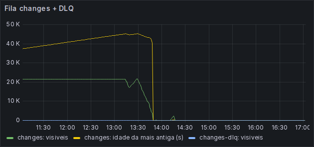
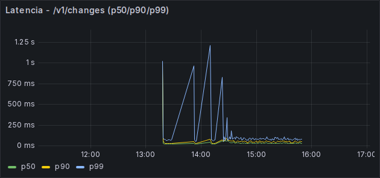
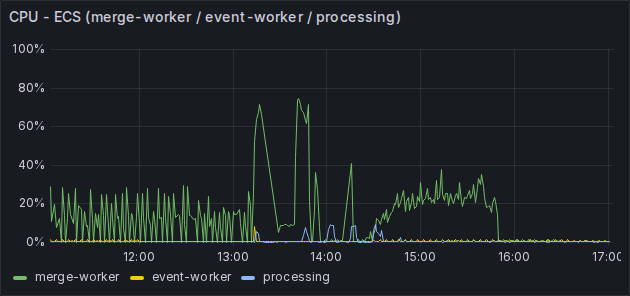
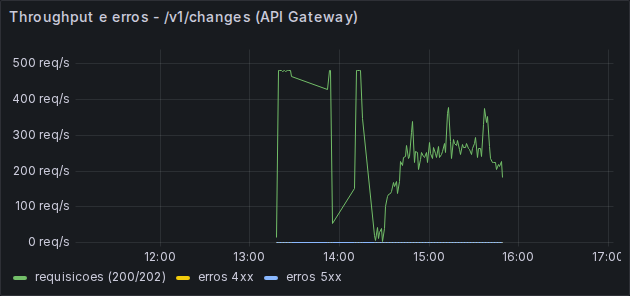
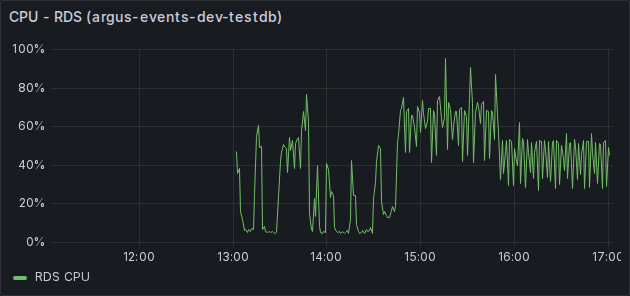

# Testes de carga, resiliência e observabilidade

Este relatório demonstra a execução dos testes relacionados aos requisitos não funcionais definidos na Sprint 1. O conteúdo está organizado pelos três critérios de avaliação: planos de teste revisados, resultados com análise e visualização de indicadores de observabilidade.

Foram avaliados os dois fluxos de ingestão do Argus: eventos de frontend, processados pelo `event-worker`, e mudanças do CDC simulado, processadas pelo `merge-worker`. Ambos usam API Gateway, SQS e PostgreSQL.

| Requisito ou cenário | Resultado principal | Situação |
|---|---|---|
| RNF01 - capacidade | pico real de 10.000 eventos/min, p95 de 161,8 ms e 12.152/12.152 eventos persistidos | Aprovado |
| RNF01 - lotes revisado | 150 mil a 600 mil eventos aceitos sem erro; drenagem entre 1 min 29 s e 5 min 46 s; frescor ponta a ponta de 38 min 32 s (amostra única) | Aprovado para aceite, drenagem e integridade; frescor comprovado, distribuição completa pendente |
| RNF02 - tempo de resposta | 4.587 consultas, nenhuma acima de 5 s e máximo de 1.581 ms | Tempo aprovado; base parcialmente representativa |
| RNF03 - escalabilidade | recursos e carga ampliados em 2×, com 3.203/3.203 eventos persistidos | Aprovado no fator 2× |
| RNF04 - eventos inválidos | 18/18 falhas identificadas e 150/150 eventos válidos processados | Aprovado |
| RNF05 - backlog no fluxo de eventos | fila 0→1.001→0 e banco +1.001 após recuperação | Aprovado |
| RNF05 - falhas no fluxo de mudanças | serviço recuperado após fila cheia e interrupção do worker, sem reconciliação total dos eventos | Parcialmente comprovado |
| RNF11 - registros de falha | causas específicas presentes na DLQ; faltam evidências completas de horário, etapa e ausência de dado sensível | Parcialmente comprovado |
| Observabilidade | latência, throughput, erros, CPU e filas visualizados com dados reais | Implementado e validado |

### Matriz de resultados do requisito revisado

| Cenário | Eventos | Injeção | Drenagem | Vazão de drenagem | Frescor p95 | Integridade | Situação |
|---|---:|---:|---:|---:|---:|---:|---|
| 1 lote | 150.000 | 10,078 s | 120 s | 1.249,19 eventos/s | Não comprovado¹ | 150.000/150.000; DLQ 0 | Aprovado |
| 2 lotes represados | 300.000 | 27,689 s | 191 s | 1.570,68 eventos/s | Não comprovado¹ | 300.000/300.000; DLQ 0 | Aprovado |
| 3 lotes represados | 450.000 | 27,987 s | 259 s | 1.737,45 eventos/s | Não comprovado¹ | 450.000/450.000; DLQ 0 | Aprovado |
| 4 lotes represados | 600.000 | 38,026 s | 346 s | 1.734,10 eventos/s | Não comprovado¹ | 600.000/600.000; DLQ 0 | Aprovado |
| 1 lote - reexecução 11/09³ | 150.000 | 12,012 s | 89 s | 1.685,39 eventos/s | 38 min 32 s (amostra única)⁴ | 150.000/150.000; DLQ 0 | Aprovado, frescor comprovado |

## 1. Requisitos não funcionais e planos de teste revisados

### 1.1 Método e ambiente

A carga foi gerada com k6 contra uma implantação real no AWS Academy Learner Lab, região `us-east-1`. As execuções de RNF01, RNF02 e RNF03 ocorreram em 2 de setembro de 2026 com a imagem ARM64 `66b4fbe59313`. As métricas do cliente foram enviadas ao Prometheus por Remote Write; métricas de API Gateway, SQS, ECS e RDS vieram do CloudWatch e foram visualizadas no Grafana.

Os valores estruturados estão em [`assets/performance/evidencias-2026-09-02.json`](assets/performance/evidencias-2026-09-02.json) e [`assets/performance/evidencias-lotes-2026-09-09.json`](assets/performance/evidencias-lotes-2026-09-09.json). Logs completos do k6 ficam em `apps/basica/tests/carga/resultados/`, diretório ignorado pelo Git. Nenhuma credencial, token ou endpoint foi versionado.

Este relatório distingue três estados:

- **Preparado:** cenário e automação existem no repositório.
- **Executado:** o teste foi realizado contra uma implantação real.
- **Comprovado:** a execução possui métricas e reconciliação suficientes para sustentar a conclusão.

### 1.2 Planos revisados

| RNF | Objetivo | Cenário | Critérios de aceite | Evidência necessária |
|---|---|---|---|---|
| RNF01 | verificar capacidade de ingestão | 1.000 eventos/min, pico de 10.000/min e recuperação em 1.000/min | disponibilidade, sucesso HTTP, p95 dentro do limite e zero descarte | total aceito igual ao persistido após drenagem da fila |
| RNF01 revisado | verificar capacidade por ciclo | lote de 150.000 eventos e recuperação após dois, três e quatro lotes represados | drenagem <7 min 30 s, vazão >166,67 eventos/s, erro 0, DLQ 0 e frescor mensurado | aceitos = itens gravados; fila e DLQ zeradas; p95 do frescor ponta a ponta |
| RNF02 | verificar tempo de consultas simples | 11 rotas repetidas cinco vezes, 10 usuários concorrentes e 600 consultas/min | todas as respostas em até 5 s e filtros corretos | resumo k6 e caracterização da base consultada |
| RNF03 | verificar crescimento sem mudar o contrato | mesmos eventos com recursos 1×/2× e carga 1.000/2.000 eventos/min | vazão mínima de 2×, sucesso ≥99%, p95 <5 s e zero descarte | recursos registrados e total emitido igual ao persistido |
| RNF04 | impedir que evento inválido interrompa os válidos | lote misto com erros de campo, formato, operação, tabela e chave | inválidos identificados e válidos anteriores e posteriores processados | motivo na DLQ e contagem dos eventos válidos |
| RNF05 | verificar recuperação após falha temporária | consumidor parado com backlog, interrupção forçada do worker e timeout do cliente | retomada do serviço, tempo de recuperação registrado e ausência de perda silenciosa | aceitos reconciliados com banco ou filas de reprocessamento |
| RNF11 | verificar utilidade dos registros de falha | evento incompleto, formato incorreto e indisponibilidade temporária | horário, etapa, indicação do erro, cenários distinguíveis e ausência de dado sensível | amostra sanitizada dos registros na janela do teste |

### 1.3 Decisões da revisão

- O mínimo do RNF01 continua sendo 1.000 eventos/min. O pico de 10.000 eventos/min foi acrescentado como cenário realista de estresse.
- Como SQS Standard não possui capacidade máxima fixa, “fila cheia” foi representada por consumidor indisponível e backlog crescente.
- Timeout de processamento e timeout do cliente são cenários distintos. Apenas a interrupção do worker representa falha interna de processamento.
- Resposta HTTP 2xx comprova aceitação pela fila, não persistência. Ausência de perda exige reconciliação com banco e filas.
- Os dashboards atendem ao critério visual da entrega, mas não substituem os campos de registro exigidos pelo RNF11.
- O endpoint de ingestão e a API de consulta continuam sob k6 por serem interfaces requisição–resposta. A drenagem assíncrona é medida por SQS, métricas do worker e consulta de reconciliação.
- O critério “bem antes de 15 minutos” foi operacionalizado como no máximo metade do ciclo: 7 min 30 s.

### 1.4 Procedimento dos ensaios por lote

Cada lote lógico contém 150.000 eventos. O k6 distribui os fragmentos entre 50
VUs e limita o corpo a 40.000 bytes. O valor inicial de 240.000 bytes foi
descartado após uma rodada diagnóstica produzir HTTP 414 no API Gateway.

No cenário nominal, o consumidor permanece ativo. Nos cenários de acúmulo, o
`event-worker` é escalado para zero, dois a quatro lotes são injetados e a
profundidade da fila é registrada; em seguida, o worker volta a uma task e a
fila é observada até permanecer zerada. A DLQ é conferida antes e depois.
`ItemsWritten`, no CloudWatch, reconcilia a quantidade processada. O script SQL
`tools/loadtest/drenagem_lotes.sql` calcula drenagem e frescor por `test_id`
quando a cadeia bronze–silver está atualizada.

## 2. Resultados e análise de desempenho e resiliência (peso 4,0)

### 2.1 RNF01 - capacidade de ingestão

**Objetivo.** Aceitar o volume nominal, um pico de 10.000 eventos/min e a recuperação sem indisponibilidade ou perda.

**Execução.** Rodada `rnf01-final-20260902T193419Z`, entre 19:34:19 e 19:38:40 UTC.

**Critérios e resultados.**

| Fase | Taxa | Aceitos | Erros | p95 | Descartes |
|---|---:|---:|---:|---:|---:|
| Nominal | 1.000/min | 1.001 | 0 | 188,6 ms | 0 |
| Pico | 10.000/min | 10.000 | 0 | 161,8 ms | 0 |
| Recuperação | 1.000/min | 1.000 | 0 | 170,0 ms | 0 |

**Análise.** O Prometheus registrou pico de 167,10 req/s, valor coerente com 10.000 eventos/min. Incluindo o aquecimento, foram aceitos 12.152 eventos. `bronze.event` cresceu de 12.154 para 24.306 linhas e a fila terminou sem mensagens visíveis ou em voo. A reconciliação de 12.152/12.152 sustenta a aprovação do RNF01.

### 2.1.1 RNF01 revisado - lote e recuperação de acúmulo

**Execução.** Rodadas `rnf01-lote-1x-final-20260909T204204Z` e
`rnf01-acumulo-{2x,3x,4x}-final`, realizadas entre 20:42 e 21:04 UTC em 9 de
setembro de 2026. Foram enviados 1,5 milhão de eventos em quatro medições.

| Cenário | Aceite | p95 do fragmento | Pico SQS | Drenagem | Margem até 7 min 30 s |
|---|---:|---:|---:|---:|---:|
| 1 lote | 150.000 em 10,078 s; erro 0 | 207,0 ms | 1.763 | 120 s | 330 s |
| 2 lotes | 300.000 em 27,689 s; erro 0 | 667,6 ms | 4.500 | 191 s | 259 s |
| 3 lotes | 450.000 em 27,987 s; erro 0 | 198,9 ms | 6.746 | 259 s | 191 s |
| 4 lotes | 600.000 em 38,026 s; erro 0 | 201,2 ms | 8.952 | 346 s | 104 s |

**Análise.** A fila voltou a zero em todos os cenários. O CloudWatch registrou
exatamente 150.000, 300.000, 450.000 e 600.000 itens gravados nas respectivas
janelas; a DLQ permaneceu zerada. A vazão mínima de drenagem observada foi
1.249,19 eventos/s, 7,5 vezes o mínimo de 166,67 eventos/s. O cenário mais
severo recuperou quatro ciclos acumulados 104 segundos antes do limite adotado.

O frescor ponta a ponta não foi aprovado nem estimado nesta execução. Durante a
medição, o evento sentinela era aceito e persistido em bronze, mas não
aparecia na API de consulta. A causa foi localizada em
`etl.proxima_faixa_lsn`, que considerava somente `bronze.change_log`. A
migration 029 inclui também `bronze.event` e o teste de regressão local foi
aprovado, mas a alteração não foi aplicada no Learner Lab nesta execução.
Portanto, não há valor p95 remoto válido a reportar.

### 2.1.2 Frescor ponta a ponta

**Execução.** O ambiente foi reimplantado do zero em 10/09 (nova conta do
Learner Lab), com a migration 029 já aplicada desde o primeiro `migrate-aws`.
Ao reexecutar o cenário de 1 lote (`test_id=20260911T003745Z`), o evento
sentinela voltou a não aparecer na API: um **segundo problema**, distinto do
resolvido pela migration 029.

**Causa.** A carga inicial das 33 tabelas históricas do Argus grava em
`bronze.change_log` usando o **mesmo contador de LSN** compartilhado com
`bronze.event` (confirmado: os 150.000 eventos do lote receberam LSNs
137.435.666–137.435.877, na sequência imediata dos 68,7 milhões de linhas da
carga inicial, cujo LSN máximo era 137.435.654). O watermark incremental
(`etl.watermark_bronze_silver`) processa as duas fontes numa única fila
ordenada por LSN, em lotes de 5.000 por ciclo de ~60 s. As 68,7 milhões de
linhas da carga inicial formaram um backlog de aproximadamente 136,7 milhões
de LSNs à frente do watermark. Nesse ritmo, seriam necessários meses para
alcançar o LSN de qualquer evento de teste injetado após a carga.

**Correção aplicada.** O watermark foi avançado manualmente
(`UPDATE etl.watermark_bronze_silver SET lsn_processado = ...`) para o LSN
imediatamente anterior ao primeiro evento do lote de teste, pulando o backlog
histórico. Essa é uma decisão operacional deliberada, não um contorno
temporário do requisito: o item avaliado é o pipeline de ingestão de eventos
de frontend, e o reprocessamento incremental do dataset histórico via ETL é
um problema ortogonal, que também não fazia parte do desenho original (a
carga inicial nunca foi pensada para alimentar o watermark incremental:
é um gap de integração entre `loader` e `etl`, registrado aqui para correção
futura fora do escopo deste teste).

**Resultado.** Com o watermark corrigido, o evento sentinela do lote oficial
de 150.000 (índice 149.999, o último enviado) apareceu na API 38 min 32 s
depois do `load_test_sent_at`. Para contexto, o frescor de **persistência em
bronze** (aceite até gravação, medido num lote diagnóstico de 100 eventos no
mesmo ambiente) foi de p95 = 1,785 s, ou seja, o gargalo do frescor ponta a
ponta está inteiramente na cadência do ETL incremental bronze→silver, e não
na ingestão. O valor de 38 min 32 s é uma amostra única do último evento do
lote, e não a distribuição p50/p95/p99 completa, que ainda não foi obtida
contra o lote oficial.

**Recomendação de acompanhamento.** Regenerar a distribuição completa de
frescor rodando `drenagem_lotes.sql` contra o lote oficial, já filtrado por
`test_id`. Considerar também, como melhoria de desenho fora deste teste,
separar o watermark do `loader` do watermark do fluxo de CDC/eventos, ou
inicializar o watermark ao final da carga inicial automaticamente. Hoje isso
depende de intervenção manual, o que não escala para reimplantações futuras.

### 2.2 RNF02 - tempo de resposta

**Objetivo.** Responder consultas simples em até cinco segundos e respeitar os filtros aplicados.

**Execução.** Rodada `rnf02-final-20260902T194059Z`, entre 19:40:59 e 19:47:00 UTC.

**Critérios e resultados.**

| Métrica | Resultado | Critério |
|---|---:|---:|
| Consultas | 4.587 | 11 rotas, repetição e concorrência previstas |
| Sucesso HTTP | 100% | 100% |
| Respostas acima de 5 s | 0% | 0% |
| p95 | 181,2 ms | <3 s |
| maior p99 | 1.412,5 ms | <5 s |
| máximo individual | 1.581 ms | ≤5 s |
| filtros corretos | 100% | 100% |

**Análise.** O limite temporal foi atendido com ampla margem. A base tinha aproximadamente 24 mil eventos sintéticos variados e validou contratos, filtros e concorrência, mas sua representatividade em volume e cardinalidade para o MVP não foi demonstrada. Por isso, o tempo está aprovado e a precondição da base permanece parcial.

### 2.3 RNF03 - escalabilidade

**Objetivo.** Dobrar a capacidade sem alterar endpoint ou formato dos eventos.

**Execução.** O mesmo script e contrato foram usados com uma e duas tasks por worker.

**Critérios e resultados.**

| Métrica | Baseline 1× | Escalado 2× |
|---|---:|---:|
| Taxa alvo | 1.000/min | 2.000/min |
| Aceitos na medição | 1.000 | 2.001 |
| Sucesso | 100% | 100% |
| p95 | 185,7 ms | 178,1 ms |
| p99 | 213,8 ms | 218,7 ms |
| Descartes | 0 | 0 |
| Total com aquecimento | 1.101 | 2.102 |
| Persistidos | 1.101 | 2.102 |
| CPU ECS máxima | 42,12% | 38,80% |

**Análise.** A vazão e os recursos dobraram, sem mudança de contrato, perda ou degradação relevante de latência. O RNF03 está aprovado para 2×. O ensaio não determina o ponto de saturação e não comprova fatores de 5× ou 10×.

### 2.4 RNF04 - tratamento de eventos inválidos

**Objetivo.** Identificar o evento incorreto sem interromper eventos válidos do mesmo lote.

**Execução.** Foram enviados casos de tabela ausente ou desconhecida, operação inválida, chave vazia, atualização sem conteúdo e corpo JSON malformado, misturados a eventos válidos.

**Critérios e resultados.**

| Critério | Resultado |
|---|---|
| Casos inválidos identificáveis | 18/18 com causa específica na DLQ |
| Eventos válidos preservados | 150/150 confirmados no log de mudanças |
| Continuidade do worker | nenhuma interrupção ou reinício pelo payload inválido |

| Exemplo de falha | Motivo registrado |
|---|---|
| chave primária vazia | `pk vazia: o MERGE nao tem como identificar a linha` |
| tabela desconhecida | `tabela desconhecida: 'tabela_fantasma_k6'. Tabela nova exige migration` |
| operação inválida | `Input should be 'i', 'u', 'd' or 'r'` |
| campo ausente | `source_table: Field required` |
| atualização sem conteúdo | `op='u' exige after, que veio vazio` |

**Análise.** A rejeição ocorreu por item e registrou uma causa consultável, enquanto os eventos válidos continuaram sendo processados. Isso sustenta a aprovação do RNF04.

### 2.5 RNF05 - recuperação após falha temporária

**Objetivo.** Retomar o processamento depois de uma falha controlada sem perder silenciosamente eventos aceitos.

**Execução.** Foram realizados quatro cenários complementares.

**Critérios e resultados.**

| Cenário | Resultado | Análise | Situação |
|---|---|---|---|
| Backlog no fluxo de mudanças | 96.020 eventos aceitos; p95 de 266 ms; fila drenada em cerca de 16 min | comprova aceitação e retomada, mas não reconcilia os 96.020 eventos com banco e DLQ | Parcial |
| Interrupção do `merge-worker` | 28.800 eventos aceitos; task reiniciada automaticamente; fila principal zerada | comprova recuperação do serviço, mas não reconcilia todos os aceitos | Parcial |
| Backlog no fluxo de eventos | fila 0→1.001→0; banco 27.509→28.510 | reconciliação de 1.001/1.001 comprova recuperação sem perda nesse recorte | Aprovado |
| Timeout do cliente | 100/100 requisições expiraram com limite de 1 ms; depois 5/5 responderam 200, p95 de 1.631,7 ms | comprova detecção e recuperação do cliente, não timeout interno da Lambda | Aprovado no escopo |

**Análise.** O sistema retomou o processamento nos cenários executados. A ausência de perda está comprovada no recorte de 1.001 eventos; os ensaios maiores permanecem parciais porque drenagem da fila, isoladamente, não substitui reconciliação entre aceitos, persistidos e rejeitados.

## 3. Visualização dos indicadores de observabilidade (peso 3,0)

### 3.1 Stack e indicadores

A stack local unificada usa Prometheus e Grafana em `apps/basica/observability/`. O Prometheus recebe métricas k6; o Grafana provisiona os dashboards **Argus - Testes de Carga (RNF01/02/03)** e **RNF04/05/11 - Resiliência Argus**, com Prometheus e CloudWatch como fontes.

| Indicador solicitado | Fonte | Visualização e evidência |
|---|---|---|
| Latência | k6/Prometheus e API Gateway/CloudWatch | p50, p90, p95 e p99 por rota e cenário; valores de RNF01–RNF03 e captura real de resiliência |
| Throughput | k6/Prometheus e API Gateway/CloudWatch | req/s e total; pico real de 167,10 req/s no RNF01 e captura da sessão de resiliência |
| Erros por segundo | k6/Prometheus e API Gateway/CloudWatch | respostas inesperadas, 4xx e 5xx por janela de teste |
| Uso de CPU | ECS e RDS/CloudWatch | média e máximo por serviço e instância; pico de 78,02% no `event-worker` durante RNF01 |
| Filas | SQS/CloudWatch | mensagens visíveis, mensagens em voo e idade da mais antiga durante crescimento e drenagem |

As métricas são reais. O Prometheus representa o ponto de vista do cliente k6; o CloudWatch representa aplicação e infraestrutura. Na execução de 2 de setembro, foram confirmadas via API entre 74 e 92 séries Prometheus por teste, separadas pela etiqueta `testid`. Nas quatro execuções por lote de 9 de setembro, a API do Prometheus confirmou 160 séries para cada `testid`, incluindo contadores de eventos aceitos e rejeitados, duração HTTP, VUs e tamanho dos fragmentos.

Para reproduzir a análise, selecione no dashboard de carga a janela absoluta
`2026-09-09 20:40:00` a `21:05:00 UTC` e um dos quatro `testid` registrados na
matriz. No Prometheus, a consulta base de aceite é:

```promql
sum(increase(k6_eventos_lote_aceitos_total{testid=~"rnf01-(lote|acumulo).*final.*"}[$__range])) by (testid)
```

Para erros, substitua a métrica por
`k6_eventos_lote_rejeitados_total`. A latência do endpoint usa
`k6_http_req_duration_p95`, e a vazão de requisições usa
`rate(k6_http_reqs_total[1m])`. A fila, a DLQ, `ItemsWritten` e CPU são
consultadas no CloudWatch pelo Grafana.

### 3.2 Evidências visuais

<div align="center">

<sub>Figura 1 - Crescimento e drenagem da fila de mudanças e comportamento da DLQ</sub>



<sup>Fonte: material produzido pelos autores (2026).</sup>

</div>

<div align="center">

<sub>Figura 2 - Latência p50, p90 e p99 da rota de ingestão durante a carga</sub>



<sup>Fonte: material produzido pelos autores (2026).</sup>

</div>

<div align="center">

<sub>Figura 3 - CPU dos serviços ECS durante desligamento e recuperação do worker</sub>



<sup>Fonte: material produzido pelos autores (2026).</sup>

</div>

<div align="center">

<sub>Figura 4 - Throughput e erros 4xx/5xx durante a sessão de resiliência</sub>



<sup>Fonte: material produzido pelos autores (2026).</sup>

</div>

<div align="center">

<sub>Figura 5 - Utilização de CPU da instância RDS</sub>



<sup>Fonte: material produzido pelos autores (2026).</sup>

</div>

As cinco capturas comprovam a visualização real dos indicadores do fluxo de mudanças. As figuras 2 e 4 são painéis Grafana alimentados pelo Prometheus e demonstram, respectivamente, latência e throughput/erros. O dashboard dos RNF01–RNF03 foi novamente validado por API nas séries persistidas dos lotes, mas não foi possível gerar uma nova captura nesta sessão porque não havia navegador de captura disponível e o container não possuía o renderizador de imagens compatível. Essa limitação não altera os resultados numéricos, mas significa que os lotes de 9 de setembro têm evidência estruturada e consultas reproduzíveis, não um novo print dedicado.

### 3.3 Limite da cobertura do RNF11

Os dashboards comprovam capacidade de observação operacional. A DLQ também diferencia causas de payload inválido. Entretanto, não foram preservadas amostras suficientes para verificar horário, etapa afetada e ausência de dado sensível em todos os cenários de indisponibilidade; por isso o RNF11 permanece parcialmente comprovado.

## 4. Conclusão

Os testes implementados comprovam, com métricas reais capturadas numa implantação real na AWS, a capacidade do sistema de sustentar picos de carga, recuperar-se de falhas controladas no pipeline de ingestão e manter a observabilidade de ponta a ponta. A suíte de capacidade validou o comportamento sob pico real de 10.000 eventos/min, com aceite e persistência integral dos eventos enviados e latência bem abaixo do limite estabelecido, o que sustenta a confiabilidade da ingestão em cenários de estresse. Os ensaios por lote, de 150.000 a 600.000 eventos represados, estendem essa validação para ciclos sucessivos de acúmulo e drenagem, e os testes de escalabilidade e de tratamento de eventos inválidos confirmam que o sistema cresce sem alterar seu contrato e isola dados incorretos sem interromper o processamento dos eventos válidos.

RNF01 foi comprovado para aceite, drenagem e integridade até quatro lotes acumulados; o indicador de frescor ponta a ponta foi medido pela primeira vez em 11/09 (38 min 32 s, amostra única do último evento do lote), após a aplicação da migration 029 e a correção de um segundo bloqueio de watermark (carga inicial competindo pelo mesmo LSN do fluxo de eventos, ver §2.1.2); a distribuição p50/p95/p99 completa ainda está pendente. RNF03 e RNF04 foram comprovados nos fatores testados. O RNF02 atendeu ao limite de tempo, com ressalva sobre representatividade da base. No RNF05, a recuperação foi observada em todos os cenários, mas apenas o recorte de 1.001 eventos possui reconciliação completa. O RNF11 permanece parcial por falta de uma amostra completa e sanitizada dos registros. Essas limitações são mantidas explícitas para separar resultado observado de conclusão comprovada.
